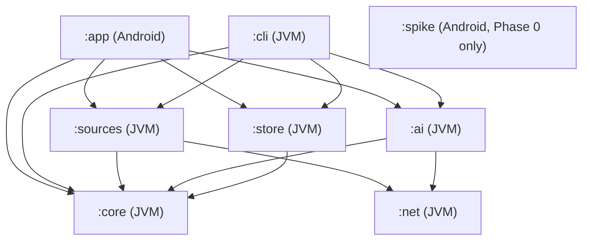
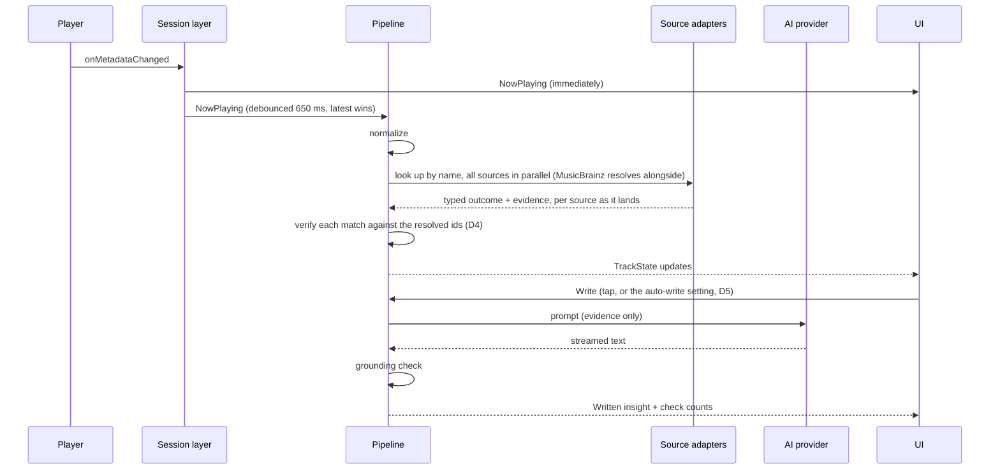

# Sleevesight architecture

**Status:** Proposal, for discussion  
**Date:** 2026-10-12  
**Builds on:** [design.md](design.md) and the [simulator](https://wkusnierczyk.github.io/sleevesight/design/simulator.html)  
**Tracking:** [#3](https://github.com/wkusnierczyk/sleevesight/issues/3)

This document turns the design into a buildable structure: modules and their boundaries, the runtime data flow, the technology choices, how the structural constraints are enforced, testing and CI. It starts with a review of the design and the simulator, because several findings change the architecture. The decisions it needed are collected at the end, as made by the owner.

## Contents

- [Review of the design](#review-of-the-design)
- [Architectural drivers](#architectural-drivers)
- [Modules](#modules)
- [Runtime](#runtime)
- [Components](#components)
- [Cross-cutting concerns](#cross-cutting-concerns)
- [Technology choices](#technology-choices)
- [Testing](#testing)
- [CI](#ci)
- [Phase mapping](#phase-mapping)
- [Decisions](#decisions)

## Review of the design

The design is sound in its core idea: deterministic code decides what is true (resolution, matching, citation checks), and the model only narrates. The typed resolution outcomes, the separation of `none` from `source_off`, the scope on every evidence line, and the mechanical grounding check are what make the product trustworthy, and the architecture below is organized around keeping them in code the model never touches.

The findings below are the places where the design is incomplete or internally inconsistent, or where the implementation needs something the design does not yet specify.

### What the implementation can port from the simulator

The simulator is a prototype of the experience: it shows how the app behaves as if every part worked, and stands in for the parts that do not exist yet with frozen data. Some of its code is the app's real logic and ports directly; for the rest, the implementation starts from the design alone:

| Component | In the simulator | For the implementation |
|---|---|---|
| Normalizer | Real logic (`normalize`) | Port |
| Prompts, grounding check | Real logic (`promptInsight` and the others, `groundCheck`), live against Claude when run as a claude.ai artifact | Port |
| Debounce, cancellation | Real logic (`onMetadataChanged`, `runPipeline`) | Port, as coroutines |
| Caching rules | Real logic (`fetchSource` for retrieval; `write` and `writeJson`, keyed with `srcSig`, for insights and cards) | Port, with the synthesis key extended per R2 |
| Source adapters (Wikipedia, Last.fm, web search) | Stood in for: frozen snapshots behind simulated latency (`querySource`, `fetchSource` over `facts-data`) | Build |
| Entity resolution | Stood in for: each fixture record carries its outcome (`song_article`, `mismatch`, ...) | Build |
| MusicBrainz | Stood in for: shown as `blocked` | Build |
| Multi-artist resolution | Stood in for: the primary artist's data only | Build |
| Evidence extraction | Stood in for: fact lines written in advance, in `facts-data` | Build |
| Discogs | Not shown | Build (Phase 3) |

The components to build are the ones the design calls the hard ones, so the architecture puts them in plain Kotlin behind interfaces, where Phase 0.5 can iterate on them in a command-line tool, on the fixture playlist, before any Android code depends on them. The simulator's frozen data then serves Phase 0.5's tests (see [Testing](#testing)): its resolution outcomes as expected outcomes, and its fact lines as reference facts that extraction should find, though not word for word.

### Findings

| # | Finding | Effect on the architecture |
|---|---|---|
| R1 | **Nobody extracts the evidence lines.** The design says each line is "one claim, in the adapter's own words, never copied prose", but an adapter is deterministic code. It can template structured data (MusicBrainz, Wikidata, Last.fm counts and tags) but it cannot paraphrase a Wikipedia article or a web page. The simulator's lines were written in advance, standing in for this step. | Evidence extraction becomes an explicit stage with a stated method per source. See D1. |
| R2 | **The synthesis cache key can serve stale citations.** It is "lookup key, enabled-source set, provider and model". When the retrieval cache expires and refetches, evidence ids can point at different lines while the cached insight still cites the old ones. | The synthesis key includes a fingerprint of the evidence set. A cached insight is reused only for the exact evidence it was written from. |
| R3 | **The latency goal and the MusicBrainz rate limit conflict.** "Within a couple of seconds" against one request per second, with a recording search, a recording lookup and one lookup per credited artist before Wikipedia can be reached safely through Wikidata. A cold track with two artists is about four seconds of MusicBrainz alone. | Progressive rendering: player metadata immediately, each source's result as it lands, the insight last. Artist resolutions are cached long-term, so the cost falls on first encounters. A per-host rate limiter is part of the network layer. See D4. |
| R4 | **The privacy statement is narrower than the traffic.** Matching by duration ("duration tolerance") sends the duration if it goes into the MusicBrainz query, and every request reveals the phone's IP address to that service. | Duration filtering happens on the phone, after the search. The first-run text names the IP address. |
| R5 | **"User-driven changes write" needs a signal the session does not give.** A skip pressed inside Spotify and a track ending on its own both arrive as `onMetadataChanged`. Only Sleevesight's own transport buttons are known to be user actions. | Measured in Phase 0 (`design.md`, *Track changes*): the time left at the change, and for Spotify the playback states before it, under a *Crossfade* setting. See D5. |
| R6 | **Genre labels depend on one source with a user key.** Last.fm needs the user's own API key; with it missing or off, no track gets genres, and 30 of 78 tracks got none even with it. MusicBrainz has genre data per artist, release group and recording, keyless. | The genre vocabulary filter may take tags from MusicBrainz as well as Last.fm, if the Phase 0.5 pilot shows they add to the labels and their licence allows it (D12). |
| R7 | **Background behaviour is unspecified.** The notification listener runs whenever access is granted, app open or not. The design does not say whether lookups run while nobody is looking. | Session history is recorded always, on the phone only. Retrieval and synthesis run only while the app is visible. See D6. |
| R8 | **Sideloaded installs cannot easily grant notification access.** Since Android 13, "restricted settings" block notification-listener access for apps installed from outside an app store, until the user unlocks it in the app's info screen. | Onboarding detects the block and explains the unlock. With distribution through Google Play (D7), this affects only development installs and any channel outside Play. |
| R9 | **A local model through Ollama is served over plain HTTP by default**, which Android blocks, and an arbitrary LAN address cannot be allowlisted in a network security config. A home HTTPS proxy often uses a self-signed or private-CA certificate, which Android does not trust either. | How the app reaches Ollama, and which certificates it accepts; see D8. |
| R10 | **`simulator.html` carries the artifact runtime.** Line 1 is a `<script>` tag loading the claude.ai artifact frame runtime from `claudeusercontent.com`, with a signed URL, saved from the rendered page. Outside claude.ai `window.claude` is absent, so the README's GitHub Pages link would show the evidence-only fallback, never live synthesis; and Pages does not serve private repositories on a free plan. | Not architecture, but recorded here; a separate cleanup issue. |
| R11 | **`design.md` still said "License: open source (to be chosen)"**; it is GPL-3.0 since #2. | Fixed by #6, with the README. |

## Architectural drivers

In order of weight:

1. **The pipeline runs off the phone.** Phase 0.5 is a JVM command-line tool sharing the pipeline with the app. Everything from normalization to the grounding check is plain Kotlin with no Android dependency.
2. **The model never decides what is true.** Resolution, matching, evidence selection and citation checking are deterministic and unit-tested. The model gets a prompt and returns text; it has no tools.
3. **Constraints are structural.** No analytics, no extra permissions, no network access outside the adapter and provider layer. Each is a build failure, not a review comment.
4. **Failure is visible.** Every source returns a typed outcome; every stage logs to the diagnostics stream; nothing degrades to a blank.
5. **Cost is the user's.** Every model call spends the user's key, so calls are explicit, cached and cancellable.
6. **The user decides.** Where a runtime behaviour is a judgement call rather than a correctness rule (cache lifetimes, the crossfade of D5, what runs in the background), it is a user setting with a reasoned default, not a fixed developer choice. Correctness rules stay fixed: the grounding check, the network boundary, the resolution thresholds. Build-time choices such as `minSdk` are not settings. `:app` reads the settings from DataStore into a plain `Settings` type defined in `:core`, which also holds the defaults, so `:cli` shares them; `:core` and `:store` read it directly, and `:ai` uses it to configure its Ollama client in `:net`. `:app` never touches `:net`.

## Modules



| Module | Kind | Contents | May depend on |
|---|---|---|---|
| `:core` | Kotlin JVM | Domain model; normalizer; resolution logic (scoring, matching, outcomes) over client interfaces; evidence model and ids; prompt builders; grounding check; genre vocabulary; the pipeline orchestration as coroutines and flows; the diagnostics event type | Kotlin stdlib, coroutines, kotlinx.serialization. **No network, no Android** |
| `:net` | Kotlin JVM | The one HTTP client: Ktor with the OkHttp engine, per-host rate limiting, the User-Agent, timeouts, retries, and a logger that redacts keys and tokens | Ktor, OkHttp |
| `:sources` | Kotlin JVM | One adapter per source (MusicBrainz, Wikipedia and Wikidata, Last.fm, Discogs, web search), each implementing the `:core` client interfaces and `SourceAdapter`, with its evidence extraction. Also the other outbound clients that are not sources: the Spotify Web API client (Phase 3) and an album-art fetcher for `http` art URIs | `:core`, `:net` |
| `:ai` | Kotlin JVM | `AiProvider` implementations: Anthropic, OpenAI, Google, Ollama. Streaming, model listing, error mapping | `:core`, `:net` |
| `:store` | Kotlin JVM | Retrieval cache, synthesis cache, artist-resolution cache, session history, track-change records (D15). SQLDelight schema and queries over an injected `SqlDriver`: `:cli` supplies the SQLite JDBC driver, `:app` the Android driver (an AAR, which a JVM module cannot depend on) | `:core`, SQLDelight runtime |
| `:cli` | Kotlin JVM application | Phase 0.5: runs the pipeline over a playlist fixture; writes the coverage report and the insights; records HTTP responses for tests | `:core`, `:sources`, `:ai`, `:store`, SQLDelight JDBC driver |
| `:app` | Android application | Session layer (`NotificationListenerService`, `MediaSessionManager`); Compose UI; settings (DataStore); secrets (Keystore); wiring; diagnostics screen | `:core`, `:sources`, `:ai`, `:store`, SQLDelight Android driver |
| `:spike` | Android application | Phase 0 probe. Removed when the Phase 0 gate passes; history keeps it | Android only |

The boundaries do the enforcing. `:core` cannot reach the network because it has no HTTP dependency; only `:sources` and `:ai` see `:net`; and `:app` gets network results only through them. The checks under [Structural constraints](#structural-constraints) make that a build failure rather than a convention.

## Runtime

### Data flow



### Concurrency

- The session layer exposes `StateFlow<NowPlaying?>` and `StateFlow<PlaybackInfo>`.
- The pipeline is `nowPlaying.filterNotNull().debounce(650.milliseconds).map(::normalize).distinctUntilChangedBy { it.lookupKey }.collectLatest { run(it) }`: normalization comes first, because the lookup key belongs to `NormalizedTrack`, not to `NowPlaying`. `collectLatest` cancels a superseded track's retrieval and synthesis, the coroutine version of the simulator's `AbortController` and `app.gen`. A `null` (no active session) is filtered out, so it neither cancels the current track's run nor clears its state; the UI reads `nowPlaying` directly to show the idle state.
- Sources run in parallel inside `run`, each in its own child coroutine, each publishing its result as soon as it lands.
- Detail insights (song, artist, album, genre, sounds-like) are separate on-demand jobs, scoped to the screen or box that asked, cancelled when it closes.
- Preparing the next track (D13) is a job of its own, keyed by the next queue item and cancelled when that item changes. Requests in flight are shared by key, so a track that starts while it is being prepared waits on the same requests rather than repeating them. See [Preparing the next track](#preparing-the-next-track).
- Playback state (play, pause, seek, progress) never enters the pipeline.

### State

The UI renders one immutable state per track:

```kotlin
data class TrackState(
    val nowPlaying: NowPlaying,
    val normalized: NormalizedTrack?,
    val sources: Map<SourceId, SourceState>,   // Pending | Done(outcome, evidence, latency, cached) | Failed(error)
    val evidence: EvidenceSet?,                // ids assigned, fingerprinted
    val genres: List<GenreLabel>,
    val similar: List<SimilarArtist>,
    val insight: InsightState,                 // Idle(canWrite) | Writing(partial) | Written(GroundedText) | NoEvidence | Failed(reason)
)
```

## Components

### Session layer (`:app`)

- `SleevesightListenerService : NotificationListenerService` is declared only to obtain the session permission; it ignores notifications themselves.
- `SessionRepository` registers `addOnActiveSessionsChangedListener` and a `MediaController.Callback` on the active session of each followed player, and maps metadata to `NowPlaying` (title, artists string, album, duration, art bitmap, package, media id when present, active queue item when published). Events from players not followed are dropped and logged as ignored.
- Track identity, for skip detection and session history (Phase 0, `design.md` *Track changes*): the media id when the player sends one; else the active queue item where the player publishes one (an item of −1 is no item; when either side has no item, title and artists decide); else title and artists. A known limit: a song repeated right away (repeat-one, or the same song queued twice) is the same track, unless the player gives no media id but separate queue items, so it gets no new skip decision, no new entry in the session history, and no new lookup. A new length or new art for the same track is an update, not a change, and the time left is computed from the latest length. The pipeline's lookup key (normalized artist and title) is unaffected.
- Transport controls are offered only when `PlaybackState.actions` advertises them.
- Handoff: `sessionActivity` for the player's own screen; `spotify:` URIs when an id is known; `spotify:search:` otherwise, logged as a fallback.
- Process death: the service reconnects on rebind; the repository rebuilds from `getActiveSessions` on start.
- Queue: when a player publishes `getQueue()` and `getQueueTitle()`, the track list uses it; Spotify does (measured in Phase 0), as well as naming the playlist in its metadata. Spotify's Device Broadcast intents are not adopted: Phase 0 showed the session carries everything they do and more.
- Players that send only a title still run the pipeline; resolution is then mostly `none`, and how much of the UI to hide stays the design's open question on per-player behaviour.
- Session history (the default track list) is written to `:store` locally, whether or not the app is visible.

### Normalizer (`:core`)

A port of the simulator's `normalize`, unchanged in behaviour, with the design's table and every fixture title as unit tests. Accent folding (Unicode NFKD) sits behind a small interface, since `java.text.Normalizer` is JVM-only (D2). Output: `NormalizedTrack(title, artists, primary, from, variant, notes, lookupKey)`.

### Entity resolution (`:core` logic, `:sources` clients)

`:core` holds the scoring and decisions; `:sources` provides `MusicBrainzClient` and `WikidataClient`. Per D4, resolution runs alongside the lookups by name rather than before them: each source's match is verified against the resolved ids when they land. A Wikipedia article can also be verified without MusicBrainz, through its own Wikidata item (step 5). Matches from the other sources stay unverified (shown, not cited) if MusicBrainz finds nothing.

1. **Recording.** Search MusicBrainz by normalized title and credited artists. Score candidates on title similarity, artist-credit overlap, and duration within a tolerance (computed locally, R4). Accept above a threshold, otherwise `none`; a near miss with a conflicting artist is `rejected(reason)`.
2. **First release.** From the accepted recording's releases, take the earliest release-group first-release date. The release the player reports stays separate (`P` evidence). Both are kept; which one the UI shows is still the design's open question on release-date semantics.
3. **Artists.** Each credited artist resolved separately, to an MBID, cached long-term.
4. **Cover detection.** The recording's work relationship and the work's earliest recording by a different artist give `original_song`.
5. **Wikipedia identity.** With a MusicBrainz match: MBID to Wikidata through the MusicBrainz URL relationship, then the English Wikipedia sitelink. For an article found by name: the article's own Wikidata item (its `wikibase_item`). Either way, the article is accepted only if Wikidata confirms it: instance of song, single or musical work, with a performer (P175) matching a credited artist; otherwise `rejected`. The performer is matched by its MusicBrainz artist ID (P434) when artist resolution has one, and by normalized name otherwise. This is the check that rejects the wrong Reem.

Thresholds and tolerances are constants tuned in Phase 0.5 against the fixture's known cases. They decide whether a match is correct, so they stay fixed rather than becoming user settings (driver 6).

### Source adapters (`:sources`)

`SourceAdapter` as in the design, with the input D4 needs: `lookup(track: NormalizedTrack, resolution: Deferred<Resolution>)`, so an adapter starts by name at once and awaits the resolved ids only to verify. It returns `SourceResult(outcome: Outcome, evidence: List<EvidenceDraft>, latency)`. Evidence extraction per source (D1):

| Source | Evidence lines |
|---|---|
| MusicBrainz | Templated from structured data: first release, writers, producers, performers, work and cover relationships |
| Wikidata | Templated: genre, record label, notable awards, inception |
| Wikipedia | Selected sentences from the article's lead, verbatim, attributed (CC BY-SA 4.0), at most a fixed number per article, filtered to those that name the entity |
| Last.fm | Templated: listeners, tags, similar artists. Bio: selected sentences, verbatim, attributed (CC BY-SA) |
| Discogs | Templated: personnel, labels, formats |
| Web search | One line per result: the provider's snippet, verbatim, with its URL |

### Evidence (`:core`)

- `EvidenceLine` as in the design. Ids are the source tag plus a position, assigned after a deterministic sort, so the same retrieval gives the same ids.
- `EvidenceSet.fingerprint` is a hash over the ordered (id, scope, text) triples. It is part of the synthesis cache key (R2). The hash function sits behind a small interface (D2).

### Synthesis and grounding (`:core`, `:ai`)

- Prompt builders in `:core`, ported from the simulator; the prompt contracts in the design's appendix are their specification.
- `AiProvider` in `:core`, implementations in `:ai`:

  ```kotlin
  interface AiProvider {
      val id: ProviderId
      suspend fun models(key: Secret): List<ModelInfo>
      fun stream(request: CompletionRequest, key: Secret): Flow<CompletionEvent>   // Delta | Done(usage) | Error(kind)
  }
  ```

  Small clients over `:net` (server-sent events for Anthropic, OpenAI and Google; line-delimited JSON for Ollama) rather than vendor SDKs (D3): the three official SDKs would bring three dependency trees into the allowlist, each with its own HTTP stack outside `:net`, and they are JVM-only, against D2. The surface used is one streaming call and one model list.
- JSON cards (genre, sounds-like) parse with kotlinx.serialization; a parse failure is a visible error, not a retry loop.
- The grounding check is a port of the simulator's `groundCheck` and `splitSentences`, with tests from the fixtures. Its hedge detection is English-only, as the prompts are.
- Each prompt is a fixed contract plus the user's style; see [Prompt style](#prompt-style).
- Prompt injection and tampering: web snippets and article sentences are untrusted text inside the prompt, and on an unencrypted link to a local model the prompt and the reply can be altered in transit (D8). The model has no tools, so the most either can do is distort the text of the cards it reaches: one card for an injected instruction, every reply for someone tampering with an unencrypted link. The grounding check flags uncited sentences and citations to missing evidence, but it cannot tell whether a cited line supports its sentence, so a plausible false sentence with a valid citation passes. Evidence is fenced and labelled as data in the prompt.
- Model prose is rendered as plain text, never as HTML, markdown or links; its only interactive elements are the citation chips, which the app builds from the evidence ids it assigned. The genre and sounds-like cards' suggestions (`more`, `start`) are parsed from the JSON fields and become actions the app builds, each used only as a percent-encoded search query in the player (`spotify:search:`), never as a URL.

### Prompt style

The user shapes how insights are written, within limits the grounding check depends on (D14). Each prompt has two parts:

- **Contract**, fixed: the evidence format and ids, the citation rule, no names, dates, places or numbers outside the evidence, the scope rules, `NO_EVIDENCE`, plain text without markdown, and for the genre and sounds-like cards their JSON structure. It is restated after the style, so a style adds preferences but cannot override it.
- **Style**, a user setting: length, tone, focus, audience, and free text.

The setting:

- **A default style** for all cards, chosen from **presets** (for example Brief, Detailed, Liner-notes) or written as free text, with a reset.
- **Overrides per card** (the home insight; the song, artist and album insights; the genre card; the sounds-like card) under *Advanced*, each starting from the default style.
- Each card keeps its own built-in length, and a style makes it shorter or longer relative to that.
- For the genre and sounds-like cards, the style shapes the tone and length of the text fields only.
- The synthesis cache key includes a hash of the style the card actually used, so a changed style writes afresh rather than serving text in the old one.
- The output language is a separate question: the grounding check's hedge detection is English-only.

Free text is the user's own input to their own prompt, so it is not untrusted in the sense web snippets are; a style that asks for uncited claims still meets the restated contract and then the grounding check.

### Genre labels (`:core`)

The simulator's vocabulary and hues, moved to a data file in `:core`, applied to Last.fm tags, and to MusicBrainz tags as well subject to D12 (R6).

### Cache and history (`:store`)

| Table | Key | Lifetime |
|---|---|---|
| Retrieval | source, lookup key | Days, per source; a user setting (D9) |
| Artist resolution | normalized artist name | Long, months |
| Synthesis | kind, entity key, evidence fingerprint, prompt-template version, style hash (D14), provider, model, model-knowledge switch | Until evicted by size |
| Session history | time | Local only, user-clearable |
| Track changes (D15) | player, time | Local only, cleared with the session history |

Offline: cached tracks work fully; uncached lookups are `unreachable`.

### Settings and secrets (`:app`)

- Preferences in DataStore, including the *Write insights* master switch, *Write insights automatically* and its *Crossfade* (D5), *Prepare the next track* (D13), the prompt style and its overrides per card (D14), the per-source cache lifetimes (D9), the background-lookup switch (D6) and the Ollama host and its pinned certificate (D8).
- API keys and tokens encrypted with an AES-GCM key held in the Android Keystore, stored in DataStore. Not Jetpack Security's `EncryptedSharedPreferences`, which is deprecated.
- `Secret` (defined in `:core`, since `AiProvider` takes it) is a type whose `toString()` is redacted, so a key cannot reach a log by accident.

### Writing insights automatically

Each insight is a paid call on the user's key (design, *Caching and offline*), so when one is written is the user's choice (D5):

- **Write insights**, the design's master switch, on by default. Off means no AI calls at all; the evidence is still shown.
- **Write insights automatically**, under it:

  | Option | Writes without a tap |
  |---|---|
  | On every track change (default) | Every track |
  | When I skip | Tracks the user moved to: a skip in the player, or any action in Sleevesight |
  | Never | Nothing; insights are written only when the user taps Write |

- **Detecting a skip in the player.** Measured in Phase 0 (`design.md`, *Track changes*): Spotify, Castbox and YouTube Music report no skip state, and a natural end lands exactly at the crossfade. So a sub-setting, *Crossfade* (driver 6): **Autodetect** (the default) or a fixed value, 0 to 15 s. With a fixed value *c*, a change with at most *c* + 0.5 s left is a natural end, and for Spotify also one with the late cluster and at most 15 s left. Autodetect, for Spotify: a change with at most 15 s left is a natural end when Spotify's late cluster of playback states is there, or when the time left matches 0 or a crossfade learned from repeating natural ends; for other players, timing alone. Changes Sleevesight caused itself need no detection. Detection errs towards "ended on its own": that mistake costs a tap, the other an unrequested paid call. The one accepted exception: under Autodetect for Spotify, a natural end without the late cluster, before any crossfade is learned, reads as a skip.
- **Actions in Sleevesight** (previous, next, play, selecting a track; not pause) always count as user-driven. Play also writes the current track if it has no insight yet, as in the simulator, except under "never".
- **After the app opens**, nothing is written until the user's first action in it, in every mode, as in the simulator.
- **The default** is *On every track change* (owner, 2026-10-12), so that with [Preparing the next track](#preparing-the-next-track) a card is usually written before its track plays. It assumes listening rather than skipping; someone who skips a lot, or previews a playlist, saves calls with *When I skip*. Skip detection serves *When I skip*; under the default it decides no writes.

### Learning skip detection

Skip detection gets better per player from data, on the device, without an LLM (D15).

- **From Phase 1:** each track change is recorded locally with a few features: the time left, the pattern of playback states before it, the time since the user's last action in Sleevesight, the learned crossfade, and the player. A table in `:store`, local only, cleared with the session history.
- **Later (Phase 2 or after):** a small, explainable model per player (for example naive Bayes over state patterns), fitted to trustworthy labels only:
  - skips made from Sleevesight itself (certain);
  - changes that are clear on every count (near-certain natural ends);
  - a tap on Write after a change taken as natural (a weak hint);
  - optionally, an opt-in calibration mode that asks.
- **Guardrails.** It never learns from its own predictions. The fixed rules above stay as the floor: learning adjusts within limits and still errs towards "ended on its own". What it has learned is shown on the diagnostics screen, with a reset. The data stays on the phone unless the user exports it.
- **No LLM at runtime**: it would spend the user's key, send listening behaviour off the phone, add latency, and move a decision out of code. An LLM may help the developer offline, analysing exported logs to propose rules that then ship as code, as in Phase 0.

### Preparing the next track

When a track starts, the pipeline also runs for the next item in the player's queue, so its card is ready if it plays (D13). Spotify publishes its queue with `spotify:track:` ids, Castbox with its episode ids, and YouTube Music its "Up next", which starts with the playing track, so the next item is the one after the active queue item (`design.md`, *Playlist context*). A player that publishes no queue gets no preparation.

A user setting, *Prepare the next track*:

| Option | Runs ahead |
|---|---|
| Off | Nothing |
| Evidence | Normalization, resolution and source lookups. No paid call; it removes the slow part, MusicBrainz at one request per second (R3) |
| Evidence and insight (default) | Also writes the insight: one paid AI call per track, wasted on a skip |

- The default assumes listening rather than skipping, as D5's does; someone previewing a playlist turns it off.
- It runs only while the app is visible, unless *Look up in the background* is on (D6).
- No insight is prepared while *Write insights* is off, or before the user's first action after the app opens; the evidence still is.
- It writes the insight ahead only where *Write insights automatically* would write it when the track plays: under *On every track change*, and never under *Never*. Under *When I skip* a track reached by a natural end would not be written, so only its evidence is prepared.
- A preparation for a track that no longer comes next (the queue reordered or shuffled) is cancelled; what it retrieved stays cached. The preparation runs in its own job beside the current track's, cancelled when the next item changes, and it never delays the current track: its requests share the per-host rate limiters, behind the current track's.
- When the prepared track plays, the pipeline finds its retrieval and synthesis in the cache and renders at once. A prepared track is matched by its lookup key, as any cached track is.

### Spotify account (Phase 3)

- The Web API client lives in `:sources`, so it reaches the network through `:net` like every other source.
- Sign-in is OAuth with PKCE and the user's own client ID: the authorization page opens in a Custom Tab (`androidx.browser`, an allowlist entry), and the redirect returns to the app through an intent filter on a `sleevesight://` callback.
- The access and refresh tokens are stored as secrets, like the API keys.

### UI (`:app`)

- Compose, Material 3, one activity, Navigation Compose.
- Dynamic color from the album-art bitmap with material-color-utilities.
- The detail content is one composable, mounted as a page or as an expandable box according to the layout setting.
- No image-loading library: the art arrives as a bitmap from the session. Players that send `METADATA_KEY_ART_URI` or `METADATA_KEY_ALBUM_ART_URI` instead give a URI. A `content://` URI is read through the `ContentResolver` only if the player grants read access, which is not guaranteed (otherwise `SecurityException`, and no art); an `http` URI is fetched by a small art fetcher in `:sources`, since `:app` may not reach `:net`. Measured in Phase 0: Spotify's `content://` art URI is readable by another app; Castbox sends http(s) URIs. Other players are measured as they are covered.

### Diagnostics

- `:core` emits `PipelineEvent`s (session, normalization, per-source outcome and latency, cache hits, model calls, check counts) into a `SharedFlow`.
- `:app` keeps the last few hundred in memory for the developer log screen. Nothing is written to disk unless the user exports it.
- `:cli` writes the same events to its report.

## Cross-cutting concerns

### Networking

- One `HttpClient` from `:net`, configured per host: MusicBrainz at one request per second with a descriptive User-Agent and contact address; the others at their documented limits.
- Every failure maps to a typed error (`Offline`, `RateLimited`, `Unauthorized`, `Server`, `Parse`), which the adapters map to outcomes.
- The redacting logger never prints headers carrying keys, or query parameters named like keys.

### Structural constraints

| Constraint | Enforcement |
|---|---|
| No analytics, crash-reporting or ads SDKs | Gradle dependency locking, plus a `checkDependencies` task that fails on any resolved group outside an allowlist file. A new dependency is a reviewed edit to that file |
| No permissions beyond the expected set | A `checkManifest` task parses each variant's merged manifest and fails on any `uses-permission` not in an allowlist file: `INTERNET`, and the app-private `${applicationId}.DYNAMIC_RECEIVER_NOT_EXPORTED_PERMISSION` that `androidx.core` merges in. Other extras get `tools:node="remove"`, or a reviewed allowlist entry |
| Network only through adapters and providers | Module graph: only `:net` depends on Ktor or OkHttp, only `:sources` and `:ai` on `:net`; a `checkModuleGraph` task asserts it. Detekt forbids `java.net.URL`, `HttpURLConnection` and socket APIs outside `:net` |
| Pipeline stays Multiplatform-ready (D2) | Detekt `ForbiddenImport`, `ForbiddenMethodCall` and `ForbiddenAnnotation` in the pipeline modules, as listed under [Multiplatform readiness](#multiplatform-readiness) |
| Keys never logged | The `Secret` type and the redacting logger; a unit test logs a request carrying a key and asserts it is absent |

### Multiplatform readiness

The pipeline modules are plain Kotlin JVM (D2), written so that a later switch to Kotlin Multiplatform, for an iOS target, is a build change plus a few small platform implementations:

- No JVM-only APIs in `:core`, `:sources`, `:ai` and `:store`, nor in `:net` outside its HTTP engine factory (the one part that is per platform). Detekt checks three ways: `ForbiddenImport` for `java.*` and `javax.*`; `ForbiddenMethodCall`, with type resolution, for JVM-only APIs that need no import, configured per method or constructor since the rule takes exact signatures (`kotlin.text.format`, which `String.format` resolves to; `System.currentTimeMillis`, `System.nanoTime`; `Thread` and `Math` members); and `ForbiddenAnnotation` for `@Synchronized`. None of them is a complete check; only compiling a non-JVM target is, and that happens when the switch is made.
- Platform-specific needs sit behind small interfaces in `:core`: accent folding for the normalizer, and hashing for the evidence fingerprint.
- Regular expressions only through `kotlin.text.Regex`, with portable constructs: no Unicode property classes such as `\p{M}`, no embedded flags, no lookbehind. Each platform has its own regex engine, and the normalizer's tests run on the iOS target when the switch is made.
- Instants and clocks from the standard library's `kotlin.time`; calendar dates and time zones, if needed, from kotlinx-datetime. Tests with `kotlin.test` and hand-written fakes.
- Every library in the pipeline modules has iOS support: Ktor, kotlinx.serialization, coroutines and SQLDelight do.

### Errors and empty states

Each stage has a defined visible state, as the simulator shows: gathering evidence, writing, stopped, failed with retry, insights off, no evidence, AI service not set up.

### Licensing

GPL-3.0. Dependencies must be GPL-3.0 compatible (Apache-2.0, MIT, BSD are); the allowlist file records each one's license.

The data sources carry their own terms, and every evidence line shows its source link:

| Source | Licence of what is used |
|---|---|
| MusicBrainz core data (recordings, releases, artists, relationships) | CC0 |
| MusicBrainz supplementary data (tags, genres, ratings) | CC BY-NC-SA; whether its use fits is a separate question (D12) |
| Wikidata | CC0 |
| Wikipedia | CC BY-SA 4.0 |
| Last.fm bios | CC BY-SA; the API itself is under Last.fm's API terms |
| Discogs | CC0 for the release data; the API under Discogs' terms |
| Web search | Per provider's terms; snippets only |

## Technology choices

| Area | Choice | Main alternative | Why |
|---|---|---|---|
| Language | Kotlin, JVM 17 bytecode | | Android standard |
| Build | Gradle Kotlin DSL, version catalog, convention plugins in `build-logic/` | | Shared config across the modules |
| Async | Coroutines, Flow | | `collectLatest` is the cancellation model |
| HTTP | Ktor client, OkHttp engine | Retrofit | Same client on JVM and Android, streaming-friendly, one dependency boundary |
| JSON | kotlinx.serialization | Moshi | Multiplatform-ready, no reflection |
| Database | SQLDelight | Room | Plain JVM and Android drivers from one schema, for the CLI and the app |
| UI | Jetpack Compose, Material 3 | | Design decision |
| Dependency injection | Manual constructor wiring, one `AppGraph` | Hilt, Koin | Small graph; keeps `:core` free of DI annotations |
| Static analysis | Detekt, ktlint, Android lint | | Detekt carries the forbidden-API rules |
| Tests | `kotlin.test` on the JUnit 5 runner in the JVM modules, with hand-written fakes rather than a mocking library; JUnit 4 in `:app`, where Robolectric needs it; kotlinx-coroutines-test, Ktor `MockEngine` | MockK | JVM-first, fast in CI, and portable to Multiplatform (D2) |
| Dates and times | `kotlin.time` for instants and clocks; kotlinx-datetime for calendar dates, if needed | `java.time` | Multiplatform-ready (D2) |
| Android SDK | `minSdk` 26, `targetSdk` the latest stable | `minSdk` 29 | See D10 |

## Testing

- **Fixtures.** The simulator's three JSON blocks (`playlist-data`, `facts-data`, `albums-data`) move to `fixtures/below-soundtrack/`, and the design's regression cases become named tests. The `facts-data` resolution outcomes are the expected outcomes of the resolution tests; its fact lines are reference facts the extraction tests check for by content, not wording.
- **Unit tests** in `:core`: normalizer, scoring, genre vocabulary, evidence ids and fingerprint, grounding check, prompt builders against stored prompts.
- **Adapter tests** against recorded HTTP responses. `:cli record` captures real responses for the fixture playlist into `fixtures/http/`; tests replay them through `MockEngine`. CI never calls a live service.
- **Provider tests** against recorded streams; a live smoke test runs locally with the developer's keys, never in CI.
- **Session-layer tests** in `:app` under Robolectric (JUnit 4): mapping `MediaMetadata` and `PlaybackState` to `NowPlaying` and `PlaybackInfo`, dropping players not followed, and offering only advertised transport actions.
- **Pipeline tests** with fake adapters and a fake provider, through `kotlinx-coroutines-test` virtual time: debounce, cancellation on a superseded track, cache reuse, the auto-write setting (D5) in each of its modes, including no write before the first user action; preparing the next track (D13) in each of its modes, including a dropped preparation when the queue changes; and a style (D14) changing the prompt but not the restated contract.
- **Phase 0.5 gate** (from the design) is a `:cli` run with assertions: zero `unknown` citations, uncited under 5 percent, every listed collision rejected or correctly resolved.
- **UI**: Compose previews for every state; screenshot tests once the UI settles (Phase 1).

## CI

GitHub Actions from the first code PR. On every pull request and push to `main`:

1. `./gradlew build`: compile, unit tests, Detekt, ktlint, Android lint.
2. `checkDependencies`, `checkManifest`, `checkModuleGraph`.
3. `assembleDebug`, with the APK uploaded as a workflow artifact.

A release workflow (a signed app bundle for Google Play, D7) comes with the first release; the signing key goes in a protected environment, not a repository secret. Actions minutes are metered on a private repository, so the workflow caches Gradle and skips Android jobs when only docs change.

## Phase mapping

| Phase | Modules built | Exit |
|---|---|---|
| 0. Platform spike | `:spike`; CI skeleton (`build-logic`, the three checks, empty `:core`) | Design's Phase 0 gate; D5's skip detection measured (the time left at a change, Spotify's state clusters, no skip state reported); art-URI players listed, and whether the `content://` grant holds; installation from a file tested (D7, which moved distribution to Google Play); `:spike` removed |
| 0.5. Pipeline CLI | `:core`, `:net`, `:sources` (MusicBrainz, Wikipedia and Wikidata, Last.fm, web search), `:ai` (Anthropic first), `:store`, `:cli`, fixtures and recordings | Design's Phase 0.5 gate; MusicBrainz tags judged (D12); the first web search provider chosen (D11) |
| 1. Android MVP | `:app`: session layer, home screen, sources section, insight, settings, secrets, cache, diagnostics; preparing the next track (D13); recording track changes (D15) | Runs on a real phone against Spotify |
| 2. Detail and discovery | Detail content, genre and sounds-like cards, layout setting, transport and handoff; the prompt style with its overrides per card (D14); learned skip detection (D15), here or later | |
| 3. Context and reach | Spotify Web API (PKCE), more players, Ollama, Discogs, further AI providers | |

## Decisions

Each question was put with a recommendation; ✅ marks it decided by the owner (all of D1 to D15, on 2026-10-12). The *Decision* column records the decision as made. Where the decision differs from the first recommendation, the row has the decision as made: D2 (kept Multiplatform-ready, as iOS may follow), D5 (three options instead of one rule, and later the default), D6 and D9 (user settings), D7 (Google Play, after Phase 0), D8 (HTTPS through a reverse proxy rather than cleartext), D12 (judged in the pilot, with the licence a separate question). D13 to D15 were decided after this document was first written. All of them are also in the design's *Decisions* table.

| # | Question | Decision |
|---|---|---|
| D1 ✅ | How are evidence lines made from prose sources (R1)? (a) verbatim selected sentences, attributed; (b) a model extraction pass; (c) structured data only | **(a)**, with (c) wherever structured data exists. Deterministic and checkable, no extra paid call, and the model still never decides what is true. Change the design's "never copied prose" to "short attributed quotes, never whole passages" |
| D2 ✅ | Where does the pipeline live: plain JVM modules, or Kotlin Multiplatform? See [considerations](considerations.md#d2-plain-kotlin-or-kotlin-multiplatform-for-the-pipeline) | **Plain JVM, kept Multiplatform-ready.** The CLI and Android both run JVM bytecode, and Multiplatform buys nothing until there is a non-JVM target. iOS may follow once the Android prototype is good, so the pipeline modules follow the rules under [Multiplatform readiness](#multiplatform-readiness), which keep a later switch to about a week. **Decided 2026-10-12** |
| D3 ✅ | Vendor SDKs or small HTTP clients for the AI providers? See [considerations](considerations.md#d3-small-clients-or-vendor-sdks-for-the-ai-providers) | **Small clients**, for one network boundary, a small allowlist, and Multiplatform readiness (D2), which the JVM-only vendor SDKs would break. **Decided 2026-10-12** |
| D4 ✅ | Wait for MusicBrainz before Wikipedia and Last.fm, or query them by name in parallel and verify afterwards (R3)? | **Parallel by name, verified afterwards** through Wikidata (the check in step 5), so a slow MusicBrainz delays only its own lines. Phase 0.5 measures both. **Decided 2026-10-12**; the calls are to be profiled once the adapters exist |
| D5 ✅ | How is a user skip in the player told from a track ending (R5)? | One user setting, *Write insights automatically*: on every track change, when I skip, or never. The default was first *When I skip*; it is **On every track change** (owner, 2026-10-12), to go with preparing the next track ahead (D13). Skips are detected from the time left before the end and, for Spotify, the late cluster of playback states it publishes before a natural end, under a *Crossfade* setting (Autodetect, or 0 to 15 s), refined after Phase 0. See [Writing insights automatically](#writing-insights-automatically). **Decided 2026-10-12** |
| D6 ✅ | Run lookups while the app is not visible (R7)? | **No.** History always; retrieval and synthesis only while visible, and the visible track catches up on resume. **Decided 2026-10-12** as the default of a user setting, *Look up in the background*, off (driver 6) |
| D7 ✅ | Distribution: Play Store, F-Droid, GitHub releases? (R8) | **Google Play** (owner, 2026-10-12). The first decision was GitHub releases first and F-Droid next, with Play's review of notification-listener apps left for later. Phase 0 reversed it: an app installed from a file meets a Play Protect warning (unknown developer, Install anyway), and with a Google account enrolled in Advanced Protection it cannot be installed at all, only from Google Play or a store pre-installed on the phone (`design.md`, *Notification access and installation*). Play's review of an app that holds notification access is therefore part of the release work, not deferred. **Decided 2026-10-12** |
| D8 ✅ | How does the app reach a local model through Ollama (R9)? | **HTTPS through a reverse proxy that terminates TLS in front of Ollama** is the supported setup. A publicly trusted certificate (for example from Let's Encrypt, or `tailscale cert`) works as is. A self-signed or private-CA certificate is trusted for that one host only: `:net` gives that host its own client with a custom `X509TrustManager` that accepts exactly the pinned certificate, whose fingerprint the user confirms on the first connection, and checks the host name against the pin rather than the certificate's names (OkHttp's `CertificatePinner` alone is not enough, since it runs after the platform's chain validation, which fails first). User-installed CAs are never trusted app-wide. Plain `http://` remains a fallback, allowed only to the configured Ollama host and only when the address it resolves to is private: IPv4 private or link-local, IPv6 unique-local (`fc00::/7`, which includes Tailscale's) or link-local, or `100.64.0.0/10`, which Tailscale uses but carrier-grade NAT shares, so it gets the same warning. The resolved address is checked, not the name, and at connect time: that client's OkHttp `Dns` returns only private addresses, so the address checked is the one connected to (no DNS rebinding), and it uses `Proxy.NO_PROXY` so a system proxy cannot skip the lookup; `.local` names may not resolve before Android 12, so Settings accepts an address as well. That needs the platform guard relaxed (`cleartextTrafficPermitted`) and replaced by `:net`'s own check, with tests; Settings warns that the link is unencrypted, and its insights carry an "unencrypted link" marker. Phase 3. **Decided 2026-10-12** |
| D9 ✅ | Retrieval cache lifetime per source? | A user setting per source, defaulting to MusicBrainz and Wikidata 30 days, Wikipedia and Last.fm 7 days, web search 1 day. **Decided 2026-10-12** |
| D10 ✅ | `minSdk`? | Nothing used forces it: the media-session APIs date from API 21 and AES-GCM Keystore keys from 23. It is reach against the number of OS versions to test. **26** (Android 8): more phones, and still above the Keystore floor; 29 would drop three versions of behaviour to test at the cost of reach. A build-time choice, so not a user setting (driver 6). **Decided 2026-10-12** |
| D11 ✅ | The first web search provider (an open question in the design)? | Deferred to Phase 0.5; the adapter interface does not depend on it. **Decided 2026-10-12** |
| D12 ✅ | Use MusicBrainz tags and genres (R6)? | **Established in the Phase 0.5 pilot**: pull them for the test playlist and judge what they add to the genre labels and the insights. Their licence (CC BY-NC-SA, including whether sending them in prompts to commercial AI providers is within the NC term) is a separate technical question, tracked in [#9](https://github.com/wkusnierczyk/sleevesight/issues/9) and settled before they ship in the app. **Decided 2026-10-12** |
| D13 ✅ | Prepare the next track before it plays? | **Yes, as a user setting**, *Prepare the next track*: off, evidence, or evidence and insight (the default). See [Preparing the next track](#preparing-the-next-track). Tracked in [#20](https://github.com/wkusnierczyk/sleevesight/issues/20). **Decided 2026-10-12** |
| D14 ✅ | Can the user shape how insights are written? | **A prompt style**, a user setting with presets, free text and overrides per card, on top of a fixed contract that it cannot override. See [Prompt style](#prompt-style). Tracked in [#21](https://github.com/wkusnierczyk/sleevesight/issues/21). **Decided 2026-10-12** |
| D15 ✅ | Can skip detection (D5) improve per player? | **Learned on the device, without an LLM**: features of each track change recorded from Phase 1, a small explainable model per player later, trained on trustworthy labels only, within the fixed rules. See [Learning skip detection](#learning-skip-detection). Tracked in [#22](https://github.com/wkusnierczyk/sleevesight/issues/22). **Decided 2026-10-12** |

### Follow-ups outside this document

- ✅ The artifact runtime `<script>` is removed from `design/simulator.html`, and the simulator links point to its GitHub Pages copy, which has no AI service and shows the first facts found in place of written insights (R10; [#14](https://github.com/wkusnierczyk/sleevesight/issues/14)).
