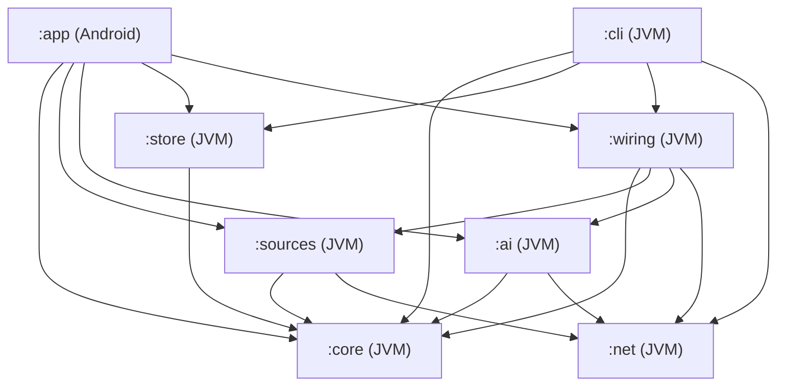
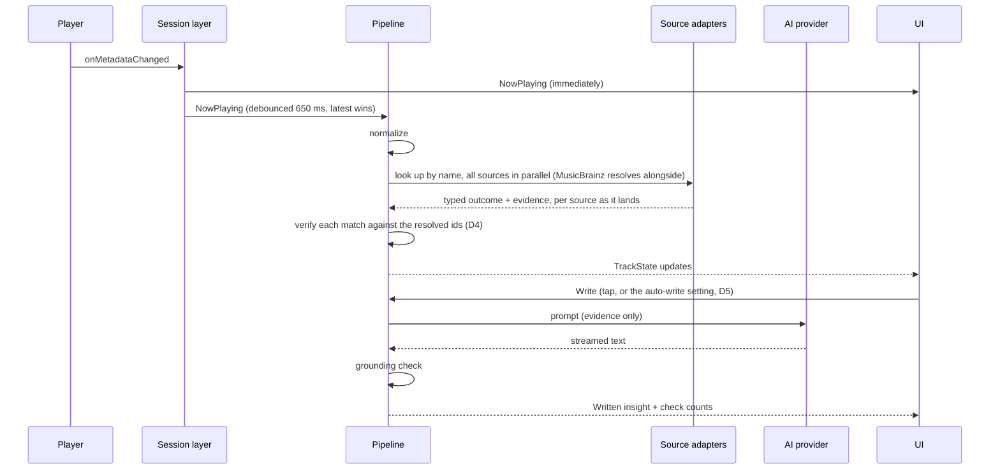

# Sleevesight architecture

**Status:** Proposal, for discussion  
**Date:** 2026-10-12  
**Builds on:** [design.md](design.md) and the [simulator](https://sleevesight.app/design/simulator.html)  
**Tracking:** [#3](https://github.com/wkusnierczyk/sleevesight/issues/3)

This document turns the design into a buildable structure: modules and their boundaries, the runtime data flow, the technology choices, how the structural constraints are enforced, testing and CI. It starts with a review of the design and the simulator, because several findings change the architecture. The decisions it needed are collected at the end, as made by the owner.

## Contents

- [Review of the design](#review-of-the-design)
- [Architectural drivers](#architectural-drivers)
- [Modules](#modules)
- [Runtime](#runtime)
- [Components](#components)
- [Cross-cutting concerns](#cross-cutting-concerns)
- [Technology choices](#technology-choices)
- [Testing](#testing)
- [CI](#ci)
- [Phase mapping](#phase-mapping)
- [Decisions](#decisions)

## Review of the design

The design is sound in its core idea: deterministic code decides what is true (resolution, matching, citation checks), and the model only narrates. The typed resolution outcomes, the separation of `none` from `source_off`, the scope on every evidence line, and the mechanical grounding check are what make the product trustworthy, and the architecture below is organized around keeping them in code the model never touches.

The findings below are the places where the design is incomplete or internally inconsistent, or where the implementation needs something the design does not yet specify.

### What the implementation can port from the simulator

The simulator is a prototype of the experience: it shows how the app behaves as if every part worked, and stands in for the parts that do not exist yet with frozen data. Some of its code is the app's real logic and ports directly; for the rest, the implementation starts from the design alone:

| Component | In the simulator | For the implementation |
|---|---|---|
| Normalizer | Real logic (`normalize`) | Port |
| Prompts, grounding check | Real logic (`promptInsight` and the others, `groundCheck`), live against Claude when run as a claude.ai artifact | Port; `promptGenre` only for a label Last.fm gives, since a label only MusicBrainz gives opens no AI-written genre card content (D12, *Conditions*) |
| Debounce, cancellation | Real logic (`onMetadataChanged`, `runPipeline`) | Port, as coroutines |
| Caching rules | Real logic (`fetchSource` for retrieval; `write` and `writeJson`, keyed with `srcSig`, for insights and cards) | Port, with the synthesis key extended per R2 |
| Source adapters (Wikipedia, Last.fm, web search) | Stood in for: frozen snapshots behind simulated latency (`querySource`, `fetchSource` over `facts-data`) | Build |
| Entity resolution | Stood in for: each fixture record carries its outcome (`song_article`, `mismatch`, ...) | Build |
| MusicBrainz | Stood in for: shown as `blocked` | Build |
| Multi-artist resolution | Stood in for: the primary artist's data only | Build |
| Evidence extraction | Stood in for: fact lines written in advance, in `facts-data` | Build |
| Discogs | Not shown | Build (Phase 3) |

The components to build are the ones the design calls the hard ones, so the architecture puts them in plain Kotlin behind interfaces, where Phase 0.5 can iterate on them in a command-line tool, on the fixture playlist, before any Android code depends on them. The simulator's frozen data then serves Phase 0.5's tests (see [Testing](#testing)): its resolution outcomes as expected outcomes, and its fact lines as reference facts that extraction should find, though not word for word.

### Findings

| # | Finding | Effect on the architecture |
|---|---|---|
| R1 | **Nobody extracts the evidence lines.** The design says each line is "one claim, in the adapter's own words, never copied prose", but an adapter is deterministic code. It can template structured data (MusicBrainz, Wikidata, Last.fm counts and tags) but it cannot paraphrase a Wikipedia article or a web page. The simulator's lines were written in advance, standing in for this step. | Evidence extraction becomes an explicit stage with a stated method per source. See D1. |
| R2 | **The synthesis cache key can serve stale citations.** It is "lookup key, enabled-source set, provider and model". When the retrieval cache expires and refetches, evidence ids can point at different lines while the cached insight still cites the old ones. | The synthesis key includes a fingerprint of the evidence set. A cached insight is reused only for the exact evidence it was written from. |
| R3 | **The latency goal and the MusicBrainz rate limit conflict.** "Within a couple of seconds" against one request per second, with a recording search, a recording lookup and one lookup per credited artist before Wikipedia can be reached safely through Wikidata. A cold track with two artists is about four seconds of MusicBrainz alone. | Progressive rendering: player metadata immediately, each source's result as it lands, the insight last. Artist resolutions are cached long-term, so the cost falls on first encounters. A per-host rate limiter is part of the network layer. See D4. |
| R4 | **The privacy statement is narrower than the traffic.** Matching by duration ("duration tolerance") sends the duration if it goes into the MusicBrainz query, and every request reveals the phone's IP address to that service. | Duration filtering happens on the phone, after the search. The first-run text names the IP address. |
| R5 | **"User-driven changes write" needs a signal the session does not give.** A skip pressed inside Spotify and a track ending on its own both arrive as `onMetadataChanged`. Only Sleevesight's own transport buttons are known to be user actions. | Measured in Phase 0 (`design.md`, *Track changes*): the time left at the change, and for Spotify the playback states before it, under a *Crossfade* setting. See D5. |
| R6 | **Genre labels depend on one source with a user key.** Last.fm needs the user's own API key; with it missing or off, no track gets genres, and 30 of 78 tracks got none even with it. MusicBrainz has genre data per artist, release group and recording, keyless. | MusicBrainz tags are a genre label source from Phase 1.0, beside Last.fm (D12, revised 2026-10-15; [#84](https://github.com/wkusnierczyk/sleevesight/issues/84)), for labels only and never in prompts. At the Phase 0.5 gate they filled 3 of Last.fm's 30 gaps, and alone they labelled 29 of 78 tracks, so a user without a Last.fm key can still get labels (with MusicBrainz switched on, #84's proposed default). The label sources are a user setting; the choice is re-evaluated in Phase 2 ([#101](https://github.com/wkusnierczyk/sleevesight/issues/101)). The licence findings are in [MusicBrainz tags and genres](#musicbrainz-tags-and-genres-9). |
| R7 | **Background behaviour is unspecified.** The notification listener runs whenever access is granted, app open or not. The design does not say whether lookups run while nobody is looking. | Session history is recorded always, on the phone only. Retrieval and synthesis run only while the app is visible. See D6. |
| R8 | **Sideloaded installs may not easily grant notification access.** Since Android 13, "restricted settings" can block notification-listener access for apps installed from outside an app store, until the user unlocks it in the app's info screen. Android marks every file install restricted; on one Samsung (One UI 8.5, Android 16) the mark was set but not enforced (`design.md`, *Notification access and installation*, #29). | Onboarding detects the block and explains the unlock. With distribution through Google Play (D7), this affects only development installs and any channel outside Play. |
| R9 | **A local model through Ollama is served over plain HTTP by default**, which Android blocks, and an arbitrary LAN address cannot be allowlisted in a network security config. A home HTTPS proxy often uses a self-signed or private-CA certificate, which Android does not trust either. | How the app reaches Ollama, and which certificates it accepts; see D8. |
| R10 | **`simulator.html` carries the artifact runtime.** Line 1 is a `<script>` tag loading the claude.ai artifact frame runtime from `claudeusercontent.com`, with a signed URL, saved from the rendered page. Outside claude.ai `window.claude` is absent, so the README's GitHub Pages link would show the evidence-only fallback, never live synthesis; and Pages does not serve private repositories on a free plan. | Not architecture, but recorded here; a separate cleanup issue. |
| R11 | **`design.md` still said "License: open source (to be chosen)"**; it is GPL-3.0 since #2. | Fixed by #6, with the README. |

## Architectural drivers

In order of weight:

1. **The pipeline runs off the phone.** Phase 0.5 is a JVM command-line tool sharing the pipeline with the app. Everything from normalization to the grounding check is plain Kotlin with no Android dependency.
2. **The model never decides what is true.** Resolution, matching, evidence selection and citation checking are deterministic and unit-tested. The model gets a prompt and returns text; it has no tools.
3. **Constraints are structural.** No analytics, no extra permissions, no network access outside the adapter and provider layer. Each is a build failure, not a review comment.
4. **Failure is visible.** Every source returns a typed outcome; every stage logs to the diagnostics stream; nothing degrades to a blank.
5. **Cost is the user's.** Every model call spends the user's key, so calls are explicit, cached and cancellable.
6. **The user decides.** Where a runtime behaviour is a judgement call rather than a correctness rule (cache lifetimes, the crossfade of D5, what runs in the background), it is a user setting with a reasoned default, not a fixed developer choice. Correctness rules stay fixed: the grounding check, the network boundary, the resolution thresholds. Build-time choices such as `minSdk` are not settings. `:app` reads the settings from DataStore into a plain `Settings` type defined in `:core`, which also holds the defaults, so `:cli` shares them; `:core` and `:store` read it directly, and `:ai` uses it to configure its Ollama client in `:net`. `:app` never touches `:net`: the app's one `NetClient` is created in `:wiring` ([Modules](#modules), [Networking](#networking)).

## Modules



| Module | Kind | Contents | May depend on |
|---|---|---|---|
| `:core` | Kotlin JVM | Domain model; normalizer; resolution logic (scoring, matching, outcomes) over client interfaces; evidence model and ids; prompt builders; grounding check; genre vocabulary; the pipeline orchestration as coroutines and flows; the diagnostics event type | Kotlin stdlib, coroutines, kotlinx.serialization. **No network, no Android** |
| `:net` | Kotlin JVM | The one HTTP client: Ktor with the OkHttp engine, per-host rate limiting, the User-Agent, timeouts, retries, and a logger that redacts keys and tokens | Ktor, OkHttp |
| `:sources` | Kotlin JVM | One adapter per source (MusicBrainz, Wikipedia and Wikidata, Last.fm, Discogs, web search), each implementing the `:core` client interfaces and `SourceAdapter`, with its evidence extraction. Also the other outbound clients that are not sources: the Spotify Web API client (Phase 3) and an album-art fetcher for `http` art URIs | `:core`, `:net` |
| `:ai` | Kotlin JVM | `AiProvider` implementations: Anthropic, OpenAI, Google, Ollama. Streaming, model listing, error mapping | `:core`, `:net` |
| `:store` | Kotlin JVM | Retrieval cache, synthesis cache, artist-resolution cache, session history, track-change records (D15). SQLDelight schema and queries over an injected `SqlDriver`: `:cli` supplies the SQLite JDBC driver, `:app` the Android driver (an AAR, which a JVM module cannot depend on) | `:core`, SQLDelight runtime |
| `:wiring` | Kotlin JVM | The network side put together (#132): the one list of host policies, every adapter's and provider's, and the `NetConfig` built from it with the version the process passes in (the app its `versionName`, the CLI its own); for the app, the process's one `NetClient` made from that configuration, and the adapters, the resolver, the art fetch and the AI providers built on that client, handed out as `:core` types only (`SourceAdapter`, `TrackResolver`, `AiProvider`, and the art fetch as a function or a small `:core` interface, such as `suspend (String) -> ByteArray?`, which `AppGraph` adapts into its `HttpArt`). It makes no request of its own. A pipeline module (`sleevesight.pipeline`), so `checkNetworkReferences` and the [readiness rules](#multiplatform-readiness) cover it. `:cli` takes the whole of it, built on the client the CLI creates (`pipelineWiringOn`), so the CLI runs the adapters and providers the app runs; the app's entry point (`appPipelineWiring`) creates the app's client. Entry points that take a `:net` type are declarations of their own, never overloads of, supertypes of or members on what `:app` calls, so `:app` compiles against `:wiring` without `:net` | `:core`, `:sources`, `:ai`, `:net` |
| `:cli` | Kotlin JVM application | Phase 0.5: runs the pipeline over a playlist fixture; writes the coverage report and the insights; records HTTP responses for tests | `:core`, `:store`, `:wiring` (the `NetConfig`, and the adapters, the resolver and the provider built on the CLI's client), `:net` (to create the live `NetClient` from that configuration and replay or record through it, #45), SQLDelight JDBC driver |
| `:app` | Android application | Session layer (`NotificationListenerService`, `MediaSessionManager`); Compose UI; settings (DataStore); secrets (Keystore); wiring; diagnostics screen | `:core`, `:sources`, `:ai`, `:store`, `:wiring`, SQLDelight Android driver |

The boundaries do the enforcing. `:core` cannot reach the network because it has no HTTP dependency; only `:sources` and `:ai` see `:net`, besides `:wiring` and `:cli`, which create the one client (the app's and the CLI's) but make no request of their own; and `:app` gets network results only through them, as `:core` types. `:wiring` exists because nothing else can create the app's client: `:app` may not name a `:net` type, and neither `:sources` nor `:ai` sees the other, so neither can build the client and hand it to both. That `:wiring` makes no request of its own and hands out only `:core` types is held by review, which is why the module is kept small. And `:app` cannot name a `:net` type only while `:sources`, `:ai` and `:wiring` declare `:net` as `implementation`, never `api`: `checkModuleGraph` reads a module's direct dependencies, so `:net` arriving through an `api` dependency would pass it. A check closes this: the build fails when `:net` is on `:app`'s compile classpath at all, transitively (`compile-forbidden.app` in `module-graph.properties`, read against each variant's compile classpath; `:net` stays on the runtime classpath, since the APK ships it). Two other ways were rejected. Letting `:app` depend on `:net` only to construct the client cannot be enforced, since the module graph checks which modules depend on which, not what a module does with one: `:app` could then send requests itself, and *network only through adapters and providers* would be a convention there. One client per module, built in `:sources` and in `:ai`, gives up the one client: one rate limiter per host would then rest on the two never sharing a host, which nothing checks, and the host policies would be listed in two places. The checks under [Structural constraints](#structural-constraints) make that a build failure rather than a convention.

## Runtime

### Data flow



### Concurrency

- The session layer exposes `StateFlow<NowPlaying?>` and `StateFlow<PlaybackInfo>`.
- The pipeline is `nowPlaying.filterNotNull().debounce(650.milliseconds).map(::normalize).distinctUntilChangedBy { runKey }.collectLatest { run(it) }`: normalization comes first, because what a run depends on is the `NormalizedTrack` (its lookup key, credited artists and work), plus the album (the `P` line) and the length (resolution chooses the recording by it); a change that alters none of them, such as new art or the same metadata sent again, is not run again, and one that alters any is (#44 review: `lookupKey` alone kept the previous track's release and artists). `collectLatest` cancels a superseded track's retrieval and synthesis, the coroutine version of the simulator's `AbortController` and `app.gen`. A `null` (no active session) is filtered out, so it neither cancels the current track's run nor clears its state; the UI reads `nowPlaying` directly to show the idle state.
- Sources run in parallel inside `run`, each in its own child coroutine, each publishing its result as soon as it lands.
- Detail insights (song, artist, album, genre, sounds-like) are separate on-demand jobs, scoped to the screen or box that asked, cancelled when it closes.
- Preparing the next track (D13) is a job of its own, keyed by the next queue item and cancelled when that item changes. Requests in flight are shared by key, so a track that starts while it is being prepared waits on the same requests rather than repeating them. See [Preparing the next track](#preparing-the-next-track).
- Playback state (play, pause, seek, progress) never enters the pipeline.

### State

The UI renders one immutable state per track:

```kotlin
data class TrackState(
    val nowPlaying: NowPlaying,
    val normalized: NormalizedTrack?,
    val sources: Map<SourceId, SourceState>,   // Pending | Done(outcome, evidence, latency, cached) | Failed(error)
    val evidence: EvidenceSet?,                // ids assigned, fingerprinted
    val genres: List<GenreLabel>,
    val similar: List<SimilarArtist>,
    val insight: InsightState,                 // Idle(canWrite) | Writing(partial) | Written(GroundedText) | NoEvidence | Failed(reason)
)
```

How the orchestration is made (#44, `Pipeline` in `:core`), where the sections above leave room:

- **Entry points.** `Pipeline.follow(changes: Flow<TrackChange?>)` is the app's loop, as under *Concurrency*; a `TrackChange` carries the session layer's verdict on why the track changed (`ChangeCause`: an action in Sleevesight, a skip in the player, or a natural end), which `AutoWrite` turns into D5's decision, together with whether the user has acted since the app opened. Skip detection itself stays in the session layer. `Pipeline.run(nowPlaying, write)` runs one track and returns its final state, for the CLI. `write()` is the tap on Write; `userActed()` the first action. `Settings` is read once per track.
- **State.** As above, plus `resolution` (MusicBrainz's, once made); `similar` waits for the sounds-like card (Phase 2), so it is not there yet. `SourceState.Done` holds the adapter's whole `SourceResult` and whether it came from the cache; `Failed` holds the exception's type only, for an adapter that threw (a bug: the network is `unreachable`). A switched-off source is `Done` with `source_off`. The evidence and genre labels are assembled once every source has landed.
- **The cache first.** Each enabled adapter's result is looked up in the retrieval cache; resolution runs only when some source misses, so a fully cached track makes no request at all. The cache is an interface in `:core`, `PipelineCache`, which `:store` implements (`StorePipelineCache`, running the blocking database calls in an injected I/O context): `:core` cannot see `:store`. A failing cache is logged and treated as a miss.
- **What is not cached.** A result is kept only when the MusicBrainz resolution it may have been verified against was made: not when MusicBrainz was unreachable, and not when it is switched off, since either result would stay unverified once MusicBrainz is back or on. That costs a repeated web search when MusicBrainz is down; the rule does not ask which adapters awaited the resolution. Nor is a result its adapter marks provisional (`SourceResult.provisional`): one that a failed request of its own verification left unverified, such as Last.fm's search for other MusicBrainz artists of a name (*Last.fm verification*).
- **Evidence.** The player's release is the `P` line, worded as the simulator words it ("This recording is on the release "…"."), with no year: the session does not report one. The other lines are the enabled sources' verified lines, in the adapters' order, so the ids do not depend on the order the sources land in. Genre labels are never evidence; those of the label sources switched on are combined (*Genre labels*). Last.fm's come with its result (`SourceResult.genres`). MusicBrainz's ([#84](https://github.com/wkusnierczyk/sleevesight/issues/84)) come later: its result names the resolved artists (`SourceResult.labelArtists`, kept with it in the retrieval cache, so a cached track has them too), and once the evidence is assembled the run asks for their tags beside the insight (`TrackLabels`), so the insight does not wait for them, at one MusicBrainz request a second per artist; the labels join `TrackState.genres` when they arrive, and the run ends when both have.
- **The insight.** No AI call without evidence: nothing to narrate, and the call would be paid for a `NO_EVIDENCE`. A card is served from the synthesis cache when its full key matches (kind, the track's retrieval key, fingerprint, `InsightPrompt.VERSION`, the style's hash, provider, model, model-knowledge switch, reasoning effort); `CardKind` names the kinds by fixed keys. A reply is kept only when it ended normally, not when it was cut off at the token limit (shown, marked incomplete) or declined. The request carries the reasoning effort (below).
- **Diagnostics.** `PipelineEvent`s go to a `SharedFlow` that never suspends the pipeline: a slow collector loses the oldest of the last 256.
- **Reasoning effort**, a user setting (`Settings.aiEffort`, low by default; driver 6): how much the model may reason before it writes, mapped by each provider to its own control (Anthropic's `output_config.effort`). Claude Haiku 5.5 reasons by default at medium effort; an insight narrates a few lines and is waited for, and the grounding check, not the model's deliberation, keeps it honest, so low is the default. Thinking is not switched off: not every model allows it. The effort is sent only to models known to take it (`AnthropicProvider.takesEffort`, a list kept with the provider, since the model list carries no capabilities): older models answer it with an error, and get the request without it.

## Components

### Session layer (`:app`)

- `SleevesightListenerService : NotificationListenerService` is declared only to obtain the session permission; it ignores notifications themselves.
- `SessionRepository` registers `addOnActiveSessionsChangedListener` and a `MediaController.Callback` on the active session of each followed player, and maps metadata to `NowPlaying` (title, artists string, album, duration, package, media id when present, active queue item when published, art URI when sent); the art itself, a bitmap, is a separate flow beside it. Events from players not followed are dropped and logged as ignored.
- Track identity, for skip detection and session history (Phase 0, `design.md` *Track changes*): the media id when the player sends one; else the active queue item where the player publishes one (an item of −1 is no item; when either side has no item, title and artists decide); else title and artists. A known limit: a song repeated right away (repeat-one, or the same song queued twice) is the same track, unless the player gives no media id but separate queue items, so it gets no new skip decision, no new entry in the session history, and no new lookup. A new length or new art for the same track is an update, not a change, and the time left is computed from the latest length. The pipeline's lookup key (normalized artist and title) is unaffected.
- Transport controls are offered only when `PlaybackState.actions` advertises them.
- Handoff: `sessionActivity` for the player's own screen; `spotify:` URIs when an id is known; `spotify:search:` otherwise, logged as a fallback.
- Process death: the service reconnects on rebind; the repository rebuilds from `getActiveSessions` on start.
- Queue: when a player publishes `getQueue()` and `getQueueTitle()`, the track list uses it; Spotify does (measured in Phase 0), as well as naming the playlist in its metadata. Spotify's Device Broadcast intents are not adopted: Phase 0 showed the session carries everything they do and more.
- Players that send only a title still run the pipeline; resolution is then mostly `none`, and how much of the UI to hide stays the design's open question on per-player behaviour.
- Session history (the default track list) is written to `:store` locally, whether or not the app is visible.

How the session layer is made (#48), where the points above leave room:

- **Nothing before the first run.** `SessionRepository` reads no session and registers no listener or callback until `FirstRunAcknowledgement.state` is true: notification access can be granted in Settings before the app is first opened, which binds the listener service at once. `SleevesightListenerService` only starts and stops the repository with its binding; on start the repository rebuilds its state from `getActiveSessions`. The system does not always bind the listener again after a force stop or an update (`NotificationListenerService.requestRebind` only undoes `requestUnbind`), and the session list needs the listener enabled, not bound, so `MainActivity` also calls the idempotent `start()` on every resume while access is granted, and `stop()` when it is not, since a repository it started is not stopped by the listener's unbinding; the repository's own gate still waits for the acknowledgement.
- **Seams.** The players to follow arrive as a `Flow<Set<String>>` of package names: in the app, `SettingsStore.followedPlayers` (#126), so a switch reaches the repository at once, and the repository reads no session until the settings' first read has arrived, so a player switched off is never followed in between. While the settings file cannot be read, the flow names no player (or nothing yet, before its first read), and the read is retried (see *Settings and secrets*); `Settings`' default (Spotify) when no flow is given. `http` art goes through `HttpArt`, which the app graph points at the art fetch `:wiring` builds on the process's one `NetClient` (`PipelineWiring.art`, over `:sources`' `ArtFetcher`; #51); until then such art is missing. `PlayerSession` and `ActiveSessions` stand between the repository and `MediaController` and `MediaSessionManager`, so the tests drive sessions with plain values.
- **The player shown.** A player is followed through its first session in the system's list; the one shown is the first followed session that is playing (or buffering, or seeking), else the first followed session. Besides `nowPlaying` and `playback`, the repository publishes the shown player's queue, its art as a bitmap, and the players seen with a session since the process started, for *Players to follow*.
- **Settling.** A session's metadata and playback state are coalesced before a track is mapped: each callback restarts a 300 ms window (`SessionRepository.SETTLE`, a constant, not a setting), capped at 1 s after the first callback of the burst (`MAX_SETTLE`, so a player reporting every 250 ms still settles), and when it passes one `NowPlaying` is mapped from the latest pair. A callback that names a new title or a new queue item may be the first half of a track change, so the cap never falls within 300 ms of one, and the first such callback of a burst restarts the burst's timing: the callbacks before it moved only the position (a seek bar scrubbed, then *next*). When that callback is a new title, a state up to 300 ms before it that fell back to the start of a track (to 1 s or less, from more than 2 s as reported) without naming a new item counts as the change's start: a new track's first state may name no new item (Castbox). A seek to mid-track is not such a state, nor one still at the start (Castbox reports `PLAYING` at 0 while it stalls). A burst settles in any case within 3 s of its first callback (`LONGEST_BURST`), which nothing moves, so a player that changes its title every 250 ms still settles. With the pipeline's 650 ms debounce after it, a lookup starts at most about 1.7 s after a change unless the title or the item changes again in its last 300 ms, and at most about 3.7 s after the burst's first callback. A player that becomes the one shown because it started a new track is shown once its reports have settled, so the track it had before is never shown in between. YouTube Music and Castbox send a new track's first state just before its metadata, so the change is published once, with the new track's title and queue item. The playback state and the queue are published at once, every state: skip detection counts the `PLAYING` states in the 1.5 s before a change and reads the position they report (D5), which coalescing would lose; the new track's first state (position 0) therefore precedes the change in `playback`. So each change is also recorded as a `SessionChange` (`SessionRepository.lastChange`): when the first callback of the burst that settled into the new track arrived (`changedAt`), and the playback state just before that burst; on a switch to another player's track settled earlier, and for any change that began before the last one published, the time it was published and no state: `changedAt` never goes back, which the repository checks where it publishes a change. Stopping the session layer clears it. D5 measures the time left and the `PLAYING` states before a change from `changedAt`, not from the emission of `nowPlaying` (#53). A state with no item (−1, YouTube Music while stopped in the background) keeps the last item the state named while the title is unchanged, so a stop and resume changes nothing. The queue's own titles are not compared with the metadata's: a queue may decorate them ("(Remastered)").
- **Identity** as above, with two refinements: equal queue items are one track whatever else is filled in (YouTube Music sends a title first and its artists a moment later), and without queue items a report without artists matches any artists. An item the state still names after the title has changed (a player that sends its new metadata well before its new state, or a stream that keeps one item while its songs change) is the previous track's: it counts as no item until the state names another (a state with no item, −1, names none), so the change is seen at the metadata, by title. That compares with the last track settled, not with the queue's titles.
- **Registration first.** A controller's callback is registered before its metadata, playback state and queue are first read, so a change in between is not lost; an active-sessions list that arrives after the listener was removed is ignored.
- **Art**, best first: the session's bitmap (`ALBUM_ART`, else `ART`), then the `content://` URIs, then the `http` ones, each tried in turn; a player that sends a bitmap never causes a request for its art. A bitmap compares by content, since Spotify sends the same art anew with each update. Art is reused only for the same track with the same sources: a track change clears it and loads again, even from the same URI, which a player may reuse for whatever plays; an update of the same track keeps it until the new art has loaded, and when that fails; an answer for a superseded track is dropped. `http` art is requested with `sensitiveUrl`, so `:net`'s log shows only its host: the address is the player's choice and may carry a token or name the track. Decoded art is scaled down by powers of two to at most 1024 pixels a side.

### Normalizer (`:core`)

A port of the simulator's `normalize`, with the design's table and every fixture title as unit tests, and the deviations listed in `Normalizer`'s KDoc. One of them is the lookup key (#72): it keeps letters and digits in any script, and `+`, where the simulator kept ASCII letters and digits only, so non-Latin tracks shared a key (every Japanese, Cyrillic or Greek track keyed as `|`) and, as the cache key, would get one another's evidence. Accents are folded away only on Latin and Greek letters; elsewhere a combining mark stays with its letter (the breve of Cyrillic `й`, Japanese voicing marks, Indic vowel signs), so different words do not merge. Symbols and emoji are dropped in either plane (supplementary ones by block, which the portable character classes do not classify); variation selectors, tags and enclosing marks are dropped without separating the letters around them. A title, artist or work of symbols only, which would fold to nothing, keys as its own characters (without variation selectors, tags and enclosing marks), so `😀` and `😢` differ and `★` keys as `★` with a variation selector does. `Normalizer.foldForKey` applies the same folding to the other parts of a cache key; the test is by character class, not a `\p{L}` regex, which is not portable. Every fixture track keeps the simulator's key. Accent folding (Unicode NFKD) sits behind a small interface, since `java.text.Normalizer` is JVM-only (D2). Output: `NormalizedTrack(title, artists, primary, from, variant, notes, lookupKey)`.

### Entity resolution (`:core` logic, `:sources` clients)

`:core` holds the scoring and decisions; `:sources` provides `MusicBrainzClient` and `WikidataClient`. Per D4, resolution runs alongside the lookups by name rather than before them: each source's match is verified against the resolved ids when they land. A Wikipedia article can also be verified without MusicBrainz, through its own Wikidata item (step 5). Matches from the other sources stay unverified (shown, not cited) if MusicBrainz finds nothing.

1. **Recording.** Search MusicBrainz by normalized title and credited artists. Score candidates on title similarity, artist-credit overlap, and duration within a tolerance (computed locally, R4). Accept above a threshold, otherwise `none`; a near miss with a conflicting artist is `rejected(reason)`.
2. **First release.** From the accepted recording's releases, take the earliest release-group first-release date. The release the player reports stays separate (`P` evidence). Both are kept; which one the UI shows is still the design's open question on release-date semantics.
3. **Artists.** Each credited artist resolved separately, to an MBID, cached long-term.
4. **Cover detection.** The recording's work relationship and the work's earliest recording by a different artist give `original_song`.
5. **Wikipedia identity.** With a MusicBrainz match: MBID to Wikidata through the MusicBrainz URL relationship, then the English Wikipedia sitelink. For an article found by name: the article's own Wikidata item (its `wikibase_item`). Either way, the article is accepted only if Wikidata confirms it: instance of song, single or musical work, with a performer (P175) matching a credited artist; otherwise `rejected`. The performer is matched by its MusicBrainz artist ID (P434) when artist resolution has one, and by normalized name otherwise. This is the check that rejects the wrong Reem.

How steps 1 to 4 are made (#36), where the steps leave room:

- The search is by normalized title and primary artist, 100 results (MusicBrainz's maximum), since a much-recorded song has dozens of recordings by the same artist and the search may rank the original far down, differently from one request to the next (#78: at 50, Chuck Berry's 1956 "Roll Over Beethoven" was sometimes missing). A candidate is accepted when its title matches (case, accents, punctuation and apostrophes aside, `ResolutionThresholds.TITLE_SIMILARITY`), its length is within `DURATION_TOLERANCE` of the player's (a missing length on either side does not count against it), and it credits at least one of the track's artists: by name, or as a band one of them leads, in the usual forms (`X and His …`, `X and Her …`, `X & the …`, `X with …`, the leader's name whole; #77: the 1962 "Misirlou" is credited to Dick Dale and His Del-Tones, the player says Dick Dale). The wording alone is not enough ("Echo" is not Echo & the Bunnymen): the leader must appear on the recording, in a performer relationship of the band's matching recordings (its preferred three are fetched), and every id of a performer of that name found there is the artist's for the band's candidates, unless that recording also credits the same id by name: beside a credit to "Alex Smith", that Alex Smith's vocal does not show who leads "Alex Smith and His Orchestra", so a mixed credit is confirmed only by another of the band's recordings. A band's own MusicBrainz id is never its leader's; when the chosen recording names the leader neither in its credit nor in its relationships, the confirmed id stands. With the player's length, a candidate whose length is known and fits is preferred to any with no length, which may be a demo, a bootleg or a live take. Of the accepted, the earliest released is chosen, so a remaster's recording does not stand in for the original's. A title and length match with no credited artist in common is `rejected`; so is a credited name that the accepted candidates, after the length has narrowed them, give to more than one MusicBrainz artist. Every matching credit counts (two artists of one name on one recording collide), and a band credit counts as every leader of that name found on its recordings, or, with none found within the three tried, as an unknown artist, since the cap and MusicBrainz's many recordings without relationships prove nothing: a namesake's solo recording and the real leader's band, confirmed or not, or two bands led by different artists of that name, collide. A band alone, unconfirmed, credits no one and is a near miss. Only when no candidate whose title and length fit credits the track's artists by name or as a band does a credit under an honorific variant of the name count (#79: track 50's recording is credited to "Mr. A Balladeer", the player says "a balladeer"): a leading `Mr.`, `Mrs.`, `Ms.`, `Miss`, `Mister`, `Dr.`, `Sir` or `Dame` on one name only, the rest the other name whole and at least two words as written (a hyphenated word is one, a leading article counts), since an honorific before one word is usually a stage name of its own (`Dr. John` is not `John`, `Mr. T-Bone` not `T-Bone`). The variant credits then stand for the artists under the same rules, a variant two MusicBrainz artists share colliding; a variant never stands beside a credit by name, so a namesake under an honorific neither displaces nor collides with a recording by the artist's own name that fits title and length. The artist's MusicBrainz id is then the variant credit's, so an article found under the plain name is accepted only through that id's P434: track 50's "Mr. A Balladeer" has no Wikidata item, so the "A Balladeer" article found by name is not used and Wikipedia gives `none`, in the safe direction.
- An artist is resolved from the accepted recording's credit, or from a performer relationship on it (a band's singer). It is never searched by name alone: without an accepted recording no artist gets an id, since a same-name collision would give the wrong one.
- A recording is a cover when MusicBrainz marks its performance of the work as one, or when the work has a recording by an artist not credited on it dated before every recording of the work by the credited artists, all of which must be dated: MusicBrainz leaves many recordings undated, and an undated one by the credited artists may be the original. The line names the work's earliest *dated* recording by another artist, as that ("The earliest dated recording of … on MusicBrainz is by …"), and only when it predates every dated recording by the credited artists; a cover whose earlier recordings are undated stays a cover with none named.

How step 5 is made (#37, `IdentityCheck`), where the step leaves room:

- *Song, single or musical work* is a fixed set of `P31` classes (`Wd.SONG_CLASSES`), matched directly, without following subclasses. A disambiguation page is rejected as one.
- A credited artist confirms a song as its performer (P175). With a MusicBrainz id the match is by P434 only, never by name, so a performer item with no P434 does not confirm a resolved artist. Without one, the name matches only a performer with no P434: a performer MusicBrainz knows is a resolved artist, and an unresolved namesake is not shown to be them (a "Wonderland" by another Reem). A writer (composer P86, lyricist P676) confirms a song found by name only when the item names no performer: the anthem *Ode to Newfoundland* has none, and the track credits its composer; with performers, the item's facts are theirs (a songwriter's song made famous by a singer). On the item MusicBrainz links, which is already tied to the recording, a credited writer does decide the scope when performers are named (below).
- A song by someone other than the credited artists is the *original song* when its performer is the original recording's artist (step 4). The item MusicBrainz links to the recording or its work (the work's own link, else its P435) is the original song when the recording is a cover, or when the item names performers, none of them a credited artist (MusicBrainz rarely dates enough to infer an unmarked cover), and the track's artists did not record the work first, and no credited artist is among its writers (P86, P676) either; it is the track's own song otherwise. *Recorded first* (owner, 2026-10-14: an earlier recording cannot be a cover of a later one): the track's artists' (those the player names, with the bands whose leader is confirmed as one of them; not a collaborator credited beside them, nor a band only worded like one of theirs) earliest recording of the work with a recording date is before every dated recording of it by anyone else, of which there must be one, and the recording is not a cover; undated recordings count for nothing either way. Release dates do not count here: MusicBrainz gives none for the others' recordings of a work, so one standing in for ours would favour ours (an unmarked cover released before the undated original's first dated rival would pass). It is the track's artists' earliest, not the accepted recording's own date, since MusicBrainz dates a session's other takes by recording date and may date the accepted one only by release (Chuck Berry's 1956 session takes, April, before the May single). MusicBrainz's cover mark still wins over it. Either test is for an artist's own song whose item lists only the later performers who made it famous again (#76: Chuck Berry's "Roll Over Beethoven", whose item names the Beatles and others as performers and him as writer); the writers' test also covers an author re-recording their own song later. An unmarked cover, performed and written by others, after an earlier dated recording by another artist, is still the original song. Its cost: a songwriter's own recording of a song first made famous by another is read as their own song, unless MusicBrainz marks it a cover or dates the other's recording earlier (step 4). Here an unresolved credited artist matches a performer or writer by name; a resolved one matches by MusicBrainz id, and by name only a person with no P434, so a name never overrides a conflicting MusicBrainz id.
- Found by name alone, a song by someone else is rejected, even when its title is the track's: a same-title song and a cover cannot be told apart without MusicBrainz (the fixture's Peleboy track "We In Here" is not DMX's song of that name). So the fixture's covers by acts MusicBrainz does not know, or knows without a work (tracks 45 and 48), are rejected rather than resolved to the original song; only MusicBrainz's cover detection (step 4) leads to one. Track 76's only article is a soundtrack album, not a song, and is rejected too. The gate (#46) may weigh a further signal for covers.
- An artist article is accepted only through the artist's MusicBrainz id (P434); without one, it is rejected, since a same-name article cannot be told apart.

The Wikipedia adapter (#38, `WikipediaSource`), where the design leaves room:

- By name, one request at once for the titles a song article would have (`Title (Artist song)`, `Title (song)`, `Title`, also in Wikipedia's casing and without a leading `The`) and each credited artist's name, following Wikipedia's redirects; no full-text search, whose results for small acts are noise. Then the items MusicBrainz links, then the articles found by name, each through the identity check; the first confirmed song wins. An artist's article is reached through its MusicBrainz id (P434), and one found by the artist's name is checked against it, so the wrong Reem is a rejection.
- Lines: from each confirmed article's lead, at most 3 sentences of at most 300 characters: the lead's first sentence, which defines the subject, and those that name it (the item's label, or the track's title for a song). Verbatim but for the punctuation the plain-text extract leaves where it drops a pronunciation; never cut inside a quotation (every straight `"` opens or closes one in turn, and a piece left with one open at the end of its paragraph is dropped; a straight `"` or a closing curly `”` directly after a digit (any Unicode number, `7½`) may be an inch mark, `a 7" single`, which would throw the pairing off, so a paragraph holding one is dropped whole: the cost, a known limit, is that such paragraphs are lost, quoted numeric titles such as `"1999"` among them); each linking its article (its title percent-encoded); then the item's Wikidata lines.
- Rejected candidates go into `SourceResult.rejections`, each credited artist as its own subject. The song's candidates are alternatives for one subject, so theirs go in only when no song is confirmed: a confirmed `Sundown (Gordon Lightfoot song)` does not list the rejected disambiguation page `Sundown`.

Thresholds and tolerances are constants tuned in Phase 0.5 against the fixture's known cases. They decide whether a match is correct, so they stay fixed rather than becoming user settings (driver 6). The gate run (#46) left them unchanged and found a reason to raise the search size, since raised to 100 (#78); the evidence is in the design's *Phase 0.5*.

### Source adapters (`:sources`)

Wikidata's lines carry a source of their own, `WIKIDATA` with the tag `WD`, apart from Wikipedia's `W`: they are templated from structured data and cached for their own lifetime (D9). The user's one Wikipedia switch covers both. The player's metadata (`P`) and the model's own knowledge (`M`) are pseudo-sources that retrieve nothing.

`SourceAdapter` as in the design, with the input D4 needs: `lookup(track: NormalizedTrack, resolution: Deferred<Resolution>)`, so an adapter starts by name at once and awaits the resolved ids only to verify. It returns `SourceResult(outcome: Outcome, evidence: List<EvidenceDraft>, latency, unverified: List<EvidenceDraft>, rejections: List<Rejection>)`. Evidence extraction per source (D1):

| Source | Evidence lines |
|---|---|
| MusicBrainz | Templated from structured data: first release, writers, producers, performers, work and cover relationships |
| Wikidata | Templated: genre, record label, notable awards, inception |
| Wikipedia | Selected sentences from the article's lead, verbatim, attributed (CC BY-SA 4.0), at most a fixed number per article, filtered to those that name the entity |
| Last.fm | Templated: listeners, tags, similar artists. Bio: selected sentences, verbatim, attributed (CC BY-SA) |
| Discogs | Templated: personnel, labels, formats |
| Web search | One line per result: the provider's snippet, verbatim, with its URL. Exa first (D11): its highlight, whitespace collapsed; at most five results, kept only when they name the title, the work it is from when the player gives one, and a credited artist (a distinctive one when there is one), and their own title does not name the artist without the song (`RecordingFilter`, shared by any later provider; design, *Web search provider (D11)*) |

A match that cannot be verified is shown, never cited (D4): `SourceResult` keeps its lines apart, in `unverified`, from the verified lines in `evidence`, which alone get ids and go to the model. The default of `unverified` is empty, so a line is cited only when an adapter puts it in `evidence`. A match that fails the check gives neither, and `rejected(reason)`; each rejected candidate is also kept in `rejections`, with what it was looked up for and why, also when another candidate gave lines (one credited artist of several), so *Sources* can show it. `Outcome` says what the source found, not whether it was verified, and has no unverified case: a result with lines only in `unverified` is the unverified one, whatever its outcome.

#### Last.fm verification

Last.fm describes artists, so each credited artist is looked up by name (`artist.getInfo` and `artist.getTopTags`, with `autocorrect=1`) and judged when the resolution lands, in this order:

1. Last.fm's artist and the resolved artist both have a MusicBrainz id: a different id rejects the match. The same id, even under a corrected name, verifies it whole only when the page is the artist's alone; when MusicBrainz shows or cannot rule out another artist of the name, it verifies the bio's sentences only (below).
2. Otherwise, a name Last.fm corrected (it differs from the credit beyond case, accents, spacing and punctuation) is rejected. Autocorrection is how a small act lands on an unrelated band's page: the fixture's track 61, `Jessiah`, which Last.fm answers with `Jesaiah`, a Swedish metalcore band. So track 61 is rejected without MusicBrainz, and also when resolution finds the real Jessiah, whose id differs.
3. Otherwise the match is unverified: the name is the same, and nothing confirms the artist. With no resolution (`Resolution.NONE`), every Last.fm match is unverified at best.

Last.fm keeps one page per name, so every artist of that name shares it: its listeners, tags and similar artists (the *aggregates*) mix them all, while its bio is written about one of them or says the name is shared. With the resolved artist's id on the page, the match is judged in this order (#75):

- **The bio says the name is shared:** it starts "There are several artists …", says several artists share the name, or enumerates them (a `1)` or `1.` at the start or after a space, a line break included, and a `2)` or `2.` after a space). The match is unverified and gives no bio sentence. This check costs no request and catches artists MusicBrainz does not know; it deliberately over-matches, since taking a shared page for one artist's is the unsafe failure (known limit: a single artist's bio with chart positions, "No. 1. … No. 2.", is taken as shared).
- **Otherwise MusicBrainz decides, from identifiers,** with one request: the first page of its artist search for the page's name (`MusicBrainzLookup.searchArtists`, 100 artists, on their own names, not aliases), compared by name key; a longer name that contains it ("Reem Kelani" for "Reem") does not count.
  - The page holds every match (MusicBrainz's `count` is no more than the artists returned), finds the resolved artist under the name and no other: the match is **verified**, aggregates included.
  - Another artist of the name is on the page, or the page cannot tell (it holds only part of the matches, or not the resolved artist under the name; or the name has no letters or digits, and is not searched): the match is **verified for its bio only** (`LastFmMatch.BioVerified`). Its bio sentences may be cited, under the usual rules for sentences; its aggregates are shown, never cited, and give genre labels as an unverified match's do. MusicBrainz does not rank exact names first (the ten artists named Fred, of 2,150 matches, ranked from 25th to 97th), so a namesake beyond the first page may exist; the page then proves nothing, which is this case.
  - The request fails, or its answer lacks the `count` or the artists: the whole match is unverified, with no partial verification, and the result is *provisional* (`SourceResult.provisional`): shown, but not kept in the retrieval cache, so a later lookup may verify it.

The search's answers, all but failures, are kept in memory for the most recent 1,024 pairs of the name as sent (lowercased) and the MusicBrainz id (a persistent cache beside the artist-resolution cache is a possible follow-up). The search delays Last.fm's whole result, by one MusicBrainz request at one a second for each credited artist whose page carries the resolved id, made only then, after the resolution, and taken from the slots of other MusicBrainz requests. The Last.fm adapter therefore consults MusicBrainz, and its `extractionVersion` is 2. It asks once rather than paging: on the fixture's artists no verdict needed a second page, and paging has failures of its own (a total that changes between pages, an empty or overlapping page).

**Remaining risk:** a shared page whose bio's wording escapes the check, written about another artist of the name, can still have its bio sentences cited for this one; only its aggregates are kept from the insight. **Cost:** on 2026-10-16, of the fixture's 70 credited artists, the 56 MusicBrainz has under that name included 15 with a namesake there (among them Paul Simon, Mick Jagger, Robert Palmer, Dick Dale and Them; the namesake may be a drummer or a package designer), whose pages would keep their bio sentences verified and lose their aggregates to unverified; the other 41 would be verified whole. Every verdict came from the first page: the two searches with more than 100 matches, "Them" (251) and "Fred" (2,150), had a namesake on it. A namesake known to MusicBrainz only by an alias, or under its name in another script, is not found. The rule was not measured against Last.fm's own shared pages, for want of a Last.fm key.

A bio sentence is quoted only whole: a summary's unterminated or ellipsized tail is dropped. Genre labels come from the top tags weighted at least 10 of 100 (a starting value; not tuned in #46, which ran without a Last.fm key, so still open), or from `artist.getInfo`'s five tags when the top tags do not arrive, and only for a match that may be shown (verified, verified for its bio, or unverified). The adapter's `lookupArtists` returns, besides the `SourceResult`, each credited artist's answer, judgement and labels, for the genre and similar-artist cards.

### Evidence (`:core`)

- `EvidenceLine` as in the design. Ids are the source tag plus a position, assigned after a deterministic sort, so the same retrieval gives the same ids. The sort is by source, in a fixed order (`EvidenceSet.SOURCE_ORDER`), keeping each source's own order; lines are numbered from 1 within each source, so a source's ids do not depend on the others. Each adapter therefore emits its lines in a deterministic order, the order of its response.
- `EvidenceSet.fingerprint` is a hash over the ordered (id, scope, text) triples. It is part of the synthesis cache key (R2). The hash function sits behind a small interface (D2). It is SHA-256, in lowercase hex, over each line in order: for the id, the scope's fixed key (`song`, `original_song`, ...) and the text, the field's UTF-8 byte length, `:`, and its UTF-8 bytes; then a newline. URL and retrieval time are left out, so a refetch that finds the same lines keeps the cached insight. A lone UTF-16 surrogate in a line's text becomes U+FFFD when the line is made, so the encoding is the same on every platform. Changing the encoding, the source order, a tag or a scope key changes every fingerprint; a golden test pins them.

### Synthesis and grounding (`:core`, `:ai`)

- Prompt builders in `:core`, ported from the simulator; the prompt contracts in the design's appendix are their specification.
- `AiProvider` in `:core`, implementations in `:ai`:

  ```kotlin
  interface AiProvider {
      val id: ProviderId
      suspend fun models(key: Secret): ModelList                                   // Listed(models) | Failed(kind)
      fun stream(request: CompletionRequest, key: Secret): Flow<CompletionEvent>   // Delta | Done(usage, stopReason) | Error(kind, retryAfter)
  }
  ```

  Small clients over `:net` (server-sent events for Anthropic, OpenAI and Google; line-delimited JSON for Ollama) rather than vendor SDKs (D3): the three official SDKs would bring three dependency trees into the allowlist, each with its own HTTP stack outside `:net`, and they are JVM-only, against D2. The surface used is one streaming call and one model list.
- JSON cards (genre, sounds-like) parse with kotlinx.serialization; a parse failure is a visible error, not a retry loop.
- The grounding check is a port of the simulator's `groundCheck` and `splitSentences`, with tests from the fixtures. It deviates in two places, from the gate run (#46): (1) an abbreviation (`U.S.`, a middle initial, `Dr.`, `feat.`) directly followed by whitespace does not end a sentence, unless initials come before a word that usually opens one (`It`, `The`), so a sentence that ends in initials before another word, or in `Dr.` or `feat.`, is joined to the next, and can hide it if uncited; (2) the insight prompt's fixed sentence for a gap, `Little else is documented.` (`GroundingCheck.GAP_SENTENCE`), is a hedge; other wordings of a gap are hedges only as the simulator's patterns allow. Its hedge detection is English-only, as the prompts are.
- Each prompt is a fixed contract plus the user's style; see [Prompt style](#prompt-style).
- Prompt injection and tampering: web snippets and article sentences are untrusted text inside the prompt, and on an unencrypted link to a local model the prompt and the reply can be altered in transit (D8). The model has no tools, so the most either can do is distort the text of the cards it reaches: one card for an injected instruction, every reply for someone tampering with an unencrypted link. The grounding check flags uncited sentences and citations to missing evidence, but it cannot tell whether a cited line supports its sentence, so a plausible false sentence with a valid citation passes. Evidence is fenced and labelled as data in the prompt.
- Model prose is rendered as plain text, never as HTML, markdown or links; its only interactive elements are the citation chips, which the app builds from the evidence ids it assigned. The genre and sounds-like cards' suggestions (`more`, `start`) are parsed from the JSON fields and become actions the app builds, each used only as a percent-encoded search query in the player (`spotify:search:`), never as a URL.

### Prompt style

The user shapes how insights are written, within limits the grounding check depends on (D14). Each prompt has two parts:

- **Contract**, fixed: the evidence format and ids, the citation rule, no names, dates, places or numbers outside the evidence, the scope rules, `NO_EVIDENCE`, plain text without markdown, and for the genre and sounds-like cards their JSON structure. It is restated after the style, so a style adds preferences but cannot override it.
- **Style**, a user setting: length, tone, focus, audience, and free text.

The setting:

- **A default style** for all cards, chosen from **presets** (for example Brief, Detailed, Liner-notes) or written as free text, with a reset.
- **Overrides per card** (the home insight; the song, artist and album insights; the genre card; the sounds-like card) under *Advanced*, each starting from the default style.
- Each card keeps its own built-in length, and a style makes it shorter or longer relative to that.
- For the genre and sounds-like cards, the style shapes the tone and length of the text fields only.
- The synthesis cache key includes a hash of the style the card actually used, so a changed style writes afresh rather than serving text in the old one.
- The output language is a separate question: the grounding check's hedge detection is English-only.

Free text is the user's own input to their own prompt, so it is not untrusted in the sense web snippets are; a style that asks for uncited claims still meets the restated contract and then the grounding check.

### Genre labels (`:core`)

The simulator's vocabulary and hues, moved to a data file in `:core` (`sleevesight/genre-vocabulary.json` among its resources, read through `ResourceReader`; a test checks it against the simulator's `GENRE_FAMILIES`), applied to the tags of the label sources the user switched on: Last.fm's, and from Phase 1.0 MusicBrainz's ([#84](https://github.com/wkusnierczyk/sleevesight/issues/84); D12, R6; licence: [MusicBrainz tags and genres](#musicbrainz-tags-and-genres-9)). A label source gives labels only while its source is on under *Where to look*, since the tags come with its lookup (`Settings.givesLabels`). As the simulator: tags lowercased and trimmed, kept if in the vocabulary, once each, at most five, in the source's order; two tags that differ only in punctuation or spacing (`hip-hop`, `hip hop`) give one label. Labels are the tag in title case unless the file overrides one (`UK Garage`).

How two sources' labels combine (#84, `combineLabels`): Last.fm's first, then MusicBrainz's, each in its source's order, at most five in all; a label both give (the same genre, `hip-hop` and `hip hop` alike) is shown once and credits both, also when the five are already Last.fm's. Last.fm's come first because its top tags are weighed over many listeners' tagging and only its labels open a genre card, so the cap keeps those; MusicBrainz's fill the room left. Each label keeps the page of the artist whose tags gave it, per source (`LabelCredit`): MusicBrainz's artist page, with the credit "MusicBrainz contributors, CC BY-NC-SA 3.0" and the licence link (`LabelSource`); `TrackLabel.opensCard` is false for a label only MusicBrainz gives.

MusicBrainz's labels (`MusicBrainzLabels`, in `:core`): each artist the resolution gave a MusicBrainz id, in credit order, one request each (`MusicBrainzClient.artistTags`, `inc=tags` on the artist), its tags most voted first and those with no net vote up left out, through the vocabulary; an artist without an id is not asked about, since its name could be a namesake's. The pipeline asks for them after the evidence (*Evidence*, above), never into a line. An artist's tags are kept by MusicBrainz id, in memory for the process (30 days at most, 500 artists, the least recently used dropped first), so a second track by the same artist asks nothing: a table of their own in `:store` would need its own schema, size accounting, eviction and lifetime, for one request per artist off the evidence path. A failed request is not kept, so the next track asks again.

For the Phase 0.5 gate's judgement (D12, #46), `GenreAgreement` compares the labels from an artist's Last.fm and MusicBrainz tags as counts only, so its output can be committed or posted under the *Conditions* below. Fetching the MusicBrainz tags (`inc=tags` on the artist) belongs to `MusicBrainzClient.artistTags`, the call behind the MusicBrainz labels ([#84](https://github.com/wkusnierczyk/sleevesight/issues/84)); nothing prompted uses it, and resolution's calls ask for core data only. The gate's tags were fetched for evaluation only (design, *Gate run (#46)*); the CLI does not fetch them (*Pipeline CLI*).

### Cache and history (`:store`)

| Table | Key | Lifetime |
|---|---|---|
| Retrieval | source, track (lookup key, credited artists, source work, the player's length) | Days, per source; a user setting (D9). Web search's results too, during development (Exa's terms open, #80) |
| Artist resolution | normalized artist name | Long, months; a user setting (90 days) |
| Synthesis | kind, entity key, evidence fingerprint, prompt-template version, style hash (D14), provider, model, model-knowledge switch, reasoning effort | Until evicted by size |
| Session history | time | Local only, user-clearable |
| Track changes (D15) | player, time | Local only, cleared with the session history |

Offline: cached tracks work fully; uncached lookups are `unreachable`.

How the three caches are made (#41, `Caches`), where the table leaves room:

- **The retrieval key** is the source and `RetrievalCache.keyOf(track, duration)`: the lookup key, the credited artists (sorted), the work the track is from and the player's length in whole seconds (`-` when it reports none, #44 review: resolution chooses the recording by its length), each folded as the lookup key is (`Normalizer.foldForKey`, so NFC and NFD spellings agree, and an artist or work of symbols only keys as itself), since the adapters read the artists and the work too; "Song (feat. X)" and "Song" get entries of their own. The synthesis cache's entity key for a track is the same.
- **Retrieval keeps results, not responses**: the `SourceResult` the pipeline uses (outcome, evidence and unverified lines, rejections, latency), as JSON, never the raw HTTP body. It stays small, and text the app does not show (the rest of an article, a whole bio) stays out of storage. Since a result depends on the adapter's extraction rules as well as the response, each entry carries `SourceAdapter.extractionVersion` (default 1, raised when an adapter's rules change) and the encoding's own version, and an entry under another version is a miss, not a stale hit. Not kept: an `unreachable` or `source_off` result, and the pseudo-sources, which have no lifetime. Web search's results are kept like any other source's, for web search's lifetime (D9: 1 day), and a result holding a web line lives no longer than that: during development, by the owner's decision of 2026-10-14 ([#81](https://github.com/wkusnierczyk/sleevesight/issues/81)), reversing the #44 review's refusal, since without the cache every repeat lookup is a paid search. Whether Exa's terms (§4.2(a)) allow keeping its results in the app is tracked in [#80](https://github.com/wkusnierczyk/sleevesight/issues/80) and must be settled before the app is published; the repository still holds only synthetic Exa fixtures, and published reports show web results as counts and URLs only. A result verified against a resolution that could not be made stays out too, the orchestration's call (#44), since it would stay unverified after MusicBrainz is back.
- **Expiry**: an entry lives for the shortest lifetime among the sources it holds lines from and the sources its adapter consults (`SourceAdapter.consults`): the Wikipedia adapter's result holds Wikidata's lines, and its rejection comes from Wikidata's identity check, so it expires with whichever is shorter. A read never returns an entry past it, measured against the settings at the time of the read, so a shortened lifetime applies at once. `purgeExpired` deletes such entries (and those holding a source that no longer has a lifetime, or holding a source the app no longer knows, as the adapter's or among the sources of its lines); `:cli` calls it at start, and the app will on start. An entry under an older extraction version is not expired: it goes when read, replaced or evicted.
- **Concurrency**: ids are `AUTOINCREMENT`, never reused, and a read that finds a stale entry deletes only the row it saw (by id and storage time), so it cannot delete an entry another call wrote in between. Concurrent calls are safe on a file-backed database (the JDBC driver on a file, the Android driver), not on the JDBC driver's in-memory database, which is for single-threaded tests.
- **Artist resolution** maps the caller's normalized name to `resolved` (the MBID), `none` or `ambiguous` (the candidates' ids); the last two are kept so they are not asked again. Its lifetime, *long, months*, is a setting (`Settings.artistCacheLifetime`, 90 days: three MusicBrainz lifetimes, so an artist MusicBrainz adds, or a namesake that makes a name ambiguous, is picked up within a season).
- **Size**: one limit for all three, a setting (`Settings.cacheSizeLimit`, 50 MB; the reasoning is in its KDoc and the design's *Settings*), counted as the UTF-8 bytes of keys and values, not the file size, and kept as running totals by triggers in the same transaction as each write, so a write does not scan the cache. An entry larger than the whole limit is not kept, and evicts nothing. Past the limit, the least recently used entries are evicted after each write and on purge: retrieval and synthesis in one order, artist entries, small and long-lived, only when no other entry is left. A read counts as a use. `Caches.stats()` gives entries and bytes per cache, for the diagnostics screen and the gate's measurements (#46).
- Time comes from an injected `kotlin.time.Clock`; the database from an injected `SqlDriver`, with `CacheDatabase.Schema` created on it.

### Settings and secrets (`:app`)

- Preferences in DataStore, including the *Write insights* master switch, *Write insights automatically* and its *Crossfade* (D5), *Prepare the next track* (D13), the prompt style and its overrides per card (D14), the genre label sources (D12, #84), the per-source cache lifetimes (D9), the artist cache lifetime and the cache size limit, the AI reasoning effort, the background-lookup switch (D6) and the Ollama host and its pinned certificate (D8).
- API keys and tokens encrypted with an AES-GCM key held in the Android Keystore, stored in DataStore. Not Jetpack Security's `EncryptedSharedPreferences`, which is deprecated.
- `Secret` (defined in `:core`, since `AiProvider` takes it) is a type whose `toString()` is redacted, so a key cannot reach a log by accident.
- How they are kept (#50):
  - Two Preferences DataStore files under the app's `files/`, `settings` and `secrets`, which the backup and transfer rules already exclude with everything else (`allowBackup="false"`, `data_extraction_rules.xml`; a test checks the `file` domain stays excluded). A key sealed on one phone could not be opened on another anyway, since its Keystore key never leaves the phone.
  - `SettingsStore` reads the file into `Settings`, one key per setting, and stores only a setting moved off its default, so a default revised later reaches everyone who has not changed it (#100: MusicBrainz's labels may be off by default in the release). *Where to look*, the web search engines, the genre label sources (#84) and *Players to follow* are stored the same way, switch by switch, as the switches turned on or off against their defaults (`sources.on` and `sources.off`, `web.engines.*`, `labels.*`, `players.on` and `players.off`), so a switch the user has not moved, or one a later version adds, follows its default; a player seen that is not listed by default is stored in `players.off` until it is switched on (#126). Last.fm's labels need no computed default: Last.fm is looked up only with its key, so its label switch, on by default, gives labels once the key is saved, and the screen shows it off, and fixed, until then. A value this version cannot use (an unknown name, out of range) reads as that setting's default. A file that cannot be read (an I/O error) never reads as the defaults, which would follow a player or use a source the user switched off: the read is retried, after 250 ms and then twice as long each time up to 30 s, and the flows go on with each change after the first read that succeeds. Meanwhile `settings` emits nothing new, so the screen keeps what it showed or shows nothing yet. `followedPlayers` emits nothing before its first read succeeds, so the session layer waits, as it does for any first read; a failure after a read names no player, so the session layer follows none until the retry succeeds. It exposes `followedPlayers`, a `Flow` of the package names switched on, which `AppGraph` hands the session layer, and `playerSeen`, which lists a new player switched off. `SeenPlayersRecorder` calls it for each player in `SessionRepository.seenPlayers`, once per process; a record that fails (the file cannot be written) is logged and tried again with the next player seen, or at the next start (#126).
  - The settings screen shows the stored settings and saves each change at once with `SettingsStore.update`. A change that fails with an I/O error (the file cannot be read or written) leaves its row at the stored value, and the screen says, above the list and without the error's text, that the change could not be saved, until a later change is saved (#138).
  - `SecretStore` keeps the Anthropic, Last.fm and Exa keys. Each is sealed with AES-GCM under one Keystore key (256 bits, no user authentication, so it can be read while the phone is locked), with the entry's name as associated data, so a value copied to another entry does not open; stored as a version byte, the IV and the ciphertext with its tag, in Base64. It hands a key out only as a `Secret`, and the settings screen sees only whether one is saved. The cipher's work, binder calls to the Keystore, runs on an injected dispatcher (IO), never on the screen's main thread, and the Keystore key is looked up once and kept.
  - The app never deletes the Keystore key on its own: Android reports passing key store errors (secure hardware busy, keystore2 restarting) with the same `InvalidKeyException`, `UnrecoverableKeyException` and even `KeyPermanentlyInvalidatedException` (for a key id it no longer finds) as a key that is gone, so no failure proves that deleting it would lose nothing. Reading a key never creates the Keystore key; a missing one reads as unreadable. A save creates it only when the lookup finds none and that cannot cost a stored key: from API 31, whose keystore2 reports a failed lookup as an error, or when the secrets file holds no entry (read from the file inside the save's lock; a failed read counts as entries stored). On API 26 to 30 the legacy provider's `getKey` returns null when the key store call fails, and generating a key deletes whatever is under the alias first, so there a save with keys stored and no key found fails, and *Reset saved keys* is the way out. From API 31, after a Keystore reset, the old entries read as unreadable and new keys save normally. A failed seal is retried once with the key looked up afresh; if it fails again, the save fails, nothing is deleted, and the key dialog says so and stays open with what was typed. Saves, removals and resets run one at a time, under one mutex.
  - *Reset saved keys* is the way out when the key store can neither read the saved keys nor seal new ones (a corrupt key blob, say). The settings screen offers it while any key reads as unreadable or a save has failed, behind a confirmation that every saved key (AI, Last.fm, Exa) is removed and must be entered again. It removes every entry and deletes the Keystore key, so the next save makes a new one; the key states are read again afterwards. A failed save does not refresh them, so a passing error never shows healthy keys as unreadable.
  - A key that cannot be opened (the Keystore key lost or reset, a damaged entry, a failing key store) reads as no key, and the screen says it is saved but can no longer be read; the entry is kept until replaced, removed or reset, so a Keystore that fails once does not cost the key. A file DataStore cannot parse is replaced by an empty one: the settings return to their defaults, the keys read as not set.
  - The first-run acknowledgement stays a `SharedPreferences` boolean: the start destination and the session layer's gate (#48, #51) read it synchronously, which DataStore does not offer. It is excluded from backup with the rest.
  - The settings screen lists a service's models through `AiProvider.models` with the saved key. `AppGraph` has no provider clients until the pipeline is wired on the phone (#51), with the providers `:wiring` builds on the one `NetClient` (`PipelineWiring.aiProviders`); until then the screen offers the default model.

### Writing insights automatically

Each insight is a paid call on the user's key (design, *Caching and offline*), so when one is written is the user's choice (D5):

- **Write insights**, the design's master switch, on by default. Off means no AI calls at all; the evidence is still shown.
- **Write insights automatically**, under it:

  | Option | Writes without a tap |
  |---|---|
  | On every track change (default) | Every track |
  | When I skip | Tracks the user moved to: a skip in the player, or any action in Sleevesight |
  | Never | Nothing; insights are written only when the user taps Write |

- **Detecting a skip in the player.** Measured in Phase 0 (`design.md`, *Track changes*): Spotify, Castbox and YouTube Music report no skip state, and a natural end lands exactly at the crossfade. So a sub-setting, *Crossfade* (driver 6): **Autodetect** (the default) or a fixed value, 0 to 15 s. With a fixed value *c*, a change with at most *c* + 0.5 s left is a natural end, and for Spotify also one with the late cluster and at most 15 s left. Autodetect, for Spotify: a change with at most 15 s left is a natural end when Spotify's late cluster of playback states is there, or when the time left matches 0 or a crossfade learned from repeating natural ends; for other players, timing alone. Changes Sleevesight caused itself need no detection. Detection errs towards "ended on its own": that mistake costs a tap, the other an unrequested paid call. The one accepted exception: under Autodetect for Spotify, a natural end without the late cluster, before any crossfade is learned, reads as a skip.
- **Actions in Sleevesight** (previous, next, play, selecting a track; not pause) always count as user-driven. Play also writes the current track if it has no insight yet, as in the simulator, except under "never".
- **After the app opens**, nothing is written until the user's first action in it, in every mode, as in the simulator.
- **The default** is *On every track change* (owner, 2026-10-12), so that with [Preparing the next track](#preparing-the-next-track) a card is usually written before its track plays. It assumes listening rather than skipping; someone who skips a lot, or previews a playlist, saves calls with *When I skip*. Skip detection serves *When I skip*; under the default it decides no writes.

### Learning skip detection

Skip detection gets better per player from data, on the device, without an LLM (D15).

- **From Phase 1:** each track change is recorded locally with a few features: the time left, the pattern of playback states before it, the time since the user's last action in Sleevesight, the learned crossfade, and the player. A table in `:store`, local only, cleared with the session history.
- **Later (Phase 2 or after):** a small, explainable model per player (for example naive Bayes over state patterns), fitted to trustworthy labels only:
  - skips made from Sleevesight itself (certain);
  - changes that are clear on every count (near-certain natural ends);
  - a tap on Write after a change taken as natural (a weak hint);
  - optionally, an opt-in calibration mode that asks.
- **Guardrails.** It never learns from its own predictions. The fixed rules above stay as the floor: learning adjusts within limits and still errs towards "ended on its own". What it has learned is shown on the diagnostics screen, with a reset. The data stays on the phone unless the user exports it.
- **No LLM at runtime**: it would spend the user's key, send listening behaviour off the phone, add latency, and move a decision out of code. An LLM may help the developer offline, analysing exported logs to propose rules that then ship as code, as in Phase 0.

### Preparing the next track

When a track starts, the pipeline also runs for the next item in the player's queue, so its card is ready if it plays (D13). Spotify publishes its queue with `spotify:track:` ids, Castbox with its episode ids, and YouTube Music its "Up next", which starts with the playing track, so the next item is the one after the active queue item (`design.md`, *Playlist context*). A player that publishes no queue gets no preparation.

A user setting, *Prepare the next track*:

| Option | Runs ahead |
|---|---|
| Off | Nothing |
| Evidence | Normalization, resolution and source lookups. No paid call; it removes the slow part, MusicBrainz at one request per second (R3) |
| Evidence and insight (default) | Also writes the insight: one paid AI call per track, wasted on a skip |

- The default assumes listening rather than skipping, as D5's does; someone previewing a playlist turns it off.
- It runs only while the app is visible, unless *Look up in the background* is on (D6).
- No insight is prepared while *Write insights* is off, or before the user's first action after the app opens; the evidence still is.
- It writes the insight ahead only where *Write insights automatically* would write it when the track plays: under *On every track change*, and never under *Never*. Under *When I skip* a track reached by a natural end would not be written, so only its evidence is prepared.
- A preparation for a track that no longer comes next (the queue reordered or shuffled) is cancelled; what it retrieved stays cached. The preparation runs in its own job beside the current track's, cancelled when the next item changes, and it never delays the current track: its requests share the per-host rate limiters, behind the current track's.
- When the prepared track plays, the pipeline finds its retrieval and synthesis in the cache and renders at once. A prepared track is matched by its lookup key, as any cached track is.

### Spotify account (Phase 3)

- The Web API client lives in `:sources`, so it reaches the network through `:net` like every other source.
- Sign-in is OAuth with PKCE and the user's own client ID: the authorization page opens in a Custom Tab (`androidx.browser`, an allowlist entry), and the redirect returns to the app through an intent filter on a `sleevesight://` callback.
- The access and refresh tokens are stored as secrets, like the API keys.

### UI (`:app`)

- Compose, Material 3, one activity, Navigation Compose.
- A credits screen lists each data source with its licence and attribution (*Licensing*), MusicBrainz's with both its licences, since its tags are a genre label source (D12). It opens from the end of the settings (#84).
- Dynamic color from the album-art bitmap with material-color-utilities.
- The detail content is one composable, mounted as a page or as an expandable box according to the layout setting.
- No image-loading library: the art arrives as a bitmap from the session. Players that send `METADATA_KEY_ART_URI` or `METADATA_KEY_ALBUM_ART_URI` instead give a URI. A `content://` URI is read through the `ContentResolver` only if the player grants read access, which is not guaranteed (otherwise `SecurityException`, and no art); an `http` URI is fetched by a small art fetcher in `:sources`, since `:app` may not reach `:net`. Measured in Phase 0: Spotify's `content://` art URI is readable by another app; Castbox sends http(s) URIs. Other players are measured as they are covered.

### Diagnostics

- `:core` emits `PipelineEvent`s (session, normalization, per-source outcome and latency, cache hits, model calls, check counts) into a `SharedFlow`.
- `:app` keeps the last few hundred in memory for the developer log screen. Nothing is written to disk unless the user exports it.
- `:cli` writes the same events to its report.

## Cross-cutting concerns

### Networking

- One `HttpClient` from `:net`, configured per host: MusicBrainz at one request per second with a descriptive User-Agent and contact address; the others at their documented limits. A host's limit is in force only once registered in `NetConfig.hosts`: `:net`'s defaults hold MusicBrainz alone, so `:wiring` registers each adapter's and provider's own policy there, such as `ExaWebSearch.HOST_POLICY` under `ExaWebSearch.HOST`, in the one list of host policies, from which it builds each process's `NetConfig` with the version the process passes in (the app its `versionName`, the CLI its own). The rate limiters belong to the client instance, so each process has exactly one `NetClient`, injected into every adapter and provider; a second instance would double every limit. In the app, `:wiring` creates it, since `:app` never touches `:net` ([Modules](#modules)); `:cli` creates its live client from the `NetConfig` `:wiring` builds and replays or records through it (in replay mode `ReplayNetClient` takes the live client's place). `:cli` also takes the adapters, the resolver and the provider from `:wiring`, built on that client, so it runs what the app runs.
- Every failure maps to a typed error (`Offline`, `RateLimited`, `Unauthorized`, `Server`, `Parse`; `TooLarge` for a body over the request's size limit; `Protocol` for an answer the engine refuses as breaking HTTP; `InvalidRequest` for a request that cannot be sent as given, such as a key with a trailing newline or a host not written in plain ASCII), which the adapters map to outcomes. No error carries an exception message, a URL or a header value. A 404 and the other statuses outside 401, 403, 429 and 5xx are responses, not errors: what they mean depends on the source, so the adapter decides.
- A 503 is `Server`, except from a host whose policy says it answers 503 when its limit is exceeded (MusicBrainz, and only it so far): there a 503 to a `GET` is `RateLimited`. A `POST`'s 503 stays `Server`, since a 503, unlike a 429, does not promise the request was not acted on.
- Retries: a 429 for any method, since the server refused the request without acting on it; a 5xx, a rate-limited 503 or a lost connection only for `GET`, so a paid `POST` is never sent twice. A `Retry-After`, in seconds or as a date in any of HTTP's three forms, replaces the backoff; one beyond the cap ends the retries.
- The engine sends nothing of its own. OkHttp's redirects and connection retries are off; request bodies are one-shot; the engine speaks HTTP/1.1 only, so there is no coalesced HTTP/2 connection whose 421 OkHttp would retry; a 503's `Retry-After` is moved out of OkHttp's sight, so it never repeats the request at once; and an origin's 407, which OkHttp refuses as a protocol error, is `Protocol`, not retried.
- Streams (server-sent events, line-delimited JSON) go through `NetClient.stream`, which hands a 2xx body to the caller line by line as it arrives; any other response is read whole and returned. The guarantees above hold: the rate limit and the retries apply only before the body, and once a line has reached the caller a failure (`Offline` for a lost connection, `TooLarge` past the request's size limit, counted over the whole stream) is returned, never retried, so a paid stream is never sent twice. A stream follows no redirect, and its attempt is logged once, when it ends, also when the caller's line handler stops it.
- Redirects of a `GET` are followed by `:net`, resolved as RFC 3986 says against the URL sent, each hop through its target's rate limit, never with user info. `:net` protects the caller's credentials; a value a server chose and handed back (a token in a `Location`, a presigned CDN URL) is not ours to keep from other origins, only from our logs. So a chain *stays in its origin* when the caller's own request carries credentials: any `NetSecrets`, a header or query parameter named like a key, user info, or `sensitiveUrl`. It is decided once, from the caller's request, and such a chain follows redirects within its origin only; to another origin the 3xx is returned, whatever the target looks like. Any other chain follows anywhere. A redirected `POST` is returned as it is.
- The log shows only what is provably public, with no matching of values. Every line holds the method, scheme, host, status, timing and attempt, and the number of headers: never a header name, a secret's name or any value. A hop also shows its path and query parameter names (never the names in `NetSecrets`) unless it is *hidden*: its URL may hold a credential (`sensitiveUrl`, user info, a query parameter named like a key), or it is a hop after a redirect. Only the caller's own URL is provably public; a `Location` is the server's choice and may carry a token in its path or as a bare query name, so every hop after a followed redirect is hidden, in every chain. The cost is that keyless redirects (Cover Art Archive to archive.org) lose their path in the log. A hidden hop shows its path as `/…` and no query names. A keyed source's first request (credentials only in `NetSecrets` or headers) still logs its path, which is public by contract. The contract: a request's URL is public, and a key never goes in it unless the request sets `sensitiveUrl` (an API that wants the key in its path, a signed URL, a `?ticket=`), which covers the path and query only; the host is always logged. A key goes in `NetSecrets` even when its wire name is not recognised as one (AcoustID's `client`). A name is taken to mark a key, whatever its case, by its tokens (split on other characters than letters and digits, at letter/digit boundaries and at camelCase: `X-Api-KeY`, `auth[token]`, `key2`, `accessToken`) or as a whole compound name with the separators removed (`CLIENTSECRET`, `XAPIKEY`, `SESSIONID`, OAuth's `code`); not by substring, so `author`, `keyword` and `languageCode` do not, and a test pins the names the keyless sources use as public. Errors carry fixed labels and kinds, never a name, URL or message. `:net` does not depend on `:core`, so it does not see `Secret`: adapters pass `Secret.reveal()` into the request's `NetSecrets`.

### Structural constraints

| Constraint | Enforcement |
|---|---|
| No analytics, crash-reporting or ads SDKs | Gradle dependency locking, plus a `checkDependencies` task that fails on any resolved group outside an allowlist file. A new dependency is a reviewed edit to that file |
| No permissions beyond the expected set | A `checkManifest` task parses each variant's merged manifest and fails on any `uses-permission` not in an allowlist file: `INTERNET`, and the app-private `${applicationId}.DYNAMIC_RECEIVER_NOT_EXPORTED_PERMISSION` that `androidx.core` merges in. Other extras get `tools:node="remove"`, or a reviewed allowlist entry |
| Network only through adapters and providers | Module graph: only `:net` depends on Ktor or OkHttp, only `:sources`, `:ai`, `:wiring` and `:cli` on `:net`, never `:app`, and `:net` not on `:app`'s compile classpath either, even transitively; a `checkModuleGraph` task asserts it. Detekt forbids `java.net.URL`, `HttpURLConnection` and socket APIs outside `:net` |
| Pipeline stays Multiplatform-ready (D2) | Detekt `ForbiddenImport`, `ForbiddenMethodCall` and `ForbiddenAnnotation` in the pipeline modules, as listed under [Multiplatform readiness](#multiplatform-readiness) |
| Keys never logged | The `Secret` type in `:core`, revealed only into `:net`'s `NetSecrets`, and a log line that holds no value and no header or secret name, and for a hidden hop neither path nor query names; the contract that a key goes in a URL only with `sensitiveUrl`; unit tests log requests carrying a key in each of these places and compare the complete lines, which hold no key. No SLF4J binding ships (the allowlist admits `slf4j-api` alone), so Ktor's own trace logs, which print URLs, go nowhere |

### Multiplatform readiness

The pipeline modules are plain Kotlin JVM (D2), written so that a later switch to Kotlin Multiplatform, for an iOS target, is a build change plus a few small platform implementations:

- No JVM-only APIs in `:core`, `:sources`, `:ai`, `:wiring` and `:store`, nor in `:net` outside its HTTP engine factory (the one part that is per platform). Detekt checks three ways: `ForbiddenImport` for `java.*` and `javax.*`; `ForbiddenMethodCall`, with type resolution, for JVM-only APIs that need no import, configured per method or constructor since the rule takes exact signatures (`kotlin.text.format`, which `String.format` resolves to; `System.currentTimeMillis`, `System.nanoTime`; `Thread` and `Math` members; `synchronized` and the access-order `LinkedHashMap` constructor, of which Detekt 1.23.8 on Kotlin 2.4 matches only the constructor written as `java.util.LinkedHashMap`, as it does not match `kotlin.text.format`); and `ForbiddenAnnotation` for `@Synchronized`. None of them is a complete check; only compiling a non-JVM target is, and that happens when the switch is made.
- Platform-specific needs sit behind small interfaces in `:core`: accent folding for the normalizer, hashing for the evidence fingerprint, and reading bundled data files (`ResourceReader`, for the genre vocabulary). Their JVM implementations are in each module's `src/jvmMain/kotlin`, the directory a Multiplatform `jvmMain` would use, and a source set of its own: it is compiled after `main`, against `main`'s classes and internals, and `main` cannot see it, so portable code that uses a JVM implementation does not compile, however it is written. The module's jar, its tests and its consumers carry both. `jvmMain` shares `main`'s dependencies: a `checkJvmMainDependencies` task fails when its compile or runtime classpath resolves other artifacts than `main`'s (apart from `main`'s own classes), whether through a declaration, an inherited configuration, a constraint or platform, a project or file dependency, a classifier or a variant, and fails first when either graph does not resolve. So the dependency allowlist and the module graph check see everything `jvmMain` uses, and its versions are the ones `main` has locked. Detekt checks `jvmMain` with the base rules only, so JVM APIs are allowed there, and nothing compiles from `src/main/java` or `src/jvmMain/java`.
- Network access stays in `:net`: a `checkNetworkReferences` task reads the compiled classes of `main` and `jvmMain` in each pipeline module and fails on any reference to `java.net`, `javax.net`, OkHttp or the Ktor client, whether the source imported it, wrote it out in full or aliased it. Its limits: a class reached by reflection, by name, and networking done inside a dependency's own code, which the module graph and the dependency allowlist cover. `:net`, the module that wraps them, forbids only `javax.net`, which it does not need.
- Regular expressions only through `kotlin.text.Regex`, with portable constructs: no Unicode property classes such as `\p{M}`, no embedded flags, no lookbehind. Each platform has its own regex engine, and the normalizer's tests run on the iOS target when the switch is made.
- Instants and clocks from the standard library's `kotlin.time`; calendar dates and time zones, if needed, from kotlinx-datetime. Tests with `kotlin.test` and hand-written fakes.
- Every library in the pipeline modules has iOS support: Ktor, kotlinx.serialization, coroutines and SQLDelight do.

### Errors and empty states

Each stage has a defined visible state, as the simulator shows: gathering evidence, writing, stopped, failed with retry, insights off, no evidence, AI service not set up.

### Licensing

GPL-3.0. Dependencies must be GPL-3.0 compatible (Apache-2.0, MIT, BSD are); the allowlist file records each one's license.

The data sources carry their own terms, and every evidence line shows its source link:

| Source | Licence of what is used |
|---|---|
| MusicBrainz core data (recordings, releases, artists, relationships, and the genre list itself: names, aliases, MBIDs) | CC0 |
| MusicBrainz supplementary data (tags, including genre associations, and ratings) | CC BY-NC-SA 3.0; what it allows is below (D12) |
| Wikidata | CC0 |
| Wikipedia | CC BY-SA 4.0 |
| Last.fm bios | CC BY-SA; the API itself is under Last.fm's API terms |
| Discogs | CC0 for the release data; the API under Discogs' terms |
| Web search | Per provider's terms; snippets only. Exa's §4.2(a) is strict; what it means for the app is open, and the test fixtures are synthetic (design, *Web search provider (D11)*) |

#### MusicBrainz tags and genres (#9)

Findings of [#9](https://github.com/wkusnierczyk/sleevesight/issues/9), 2026-10-13, from MetaBrainz's own pages, the Creative Commons texts and the AI providers' API terms. Not legal advice: a reading of public terms by the project, to be confirmed with MetaBrainz before the tags ship in a release, or else the tags are off by default there (below). Whether the app uses the tags at all is D12's: the Phase 0.5 gate ([#46](https://github.com/wkusnierczyk/sleevesight/issues/46)) left them out, as they filled 3 of Last.fm's 30 gaps; revised on 2026-10-15, they are a genre label source from Phase 1.0 ([#84](https://github.com/wkusnierczyk/sleevesight/issues/84)), for labels only and never in prompts, to be re-evaluated in Phase 2 ([#101](https://github.com/wkusnierczyk/sleevesight/issues/101)).

**What is licensed how.** MusicBrainz lists "user submitted annotations, tags (including genre associations) and ratings" as supplementary data under [CC BY-NC-SA 3.0](https://creativecommons.org/licenses/by-nc-sa/3.0/legalcode), and genres themselves ("Name, aliases, disambiguation comment, MBID") as core data under CC0 ([MusicBrainz Database](https://musicbrainz.org/doc/MusicBrainz_Database), [Data License](https://musicbrainz.org/doc/About/Data_License)). So the genre *list* is free to use; which genres an artist or recording *has* is not. `inc=genres` and `inc=tags` return the same tag votes, filtered or not ([API](https://musicbrainz.org/doc/MusicBrainz_API)); MetaBrainz says the same of genres when it introduced them ([blog, 2018](https://blog.metabrainz.org/2018/11/02/musicbrainz-introducing-genres/)). Separately from the data licence, the web service itself says "Non-commercial use of this web service is free"; that covers every MusicBrainz call the app makes, core data included.

**MetaBrainz's own licensing path.** Contributors "give the MetaBrainz Foundation the right to license this data for commercial use" ([Data License](https://musicbrainz.org/doc/About/Data_License)), and its supporter page says: "If you are an open source developer, a small non-profit, or are using our data as part of an official university or research project, please sign up as a commercial user using the non-profit tier below" ([supporter tiers](https://metabrainz.org/supporters/account-type), $0). So MetaBrainz routes open-source developers through its commercial licensing at no charge, not only through the CC grant. If such an account licenses supplementary data on MetaBrainz's own terms, the NC and ShareAlike questions below may not arise; the page does not say, and the inquiry asks. The page frames the sign-up as being "to access our datasets or the MusicBrainz Live Data Feed": registering is MetaBrainz's request, not a known requirement for using the web service.

**Facts.** CC's Data FAQ says "use of the facts and ideas embedded within the contents will not require attribution (or compliance with other applicable license conditions), unless doing so implicates copyright in the database structure", that is, in an original selection or arrangement of the contents ([CC Data FAQ](https://wiki.creativecommons.org/wiki/Data)). That a few tags or genres for one artist are such facts, and take nothing of the database's selection or arrangement, is the project's inference, not the FAQ's. That argument applies to all three questions below. Display and labels also stand on the licence's own terms; prompts do not (see the table). A further limit is the database right (below).

**Who uses the data.** Each phone fetches tags for the tracks its user plays, and shows them to that user. The project distributes code, not the data, with two exceptions: recorded HTTP responses in `fixtures/http/`, and the Phase 0.5 pilot's own output (see *Conditions*).

| Question | Finding | Confidence |
|---|---|---|
| May the app show them, and with what attribution? | **Yes under the CC licence**, while the app is non-commercial: free, no ads, no paid features. NC turns on the use, not the user ([CC, NonCommercial interpretation](https://wiki.creativecommons.org/wiki/NonCommercial_interpretation)). Showing them on one user's screen is arguably not distribution or public performance, which is what triggers the attribution condition (§4(d)), and the facts argument applies too; but crediting costs nothing. Attribution, "in any reasonable manner": each tag-derived evidence line or label links the MusicBrainz entity page, credited "MusicBrainz contributors, CC BY-NC-SA 3.0" with the licence link, and the app's credits screen (to be added with the app, see *UI*) lists MusicBrainz with both licences. **Less certain is MetaBrainz's own reading:** it puts open-source authors on a non-profit tier of its *commercial* path, and its Bronze tier names "popular mobile apps"; the app's donation links ([`.github/FUNDING.yml`](https://github.com/wkusnierczyk/sleevesight/blob/main/.github/FUNDING.yml)) add to that. The inquiry settles it | High on the CC licence; medium-high on MetaBrainz's reading until the inquiry is answered |
| Is sending them in prompts to a commercial AI provider, on the user's key, within NC? | **Likely, if the tags are treated as facts; unresolved if the CC licence is relied on.** On NC, the use is the user's, personal and unpaid; the provider processes the prompt as a service the user obtains on their own key, as a host carries it. Two points stay open. *Content licence:* providers' terms make the user assure they hold the rights needed to submit input. Anthropic takes no licence ("Anthropic disclaims any rights it receives to the Customer Content"; the customer "has all rights and permissions required to submit Inputs", [Commercial Terms](https://www.anthropic.com/legal/commercial-terms) B, L.1). OpenAI's API customer "retains all ownership rights in Input" and warrants "all rights, licenses, and permissions required to provide Input", and grants "only the limited rights that are reasonably necessary for OpenAI to deliver the Services", a permission that "also extends to subcontractors or sub-processors" ([Services Agreement](https://openai.com/policies/services-agreement/) 4.1, 4.3, 9.2; [PDF](https://cdn.openai.com/osa/openai-services-agreement.pdf)). Whether passing that limited permission on to sub-processors counts as sublicensing under the CC licence is unresolved, but it is far narrower than Google's licence (below). Google's API terms take a "perpetual, irrevocable, worldwide, sublicensable" licence to submitted content and require "the necessary rights ... to grant us the license" ([Google APIs Terms](https://developers.google.com/terms#b_submission_of_content) 5(b)); CC BY-NC-SA 3.0 forbids sublicensing (§4(a)). For protected material that conflict holds on any Google tier; for facts there is nothing to license. *Data use:* what the provider may do with the prompt depends on the terms that apply to that key, not on the provider. Gemini's "Unpaid Services" (no active billing account) use content to "improve, and develop" Google's products, but users in the EEA, Switzerland and the UK get the paid-service data terms even on unpaid quota ([Gemini API terms](https://ai.google.dev/gemini-api/terms)). Anthropic's commercial terms forbid training on customer content; OpenAI does not use it to improve its services unless the customer agrees. A local model sends nothing. Separately, the Gemini terms allow only Paid Services when making API clients available to users in the EEA, Switzerland and the UK; that bears on the Gemini adapter (Phase 3) and is not decided here. CC will not rule on edge cases and says to ask the licensor ([FAQ](https://creativecommons.org/faq/#does-my-use-violate-the-noncommercial-clause-of-the-licenses)) | Medium-low until MetaBrainz answers; lowest for Google keys |
| Are genre labels made from them through the fixed vocabulary an adaptation that carries ShareAlike? | **No, on the usual reading.** ShareAlike (§4(b)), like attribution (§4(d)), binds only distributing or publicly performing an Adaptation: labels computed and shown on one user's phone are neither, whatever they are. Nor are they likely an adaptation, which needs new copyrightable creativity based on the work ([FAQ, adaptations](https://creativecommons.org/faq/#when-is-my-use-considered-an-adaptation)); filtering one artist's tags through the app's own vocabulary yields facts ("tagged rock"). Where ShareAlike does apply, it binds the adapted data when shared, never the GPL-3.0 code that processes it: the code is not based on the data. The vocabulary may also take names from the MusicBrainz genre list freely, since that list is CC0 | Medium-high on labels; high on the code |

**Database right.** CC 3.0 Unported does not license sui generis database rights ([Data FAQ](https://wiki.creativecommons.org/wiki/Data)). The EU right (Directive 96/9/EC, [Art. 7, 11](https://eur-lex.europa.eu/eli/dir/1996/9/oj)) protects a substantial part, and also the repeated and systematic extraction of insubstantial parts; as CC puts it, "using several insubstantial portions can add up to a substantial portion" ([Data FAQ](https://wiki.creativecommons.org/wiki/Data#What_constitutes_a_.E2.80.9Csubstantial_portion.E2.80.9D_of_a_database.3F)). Article 11 gives the right to makers or rightholders who are EU nationals or residents, or companies established in the EU; the MetaBrainz Foundation is a US non-profit ([about](https://metabrainz.org/about)), which makes the right unlikely to apply, though who counts as maker or rightholder here is not confirmed. Ordinary personal lookups, one user's tracks as they play, are likely low risk; request rate says nothing either way. A bulk or offline dataset would not be low risk.

**What would change the findings.**

- *Google Play:* a free listing changes nothing; Play is the channel, not a user of the data. A paid app, in-app purchases or ads would make the use commercial and need MetaBrainz's commercial terms.
- *Donations* ([`.github/FUNDING.yml`](https://github.com/wkusnierczyk/sleevesight/blob/main/.github/FUNDING.yml): Patreon, Buy Me a Coffee; the README asks for none): voluntary support of the developer, not tied to the data or to features, is generally not "directed toward ... private monetary compensation" (licence §4(c)). Gating any feature behind a donation, or a Patreon tier that unlocks one, would be.
- *Aggregate use only* (tags used to confirm or rank Last.fm's, never shown or sent): the lowest exposure; nothing is distributed, displayed or sent to a provider, so no attribution is triggered and the provider terms do not arise. The credits screen still lists MusicBrainz.

**Before the tags ship in a release ([#100](https://github.com/wkusnierczyk/sleevesight/issues/100), which the Play release waits for).** Ask MetaBrainz (`support@metabrainz.org`, or the [forum](https://community.metabrainz.org/)), and register on the non-profit tier if MetaBrainz confirms it covers web-service use. The questions: may a free, ad-free GPL-3.0 app with donation links show tags and genre associations; does a non-profit tier account license supplementary data beyond CC BY-NC-SA 3.0, and on what terms; is sending a track's tags in a prompt to an AI provider on the user's own key non-commercial use, and may the user grant the provider the content licence its terms require (Google's is sublicensable); and do genre labels drawn from them through a fixed vocabulary need ShareAlike. A written yes settles the open rows. Without an answer by the Play release, the tags are off by default in the release build and the reason is recorded (#100).

**Conditions on their use as labels (D12).**

- Labels only: the tags are never sent in a prompt. A label only MusicBrainz gives is display-only: it opens no AI-written genre card content (no `fits`, no `promptGenre` call) unless [#101](https://github.com/wkusnierczyk/sleevesight/issues/101) decides otherwise; a label Last.fm also gives is unaffected.
- The app stays free of ads and paid features; a change there reopens this.
- What the project itself publishes is distribution: recorded MusicBrainz responses in `fixtures/http/` that include tags, and the Phase 0.5 pilot's reports, CLI output committed to the repository, and issue or PR comments that list an artist's MusicBrainz tags. Committed or posted pilot output gives aggregates only (counts, label coverage, agreement with Last.fm); anything that lists tags is attributed and marked CC BY-NC-SA 3.0, as recordings that keep `inc=tags` or `inc=genres` must be (or they drop those includes). This is the same rule `plan.md` sets for third-party text in recordings ([plan, *During implementation*](plan.md#during-implementation)). No bundled or offline tag dataset.
- Attribution as in the table, on the label's link to MusicBrainz and on the credits screen.

**Remaining risk.** Low for display and labels on the CC licence; medium-high confidence on MetaBrainz's reading until it answers. For prompts, the open point is the provider's content licence, sharpest with Google's sublicensable licence, and then the data-use terms that apply to the key (Gemini's unpaid tier outside the EEA, Switzerland and the UK trains on input). The inquiry removes the MetaBrainz-reading doubt; the provider-terms point stands unless MetaBrainz answers it, and does not arise while the tags stay out of prompts, as D12 keeps them.

## Technology choices

| Area | Choice | Main alternative | Why |
|---|---|---|---|
| Language | Kotlin, JVM 17 bytecode | | Android standard |
| Build | Gradle Kotlin DSL, version catalog, convention plugins in `build-logic/` | | Shared config across the modules |
| Async | Coroutines, Flow | | `collectLatest` is the cancellation model |
| HTTP | Ktor client, OkHttp engine | Retrofit | Same client on JVM and Android, streaming-friendly, one dependency boundary |
| JSON | kotlinx.serialization | Moshi | Multiplatform-ready, no reflection |
| Database | SQLDelight | Room | Plain JVM and Android drivers from one schema, for the CLI and the app |
| UI | Jetpack Compose, Material 3 | | Design decision |
| Dependency injection | Manual constructor wiring, one `AppGraph` | Hilt, Koin | Small graph; keeps `:core` free of DI annotations |
| Static analysis | Detekt, ktlint, Android lint | | Detekt carries the forbidden-API rules |
| Tests | `kotlin.test` on the JUnit 5 runner in the JVM modules, with hand-written fakes rather than a mocking library; JUnit 4 in `:app`, where Robolectric needs it; kotlinx-coroutines-test, Ktor `MockEngine` | MockK | JVM-first, fast in CI, and portable to Multiplatform (D2) |
| Dates and times | `kotlin.time` for instants and clocks; kotlinx-datetime for calendar dates, if needed | `java.time` | Multiplatform-ready (D2) |
| Android SDK | `minSdk` 26; `targetSdk` the latest stable once its behaviour changes are checked (36 until #147); `compileSdk` what the dependencies need (37) | `minSdk` 29 | See D10 |

## Testing

- **Fixtures.** The simulator's three JSON blocks (`playlist-data`, `facts-data`, `albums-data`) move to `fixtures/below-soundtrack/`, and the design's regression cases become named tests. The `facts-data` resolution outcomes are the expected outcomes of the resolution tests; its fact lines are reference facts the extraction tests check for by content, not wording.
- **Unit tests** in `:core`: normalizer, scoring, genre vocabulary, evidence ids and fingerprint, grounding check, prompt builders against stored prompts.
- **Store tests** in `:store`, on an in-memory SQLite database through the JDBC driver, with a clock the test moves: each cache's round trip, expiry per source, purging, eviction under the size limit in least-recently-used order, every part of the synthesis key, and versioned invalidation.
- **Adapter tests** against recorded HTTP responses in `fixtures/http/`. Tests replay them through `ReplayNetClient`, a `NetClient` in `:sources`' test fixtures that serves the recorded files (#36): `NetClient` is an interface, so the adapters need no Ktor `MockEngine`, which Detekt keeps inside `:net`. Until `:cli record` exists, a recording run of the same lookups prints each exchange and a script writes the files (`fixtures/http/README.md`). CI never calls a live service.
- **Provider tests** against recorded streams; a live smoke test runs locally with the developer's keys, never in CI.
- **Session-layer tests** in `:app` under Robolectric (JUnit 4): mapping `MediaMetadata` and `PlaybackState` to `NowPlaying` and `PlaybackInfo`, dropping players not followed, and offering only advertised transport actions.
- **Pipeline tests** with fake adapters and a fake provider, through `kotlinx-coroutines-test` virtual time: debounce, cancellation on a superseded track, cache reuse, the auto-write setting (D5) in each of its modes, including no write before the first user action; preparing the next track (D13) in each of its modes, including a dropped preparation when the queue changes; and a style (D14) changing the prompt but not the restated contract.
- **Phase 0.5 gate** (from the design) is a `:cli` run with assertions: zero `unknown` citations, uncited under 5 percent, every listed collision rejected or correctly resolved.

How the CLI is made (#45), where the design leaves room:

- **Modes.** `replay` answers every request from `fixtures/http/` and fails on a source's request with no recording; `CliReplayTest` runs it over the regression tracks in every build, so CI runs the CLI end to end without network or keys. `live` uses the developer's keys from the environment or `~/.config/sleevesight/keys.env`. `record` is live for the sources named and replayed for the others, and writes the live answers into `fixtures/http/` (`fixtures/http/README.md`). The tracks run one after another, each through `Pipeline.run`, with the cache a fresh temporary database in replay (so the playlist's duplicates hit it), `.dev/cli/cache.db` live, and none when recording.
- **What runs where.** Web search runs only live: its fixtures are synthetic (Exa's terms), so replaying them would put invented text in a coverage report, and recording would store Exa's results. Last.fm runs only live and with a key, which does not exist yet; it is reported as off. The AI replays from recorded replies, matched by the request body's hash; none is committed yet (`fixtures/http/README.md`).
- **The gate's criteria** (`Gate`): the two citation criteria over every written insight, not checked when none is written; the collisions are the design's regression cases with a same-name or same-title namesake (tracks 8 and 22, 12 and 20, 45, 48 and 76, 61), each with what a right answer looks like per source (no Wikipedia song lines for the covers, whose original-song lines are right; no artist lines for the wrong Reem; Last.fm rejected for Jessiah), checked only where the source ran; an unreachable or failed source on a listed track leaves its check unchecked, and the criterion not checked (#45 review: it had passed). The citation criteria count the insights written of those with evidence and name the failed ones; a written insight that fails a criterion fails it, and only when none does is a criterion left not checked because some insight call failed. The exit status is 1 when a criterion fails, 2 for a usage error or a source's request with no recording, 3 when a criterion the run should have checked could not be.
- **The report** quotes Wikipedia's sentences with their links and MusicBrainz's and Wikidata's templated lines; never an Exa snippet (counts and URLs only), and it marks an insight written from web lines as one not to commit or post. MusicBrainz tags are not fetched: the CLI keeps MusicBrainz's genre labels off (#84), since the report lists each track's labels and there are no recordings of tags. It ends with the diagnostics events, one line each.
- **UI**: Compose previews for every state; screenshot tests once the UI settles (Phase 1).

## CI

GitHub Actions from the first code PR. On every pull request, and every push to `main` or a `dev-*` integration branch that changes more than Markdown:

1. `./gradlew build`: compile, unit tests, Detekt, ktlint, Android lint.
2. `checkDependencies`, `checkManifest`, `checkModuleGraph`.
3. `assembleDebug`, with the APK uploaded as a workflow artifact.

`main` requires the `build` check, so every pull request runs it, Markdown-only ones included: a required check that never reports leaves the pull request unmergeable. A push to `main` or a `dev-*` branch that changes only Markdown runs no CI. `design/simulator.html` is not Markdown, so a change to it does run CI, and a `:core` test checks that its embedded data agrees with the fixtures.

`build` assembles the release variant too, shrunk by R8, so every pull request runs R8 over the app.

The release workflow (`release.yml`, D7) runs on a version tag on `main`, `v<major>.<minor>.<patch>`: it builds the app bundle with the version taken from the tag and signs it with the upload key, whose secrets belong to the protected environment `release`, not to the repository, and uploads the bundle as a workflow artifact. Versioning, R8, signing and the one-time setup outside the repository (the key, the environment, Play App Signing) are in [release.md](release.md).

## Phase mapping

| Phase | Modules built | Exit |
|---|---|---|
| 0. Platform spike | `:spike`; CI skeleton (`build-logic`, the three checks, empty `:core`) | Design's Phase 0 gate; D5's skip detection measured (the time left at a change, Spotify's state clusters, no skip state reported); art-URI players listed, and whether the `content://` grant holds; installation from a file tested (D7, which moved distribution to Google Play); `:spike` removed. **Passed 2026-10-13**; restricted settings moved to Phase 1 |
| 0.5. Pipeline CLI | `:core`, `:net`, `:sources` (MusicBrainz, Wikipedia and Wikidata, Last.fm, web search), `:ai` (Anthropic first), `:store`, `:cli`, fixtures and recordings | Design's Phase 0.5 gate; MusicBrainz tags judged (D12); the first web search provider chosen (D11). **Passed 2026-10-15** |
| 1. Android MVP | `:wiring` (#132); `:app`: session layer, home screen, sources section, insight, settings (the genre label sources among them, D12), secrets, cache, diagnostics; preparing the next track (D13); recording track changes (D15) | Runs on a real phone against Spotify |
| 1.5. Play release | Release workflow (a signed app bundle, see [CI](#ci)); store listing, privacy policy, data safety form | Published on Google Play (D7) |
| 2. Detail and discovery | Detail content, genre and sounds-like cards, layout setting, transport and handoff; the prompt style with its overrides per card (D14); learned skip detection (D15), here or later | |
| 3. Context and reach | Spotify Web API (PKCE), more players, Ollama, Discogs, further AI providers | |

## Decisions

Each question was put with a recommendation; ✅ marks it decided by the owner (all of D1 to D15, on 2026-10-12). The *Decision* column records the decision as made. Where the decision differs from the first recommendation, the row has the decision as made: D2 (kept Multiplatform-ready, as iOS may follow), D5 (three options instead of one rule, and later the default), D6 and D9 (user settings), D7 (Google Play, after Phase 0), D8 (HTTPS through a reverse proxy rather than cleartext), D12 (judged in the pilot, with the licence a separate question). D13 to D15 were decided after this document was first written. All of them are also in the design's *Decisions* table.

| # | Question | Decision |
|---|---|---|
| D1 ✅ | How are evidence lines made from prose sources (R1)? (a) verbatim selected sentences, attributed; (b) a model extraction pass; (c) structured data only | **(a)**, with (c) wherever structured data exists. Deterministic and checkable, no extra paid call, and the model still never decides what is true. Change the design's "never copied prose" to "short attributed quotes, never whole passages" |
| D2 ✅ | Where does the pipeline live: plain JVM modules, or Kotlin Multiplatform? See [considerations](considerations.md#d2-plain-kotlin-or-kotlin-multiplatform-for-the-pipeline) | **Plain JVM, kept Multiplatform-ready.** The CLI and Android both run JVM bytecode, and Multiplatform buys nothing until there is a non-JVM target. iOS may follow once the Android prototype is good, so the pipeline modules follow the rules under [Multiplatform readiness](#multiplatform-readiness), which keep a later switch to about a week. **Decided 2026-10-12** |
| D3 ✅ | Vendor SDKs or small HTTP clients for the AI providers? See [considerations](considerations.md#d3-small-clients-or-vendor-sdks-for-the-ai-providers) | **Small clients**, for one network boundary, a small allowlist, and Multiplatform readiness (D2), which the JVM-only vendor SDKs would break. **Decided 2026-10-12** |
| D4 ✅ | Wait for MusicBrainz before Wikipedia and Last.fm, or query them by name in parallel and verify afterwards (R3)? | **Parallel by name, verified afterwards** through Wikidata (the check in step 5), so a slow MusicBrainz delays only its own lines. Phase 0.5 measures both. **Decided 2026-10-12**; the calls are to be profiled once the adapters exist |
| D5 ✅ | How is a user skip in the player told from a track ending (R5)? | One user setting, *Write insights automatically*: on every track change, when I skip, or never. The default was first *When I skip*; it is **On every track change** (owner, 2026-10-12), to go with preparing the next track ahead (D13). Skips are detected from the time left before the end and, for Spotify, the late cluster of playback states it publishes before a natural end, under a *Crossfade* setting (Autodetect, or 0 to 15 s), refined after Phase 0. See [Writing insights automatically](#writing-insights-automatically). **Decided 2026-10-12** |
| D6 ✅ | Run lookups while the app is not visible (R7)? | **No.** History always; retrieval and synthesis only while visible, and the visible track catches up on resume. **Decided 2026-10-12** as the default of a user setting, *Look up in the background*, off (driver 6) |
| D7 ✅ | Distribution: Play Store, F-Droid, GitHub releases? (R8) | **Google Play** (owner, 2026-10-12). The first decision was GitHub releases first and F-Droid next, with Play's review of notification-listener apps left for later. Phase 0 reversed it: an app installed from a file meets a Play Protect warning (unknown developer, Install anyway), and with a Google account enrolled in Advanced Protection it cannot be installed at all, only from Google Play or a store pre-installed on the phone (`design.md`, *Notification access and installation*). Play's review of an app that holds notification access is therefore part of the release work, not deferred. **Decided 2026-10-12** |
| D8 ✅ | How does the app reach a local model through Ollama (R9)? | **HTTPS through a reverse proxy that terminates TLS in front of Ollama** is the supported setup. A publicly trusted certificate (for example from Let's Encrypt, or `tailscale cert`) works as is. A self-signed or private-CA certificate is trusted for that one host only: `:net` gives that host its own client with a custom `X509TrustManager` that accepts exactly the pinned certificate, whose fingerprint the user confirms on the first connection, and checks the host name against the pin rather than the certificate's names (OkHttp's `CertificatePinner` alone is not enough, since it runs after the platform's chain validation, which fails first). User-installed CAs are never trusted app-wide. Plain `http://` remains a fallback, allowed only to the configured Ollama host and only when the address it resolves to is private: IPv4 private or link-local, IPv6 unique-local (`fc00::/7`, which includes Tailscale's) or link-local, or `100.64.0.0/10`, which Tailscale uses but carrier-grade NAT shares, so it gets the same warning. The resolved address is checked, not the name, and at connect time: that client's OkHttp `Dns` returns only private addresses, so the address checked is the one connected to (no DNS rebinding), and it uses `Proxy.NO_PROXY` so a system proxy cannot skip the lookup; `.local` names may not resolve before Android 12, so Settings accepts an address as well. That needs the platform guard relaxed (`cleartextTrafficPermitted`) and replaced by `:net`'s own check, with tests; Settings warns that the link is unencrypted, and its insights carry an "unencrypted link" marker. Phase 3. **Decided 2026-10-12** |
| D9 ✅ | Retrieval cache lifetime per source? | A user setting per source, defaulting to MusicBrainz and Wikidata 30 days, Wikipedia and Last.fm 7 days, web search 1 day. **Decided 2026-10-12**. Discogs: 30 days, as for MusicBrainz (owner, 2026-10-13) |
| D10 ✅ | `minSdk`? | Nothing used forces it: the media-session APIs date from API 21 and AES-GCM Keystore keys from 23. It is reach against the number of OS versions to test. **26** (Android 8): more phones, and still above the Keystore floor; 29 would drop three versions of behaviour to test at the cost of reach. A build-time choice, so not a user setting (driver 6). **Decided 2026-10-12** |
| D11 ✅ | The first web search provider (an open question in the design)? | Deferred to Phase 0.5; the adapter interface does not depend on it. **Decided 2026-10-12**. Chosen in [#40](https://github.com/wkusnierczyk/sleevesight/issues/40), 2026-10-14: **Exa**, for its free tier without a card and its results on the thin tracks; only Exa tested live. Comparison and filtering in the design's *Web search provider (D11)*. Its results are kept in the on-device retrieval cache for a day during development (owner, 2026-10-14; #81, reversing the #44 review); whether Exa's §4.2(a) allows that in the app is open (#80), to settle before publishing |
| D12 ✅ | Use MusicBrainz tags and genres (R6)? | **Established in the Phase 0.5 pilot**: pull them for the test playlist and judge what they add to the genre labels and the insights. Their licence (CC BY-NC-SA, including whether sending them in prompts to commercial AI providers is within the NC term) is a separate technical question, tracked in [#9](https://github.com/wkusnierczyk/sleevesight/issues/9) and settled before they ship in the app. **Decided 2026-10-12**. Licence findings (#9, 2026-10-13): see [MusicBrainz tags and genres](#musicbrainz-tags-and-genres-9). **Outcome, 2026-10-15** (the gate, #46): not adopted to fill Last.fm's gaps, which they fill 3 of 30; whether they are the keyless labels when Last.fm is off was left to Phase 2 ([#95](https://github.com/wkusnierczyk/sleevesight/issues/95), since superseded). **Revised 2026-10-15**: a genre label source from Phase 1.0 ([#84](https://github.com/wkusnierczyk/sleevesight/issues/84)), for labels only and never in prompts, attributed as in [*Conditions*](#musicbrainz-tags-and-genres-9); the label sources are a user setting, since whether 3 gaps filled, and 29 of 78 tracks labelled without a Last.fm key, are worth another source is a judgement call. The MetaBrainz inquiry ([#100](https://github.com/wkusnierczyk/sleevesight/issues/100)) is settled before the Play release: answered and its terms met, or the tags off by default in the release. Re-evaluated in Phase 2 ([#101](https://github.com/wkusnierczyk/sleevesight/issues/101)) |
| D13 ✅ | Prepare the next track before it plays? | **Yes, as a user setting**, *Prepare the next track*: off, evidence, or evidence and insight (the default). See [Preparing the next track](#preparing-the-next-track). Tracked in [#20](https://github.com/wkusnierczyk/sleevesight/issues/20). **Decided 2026-10-12** |
| D14 ✅ | Can the user shape how insights are written? | **A prompt style**, a user setting with presets, free text and overrides per card, on top of a fixed contract that it cannot override. See [Prompt style](#prompt-style). Tracked in [#21](https://github.com/wkusnierczyk/sleevesight/issues/21). **Decided 2026-10-12** |
| D15 ✅ | Can skip detection (D5) improve per player? | **Learned on the device, without an LLM**: features of each track change recorded from Phase 1, a small explainable model per player later, trained on trustworthy labels only, within the fixed rules. See [Learning skip detection](#learning-skip-detection). Tracked in [#22](https://github.com/wkusnierczyk/sleevesight/issues/22). **Decided 2026-10-12** |

### Follow-ups outside this document

- ✅ The artifact runtime `<script>` is removed from `design/simulator.html`, and the simulator links point to its GitHub Pages copy, which has no AI service and shows the first facts found in place of written insights (R10; [#14](https://github.com/wkusnierczyk/sleevesight/issues/14)).
