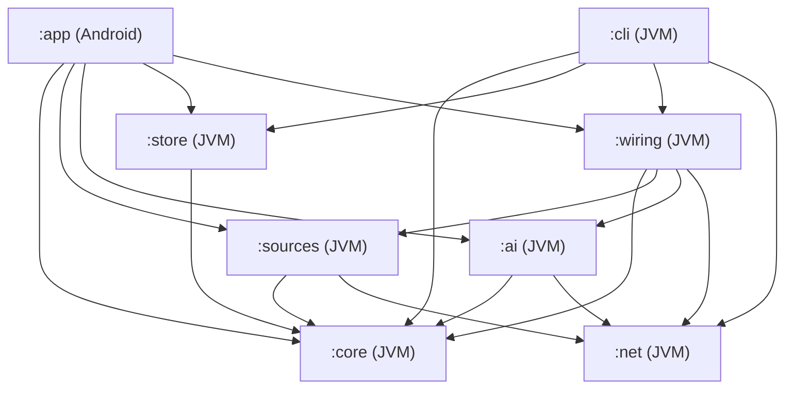

# Sleevesight architecture

**Status:** Proposal, for discussion  
**Date:** 2026-10-12  
**Builds on:** [design.md](design.md) and the [simulator](https://sleevesight.app/design/simulator.html)  
**Tracking:** [#3](https://github.com/wkusnierczyk/sleevesight/issues/3)

This document turns the design into a buildable structure: modules and their boundaries, the runtime data flow, the technology choices, how the structural constraints are enforced, testing and CI. It starts with a review of the design and the simulator, because several findings change the architecture. The decisions it needed are collected at the end, as made by the owner.

## Contents

- [Review of the design](#review-of-the-design)
- [Architectural drivers](#architectural-drivers)
- [Modules](#modules)
- [Runtime](#runtime)
- [Components](#components)
- [Cross-cutting concerns](#cross-cutting-concerns)
- [Technology choices](#technology-choices)
- [Testing](#testing)
- [CI](#ci)
- [Phase mapping](#phase-mapping)
- [Decisions](#decisions)

## Review of the design

The design is sound in its core idea: deterministic code decides what is true (resolution, matching, citation checks), and the model only narrates. The typed resolution outcomes, the separation of `none` from `source_off`, the scope on every evidence line, and the mechanical grounding check are what make the product trustworthy, and the architecture below is organized around keeping them in code the model never touches.

The findings below are the places where the design is incomplete or internally inconsistent, or where the implementation needs something the design does not yet specify.

### What the implementation can port from the simulator

The simulator is a prototype of the experience: it shows how the app behaves as if every part worked, and stands in for the parts that do not exist yet with frozen data. Some of its code is the app's real logic and ports directly; for the rest, the implementation starts from the design alone:

| Component | In the simulator | For the implementation |
|---|---|---|
| Normalizer | Real logic (`normalize`) | Port |
| Prompts, grounding check | Real logic (`promptInsight` and the others, `groundCheck`), live against Claude when run as a claude.ai artifact | Port; `promptGenre` not for a label only MusicBrainz gives, which opens no AI-written genre card content (D12, *Conditions*) |
| Debounce, cancellation | Real logic (`onMetadataChanged`, `runPipeline`) | Port, as coroutines |
| Caching rules | Real logic (`fetchSource` for retrieval; `write` and `writeJson`, keyed with `srcSig`, for insights and cards) | Port, with the synthesis key extended per R2 |
| Source adapters (Wikipedia, Last.fm, web search) | Stood in for: frozen snapshots behind simulated latency (`querySource`, `fetchSource` over `facts-data`) | Build |
| Entity resolution | Stood in for: each fixture record carries its outcome (`song_article`, `mismatch`, ...) | Build |
| MusicBrainz | Stood in for: shown as `blocked` | Build |
| Multi-artist resolution | Stood in for: the primary artist's data only | Build |
| Evidence extraction | Stood in for: fact lines written in advance, in `facts-data` | Build |
| Discogs | Not shown | Build (Phase 3) |

The components to build are the ones the design calls the hard ones, so the architecture puts them in plain Kotlin behind interfaces, where Phase 0.5 can iterate on them in a command-line tool, on the fixture playlist, before any Android code depends on them. The simulator's frozen data then serves Phase 0.5's tests (see [Testing](#testing)): its resolution outcomes as expected outcomes, and its fact lines as reference facts that extraction should find, though not word for word.

### Findings

| # | Finding | Effect on the architecture |
|---|---|---|
| R1 | **Nobody extracts the evidence lines.** The design says each line is "one claim, in the adapter's own words, never copied prose", but an adapter is deterministic code. It can template structured data (MusicBrainz, Wikidata, Last.fm counts and tags) but it cannot paraphrase a Wikipedia article or a web page. The simulator's lines were written in advance, standing in for this step. | Evidence extraction becomes an explicit stage with a stated method per source. See D1. |
| R2 | **The synthesis cache key can serve stale citations.** It is "lookup key, enabled-source set, provider and model". When the retrieval cache expires and refetches, evidence ids can point at different lines while the cached insight still cites the old ones. | The synthesis key includes a fingerprint of the evidence set. A cached insight is reused only for the exact evidence it was written from. |
| R3 | **The latency goal and the MusicBrainz rate limit conflict.** "Within a couple of seconds" against one request per second, with a recording search, a recording lookup and one lookup per credited artist before Wikipedia can be reached safely through Wikidata. A cold track with two artists is about four seconds of MusicBrainz alone. | Progressive rendering: player metadata immediately, each source's result as it lands, the insight last. Artist resolutions are cached long-term, so the cost falls on first encounters. A per-host rate limiter is part of the network layer. See D4. |
| R4 | **The privacy statement is narrower than the traffic.** Matching by duration ("duration tolerance") sends the duration if it goes into the MusicBrainz query, and every request reveals the phone's IP address to that service. | Duration filtering happens on the phone, after the search. The first-run text names the IP address. |
| R5 | **"User-driven changes write" needs a signal the session does not give.** A skip pressed inside Spotify and a track ending on its own both arrive as `onMetadataChanged`. Only Sleevesight's own transport buttons are known to be user actions. | Measured in Phase 0 (`design.md`, *Track changes*): the time left at the change, and for Spotify the playback states before it, under a *Crossfade* setting. See D5. |
| R6 | **Genre labels depend on one source with a user key.** Last.fm needs the user's own API key; with it missing or off, no track gets genres, and 30 of 78 tracks got none even with it. MusicBrainz has genre data per artist, release group and recording, keyless. | MusicBrainz tags are a genre label source from Phase 1.0, beside Last.fm (D12, revised 2026-10-15; [#84](https://github.com/wkusnierczyk/sleevesight/issues/84)), for labels only and never in prompts. At the Phase 0.5 gate they filled 3 of Last.fm's 30 gaps, and alone they labelled 29 of 78 tracks, so a user without a Last.fm key can still get labels (with MusicBrainz switched on, #84's proposed default). The label sources are a user setting; the choice is re-evaluated in Phase 2 ([#101](https://github.com/wkusnierczyk/sleevesight/issues/101)). The licence findings are in [MusicBrainz tags and genres](#musicbrainz-tags-and-genres-9). |
| R7 | **Background behaviour is unspecified.** The notification listener runs whenever access is granted, app open or not. The design does not say whether lookups run while nobody is looking. | Session history is recorded always, on the phone only. Retrieval and synthesis run only while the app is visible. See D6. |
| R8 | **Sideloaded installs may not easily grant notification access.** Since Android 13, "restricted settings" can block notification-listener access for apps installed from outside an app store, until the user unlocks it in the app's info screen. Android marks every file install restricted; on one Samsung (One UI 8.5, Android 16) the mark was set but not enforced (`design.md`, *Notification access and installation*, #29). | Onboarding detects the block and explains the unlock. With distribution through Google Play (D7), this affects only development installs and any channel outside Play. |
| R9 | **A local model through Ollama is served over plain HTTP by default**, which Android blocks, and an arbitrary LAN address cannot be allowlisted in a network security config. A home HTTPS proxy often uses a self-signed or private-CA certificate, which Android does not trust either. | How the app reaches Ollama, and which certificates it accepts; see D8. |
| R10 | **`simulator.html` carries the artifact runtime.** Line 1 is a `<script>` tag loading the claude.ai artifact frame runtime from `claudeusercontent.com`, with a signed URL, saved from the rendered page. Outside claude.ai `window.claude` is absent, so the README's GitHub Pages link would show the evidence-only fallback, never live synthesis; and Pages does not serve private repositories on a free plan. | Not architecture, but recorded here; a separate cleanup issue. |
| R11 | **`design.md` still said "License: open source (to be chosen)"**; it is GPL-3.0 since #2. | Fixed by #6, with the README. |

## Architectural drivers

In order of weight:

1. **The pipeline runs off the phone.** Phase 0.5 is a JVM command-line tool sharing the pipeline with the app. Everything from normalization to the grounding check is plain Kotlin with no Android dependency.
2. **The model never decides what is true.** Resolution, matching, evidence selection and citation checking are deterministic and unit-tested. The model gets a prompt and returns text; it has no tools.
3. **Constraints are structural.** No analytics, no extra permissions, no network access outside the adapter and provider layer. Each is a build failure, not a review comment.
4. **Failure is visible.** Every source returns a typed outcome; every stage logs to the diagnostics stream; nothing degrades to a blank.
5. **Cost is the user's.** Every model call spends the user's key, so calls are explicit, cached and cancellable.
6. **The user decides.** Where a runtime behaviour is a judgement call rather than a correctness rule (cache lifetimes, the crossfade of D5, what runs in the background), it is a user setting with a reasoned default, not a fixed developer choice. Correctness rules stay fixed: the grounding check, the network boundary, the resolution thresholds. Build-time choices such as `minSdk` are not settings. `:app` reads the settings from DataStore into a plain `Settings` type defined in `:core`, which also holds the defaults, so `:cli` shares them; `:core` and `:store` read it directly, and `:ai` uses it to configure its Ollama client in `:net`. `:app` never touches `:net`: the app's one `NetClient` is created in `:wiring` ([Modules](#modules), [Networking](#networking)).

## Modules



| Module | Kind | Contents | May depend on |
|---|---|---|---|
| `:core` | Kotlin JVM | Domain model; normalizer; resolution logic (scoring, matching, outcomes) over client interfaces; evidence model and ids; prompt builders; grounding check; genre vocabulary; the pipeline orchestration as coroutines and flows; the diagnostics event type | Kotlin stdlib, coroutines, kotlinx.serialization. **No network, no Android** |
| `:net` | Kotlin JVM | The one HTTP client: Ktor with the OkHttp engine, per-host rate limiting, the User-Agent, timeouts, retries, and a logger that redacts keys and tokens | Ktor, OkHttp |
| `:sources` | Kotlin JVM | One adapter per source (MusicBrainz, Wikipedia and Wikidata, Last.fm, Discogs, web search), each implementing the `:core` client interfaces and `SourceAdapter`, with its evidence extraction. Also the other outbound clients that are not sources: the Spotify Web API client (Phase 3) and an album-art fetcher for `http` art URIs | `:core`, `:net` |
| `:ai` | Kotlin JVM | `AiProvider` implementations: Anthropic, OpenAI, Google, Ollama. Streaming, model listing, error mapping | `:core`, `:net` |
| `:store` | Kotlin JVM | Retrieval cache, artist-level results cache, synthesis cache, artist-resolution cache, session history, track-change records (D15). SQLDelight schema and queries over an injected `SqlDriver`: `:cli` supplies the SQLite JDBC driver, `:app` the Android driver (an AAR, which a JVM module cannot depend on) | `:core`, SQLDelight runtime |
| `:wiring` | Kotlin JVM | The network side put together (#132): the one list of host policies, every adapter's and provider's, and the `NetConfig` built from it with the version the process passes in (the app its `versionName`, the CLI its own); for the app, the process's one `NetClient` made from that configuration, and the adapters, the resolver, the art fetch and the AI providers built on that client, handed out as `:core` types only (`SourceAdapter`, `TrackResolver`, `AiProvider`, and the art fetch as a function or a small `:core` interface, such as `suspend (String) -> ByteArray?`, which `AppGraph` adapts into its `HttpArt`). It makes no request of its own. A pipeline module (`sleevesight.pipeline`), so `checkNetworkReferences` and the [readiness rules](#multiplatform-readiness) cover it. `:cli` takes the whole of it, built on the client the CLI creates (`pipelineWiringOn`), so the CLI builds its adapters, resolver and provider with the app's constructors; it chooses its sources by its own mode and keys rather than through `adapters(...)`, and leaves out `musicBrainzLabels`; the app's entry point (`appPipelineWiring`) creates the app's client. Entry points that take a `:net` type are declarations of their own, never overloads of, supertypes of or members on what `:app` calls, so `:app` compiles against `:wiring` without `:net` | `:core`, `:sources`, `:ai`, `:net` |
| `:cli` | Kotlin JVM application | Phase 0.5: runs the pipeline over a playlist fixture; writes the coverage report and the insights; records HTTP responses for tests | `:core`, `:store`, `:wiring` (the `NetConfig`, and the adapters, the resolver and the provider built on the CLI's client), `:net` (to create the live `NetClient` from that configuration and replay or record through it, #45), SQLDelight JDBC driver |
| `:app` | Android application | Session layer (`NotificationListenerService`, `MediaSessionManager`); Compose UI; settings (DataStore); secrets (Keystore); the app graph (`AppGraph`), which takes the network side from `:wiring`; diagnostics screen | `:core`, `:store`, `:wiring`, SQLDelight Android driver |

The boundaries do the enforcing. `:core` cannot reach the network because it has no HTTP dependency; only `:sources` and `:ai` see `:net`, besides `:wiring` and `:cli`, which create the one client (the app's and the CLI's) but make no request of their own; and `:app` gets network results only through them, as `:core` types. The checks under [Structural constraints](#structural-constraints) make that a build failure rather than a convention.

`:wiring` exists because nothing else can create the app's client: `:app` may not name a `:net` type, and neither `:sources` nor `:ai` sees the other, so neither can build the client and hand it to both. That `:wiring` makes no request of its own and hands `:app` only `:core` types is held by review, which is why the module is kept small. And `:app` cannot name a `:net` type only while `:sources`, `:ai` and `:wiring` declare `:net` as `implementation`, never `api`: `checkModuleGraph` reads a module's direct dependencies, so `:net` arriving through an `api` dependency would pass it. A check closes this: the build fails when `:net` is on `:app`'s compile classpath at all, transitively (`compile-forbidden.app` in `module-graph.properties`, read against each variant's compile classpath and its unit tests' and instrumented tests'; `:net` stays on the runtime classpath, since the APK ships it). Two other ways were rejected. Letting `:app` depend on `:net` only to construct the client cannot be enforced, since the module graph checks which modules depend on which, not what a module does with one: `:app` could then send requests itself, and *network only through adapters and providers* would be a convention there. One client per module, built in `:sources` and in `:ai`, gives up the one client: one rate limiter per host would then rest on the two never sharing a host, which nothing checks, and the host policies would be listed in two places.

## Runtime

### Data flow

```mermaid
sequenceDiagram
  participant P as Player
  participant S as Session layer
  participant Pl as Pipeline
  participant Src as Source adapters
  participant AI as AI provider
  participant UI as UI
  P->>S: onMetadataChanged
  S->>UI: NowPlaying (immediately)
  S->>Pl: NowPlaying (debounced 650 ms, latest wins)
  Pl->>Pl: normalize
  Pl->>Src: look up by name, all sources in parallel (MusicBrainz resolves alongside)
  Src-->>Pl: typed outcome + evidence, per source as it lands
  Pl->>Pl: verify each match against the resolved ids (D4; web search: its filter only)
  Pl-->>UI: TrackState updates
  UI->>Pl: Write (tap, or the auto-write setting, D5)
  Pl->>AI: prompt (evidence only)
  AI-->>Pl: streamed text
  Pl->>Pl: grounding check
  Pl-->>UI: Written insight + check counts
```

### Concurrency

- The session layer exposes `StateFlow<NowPlaying?>` and `StateFlow<PlaybackInfo>`.
- The pipeline is `nowPlaying.filterNotNull().debounce(650.milliseconds).map(::normalize).distinctUntilChangedBy { runKey }.collectLatest { run(it) }`: normalization comes first, because what a run depends on is the `NormalizedTrack` (its lookup key, credited artists and work), plus the album (the `P` line) and the length (resolution chooses the recording by it); a change that alters none of them, such as new art or the same metadata sent again, is not run again, and one that alters any is (#44 review: `lookupKey` alone kept the previous track's release and artists). `collectLatest` cancels a superseded track's retrieval and synthesis, the coroutine version of the simulator's `AbortController` and `app.gen`. A `null` (no active session) is filtered out, so it neither cancels the current track's run nor clears its state; the UI reads `nowPlaying` directly to show the idle state.
- Sources run in parallel inside `run`, each in its own child coroutine, each publishing its result as soon as it lands.
- Detail insights (song, artist, album, genre, sounds-like) are separate on-demand jobs, scoped to the screen or box that asked, cancelled when it closes.
- Preparing the next track (D13) is a job of its own, for the next queue item, started once the playing track's run has ended its requests and cancelled when that item or the playing track changes. It shares no requests in flight: what it has obtained is kept by name or id (MusicBrainz's answers in memory, its genre labels in the artist-level cache), so a track that starts while it is being prepared repeats only what was not yet answered. See [Preparing the next track](#preparing-the-next-track).
- Playback state (play, pause, seek, progress) never enters the pipeline.

### State

The UI renders one immutable state per track:

```kotlin
data class TrackState(
    val nowPlaying: NowPlaying,
    val normalized: NormalizedTrack?,
    val sources: Map<SourceId, SourceState>,   // Pending | Done(outcome, evidence, latency, cached) | Failed(error)
    val evidence: EvidenceSet?,                // ids assigned, fingerprinted
    val genres: List<GenreLabel>,
    val similar: List<SimilarArtist>,
    val insight: InsightState,                 // Idle(canWrite) | Writing(partial) | Written(GroundedText) | NoEvidence | Failed(reason)
)
```

How the orchestration is made (#44, `Pipeline` in `:core`), where the sections above leave room:

- **Entry points.** `Pipeline.follow(changes: Flow<TrackChange?>)` is the app's loop, as under *Concurrency*; a `TrackChange` carries the session layer's verdict on why the track changed (`ChangeCause`: an action in Sleevesight, a skip in the player, or a natural end), which `AutoWrite` turns into D5's decision, together with whether the user has acted since the app started; in the app, a run reports the causes its settings write on (`AutoWrite.causes`), and the coordinator decides with the cause of the latest report. Skip detection itself stays in the session layer. `Pipeline.run(nowPlaying, write)` runs one track and returns its final state, for the CLI. `write()` is the tap on Write; `userActed()` the first action. `Settings` is read once per track.
- **State.** As above, plus `resolution` (MusicBrainz's, once made); `similar` waits for the sounds-like card (Phase 2), so it is not there yet. `SourceState.Done` holds the adapter's whole `SourceResult` and whether it came from the cache; `Failed` holds the exception's type only, for an adapter that threw (a bug: the network is `unreachable`). A switched-off source is `Done` with `source_off`. The evidence is assembled once every source has landed, and the genre labels with it; MusicBrainz's artists' labels and Last.fm's track's and album's join later, when their tags arrive (*Evidence*, below).
- **The cache first.** Each enabled adapter's result is looked up in the retrieval cache; resolution runs only when some source misses, so a fully cached track makes no lookup request; its genre labels may still ask (Last.fm's track and album tags, #439, and MusicBrainz's artist tags where the artist cache misses; *Genre labels*). The cache is an interface in `:core`, `PipelineCache`, which `:store` implements (`StorePipelineCache`, running the blocking database calls in an injected I/O context): `:core` cannot see `:store`. A failing cache is logged and treated as a miss.
- **What is not cached.** A result is kept only when the MusicBrainz resolution it may have been verified against was made: not when MusicBrainz was unreachable, and not when it is switched off, since either result would stay unverified once MusicBrainz is back or on. That costs a repeated web search when MusicBrainz is down; the rule does not ask which adapters awaited the resolution. Nor is a result its adapter marks provisional (`SourceResult.provisional`): one that a failed request of its own verification left unverified, such as Last.fm's search for other MusicBrainz artists of a name (*Last.fm verification*).
- **Evidence.** The player's release is the `P` line, worded as the simulator words it ("This recording is on the release "…"."), with no year: the session does not report one. The other lines are the enabled sources' evidence lines (the verified ones, and web search's kept ones), in the adapters' order, so the ids do not depend on the order the sources land in. Genre labels are never evidence; those of the label sources switched on are combined, a row per level (*Genre labels*). Last.fm's artists' come with its result (`SourceResult.genres`), and MusicBrainz's recording's with its own (`SourceResult.recordingTags`). Last.fm's track's and album's (#439) come later, asked for once the evidence is assembled, beside MusicBrainz's artists'. MusicBrainz's artists' ([#84](https://github.com/wkusnierczyk/sleevesight/issues/84)) come later: its result names the resolved artists (`SourceResult.labelArtists`, kept with it in the retrieval cache, so a cached track has them too), and once the evidence is assembled the run asks for their tags beside the insight (`TrackLabels`), so the insight does not wait for them, at one MusicBrainz request a second per artist; the labels join `TrackState.genres` when they arrive, and the run ends when both have.
- **The insight.** No AI call when the evidence has nothing to narrate (`EvidenceSet.nothingToNarrate`, #193): no evidence line, whatever the model-knowledge switch, or only the `P` line, which repeats the release the prompt's track block already gives, so the call would be paid for a `NO_EVIDENCE` or a restatement of the release. With model knowledge on, a `P`-only set gets a call once the report names the artists: the model may add its one `[AI]` sentence, which the user opted into. A report with no artists yet (some players send the title and album first) has nothing to narrate whatever the switch (#204): a call would write a card the model wrote without knowing the artist, and that card would stand when the artists arrive (the insight ledger, below), while a decision with no call leaves the track to be decided afresh under the report with the artists. With no call, the card shows the app's own text, as it does for a `NO_EVIDENCE` reply. A card is served from the synthesis cache when its full key matches (kind, the track's retrieval key, fingerprint, `InsightPrompt.VERSION`, the style's hash, provider, model, model-knowledge switch, reasoning effort); `CardKind` names the kinds by fixed keys. A reply is kept only when it ended normally, not when it was cut off at the token limit (shown, marked incomplete) or declined. The request carries the reasoning effort (below).
- **Diagnostics.** `PipelineEvent`s go to a `SharedFlow` that never suspends the pipeline: a slow collector loses the oldest of the last 256.
- **Reasoning effort**, a user setting per provider (`Settings.effort(provider)`, #227; driver 6): how much the model may reason before it writes, chosen from the provider's own scale (`EffortScale` in `Settings.EFFORT_SCALES`: the levels it offers, from the shared names of `ReasoningEffort`, and its default), or the provider's own default, and mapped by the provider to its control (Anthropic's `output_config.effort` and OpenAI's `reasoning.effort`: low, medium, high; Google's `thinkingConfig.thinkingLevel`: minimal, low, medium, high, #229; low by default for all three). Providers do not share one scale, so each is sent only its own levels. Claude Haiku 5.5 reasons by default at medium effort; an insight narrates a few lines and is waited for, and the grounding check, not the model's deliberation, keeps it honest, so low is the default. Thinking is not switched off: not every model allows it. The effort is sent only to models known to take it (`AnthropicProvider.takesEffort` and `OpenAiProvider.takesEffort`, lists kept with each provider, since the model lists carry no capabilities): older models answer it with an error, and get the request without it, as do OpenAI's Pro models, which take only their upper levels. OpenAI's models also name `none`, `minimal`, `xhigh` and `max`, which not every one takes; its scale offers the three every current reasoning model takes. Google's levels go to Gemini 3 and later (`GoogleProvider.takesThinkingLevel`); the 2.5 models take a token budget instead and get none, and a model that refuses `minimal` (Gemini 3.8 Flash, Gemini 4 Argon) gets `low` (`GoogleProvider.takesMinimal`). Low is Google's default rather than minimal, Gemini 3.5 Flash-Lite's own: it is the least level every current Gemini text model takes.

How the app runs it (#51, `PipelineCoordinator` and `PipelineHost` in `:app`), where the sections above leave room:

- **One owner.** `PipelineCoordinator` is a state machine that takes events one at a time, from one queue, and answers with effects; it is pure (no threads, no time), and `PipelineHost` carries the effects out and turns what happens into events. Its state is the whole picture: the activities started (and whether one is restarting after a configuration change), *Look up in the background*, the first action since the app started, with *Saver*, the count of track changes away and whether the first action expired (#203), the latest report and whether its debounce has passed, the run in progress and what it waits for, the insight ledger (below), the pipeline being built or live, and the next track to prepare (D13) with its preparation in progress and the track last prepared.
- **Only the owner grants steps.** A run of the shared `Pipeline` (`Pipeline.run(nowPlaying, control)`, the hook in `:core`: `RunControl`, with `RunStep`) asks before each step that sends requests or spends: its lookups (MusicBrainz's resolution and the adapters' own follow-up requests are part of them), MusicBrainz's genre labels, and the model call; and it asks whether to write without a tap once its evidence is in. The coordinator grants and decides from the whole state at once: the run current, requests allowed (D6), the mode, the first action, the track not already decided. A step reports its end from a `finally`, so a call cut off is an event like any other, never inferred from what the UI shows. After a model call that failed or was stopped, the run asks whether to call again (`RunControl.awaitRetry`) and waits for a tap; while a call is under way, it ends it as stopped when the user taps Stop (`RunControl.awaitStop`), unless the reply's end (done or failed) has already come, which is then the outcome, though the transport is still open: the stream is read until the transport closes it, as before, so the CLI's recorder keeps the reply. The CLI's `Pipeline.run(nowPlaying, write)` and `Pipeline.follow` use controls that grant at once, as before.
- **Nothing before the first run.** Until `FirstRunAcknowledgement.state` is true the host collects no report, setting or key, and the coordinator builds and starts nothing. The app graph reads the settings for the pipeline, the caches and the history's recorder and retention only after it (`afterAcknowledged`), so neither `cache.db` nor `history.db` is opened before it; the session layer has its own gate (*Session layer*), and reads only *Players* before it. *Font* is read before it too, for the theme (`AppGraph.font`, #377), since the first-run screen is drawn in it; it reads the settings file and `last_font`, writes `last_font` (`LastFont`, *Settings and secrets*), and sends nothing.
- **The debounce** is the host's timer, one per report (650 ms); only the latest report's settles, and it starts a run unless the run in progress holds it: the run is of its key (`RunKey`: the normalized track, album and length), or the report is of the insight track the ledger has written, and so is the run. An orphaned run (below) holds nothing, not even a report of its own key: a report of the run's key but another insight track (another player on the same release, or another media id or queue item with the same title, artists, album and length) is a track change as `TrackIdentity` judges it, so once it settles the run is orphaned and replaced, a call under way is cut off, and the new track decides afresh (D5): the card kept in the store is served if the old call had ended; else it is written again where the mode and the first action allow, and otherwise Write is offered. This is kept as it is (#255): the coordinator follows the session layer's identity rather than a rule of its own. #297 takes the queue slot out of identity for players that send no track id; the media id still decides when both reports send one, so another player on the same release, or another media id with the same metadata, stays a track change.
- **Currency.** A run is current while it holds the latest report, on the live pipeline, with no rebuild pending. A report the run does not hold makes it stale at once, before that report's debounce, which only delays starting the replacement; a report of its own key before then (a skip there and back) makes it current again. A stale run is granted nothing and decides nothing: it waits, and its replacement cancels it.
- **The same insight track** is `TrackIdentity.playsOn`: the session layer's identity (`TrackIdentity.same`) and the same title, the rule the session history uses for a track that plays on (`HistoryRecorder.sameAsLast` calls it). A new length (YouTube Music sends the playing track's length several times), album or artists is the same insight track; a stream's next song under one media id (a new title) is not.
- **The insight ledger** is one entry in the coordinator's state, for the current insight track: whether its insight is decided, whether it is written (a model call granted, on a tap or without one, a call that then fails, is stopped or is cut off included; or any cache hit, a reply kept as `NO_EVIDENCE` included), the report and `RunKey` it was written or shown under, and the latest report of the track, whose artists, album and length the header shows. Only a report of another insight track, once settled, replaces the entry; runs, rebuilds and new keys never make it unwritten. For the track the ledger has written, no run starts for a new key (the run holds the report, and its insight stays on screen), a run that does start (a rebuild's) starts under the ledger's key and report, so its card is found under its own key, and nothing is ever written for it without a tap. The ledger also holds the card paid for, with the evidence it cites, as the run reports it (`RunControl.cardWritten` when a call writes it, `cardShown` when the cache serves it; an event like any other, never read off what the view shows): a card written by a call (a rewrite included) always replaces it, one served from the cache only fills an empty slot, so the newest paid card survives a later cache hit of an older one; a call that fails, is stopped or is cut off adds none; it goes with the entry. A run in progress when a report of another insight track settles is orphaned: it holds no report, is never current again, and its reports to the ledger are ignored, so it cannot bring its track back even if that track's report returns; the return gets a run, and a decision, of its own. The view shows it whenever that track's run has no insight of its own: while it gathers, when it finds no card under a new card key (new evidence, another AI service), finds nothing, has no AI service, or its rewrite fails or is stopped. When the run offers Write (its card not found), Write is beside the card (`PipelineView.rewrite`): a tap is the user asking to rewrite it. If the ledger holds no card (its call failed, was stopped or was cut off), Write is offered alone. For a track decided but not written (nothing to narrate, no AI service, Write offered and not tapped), a new key starts a new run that decides afresh: the artists after a title-only report that had nothing to narrate (a title and album with no artists included, whatever the model-knowledge switch, #204) are written without a tap. So an insight written from a title alone stays when the artists arrive, under the new header: nothing is written twice for one track without a tap (D5), and a title-only report that found nothing is decided afresh. A rewrite runs under the ledger's report, not the latest one the header shows: it is a rebuild's run, which starts under the key the card was written under, so that the card is found when the rebuild changed nothing in it (both kept as they were, on revisiting them with #53). A track that returns after another has settled is a new decision (D5, as on `dev-1.0`): the card kept in the store is served when the return's key matches it; at another length, after the first action, it is written again.
- **Requests only while visible (D6).** Requests are allowed, once the first run is acknowledged, while an activity is started (counted, since a second instance is possible, and through a restart for a configuration change) or *Look up in the background* is on. A step granted runs to its end; nothing new is granted while requests are not allowed, so a run waits before its lookups, before the labels and before its model call or decision, and goes on when they are allowed again, if it is still current. A step can be asked for again once it has ended (a preparation's second try, #191), and is then granted again under the same rule; the host matches each request with a grant of its own (`PipelineHost`'s `StepHandle`), so a second request never passes on the first one's grant. So the visible track catches up, whether or not it is the track last run, and the tracks played meanwhile are never looked up. The session layer's `http` art waits on the same condition (`PipelineHost.lookupsAllowed`, `HttpArt.onlyWhen`); a track's art load is cancelled with its track, so on return only the current track's art is fetched.
- **The app opening** ([#190](https://github.com/wkusnierczyk/sleevesight/issues/190)). Only a cold start, the first activity start in a new process, is the app opening, and it begins without a first action (D5): the host makes one coordinator per process (`PipelineHost`, held by `AppGraph`, which the `Application` holds), whose state starts without it, and only its expiry clears it (#203, below). A return to the app from the background (the user switched to the player to skip, say), the screen turned off and on, or a configuration change keeps the first action made, so automatic writing goes on for someone who controls playback in the player. The first action lasts as long as the process, and while notification access is granted, `SleevesightListenerService` usually keeps the process alive after the app is left (Back, Home), often for days: until a reboot, an update of the app, or the system ending it (on some devices, a swipe from Recents). So a later launch into the same process is a return, and under *On track change (auto)* it can write without a new tap, unless the first action expired while the app was away (#203, below). Besides a tap on *Write insight* or *Rewrite insight*, choosing an automatic mode is the first action ([#625](https://github.com/wkusnierczyk/sleevesight/issues/625)): the host sends `ModeChosen` for each mode chosen, in the insight card's menu or in *Reactive*, the current one included (`PipelineHost.modeChosen`), and an automatic one makes the first action, so automatic writing starts with the next track. A mode chosen applies from the next track: the track playing then, decided or still looked up, is written only on a tap (`Report.tapOnly`); "the next track" is the next one the coordinator hears of after the choice, even if the session layer had already published it. A track that came to play before the first action is written only on a tap too, whenever its run decides. And since a run reads its settings when it starts, every decision is also checked against the mode now selected (`CoordinatorState.mode`), so a switch to *On track skip (auto)* never lets a run started under *On track change (auto)* write a track that followed by itself. That mode has one source once the user has chosen in this process: the latest choice (`ModeChosen`, numbered by the host), then, once that choice's save has ended, saved or not (`ModeChoiceSettled`), the narrower of the choice and what the store holds, so a save that failed never leaves it writing more than either the choice or the menu says; an unreadable store keeps the choice. The store's own emissions (`WritingModeChanged`) set it only before the first choice, at the start, so a late emission of an earlier choice's save can never widen it. What the rule keeps is narrower than before: no paid call just because the app was launched into a new process. A process the system ended while the app was in the background starts again without the first action, as any new process does. The decision whether to write is made when it is granted, so a run waiting through an absence is written on return if the first action stands, and the latest report's cause is one the mode writes on.
- **Automatic writing expires when unattended** ([#203](https://github.com/wkusnierczyk/sleevesight/issues/203)). Since the first action lasts as long as the process, one tap would otherwise keep automatic writing going for days: with *Look up in the background* on, a paid call for every track played whether anyone looks or not; with it off, a call for the track playing whenever the app comes back. So the first action expires when the app is left unattended for more track changes than *Saver* names (5 by default; 3 or 10; *Off* keeps it for the process). The host sends the setting as `PauseAutoWriteChanged`, as it does *Look up in the background*. The coordinator counts a track change, a report of another insight track than the report before (a new length or album of the playing track is none), while no activity is started or restarting after a configuration change; an activity start resets the count. That many changes away are written as usual; at the next, the first action, if made, expires (`acted` false, `expired` true), so that track's run, and every one after it, offers Write instead of writing: with the default, five tracks are written while away, and the sixth waits. A tap kept for the run asking again (#192) is dropped at the expiry, so a tap made before it never pays after it. An activity start resets the count, so a return after exactly that many changes keeps the first action; and since #625 it undoes an expiry too, making the first action again: opening Sleevesight resumes automatic writing. A track that came to play while the first action was expired (`Report.whilePaused`: set on a report of another insight track once the count has expired it, kept by a report of the same insight track, never on an action in Sleevesight) is still not written without a tap, whether its run decided while the app was away or decides after the return, so the track playing at a return after more changes is not paid for unasked, and offers Write. The first action made again (a tap on Write, a tap kept for a run that asks again, an action in Sleevesight, an automatic mode chosen) undoes the expiry and resets the count. A run that offers Write only because of the expiry, which would have written had the first action stood, is marked (`Run.lapsed`), and the view says so (`PipelineView.lapsed`), so the home screen says why Write is offered, also once the opening has resumed automatic writing. Likewise a run that offers Write only because its track followed the last one by itself, a cause the mode does not write on (*On track skip (auto)*), with the first action standing (`Run.followed`, `PipelineView.followed`, #625). Back online (#192), an expired first action means the run asking again offers Write: the grant's check needs the first action, and a decision for nothing to narrate made while it was expired leaves no `wouldWrite`. The ledger keeps why instead (`Ledger.paused`, the settings of a decision that offered Write, or found nothing to narrate, only because of the expiry, set as `wouldWrite` is, never deciding a write), so the run asking again says so too, but only under the same settings, with the latest report's cause still one they write on: after a change to *On demand* or *Show insights* off, the line is not shown.
- **Write on tap.** Write is offered for the current run's track only while it waits for a tap, with no rebuild pending (`CoordinatorState.offersWrite`); a tap then grants the model call and is the first action. A tap carries the key of the run Write was offered for (`PipelineView.writeKey`), and the host drops it unless the track it was shown beside is still the track the session layer shows (`PipelineHost.write`), read at the tap, before its report may have reached the coordinator; the coordinator then grants it only to the run of that key. A tap at any other moment, or for another run, does nothing, and is not counted.
- **Look again** ([#617](https://github.com/wkusnierczyk/sleevesight/issues/617)). On the card paid for, the split button's menu offers *Look again* while the coordinator does (`PipelineView.lookAgainKey`, `CoordinatorState.lookAgainKey`: the current run is of the ledger's written track, whose card cites evidence, its sources have landed, and no model call is under way). A tap (`PipelineHost.lookAgain`, dropped for a track the session layer no longer shows, as a Write's is) is `LookAgainTapped`: the current run is replaced by one of its key and report that looks every source up afresh (`StartRun`'s `lookAgain`, `Pipeline.run`'s `LookAgain`), carrying the evidence the card cites (`Run.lookAgain`, `CoordinatorState.LookingAgain`). It never writes and grants no call: nothing in it can. That run reads no retrieval cache, and runs marked `FreshLookups`, a coroutine context element under which the artist-level cache (`StoreArtistResults`) and MusicBrainz's answers in memory (`RememberedMusicBrainz`) read nothing; all three keep what it finds as for any lookup, under each source's lifetime and *Keep what sources said about each artist*, except that the retrieval cache keeps a fresh result only as it came: one shown with the earlier state, or with earlier lines carried, is not kept, so no partial result replaces a fuller entry, and lines carried keep their own lifetime. What is new is decided by what the lines say, not by the evidence's fingerprint, which keys the synthesis cache and stays as it is: a line is new when no line of the card's evidence says the same (`LineContent`: source, scope and text, lower case, quotes and dashes plain, every Unicode space one space; a line marked `EvidenceDraft.aggregate`, Last.fm's counts and lists, with its numbers masked and its list as a set), and a line missing never counts (`EvidenceSet.bringsNewSince`). It is a heuristic: a wrong "new" costs only an offer. Each source keeps its state from the run before (`LookAgain.before`, what that run gathered) unless its fresh lookup brought such a line, so one that failed, answered in part, was left provisional, or was judged against a resolution that could not be made keeps what it found then, and an unreachable resolution is that run's; one that brought a new line but lacks a kind of line it had keeps those lines beside the new ones: an artist's lines by the page they cite, so each credited artist's are its own, other lines by their scope. Last.fm's extraction version is 4 since its counts and lists were marked, so results kept before the mark are missed rather than compared. Once its evidence is assembled the run reports it (`RunControl.assembled`, `EvidenceAssembled`). With something new, a card for that evidence found in the synthesis cache is shown and replaces the ledger's; else the run's question is answered by offering *Rewrite insight* (`CoordinatorState.foundSomethingNew`, `PipelineView.somethingNew`), whose tap is a `WriteTapped` like any rewrite's, a paid call under every rule of a Write, written from the run's evidence. With nothing new, nothing is offered beyond what the run it replaced offered (*Rewrite insight* after a settings change), a card from the cache does not replace the one shown, and the view says "The sources found nothing new." (`PipelineView.nothingNew`), with the card paid for shown, not one the run found in the cache under the settings as they are now. A run that replaces it to ask its unreachable sources again (#192) is an ordinary run. The tap is recorded as the user's action for skip detection (`Acted`, D15), but it is not the first action (D5): it starts no automatic writing, since a written card can be shown from the cache before any action. The diagnostics log shows it as `fresh`, the sources asked afresh.
- **Write again, and Stop** ([#163](https://github.com/wkusnierczyk/sleevesight/issues/163)). A model call that fails (the AI service's error, a reply that ends early, the model declining) or is stopped leaves the ledger written, as every call granted does, so nothing writes the track again without a tap, a rebuild's run included: its run offers Write again (`RetryAsked`, sent after the call's end), and a tap on it, under the same rules as any tap, is a new paid call. Beside a card paid for, that Write is *Rewrite insight* (`PipelineView.rewrite`; the split button's leading half, #615, #625): offered only when a settings change (the AI service, its model, its effort, *AI service knowledge*, a source's key, the web engine) changed the card's key, so the card kept was written with earlier settings, and again after such a rewrite failed or was stopped. Stop is offered while the run in progress has a model call under way, current or not (a rebuild waits for the call), and carries that call (`CallId`: the run and the call's number, counted as the coordinator grants them; `PipelineView.stopCall`, `PipelineHost.stop`); the coordinator stops the call (`StopCall`) only if that very call is still under way, so a Stop shown for a call that failed never reaches the call a tap made after it. A Stop is never dropped for a track left meanwhile, since stopping spends nothing; it is not an action (the first action, D15). The call then ends as stopped: what the service generated before it may still be billed, nothing is kept, and the run offers Write again. A Stop that came before the request went out sends nothing, and the log shows no call; one that comes once the reply's end has come changes nothing. The host and the run number a run's model calls in the same order as the coordinator, so the Stop reaches its call alone. A run that fails while writing (a bug) has ended, and offers nothing.
- **The keys.** A pipeline is built from `AppPipelineParts`: `PipelineWiring.adapters` with the saved Last.fm and Exa keys and the web engines switched on, the resolver, MusicBrainz's labels, and the switched-on AI service's client with its key (none when no service is switched on, it has no client yet, or its key is missing or unreadable: the evidence is still shown). A key saved, replaced or removed (`SecretStore.changes`), a web engine switched, or another AI service switched on requests a rebuild. `SecretStore.changes` retries a failed read (the backoff starting again after a read that succeeds), so no pipeline is built until the keys' first read succeeds. Nothing else rebuilds it, since what an adapter keeps in memory is lost with it (Last.fm's verdicts outlive it only in the artist-level cache, when there is one); the other settings are read by the pipeline for each track. A keyed source (Last.fm, web search with an engine on) switched on without its key has no adapter, so no entry in `TrackState.sources`, and the host's state lists it under `needsKey`: it shows as needing its key, not as a failure.
- **A rebuild never spends twice.** While a rebuild is pending no run is current. The new pipeline goes live once it is built and no model call is under way, so what a call costs is not lost; the run in progress is then cancelled, and the latest report, if settled, runs on the new pipeline: for the ledger's written track, under the ledger's key and report, so a rebuild that changes nothing in the card's key shows the card kept, and one that does (new evidence, another AI service) keeps the card paid for on screen and offers Write beside it, never writing without a tap. A run of a key the ledger decided without writing it offers Write rather than writing unasked (a rebuild is not a track change, D5); one cut off before it decided is still decided once. A pipeline that cannot be built is reported, and none runs until the next rebuild.
- **Preparing the next track** (D13, [Preparing the next track](#preparing-the-next-track)). The host reports the next queue item as `NextChanged` (none while *Proactive*, once *Prepare the next track*, is off), and carries a preparation out as it does a run (`Pipeline.prepare`, with a control of its own that never writes), its steps asked for and ended through the same events, its end reported from a `finally` (`PreparationEnded`). The coordinator starts it and grants its steps only while requests are allowed and the current run has ended its requests (`CoordinatorState.prepares`: its labels step, asked for after its evidence and the last of its requests, has ended, or the run has), so it never stalls or displaces the playing track's run; it never grants it a model call.
- **Back online** ([#192](https://github.com/wkusnierczyk/sleevesight/issues/192)). The host reports the phone's connection as `NetworkChanged`: online while its default network has internet access that Android has validated (`ConnectivityManager.online`, through `registerDefaultNetworkCallback`, with `ACCESS_NETWORK_STATE`), so a network still connecting, or behind a captive portal, is not yet online. The coordinator counts the returns, from offline to online. Each run reports what its sources ended with once every one has landed (`RunControl.gathered`, `SourcesGathered`, before its evidence is assembled), and keeps the count of returns when its lookups were granted. When requests are allowed, the phone is online, the current run has no model call under way (what it costs is not lost; it is asked again once the call ends), some of its sources ended `unreachable`, and the network has come back since its lookups were granted, the run is replaced by a run of its key and report that asks again only those sources (`StartRun`'s `again`, `Pipeline.run(nowPlaying, control, again)`): the others keep what they found, a resolution made then is used again, and the diagnostics log says which sources are asked again (`AskedAgain`). So it is once per return: the run that asks again has its lookups granted after it, and one that finds its sources unreachable again waits for the next return. A return that comes while the lookups are under way is seen when they end. Only the playing track's run is asked again; a track left meanwhile is not, and a return while requests are not allowed waits until they are (D6). Its insight, for a key the ledger has decided, is written without a tap only when every one of these holds; else the run offers Write, never writing unasked. The key's first decision was made with no call because the evidence had nothing to narrate (`RunControl.nothingToNarrate`, `DecidedWithoutCall` carrying the run's `WriteSettings`), and the grant's own check would then have written had there been evidence: the latest report's cause among the causes its settings write on, the first action made, the key neither written nor decided before. The ledger keeps those settings (`Ledger.wouldWrite`). The run's settings still give the same causes and the same model-knowledge switch (`InsightAsked` carries both), so a mode changed or model knowledge turned on since decides nothing without a tap. A source unreachable when the key was decided has returned lines, not only a source switched on since; the ledger keeps those sources with the settings (`CoordinatorState.WouldWrite`, held in `Ledger.wouldWrite`), so this holds however many replacements came between, when the network flaps again before one decides. And the grant's check holds now. A later decision for the key never sets `wouldWrite`, so a rebuild's run after no AI service cannot: a run of the key asking again that again finds nothing to narrate keeps it, under the same settings, for the next return, and clears it under others; any other decision (a Decide, a tap, a card, a rebuild's run) replaces the entry without it, and so does a report of another insight track. So a track started offline under *On track change (auto)*, after the first action, is written once its sources answer; Write offered before, insights off, no AI service, a setting changed since, or nothing new found leave Write offered. One written is not written again without a tap (D5); its new evidence offers Write beside the card paid for, as a rebuild's run does. A tap shown for a run replaced, which offered Write, may reach the coordinator after the replacement started: it is kept until a replacement decides (`Run.keepsTap`, carried through further replacements when the network flaps again) and answers its question as a tap, one call, so it is never lost and never paid twice; a replacement served from the cache, deciding with no call, or ending drops it. A rebuild's run started after the return, which looks the track up afresh, is a rebuild's run as before. While the phone is offline the view says so (`PipelineView.offline`), and the home screen with it, for a track with a source unreachable. Not covered: a result its adapter marked provisional (a request of its own verification failed, often the network) is kept as it landed, neither verified again nor cached on return, until the track is looked up again; and a network Android never validates (Private DNS misconfigured, the connectivity check blocked) never counts as a return, so nothing is asked again and the offline notice stays beside an unreachable source. The connection is read with the callback registered first, and its first reading is sent only if no callback has come meanwhile (`FirstReading`), so a stale reading never hides a change.
- **What the UI reads.** `PipelineHost.state`, a `StateFlow<PipelineView>`: the live pipeline's `TrackState` (kept through a rebuild until the new pipeline publishes), with Write only while the coordinator offers it, the ledger's card for its written track in place of an insight its run lacks (beside the run's own source states, with the evidence it cites), and the header (artists, album, length) from the ledger's latest report; `rewrite`, whether Write is offered beside that card; `cardShown`, whether that card is shown, from the card lookup itself, so the *Sources* section says its lines are those the card cites whether or not Write is offered beside it; `rewriteFailed`, why the run's own insight failed when that card is shown in its place, so a rewrite that fails (or is stopped, `PipelineHost.STOPPED`) says so rather than quietly showing the card again; `retry`, whether Write is offered again beside an insight that failed or was stopped; `writeKey`, the key of the run Write is offered for, which a tap carries back; `stopCall`, the call Stop is offered for; `lapsed`, whether Write is offered only because automatic writing paused (#203); `followed`, whether only because the track followed the last one by itself (#625); `waiting`, whether automatic writing waits for the user, so the card does not say it writes automatically; `needsKey`; and `aiReady`; and `events`, the diagnostics stream across rebuilds (#54). The home screen (#52) renders these with the session layer's track, playback state and art, as published, and decides nothing: it shows the pipeline's track only while it is the track the session layer shows (`TrackIdentity.playsOn`), so a new track shows at once, its evidence to come, never with the last track's; and Write is a tap sent to the host (`PipelineHost.write`) with `writeKey` and the track it was shown beside, which the coordinator grants or ignores; Stop, shown while the insight is being written, a tap sent with `stopCall` (`PipelineHost.stop`).
- **Threads and failures.** The host runs on `Dispatchers.Default`, since the adapters parse their responses where they are called; the coordinator is touched by its loop alone. Every run's job reports its end (`RunEnded`, from a `finally`), so nothing in the coordinator waits for a run that is gone, whatever ended it. A run that fails (a bug: the stages map their failures to outcomes) is logged by its exception's type and ends, its insight shown as failed if it was being written; the next track runs.
- **The caches** are `cache.db` in the app's `databases/` (excluded from backup and transfer, as `history.db` is), through `StorePipelineCache` (and, for the adapters' artist-level results, `StoreArtistResults`, which the wiring is given) on the I/O dispatcher, over the Android SQLite driver; opened at its first query, which is the purge of expired entries after the first-run acknowledgement, or a lookup.

The rules, as `PipelineCoordinator` applies them (its KDoc has the same table). After every event, once acknowledged, come the grants: while a run is current and requests are allowed, it is granted each step it waits for, and its question whether to write is answered. For the insight track the ledger has written, the answer is never to write: the question comes only when a rebuild's run cannot find its card, and Write is offered beside the card paid for, to rewrite it on a tap. Else write when the latest report's cause (which the current run holds; a skip back to its track during the run included) is one *Reactive* writes on under the run's settings (`InsightAsked`'s causes: every cause under *On track change (auto)*, a skip in the player or an action in Sleevesight under *On track skip (auto)*, none under *On demand* or with *Show insights* off), the user has acted since the app started (a cold start; a return to the app keeps the first action) and that first action has not expired (#203), the track came to play after it and no mode was chosen while it played (#625, `Report.tapOnly`), the mode now selected writes on the cause too, and the ledger has not decided this key; else offer Write, marking the run lapsed when only the expiry kept it from writing, or followed when only its cause did (#625). The ledger then records the decision. A model call that fails or is stopped leaves the ledger written, so nothing writes the track again without a tap: its run offers Write again, and a tap is a new paid call. Then the next track's preparation (D13), while requests are allowed and the current run has ended its requests (every StartRun, a new length or album of the playing track's included, also cancels a preparation in progress, which starts again once the new run's requests are over): it is started for the next track unless there is none, it was prepared on the live pipeline already, or it is the track playing; else it is granted each step it waits for, never a model call, a Stop or Write again (they act on the run alone). The table gives each event's own effects; the grants and the preparation follow every row. "The run" is the run in progress; "an old run" is any other, cancelled or replaced. "The key" is a report's `RunKey`; the run "holds" a report of its key, and one of the ledger's written insight track when the run is of that track too.

Asking again (back online, #192) comes before the grants, after every event once acknowledged: when requests are allowed, the phone is online, the current run has no model call under way, some of its sources ended unreachable, and the network has come back since its lookups were granted, the run is cancelled and a run of its key and report started that asks again only those sources, keeping what the others found (CancelRun, CancelPreparation if one is in progress, StartRun with what the run gathered); for a key the ledger decided, it writes without a tap only when the key's first decision was made with no call for nothing to narrate and would have written had there been evidence, the run's settings still give the same causes and model-knowledge switch, a source unreachable when the key was decided has returned lines, and the grant's check holds now; else it offers Write. A tap shown for a run replaced, which offered Write, is kept through further replacements until one decides, and answers its question as a tap; a replacement that decides otherwise, or ends, drops it. The grants then record the count of returns with the lookups they grant.

| State | Event | New state | Effects |
|---|---|---|---|
| not acknowledged | anything but the events of the rows below, up to ModeChoiceSettled | unchanged | none |
| any | Acknowledged | acknowledged | none |
| any | ActivityStarted | one more started; none restarting; the first action kept (only a new process, with a new coordinator, starts without it); the count of track changes away reset (#203); a first action expired made again (#625) | none |
| any | ActivityStopped(configuration change?) | one fewer started; restarting when none is left and it was a configuration change | none |
| any | BackgroundChanged(on) | background on or off | none |
| any | PauseAutoWriteChanged(n) | the pause after n track changes away (none for *Off*) | none |
| any | ModeChosen(mode, choice) | the mode now selected; the latest choice; the latest report written only on a tap; the first action made, if automatic (#625) | none |
| any | ModeChoiceSettled(choice, stored) | of the latest choice, with the store read: the mode now selected = the narrower of it and stored; else unchanged (#625) | none |
| any | WritingModeChanged(mode) | the mode now selected, until the first choice in this process; then unchanged (#553, #625) | none |
| any | Reported(key, cause) | the latest report, with its cause; of another insight track, tap-only when the first action is not made after it (as below), while-paused when it is expired, and following when a report came before; of the same insight track, as the report before; never tap-only or while-paused for an action in Sleevesight (#625); the run current only if it holds it; the first action made if the cause is an action in Sleevesight; a preparation cancelled unless the report is of the insight track reported before | CancelPreparation (if one is cancelled), StartTimer |
| none visible (no activity started or restarting) | Reported(key, cause), of another insight track than the report before (or the first), not an action in Sleevesight | as above; one more track change away; past the pause's count (the change after that many), with the first action made: the first action expired (`acted` false), until the user acts again, and a tap kept for the run dropped (`keepsTap` and `tapped` cleared); with *Off*, never | as above |
| latest report is newer | Settled | unchanged | none |
| any | Settled, of another insight track than the ledger's | latest settled; the ledger emptied; then as below | as below |
| a run of another insight track in progress | Settled | latest settled; the run orphaned: it holds nothing, and its ledger reports are ignored; then as below | as below |
| any | Settled, of the ledger's insight track | latest settled; the ledger's header from it; then as below | as below |
| no live pipeline, or a rebuild pending | Settled | as above | none (the swap starts it) |
| the run holds the latest report | Settled | as above | none |
| otherwise | Settled | as above; a new run of it (under the ledger's key and report, for its written track); a preparation cancelled, the next track kept | CancelRun (old), CancelPreparation (if one is cancelled), StartRun |
| any | RebuildRequested | a new build pending; no run current; a preparation cancelled, and nothing prepared on the new pipeline yet | CancelPreparation (if one is cancelled), Build |
| build not the pending one | RebuildFinished | unchanged | none |
| the pending build, the run's model call under way | RebuildFinished | its outcome kept; waits for the call | none |
| the pending build, no model call under way | RebuildFinished | the new pipeline live (or none); the run cleared; the ledger kept | CancelRun (old), Swap, StartRun of the latest report if settled (under the ledger's key and report, for its written track) |
| the run, its model call under way | StepEnded(model call) | no call under way; then a pending swap, or a run of the latest report if settled and not held | as for RebuildFinished, or StartRun |
| the run | StepEnded(labels) | its requests over | none |
| the run | RunEnded | its call under way, its Write offered, the steps it waits for and its question cleared; its requests over; a kept tap dropped (`keepsTap` and `tapped` cleared); then as for StepEnded(model call) | as above |
| the run, current or not | StepRequested(step), InsightAsked(causes, model knowledge) | the step or the question waiting, with the causes its settings write on (granted once it is current and requests are allowed); for the ledger's written track, its card not found, the answer is to offer Write to rewrite it, never to write | none |
| current run asking again, not yet decided, a run it replaced (or one before) offering Write, no tap kept yet, requests allowed, of the tap's key | WriteTapped(key) | the tap kept: it answers the run's question as a tap (one call, the ledger written); the first action made | Acted |
| current run offering Write, requests allowed, of the tap's key | WriteTapped(key) | its model call (its next) under way; the ledger written, under the run's key (kept as it is when written already: a rewrite); the first action made; the latest report no longer tap-only or while-paused (#625) | Grant(model call), Acted (the time of the action kept, `UserActions`) |
| otherwise (a tap for another run's key included) | WriteTapped(key) | unchanged | none |
| the run, the tap's call under way | StopTapped(call) | unchanged (the call ends with its StepEnded; the ledger stays written, so nothing writes it again without a tap) | StopCall(call) |
| otherwise (no call under way, another run's call, or an earlier call of the run) | StopTapped(call) | unchanged | none |
| the run, current or not | RetryAsked (its call failed or was stopped) | Write offered again: a tap grants a new call, never the grants on their own; the ledger unchanged | none |
| the run, not orphaned | CardShown(card or none) | the ledger written, under the run's key, unless written already; the card only if the ledger has none; a kept tap dropped | none |
| the run, not orphaned | CardWritten(card) | the ledger's card replaced (the ledger written already, when the call was granted); a kept tap dropped | none |
| the run, orphaned (a report of another insight track settled while it ran) | CardShown, CardWritten, DecidedWithoutCall | unchanged | none |
| the run, not orphaned | DecidedWithoutCall(nothing to narrate?) | the ledger decided, not written, under the run's key, unless written already; with the run's settings as would-write only when it was for nothing to narrate, the key's first decision, by the current run, and the grant's check would have written; kept, under the same settings, by a run of the key asking again; else none; paused (#203) likewise, with the first action expired in place of made; a kept tap dropped | none |
| an old run | StepRequested, InsightAsked, StepEnded, RunEnded, CardShown, CardWritten, DecidedWithoutCall, RetryAsked | unchanged | none |
| any | NextChanged(next) | the next track; a preparation of another track cancelled | CancelPreparation (if one is cancelled) |
| the preparation | StepRequested(step) | the step waiting (granted once the preparation may run; a model call never) | none |
| the preparation | PreparationEnded | none in progress; its track prepared | none |
| an old preparation | StepRequested, PreparationEnded | unchanged | none |
| a preparation, current or old | StepEnded | unchanged | none |
| any | NetworkChanged(online) | online or not; one more return when it was offline and is now online | none |
| the run | SourcesGathered(gathered) | what its sources ended with kept | none |
| an old run | SourcesGathered | unchanged | none |

## Components

### Session layer (`:app`)

- `SleevesightListenerService : NotificationListenerService` is declared only to obtain the session permission; it ignores notifications themselves.
- `SessionRepository` registers `addOnActiveSessionsChangedListener` and a `MediaController.Callback` on the active session of each followed player, and maps metadata to `NowPlaying` (title, artists string, album, duration, package, media id when present, active queue item when published, art URI when sent); the art itself, a bitmap, is a separate flow beside it. Events from players not followed are dropped and logged as ignored. A call's session (`Settings.isCall`: the telecom and dialer packages; or `PlayerSession.marksCall`: audio usage `VOICE_COMMUNICATION`) is dropped before anything of it is read, followed or not. Every read of a registered session goes through its `CallGate`, which checks the mark just before and after the read; every report (metadata, playback state, queue, queue title) is admitted only while the session is not a call, a settle checks again as it runs (Android 16 reports no audio-info change for a local change of usage, so `onAudioInfoChanged` is not relied on), and a followed session found to be a call forgets everything it held (reports, the track, a pending settle, the states kept for skip detection) and shows nothing, so another followed player is shown; a probe reads no metadata while its session is a call or in the wait below (#435). The mark is honoured from when Android reports it. The first reads of a session go through the gate one getter at a time and stop at a call. A session seen as a call is ignored, and not shown, while Android marks it and for `SETTLE` after its first handling with the mark off (`afterCall`, shared by followed sessions and probes); then it is read afresh through the gate, its state and queue included, so a player that plays is shown at once. The entry goes when the session is read again, is destroyed, or leaves the list. The limit: an app you follow that also makes calls (not the phone app, which is never read) may show leftover caller details as a track for a moment after a call, and a call Sleevesight did not see (after a restart, or while notification access is off) is read like any player's once Android no longer marks it. A VoIP call in an ordinary media session is not recognised.
- Track identity, for skip detection and session history (Phase 0, `design.md` *Track changes*): the media id when the player sends one; else the active queue item where the player publishes one (an item of −1 is no item; when either side has no item, title and artists decide); else title and artists. A known limit: a song repeated right away (repeat-one, or the same song queued twice) is the same track, unless the player gives no media id but separate queue items, so it gets no new skip decision, no new entry in the session history, and no new lookup. A new length or new art for the same track is an update, not a change, and the time left is computed from the latest length. The pipeline's lookup key (normalized artist and title) is unaffected.
- Transport controls are offered only when `PlaybackState.actions` advertises them.
- Handoff: `sessionActivity` for the player's own screen; `spotify:` URIs when an id is known; `spotify:search:` otherwise, logged as a fallback.
- Process death: the service reconnects on rebind; the repository rebuilds from `getActiveSessions` on start.
- Queue: when a player publishes `getQueue()` and `getQueueTitle()`, the track list uses it; Spotify does (measured in Phase 0), as well as naming the playlist in its metadata. Spotify's Device Broadcast intents are not adopted: Phase 0 showed the session carries everything they do and more.
- Players that send only a title still run the pipeline; resolution is then mostly `none`, and how much of the UI to hide stays the design's open question on per-player behaviour.
- Session history (the default track list) is written to `:store` locally, whether or not the app is visible.

How the session layer is made (#48), where the points above leave room:

- **Nothing before the first run.** `SessionRepository` reads no session and registers no listener or callback until `FirstRunAcknowledgement.state` is true: notification access can be granted in Settings before the app is first opened, which binds the listener service at once. `SleevesightListenerService` only starts and stops the repository with its binding; on start the repository rebuilds its state from `getActiveSessions`. The system does not always bind the listener again after a force stop or an update (`NotificationListenerService.requestRebind` only undoes `requestUnbind`), and the session list needs the listener enabled, not bound, so `MainActivity` also calls the idempotent `start()` on every resume while access is granted, and `stop()` when it is not, since a repository it started is not stopped by the listener's unbinding; the repository's own gate still waits for the acknowledgement.
- **Seams.** The players to follow arrive as a `Flow<Set<String>>` of package names: in the app, `SettingsStore.followedPlayers` (#126), so a switch reaches the repository at once, and the repository reads no session until the settings' first read has arrived, so a player switched off is never followed in between. While the settings file cannot be read, the flow names no player (or nothing yet, before its first read), and the read is retried (see *Settings and secrets*); `Settings`' default (Spotify) when no flow is given. `http` art goes through `HttpArt`, which the app graph points at the art fetch `:wiring` builds on the process's one `NetClient` (`PipelineWiring.art`, over `:sources`' `ArtFetcher`; #51), and only while lookups are allowed (D6; *How the app runs it*). `PlayerSession` and `ActiveSessions` stand between the repository and `MediaController` and `MediaSessionManager`, so the tests drive sessions with plain values.
- **The player shown.** Every session of a followed player is followed (#595: Spotify playing to another device through Spotify Connect may keep a paused session beside the one that plays, and the system need not list the playing one first, nor send a new list when it starts); the one shown is the first followed session that is playing (or buffering, or seeking), else the first followed session, unless the session already shown is of that same player, which then stays (`SessionRepository.choose`). Each report of any of them publishes again. **A remote session's state** is read by its playback type, in one place, `SessionMapping.effectiveState`, which every reader of a followed session's state takes it from (the status shown, the bar, `choose`, skip detection's time left, the history and so the insights): a session of playback type remote (`MediaController.getPlaybackInfo().playbackType == PLAYBACK_TYPE_REMOTE`, read with each state and again on `onAudioInfoChanged`, since playback can move between the phone and another device while the session lasts) of Spotify (`SessionMapping.CONNECT_PLAYERS`) that reports `PAUSED` at a speed above 0 is read as `PLAYING` at that speed, its position extrapolated from the reported position, update time and speed. Other players' remote sessions are read as reported: only Spotify's was measured, and a cast session paused at speed 1 would otherwise show as playing. Skip detection under *Autodetect* has no late cluster to go by on Connect, so a natural end that crossfades in a car reads as a skip, under *On track skip (auto)* too, unless its time left is within the margin or matches the crossfade learned for Spotify, which is learned from the phone's own playback and may differ from the car's (D5's exception for a natural end without the cluster). The evidence (#595, a capture in a car of the system's log of each Spotify state and of `dumpsys media_session`): Spotify Connect publishes one session for the remote device, `volumeType=REMOTE`, whose state is always `PAUSED`; its speed is 1 while the car plays (the position moves on in real time between reports) and 0 while it is paused, and a new track arrives `PAUSED` at speed 1 near 0. On the phone's speaker Spotify reports `PLAYING`, `volumeType=LOCAL`. A local session is read as reported at any speed, since a local player's speed says nothing: in the same capture Audioteka reports `STOPPED` at speed 1 while it is stopped, and many players report `PAUSED` at speed 1. `RemoteSessionTest` replays the captured states. A known limit: with Spotify's app closed on the phone, Connect playback publishes no session, so nothing is shown until Spotify's app is opened on the phone. A state that says it plays at speed 0 moves on the home screen's bar at normal speed (`PlaybackInfo.displayPositionAt`; a guard, since the capture shows no such state); skip detection reads the position at the reported speed (`positionAt`), as Android defines it. Besides `nowPlaying` and `playback`, the repository publishes the shown player's queue, its art as a bitmap, and the players whose session has reported music (a title and an artist, `SessionMapping.reportsMusic`) since the process started, for *Players* (#435): a followed player's through its own callback; a player not followed, and not seen yet, through a probe callback on each of its sessions that reads only its metadata for that test (once as it registers, then as reported) and is removed once the player passes, or its session leaves the list or ends; a player seen has nothing more read. Its name and icon come from `PackageManager`, visible through the manifest's `<queries>` for launcher apps and for apps that offer a media browser service (`android.media.browse.MediaBrowserService`) or take media buttons (`MEDIA_BUTTON`), which almost every media app does, headless ones included (#535; not `QUERY_ALL_PACKAGES`). *Players* lists a stored player the phone shows the app, or one in `seenPlayers`, so a followed player that plays always has its switch; one neither shown nor seen is hidden and its entry kept, since not being shown is no proof of an uninstall (package visibility). An entry is deleted only when Android reports the package removed: `PlayerRemovedReceiver`, a manifest receiver of `PACKAGE_FULLY_REMOVED` (exempt from Android 8's limit on implicit broadcasts, sent after an uninstall and never for an update, and only for a package this app can see), calls `AppGraph.forgetRemovedPlayer`, which drops it from `seenPlayers` and from what `SeenPlayersRecorder` has recorded (so a reinstall in the same process is probed, seen and listed again, #579) and calls `SettingsStore.forgetPlayer`; a player listed by default keeps its entry. So a player removed through the receiver comes back switched off when reinstalled, and one removed unseen comes back with its stored switch.
- **Settling.** A session's metadata and playback state are coalesced before a track is mapped: each callback restarts a 300 ms window (`SessionRepository.SETTLE`, a constant, not a setting), capped at 1 s after the first callback of the burst (`MAX_SETTLE`, so a player reporting every 250 ms still settles), and when it passes one `NowPlaying` is mapped from the latest pair. A callback that names a new title or a new queue item may be the first half of a track change, so the cap never falls within 300 ms of one, and the first such callback of a burst restarts the burst's timing: the callbacks before it moved only the position (a seek bar scrubbed, then *next*). When that callback is a new title, a state up to 300 ms before it that fell back to the start of a track (to 1 s or less, from more than 2 s as reported) without naming a new item counts as the change's start: a new track's first state may name no new item (Castbox). A seek to mid-track is not such a state, nor one still at the start (Castbox reports `PLAYING` at 0 while it stalls). Two known costs of that rule (`SessionMapping.movedBack`), each rare and off the measured paths: a podcast player that resumes the next episode at a saved position (Castbox: `PAUSED` at 31m 18s, then at 10m on the same item, the new title 90 ms later) does not fall back to the start, so its change is timed at the title, with the new episode's state as the one before; and a restart then *previous* within 300 ms on a player that sends the title first (Spotify) is timed at the restart, with the state before the restart as the one before. A burst settles in any case within 3 s of its first callback (`LONGEST_BURST`), which nothing moves, so a player that changes its title every 250 ms still settles. With the pipeline's 650 ms debounce after it, a lookup starts at most about 1.7 s after a change unless the title or the item changes again in its last 300 ms, and at most about 3.7 s after the burst's first callback. A player that becomes the one shown because it started a new track is shown once its reports have settled, so the track it had before is never shown in between. YouTube Music and Castbox send a new track's first state just before its metadata, so the change is published once, with the new track's title and queue item. The playback state and the queue are published at once, every state: skip detection counts the `PLAYING` states in the 1.5 s before a change and reads the position they report (D5), which coalescing would lose; the new track's first state (position 0) therefore precedes the change in `playback`. So each change is also recorded as a `SessionChange` (`SessionRepository.lastChange`): when the first callback of the burst that settled into the new track arrived (`changedAt`), and the playback state just before that burst; on a switch to another player's track settled earlier, and for any change that began before the last one published, the time it was published and no state: `changedAt` never goes back, which the repository checks where it publishes a change. Stopping the session layer clears it. D5 measures the time left and the `PLAYING` states before a change from `changedAt`, not from the emission of `nowPlaying` (#53). A `SessionChange` also carries the track it left (`from`, whose latest length gives `timeLeft`) and every playback state the player reported in the 5 s before it, at most 32, equal ones included, which the `playback` flow would merge (`states`, #49); empty on a switch. For the session history, `playing` is the track shown while it plays, as of its settle: a new track's `PLAYING` state that arrives before its metadata never pairs with the track before. A state with no item (−1, YouTube Music while stopped in the background) keeps the last item the state named while the title is unchanged, so a stop and resume changes nothing. The queue's own titles are not compared with the metadata's: a queue may decorate them ("(Remastered)").
- **Identity** as above, with two refinements: equal queue items are one track whatever else is filled in (YouTube Music sends a title first and its artists a moment later), and without queue items a report without artists matches any artists. An item the state still names after the title has changed (a player that sends its new metadata well before its new state, or a stream that keeps one item while its songs change) is the previous track's: it counts as no item until the state names another (a state with no item, −1, names none), so the change is seen at the metadata, by title. That compares with the last track settled, not with the queue's titles.
- **Registration first.** A controller's callback is registered before its metadata, playback state and queue are first read, so a change in between is not lost; an active-sessions list that arrives after the listener was removed is ignored.
- **Art**, best first: the session's bitmap (`ALBUM_ART`, else `ART`), then the `content://` URIs, then the `http` ones, each tried in turn; a player that sends a bitmap never causes a request for its art. A bitmap compares by content, since Spotify sends the same art anew with each update. Art is reused only for the same track with the same sources: a track change clears it and loads again, even from the same URI, which a player may reuse for whatever plays; an update of the same track keeps it until the new art has loaded, and when that fails; an answer for a superseded track is dropped. `http` art is requested with `sensitiveUrl`, so `:net`'s log shows only its host: the address is the player's choice and may carry a token or name the track. Decoded art is scaled down by powers of two to at most 1024 pixels a side.
- **Skip detection** (D5, #53; *Writing insights automatically*). `SkipDetector` judges each change once, as the repository publishes it (`SessionRepository`'s `classify`, on the main thread, in the order the changes are published), from its features (`ChangeFeatures`: the player, `timeLeft`, the `PLAYING` states in the 1.5 s before `changedAt`), the user's *Crossfade* as read then, and the crossfade learned for the player; the verdict is the change's `cause`, with the `learnedCrossfade` that judged it. The rules are `SkipDetection`'s, a pure function, as D5 has them, with one reading made explicit: a time left at most 0.5 s counts as "within 0.5 s of 0" however far past the end (a change after the end cannot be a skip). No time left known (a switch to another player's track, a track with no length or position) is a natural end. `trackChanges` publishes each track with its cause, together with `nowPlaying` and `lastChange`, so a report never pairs with another track's cause. A cause belongs to the change it was judged for, and is carried only across the reports after it that each play on the one before (`TrackIdentity.playsOn`: a new length, album or artists); any break (another track, no track, a track after none, the session layer stopped) drops it, and a track with no judged change into it is a natural end (`CarriedCause`, explicit state set where the change is judged, never read back from `lastChange`): so a stream's next song under one media id, or a track resumed after none was shown, is a natural end, however it was reached before. The pipeline reads `trackChanges`. **The learned crossfade** (`CrossfadeLearning`, per player) learns only from natural ends the late cluster vouches for, with at most 15 s left, so it never feeds on its own judgements: the mean of two in a row that agree within 0.1 s, replaced when two later ones in a row agree on another. It lasts across restarts through the record of track changes: before the session layer reads any session (its gate waits for `SkipDetector.restored`, and for the settings' first read, so a fixed *Crossfade* is never judged as Autodetect), the detector relearns from the latest 200 changes recorded, oldest first, so no change of the running process is learned twice. So at each start it is relearned only from what is still recorded: changes older than *Keep history for* drop out then, though their deletion does not reset the running detector, and only from the changes after the last reset of the diagnostics screen (*Learning skip detection*). *Clear history* and that reset reset it at once (`SkipDetector.reset`), and a restore whose read a reset overtook applies nothing (a generation the reset advances). `SkipDetector.learned` (each player's crossfade) is what the diagnostics screen can show (#54).

### Normalizer (`:core`)

A port of the simulator's `normalize`, with the design's table and every fixture title as unit tests, and the deviations listed in `Normalizer`'s KDoc. One of them is the lookup key (#72): it keeps letters and digits in any script, and `+`, where the simulator kept ASCII letters and digits only, so non-Latin tracks shared a key (every Japanese, Cyrillic or Greek track keyed as `|`) and, as the cache key, would get one another's evidence. Accents are folded away only on Latin and Greek letters; elsewhere a combining mark stays with its letter (the breve of Cyrillic `й`, Japanese voicing marks, Indic vowel signs), so different words do not merge. Symbols and emoji are dropped in either plane (supplementary ones by block, which the portable character classes do not classify); variation selectors, tags and enclosing marks are dropped without separating the letters around them. A title, artist or work of symbols only, which would fold to nothing, keys as its own characters (without variation selectors, tags and enclosing marks), so `😀` and `😢` differ and `★` keys as `★` with a variation selector does. `Normalizer.foldForKey` applies the same folding to the other parts of a cache key; the test is by character class, not a `\p{L}` regex, which is not portable. Every fixture track keeps the simulator's key. Accent folding (Unicode NFKD) sits behind a small interface, since `java.text.Normalizer` is JVM-only (D2). Output: `NormalizedTrack(title, artists, primary, from, variant, notes, lookupKey)`.

### Entity resolution (`:core` logic, `:sources` clients)

`:core` holds the scoring and decisions; `:sources` provides `MusicBrainzClient` and `WikidataClient`. Per D4, resolution runs alongside the lookups by name rather than before them: each source's match is verified against the resolved ids when they land. A Wikipedia article can also be verified without MusicBrainz, through its own Wikidata item (step 5). Matches from the other sources stay unverified (shown, not cited) if MusicBrainz finds nothing. Web search is the exception: a web page has no id to verify against, so its results are kept or dropped by `RecordingFilter` alone, and the kept ones may be cited, whatever MusicBrainz finds.

1. **Recording.** Search MusicBrainz by normalized title and credited artists. Score candidates on title similarity, artist-credit overlap, and duration within a tolerance (computed locally, R4). Accept above a threshold, otherwise `none`; a near miss with a conflicting artist is `rejected(reason)`.
2. **First release.** From the accepted recording's releases, take the earliest release-group first-release date. The release the player reports stays separate (`P` evidence). Beside it, the releases of every recording the choice weighed (title and length fit, credited to the accepted artists), by their own titles, one per title and release group with its earliest date (`Resolution.releaseDates`, #556): the home screen finds the player's album among them for the year after it, and shows the first release apart when it is earlier (design, *Key data*). MusicBrainz's result keeps both in the retrieval cache, whose key does not hold the album.
3. **Artists.** Each credited artist resolved separately, to an MBID, cached long-term (the artist-resolution cache, which nothing reads yet: *Cache and history*).
4. **Cover detection.** The recording's work relationship and the work's earliest recording by a different artist give `original_song`.
5. **Wikipedia identity.** With a MusicBrainz match: MBID to Wikidata through the MusicBrainz URL relationship, then the English Wikipedia sitelink. For an article found by name: the article's own Wikidata item (its `wikibase_item`). Either way, the article is accepted only if Wikidata confirms it: instance of song, single or musical work, with a performer (P175) matching a credited artist; otherwise `rejected`. The performer is matched by its MusicBrainz artist ID (P434) when artist resolution has one, and by normalized name otherwise. This is the check that rejects the wrong Reem.

How steps 1 to 4 are made (#36), where the steps leave room:

- The search is by normalized title and primary artist, 100 results (MusicBrainz's maximum), since a much-recorded song has dozens of recordings by the same artist and the search may rank the original far down, differently from one request to the next (#78: at 50, Chuck Berry's 1956 "Roll Over Beethoven" was sometimes missing). A candidate is accepted when its title matches (case, accents, punctuation and apostrophes aside, `ResolutionThresholds.TITLE_SIMILARITY`), its length is within `DURATION_TOLERANCE` of the player's (a missing length on either side does not count against it), and it credits at least one of the track's artists: by name, or as a band one of them leads, in the usual forms (`X and His …`, `X and Her …`, `X & the …`, `X with …`, the leader's name whole; #77: the 1962 "Misirlou" is credited to Dick Dale and His Del-Tones, the player says Dick Dale). The wording alone is not enough ("Echo" is not Echo & the Bunnymen): the leader must appear on the recording, in a performer relationship of the band's matching recordings (its preferred three are fetched), and every id of a performer of that name found there is the artist's for the band's candidates, unless that recording also credits the same id by name: beside a credit to "Alex Smith", that Alex Smith's vocal does not show who leads "Alex Smith and His Orchestra", so a mixed credit is confirmed only by another of the band's recordings. A band's own MusicBrainz id is never its leader's; when the chosen recording names the leader neither in its credit nor in its relationships, the confirmed id stands. With the player's length, a candidate whose length is known and fits is preferred to any with no length, which may be a demo, a bootleg or a live take. Of the accepted, the earliest released is chosen, so a remaster's recording does not stand in for the original's. A title and length match with no credited artist in common is `rejected`; so is a credited name that the accepted candidates, after the length has narrowed them, give to more than one MusicBrainz artist. Every matching credit counts (two artists of one name on one recording collide), and a band credit counts as every leader of that name found on its recordings, or, with none found within the three tried, as an unknown artist, since the cap and MusicBrainz's many recordings without relationships prove nothing: a namesake's solo recording and the real leader's band, confirmed or not, or two bands led by different artists of that name, collide. A band alone, unconfirmed, credits no one and is a near miss. Only when no candidate whose title and length fit credits the track's artists by name or as a band does a credit under an honorific variant of the name count (#79: track 50's recording is credited to "Mr. A Balladeer", the player says "a balladeer"): a leading `Mr.`, `Mrs.`, `Ms.`, `Miss`, `Mister`, `Dr.`, `Doctor`, `Sir` or `Dame` on one name only, the rest the other name whole (a leading `the` aside, as for a credit by name) and at least two words as written (a hyphenated word is one, a word with no letters or digits none, a leading article counts), since an honorific before one word is usually a stage name of its own (`Dr. John` is not `John`, `Mr. T-Bone` not `T-Bone`); or one honorific spelled two ways on both names (`Dr.` and `Doctor`, `Mr.` and `Mister`), the rest one name, at any length (`Dr. Hook & the Medicine Show` and `Doctor Hook & the Medicine Show`). The variant credits then stand for the artists under the same rules, a variant two MusicBrainz artists share colliding; a variant never stands beside a credit by name, so a namesake under an honorific neither displaces nor collides with a recording by the artist's own name that fits title and length. The artist's MusicBrainz id is then the variant credit's, so an article found under the plain name is accepted only through that id's P434: track 50's "Mr. A Balladeer" has no Wikidata item, so the "A Balladeer" article found by name is not used and Wikipedia gives `none`, in the safe direction. Last, when neither a credit by name, a band's nor a variant fits, a joint credit counts (#661): the player names as one artist what MusicBrainz credits as several, two or more consecutive credits that, written with the join phrases between them, are the artist's name (Spotify's "Derya Yıldırım & Grup Şimşek" for the credits "Derya Yıldırım" and "Grup Şimşek" joined by " & "; each name as credited or as MusicBrainz names the artist, in any mix, `&` as `and` as everywhere). A joint credit is one identity, its run of artists: the earliest fitting recording is chosen, and one name that two different runs share collides, on one recording or on several. The artist gets no MusicBrainz id, not even from a performer relationship of the same name, since no one MusicBrainz artist is theirs; the run's artists count as theirs when the work's original is sought, and their tags give MusicBrainz's genre labels. Since the rule changes what a track resolves to, MusicBrainz's and Wikipedia's kept results (which Wikipedia checks against the resolution) were made at new extraction versions, so a track kept as a miss is looked up again; Last.fm's judgement uses only the artists' ids, which a joint credit leaves as they were, and the web search does not read the resolution.
- An artist is resolved from the accepted recording's credit, or from a performer relationship on it (a band's singer). It is never searched by name alone: without an accepted recording no artist gets an id, since a same-name collision would give the wrong one.
- A recording is a cover when MusicBrainz marks its performance of the work as one, or when the work has a recording by an artist not credited on it dated before every recording of the work by the credited artists, all of which must be dated: MusicBrainz leaves many recordings undated, and an undated one by the credited artists may be the original. The line names the work's earliest *dated* recording by another artist, as that ("The earliest dated recording of … on MusicBrainz is by …"), and only when it predates every dated recording by the credited artists; a cover whose earlier recordings are undated stays a cover with none named.

How step 5 is made (#37, `IdentityCheck`), where the step leaves room:

- *Song, single or musical work* is a fixed set of `P31` classes (`Wd.SONG_CLASSES`), matched directly, without following subclasses. A disambiguation page is rejected as one.
- A credited artist confirms a song as its performer (P175). With a MusicBrainz id the match is by P434 only, never by name, so a performer item with no P434 does not confirm a resolved artist. Without one, the name matches only a performer with no P434: a performer MusicBrainz knows is a resolved artist, and an unresolved namesake is not shown to be them (a "Wonderland" by another Reem). A writer (composer P86, lyricist P676) confirms a song found by name only when the item names no performer: the anthem *Ode to Newfoundland* has none, and the track credits its composer; with performers, the item's facts are theirs (a songwriter's song made famous by a singer). On the item MusicBrainz links, which is already tied to the recording, a credited writer does decide the scope when performers are named (below).
- A song by someone other than the credited artists is the *original song* when its performer is the original recording's artist (step 4). The item MusicBrainz links to the recording or its work (the work's own link, else its P435) is the original song when the recording is a cover, or when the item names performers, none of them a credited artist (MusicBrainz rarely dates enough to infer an unmarked cover), and the track's artists did not record the work first, and no credited artist is among its writers (P86, P676) either; it is the track's own song otherwise. *Recorded first* (owner, 2026-10-14: an earlier recording cannot be a cover of a later one): the track's artists' (those the player names, with the bands whose leader is confirmed as one of them; not a collaborator credited beside them, nor a band only worded like one of theirs) earliest recording of the work with a recording date is before every dated recording of it by anyone else, of which there must be one, and the recording is not a cover; undated recordings count for nothing either way. Release dates do not count here: MusicBrainz gives none for the others' recordings of a work, so one standing in for ours would favour ours (an unmarked cover released before the undated original's first dated rival would pass). It is the track's artists' earliest, not the accepted recording's own date, since MusicBrainz dates a session's other takes by recording date and may date the accepted one only by release (Chuck Berry's 1956 session takes, April, before the May single). MusicBrainz's cover mark still wins over it. Either test is for an artist's own song whose item lists only the later performers who made it famous again (#76: Chuck Berry's "Roll Over Beethoven", whose item names the Beatles and others as performers and him as writer); the writers' test also covers an author re-recording their own song later. An unmarked cover, performed and written by others, after an earlier dated recording by another artist, is still the original song. Its cost: a songwriter's own recording of a song first made famous by another is read as their own song, unless MusicBrainz marks it a cover or dates the other's recording earlier (step 4). Here an unresolved credited artist matches a performer or writer by name; a resolved one matches by MusicBrainz id, and by name only a person with no P434, so a name never overrides a conflicting MusicBrainz id.
- Found by name alone, a song by someone else is rejected, even when its title is the track's: a same-title song and a cover cannot be told apart without MusicBrainz (the fixture's Peleboy track "We In Here" is not DMX's song of that name). So the fixture's covers by acts MusicBrainz does not know, or knows without a work (tracks 45 and 48), are rejected rather than resolved to the original song; only MusicBrainz's cover detection (step 4) leads to one. Track 76's only article is a soundtrack album, not a song, and is rejected too. The gate (#46) may weigh a further signal for covers.
- An artist article is accepted only through the artist's MusicBrainz id (P434); without one, it is rejected, since a same-name article cannot be told apart.

The Wikipedia adapter (#38, `WikipediaSource`), where the design leaves room:

- By name, one request at once for the titles a song article would have (`Title (Artist song)`, `Title (song)`, `Title`, also in Wikipedia's casing and without a leading `The`) and each credited artist's name, following Wikipedia's redirects; no full-text search, whose results for small acts are noise. Then the items MusicBrainz links, then the articles found by name, each through the identity check; the first confirmed song wins. An artist's article is reached through its MusicBrainz id (P434), and one found by the artist's name is checked against it, so the wrong Reem is a rejection.
- Lines: from each confirmed article's lead, at most 3 sentences of at most 300 characters: the lead's first sentence, which defines the subject, and those that name it (the item's label, or the track's title for a song). Verbatim but for the punctuation the plain-text extract leaves where it drops a pronunciation; never cut inside a quotation (every straight `"` opens or closes one in turn, and a piece left with one open at the end of its paragraph is dropped; a straight `"` or a closing curly `”` directly after a digit (any Unicode number, `7½`) may be an inch mark, `a 7" single`, which would throw the pairing off, so a paragraph holding one is dropped whole: the cost, a known limit, is that such paragraphs are lost, quoted numeric titles such as `"1999"` among them); each linking its article (its title percent-encoded); then the item's Wikidata lines.
- A resolved artist's article does not depend on the track, so what it gave (its sentences and Wikidata lines, its rejection, or no Wikidata item with the id) is kept in the artist-level cache (*Cache and history*), by the MusicBrainz id and the name as credited (which a rejection's reason names), for the shorter of Wikipedia's and Wikidata's lifetimes: a second track by the same artist asks Wikidata and Wikipedia nothing about the artist. Its lines keep the time they were retrieved. An artist without an id is not kept: its article, found by name in the track's own lookup, is rejected for want of an id to confirm it. A part a lookup failed for is not kept.
- Rejected candidates go into `SourceResult.rejections`, each credited artist as its own subject. The song's candidates are alternatives for one subject, so theirs go in only when no song is confirmed: a confirmed `Sundown (Gordon Lightfoot song)` does not list the rejected disambiguation page `Sundown`.

Thresholds and tolerances are constants tuned in Phase 0.5 against the fixture's known cases. They decide whether a match is correct, so they stay fixed rather than becoming user settings (driver 6). The gate run (#46) left them unchanged and found a reason to raise the search size, since raised to 100 (#78); the evidence is in the design's *Phase 0.5*.

### Source adapters (`:sources`)

Wikidata's lines carry a source of their own, `WIKIDATA` with the tag `WD`, apart from Wikipedia's `W`: they are templated from structured data and cached for their own lifetime (D9). The user's one Wikipedia switch covers both. The player's metadata (`P`) and the model's own knowledge (`AI`) are pseudo-sources that retrieve nothing. The model's own knowledge was `M` until 0.1.8 (#668): replies kept from then cite `[M]`, which `citationId` reads as `AI` wherever a reply is read (the grounding check, the card's chips), so a kept card counts and shows as one written now; the insight prompt's version stayed, since writing every kept card afresh would buy nothing. No cache row or evidence id holds the model's tag: it has no lines.

`SourceAdapter` as in the design, with the input D4 needs: `lookup(track: NormalizedTrack, resolution: Deferred<Resolution>)`, so an adapter starts by name at once and awaits the resolved ids only to verify. It returns `SourceResult(outcome: Outcome, evidence: List<EvidenceDraft>, latency, unverified: List<EvidenceDraft>, rejections: List<Rejection>)`. Evidence extraction per source (D1):

| Source | Evidence lines |
|---|---|
| MusicBrainz | Templated from structured data: first release, writers, producers, performers, work and cover relationships |
| Wikidata | Templated: genre (not with *Show genres* off, #545), record label, notable awards, inception |
| Wikipedia | Selected sentences from the article's lead, verbatim, attributed (CC BY-SA 4.0), at most a fixed number per article, filtered to those that name the entity |
| Last.fm | Templated: listeners, tags (not with *Show genres* off, #545), similar artists. Bio: selected sentences, verbatim, attributed (CC BY-SA) |
| Discogs | Templated: personnel, labels, formats |
| Web search | One line per result: the provider's snippet, verbatim, with its URL. Exa first (D11): its highlight, whitespace collapsed and cut at a word boundary to at most 300 characters, the cut marked with `…`; at most five results, kept only when they name the title, the work it is from when the player gives one, and a credited artist (a distinctive one when there is one), and their own title does not name the artist without the song (`RecordingFilter`, shared by any later provider; design, *Web search provider (D11)*) |

A match that cannot be verified is shown, never cited (D4): `SourceResult` keeps its lines apart, in `unverified`, from the lines in `evidence` (verified ones, and web search's kept results, whose filter is their only check), which alone get ids and go to the model. The default of `unverified` is empty, so a line is cited only when an adapter puts it in `evidence`. A match that fails the check gives neither, and `rejected(reason)`; each rejected candidate is also kept in `rejections`, with what it was looked up for and why, also when another candidate gave lines (one credited artist of several), so *Sources* can show it. `Outcome` says what the source found, not whether it was verified, and has no unverified case: a result with lines only in `unverified` is the unverified one, whatever its outcome.

#### Last.fm verification

Last.fm describes artists, so each credited artist is looked up by name (`artist.getInfo` and `artist.getTopTags`, with `autocorrect=1`) and judged when the resolution lands, in this order:

1. Last.fm's artist and the resolved artist both have a MusicBrainz id: a different id rejects the match. The same id, even under a corrected name, verifies it whole only when the page is the artist's alone; when MusicBrainz shows or cannot rule out another artist of the name, it verifies the bio's sentences only (below).
2. Otherwise, a name Last.fm corrected (it differs from the credit beyond case, accents, spacing and punctuation) is rejected. Autocorrection is how a small act lands on an unrelated band's page: the fixture's track 61, `Jessiah`, which Last.fm answers with `Jesaiah`, a Swedish metalcore band. So track 61 is rejected without MusicBrainz, and also when resolution finds the real Jessiah, whose id differs.
3. Otherwise the match is unverified: the name is the same, and nothing confirms the artist. With no resolution (`Resolution.NONE`), every Last.fm match is unverified at best.

Last.fm keeps one page per name, so every artist of that name shares it: its listeners, tags and similar artists (the *aggregates*) mix them all, while its bio is written about one of them or says the name is shared. With the resolved artist's id on the page, the match is judged in this order (#75):

- **The bio says the name is shared:** it starts "There are several artists …", says several artists share the name, or enumerates them (a `1)` or `1.` at the start or after a space, a line break included, and a `2)` or `2.` after a space). The match is unverified and gives no bio sentence. This check costs no request and catches artists MusicBrainz does not know; it deliberately over-matches, since taking a shared page for one artist's is the unsafe failure (known limit: a single artist's bio with chart positions, "No. 1. … No. 2.", is taken as shared).
- **Otherwise MusicBrainz decides, from identifiers,** with one request: the first page of its artist search for the page's name (`MusicBrainzLookup.searchArtists`, 100 artists, on their own names, not aliases), compared by name key; a longer name that contains it ("Reem Kelani" for "Reem") does not count.
  - The page holds every match (MusicBrainz's `count` equals the artists returned: a count of the search index's, so the verdict is no stronger than the search), finds the resolved artist under the name and no other: the match is **verified**, aggregates included.
  - Another artist of the name is on the page, or the page cannot tell (it holds only part of the matches, or not the resolved artist under the name; or the name has no letters or digits, and is not searched): the match is **verified for its bio only** (`LastFmMatch.BioVerified`). Its bio sentences may be cited, under the usual rules for sentences; its aggregates are shown, never cited, and give genre labels as an unverified match's do. MusicBrainz does not rank exact names first (the ten artists named Fred, of 2,150 matches, ranked from 25th to 97th), so a namesake beyond the first page may exist; the page then proves nothing, which is this case.
  - The request fails, or its answer lacks the `count` or the artists, or gives a `count` below the artists it returns: the whole match is unverified, with no partial verification, and the result is *provisional* (`SourceResult.provisional`): shown, but not kept in the retrieval cache, so a later lookup may verify it.

The search's answers, all but failures, are kept by the name as sent (lowercased) and the MusicBrainz id, in the artist-level cache (*Cache and history*) for MusicBrainz's lifetime, so a restart does not search again (#114 item 4, #238); without that cache (the CLI without one, the tests), in memory for the most recent 1,024 pairs instead. What Last.fm answers for a credited artist's name (`artist.getInfo` and `artist.getTopTags`) is kept there too, by the name exactly as sent (Last.fm answers each spelling on its own: a name with an accent or without, `Björk` and `Bjork`, or with other punctuation, `AC/DC` and `AC DC`, may be different pages), for Last.fm's lifetime, and judged afresh against each track's resolution, so a second track by the same artist asks Last.fm nothing. The search delays Last.fm's whole result, by one MusicBrainz request at one a second for each credited artist whose page carries the resolved id, made only then, after the resolution, and taken from the slots of other MusicBrainz requests. The Last.fm adapter therefore consults MusicBrainz, and its `extractionVersion` is 2. It asks once rather than paging: on the fixture's artists no verdict needed a second page, and paging has failures of its own (a total that changes between pages, an empty or overlapping page).

**Remaining risk:** a shared page whose bio's wording escapes the check, written about another artist of the name, can still have its bio sentences cited for this one; only its aggregates are kept from the insight. **Cost:** on 2026-10-16, of the fixture's 70 credited artists, the 56 MusicBrainz has under that name included 15 with a namesake there (among them Paul Simon, Mick Jagger, Robert Palmer, Dick Dale and Them; the namesake may be a drummer or a package designer), whose pages would keep their bio sentences verified and lose their aggregates to unverified; the other 41 would be verified whole. Every verdict came from the first page: the two searches with more than 100 matches, "Them" (251) and "Fred" (2,150), had a namesake on it. A namesake known to MusicBrainz only by an alias, or under its name in another script, is not found. The rule was not measured against Last.fm's own shared pages, for want of a Last.fm key.

A bio sentence is quoted only whole: a summary's unterminated or ellipsized tail is dropped. Genre labels come from the top tags weighted at least 10 of 100 (a starting value; not tuned in #46, which ran without a Last.fm key, so still open), or from `artist.getInfo`'s five tags when the top tags do not arrive, and only for a match that may be shown (verified, verified for its bio, or unverified). The adapter's `lookupArtists` returns, besides the `SourceResult`, each credited artist's answer, judgement and labels, for the genre and similar-artist cards.

### Evidence (`:core`)

- `EvidenceLine` as in the design. Ids are the source tag plus a position, assigned after a deterministic sort, so the same retrieval gives the same ids. The sort is by source, in a fixed order (`EvidenceSet.SOURCE_ORDER`), keeping each source's own order; lines are numbered from 1 within each source, so a source's ids do not depend on the others. Each adapter therefore emits its lines in a deterministic order, the order of its response.
- `EvidenceSet.fingerprint` is a hash over the ordered (id, scope, text) triples. It is part of the synthesis cache key (R2). The hash function sits behind a small interface (D2). It is SHA-256, in lowercase hex, over each line in order: for the id, the scope's fixed key (`song`, `original_song`, ...) and the text, the field's UTF-8 byte length, `:`, and its UTF-8 bytes; then a newline. URL and retrieval time are left out, so a refetch that finds the same lines keeps the cached insight. A lone UTF-16 surrogate in a line's text becomes U+FFFD when the line is made, so the encoding is the same on every platform. Changing the encoding, the source order, a tag or a scope key changes every fingerprint; a golden test pins them.

### Synthesis and grounding (`:core`, `:ai`)

- Prompt builders in `:core`, ported from the simulator; the prompt contracts in the design's appendix are their specification.
- What the insight prompt is given of the evidence (#239, `PromptEvidence`, design *Synthesis*, *The insight stays on the track*): with `Settings.artistFactsOncePerSession` off (#407), the whole evidence, read per track like every setting, though the facts it cites are still recorded in `SessionFacts`; on, as by default, the track's evidence less artist-level lines, all of them for a track with `ENOUGH_OF_ITS_OWN` (4) lines of scope song, original song or web, else those another track's insight in the listening session cited, by source and text (`ArtistFact`; ids are per-track positions); in both, less the player's release line (`P`) when MusicBrainz's first-release line names the release the player reports as the album the song first came out on: the album read from that templated line's own slot, after its date and type (`MusicBrainzEvidence.firstReleaseAlbum`, so never the track's title or the artist credit), and the two names equal once folded as `ArtistFact` folds, the player's less its closing bracketed parts (`PromptEvidence.edition`, balanced), MusicBrainz's as it is (#424, `PromptEvidence.restatesRelease`, design *No restated release*). The lines kept keep their ids (`EvidenceSet.without`), so a card served from the cache, written in another session, cites ids the shown evidence has. A fresh reply is checked against the set sent, so a citation of a line left out is `unknown`, and the ids sent travel with the state (`InsightState.Writing.held`, `Written.held`), so its chip, while it streams and once checked, shows and reads as one of no line (`citeKind`); such a reply is not kept in the synthesis cache, so every kept card cites only lines its prompt held and is checked on replay against the whole set with the same result, and the track is written again, a paid call, when it next plays. A `NO_EVIDENCE` reply to a prompt that left lines out is not kept either, nor shown or reported as the track's outcome, and is asked again at once with the whole evidence, in the same step of the run; the writer remembers the fallback, so a Retry after that call failed or was stopped asks with the whole evidence too. The CLI's report counts both calls, reading each track's calls and tokens from its own run's events (`ArtistFacts.RunCalls`), the one place both its sections take them from. The fallback to the whole evidence is decided with model knowledge off, so `[AI]` never stands in for artist lines left out. What the session cited is `SessionFacts` in `PipelineParts`: in the app, `ListeningSessionFacts` over the history's latest session number (`SessionHistory.latestSessionNumber`), one for the process, so it outlives a rebuild of the parts, kept in memory and dropped when the number changes; each call reads the session under the same lock as the facts, so concurrent calls cannot apply their reads out of order, and a session read that fails counts as the last one read. The history's recorder writes a track's row as it starts, usually before its insight is asked for; one whose insight comes first counts in the session before it. A fact is kept with the tracks that cited it, so a Rewrite of a track is not denied its own facts. In the CLI, a run is one session. `PipelineEvent.ModelCall.leftOut` names the lines a call left out, for the diagnostics log and the CLI's report.
- `AiProvider` in `:core`, implementations in `:ai`:

  ```kotlin
  interface AiProvider {
      val id: ProviderId
      suspend fun models(key: Secret): ModelList                                   // Listed(models) | Failed(kind)
      fun stream(request: CompletionRequest, key: Secret): Flow<CompletionEvent>   // Delta | Done(usage, stopReason) | Error(kind, retryAfter)
  }
  ```

  Small clients over `:net` (server-sent events for Anthropic, OpenAI and Google; line-delimited JSON for Ollama) rather than vendor SDKs (D3): the three official SDKs would bring three dependency trees into the allowlist, each with its own HTTP stack outside `:net`, and they are JVM-only, against D2. The surface used is one streaming call and one model list. Anthropic answers a spend limit the user set on the organization or a workspace, once reached, with `400 invalid_request_error`, the type of a malformed request; its message tells it apart, and it is `BILLING` (#449). The organization's tier spend cap reached comes as `429 rate_limit_error`, the type of a rate limit, with no `retry-after`, and only the body's `error.details.error_code` (`enforced_spend_limit_reached`) tells it apart; so Anthropic's host policy too has `:net` pass a 429 on (`AnthropicProvider.HOST_POLICY`), the spend cap is `BILLING` at once, and a rate limit is sent once more, as OpenAI's is (#463).

  OpenAI's client (#228) uses the Responses API (`POST /v1/responses`, `stream: true`), with `store: false`, so the response is not kept on OpenAI's side for later retrieval, as the API otherwise does for at least 30 days. Its model list (`GET /v1/models`) holds every model the key may use, embeddings and speech models among them, so the client keeps the text models that stream from the Responses API, leaves out those whose shutdown date has passed, and lists those with no shutdown date first, newest first within each. OpenAI answers 429 both for a rate limit and for an account out of credit or over its spending limit, and only the body says which: its host's policy has `:net` pass a 429 on as a response, unretried (`HostPolicy.passOn429`), and the client reads it. An account out of credit is `BILLING` at once; a rate limit the client sends once more itself after its `Retry-After`, or the first backoff without one, when that is within `RetryPolicy.maxDelay` (the process's, `HostPolicies.RETRY`), else it is `RATE_LIMITED` with the wait. A request refused for its effort (a 400 naming `reasoning.effort` or `reasoning`) is sent once more without one. A prompt declined for a usage policy (`invalid_prompt` and the like, in an error response, an `error` event or a failed response) ends as a refusal.

  Google's is the Gemini API (`generativelanguage.googleapis.com`, `v1`, a key from Google AI Studio in `x-goog-api-key`): `streamGenerateContent` with `alt=sse`, and `models.list` kept to the models that take `generateContent` and write text (not the image, speech or live models, by their ids) (#229). Not its Interactions API, which Google recommends for new projects but which stores each exchange unless `store=false` is sent, while `generateContent` keeps nothing and stays fully supported, though Google calls it legacy (a move may come later); and not Vertex AI, which needs a Google Cloud project's OAuth or service account rather than a key the user pastes. Google, too, answers `429 RESOURCE_EXHAUSTED` both for a rate limit and for a daily quota (the free tier's requests per day), and only the body's `QuotaFailure` says which, so its host's policy also has `:net` pass a 429 on (`GoogleProvider.HOST_POLICY`): a quota that resets after a day or a month is `QUOTA_EXHAUSTED` at once, and a monthly spending cap reached (its message, with no `details`) `BILLING`; a rate limit is sent once more after its `RetryInfo.retryDelay` (else `Retry-After`, else the first backoff) when that is within `RetryPolicy.maxDelay`, else it is `RATE_LIMITED` with the wait.

  **The selected model checked** (#540). The model a user chose, or the default they never changed (`Settings.DEFAULT_MODELS`), can be retired by its service, or be listed and still refused for the account, and would then fail every insight. `ModelCheck` (`:app`) keeps at most one mark per service, with its reason. `LISTED_ABSENT`: the service's model list for the saved key does not hold the model; it asks once lookups are allowed at start (D6), and again when the service switched on, its model or a saved key changes (not while *Show insights* is off), and the model choice's own list tells it too; a later list that holds the model lifts it. `REFUSED`: a call through the pipeline's client ends `MODEL_NOT_FOUND` or `MODEL_REFUSED` (`ModelCheck.watching`); since OpenAI and Google list models they refuse, no list lifts it, only a later call with the model that succeeds. Either is dropped when the service's selected model changes, another service is switched on, or another key is saved. The selection, the keys' fingerprints (a SHA-256 of each key, in memory only) and the marks are kept by one loop, a coroutine taking one event at a time from a channel (`ModelMarks`), and nothing else changes them, so each rule reads and writes them with nothing in between. The keys are read outside it and handed to it in the order the reads were issued, so a read that took longer than a later one counts for nothing, and a read that finds no key while one may still be stored (`SecretStore.isStored`: the entry is there though it does not open, or the file cannot be read) is ignored and drops no mark: only a confirmed absence does. Each answer, a list or a call, comes with the key and the model it was made with and its service's key and selection revisions as its request was issued (a `Ticket`), and counts only if none of them has moved on: a refusal made with a key since replaced, arriving after the new key's list, or a `MODEL_NOT_FOUND` for a model since left, is ignored, whatever order the coroutines run in. Once the loop has ended (its scope cancelled), a ticket comes at once and nothing counts under it, so no call or list waits on it. A list that cannot be had says nothing of the model. While the switched-on service's model is unavailable, the pipeline is rebuilt without its AI access (`AppPipelineParts`), so no insight is written with it or with any other model in its place, and the settings and Home say so, until another model or service is chosen. What each list says per key, and so what the model choice offers: Anthropic's (`GET /v1/models`, per workspace) gives each model's `lifecycle`, and a `deprecated` model still answers for an organization that already uses it but is closed to new adopters, so it counts as listed and is not offered for a new choice (`ModelInfo.offered`; the default too, unless it is the model selected), and a `retired` one is left out; OpenAI's is per project (a project's model allowlist narrows it), with `shutdown_date`, past which a model is left out, but it does not say which models need the organization verified to stream them, which a call answers with a 400 naming `stream`, read as `MODEL_REFUSED`; Google's is the same for every key, whatever its tier, and a model the free tier gives no quota answers `429 RESOURCE_EXHAUSTED` with a limit of 0, also `MODEL_REFUSED`. Narrowing those last two before the list is shown would take a call per model listed (a streaming request with one token of output, for OpenAI about 30 text models, for Google about 20), billed on the user's key at every opening, so it is not done: a refused model is caught on its first call instead, and the next choice is made from the list again. A scheduled workflow (`default-models.yml`) runs each provider's live test with a spend-limited key stored as a repository secret: the default model listed (for Anthropic, not deprecated) and one short request answered, else it fails, so a default is updated before users meet it; a provider whose secret is absent is skipped with a notice.
- JSON cards (genre, sounds-like) parse with kotlinx.serialization; a parse failure is a visible error, not a retry loop.
- The grounding check is a port of the simulator's `groundCheck` and `splitSentences`, with tests from the fixtures. It deviates in four places, (1) and (4) from the gate run (#46): (1) an abbreviation (`U.S.`, a middle initial, `Dr.`, `feat.`, and since #574 `e.g.` and `i.e.`) directly followed by whitespace does not end a sentence, unless initials come before a word that usually opens one (`It`, `The`), so a sentence that ends in initials before another word, or in `Dr.`, `feat.`, `e.g.` or `i.e.`, is joined to the next, and can hide it if uncited (`etc.`, which ends sentences as often as not, still ends one before a capital, as in the simulator); the abbreviation rule reads the next word through emphasis marks (`e.g. *Thriller*`, `the U.S. *Billboard*`); (2) a stop followed by closing quotes (`."`, `?'`, typographic too) and then citations ends a sentence (`... the title track "Sundown." [MB1] It ...`; #423), where the simulator joined it to the next; with no citation after the quotes it ends nothing, as in the simulator, since a title ending in a stop sits mid-sentence (`On "Help!" Lennon sang`, `"DAMN." (2017) won`), so an uncited sentence that ends in a quoted stop is joined to the next and can hide behind its citation, and closing emphasis marks (`*`, `_`) count as closing quotes there (`... the album *Sundown.* [MB1] It ...`; #574); (3) a sentence may open with Markdown, which the prompt forbids and a model sometimes writes anyway (#555), the mark being part of the sentence it opens (#574): after a stop and a line break, a list's marker (`-`, `*`, `+`, `1.`, `1)`), a heading's `#`s or a quotation's `>` before a space opens one whatever follows it, even after an abbreviation, and after a stop anywhere, an opening run of `*` or `_` before a capital, a quote or `(` opens one as that character would (`... [W1] *Abbey Road* was ...`); a list's number at a line's start ends no sentence. The simulator joined such a sentence to the one before, so an uncited list item, or a sentence opening with an italic title, passed under the citation before it. A list item or heading with no stop of its own is still joined to what follows, since a line break alone ends nothing. Each sentence keeps whether a line break came before it (`CheckedSentence.afterLineBreak`), and the card starts it on a new line, so a list's items and a heading keep their lines once checked rather than run on as prose; (4) insight prompt version 2's fixed sentence for a gap, `Little else is documented.` (`GroundingCheck.GAP_SENTENCE`), is a hedge, and stays one after version 3 stopped asking for it (#193), so a version 2 reply reads as it did; other wordings of a gap are hedges only as the simulator's patterns allow. Its hedge detection is English-only, as the prompts are.
- Before it splits a reply, the grounding check takes out a correction the model made of it in the open (#597, `SelfCorrection`; design *Synthesis*, *A reply that corrects itself shows its last version*): a line before a revision of the draft (the text after it cites at least one line, and only lines the text before it cited, and its first sentence restates the text before it, at least three quarters of its words being that text's), holding whole sentences, in no quotation or emphasis and citing nothing, its quotations (double or single, apostrophes aside) unread, that opens as only an aside does (`Wait,`, `Oops,`) and speaks of the reply's making, or opens as an aside may (`Actually`, `Let me`, `I'll`) and withdraws a part of the reply in the first person (`I'll drop it`), or ends in a sentence that only introduces a corrected version (`Here is the corrected insight:`), and everything before it. `GroundedText.text` and its sentences are the version kept, and `GroundedText.withdrawn` holds what was taken out, for the diagnostics event (`PipelineEvent.Grounded.selfCorrected`), *Show grounding details*, the tester's report and the CLI's report. The cache keeps the reply as written; the check takes the correction out again on every read.
- Each prompt is a fixed contract plus the user's style; see [Prompt style](#prompt-style).
- Prompt injection and tampering: web snippets and article sentences are untrusted text inside the prompt, and on an unencrypted link to a local model the prompt and the reply can be altered in transit (D8). The model has no tools, so the most either can do is distort the text of the cards it reaches: one card for an injected instruction, every reply for someone tampering with an unencrypted link. The grounding check flags uncited sentences and citations to missing evidence, but it cannot tell whether a cited line supports its sentence, so a plausible false sentence with a valid citation passes. Evidence is fenced and labelled as data in the prompt.
- Model prose is rendered as plain text, never as HTML, markdown or links; its only interactive elements are the citation chips, which the app builds from the evidence ids it assigned. Markdown the model writes anyway, against the contract, is cleaned before it is shown (#555, `ShownRun`): a title in `*…*` or `_…_` is set in italics and `**…**` or `__…__` in bold, and a heading's `#`, a list's marker, a quotation's `>`, a rule, code's backticks and a link's brackets and address are taken out, leaving their text. A `*` or `_` that pairs with nothing, has a space on both sides (`5 * 3`), or sits inside a word, a letter or digit on both sides (`snake_case`, `M*A*S*H`, `F**k`), stays, and so does a mark after a backslash (`\*`), shown without it (a backslash before a citation is dropped, the citation kept). What is inside code, backslashes included, and a web address written out (`https://…`, `www.…`) are shown as written, so an address's `_` or `*` is no emphasis. A link's address must read as one (a scheme, a dot or a slash), so `[Live](1999)` stays as written. A sentence that is only Markdown (a rule on its own) shows as nothing, is not read out, and is not counted in the note under the insight. Only the display changes: the grounding check reads the reply as written, so its sentences and their citations are the raw text's, as are the cache's and a report's, and a card kept from before shows cleaned too. The citations are read first and are never Markdown. A screen reader hears each chip by what it points at (a source's line, the model's own knowledge, a line that does not exist), and each line a paragraph's chips scroll to is also an accessibility action of that paragraph, up to 16 (Compose throws at 32 custom actions on one node), the rest reached under *Sources*, which lists every line. An uncited sentence is said to be so before its closing punctuation, where a citation would be ("It is great (not cited)."). The genre and sounds-like cards' suggestions (`more`, `start`) are parsed from the JSON fields and become actions the app builds, each used only as a percent-encoded search query in the player (`spotify:search:`), never as a URL.

### Prompt style

The user shapes how insights are written, within limits the grounding check depends on (D14). Each prompt has two parts:

- **Contract**, fixed: the evidence format and ids, the citation rule, no names, dates, places or numbers outside the evidence, the scope rules, `NO_EVIDENCE`, plain text without markdown, and for the genre and sounds-like cards their JSON structure. It comes after the style, under a heading saying it holds whatever the style says, so a style adds preferences but cannot override it (stated before the style as well until prompt version 5, #399).
- **Style**, a user setting: length, tone, focus, audience, and free text.

The setting:

- **A default style** for all cards, chosen from **presets** (for example Brief, Detailed, Liner-notes) or written as free text, with a reset.
- **Overrides per card** (the home insight; the song, artist and album insights; the genre card; the sounds-like card) under *Advanced*, each starting from the default style.
- Each card keeps its own built-in length, and a style makes it shorter or longer relative to that.
- For the genre and sounds-like cards, the style shapes the tone and length of the text fields only.
- The synthesis cache key includes a hash of the style the card actually used, so a changed style writes afresh rather than serving text in the old one.
- The output language is a separate question: the grounding check's hedge detection is English-only.

Free text is the user's own input to their own prompt, so it is not untrusted in the sense web snippets are; a style that asks for uncited claims still meets the contract after it and then the grounding check.

### Genre labels (`:core`)

The simulator's vocabulary and hues (the hues kept for the genre cards; the labels are drawn plain, #439), moved to a data file in `:core` (`sleevesight/genre-vocabulary.json` among its resources, read through `ResourceReader`), applied to the tags of the label sources the user switched on: Last.fm's, and from Phase 1.0 MusicBrainz's ([#84](https://github.com/wkusnierczyk/sleevesight/issues/84); D12, R6; licence: [MusicBrainz tags and genres](#musicbrainz-tags-and-genres-9)). A label source gives labels only while its source is on under *Sources*, since the tags come with its lookup (`Settings.givesLabels`). As the simulator: tags lowercased and trimmed, kept if in the vocabulary, once each, at most five, in the source's order; two tags that differ only in punctuation or spacing (`hip-hop`, `hip hop`) give one label. Labels are the tag in title case unless the file overrides one (`UK Garage`).

Labels have a level (#439, `GenreLevel`): the track's, an artist's or the album's, since an artist's tags describe a career rather than the track playing. A track's genres (`TrackGenres`, built by `combineGenres`) are a row per level that has labels, in the order the header names them: the track's, each credited artist's in credit order (the label naming its artist, `GenreLabel.artist`), the album's; a row with no labels is left out, and a genre found on several levels is on each of their rows. Folded, the home screen shows the most specific level's (`TrackGenres.folded`): the track's, else the album's, else the artists' together, each genre once, at most five. Where the levels come from: the track's from Last.fm's `track.getTopTags` and MusicBrainz's recording tags; the artists' from Last.fm's `artist.getTopTags` and MusicBrainz's artist tags; the album's from Last.fm's `album.getTopTags`. MusicBrainz's release tags would take a request of their own, so it gives no album labels.

How two sources' labels combine on a row (#84, `combineLabels`): Last.fm's first, then MusicBrainz's, each in its source's order, at most five a row; a label both give (the same genre, `hip-hop` and `hip hop` alike) is shown once and credits both, also when the five are already Last.fm's. Last.fm's come first because its top tags are weighed over many listeners' tagging and a label only MusicBrainz gives opens no genre card, so the cap keeps Last.fm's; MusicBrainz's fill the room left. Each label keeps the page whose tags gave it, per source (`LabelCredit`): the track's, artist's or album's page on Last.fm, or MusicBrainz's recording or artist page, with the credit "MusicBrainz contributors, CC BY-NC-SA 3.0" and the licence link (`LabelSource`); `TrackLabel.opensCard` is false for a label only MusicBrainz gives, and for the track's and the album's: which labels open a genre card is unchanged by the levels, unless #101 decides otherwise.

MusicBrainz's labels (`MusicBrainzLabels`, in `:core`): each artist the resolution gave a MusicBrainz id, in credit order, one request each (`MusicBrainzClient.artistTags`, `inc=tags` on the artist), its tags most voted first and those with no net vote up left out, through the vocabulary; an artist without an id is not asked about, since its name could be a namesake's. The pipeline asks for them after the evidence (*Evidence*, above), never into a line. An artist's tags are kept by MusicBrainz id, in the artist-level cache (*Cache and history*, #238) for MusicBrainz's lifetime, so a second track by the same artist asks nothing, after a restart too; without that cache (the CLI without one, the tests), in memory for the process instead (30 days at most, 500 artists, the least recently used dropped first). A failed request is not kept, so the next track asks again. The recording's tags take no request: the resolution's recording lookup asks for them (`inc=tags` among its includes, `MusicBrainzClient.RECORDING_INC`), resolution passes them on unread (`Resolution.recordingTags`), and MusicBrainz's result carries them (`SourceResult.recordingTags`), kept with it in the retrieval cache, so a cached track has them too; no line templates them.

Last.fm's track and album labels (`LastFmLabels`, in `:core`, over `LastFmTags` in `:sources`, on the user's key; #439): `track.getTopTags` by the primary artist's name and the title, and `album.getTopTags` by the primary artist's name and the player's album, as the player gives it (`autocorrect` corrects the artist only, so an album the player calls "… (Deluxe Edition)" may find none), each with `autocorrect=1` and the tags weighted at least 10 of 100, as for an artist's, one request each per track. They are asked for after the evidence, beside MusicBrainz's artist tags (*Evidence*, above), and only once Last.fm's result shows an artist (`artist_article`) and has not rejected the primary artist, whose name the requests carry: an artist it rejected may be another's of the name, whose track this is not. An artist's label goes on the row of the artist the track credits under the same folded key, so a result the cache kept for another spelling of the key ("Sigur Rós" for "Sigur Ros") joins its row. An album's tags are kept by the artist's name and the album's, each folded as a lookup key is, in the artist-level cache for Last.fm's lifetime (`lastfm.album.tags`), so the album's next track asks nothing about it, while *Keep what sources said about each artist* is on; off (the default), nothing is kept, and each track asks for its album's tags again, as it does for its artists'; without the cache (the CLI without one), in memory; the track's are not kept, since the retrieval cache, whose key holds no album, does not see them. A failed request is not kept, and gives that level no labels. Measured on the test playlist (2026-10-24, live, 80 positions): Last.fm gave track labels to 5 and album labels to 11, every one of them a track its artists' labels already covered (53); MusicBrainz's recording tags would label 18 (counted, not shown: the CLI keeps MusicBrainz's labels off). On three albums (`fixtures/tracklists/`; tracks with Last.fm's track, Last.fm's album and MusicBrainz's recording labels): Rubber Soul 0, 14 and 13 of 14 (Last.fm answers The Beatles' tracks with no tags), the Radiohead album 9, 10 and 7 of 10, Punisher 10, 11 and 10 of 11. So the requests pay off on well-known music, little on the playlist's.

For the Phase 0.5 gate's judgement (D12, #46), `GenreAgreement` compares the labels from an artist's Last.fm and MusicBrainz tags as counts only, so its output can be committed or posted under the *Conditions* below. Fetching the MusicBrainz tags belongs to `MusicBrainzClient.artistTags` (`inc=tags` on the artist), the call behind the MusicBrainz labels ([#84](https://github.com/wkusnierczyk/sleevesight/issues/84)), and to the recording's lookup, whose tags give the track's labels (#439); nothing prompted uses them, and resolution's other calls ask for core data only. The gate's tags were fetched for evaluation only (design, *Gate run (#46)*); the CLI does not fetch them (*Pipeline CLI*).

**What a genre is, and why the track has it** (#523; design, *Genre labels*). The definition (`GenreDefinitions`, in `:core`, over `WikipediaGenres` in `:sources`): the vocabulary names each tag's MusicBrainz genre (`musicbrainz` in the vocabulary file, `GenreVocabulary.musicBrainzGenre`; matched by folded name against MusicBrainz's genre list, CC0, 64 of the 79 tags); Wikidata's search for the items holding that id (`haswbstatement:P8052=<id>`), the first item with an `enwiki` sitelink (`wbgetentities`), and the article's lead as plain text (`prop=extracts`), of which the first two sentences are kept (of several items, the lowest-numbered with an article), split as the Wikipedia adapter splits its leads. Three Wikimedia requests, keyless, looked up when a genre's panel opens, while Wikipedia is on. Kept per MusicBrainz genre in the artist-level table (part `wikipedia.genre`, a JSON array of the text, the article's title and its address, or an empty one for no article) for Wikipedia's lifetime, whatever *Keep what sources said about each artist* says (the app's `StoreArtistResults` for it is always on; turning that switch off still clears the table, definitions with it, which are then looked up again); a failed lookup is not kept, an error envelope Wikimedia answers with status 200 (`ratelimited`, `maxlag`) included (`parseWikimedia`). The panel's definition is per genre, so another genre's never shows while this one's is looked up, and it is looked up again when Wikipedia comes on. The reason (`GenreReasons`, in `:core`): a card of `CardKind.GENRE`, its key the insight's with the genre's identity as `CardKey.subject` (the store appends it to the track's entity key), written in one call from `GenreReasonPrompt` (design, *Appendix*, *Genre reason*) and checked by `GroundingCheck`; none for a label only MusicBrainz gives (D12). The app's `AppGenreNotes` writes it on a tap with the live pipeline's parts (`PipelineHost.liveParts`: its AI service, synthesis cache and hasher), in the process's scope marked with `ClearEpoch`, keeps each reason shown in memory by its key (at most 64) with when it was written, the cache's time for one read from it (`PipelineCache.keptCard`), dropping it once older than *Keep history for*, reads the synthesis cache the first time a panel asks for one, and forgets them on *Clear history*.

### Cache and history (`:store`)

| Table | Key | Lifetime |
|---|---|---|
| Retrieval | source, track (lookup key, credited artists, source work, the player's length) | Days, per source; a user setting (D9). Web search's results too, during development (Exa's terms open, #80) |
| Artist-level results | part (one source's lookup about an artist), artist (its MusicBrainz id, or its name as sent, where the source is asked by name) | The shortest lifetime of the sources the part depends on (D9): Last.fm's answers 7 days; the Wikipedia artist article, with Wikidata's lines, 7 days; MusicBrainz's tags and Last.fm's verdicts from MusicBrainz's search 30 days |
| Artist resolution | normalized artist name | Long, months; a user setting (90 days) |
| Synthesis | kind, entity key (for a genre's reason, #523, the track's and the genre's), evidence fingerprint (of the track's whole evidence, not the part a prompt sent, #239), prompt-template version, style hash (D14), provider, model, model-knowledge switch, reasoning effort | Until evicted by size; a genre's reason also no longer than *Keep history for* |
| Session history | time | Local only; a user setting, *Keep history for* (90 days, or for ever); user-clearable |
| Track changes (D15) | player, time | Local only, kept and cleared with the session history |

Offline: cached tracks work fully; uncached lookups are `unreachable`. Once the phone is back online, the playing track's run asks its unreachable sources again (#192, *How the app runs it*, *Back online*).

Beside these tables, kept in memory only, for the process: MusicBrainz's answers to the resolver and to Last.fm's check, for 30 minutes (`RememberedMusicBrainz`, so what preparing the next track asks ahead is not asked again when it plays, D13; see [Preparing the next track](#preparing-the-next-track)). MusicBrainz's genre labels by artist (*Genre labels*) and Last.fm's verdicts on artists' names are kept in memory only where there is no artist-level table (the CLI without a cache, the tests); with it, only there, so neither outlives its lifetime in memory.

How the caches are made (#41, #238, `Caches`), where the table leaves room:

- **The retrieval key** is the source and `RetrievalCache.keyOf(track, duration)`: the lookup key, the credited artists (sorted), the work the track is from and the player's length in whole seconds (`-` when it reports none, #44 review: resolution chooses the recording by its length), each folded as the lookup key is (`Normalizer.foldForKey`, so NFC and NFD spellings agree, and an artist or work of symbols only keys as itself), since the adapters read the artists and the work too; "Song (feat. X)" and "Song" get entries of their own. The synthesis cache's entity key for a track is the same.
- **Retrieval keeps results, not responses**: the `SourceResult` the pipeline uses (outcome, evidence and unverified lines, rejections, latency), as JSON, never the raw HTTP body. It stays small, and text the app does not show (the rest of an article, a whole bio) stays out of storage. Since a result depends on the adapter's extraction rules as well as the response, each entry carries `SourceAdapter.extractionVersion` (default 1, raised when an adapter's rules change) and the encoding's own version, and an entry under another version is a miss, not a stale hit. Not kept: an `unreachable` or `source_off` result, and the pseudo-sources, which have no lifetime. Web search's results are kept like any other source's, for web search's lifetime (D9: 1 day), and a result holding a web line lives no longer than that: during development, by the owner's decision of 2026-10-14 ([#81](https://github.com/wkusnierczyk/sleevesight/issues/81)), reversing the #44 review's refusal, since without the cache every repeat lookup is a paid search. Whether Exa's terms (§4.2(a)) allow keeping its results in the app is tracked in [#80](https://github.com/wkusnierczyk/sleevesight/issues/80) and must be settled before the app is published; the repository still holds only synthetic Exa fixtures, and published reports show web results as counts and URLs only. A result verified against a resolution that could not be made stays out too, the orchestration's call (#44), since it would stay unverified after MusicBrainz is back.
- **Expiry**: an entry lives for the shortest lifetime among the sources it holds lines from and the sources its adapter consults (`SourceAdapter.consults`): the Wikipedia adapter's result holds Wikidata's lines, and its rejection comes from Wikidata's identity check, so it expires with whichever is shorter. A read never returns an entry past it, measured against the settings at the time of the read, so a shortened lifetime applies at once. `purgeExpired` deletes such entries (and those holding a source that no longer has a lifetime, or holding a source the app no longer knows, as the adapter's or among the sources of its lines); `:cli` calls it at start, and the app will on start. An entry under an older extraction version is not expired: it goes when read, replaced or evicted.
- **Concurrency**: ids are `AUTOINCREMENT`, never reused, and a read that finds a stale entry deletes only the row it saw (by id and storage time), so it cannot delete an entry another call wrote in between. Concurrent calls are safe on a file-backed database (the JDBC driver on a file, the Android driver), not on the JDBC driver's in-memory database, which is for single-threaded tests.
- **Artist-level results** (#238, `ArtistResultCache`; `ArtistResults` in `:core`, which the adapters see, `StoreArtistResults` over it), kept only while *Keep what sources said about each artist* is on (#420, `Settings.keepArtistResults`, off by default, read through `ArtistKeeping`): off, `StoreArtistResults` reads and keeps nothing (and the adapters keep nothing in memory in its place, since `persists` stays true), so each track's artists are looked up again; and `StorePipelineCache` keeps and reads back only a track result its adapter marks as about the track alone (`SourceResult.trackOnly`, false by default: the rule is default-deny, so a result of a new kind is not kept until its adapter says so). The marked ones: Exa's web search (pages about the recording, found by it, which may name or describe its artists: kept so a replay makes no paid search); Wikipedia with no credited artist to look up; MusicBrainz finding no recording and no artist. Every other result, an empty one or a verdict on an artist included, may say something about the artists, so its source is asked again for every track, one played before too: Last.fm and Wikipedia always, and MusicBrainz always, unless the track has no credited artist, at one request a second (its match held in memory for half an hour only): a track's run resolves it whenever another source misses. In short, only the web search's findings (pages about the recording, which may name or describe its artists) and those of a lookup that found no artist to look up are kept. So lookups are slower and more requests go out. Such a result is kept whole or not at all: kept without its artist lines, a replay would show the track without them. The app deletes the artist-level results, the artist resolutions and every retrieval entry without the mark (`Caches.clearArtists`: those whose encoded payload lacks `"trackOnly":true`, which a line's text cannot forge since its quotation marks are escaped, and every entry of an older encoding, format 6 being the first to carry the mark) whenever the switch reads off, at start too; a write of them takes turns with the clear, so nothing is kept after it, and a clear that failed is tried again at the next read of either cache while the switch is off (`ArtistKeeping.retryClear`). `RememberedMusicBrainz` holds MusicBrainz's answers, artist searches included, in memory for half an hour whatever the switch: it serves the track about to play, and is never stored. The CLI keeps it all on (`ArtistKeeping.ALWAYS`). Some lookups describe an artist, not the track, so their results are kept per artist, and a track's result is built from its own track-level lookups and the artists' kept parts; the retrieval cache then keeps the track's result as before, so, while the switch is on, a track looked up again makes no lookup request (only Last.fm's track tags for its genre labels, #439), and a new track by a known artist asks only what is about the track. The parts: Last.fm's answers for a credited artist's name (`lastfm.artist`, by the name as sent: the artist as parsed, its bio as the sentences that may be quoted, not the summary, and its top tags; or that Last.fm does not know the name), judged afresh against each track's resolution; Last.fm's verdicts from MusicBrainz's artist search (`lastfm.ownership`, by MusicBrainz id and the name as sent; *Last.fm verification*); the Wikipedia artist article (`wikipedia.artist`, by MusicBrainz id and credited name; *Source adapters*); MusicBrainz's tags (`musicbrainz.tags`, by MusicBrainz id; *Genre labels*); Last.fm's album tags (`lastfm.album.tags`, by the artist's name and the album's, #439; *Genre labels*). Each entry is the adapter's own encoding, not the raw response, under its part's version, made from the adapter's `extractionVersion` and the part's own encoding version (`ArtistPart`), so raising either misses the kept parts, and an entry under another version is a miss; it lives for the shortest lifetime of the sources the part depends on, read at each read, and is not kept when one has none. A read says when the entry stops being fresh, and a track result built from kept parts carries the earliest such time (`SourceResult.freshUntil`): the retrieval cache stores it as if made early enough to expire then (or when its own lifetime ends, if sooner), and does not keep it once a part is stale, so a track's entry is never served past its parts' lifetimes in force when it was kept (D9). A later shortening of a part's source lifetime takes effect on that part in the artist-level cache at once, and on the track entries built from it within those entries' own lifetimes, which every read measures against the settings then. No memory layer sits in front of the table, for the same reason. Not kept: a part a request failed for, or one Last.fm answered with another error (a rejected key, the rate limit), or an artist whose top tags did not arrive. A store that fails misses and keeps nothing, so the adapter asks its source each time (with no cache, the adapters keep some answers in memory instead). The CLI counts the reads per part, hits and misses, in its report's header, so the saving can be measured on the regression tracks; in replay, where Last.fm is off, no two regression tracks share an artist MusicBrainz resolves, so its Wikipedia artist articles are all misses, and Last.fm's live runs are where tracks share artists by name (Peleboy, Reem).
- **Artist resolution** maps the caller's normalized name to `resolved` (the MBID), `none` or `ambiguous` (the candidates' ids); the last two are kept so they are not asked again. Nothing reads or writes it yet: resolution takes an artist's id from the accepted recording's credit or relationships, never from a name alone (*Entity resolution*), so it has had no use for an id kept by name. Its lifetime, *long, months*, is a setting (`Settings.artistCacheLifetime`, 90 days: three MusicBrainz lifetimes, so an artist MusicBrainz adds, or a namesake that makes a name ambiguous, is picked up within a season).
- **Size**: one limit for all of them, a setting (`Settings.cacheSizeLimit`, 50 MB; the reasoning is in its KDoc and the design's *Settings*), counted as the UTF-8 bytes of keys and values, not the file size, and kept as running totals by triggers in the same transaction as each write, so a write does not scan the cache. An entry larger than the whole limit is not kept, and evicts nothing. Past the limit, the least recently used entries are evicted after each write and on purge: retrieval, artist-level and synthesis in one order, artist resolution entries, small and long-lived, only when no other entry is left. A read counts as a use. `Caches.stats()` gives entries and bytes per cache, for the diagnostics screen and the gate's measurements (#46).
- Time comes from an injected `kotlin.time.Clock`; the database from an injected `SqlDriver`, with `CacheDatabase.Schema` created on it.
- **Schema versions**: the caches can be rebuilt, but a new version must still open the database an older one left, so each schema version is kept (`store/src/main/sqldelight/databases/`) and migrations are verified against it (`verifyMainCacheDatabaseMigration`, part of `check`), as the history's are. Version 2 (#238, `migrations/1.sqm`) added the artist-level table and its running total; `CacheMigrationTest` upgrades a version 1 database with rows in it, by the schema's migration and by opening it with the driver, as the CLI and the app do. A database a newer version left (an older build installed over a newer one, which Play forbids, so a test phone's case) is dropped and created afresh when the app opens it (`RebuiltOnDowngrade`), since the caches can be rebuilt; the history has no such callback, and needs the app's data cleared.

How the history is made (#49, `SessionHistory`):

- **Its own database**, `HistoryDatabase` (`history.db` in the app's `databases/`, which the backup and transfer rules exclude), apart from the caches: the caches can be evicted or rebuilt, the history is the user's and cannot be. The caches' size limit does not count it. Each schema version is kept (`store/src/main/history/databases/`) and migrations are verified against it (`verifyMainHistoryDatabaseMigration`, part of `check`); `HistoryMigrationTest` upgrades a version 1 database with rows in it. Version 2 (#257, `migrations/1.sqm`) added `played.resumed_at`. A downgrade has no migration: installing an older APK over a newer one throws when `history.db` opens (`SupportSQLiteOpenHelper` refuses a lower version), so it needs the app's data cleared first. Play forbids downgrades, so in practice it is met only on test phones, by an older build installed over a newer one. `SessionHistory.clear` deletes the history and the track changes in one transaction.
- **The session history** (`played`): each track the session layer shows once it is seen playing (`SessionRepository.playing`), so a player's last track found paused at start is not one played; in order, with when it was first seen playing, the player and what the player reported (not the art), when it was last seen to stop playing, and when it last began to play again in its row (a resume, or found playing after a restart). These times are when the app saw them, once the player's reports had settled: up to the settle window late, later while a track buffers before it plays. A change's precise time is in its `track_change` row, which names the tracks it links, when the session layer recorded one: a new title under one media id (a stream) is a new row with no change. The recorder tells the history what happened, and the history's rules are in `SessionHistory`'s KDoc:
  - *Continued*: the track playing before, updated (artists sent after the title, an album, a new length). Its row takes the update however long it has played; no listening session is decided.
  - *Started*: another track, or a track after none (a resume, a restart, the session layer started). The one before is stopped, and only here is a listening session decided: the same track as the last row, within the session gap of when that row was last heard (when it stopped; failing that, a length after it last began to play, its resume or else its start, since no position reaches the history), is that row again, begun again then; otherwise a new row, in a new listening session past the gap. The gap is a user setting, *New session idle trigger* (`Settings.sessionGap`, 30 minutes), which the recorder passes with each start, so a change applies from the next start; its queue waits for the settings' first read, so no start is decided by the default in place of the user's gap. A new title under one media id is a new row, in the same session.
  - *Stopped*: paused, stopped, or the session layer stopped. The first stop is kept until the track plays again.
- **The track changes** (`track_change`, and `track_change_state` for the states before each, in order): each `SessionChange`, with the player, when it began, the titles and media ids of the tracks it left and entered, `timeLeft`, and each state's offset before the change, status (`PlaybackStatus` names, which therefore are not renamed), position and the offset of its position's time. The time since the user's last action in Sleevesight before the change (a tap on Write the coordinator took; the transport controls in Phase 2; `UserActions`, null with none since the process started) and the crossfade skip detection had learned when it judged the change. They are read a page at a time, newest first (`SessionHistory.changes(limit, before)`, keyed by id, so changes written meanwhile do not shift a later page), for the diagnostics screen (#54).
- **Written whether or not the app is visible**: `HistoryRecorder`, started by the app graph, runs as long as the process; the session layer publishes nothing before the first run is acknowledged. Its writes go through one queue on the I/O dispatcher; a failed write is logged and dropped. After a failed start, the track's next update starts it again, at its original time, rather than updating the last row, which may be an earlier playback of the same track.
- **Kept, and cleared** (#148, `HistoryRetention`), both through the recorder's queue, so each runs after every write queued before it and before any queued after: a clear is never undone by a write of something seen before it, and a clear also forgets the playback being recorded, so the track playing then comes back, as a new row, only with its next value. What is older than *Keep history for* (`Settings.historyLifetime`: 90 days, or null for *Forever*; the reasoning is in its KDoc) is deleted by `SessionHistory.deleteOlderThan`, at each start of the process (the settings' first read), whenever the setting changes, and after every 6 hours the phone is awake while the process lives (a coroutine delay, which deep sleep pauses); with *Forever*, nothing. A track goes by when it began to play, a change by when it began: every row has that time, and it is the history's order, so what goes is its oldest part; it differs from when a track was last heard by how long it played, against a limit of days. The lifetime is counted back from today (the wall clock). A clock set ahead would delete history early, so the recorder notes the wall clock less `elapsedRealtime` when it is made, at the process's start, and each deletion checks that offset again as it runs: while it has moved by more than an hour, ahead or back, the deletion is skipped, and once the clock is set right the next one runs. No deletion runs by a moved clock; a check that stayed tripped until the next start would only keep entries past *Keep history for* for as long as the process lives. With *Forever* the clock is not checked. A start takes the clock as it finds it, so a jump made while the process was not running, or across a restart of the phone, is not caught. A deletion reads the lifetime when it runs, not when it was queued, so one queued before the lifetime was made longer, or *Forever*, deletes by the new one. The track added last is kept while it may still be playing, so a stream that plays across the cutoff keeps its row. No WorkManager, as nothing writes the history while the process is not running, and no index on the times: `played` and `track_change` hold tens of thousands of rows a year, and the states are found by their key. *Clear history*, in the settings, deletes both after a confirmation, in the process's scope, so leaving the screen does not cancel it; the screen says it was cleared, or that it could not be, without the error's text. It then deletes everything else kept about the tracks played (#547, `AppGraph.forgetTracks`, through `HistoryRetention`'s `forget`), even if the history's clear failed. First a boundary (`ClearEpoch`): each run and preparation is marked, as `PipelineHost` starts it, with the generation then, and every store that keeps what such work finds (`StorePipelineCache`, `StoreArtistResults`, `RememberedMusicBrainz`, `ListeningSessionFacts`) writes through it, under a shared lock that `advance` waits for, so a write from work started before the clear either ends before it and is deleted, or is dropped. Then the pipeline's part (`PipelineHost.forget`, through its queue): the pipelines forget their state (`Pipeline.forget`, after which a run started before publishes nothing and emits no event), and the coordinator takes `Cleared`, which cancels the run and the preparation, empties the ledger, and holds the track playing (no run, nor a rebuild's, until a report of another insight track settles), so the insight on Home goes at once and no lookup or paid call follows on its own; the view shows nothing from before it. Then every cache in one transaction (`Caches.clearAll`), in turn with what is written about artists (`ArtistKeeping.clearWith`); MusicBrainz's answers held in memory (`RememberedMusicBrainz.forget`); the listening session's cited artist facts (`ListeningSessionFacts.forget`); the session layer's last change, which names the track before (`SessionRepository.forgetLastChange`); and the diagnostics' steps (`DiagnosticsLog.clear`). The API keys and the settings stay. Neither changes the schema.

### Settings and secrets (`:app`)

- Preferences in DataStore, including the *Show insights* master switch, *Reactive*, *Saver* (#203) and *Crossfade* (D5), *Proactive* (D13), *Show genres* (#444), the theme (#444), developer mode (#444), the prompt style and its overrides per card (D14), the genre label sources (D12, #84), the per-source cache lifetimes (D9), whether to keep what sources said about each artist (#420), the artist cache lifetime and the cache size limit, the history's lifetime and session gap (#148), the AI service switched on and each provider's model and reasoning effort, kept per provider while it is off (#227; `ai.model.<PROVIDER>`, `ai.effort.<PROVIDER>`, moved from the single `ai.model` and `ai.effort` of earlier versions at the first write, `AiSettingsCodec`), the background-lookup switch (D6), whether an artist's facts are told once per session (#407) and the Ollama host and its pinned certificate (D8).
- API keys and tokens encrypted with an AES-GCM key held in the Android Keystore, stored in DataStore. Not Jetpack Security's `EncryptedSharedPreferences`, which is deprecated.
- `Secret` (defined in `:core`, since `AiProvider` takes it) is a type whose `toString()` is redacted, so a key cannot reach a log by accident.
- How they are kept (#50):
  - Two Preferences DataStore files under the app's `files/`, `settings` and `secrets`, which the backup and transfer rules already exclude with everything else (`allowBackup="false"`, `data_extraction_rules.xml`; a test checks the `file` domain stays excluded). A key sealed on one phone could not be opened on another anyway, since its Keystore key never leaves the phone.
  - `SettingsStore` reads the file into `Settings`, one key per setting, and stores only a setting moved off its default, so a default revised later reaches everyone who has not changed it (#100: MusicBrainz's labels may be off by default in the release). *Sources*, the web search engines, the genre label sources (#84) and *Players* are stored the same way, switch by switch, as the switches turned on or off against their defaults (`sources.on` and `sources.off`, `web.engines.*`, `labels.*`, `players.on` and `players.off`), so a switch the user has not moved, or one a later version adds, follows its default; a player seen that is not listed by default is stored in `players.off` until it is switched on (#126), so a player listed by default follows its default only while this phone has not already listed it off. A name in both of a pair's keys, which no write stores, reads as off, players included. Last.fm's labels need no computed default: Last.fm is looked up only with its key, so its label switch, on by default, gives labels once the key is saved, and the screen shows it off, and fixed, until then. A value this version cannot use (an unknown name, out of range) reads as that setting's default, and a change rewrites only the settings it changes, and in a set of switches only the switches it changes, leaving the others as stored (names this version does not know, and overrides a later version stored against other defaults), so what a later version stored survives a downgrade until the user changes that setting or switch. A file that cannot be read (an I/O error) never reads as the defaults, which would follow a player or use a source the user switched off: the read is retried, after 250 ms and then twice as long each time up to 30 s, counted from the last read that succeeded, and the flows go on with each change after the first read that succeeds. Meanwhile `settings` emits nothing new, so the screen keeps what it showed or shows nothing yet. `followedPlayers` emits nothing before its first read succeeds, so the session layer waits, as it does for any first read; a failure after a read names no player, so the session layer follows none until the retry succeeds. It exposes `followedPlayers`, a `Flow` of the package names switched on, which `AppGraph` hands the session layer, and `playerSeen`, which lists a new player switched off. `SeenPlayersRecorder` calls it for each player in `SessionRepository.seenPlayers`, once per process; a record that fails (the file cannot be written) is logged and tried again with the next player seen, or at the next start (#126). A phone call's package is never read from the file or listed (#435), and `PrunePlayersMigration`, a DataStore migration run once (marked `players.pruned`), drops what an older version listed for any media session: the players listed off that are not listed by default, which are listed again once they report music, and every call's package; a player switched on stays.
  - The settings screen shows the stored settings and saves each change at once with `SettingsStore.update`, in the process's scope (`AppGraph.settingsSaves`), as *Clear history* runs, so leaving the screen or a rotation does not cut a change short; the screen only waits for the result. A change that fails with an I/O error (the file cannot be read or written) leaves its row at the stored value, and the screen says, above the list and without the error's text, that the change could not be saved, until a later change is saved (#138); each failure in a row draws the message afresh, so a screen reader announces it again.
  - `SecretStore` keeps the Anthropic, OpenAI, Google, Last.fm and Exa keys. Each is sealed with AES-GCM under one Keystore key (256 bits, no user authentication, so it can be read while the phone is locked), with the entry's name as associated data, so a value copied to another entry does not open; stored as a version byte, the IV and the ciphertext with its tag, in Base64. It hands a key out only as a `Secret`, and the settings screen sees only whether one is saved. The cipher's work, binder calls to the Keystore, runs on an injected dispatcher (IO), never on the screen's main thread, and the Keystore key is looked up once and kept.
  - The app never deletes the Keystore key on its own: Android reports passing key store errors (secure hardware busy, keystore2 restarting) with the same `InvalidKeyException`, `UnrecoverableKeyException` and even `KeyPermanentlyInvalidatedException` (for a key id it no longer finds) as a key that is gone, so no failure proves that deleting it would lose nothing. Reading a key never creates the Keystore key; a missing one reads as unreadable. A save creates it only when the lookup finds none and that cannot cost a stored key: from API 31, whose keystore2 reports a failed lookup as an error, or when the secrets file holds no entry (read from the file inside the save's lock; a failed read allows no key, and the save fails as a storage failure, not the key store's). On API 26 to 30 the legacy provider's `getKey` returns null when the key store call fails, and generating a key deletes whatever is under the alias first, so there a save with keys stored and no key found fails, and *Purge keys* is the way out. From API 31, after a Keystore reset, the old entries read as unreadable and new keys save normally. A failed seal is retried once with the key looked up afresh; if it fails again, the save fails, nothing is deleted, and the key dialog says so and stays open with what was typed. A save says which step failed (`SaveResult`): the key store, for which the dialog suggests *Purge keys*, or the file, for which it only suggests trying again. Saves, removals and resets run one at a time, under one mutex, and in the process's scope, as the settings' changes do.
  - *Purge keys*, under *Secrets* (once *Reset saved keys* and *Remove all API keys*, merged in #444), is the way out when the key store can neither read the saved keys nor seal new ones (a corrupt key blob, say). It is offered while any key is stored, readable or not (#234), and says why to use it while any key reads as unreadable or the key store could not seal the last key saved (not after a file that could not be written, which a purge cannot cure), each behind a confirmation that the keys for every API service are irrecoverably deleted. Either removes every entry and deletes the Keystore key, so the next save makes a new one; the key states are read again afterwards. The Keystore key is deleted even when the entries could not be removed (the file could not be written): the user asked for every key to go, and without it the entries left never open again, so no key removed is used or readable afterwards; they read as unreadable, and the next reset that can write the file removes them. Before API 31, a save fails until then. A failed save does not refresh them, so a passing error never shows healthy keys as unreadable. Each stored key's row also has a delete button, which removes that key alone (`SecretStore.clear`) after a confirmation, as the key's dialog's *Remove* does without one; each AI service's key has its row under the service's switch, whether the service is on or not.
  - A key that cannot be opened (the Keystore key lost or reset, a damaged entry, a failing key store) reads as no key, and the screen says it is saved but can no longer be read; the entry is kept until replaced, removed or reset, so a Keystore that fails once does not cost the key. A file DataStore cannot parse is replaced by an empty one: the settings return to their defaults, the keys read as not set.
  - The first-run acknowledgement stays a `SharedPreferences` boolean: the start destination and the session layer's gate (#48, #51) read it synchronously, which DataStore does not offer. It is excluded from backup with the rest.
  - `LastFont` keeps a copy of *Font* in `SharedPreferences` (file `last_font`), written on each change the settings' reads bring, so a new process's first frames are in the font last read, read synchronously before DataStore's first read of the settings (#377). The settings stay the source: their first read replaces it. It is excluded from backup with the rest.
  - The settings screen lists a service's models through `AiProvider.models` with the saved key. `AppGraph` takes the clients from `:wiring`, built on the one `NetClient` (`PipelineWiring.aiProviders`, #51), and hands the same ones to the pipeline.

### Writing insights automatically

Each insight is a paid call on the user's key (design, *Caching and offline*), so when one is written is the user's choice (D5):

- **Show insights** (once *Write insights*), the design's master switch, on by default. Off means no AI calls at all; the evidence is still shown.
- **Reactive** (once *Write insights automatically*), under it, its options in order of how much is written automatically ([#625](https://github.com/wkusnierczyk/sleevesight/issues/625)):

  | Option | Writes without a tap |
  |---|---|
  | On demand (once *Now*, and *Manual* before it) | Nothing; insights are written only when the user taps *Write insight* |
  | On track skip (auto) (once *On track skip*, and *On skip* before it) | Tracks the user moved to: a skip in the player, or any action in Sleevesight |
  | On track change (auto) (the default; once *On track change*) | Every track |

  A mode chosen applies from the next track: the track playing when it is chosen is written only on a tap (#625).

- **Detecting a skip in the player.** Measured in Phase 0 (`design.md`, *Track changes*): Spotify, Castbox and YouTube Music report no skip state, and a natural end lands exactly at the crossfade. So a sub-setting, *Crossfade* (driver 6): **Autodetect** (the default) or a fixed value, 0 to 15 s. With a fixed value *c*, a change with at most *c* + 0.5 s left is a natural end, and for Spotify also one with the late cluster and at most 15 s left. Autodetect, for Spotify: a change with at most 15 s left is a natural end when Spotify's late cluster of playback states is there, or when the time left matches 0 or a crossfade learned from repeating natural ends; for other players, timing alone. Changes Sleevesight caused itself need no detection. Detection errs towards "ended on its own": that mistake costs a tap, the other an unrequested paid call. The one accepted exception: under Autodetect for Spotify, a natural end without the late cluster, before any crossfade is learned, reads as a skip.
- **Actions in Sleevesight** (previous, next, play, selecting a track; not pause) always count as user-driven. Play also writes the current track if it has no insight yet, as in the simulator, except under "never".
- **After the app starts**, nothing is written until the user's first action in it, in every mode: a tap on *Write insight* or *Rewrite insight*, or an automatic mode chosen (#625). Only a cold start (a new process) counts: a return to the app from the background, or the screen turned off and on, keeps the first action made ([#190](https://github.com/wkusnierczyk/sleevesight/issues/190)). The simulator, where opening means loading the page, has no return.
- **Saver** (once *Pause automatic writing after*; [#203](https://github.com/wkusnierczyk/sleevesight/issues/203)): that many track changes while the app is not on screen are written as usual; at the next, the first action expires, and nothing more is written until the user acts again or opens the app, which resumes automatic writing; a track that came to play while it was expired is written only on a tap (#625). Off, 3, 5 (the default) or 10 track changes. The default lets writing go on through a short absence, someone skipping from the player or the lock screen for a few tracks, and bounds what one forgotten tap costs to five unattended calls (that many changes away are written, the next waits); *Off* keeps the first action for the process, as before. The settings say that each insight written is a paid call on the user's key, and, beside *Look up in the background*, that with it on automatic writing makes those calls while the app is not on screen.
- **The default** is *On track change (auto)* (owner, 2026-10-12), chosen at the time so that with [Preparing the next track](#preparing-the-next-track) a card would usually be written before its track plays; preparation now looks up the evidence ahead but writes no insight (#20), so the card is written once the track plays, with its lookups mostly done. It assumes listening rather than skipping; someone who skips a lot, or previews a playlist, saves calls with *On track skip (auto)*. Skip detection serves *On track skip (auto)*; under the default it decides no writes.

How the app makes it (#53), where the points above leave room:

- **The cause** of each report is the session layer's (*Session layer*, *Skip detection*): a skip in the player or a natural end, judged once per change. An action in Sleevesight is a cause of its own (`ChangeCause.USER_ACTION`), for the controls that make one (Phase 2). Until then the one action in the app is a tap on Write, which makes the first action and changes no track.
- **The decision** is the coordinator's (*How the app runs it*): a run asks once its evidence is in, with the causes its settings write on (`AutoWrite.causes`, from the settings it read for the track), and the coordinator writes when the latest report's cause is among them, the user has acted since the app started and that action has not expired (#203), and the ledger has not decided the key. So a skip back to a track while its run gathers is decided as a skip, and nothing is decided from what the UI shows.
- **The time of each action taken** (`UserActions`, from the coordinator's `Acted`) is kept for the record of track changes (D15), which also holds the crossfade learned when each change was judged.

### Learning skip detection

Skip detection gets better per player from data, on the device, without an LLM (D15).

- **From Phase 1:** each track change is recorded locally with a few features: the time left, the pattern of playback states before it, the time since the user's last action in Sleevesight, the learned crossfade, and the player. A table in `:store`, local only, cleared with the session history.
- **Later (Phase 2 or after):** a small, explainable model per player (for example naive Bayes over state patterns), fitted to trustworthy labels only:
  - skips made from Sleevesight itself (certain);
  - changes that are clear on every count (near-certain natural ends);
  - a tap on Write after a change taken as natural (a weak hint);
  - optionally, an opt-in calibration mode that asks.
- **Guardrails.** It never learns from its own predictions. The fixed rules above stay as the floor: learning adjusts within limits and still errs towards "ended on its own". What it has learned is shown on the diagnostics screen, with a reset that lasts across restarts and leaves the session history as it is: it marks the record of track changes with the id of the newest change then, in a small store of its own (`DataStoreLearningMark`, app state rather than a setting), and forgets what was learned; at each start detection relearns only from the changes recorded after the mark (`SkipDetectorLearning`). An id rather than a time, since ids only grow, through *Keep history for*'s deletions and *Clear history*, and no clock moves them. A mark that cannot be written leaves the learning as it was, and the reset reports that it failed. A mark that cannot be trusted never makes a start learn from the changes before a reset, nor hides the changes after one for good: one whose file is corrupt (the mark's store replaces such a file with a mark it refuses, `CorruptMarkException`, not with an empty one, which would read as no reset) relearns nothing and is written anew as the newest change's id, as a reset then; one that cannot be read for another reason, an I/O error that may pass, relearns nothing at that start and is kept, since written anew it would hide the changes since the real reset from every later start; one above the history's `AUTOINCREMENT` sequence (`SessionHistory.changeSequence`, from `sqlite_sequence`, which *Clear history* leaves as it is) is from a history created anew since the reset, as when Android deletes a corrupt database file, so every change recorded came after it: all are relearned from, and the mark goes back to 0. The data stays on the phone unless the user exports it.
- **No LLM at runtime**: it would spend the user's key, send listening behaviour off the phone, add latency, and move a decision out of code. An LLM may help the developer offline, analysing exported logs to propose rules that then ship as code, as in Phase 0.

### Preparing the next track

When a track starts, the next item in the player's queue is prepared ahead, so its lookups are mostly done when it plays (D13). Spotify publishes its queue with `spotify:track:` ids, Castbox with its episode ids, and YouTube Music its "Up next". Spotify's queue and YouTube Music's both start with the playing track (Phase 0 probes), so the next item is the one after the playing track's: found by its media id where the player sends one (its active queue item can lag behind a new queue for a moment; a media id queued twice is told apart by the active queue item, or, while that item lags on another entry, is the first of them after it; an item that leads instead, already on the next entry while the metadata is still on the track before, prepares the wrong track for a moment, a cost accepted since media-id players have only been seen lagging, and a preparation makes no model call and is replaced by the next report), else by its active queue item (`NextInQueue`). A player that publishes no queue, or a track not found in it or found ambiguously, gets no preparation.

`QueueEntry` keeps a queue item's title, subtitle (the artists) and media id: no album and no length. Measured ([#172](https://github.com/wkusnierczyk/sleevesight/issues/172), 2026-10-17): Spotify's queue items carry the title, the artists, the `spotify:track:` id, an art URI and two content flags (`IS_EXPLICIT`, `IS_19_PLUS`) in their extras; Castbox's carry the album (the episode title) and the length in their extras, which `QueueEntry` does not read; YouTube Music's were not captured. The retrieval cache keys a result on the length (`RetrievalCache.keyOf`), since resolution chooses the recording by it, and the synthesis cache keys a card on the length and on the evidence's fingerprint, which holds the album as the `P` line (`CardKey`). So nothing looked up from a queue item can be kept under the keys the playing track reads, and an insight written ahead would be paid for again when the track plays, against D5's rule that nothing is written twice for one track without a tap. What preparation does instead is fill what the playing track's run finds by name or id ([#20](https://github.com/wkusnierczyk/sleevesight/issues/20)).

A user setting, *Proactive* (once *Prepare the next track*):

| Option | Runs ahead |
|---|---|
| Off | Nothing |
| Evidence (default) | The resolution by name, and MusicBrainz's genre labels for the artists it finds. No paid call; it takes most of MusicBrainz, the slow part (R3), out of the playing track's run |

*Evidence and insight*, first proposed as the default, is not offered: Spotify's queue items carry neither the album nor the length (#172), so the insight is written when the track plays, and the wait for it then is accepted. Since it is, two ways to write ahead are not pursued, each new machinery to save that one wait: reading Castbox's extras, for one podcast player; and keeping a card prepared ahead under Spotify's track id, which the playing track carries as its media id, to adopt when the playing track's run finds the same recording. A value stored under that name reads as *Evidence*.

- **What it fills** (`Pipeline.prepare`, `Preparation` in `:core`): MusicBrainz's answers are kept in memory for 30 minutes, at most 100 of each kind of question, the least recently used dropped first (`RememberedMusicBrainz`, the resolver's and Last.fm's lookup in the app; the CLI asks afresh, so its reports time every request). A failed answer is not kept. The preparation resolves the queue item by name, with no length; when the track plays, its run resolves it again with the player's length, through the same resolver and rules (the same-name checks of [#36](https://github.com/wkusnierczyk/sleevesight/issues/36) and [#37](https://github.com/wkusnierczyk/sleevesight/issues/37) included), and finds MusicBrainz's search and the recordings it led to answered already; only a recording or work that the length leads to and the name alone did not is asked for then. Of the adapters, only one that sends no request of its own runs ahead (`SourceAdapter.preparesAhead`): MusicBrainz's lines, which name the resolved artists, whose genre labels `MusicBrainzLabels` then asks for and keeps. The others do not: their results would be kept under the length and never read, so their requests would be sent again when the track plays, and a web search costs the user. Last.fm does not either. Its answers and verdicts are now kept per artist in the artist-level cache (#238), so its lookup ahead would no longer be repeated when the track plays; whether it should prepare ahead is open. Nothing is published, nothing goes into the retrieval or synthesis cache, and no insight is written. Nothing is prepared with MusicBrainz switched off, or for an item without a title or artists. A resolution that ends `unreachable` for a failure `:net` itself retries (`RateLimited`, `Server`, `Offline`: `Preparation.PASSING`; not an unexpected status or an unreadable answer, which would fail again) is tried once more, and then not again ([#191](https://github.com/wkusnierczyk/sleevesight/issues/191)). Its lookups step ends, and 15 s later (`Preparation.RETRY_WAIT`) the preparation asks for it again, so the second try waits, as the first did, until requests are allowed (*Requests only while visible*). The reason: MusicBrainz can refuse requests (503) for a few seconds when the pool of requests it shares among its clients runs out, however slowly one client sends, and `:net`'s own retries, three attempts at its one request a second, end within about 2 s. A preparation runs minutes before its track plays and nobody waits for it, so it can wait; one more try bounds what it sends. The wait and the single retry are constants, not settings: nothing in them is the user's to choose. A new run, or anything else that cancels the preparation, cancels it while it waits, for the 15 s or for its grant. Each try is logged as `prepared` with its resolution's outcome, the second marked as such (*Diagnostics*).
- **When it runs**, as `PipelineCoordinator` grants it (*How the app runs it*): only while requests are allowed (D6: the app visible, or *Look up in the background* on), and only once the playing track's run has ended its requests (its labels step, the last of them, ended, or the run itself), so a preparation never stalls the playing track's run or takes its place at MusicBrainz's one request a second. A step granted runs to its end, as a run's does; the next waits while requests are not allowed. It is never granted a model call. The first action and *Show insights* gate only insights, so they do not gate it.
- **When it stops.** It is cancelled when the next item changes (the queue reordered or shuffled, the setting switched off); when another track is reported playing; when a run starts, a new length or album of the playing track included (YouTube Music sends a new length early in each track), whose lookups come first, the preparation starting again once they are over; and when the pipeline is rebuilt, on whose new pipeline it prepares again. What it obtained before then stays in memory, so a preparation started again asks only what was not yet answered. A track prepared on the live pipeline is not prepared again, nor is the track playing.

### Spotify account (Phase 3)

- The Web API client lives in `:sources`, so it reaches the network through `:net` like every other source.
- Sign-in is OAuth with PKCE and the user's own client ID: the authorization page opens in a Custom Tab (`androidx.browser`, an allowlist entry), and the redirect returns to the app through an intent filter on a `sleevesight://` callback.
- The access and refresh tokens are stored as secrets, like the API keys.

### UI (`:app`)

- Compose, Material 3, one activity, Navigation Compose.
- A credits screen lists each data source with its licence and attribution (*Licensing*), MusicBrainz's with both its licences, since its tags are a genre label source (D12), the font, the icons, Material Symbols (Apache License 2.0), and the libraries the app ships, by licence, each with the licence's text (#488). It opens from the end of the settings (#84). It and the first-run screen opened again are pages in `PageFrame`, the frame of Home's pages: a bar with the back arrow and the page's name, and *Close* at the end (`PageCloseButton`), both going back to where the page was opened from (#549); during the first run the screen has neither, and *Continue* goes on. The diagnostics screen has the same bar (`PageBar`), with *Export* in it, and no *Close*. Beside it, a row opens the privacy policy on the site in the browser, with where the app stands under the GDPR and the EU AI Act; the first-run screen ends with the same link (#295).
- The text is in Roboto (#377): Roboto 3.016's `android/static` Regular and Medium, the weights Material 3's type scale uses, and Bold, for the settings' section headings (#442) and the track header's title (#438), from [`googlefonts/roboto-3-classic`](https://github.com/googlefonts/roboto-3-classic/releases/tag/v3.016), in `res/font`, set in the theme's `Typography` as one Compose `FontFamily` of the files; italics, which only the track header's album takes (#438), are synthesized from Regular, and a weight nothing sets yet would be too, until its file is added. Bundled, not a downloadable font, so nothing is fetched. *Font* (`Settings.font`) chooses the system font instead: Material's default type scale. The diagnostics screen's monospace text sets its own family, so it stays monospace.
- The notes of Home's guide (#627) are in Caveat, a hand-written font: Caveat Regular, the static build in [`googlefonts/caveat`](https://github.com/googlefonts/caveat) (`fonts/ttf/Caveat-Regular.ttf` at `59745e8`, the commit `google/fonts` takes Caveat from; SHA-256 `7af58d70e539c9195cc328617a68c9961ed804a4404b0b818989ba7c013e8776`), in `res/font`, the smallest file of it (about 290 KB: the repository has no static Medium, and the variable font is larger by a third). Bundled, so nothing is fetched.
- Dynamic color from the album-art bitmap with material-color-utilities, through its Kotlin port `com.materialkolor:material-color-utilities` (MIT), since Google publishes no artifact of its own: the art's most suitable colour, as `Score` picks it, seeds a tonal-spot scheme, light or dark as the system is, for the now-playing content (#52).
- Links, headings and switches leave the accent colour out (#442; design, *User interface*), in `ui/theme/Accents.kt`, the one place links are made: `LinkedText` takes a text as parts (words, a link to a web page, a link that runs an action) and makes each link's annotation itself, with the one private style, which keeps the text's own look and tints a link while it is focused, hovered or pressed; `LinkLabel` is a whole text that is one link (`WebLink`, Home's *What leaves the device?*): one link annotation over all of it, so a screen reader finds it among the links and keyboard focus stops on it once, with a label for what a tap does ("Open in your browser", "Show what leaves the device") and a touch target of at least 48 dp around it that only takes taps; `LinkLook` draws a link's look inside a control that is itself the target: `ExternalLink` (*Open the app ↗* under a player, *Open website ↗* under a source and in *About*), whose symbol takes the text colour too. Both draw the line under a link behind the text, from its layout: worked out once per layout, on each line a link spans and under each stretch of it as drawn, so a link that mixes left-to-right and right-to-left text is underlined under its glyphs and not between them; 0.24 em below the baseline and 0.05 em thick, the em resolved from the style's size (an em size, or none, against Compose's default 14 sp). Compose's `TextDecoration.Underline` is Android's, at the font's own underline position, through the descenders, and Compose sets neither its offset nor its thickness. *Link style* (#519, `Settings.linkStyle`, a developer setting) swaps the line for a highlight: the same stretches, each a rounded rectangle from 0.86 em above the baseline to 0.38 em below it (inside the line's box), 0.17 em wider each side, with 0.24 em corners, in the text colour at 10 %. The marks' geometry is in `ui/theme/Marks.kt`. `AppGraph.linkStyle` follows the setting and `SleevesightTheme` provides it as `LocalLinkStyle`, which `MarkedText`, the drawing all three share, reads. It works the marks out in the draw phase (`drawWithCache`), from the layout of the same frame, so a link is marked on its first frame. `LinkSourcesTest` fails on a link annotation, a link style or an underline made anywhere else, by name, call or import (an alias included), the citations' own chip and flagged-sentence lines aside. Switches take `plainSwitchColors()` (`ui/theme/Switches.kt`): the track in `onSurface` and the thumb in `surface` when on, Material's greys otherwise. Settings' section headings are `titleMedium` in bold, in `onSurface`.
- Each item of the home screen is one composable, mounted as an expandable box on the home screen or as a page of its own according to the layout setting (`Settings.layout`, #447; design, *Layout setting*): `SourcesBody` and the genres' `Chips` and `Table`; the song, artist and album insights join them in Phase 1.5 (#522), and in Phase 2 the song, artist and album detail beyond their insights (the tracks by an artist or from an album in the playlist or session), genre cards beyond the genre's panel (which shows what the genre is and *Why is this …?* since #523, `GenreAbout`, on Home and the genres' page alike) and sounds-like cards. The key insight is always on the home screen, in full. A page is a destination of the navigation graph (`HomePage`: `Sources`, with the citation it was opened for, and `Genres`), drawn by `NowPlayingPage` from the same state as the home screen, which `HomeFeed` publishes; the settings are held for the process (`AppGraph.latestSettings`), so the home screen comes back from a page laid out as it was left, at the place it was scrolled to.
- No image-loading library: the art arrives as a bitmap from the session. Players that send `METADATA_KEY_ART_URI` or `METADATA_KEY_ALBUM_ART_URI` instead give a URI. A `content://` URI is read through the `ContentResolver` only if the player grants read access, which is not guaranteed (otherwise `SecurityException`, and no art); an `http` URI is fetched by a small art fetcher in `:sources`, since `:app` may not reach `:net`. Measured in Phase 0: Spotify's `content://` art URI is readable by another app; Castbox sends http(s) URIs. Other players are measured as they are covered.

### Diagnostics

- `:core` emits `PipelineEvent`s (session, normalization, per-source outcome and latency, cache hits, model calls, check counts) into a `SharedFlow`. MusicBrainz's resolution, the playing track's (`resolved`) and a preparation's (`prepared`), names why MusicBrainz could not be asked when it is `unreachable`: the failed lookup's kind as the client names it (`Resolution.failure`: `RateLimited`, `Offline`, `Server`, `status 400`, …), never a URL or a value, as in `prepared artist|song: unreachable (RateLimited) in 2050 ms` (#191).
- `:app` keeps the last few hundred in memory for the developer log screen. Nothing is written to disk unless the user exports it.
- How the screen is made (#54): `DiagnosticsLog` follows `PipelineHost.events` from the start of the process, in memory, whether or not the screen is shown, and keeps the last `DiagnosticsLog.CAPACITY` with when each arrived. The screen opens from the settings while *Diagnostics* (`Settings.showDiagnostics`, off) is on, in three tabs: the events, newest first, under `Caches.stats()`, each line as the CLI's report words it (`EventLine`, in `:core`); the track changes, a page at a time (`SessionHistory.changes`, `Diagnostics.PAGE_SIZE` to a page), each opening on its playback states; and what skip detection has learned, per player, with a reset behind a confirmation, through `SkipLearning`, which skip detection supplies (`SkipDetectorLearning`, #53; see *Learning skip detection*). *Export* writes all of it, every track change included, as text to a document the user creates through the system's file picker (`ACTION_CREATE_DOCUMENT`), so it needs no permission and writes nowhere else. It runs in the process's scope, so a rotation or leaving the screen does not cut it short, and the screen, whichever instance shows, says it is under way and how it ended: written, written without a part that could not be read (the caches, a page of the history; the file says which), or failed. The state ends from the export's job completing, not from its body, so an export cut short (its scope cancelled, even before it started, or an `Error`) ends as failed rather than under way for ever. A read or write that fails is shown as failed, logged by its type only; so is a reset that fails, which `SkipLearning.reset` reports as false.
- `:cli` writes the same events to its report.

## Cross-cutting concerns

### Networking

- One `HttpClient` from `:net`, configured per host: MusicBrainz at one request per second with a descriptive User-Agent and contact address; the others at their documented limits. A host's limit is in force only once registered in `NetConfig.hosts`: `:net`'s defaults hold MusicBrainz alone, so `:wiring` registers each adapter's and provider's own policy there, such as `ExaWebSearch.HOST_POLICY` under `ExaWebSearch.HOST`, in the one list of host policies, from which it builds each process's `NetConfig` with the version the process passes in (the app its `versionName`, the CLI its own). The rate limiters belong to the client instance, so each process has exactly one `NetClient`, injected into every adapter and provider; a second instance would double every limit. In the app, `:wiring` creates it, since `:app` never touches `:net` ([Modules](#modules)); `:cli` creates its live client from the `NetConfig` `:wiring` builds and replays or records through it (in replay mode `ReplayNetClient` takes the live client's place). `:cli` also takes the adapters, the resolver and the provider from `:wiring`, built on that client with the app's constructors; it chooses its sources by its own mode and keys rather than through `adapters(...)`, and leaves out MusicBrainz's genre labels.
- Every failure maps to a typed error (`Offline`, `RateLimited`, `Unauthorized`, `Server`, `Parse`; `TooLarge` for a body over the request's size limit; `Protocol` for an answer the engine refuses as breaking HTTP; `InvalidRequest` for a request that cannot be sent as given, such as a key with a trailing newline or a host not written in plain ASCII), which the adapters map to outcomes. No error carries an exception message, a URL or a header value. A 404 and the other statuses outside 401, 403, 429 and 5xx are responses, not errors: what they mean depends on the source, so the adapter decides.
- A 503 is `Server`, except from a host whose policy says it answers 503 when its limit is exceeded (MusicBrainz, and only it so far): there a 503 to a `GET` is `RateLimited`. A `POST`'s 503 stays `Server`, since a 503, unlike a 429, does not promise the request was not acted on.
- A 429 is `RateLimited`, except from a host whose policy passes it on (`passOn429`: Anthropic, OpenAI and Google), whose 429 can also mean what no retry mends soon: a spend cap reached or an account out of credit, or Google's daily quota. There it is a response, not retried, and the provider reads its body ([Synthesis and grounding](#synthesis-and-grounding-core-ai)).
- Retries: a 429 for any method, since the server refused the request without acting on it; a 5xx, a rate-limited 503 or a lost connection only for `GET`, so a paid `POST` is never sent twice. A `Retry-After`, in seconds or as a date in any of HTTP's three forms, replaces the backoff; one beyond the cap ends the retries.
- The engine sends nothing of its own. OkHttp's redirects and connection retries are off; request bodies are one-shot; the engine speaks HTTP/1.1 only, so there is no coalesced HTTP/2 connection whose 421 OkHttp would retry; a 503's `Retry-After` is moved out of OkHttp's sight, so it never repeats the request at once; and an origin's 407, which OkHttp refuses as a protocol error, is `Protocol`, not retried.
- Streams (server-sent events, line-delimited JSON) go through `NetClient.stream`, which hands a 2xx body to the caller line by line as it arrives; any other response is read whole and returned. The guarantees above hold: the rate limit and the retries apply only before the body, and once a line has reached the caller a failure (`Offline` for a lost connection, `TooLarge` past the request's size limit, counted over the whole stream) is returned, never retried, so a paid stream is never sent twice. A stream follows no redirect, and its attempt is logged once, when it ends, also when the caller's line handler stops it.
- Redirects of a `GET` are followed by `:net`, resolved as RFC 3986 says against the URL sent, each hop through its target's rate limit, never with user info. `:net` protects the caller's credentials; a value a server chose and handed back (a token in a `Location`, a presigned CDN URL) is not ours to keep from other origins, only from our logs. So a chain *stays in its origin* when the caller's own request carries credentials: any `NetSecrets`, a header or query parameter named like a key, user info, or `sensitiveUrl`. It is decided once, from the caller's request, and such a chain follows redirects within its origin only; to another origin the 3xx is returned, whatever the target looks like. Any other chain follows anywhere. A redirected `POST` is returned as it is.
- The log shows only what is provably public, with no matching of values. Every line holds the method, scheme, host, status, timing and attempt, and the number of headers: never a header name, a secret's name or any value. A hop also shows its path and query parameter names (never the names in `NetSecrets`) unless it is *hidden*: its URL may hold a credential (`sensitiveUrl`, user info, a query parameter named like a key), or it is a hop after a redirect. Only the caller's own URL is provably public; a `Location` is the server's choice and may carry a token in its path or as a bare query name, so every hop after a followed redirect is hidden, in every chain. The cost is that keyless redirects (Cover Art Archive to archive.org) lose their path in the log. A hidden hop shows its path as `/…` and no query names. A keyed source's first request (credentials only in `NetSecrets` or headers) still logs its path, which is public by contract. The contract: a request's URL is public, and a key never goes in it unless the request sets `sensitiveUrl` (an API that wants the key in its path, a signed URL, a `?ticket=`), which covers the path and query only; the host is always logged. A key goes in `NetSecrets` even when its wire name is not recognised as one (AcoustID's `client`). A name is taken to mark a key, whatever its case, by its tokens (split on other characters than letters and digits, at letter/digit boundaries and at camelCase: `X-Api-KeY`, `auth[token]`, `key2`, `accessToken`) or as a whole compound name with the separators removed (`CLIENTSECRET`, `XAPIKEY`, `SESSIONID`, OAuth's `code`); not by substring, so `author`, `keyword` and `languageCode` do not, and a test pins the names the keyless sources use as public. Errors carry fixed labels and kinds, never a name, URL or message. `:net` does not depend on `:core`, so it does not see `Secret`: adapters pass `Secret.reveal()` into the request's `NetSecrets`.

### Structural constraints

| Constraint | Enforcement |
|---|---|
| No analytics, crash-reporting or ads SDKs | Gradle dependency locking, plus a `checkDependencies` task that fails on any resolved group outside an allowlist file. A new dependency is a reviewed edit to that file |
| No permissions beyond the expected set | A `checkManifest` task parses each variant's merged manifest and fails on any `uses-permission` not in an allowlist file: `INTERNET`, `ACCESS_NETWORK_STATE` (whether the phone is online, #192), `CAMERA` (to scan an API key's QR code, asked for only then, #268), `BLUETOOTH_ADVERTISE` and `BLUETOOTH_CONNECT` (to type into a field from a computer, asked for only then, #394; `BLUETOOTH` and `BLUETOOTH_ADMIN` before Android 12), and the app-private `${applicationId}.DYNAMIC_RECEIVER_NOT_EXPORTED_PERMISSION` that `androidx.core` merges in. Other extras get `tools:node="remove"`, or a reviewed allowlist entry |
| Network only through adapters and providers | Module graph: only `:net` depends on Ktor or OkHttp, only `:sources`, `:ai`, `:wiring` and `:cli` on `:net`, never `:app`, and `:net` not on `:app`'s compile classpath either, even transitively; a `checkModuleGraph` task asserts it. Detekt forbids `java.net.URL`, `HttpURLConnection` and socket APIs outside `:net` |
| Pipeline stays Multiplatform-ready (D2) | Detekt `ForbiddenImport`, `ForbiddenMethodCall` and `ForbiddenAnnotation` in the pipeline modules, and a `checkPortableCode` task on their compiled classes, as listed under [Multiplatform readiness](#multiplatform-readiness) |
| Keys never logged | The `Secret` type in `:core`, revealed only into `:net`'s `NetSecrets`, and a log line that holds no value and no header or secret name, and for a hidden hop neither path nor query names; the contract that a key goes in a URL only with `sensitiveUrl`; unit tests log requests carrying a key in each of these places and compare the complete lines, which hold no key. No SLF4J binding ships (the allowlist admits `slf4j-api` alone), so Ktor's own trace logs, which print URLs, go nowhere |

### Multiplatform readiness

The pipeline modules are plain Kotlin JVM (D2), written so that a later switch to Kotlin Multiplatform, for an iOS target, is a build change plus a few small platform implementations:

- No JVM-only APIs in `:core`, `:sources`, `:ai`, `:wiring` and `:store`, nor in `:net` outside its HTTP engine factory (the one part that is per platform). Detekt checks three ways: `ForbiddenImport` for `java.*` and `javax.*`; `ForbiddenMethodCall`, with type resolution, for JVM-only APIs that need no import, configured per method or constructor since the rule takes exact signatures (`kotlin.text.format`, which `String.format` resolves to; `System.currentTimeMillis`, `System.nanoTime`; `Thread` and `Math` members; `synchronized` and the access-order `LinkedHashMap` constructor, of which Detekt 1.23.8 on Kotlin 2.4 matches only the constructor written as `java.util.LinkedHashMap`, as it does not match `kotlin.text.format`); and `ForbiddenAnnotation` for `@Synchronized`. Detekt is the early signal, in the source; a `checkPortableCode` task then reads the compiled classes of `main`, the tests and the test fixtures (most of which become `commonTest` at the switch, and to which Detekt applies the same rules; tests of `jvmMain` code would become `jvmTest`, and are held to the same rules all the same) and fails on what Detekt misses as Kotlin usually writes it: `synchronized` (a monitor instruction, or a method flagged synchronized), the access-order `LinkedHashMap` constructor and `String.format`, however the source spelled them, and an override of `removeEldestEntry` in a class descended from `LinkedHashMap`, the usual way to bound an LRU, which is a JVM-only member that no Detekt rule sees. The ancestry is followed through the classes the task reads (`main`, the tests and the test fixtures together); a superclass outside them, in a dependency or another module, is not resolved. It does not read `jvmMain`, where JVM APIs are allowed. None of these is a complete check; only compiling a non-JVM target is, and that happens when the switch is made.
- Platform-specific needs sit behind small interfaces in `:core`: accent folding for the normalizer, hashing for the evidence fingerprint, and reading bundled data files (`ResourceReader`, for the genre vocabulary). Their JVM implementations are in each module's `src/jvmMain/kotlin`, the directory a Multiplatform `jvmMain` would use, and a source set of its own: it is compiled after `main`, against `main`'s classes and internals, and `main` cannot see it, so portable code that uses a JVM implementation does not compile, however it is written. The module's jar, its tests and its consumers carry both, the Android Gradle plugin included, which packages a project dependency from its class and resource directories rather than its jar (`runtimeElements`' secondary variants; without `jvmMain` in them a debug APK lacked those classes and crashed on start, #177). `:app`'s `checkApkClasses`, in `check`, reads each variant's APK and fails when its code refers to an `app.sleevesight` class that no dex file of it defines. `jvmMain` shares `main`'s dependencies: a `checkJvmMainDependencies` task fails when its compile or runtime classpath resolves other artifacts than `main`'s (apart from `main`'s own classes), whether through a declaration, an inherited configuration, a constraint or platform, a project or file dependency, a classifier or a variant, and fails first when either graph does not resolve. So the dependency allowlist and the module graph check see everything `jvmMain` uses, and its versions are the ones `main` has locked. Detekt checks `jvmMain` with the base rules only, so JVM APIs are allowed there, and nothing compiles from `src/main/java` or `src/jvmMain/java`.
- Network access stays in `:net`: a `checkNetworkReferences` task reads the compiled classes of `main` and `jvmMain` in each pipeline module and fails on any reference to `java.net`, `javax.net`, OkHttp or the Ktor client, whether the source imported it, wrote it out in full or aliased it. Its limits: a class reached by reflection, by name, and networking done inside a dependency's own code, which the module graph and the dependency allowlist cover. `:net`, the module that wraps them, forbids only `javax.net`, which it does not need.
- Regular expressions only through `kotlin.text.Regex`, with portable constructs: no Unicode property classes such as `\p{M}`, no embedded flags, no lookbehind. Each platform has its own regex engine, and the normalizer's tests run on the iOS target when the switch is made.
- Instants and clocks from the standard library's `kotlin.time`; calendar dates and time zones, if needed, from kotlinx-datetime. Tests with `kotlin.test` and hand-written fakes.
- Every library in the pipeline modules has iOS support: Ktor, kotlinx.serialization, coroutines and SQLDelight do.

### Errors and empty states

Each stage has a defined visible state, as the simulator shows: gathering evidence, writing, stopped, failed with retry, insights off, nothing to write from (the app's own text, "The sources give nothing to write an insight from.", when the evidence has nothing to narrate and no call is made, and for a `NO_EVIDENCE` reply), AI service not set up. The home screen (#52) shows them all. While the insight is being written it offers *Stop writing*; a call stopped shows as stopped, and one that failed shows its reason; both offer Write again, a new paid call on a tap, never made on its own ([#163](https://github.com/wkusnierczyk/sleevesight/issues/163); *How the app runs it*, *Write again, and Stop*): *Write insight*, in every mode (#625). The card paid for says "Kept from before." whenever it is shown (`PipelineView.cardShown`), and, while the coordinator offers to write it again (`PipelineView.rewrite`), offers *Rewrite insight* with "Rewrite insight with updated source or model settings.", straight under "Kept from before." (#606). A rewrite that failed or was stopped (`PipelineView.rewriteFailed`) shows the card written before, says so ("Rewriting failed: <reason>. This is the insight written earlier.", "Rewriting stopped. This is the insight written earlier."), and offers *Rewrite insight* again while the coordinator offers Write. A run that failed while writing (a bug) shows as failed, with no Write. A selected model found unavailable (#540: `ModelCheck`) shows "The currently selected Anthropic model Claude Haiku 5.5 is not available. Please select another model or provider in AI services." in place of why nothing is written, or of the call it failed, with no Write. Write offered for a track that came to play while *Saver* had paused automatic writing says so, in place of the usual line, once opening the app has resumed it ("Automatic writing was paused while Sleevesight was not on screen, and resumes now. This track wasn't written: tap Write insight to have it written."; `PipelineView.lapsed`, #203, #625); one offered for a track that followed the last one by itself under *On track skip (auto)* says that ("This track followed the last one by itself, so it wasn't written automatically. Tap Write insight to have it written."; `PipelineView.followed`). After a rebuild, a track whose call failed or was stopped, with no card paid for, shows plain Write (the rebuild's run finds no card and offers it): the reason is not carried over, though the tap is still a new paid call, never made on its own. *Sounds like* waits for its card, in Phase 2 ([#164](https://github.com/wkusnierczyk/sleevesight/issues/164)).

With nothing playing in a followed player, Home lists the players *Players* lists, A to Z by name, to start one, and under them the guide to Home, while *Home guide* is on (#627; design, *Home screen*, *Nothing playing*); with no player seen yet, a line says so and links to *Players*. With *Only enabled players on Home* on (#674, `Settings.onlyEnabledPlayersOnHome`), only the followed players are listed, and with none followed a line says so, with the same link.

A source that cannot be reached shows as `unreachable` on its chip. While the phone is offline and a source of the track shown is unreachable, the *Sources* section says so, and that those sources are asked again once the phone is back online (#192); the chips of the sources asked again then show as looking, and the rest keep what they found.

### Licensing

GPL-3.0. Dependencies must be GPL-3.0 compatible (Apache-2.0, MIT, BSD are); the allowlist file records each one's license.

The bundled fonts, Roboto and Caveat (the hand-written notes of Home's guide, #627), are under the SIL Open Font License 1.1, which lets it be bundled with any software, a GPL program included, as long as each copy carries its copyright notice and licence: each licence's text ships in the app (`assets/licences/roboto-ofl.txt`, `caveat-ofl.txt`), and the credits screen names each font, its copyright and its licence (#377, #627).

The icons (the `ic_*` symbols in `res/drawable` other than the launcher's, such as the cogwheel, #445) are Material Symbols outlines by Google, under the Apache License 2.0, which asks that each copy carry the licence: its text ships in the app (`assets/licences/apache-2.0.txt`), and the credits screen names the set and links the licence.

The libraries the app ships are under the Apache License 2.0, MIT (the SLF4J API, which Ktor brings, and materialkolor) and BSD-3-Clause (the copy of Protocol Buffers in DataStore, `datastore-preferences-external-protobuf`). Some carry more than their POMs say: kotlinx.coroutines, kotlinx.serialization, kotlinx-io and ZXing have Apache NOTICE files that their jars leave out, Kotlin's standard library has code from the ThreeTen backport (BSD-3-Clause), and OkHttp's Android AAR brings the Public Suffix List (MPL-2.0) into the APK as an asset and compiles Unicode's IDNA mapping table (Unicode-3.0) into its code. MIT and BSD ask that each copy carry the copyright and permission notice, the Apache License that it carry the licence and the NOTICE file, and the MPL that recipients learn the file's licence and where its source is. The libraries' own `META-INF` files are not enough: the Android Gradle plugin's default packaging excludes drop SLF4J's `META-INF/LICENSE.txt` from the APK, and the BSD text DataStore carries has no copyright line. So the notices ship as assets (`assets/licences/`), and the credits screen lists the libraries by notice with each text (#488). The build keeps this current: for each variant it reads each shipped library's licence from its POM, or its parent's, writes the list the credits read (`listLibraryLicences`), and fails on a licence it does not know; on a library with no line in `config/licence-notices.txt` when it needs one (a licence other than Apache-2.0, a NOTICE file in its jar, assets in its AAR); on a line that matches nothing; and on a notice without its licence's whole text, held to SPDX's (`build-logic/src/main/resources/sleevesight/licences/`), or without the library's copyright lines. `checkApkNotices` reads the APK for the list and each notice. What the build cannot see, a NOTICE file outside the jars or third-party code a library's sources name, is a reviewed line of the table, which says what was checked and needed none.

The data sources carry their own terms, and every evidence line shows its source link:

| Source | Licence of what is used |
|---|---|
| MusicBrainz core data (recordings, releases, artists, relationships, and the genre list itself: names, aliases, MBIDs) | CC0 |
| MusicBrainz supplementary data (tags, including genre associations, and ratings) | CC BY-NC-SA 3.0; what it allows is below (D12) |
| Wikidata | CC0 |
| Wikipedia | CC BY-SA 4.0 |
| Last.fm bios | CC BY-SA; the API itself is under Last.fm's API terms |
| Discogs | CC0 for the release data; the API under Discogs' terms |
| Web search | Per provider's terms; snippets only. Exa's §4.2(a) is strict; what it means for the app is open, and the test fixtures are synthetic (design, *Web search provider (D11)*) |

#### MusicBrainz tags and genres (#9)

Findings of [#9](https://github.com/wkusnierczyk/sleevesight/issues/9), 2026-10-13, from MetaBrainz's own pages, the Creative Commons texts and the AI providers' API terms. Not legal advice: a reading of public terms by the project, to be confirmed with MetaBrainz before the tags ship in a release, or else the tags are off by default there (below). Whether the app uses the tags at all is D12's: the Phase 0.5 gate ([#46](https://github.com/wkusnierczyk/sleevesight/issues/46)) left them out, as they filled 3 of Last.fm's 30 gaps; revised on 2026-10-15, they are a genre label source from Phase 1.0 ([#84](https://github.com/wkusnierczyk/sleevesight/issues/84)), for labels only and never in prompts, to be re-evaluated in Phase 2 ([#101](https://github.com/wkusnierczyk/sleevesight/issues/101)).

**What is licensed how.** MusicBrainz lists "user submitted annotations, tags (including genre associations) and ratings" as supplementary data under [CC BY-NC-SA 3.0](https://creativecommons.org/licenses/by-nc-sa/3.0/legalcode), and genres themselves ("Name, aliases, disambiguation comment, MBID") as core data under CC0 ([MusicBrainz Database](https://musicbrainz.org/doc/MusicBrainz_Database), [Data License](https://musicbrainz.org/doc/About/Data_License)). So the genre *list* is free to use; which genres an artist or recording *has* is not. `inc=genres` and `inc=tags` return the same tag votes, filtered or not ([API](https://musicbrainz.org/doc/MusicBrainz_API)); MetaBrainz says the same of genres when it introduced them ([blog, 2018](https://blog.metabrainz.org/2018/11/02/musicbrainz-introducing-genres/)). Separately from the data licence, the web service itself says "Non-commercial use of this web service is free"; that covers every MusicBrainz call the app makes, core data included.

**MetaBrainz's own licensing path.** Contributors "give the MetaBrainz Foundation the right to license this data for commercial use" ([Data License](https://musicbrainz.org/doc/About/Data_License)), and its supporter page says: "If you are an open source developer, a small non-profit, or are using our data as part of an official university or research project, please sign up as a commercial user using the non-profit tier below" ([supporter tiers](https://metabrainz.org/supporters/account-type), $0). So MetaBrainz routes open-source developers through its commercial licensing at no charge, not only through the CC grant. If such an account licenses supplementary data on MetaBrainz's own terms, the NC and ShareAlike questions below may not arise; the page does not say, and the inquiry asks. The page frames the sign-up as being "to access our datasets or the MusicBrainz Live Data Feed": registering is MetaBrainz's request, not a known requirement for using the web service.

**Facts.** CC's Data FAQ says "use of the facts and ideas embedded within the contents will not require attribution (or compliance with other applicable license conditions), unless doing so implicates copyright in the database structure", that is, in an original selection or arrangement of the contents ([CC Data FAQ](https://wiki.creativecommons.org/wiki/Data)). That a few tags or genres for one artist are such facts, and take nothing of the database's selection or arrangement, is the project's inference, not the FAQ's. That argument applies to all three questions below. Display and labels also stand on the licence's own terms; prompts do not (see the table). A further limit is the database right (below).

**Who uses the data.** Each phone fetches tags for the tracks its user plays, and shows them to that user. The project distributes code, not the data, with two exceptions: recorded HTTP responses in `fixtures/http/`, and the Phase 0.5 pilot's own output (see *Conditions*).

| Question | Finding | Confidence |
|---|---|---|
| May the app show them, and with what attribution? | **Yes under the CC licence**, while the app is non-commercial: free, no ads, no paid features. NC turns on the use, not the user ([CC, NonCommercial interpretation](https://wiki.creativecommons.org/wiki/NonCommercial_interpretation)). Showing them on one user's screen is arguably not distribution or public performance, which is what triggers the attribution condition (§4(d)), and the facts argument applies too; but crediting costs nothing. Attribution, "in any reasonable manner": each tag-derived evidence line or label links the MusicBrainz entity page, credited "MusicBrainz contributors, CC BY-NC-SA 3.0" with the licence link, and the app's credits screen (to be added with the app, see *UI*) lists MusicBrainz with both licences. **Less certain is MetaBrainz's own reading:** it puts open-source authors on a non-profit tier of its *commercial* path, and its Bronze tier names "popular mobile apps"; the app's donation links ([`.github/FUNDING.yml`](https://github.com/wkusnierczyk/sleevesight/blob/main/.github/FUNDING.yml)) add to that. The inquiry settles it | High on the CC licence; medium-high on MetaBrainz's reading until the inquiry is answered |
| Is sending them in prompts to a commercial AI provider, on the user's key, within NC? | **Likely, if the tags are treated as facts; unresolved if the CC licence is relied on.** On NC, the use is the user's, personal and unpaid; the provider processes the prompt as a service the user obtains on their own key, as a host carries it. Two points stay open. *Content licence:* providers' terms make the user assure they hold the rights needed to submit input. Anthropic takes no licence ("Anthropic disclaims any rights it receives to the Customer Content"; the customer "has all rights and permissions required to submit Inputs", [Commercial Terms](https://www.anthropic.com/legal/commercial-terms) B, L.1). OpenAI's API customer "retains all ownership rights in Input" and warrants "all rights, licenses, and permissions required to provide Input", and grants "only the limited rights that are reasonably necessary for OpenAI to deliver the Services", a permission that "also extends to subcontractors or sub-processors" ([Services Agreement](https://openai.com/policies/services-agreement/) 4.1, 4.3, 9.2; [PDF](https://cdn.openai.com/osa/openai-services-agreement.pdf)). Whether passing that limited permission on to sub-processors counts as sublicensing under the CC licence is unresolved, but it is far narrower than Google's licence (below). Google's API terms take a "perpetual, irrevocable, worldwide, sublicensable" licence to submitted content and require "the necessary rights ... to grant us the license" ([Google APIs Terms](https://developers.google.com/terms#b_submission_of_content) 5(b)); CC BY-NC-SA 3.0 forbids sublicensing (§4(a)). For protected material that conflict holds on any Google tier; for facts there is nothing to license. *Data use:* what the provider may do with the prompt depends on the terms that apply to that key, not on the provider. Gemini's "Unpaid Services" (no active billing account) use content to "improve, and develop" Google's products, but users in the EEA, Switzerland and the UK get the paid-service data terms even on unpaid quota ([Gemini API terms](https://ai.google.dev/gemini-api/terms)). Anthropic's commercial terms forbid training on customer content; OpenAI does not use it to improve its services unless the customer agrees. A local model sends nothing. Separately, the Gemini terms allow only Paid Services when making API clients available to users in the EEA, Switzerland and the UK; that bears on the Gemini adapter (Phase 1.5, [#229](https://github.com/wkusnierczyk/sleevesight/issues/229); Phase 3 when this was written) and is not decided here. CC will not rule on edge cases and says to ask the licensor ([FAQ](https://creativecommons.org/faq/#does-my-use-violate-the-noncommercial-clause-of-the-licenses)) | Medium-low until MetaBrainz answers; lowest for Google keys |
| Are genre labels made from them through the fixed vocabulary an adaptation that carries ShareAlike? | **No, on the usual reading.** ShareAlike (§4(b)), like attribution (§4(d)), binds only distributing or publicly performing an Adaptation: labels computed and shown on one user's phone are neither, whatever they are. Nor are they likely an adaptation, which needs new copyrightable creativity based on the work ([FAQ, adaptations](https://creativecommons.org/faq/#when-is-my-use-considered-an-adaptation)); filtering one artist's tags through the app's own vocabulary yields facts ("tagged rock"). Where ShareAlike does apply, it binds the adapted data when shared, never the GPL-3.0 code that processes it: the code is not based on the data. The vocabulary may also take names from the MusicBrainz genre list freely, since that list is CC0 | Medium-high on labels; high on the code |

**Database right.** CC 3.0 Unported does not license sui generis database rights ([Data FAQ](https://wiki.creativecommons.org/wiki/Data)). The EU right (Directive 96/9/EC, [Art. 7, 11](https://eur-lex.europa.eu/eli/dir/1996/9/oj)) protects a substantial part, and also the repeated and systematic extraction of insubstantial parts; as CC puts it, "using several insubstantial portions can add up to a substantial portion" ([Data FAQ](https://wiki.creativecommons.org/wiki/Data#What_constitutes_a_.E2.80.9Csubstantial_portion.E2.80.9D_of_a_database.3F)). Article 11 gives the right to makers or rightholders who are EU nationals or residents, or companies established in the EU; the MetaBrainz Foundation is a US non-profit ([about](https://metabrainz.org/about)), which makes the right unlikely to apply, though who counts as maker or rightholder here is not confirmed. Ordinary personal lookups, one user's tracks as they play, are likely low risk; request rate says nothing either way. A bulk or offline dataset would not be low risk.

**What would change the findings.**

- *Google Play:* a free listing changes nothing; Play is the channel, not a user of the data. A paid app, in-app purchases or ads would make the use commercial and need MetaBrainz's commercial terms.
- *Donations* ([`.github/FUNDING.yml`](https://github.com/wkusnierczyk/sleevesight/blob/main/.github/FUNDING.yml): Patreon, Buy Me a Coffee; the README asks for none): voluntary support of the developer, not tied to the data or to features, is generally not "directed toward ... private monetary compensation" (licence §4(c)). Gating any feature behind a donation, or a Patreon tier that unlocks one, would be.
- *Aggregate use only* (tags used to confirm or rank Last.fm's, never shown or sent): the lowest exposure; nothing is distributed, displayed or sent to a provider, so no attribution is triggered and the provider terms do not arise. The credits screen still lists MusicBrainz.

**Before the tags ship in a release ([#100](https://github.com/wkusnierczyk/sleevesight/issues/100), which the Play release waits for).** Ask MetaBrainz (`support@metabrainz.org`, or the [forum](https://community.metabrainz.org/)), and register on the non-profit tier if MetaBrainz confirms it covers web-service use. The questions: may a free, ad-free GPL-3.0 app with donation links show tags and genre associations; does a non-profit tier account license supplementary data beyond CC BY-NC-SA 3.0, and on what terms; is sending a track's tags in a prompt to an AI provider on the user's own key non-commercial use, and may the user grant the provider the content licence its terms require (Google's is sublicensable); and do genre labels drawn from them through a fixed vocabulary need ShareAlike. A written yes settles the open rows. In the release, the tags are off by default unless the inquiry is answered and its terms met, and the reason is recorded (#100).

**Conditions on their use as labels (D12).**

- Labels only: the tags are never sent in a prompt. A label only MusicBrainz gives is display-only: it opens no AI-written genre card content (no `fits`, no `promptGenre` call) unless [#101](https://github.com/wkusnierczyk/sleevesight/issues/101) decides otherwise; a label Last.fm also gives is unaffected.
- The app stays free of ads and paid features; a change there reopens this.
- What the project itself publishes is distribution: recorded MusicBrainz responses in `fixtures/http/` that include tags, and the Phase 0.5 pilot's reports, CLI output committed to the repository, and issue or PR comments that list an artist's MusicBrainz tags. Committed or posted pilot output gives aggregates only (counts, label coverage, agreement with Last.fm); anything that lists tags is attributed and marked CC BY-NC-SA 3.0, as recordings that keep `inc=tags` or `inc=genres` must be (or they drop those includes). This is the same rule `plan.md` sets for third-party text in recordings ([plan, *During implementation*](plan.md#during-implementation)). No bundled or offline tag dataset.
- Attribution as in the table, on the label's link to MusicBrainz and on the credits screen.

**Remaining risk.** Low for display and labels on the CC licence; medium-high confidence on MetaBrainz's reading until it answers. For prompts, the open point is the provider's content licence, sharpest with Google's sublicensable licence, and then the data-use terms that apply to the key (Gemini's unpaid tier outside the EEA, Switzerland and the UK trains on input). The inquiry removes the MetaBrainz-reading doubt; the provider-terms point stands unless MetaBrainz answers it, and does not arise while the tags stay out of prompts, as D12 keeps them.

## Technology choices

| Area | Choice | Main alternative | Why |
|---|---|---|---|
| Language | Kotlin, JVM 17 bytecode | | Android standard |
| Build | Gradle Kotlin DSL, version catalog, convention plugins in `build-logic/` | | Shared config across the modules |
| Async | Coroutines, Flow | | `collectLatest` is the cancellation model |
| HTTP | Ktor client, OkHttp engine | Retrofit | Same client on JVM and Android, streaming-friendly, one dependency boundary |
| JSON | kotlinx.serialization | Moshi | Multiplatform-ready, no reflection |
| Database | SQLDelight | Room | Plain JVM and Android drivers from one schema, for the CLI and the app |
| UI | Jetpack Compose, Material 3 | | Design decision |
| Dependency injection | Manual constructor wiring, one `AppGraph` | Hilt, Koin | Small graph; keeps `:core` free of DI annotations |
| Static analysis | Detekt, ktlint, Android lint | | Detekt carries the forbidden-API rules |
| Tests | `kotlin.test` on the JUnit 5 runner in the JVM modules, with hand-written fakes rather than a mocking library; JUnit 4 in `:app`, where Robolectric needs it; kotlinx-coroutines-test, Ktor `MockEngine` | MockK | JVM-first, fast in CI, and portable to Multiplatform (D2) |
| Dates and times | `kotlin.time` for instants and clocks; kotlinx-datetime for calendar dates, if needed | `java.time` | Multiplatform-ready (D2) |
| Android SDK | `minSdk` 26; `targetSdk` the latest stable once its behaviour changes are checked (37 since #147); `compileSdk` what the dependencies need (37) | `minSdk` 29 | See D10 |

## Testing

- **Fixtures.** The simulator's three JSON blocks (`playlist-data`, `facts-data`, `albums-data`) move to `fixtures/below-soundtrack/`, and the design's regression cases become named tests. The `facts-data` resolution outcomes are the expected outcomes of the resolution tests; its fact lines are reference facts the extraction tests check for by content, not wording.
- **Unit tests** in `:core`: normalizer, scoring, genre vocabulary, evidence ids and fingerprint, grounding check, prompt builders against stored prompts.
- **Store tests** in `:store`, on an in-memory SQLite database through the JDBC driver, with a clock the test moves: each cache's round trip, expiry per source, purging, eviction under the size limit in least-recently-used order, every part of the synthesis key, versioned invalidation, and the cache database's upgrade from each older schema version.
- **Adapter tests** against recorded HTTP responses in `fixtures/http/`. Tests replay them through `ReplayNetClient`, a `NetClient` in `:sources`' test fixtures that serves the recorded files (#36): `NetClient` is an interface, so the adapters need no Ktor `MockEngine`, which Detekt keeps inside `:net`. Until `:cli record` exists, a recording run of the same lookups prints each exchange and a script writes the files (`fixtures/http/README.md`). CI never calls a live service.
- **Provider tests** against recorded streams; a live smoke test runs locally with the developer's keys, never in CI.
- **Session-layer tests** in `:app` under Robolectric (JUnit 4): mapping `MediaMetadata` and `PlaybackState` to `NowPlaying` and `PlaybackInfo`, dropping players not followed, and offering only advertised transport actions.
- **Pipeline tests** with fake adapters and a fake provider, through `kotlinx-coroutines-test` virtual time: debounce, cancellation on a superseded track, cache reuse, the auto-write setting (D5) in each of its modes, including no write before the first user action; preparing the next track (D13) in each of its modes, including a dropped preparation when the queue or the track changes, and none before the playing track's requests are over; and a style (D14) changing the prompt but not the contract after it.
- **Phase 0.5 gate** (from the design) is a `:cli` run with assertions: zero `unknown` citations, uncited under 5 percent, every listed collision rejected or correctly resolved. Each is judged over all of a run's passes together (`--repeat <n>`), and with live replies, uncited sentences over 50 sentences or more (`Gate.Sample.LIVE`), whatever the number of passes: a pass of the regression tracks has about 20 sentences, so one uncited sentence in it is already 5 percent, and replies vary from one pass to the next (#399: two of four single runs of version 5 were at or over 5 percent; each is under 50 sentences, so not checked, and a three-pass run, 0 of 61, passes). At 50 one uncited sentence is 2 percent, and it takes three to fail; one pass of the whole playlist (about 280) is a full sample, and three of the regression tracks (about 60) are, for a few cents. A smaller sample is not checked, and the run does not fail on it (unless an insight call failed too, which leaves it incomplete, as any criterion a failed call left unchecked), but for a gross share: 15 percent or more of its own sentences (`Gate.GROSS_UNCITED`), three uncited in a pass of 20, well above the one or two that live replies give by chance, which catches a prompt that drops citations wholesale. The report says how many passes at the run's length would make the sample. Recorded replies are the same every pass, so a replay is judged on one, against the plain 5 percent.

How the CLI is made (#45), where the design leaves room:

- **Modes.** `replay` answers every request from `fixtures/http/` and fails on a source's request with no recording; `CliReplayTest` runs it over the regression tracks in every build, so CI runs the CLI end to end without network or keys. `live` uses the developer's keys from the environment (the `SLEEVESIGHT_` names only) or `~/.config/sleevesight/keys.env` (those names or the providers' usual ones, the prefixed one winning: `Keys.FILE_NAMES`, the same as the API keys page's). `record` is live for the sources named and replayed for the others, and writes the live answers into `fixtures/http/` (`fixtures/http/README.md`). The tracks run one after another, each through `Pipeline.run`, with the cache a fresh temporary database in replay (so the playlist's duplicates hit it), `.dev/cli/cache.db` live, and none when recording.
- **What runs where.** Web search runs only live: its fixtures are synthetic (Exa's terms), so replaying them would put invented text in a coverage report, and recording would store Exa's results. Last.fm runs only live and with a key, which does not exist yet; it is reported as off. The AI replays from recorded replies, matched by the request body's hash; none is committed yet (`fixtures/http/README.md`).
- **The gate's criteria** (`Gate`): the two citation criteria over every written insight of every pass, not checked when none is written, and the uncited one, with live replies, judged over `Gate.Sample.LIVE` (50 sentences over all passes), and over fewer not checked but for a gross share of 15 percent (`Gate.uncitedFails`); the collisions are the design's regression cases with a same-name or same-title namesake (tracks 8 and 22, 12 and 20, 45, 48 and 76, 61), each with what a right answer looks like per source (no Wikipedia song lines for the covers, whose original-song lines are right; no artist lines for the wrong Reem; Last.fm rejected for Jessiah), checked only where the source ran; an unreachable or failed source on a listed track leaves its check unchecked, and the criterion not checked (#45 review: it had passed). The citation criteria count the insights written of those with evidence and name the failed ones; a written insight that fails a criterion fails it, and only when none does is a criterion left not checked because some insight call failed. The exit status is 1 when a criterion fails, 2 for a usage error or a source's request with no recording, 3 when a criterion the run should have checked could not be.
- **The report** quotes Wikipedia's sentences with their links and MusicBrainz's and Wikidata's templated lines; never an Exa snippet (counts and URLs only), and it marks an insight written from web lines as one not to commit or post. No MusicBrainz tag is listed: the CLI keeps MusicBrainz's genre labels off (#84), since the report lists each track's labels and there are no recordings of tags. The artists' tags are not fetched; the recording's come with its lookup in a live run (#439), and the report counts the tracks they would label, beside a table of the tracks with labels of each level from Last.fm, which a live run asks for its track and album tags too. It ends with the diagnostics events, one line each.
- **UI**: Compose previews for every state; screenshot tests once the UI settles (Phase 1).

## CI

GitHub Actions from the first code PR. On every pull request, and every push to `main` or a `dev-*` integration branch that changes more than Markdown:

1. `./gradlew build`: compile, unit tests, Detekt, ktlint, Android lint, and `checkApkClasses` on the APKs it assembles.
2. `./gradlew :build-logic:functionalTest`: the convention plugins' functional tests, nested TestKit builds, which need Maven Central and so are not part of `build`.
3. `checkDependencies`, `checkManifest`, `checkModuleGraph`.
4. `assembleDebug`, with the APK uploaded as a workflow artifact.

`main` requires the `build` check, so every pull request runs it, Markdown-only ones included: a required check that never reports leaves the pull request unmergeable.

`build` assembles the release variant too, shrunk by R8, so every pull request runs R8 over the app.

Before CI, the hooks in `.githooks/` (#618; set up and described in the README's *Building*) format the staged Kotlin with ktlint at each commit, and at each push run `staticChecks`, `check` without the tests, on the modules the push changes. They only move findings earlier: CI stays the check that counts.

The release workflow (`release.yml`, D7) runs on a version tag on `main`, `v<major>.<minor>.<patch>`: it builds the app bundle with the version taken from the tag and signs it with the upload key, whose secrets belong to the protected environment `release`, not to the repository, and uploads the bundle as a workflow artifact. Versioning, R8, signing and the one-time setup outside the repository (the key, the environment, Play App Signing) are in [release.md](release.md).

## Phase mapping

| Phase | Modules built | Exit |
|---|---|---|
| 0. Platform spike | `:spike`; CI skeleton (`build-logic`, the three checks, empty `:core`) | Design's Phase 0 gate; D5's skip detection measured (the time left at a change, Spotify's state clusters, no skip state reported); art-URI players listed, and whether the `content://` grant holds; installation from a file tested (D7, which moved distribution to Google Play); `:spike` removed. **Passed 2026-10-13**; restricted settings moved to Phase 1 |
| 0.5. Pipeline CLI | `:core`, `:net`, `:sources` (MusicBrainz, Wikipedia and Wikidata, Last.fm, web search), `:ai` (Anthropic first), `:store`, `:cli`, fixtures and recordings | Design's Phase 0.5 gate; MusicBrainz tags judged (D12); the first web search provider chosen (D11). **Passed 2026-10-15** |
| 1. Android MVP | `:wiring` (#132); `:app`: session layer, home screen, sources section, insight, settings (the genre label sources among them, D12), secrets, cache, diagnostics; preparing the next track (D13); recording track changes (D15) | Runs on a real phone against Spotify |
| 1.5. Play release | Release workflow (a signed app bundle, see [CI](#ci)); store listing, privacy policy, data safety form; the AI settings per provider ([#227](https://github.com/wkusnierczyk/sleevesight/issues/227)) and the OpenAI and Google providers in `:ai` ([#228](https://github.com/wkusnierczyk/sleevesight/issues/228), [#229](https://github.com/wkusnierczyk/sleevesight/issues/229)); the layout setting ([#447](https://github.com/wkusnierczyk/sleevesight/issues/447)) and the song, artist and album insights ([#522](https://github.com/wkusnierczyk/sleevesight/issues/522)) in `:app` | Published on Google Play (D7) |
| 2. Detail and discovery | The song, artist and album detail beyond their insights (the tracks by an artist or from an album in the playlist or session), genre cards beyond the genre's panel (which has what the genre is and why the track has it since [#523](https://github.com/wkusnierczyk/sleevesight/issues/523)) and sounds-like cards, under the layout setting (Phase 1.5, #447); transport and handoff; the prompt style with its overrides per card (D14); learned skip detection (D15), here or later | |
| 3. Context and reach | Spotify Web API (PKCE), more players, Ollama, Discogs | |

## Decisions

Each question was put with a recommendation; ✅ marks it decided by the owner (all of D1 to D15, on 2026-10-12). The *Decision* column records the decision as made. Where the decision differs from the first recommendation, the row has the decision as made: D2 (kept Multiplatform-ready, as iOS may follow), D5 (three options instead of one rule, and later the default), D6 and D9 (user settings), D7 (Google Play, after Phase 0), D8 (HTTPS through a reverse proxy rather than cleartext), D12 (judged in the pilot, with the licence a separate question). D13 to D15 were decided after this document was first written. All of them are also in the design's *Decisions* table.

| # | Question | Decision |
|---|---|---|
| D1 ✅ | How are evidence lines made from prose sources (R1)? (a) verbatim selected sentences, attributed; (b) a model extraction pass; (c) structured data only | **(a)**, with (c) wherever structured data exists. Deterministic and checkable, no extra paid call, and the model still never decides what is true. Change the design's "never copied prose" to "short attributed quotes, never whole passages" |
| D2 ✅ | Where does the pipeline live: plain JVM modules, or Kotlin Multiplatform? See [considerations](considerations.md#d2-plain-kotlin-or-kotlin-multiplatform-for-the-pipeline) | **Plain JVM, kept Multiplatform-ready.** The CLI and Android both run JVM bytecode, and Multiplatform buys nothing until there is a non-JVM target. iOS may follow once the Android prototype is good, so the pipeline modules follow the rules under [Multiplatform readiness](#multiplatform-readiness), which keep a later switch to about a week. **Decided 2026-10-12** |
| D3 ✅ | Vendor SDKs or small HTTP clients for the AI providers? See [considerations](considerations.md#d3-small-clients-or-vendor-sdks-for-the-ai-providers) | **Small clients**, for one network boundary, a small allowlist, and Multiplatform readiness (D2), which the JVM-only vendor SDKs would break. **Decided 2026-10-12** |
| D4 ✅ | Wait for MusicBrainz before Wikipedia and Last.fm, or query them by name in parallel and verify afterwards (R3)? | **Parallel by name, verified afterwards** through Wikidata (the check in step 5), so a slow MusicBrainz delays only its own lines. Phase 0.5 measures both. **Decided 2026-10-12**; the calls are to be profiled once the adapters exist |
| D5 ✅ | How is a user skip in the player told from a track ending (R5)? | One user setting, *Write insights automatically*: on every track change, when I skip, or never. The default was first *When I skip*; it is **On every track change** (owner, 2026-10-12), to go with preparing the next track ahead (D13). Skips are detected from the time left before the end and, for Spotify, the late cluster of playback states it publishes before a natural end, under a *Crossfade* setting (Autodetect, or 0 to 15 s), refined after Phase 0. See [Writing insights automatically](#writing-insights-automatically). **Decided 2026-10-12** |
| D6 ✅ | Run lookups while the app is not visible (R7)? | **No.** History always; retrieval and synthesis only while visible, and the visible track catches up on resume. **Decided 2026-10-12** as the default of a user setting, *Look up in the background*, off (driver 6) |
| D7 ✅ | Distribution: Play Store, F-Droid, GitHub releases? (R8) | **Google Play** (owner, 2026-10-12). The first decision was GitHub releases first and F-Droid next, with Play's review of notification-listener apps left for later. Phase 0 reversed it: an app installed from a file meets a Play Protect warning (unknown developer, Install anyway), and with a Google account enrolled in Advanced Protection it cannot be installed at all, only from Google Play or a store pre-installed on the phone (`design.md`, *Notification access and installation*). Play's review of an app that holds notification access is therefore part of the release work, not deferred. **Decided 2026-10-12** |
| D8 ✅ | How does the app reach a local model through Ollama (R9)? | **HTTPS through a reverse proxy that terminates TLS in front of Ollama** is the supported setup. A publicly trusted certificate (for example from Let's Encrypt, or `tailscale cert`) works as is. A self-signed or private-CA certificate is trusted for that one host only: `:net` gives that host its own client with a custom `X509TrustManager` that accepts exactly the pinned certificate, whose fingerprint the user confirms on the first connection, and checks the host name against the pin rather than the certificate's names (OkHttp's `CertificatePinner` alone is not enough, since it runs after the platform's chain validation, which fails first). User-installed CAs are never trusted app-wide. Plain `http://` remains a fallback, allowed only to the configured Ollama host and only when the address it resolves to is private: IPv4 private or link-local, IPv6 unique-local (`fc00::/7`, which includes Tailscale's) or link-local, or `100.64.0.0/10`, which Tailscale uses but carrier-grade NAT shares, so it gets the same warning. The resolved address is checked, not the name, and at connect time: that client's OkHttp `Dns` returns only private addresses, so the address checked is the one connected to (no DNS rebinding), and it uses `Proxy.NO_PROXY` so a system proxy cannot skip the lookup; `.local` names may not resolve before Android 12, so Settings accepts an address as well. That needs the platform guard relaxed (`cleartextTrafficPermitted`) and replaced by `:net`'s own check, with tests; Settings warns that the link is unencrypted, and its insights carry an "unencrypted link" marker. Since `targetSdk` 37 (#147), Android 17 lets an app connect to a device on the local network only with the runtime permission `ACCESS_LOCAL_NETWORK` (`NEARBY_DEVICES` group), over HTTPS as well as plain HTTP (and to resolve a `.local` name): an Ollama host reached as a device on the local network (Wi-Fi or Ethernet, not a VPN such as Tailscale, which Android's [local network definition](https://developer.android.com/privacy-and-security/local-network-definition) leaves out) needs it declared, asked for when the user sets that host, and allowed by `checkManifest`: what decides is the network the host is reached on, not the private ranges above. Phase 3. **Decided 2026-10-12** |
| D9 ✅ | Retrieval cache lifetime per source? | A user setting per source, defaulting to MusicBrainz and Wikidata 30 days, Wikipedia and Last.fm 7 days, web search 1 day. **Decided 2026-10-12**. Discogs: 30 days, as for MusicBrainz (owner, 2026-10-13) |
| D10 ✅ | `minSdk`? | Nothing used forces it: the media-session APIs date from API 21 and AES-GCM Keystore keys from 23. It is reach against the number of OS versions to test. **26** (Android 8): more phones, and still above the Keystore floor; 29 would drop three versions of behaviour to test at the cost of reach. A build-time choice, so not a user setting (driver 6). **Decided 2026-10-12** |
| D11 ✅ | The first web search provider (an open question in the design)? | Deferred to Phase 0.5; the adapter interface does not depend on it. **Decided 2026-10-12**. Chosen in [#40](https://github.com/wkusnierczyk/sleevesight/issues/40), 2026-10-14: **Exa**, for its free tier without a card and its results on the thin tracks; only Exa tested live. Comparison and filtering in the design's *Web search provider (D11)*. Its results are kept in the on-device retrieval cache for a day during development (owner, 2026-10-14; #81, reversing the #44 review); whether Exa's §4.2(a) allows that in the app is open (#80), to settle before publishing |
| D12 ✅ | Use MusicBrainz tags and genres (R6)? | **Established in the Phase 0.5 pilot**: pull them for the test playlist and judge what they add to the genre labels and the insights. Their licence (CC BY-NC-SA, including whether sending them in prompts to commercial AI providers is within the NC term) is a separate technical question, tracked in [#9](https://github.com/wkusnierczyk/sleevesight/issues/9) and settled before they ship in the app. **Decided 2026-10-12**. Licence findings (#9, 2026-10-13): see [MusicBrainz tags and genres](#musicbrainz-tags-and-genres-9). **Outcome, 2026-10-15** (the gate, #46): not adopted to fill Last.fm's gaps, which they fill 3 of 30; whether they are the keyless labels when Last.fm is off was left to Phase 2 ([#95](https://github.com/wkusnierczyk/sleevesight/issues/95), since superseded). **Revised 2026-10-15**: a genre label source from Phase 1.0 ([#84](https://github.com/wkusnierczyk/sleevesight/issues/84)), for labels only and never in prompts, attributed as in [*Conditions*](#musicbrainz-tags-and-genres-9); the label sources are a user setting, since whether 3 gaps filled, and 29 of 78 tracks labelled without a Last.fm key, are worth another source is a judgement call. The MetaBrainz inquiry ([#100](https://github.com/wkusnierczyk/sleevesight/issues/100)) is settled before the Play release: answered and its terms met, or the tags off by default in the release. Re-evaluated in Phase 2 ([#101](https://github.com/wkusnierczyk/sleevesight/issues/101)) |
| D13 ✅ | Prepare the next track before it plays? | **Yes, as a user setting**, *Prepare the next track*: off, evidence, or evidence and insight (the default). Revised when implemented ([#20](https://github.com/wkusnierczyk/sleevesight/issues/20), 2026-10-17): the queue item the app reads has no album or length, so the default is **Evidence**, by name with MusicBrainz's answers kept in memory, and the insight is not prepared: [#172](https://github.com/wkusnierczyk/sleevesight/issues/172) found that Spotify's queue items give neither. See [Preparing the next track](#preparing-the-next-track). **Decided 2026-10-12** |
| D14 ✅ | Can the user shape how insights are written? | **A prompt style**, a user setting with presets, free text and overrides per card, on top of a fixed contract that it cannot override. See [Prompt style](#prompt-style). Tracked in [#21](https://github.com/wkusnierczyk/sleevesight/issues/21). **Decided 2026-10-12** |
| D15 ✅ | Can skip detection (D5) improve per player? | **Learned on the device, without an LLM**: features of each track change recorded from Phase 1, a small explainable model per player later, trained on trustworthy labels only, within the fixed rules. See [Learning skip detection](#learning-skip-detection). Tracked in [#22](https://github.com/wkusnierczyk/sleevesight/issues/22). **Decided 2026-10-12** |

### Follow-ups outside this document

- ✅ The artifact runtime `<script>` is removed from `design/simulator.html`, and the simulator links point to its GitHub Pages copy, which has no AI service and shows the first facts found in place of written insights (R10; [#14](https://github.com/wkusnierczyk/sleevesight/issues/14)).
