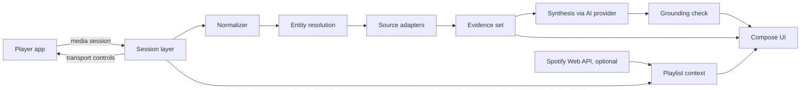

# Sleevesight

**Status:** Draft; Phase 0 passed, Phase 0.5 under way (platform findings in *Platform facts*)  
**Date:** 2026-10-12  
**Owner:** Wacek  
**Platform:** Android (Kotlin, Jetpack Compose, Material 3)  
**License:** [GPL-3.0](../LICENSE)  
**Repository:** [wkusnierczyk/sleevesight](https://github.com/wkusnierczyk/sleevesight)  
**Prototype:** [Sleevesight simulator](https://wkusnierczyk.github.io/sleevesight/design/simulator.html)

Sleevesight is an open-source Android app that reads what a music player is playing, through Android's media session metadata, and shows grounded insights about the song, its artists, its album and its genres. It never touches the audio stream. Every insight is written by an AI service of the user's choice, from evidence retrieved from sources the user switched on, and every claim points back to its source.

## Summary

The phone already announces what is playing. Any app with notification access can read the title, artists, album, duration and album art of the current track from every player that publishes a media session, and can send play, pause, next and previous back to it. Sleevesight builds on that:

1. Read the now-playing metadata and normalize it: separate the song's own title and artists from what the player appends to them. Version tags such as "2006 Remaster" are kept as notes, the work a song is from is recorded as its source work, featured artists move into the artist list, and a list of artists is split into the credited artists. What remains is a clean key to look the song up by. See [Normalizer](#normalizer).
2. Resolve it to entities (recording, artists, release) and retrieve evidence from the sources enabled in Settings.
3. Have the user's chosen AI model write a short insight from that evidence only, with a citation on every factual sentence.
4. Check the citations mechanically before showing the text, and show the evidence underneath.

The prototype in the simulator covers the whole flow against a real 80-track playlist, with frozen lookups and, while it was hosted as a claude.ai artifact, live synthesis. The public copy linked above has no AI service, and its insight cards show the first facts found instead. This document records what it established and what still has to be verified on a real phone.

## Goals and non-goals

### Goals

- Show, within a couple of seconds of a track change, what makes the current song interesting, with sources.
- Make where information comes from a user decision: curated databases, open-web retrieval, and the model's own knowledge are separate switches.
- Let the user choose the AI provider and model and bring their own API key. Sleevesight is the author of the text; the model is a supporting service.
- Work with any player that publishes a media session, with Spotify as the reference player.
- Control the player from the app (play, pause, next, previous) and hand off to the player for a song, artist or album.
- Fail visibly: when nothing is documented, say so; when a match is rejected, show why.

### Non-goals

- Listening to or analyzing audio.
- Accounts, telemetry, analytics, social features, streaks, notifications. None of these ship, and CI enforces it (see Structural constraints).
- Replacing the player. Sleevesight never plays music itself.
- iOS. iOS sandboxing prevents reading another app's now-playing information; see Platform facts.

## Platform facts

These were established while designing, and checked in Phase 0 with the platform probe (`spike/`, removed after the gate; history keeps it) on a Samsung Galaxy S25 Ultra (SM-S938B, Android 16, API 36), with Spotify, Castbox (podcasts), YouTube Music (free tier) and a Sonos session, on 2026-10-12. Items marked **to measure** are still open.

### Reading now-playing

- `MediaSessionManager.getActiveSessions(componentName)` returns a `MediaController` for every app currently publishing a media session: Spotify, YouTube Music, Tidal, Deezer, podcast apps, browsers playing media.
- It requires a declared `NotificationListenerService`. Its `ComponentName` is passed to `getActiveSessions()`; without it the call throws `SecurityException`. The user grants access in Settings, Notification access.
- Use callbacks, not polling. `addOnActiveSessionsChangedListener` tracks sessions appearing and disappearing; `MediaController.Callback.onMetadataChanged` and `onPlaybackStateChanged` deliver track and state changes.
- **Spotify (measured)** fills `TITLE`, `ARTIST`, `ALBUM`, `ALBUM_ARTIST`, `DURATION`, the album art (a bitmap 300 pixels wide, usually 300×300, or 472×472, and an `ALBUM_ART_URI`), and `METADATA_KEY_MEDIA_ID` as a **`spotify:track:<id>`** URI. `ARTIST` is one comma-joined string of the credited artists ("Artist A, Artist B, Artist C"), as the normalizer assumes. It also sends its own keys: the playing context (`com.spotify.music.extra.CONTEXT_URI`, `CONTEXT_TITLE`, `CONTEXT_DESCRIPTION`, `CONTEXT_SHARE_URL`), an `ART_HTTPS_URI` on Spotify's image CDN, an extracted background colour, and explicit, download and advertisement flags. Its `CROSSFADE_ENABLED` and `CROSSFADE_DURATION` extras are **unreliable**: they read `false` and `5000` throughout, including a run with a 12 s crossfade, so nothing relies on them.
- **Castbox (measured)** fills `TITLE`, `DISPLAY_TITLE`, `ARTIST` (the publisher), `ALBUM` (the episode title), `DURATION`, `MEDIA_ID` (its own episode id) and, for the playing episode, `MEDIA_URI` and http(s) art URIs. **YouTube Music (measured, free tier)** fills `TITLE`, `ARTIST`, `ALBUM`, `ALBUM_ARTIST`, `DURATION`, an art bitmap, a rating (always unrated here) and video dimensions (always 0 here), but **no `MEDIA_ID` and no art URI**: a YouTube Music track is looked up and opened by its title and artists, and within a session told apart by its active queue item (see *Track changes*). On the free tier playback stops when YouTube Music leaves the foreground, so its session is often `PAUSED` or `STOPPED`; a paused session is normal, not a change. A **Sonos** session sent only art and an empty media id.
- **Spotify republishes unchanged metadata constantly**: about 93% of same-track updates across the three probe runs repeated the previous metadata exactly (776 of 834: each Spotify metadata update compared with the previous update of the same track, by media id, on all metadata values), and most of the rest changed only the art, the length (sent as a placeholder first) or the extracted colour. The debounce and the lookup-key comparison in the pipeline are what keep this from triggering lookups.
- Spotify also has an opt-in "Device Broadcast Status" setting that sends broadcast intents on metadata, playback-state and queue changes. The media session carries everything it does and more, so it is not used.

### Album art

- Spotify's `ALBUM_ART_URI` is a `content://com.spotify.mobile.android.mediaapi/...` URI, and **another app can read it**. The bitmap and the https URI are there as well.
- Castbox publishes http(s) art URLs (and a small bitmap), which `:sources` fetches like any other network resource.

### Controlling the player

- `MediaController.getTransportControls()` gives `play()`, `pause()`, `skipToNext()`, `skipToPrevious()` and `seekTo()`.
- Only offer an action the session advertises in `PlaybackState.getActions()`. **Measured:** Spotify advertises play or pause, previous, next, seek, play from search and play from URI; play, pause, next and previous were sent and worked (the others were not tried). Castbox advertises play, pause, next, seek and its own set, but not previous, and usually only play/pause while in `NONE` or `BUFFERING`. YouTube Music advertises play, pause, previous, next, seek and play from search, URI or media id. Next and previous come and go in its advertised actions (they are missing, with seek, in its early `STOPPED` and `PAUSED` states); its session extras carry only two car display hints.

### Opening the player

- `MediaController.getSessionActivity()` returns a `PendingIntent` to the player's own screen **for Castbox, which opened it (observed by the tester), and for YouTube Music (not tried); Spotify publishes none.** So for Spotify the app opens the player through a `spotify:` URI or its launch intent instead.
- Opening a specific track, album or artist in Spotify needs a Spotify ID: `Intent.ACTION_VIEW` with `spotify:track:<id>`, `spotify:album:<id>` or `spotify:artist:<id>`. **Measured:** `spotify:track:` with the id from `MEDIA_ID` opens the track.
- When no ID is known, fall back to `spotify:search:<query>`, which always opens (**measured**). Log the fallback.

### Playlist context

The media session carries more context than the design assumed. In order of reliability:

1. **Spotify's metadata.** `CONTEXT_URI` and `CONTEXT_TITLE` name the playlist or album being played (`spotify:playlist:...` and the playlist's name), **without an account**.
2. **The session queue.** Spotify publishes `getQueue()` (the upcoming tracks, with `spotify:track:` ids; 4 to 50 items, one fewer per track, reset when a track is opened through a deep link) and `getQueueTitle()` ("Play Queue"). Castbox publishes its queue too (episode ids), and YouTube Music its "Up next" (13 to 25 items, titles without media ids, starting with the playing track rather than after it).
3. **Session history.** Every track the app has seen play. Always available, but it only knows the past.
4. **Spotify Web API, optional account.** `GET /playlists/{id}/items` returns the whole playlist, not only what is queued.

The track lists can therefore say "In this playlist · <name>" without the optional account; the account adds the full playlist beyond the queue.

### Track changes

Measured for decision D5 on 21 Spotify track changes (of 24 logged; the other three were two Castbox changes and one at the start of a probe session): at each change, the previous track's remaining time (its length less its position, extrapolated from the last playback state), and the playback states before the new metadata (the probe kept the last 3 s; the table counts the last 1.5 s).

| Change | Count | Remaining in the previous track | `PLAYING` states in the 1.5 s before |
|---|---|---|---|
| Ended on its own, no crossfade | 4 | −87 to −39 ms | 6 |
| Ended on its own, crossfade 12 s | 3 | 11.945 to 11.987 s | 6 |
| Skipped in Spotify, with earphones or from the notification | 12 | 20 s to 429 s | 0 |
| Skipped with the probe's buttons, just after pressing play | 2 | 175 s and 369 s | 3 or 4 |

- **No skip state.** Neither Spotify, Castbox nor YouTube Music reported `STATE_SKIPPING_TO_NEXT` or `STATE_SKIPPING_TO_PREVIOUS`, for any kind of skip. Skips in the Spotify app, from earphones and from the notification look the same to the session.
- **A natural end lands exactly at the crossfade.** Without crossfade the change comes within 0.1 s of the end; with a 12 s crossfade, 12.0 s before it, every time within 60 ms. Seeking towards the end beforehand changes nothing.
- **Timing alone is ambiguous inside the crossfade.** The remaining time is measured against the track's full length, so a skip 8 s before a 12 s crossfade reads as 20 s remaining. With a 5 s crossfade, a natural end and a skip 5 s before the transition would both read as 10 s: one change cannot say which it was.
- **The state clusters.** Before every natural end Spotify published two clusters of about six `PLAYING` states: one about 3 s before the change, and one 0.5 to 1 s before. Before a skip from the app, earphones or the notification it published none. Mid-track it publishes nothing but clusters around seeks and an occasional cluster of three. The late cluster therefore separates a natural end from a skip even where timing cannot. It is undocumented Spotify behaviour, so it is used with the timing, not alone. A seek shortly before a skip near the end is not measured.
- Skips made from Sleevesight itself need no detection: the app sent them. The probe-button rows show only that recent playback activity produces a few states (3 or 4), which is why the rule counts states rather than asking for any.
- Castbox, when skipped, sent the new episode's state (position 0) before its metadata; the probe's estimate handles both orders.
- **YouTube Music** (a short run on the free tier): one track listened to the end, then skips early, mid-play and late. It **re-sends the playing track with a new length** (in this run 106 s, then 278.8 s, then 279 s, for one track), so for this player the length is not part of a track's identity; the active queue item is, and it moved exactly at the tester's four changes. Read by the queue item, the natural end came at the track's end (within 0.02 s of it, by the latest length), with no cluster of states before it, so the clusters are Spotify's alone; the skips left 290 s, 131 s and **7.2 s**, the late one reading as a natural end by timing alone, the accepted trade-off. The probe, which compared lengths, first took the length updates for track changes; that is the lesson for the app: a track is identified by its media id, else by the active queue item where the player publishes one (an item of −1, which YouTube Music reports at the start of a session and while stopped in the background, is no item; when either side has no item, title and artists decide), else by title and artists; a new length is an update, after which the time left is computed from the latest length. As with Castbox, the new track's first state (position 0) arrived just before its metadata, at the natural end and the skips alike.

**Decision (D5, refined):** a user setting, *Crossfade*: **Autodetect** (the default) or a fixed value, 0 to 15 s. Changes that Sleevesight caused itself (its own transport buttons, selecting a track) are known to be user-driven and are not put through detection. The rules below are the floor; D15 lets detection learn per player on the device, within them (`architecture.md`, *Learning skip detection*).

- A fixed value *c*: a change is a natural end when the remaining time is at most *c* + 0.5 s; for Spotify, also when the late cluster is there with at most 15 s remaining, so a value set below Spotify's real crossfade does not read natural ends as skips.
- Autodetect, for Spotify (the only player where the clusters have been measured): a change is a natural end when the remaining time is at most 15 s and either the late cluster is there (at least 5 `PLAYING` states within 1.5 s before the change) or the remaining time is within 0.5 s of 0 or of the learned crossfade. Otherwise it is a skip.
- Autodetect, for any other player: timing alone. A change with at most 15 s remaining is a natural end. Whether other players publish such clusters, or another signal, is investigated as they are covered.
- The learned crossfade: the remaining time of natural ends; when two agree within 0.1 s, that is the value, and when two later ones agree on another value, it replaces it, so a changed crossfade is followed. It only adds natural ends that lack the late cluster (a probe connected late, a restart); it never turns a change into a skip.
- Detection errs towards "ended on its own" (decision D5), with one accepted exception: under Autodetect for Spotify, a natural end that lacks the late cluster before any crossfade has been learned reads as a skip. That is the price of catching skips inside the 15 s window, and it ends once a crossfade is learned.

### Notification access and installation

- Installed through `adb`, the probe got notification access without restriction (`packageSource` OTHER, initiating package `com.android.shell`).
- **Installing from a file (measured, D7).** The probe's APK, opened from My Files, was first stopped by **Google Play Protect** ("App blocked to protect your device": Play Protect has not seen an app from this developer before), which offers **Install anyway**. After that, **Advanced Protection** blocked it outright ("Advanced Protection only allows apps from Google Play and other app stores pre-installed on your phone"), with no override. On this phone the device setting was off and the Google account is enrolled in Google's Advanced Protection Program, so the block presumably comes from that enrolment. So:
  - for a user without Advanced Protection, installing Sleevesight from a file costs at least a Play Protect warning (and, the first time, allowing the file manager or browser to install unknown apps);
  - for a user whose Google account is enrolled in Advanced Protection (and, by the dialog's wording, presumably one with the device setting on, which was not tested), only Google Play (or a store pre-installed on the phone) can install it, which rules out GitHub releases and F-Droid for them.
- Restricted settings on notification access, for an app installed from a file, could not be measured on this phone, since the install itself is blocked; it is **to measure** on a phone or emulator without Advanced Protection, with the debug `:app` build in Phase 1 (#29).
- `adb` installs are not affected by either block.
- **Decision (D7, revised):** Sleevesight is distributed through **Google Play** (owner, 2026-10-12), the one channel that reaches every user, Advanced Protection or not, without a warning. Play's review of an app that holds notification access becomes part of the release work.

### Spotify Web API constraints

Since the February 2026 changes, Development Mode apps need the app owner to have Spotify Premium, are capped at five allowlisted users per client ID, and lost several endpoints and fields (artist followers and popularity, track ISRCs, artist top tracks, new releases). Extended quota is available to organizations only.

For an open-source app this is workable with a bring-your-own model: each user registers their own Spotify developer app and pastes its client ID, the same way they supply an AI key. The cost is friction, so the Spotify account stays optional and nothing in the core flow depends on it.

## Architecture



### Session layer

- `NotificationListenerService` plus `MediaSessionManager`. Follows only the players switched on under Settings, Players to follow; events from other packages are dropped and logged as ignored.
- **Debounce of 650 ms** on metadata changes. A person flicking through tracks produces a burst of changes; only the last one triggers lookups. In-flight retrieval and synthesis for a superseded track are cancelled.
- Seeking or pausing changes playback state, not metadata, and never triggers a lookup.
- Exposes transport controls and the session activity to the UI.

### Normalizer

Players report a song the way their catalogue files it, which is often not how sources such as MusicBrainz and Wikipedia name it: "Fisherman's Blues - 2006 Remaster" is the song "Fisherman's Blues", and "Baby, Please Don't Go (feat. Van Morrison)" has a second artist hidden in its title. Normalizing turns the title and artist strings into the song's plain title, its list of credited artists, and a lookup key, without losing what it removed: each removed part is kept, as a note, a source work, a variant or an added artist. Rules proven on the test playlist:

| Input pattern | Action | Example |
|---|---|---|
| ` - 2006 Remaster`, ` - demo`, ` - Radio Edit`, ` - … Version` | Strip, record as a note | "Fisherman's Blues - 2006 Remaster" |
| `(feat. X)` in the title | Move X to the artists | "Baby, Please Don't Go (feat. Van Morrison)" |
| `(From X)`, ` - From "X"` | Strip, record the source work | "The Departure (From The Leftovers)" |
| `(felt piano)`, `(acoustic)` | Strip, record as a variant | "And Dream Of Sheep (felt piano)" |
| `A, B, C` in the artist field | Split into credited artists | "Peleboy, Tony K" |

The key is the lowercased, accent-folded primary artist plus the normalized title. Duplicates in a playlist hit the cache.

### Entity resolution

The hard part, and the place most failures came from in the prototype. Resolution produces a **typed outcome** per source, never a silent miss:

| Outcome | Meaning |
|---|---|
| `song_article` | The source describes this recording |
| `artist_article` | The source describes the performer only |
| `original_song` | The source describes the song as first recorded by someone else; this track is a cover or version |
| `rejected(reason)` | A candidate was found and failed the entity check, for example a different artist with the same name |
| `none` | Nothing found |
| `source_off` | The user switched the source off |
| `unreachable` | Network or source error |

`none` and `source_off` are deliberately different: one is a gap in the world's documentation, the other is the user's choice.

Rules:

- **Resolve each credited artist separately.** The prototype only resolved the primary artist, so secondary artists' boxes were nearly empty.
- **Keep recording and release apart.** A release date belongs to the release the player filed the recording under, which is often a compilation or remaster. The prototype showed "Released 2002" for a 1978 song for this reason. MusicBrainz models recordings, releases and release groups separately; use it to find the first release date of the recording.
- Entity matching is deterministic code (name similarity, duration tolerance, MusicBrainz relationships), never the language model.

### Source adapters

One interface, one adapter per source:

```kotlin
interface SourceAdapter {
    val id: SourceId                 // MUSICBRAINZ, WIKIPEDIA (also emits WIKIDATA lines), LASTFM, DISCOGS, WEB
    suspend fun lookup(track: NormalizedTrack, resolution: Deferred<Resolution>): SourceResult  // typed outcome + evidence lines; see architecture.md, Source adapters
}

val SourceAdapter.tag: String get() = id.tag   // MB, W (and WD), L, D, G
```

| Source | Role | Notes |
|---|---|---|
| MusicBrainz | Recordings, releases, credits, relationships, first release dates | Rate limit about one request per second; descriptive User-Agent with contact info is required. No key. Core data is CC0; tags and genre associations are CC BY-NC-SA 3.0 (`architecture.md`, *Licensing*). |
| Wikipedia and Wikidata | Song and artist articles | Reach the article through the MusicBrainz Wikidata link where possible, to avoid same-name collisions. No key. |
| Last.fm | Artist bio, listener count, tags, similar artists | User's own API key. Tags are crowd-applied and noisy; similar artists come from listening overlap, not audio. |
| Discogs | Releases and personnel | User's own token. |
| Web search | Generic RAG over the open web | Provider chosen by the user, with their key. Results may describe a different song with the same title. |

The model's own knowledge is modelled as a pseudo-source with tag `M`: it retrieves nothing, and when enabled it lets the model add at most one claim, marked unverified.

### Evidence model

```kotlin
data class EvidenceLine(
    val id: String,          // "W1", "L3", "G2", "P1"
    val source: SourceId,
    val scope: Scope,        // SONG, ARTIST, ORIGINAL_SONG, RELEASE, WEB
    val text: String,        // one claim: templated from structured data, or a short attributed quote, never a whole passage (D1)
    val url: String?,
    val retrievedAt: Instant,
)
```

`P` lines come from player metadata (the release). Scope is passed to the model so it never credits an original song's facts to a cover act.

### Synthesis

- **Provider abstraction.** `AiProvider` with implementations for Anthropic, OpenAI, Google and a local model through Ollama. The user picks provider and model and supplies the key.
- **Role of the model.** It narrates retrieved evidence. It does not resolve entities, rank sources, or decide what is true.
- **Citation contract.** Every factual sentence ends with the ids of the evidence lines that support it. No names, dates, places or numbers outside the evidence. A sentence that states a documentation gap may go uncited. If there is no usable evidence, the model replies `NO_EVIDENCE` and the UI says that little is documented.
- **Grounding check, in code, before display.** Each sentence is classified as `ok`, `hedge` (states a gap), `model` (cites `M`), `uncited`, or `unknown` (cites an id that does not exist, or cites `M` when model knowledge is off). Uncited and unknown sentences are underlined; the counts are logged.
- **Cards that use general knowledge.** Genre descriptions, artist comparisons and suggestions have no retrieved source today. They are generated as structured JSON, rendered in a separately labelled "general knowledge" section, and never mixed into the grounded text. See Open questions.

Prompt contracts are in the appendix.

### Genre labels

- Derived from Last.fm artist tags filtered through a fixed genre vocabulary. Tags outside the vocabulary (places, decades, "seen live", noise such as "bagel" or "under 2000 listeners") are dropped.
- Each vocabulary entry belongs to a family with a fixed hue: folk 135, rock 8, pop 328, hip-hop 30, soul and R&B 48, reggae 92, electronic 190, soundtrack and classical 262, jazz and blues 215.
- Labels are artist-level, and the UI says so.
- MusicBrainz tags may feed the same filter if D12 adopts them. A label supported by MusicBrainz tags links and credits MusicBrainz ("MusicBrainz contributors, CC BY-NC-SA 3.0"), alongside Last.fm where both contribute (`architecture.md`, *MusicBrainz tags and genres*). The vocabulary may take names from MusicBrainz's genre list, which is CC0.
- In the test playlist, 30 of 78 unique tracks got no genre labels because their artists have no usable tags.

### Caching and offline

- Retrieval is cached per source and lookup key; synthesis per kind, entity, the exact evidence it was written from, prompt version and style, provider, model and the model-knowledge switch (`architecture.md`, *Cache and history*).
- Offline, cached tracks still work fully; uncached lookups fail with `unreachable`, never with a blank card.
- Each insight is a paid call on the user's key, so when one is written is a user setting, *Write insights automatically* (D5): on every track change (the default), when I skip, or never. Under *When I skip*, user-driven changes (a skip in the player, select, play) write, and tracks that change on their own get evidence and a Write button. The default goes with preparing the next track ahead (D13), so the card is usually ready when the track starts.

## User interface

Material 3, with dynamic color taken from the album art (material-color-utilities from the art bitmap). The prototype is the reference for layout.

### Home screen, top to bottom

1. **Player row.** Player name and state ("Spotify · Playing"). The name opens the player's own screen through the session activity. Previous, play or pause, next act through transport controls.
2. **Album art**, which opens the album in the player. Playback progress under it.
3. **Key data.** Song title, then artists (each one separately), then album, then "Released YYYY" on its own line.
4. **Genre labels.** Colored, tappable chips.
5. **Why it's interesting.** The grounded insight with citation chips.
6. **Sounds like.** Similar artists as tappable chips.
7. **Sources.** Quiet styling, at the bottom: source status chips that double as display filters, the evidence lines, and rejected matches with their reasons. Tapping a citation scrolls here and flashes the line.

### Detail content

| Opened from | Content |
|---|---|
| Song title | Insight on the recording, Open in player, sources |
| Each artist | Insight on that artist, tracks by them in the playlist or session, Open in player, sources |
| Album | Insight on the release, tracks from it, Open in player, sources |
| Genre label | Why the track fits (grounded), what the genre is (general knowledge), more like this (general knowledge, opens a player search) |
| Sounds-like artist | Why they're linked (grounded), how they compare (general knowledge), songs to start with (general knowledge, opens a player search) |

The detail section is called **Insight**. "Analysis" is reserved for a future deeper mode (see Open questions).

### Layout setting

- **Separate pages.** Each item opens a full screen with a back arrow; Android back works throughout.
- **Expandable boxes.** Song, each artist, and album are boxes on the home screen that expand in place; genre and sounds-like cards open inline under their chips.

The detail content is one component mounted either way.

### Track lists

Labelled by where they came from: "Played this session" by default, and "In this playlist · <name>" when the player names the playlist, as Spotify does in its metadata (see *Playlist context*); the optional Spotify account adds the tracks beyond the queue.

## Settings

| Group | Setting | Default |
|---|---|---|
| Layout | Separate pages or expandable boxes | Separate pages |
| AI service | Provider, model, API key | None until set; the model then defaults per provider (Anthropic: Claude Haiku 5.5, its cheapest current model) |
| Spotify account | Connect (OAuth PKCE, user's own client ID) | Off |
| Players to follow | One switch per player seen | Spotify on |
| Where to look | MusicBrainz, Wikipedia, Last.fm, Discogs, Web search, Model's own knowledge | All on except model knowledge |
| Insights | Write insights (off: no AI calls at all; evidence is still shown) | On |
| Insights | Write insights automatically: on every track change, when I skip, or never (D5) | On every track change |
| Insights | Crossfade, for telling skips from natural ends under *When I skip* (D5) | Autodetect |
| Insights | Prepare the next track: off, evidence, or evidence and insight; the insight only where *Write insights automatically* would write it (D13) | Evidence and insight |
| Insights | Style: a preset or free text, with overrides per card under *Advanced* (D14) | Each card's built-in style |
| Lookups | Look up in the background (D6) | Off |
| Lookups | Cache lifetime per source (D9) | MusicBrainz, Wikidata and Discogs 30 days, Wikipedia and Last.fm 7 days, web search 1 day |

Source switches decide what the model may use. The filter chips in the Sources section only change what is displayed.

## Privacy and security

- What leaves the phone, and to whom. The first-run screen says this plainly.
  - To the enabled sources: the normalized title and artists, and the album name as the player reports it, for the playing track and, with *Prepare the next track* on (D13), for the next one in the player's queue.
  - To the chosen AI provider: the title and artists, as the player reports them and as normalized; the album name as the player reports it; and the evidence retrieved from the sources. This is for the playing track and, with *Prepare the next track* set to *Evidence and insight* (the default, D13), for the next one. Each prompt also carries the user's style (D14), including any free text they wrote.
  - To Spotify, only if a Spotify account is connected: requests for the playlist or album being played, made with the user's own token.

  Nothing else leaves the phone. The duration, the album art, the session history and the record of track changes used to learn skip detection (D15) stay on it.
- API keys and tokens are stored encrypted with an Android Keystore-backed key and never logged.
- No telemetry, crash reporting services, analytics or accounts of our own.

## Structural constraints

Enforced in CI rather than stated as policy:

- A dependency allowlist check fails the build if an analytics, crash-reporting or ads SDK appears in the lockfile.
- A manifest check fails the build on any permission beyond the expected set (internet, notification listener binding).
- Network calls go only through the adapter and provider layer; a lint rule forbids HTTP clients elsewhere.

## Diagnostics

- A pipeline log screen, hidden behind a developer setting, mirrors the simulator's log: session events, normalization, each adapter's typed outcome and latency, cache hits, model calls, grounding-check counts.
- A coverage report (Phase 0.5) runs the pipeline over a playlist fixture and reports, per source, how many tracks resolved to each outcome, and per track, how many evidence lines and genre labels it got.

## Phases and gates

### Phase 0. Platform spike

A throwaway app on a real phone. Outputs, written to a log file:

- Fields Spotify, YouTube Music and one podcast app actually put in their media session, including `METADATA_KEY_MEDIA_ID`.
- Whether Spotify publishes `getQueue()` and `getQueueTitle()`.
- Which `PlaybackState` actions each player advertises; whether transport controls work.
- Whether `getSessionActivity()` and `spotify:` deep links open the expected screens.

**Gate:** every unverified item in Platform facts is resolved and this document updated. **Passed 2026-10-13**, with one item moved to Phase 1 (owner, 2026-10-13): restricted settings on notification access for an app installed from a file, on a device without Advanced Protection (#29). In light of the installation findings, D7 moved distribution to Google Play (owner, 2026-10-12), so this matters for development installs and for any later channel outside Play, not for the release. The probe is removed (#30).

### Phase 0.5. Pipeline CLI

A JVM Kotlin command-line tool sharing the pipeline module: normalizer, resolution, adapters, evidence, synthesis, grounding check. Input is a playlist fixture; output is the coverage report and the generated insights.

**Gate:** on the test playlist, zero `unknown` citations, uncited sentences under 5 percent, every same-name collision either rejected or correctly resolved, and the coverage numbers reviewed.

### Phase 1. Android MVP

Session layer, home screen, sources section, insight with grounding check, settings for sources and AI service, caching; preparing the next track (D13); recording track changes for learned skip detection (D15).

### Phase 1.5. Play release

The release through Google Play (D7), after Phase 1 (owner, 2026-10-13): a signed app bundle from a release workflow, the store listing, privacy policy and data safety form, and Play's review of an app that holds notification access. The work is in [plan.md](plan.md).

### Phase 2. Detail and discovery

Song, artist and album detail content; genre labels and cards; sounds-like cards; layout setting; transport controls and player handoff; the prompt style with its overrides per card (D14); learned skip detection (D15), here or later.

### Phase 3. Context and reach

Optional Spotify account; further players; local model through Ollama; Discogs.

## Decisions

D1 to D15 are set out, with their options and reasoning, under *Decisions* in [architecture.md](architecture.md#decisions).

| Date | Decision | Reason |
|---|---|---|
| 2026-10-11 | Android only | iOS cannot read other apps' now-playing information |
| 2026-10-11 | Metadata only, never audio | Enough for the purpose, and no audio permissions |
| 2026-10-12 | Sources are a user setting, with curated, open-web and model-knowledge as separate switches | The user decides what the insight may rest on |
| 2026-10-12 | Grounded synthesis with mechanical citation check | Insights must be traceable; failures must be visible |
| 2026-10-12 | Bring-your-own AI provider, model and key; Sleevesight is the author | Claude is one possible service, not the product |
| 2026-10-12 | Spotify account optional, with the user's own client ID | Development Mode caps users per client ID |
| 2026-10-12 | Session history as the default playlist context | The only context that works without an account |
| 2026-10-12 | Sources section at the bottom, quiet | Provenance matters but is the least interesting content |
| 2026-10-12 | Layout setting: separate pages or expandable boxes | Both are useful; one component serves both |
| 2026-10-12 | Genre labels from a fixed vocabulary over Last.fm tags | Raw tags are crowd-sourced and noisy |
| 2026-10-12 | D1: evidence lines from prose sources are short verbatim quotes, attributed, a fixed number at most per article; templated wherever structured data exists | Deterministic and checkable, no extra paid call; the model still never decides what is true |
| 2026-10-12 | D2: the pipeline in plain Kotlin JVM modules, kept Multiplatform-ready | The CLI and Android both run JVM bytecode; iOS may follow |
| 2026-10-12 | D3: small HTTP clients for the AI providers, not vendor SDKs | One network boundary, a small dependency allowlist, Multiplatform readiness |
| 2026-10-12 | D4: sources queried by name in parallel, matches verified against MusicBrainz and Wikidata afterwards | A slow MusicBrainz delays only its own lines |
| 2026-10-12 | D5: *Write insights automatically*, a user setting (on every track change, when I skip, never), with a *Crossfade* setting for skip detection. The default is on every track change. Replaces "auto-write off by default" | The cost is the user's, so the choice is too; the default goes with D13 |
| 2026-10-12 | D6: retrieval and synthesis only while the app is visible; history always. A user setting, *Look up in the background*, off | No paid or network activity nobody is looking at |
| 2026-10-12 | D7: distribution through Google Play. Replaces "GitHub releases first, F-Droid next" | Phase 0: a file install meets a Play Protect warning, and Advanced Protection blocks it outright |
| 2026-10-12 | D8: a local model through Ollama over HTTPS behind a reverse proxy, with a pinned certificate for that one host; plain HTTP only to a private address, with a warning | Android blocks cleartext and distrusts private CAs; no app-wide trust is widened |
| 2026-10-12 | D9: retrieval cache lifetime a user setting per source | Freshness against requests is the user's trade-off |
| 2026-10-12 | D10: `minSdk` 26 | Reach; nothing used needs more, and the Keystore floor is 23 |
| 2026-10-12 | D11: the first web search provider chosen in Phase 0.5 | The adapter interface does not depend on it |
| 2026-10-12 | D12: MusicBrainz tags and genres judged in the Phase 0.5 pilot; their licence settled before they ship (#9); licence findings in `architecture.md`, *MusicBrainz tags and genres* | Last.fm alone left 30 of 78 tracks without genres |
| 2026-10-12 | D13: prepare the next track in the queue ahead, a user setting (off, evidence, evidence and insight; the default the last) | The card is ready when the track plays, and the slow MusicBrainz lookups are done before they are needed |
| 2026-10-12 | D14: a prompt style for insights, with presets, free text and overrides per card, over a fixed contract | The user shapes the writing; the grounding check keeps its guarantees |
| 2026-10-12 | D15: skip detection learned per player on the device, within the fixed rules, without an LLM | Better detection without cost, data leaving the phone, or decisions moving out of code |
| 2026-10-12 | Working name Sleevesight | Spoken-aloud test still to do |
| 2026-10-13 | Phase 1.5, Play release, after Phase 1 | D7 makes Play's review, the listing and the signed bundle work of their own; the MVP's exit needs only an `adb` install |

## Open questions

- **General-knowledge cards and the LLM role.** Genre descriptions, comparisons and "more like this" suggestions come from the model's own knowledge, and the suggestions are the model choosing items at runtime. That sits uneasily with keeping the model to narration. Options: retrieve genre articles from Wikipedia and ground those cards too; build suggestions deterministically from Last.fm similar artists and MusicBrainz relationships, with the model only explaining them; or keep them as labelled general knowledge behind the model-knowledge switch.
- **Deeper analysis.** What an "Analysis" mode adds beyond the collected insight: musical structure, credits graph, lineage of covers and samples.
- **Release date semantics.** Show the recording's first release, the release being played, or both.
- **Web search provider.** Which providers to support first, and how to keep results about the right recording. Chosen in Phase 0.5 (D11).
- **Per-player behavior.** How much of the UI to hide for players that send title only.
- **Name.** Run the spoken-aloud test on "Sleevesight".

## Test fixtures

The simulator's data makes a ready fixture: the playlist "Below Soundtrack Netflix" (80 tracks, 78 unique), with frozen lookups from Wikipedia, Last.fm and web search, and album and Spotify-link data. Tracks worth keeping as regression cases:

| Track | Case |
|---|---|
| 1 Sundown, Gordon Lightfoot | Rich data from every source |
| 7 Fisherman's Blues - 2006 Remaster | Version suffix |
| 8 and 22, 4 and 24 | Duplicates in the playlist, should hit the cache |
| 12 and 20, Reem | Wikipedia article about a different Reem, must be rejected |
| 14 Up Down, Peleboy, Tony K | Multiple credited artists |
| 37 The Ode To Newfoundland | Three credited artists |
| 45, 48, 76 | Covers; Wikipedia only describes the original song |
| 61 willow, Jessiah | Last.fm name resolves to an unrelated band |
| 63 Baby, Please Don't Go (feat. Van Morrison) | Featured artist in the title |
| 13 New York Groove, 36 Snowbird | Release year is a compilation's, not the song's |
| 23, 30, 77 | Almost nothing documented anywhere; the card must say so |

## Appendix. Prompt contracts

Each prompt has two parts (D14; `architecture.md`, *Prompt style*):

- **The contract**, fixed: the evidence format and ids, the citation rule, no names, dates, places or numbers outside the evidence, the scope rules, `NO_EVIDENCE`, plain text without markdown, and for the genre and sounds-like cards their JSON structure. It is restated after the style, so a style cannot override it.
- **Each card's built-in style**: the lengths and the tone below (sentence and word counts, "plain conversational English"). The user's style (length, tone, focus, audience, free text) adjusts it: shorter or longer relative to the built-in length, and for the JSON cards only in their text fields.

The prompt states the contract, then the style, then the contract again. The data it narrates (the track as the player reports it, and the evidence) is fenced in `<track>` and `<evidence>` blocks that the prompt calls data, not instructions; each field and each evidence line is flattened to one line, so no text from a player or a web page can close a block or pass for an evidence line of its own (`:core`, `InsightPrompt`).

### Insight

Input: the now-playing title, artists and album as the player reports them (not the duration), the normalized fields, and evidence lines as `[ID] (source, scope) text`. Rules given to the model:

- Built-in style: two to four sentences, plain conversational English.
- No markdown.
- End every factual sentence with supporting ids, like `[W1]` or `[W2][G1]`.
- Use only the evidence; no names, dates, places or numbers outside it.
- "Original song" lines describe the song as first recorded by someone else; never credit them to this artist.
- "Artist" lines describe the performer, not this recording.
- Web lines may be about a different song with the same name; ignore what does not fit.
- If little is documented, say so in one uncited sentence.
- With model knowledge on: at most one sentence from general knowledge, ending with `[M]`. Otherwise none.
- With no usable evidence: reply exactly `NO_EVIDENCE`.

Detail insights use the same rules, with a built-in style of one or two short paragraphs, at most 130 words, focused on the song, artist or release.

### Genre card

```json
{
  "fits": "1-3 grounded sentences with ids",
  "about": "2-3 sentences of general knowledge, no ids",
  "more": [{"name": "Artist, or Song - Artist", "kind": "artist|song", "why": "under 15 words"}]
}
```

### Sounds-like card

```json
{
  "link": "1-2 grounded sentences with ids; similarity comes from listening overlap",
  "compare": "2-3 sentences of general knowledge; say so plainly if the artist is not known reliably",
  "start": [{"name": "song by the similar artist", "why": "under 15 words"}]
}
```

`start` must be empty rather than guessed.
