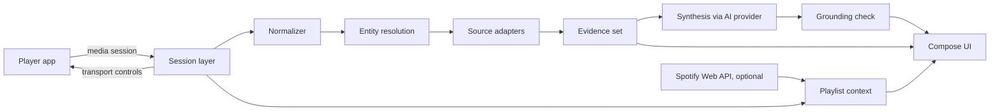

# Sleevesight

**Status:** Draft; Phase 0 passed, Phase 0.5 under way (platform findings in *Platform facts*)  
**Date:** 2026-10-12  
**Owner:** Wacek  
**Platform:** Android (Kotlin, Jetpack Compose, Material 3)  
**License:** [GPL-3.0](../LICENSE)  
**Repository:** [wkusnierczyk/sleevesight](https://github.com/wkusnierczyk/sleevesight)  
**Prototype:** [Sleevesight simulator](https://sleevesight.app/design/simulator.html)  
**Brand:** [Sleevesight brand sheet](https://sleevesight.app/design/brand.html)

Sleevesight is an open-source Android app that reads what a music player is playing, through Android's media session metadata, and shows grounded insights about the song, its artists, its album and its genres. It never touches the audio stream. Every insight is written by an AI service of the user's choice, from evidence retrieved from sources the user switched on, and every claim points back to its source.

## Summary

The phone already announces what is playing. Any app with notification access can read the title, artists, album, duration and album art of the current track from every player that publishes a media session, and can send play, pause, next and previous back to it. Sleevesight builds on that:

1. Read the now-playing metadata and normalize it: separate the song's own title and artists from what the player appends to them. Version tags such as "2006 Remaster" are kept as notes, the work a song is from is recorded as its source work, featured artists move into the artist list, and a list of artists is split into the credited artists. What remains is a clean key to look the song up by. See [Normalizer](#normalizer).
2. Resolve it to entities (recording, artists, release) and retrieve evidence from the sources enabled in Settings.
3. Have the user's chosen AI model write a short insight from that evidence only, with a citation on every factual sentence.
4. Check the citations mechanically before showing the text, and show the evidence underneath.

The prototype in the simulator covers the whole flow against a real 80-track playlist, with frozen lookups and, while it was hosted as a claude.ai artifact, live synthesis. The public copy linked above has no AI service, and its insight cards show the first facts found instead. This document records what it established and what still has to be verified on a real phone.

## Goals and non-goals

### Goals

- Show, within a couple of seconds of a track change, what makes the current song interesting, with sources.
- Make where information comes from a user decision: curated databases, open-web retrieval, and the model's own knowledge are separate switches.
- Let the user choose the AI provider and model and bring their own API key. Sleevesight is the author of the text; the model is a supporting service.
- Work with any player that publishes a media session, with Spotify as the reference player.
- Control the player from the app (play, pause, next, previous) and hand off to the player for a song, artist or album.
- Fail visibly: when nothing is documented, say so; when a match is rejected, show why.

### Non-goals

- Listening to or analyzing audio.
- Accounts, telemetry, analytics, social features, streaks, notifications. None of these ship, and CI enforces it (see Structural constraints).
- Replacing the player. Sleevesight never plays music itself.
- iOS. iOS sandboxing prevents reading another app's now-playing information; see Platform facts.

## Platform facts

These were established while designing, and checked in Phase 0 with the platform probe (`spike/`, removed after the gate; history keeps it) on a Samsung Galaxy S25 Ultra (SM-S938B, Android 16, API 36), with Spotify, Castbox (podcasts), YouTube Music (free tier) and a Sonos session, on 2026-10-12. Items marked **to measure** are still open.

### Reading now-playing

- `MediaSessionManager.getActiveSessions(componentName)` returns a `MediaController` for every app currently publishing a media session: Spotify, YouTube Music, Tidal, Deezer, podcast apps, browsers playing media.
- It requires a declared `NotificationListenerService`. Its `ComponentName` is passed to `getActiveSessions()`; without it the call throws `SecurityException`. The user grants access in Settings, Notification access. On Android 12 (API 31) and later, the service declares `android.service.notification.default_filter_types=""` and `android.service.notification.disabled_filter_types="conversations|alerting|silent|ongoing"` ([#739](https://github.com/wkusnierczyk/sleevesight/issues/739)), which sets its allowed notification filter bitmask in `NotificationManagerService` to `0` on both new installs and upgrades while leaving `MediaSessionService`'s `hasEnabledNotificationListener` check unaffected. Measured on a Samsung Galaxy S25 Ultra with Android 17 (2026-10-30): no notification reaches the listener, fresh or upgraded, and the media sessions read as before (architecture, *Session layer*). On stock Android, the platform documents the disabled types as ones the user cannot turn on in its settings (not measured here); Samsung's One UI has no per-type setting to show.
- Use callbacks, not polling. `addOnActiveSessionsChangedListener` tracks sessions appearing and disappearing; `MediaController.Callback.onMetadataChanged` and `onPlaybackStateChanged` deliver track and state changes.
- **Spotify (measured)** fills `TITLE`, `ARTIST`, `ALBUM`, `ALBUM_ARTIST`, `DURATION`, the album art (a bitmap 300 pixels wide, usually 300×300, or 472×472, and an `ALBUM_ART_URI`), and `METADATA_KEY_MEDIA_ID` as a **`spotify:track:<id>`** URI. `ARTIST` is one comma-joined string of the credited artists ("Artist A, Artist B, Artist C"), as the normalizer assumes. It also sends its own keys: the playing context (`com.spotify.music.extra.CONTEXT_URI`, `CONTEXT_TITLE`, `CONTEXT_DESCRIPTION`, `CONTEXT_SHARE_URL`), an `ART_HTTPS_URI` on Spotify's image CDN, an extracted background colour, and explicit, download and advertisement flags. Its `CROSSFADE_ENABLED` and `CROSSFADE_DURATION` extras are **unreliable**: they read `false` and `5000` throughout, including a run with a 12 s crossfade, so nothing relies on them.
- **Castbox (measured)** fills `TITLE`, `DISPLAY_TITLE`, `ARTIST` (the publisher), `ALBUM` (the episode title), `DURATION`, `MEDIA_ID` (its own episode id) and, for the playing episode, `MEDIA_URI` and http(s) art URIs. **YouTube Music (measured, free tier)** fills `TITLE`, `ARTIST`, `ALBUM`, `ALBUM_ARTIST`, `DURATION`, an art bitmap, a rating (always unrated here) and video dimensions (always 0 here), but **no `MEDIA_ID` and no art URI**: a YouTube Music track is looked up and opened by its title and artists, and told apart by them and its album, never by its queue item (see *Track changes*). On the free tier playback stops when YouTube Music leaves the foreground, so its session is often `PAUSED` or `STOPPED`; a paused session is normal, not a change. A **Sonos** session sent only art and an empty media id.
- **Spotify republishes unchanged metadata constantly**: about 93% of same-track updates across the three probe runs repeated the previous metadata exactly (776 of 834: each Spotify metadata update compared with the previous update of the same track, by media id, on all metadata values), and most of the rest changed only the art, the length (sent as a placeholder first) or the extracted colour. The debounce and the lookup-key comparison in the pipeline are what keep this from triggering lookups.
- Spotify also has an opt-in "Device Broadcast Status" setting that sends broadcast intents on metadata, playback-state and queue changes. The media session carries everything it does and more, so it is not used.

### Album art

- Spotify's `ALBUM_ART_URI` is a `content://com.spotify.mobile.android.mediaapi/...` URI, and **another app can read it**. The bitmap and the https URI are there as well.
- Castbox publishes http(s) art URLs (and a small bitmap), which `:sources` fetches like any other network resource.

### Controlling the player

- `MediaController.getTransportControls()` gives `play()`, `pause()`, `skipToNext()`, `skipToPrevious()` and `seekTo()`.
- Only offer an action the session advertises in `PlaybackState.getActions()`. **Measured:** Spotify advertises play or pause, previous, next, seek, play from search and play from URI; play, pause, next and previous were sent and worked (the others were not tried). Castbox advertises play, pause, next, seek and its own set, but not previous, and usually only play/pause while in `NONE` or `BUFFERING`. YouTube Music advertises play, pause, previous, next, seek and play from search, URI or media id. Next and previous come and go in its advertised actions (they are missing, with seek, in its early `STOPPED` and `PAUSED` states); its session extras carry only two car display hints.

### Opening the player

- `MediaController.getSessionActivity()` returns a `PendingIntent` to the player's own screen **for Castbox, which opened it (observed by the tester), and for YouTube Music (not tried); Spotify publishes none.** So for Spotify the app opens the player through a `spotify:` URI or its launch intent instead. The home screen's player row falls back to the launch intent (`AppGraph.playerLaunchIntent`) whenever the session gives no usable screen, none or a cancelled one (#596), and says it has nothing to open only when there is neither.
- Opening a specific track, album or artist in Spotify needs a Spotify ID: `Intent.ACTION_VIEW` with `spotify:track:<id>`, `spotify:album:<id>` or `spotify:artist:<id>`. **Measured:** `spotify:track:` with the id from `MEDIA_ID` opens the track.
- When no ID is known, fall back to `spotify:search:<query>`, which always opens (**measured**). Log the fallback.

### Playlist context

The media session carries more context than the design assumed. In order of reliability:

1. **Spotify's metadata.** `CONTEXT_URI` and `CONTEXT_TITLE` name the playlist or album being played (`spotify:playlist:...` and the playlist's name), **without an account**.
2. **The session queue.** Spotify publishes `getQueue()` (the playing track, then the upcoming ones, with `spotify:track:` ids; 4 to 50 items, one fewer per track, reset when a track is opened through a deep link; the playing track's media id matches the queue's first item in every capture, while its active queue item can lag a new track's queue for a moment) and `getQueueTitle()` ("Play Queue"). Castbox publishes its queue too (episode ids), and YouTube Music its "Up next" (13 to 25 items, titles without media ids, starting with the playing track rather than after it).
3. **Session history.** The record of every track the app has seen play. Always available, but it only knows the past.
4. **Spotify Web API, optional account.** `GET /playlists/{id}/items` returns the whole playlist, not only what is queued.

The track lists can therefore say "In this playlist · <name>" without the optional account; the account adds the full playlist beyond the queue.

### Track changes

Measured for decision D5 on 21 Spotify track changes (of 24 logged; the other three were two Castbox changes and one at the start of a probe session): at each change, the previous track's remaining time (its length less its position, extrapolated from the last playback state), and the playback states before the new metadata (the probe kept the last 3 s; the table counts the last 1.5 s).

| Change | Count | Remaining in the previous track | `PLAYING` states in the 1.5 s before |
|---|---|---|---|
| Ended on its own, no crossfade | 4 | −87 to −39 ms | 6 |
| Ended on its own, crossfade 12 s | 3 | 11.945 to 11.987 s | 6 |
| Skipped in Spotify, with earphones or from the notification | 12 | 20 s to 429 s | 0 |
| Skipped with the probe's buttons, just after pressing play | 2 | 175 s and 369 s | 3 or 4 |

- **No skip state.** Neither Spotify, Castbox nor YouTube Music reported `STATE_SKIPPING_TO_NEXT` or `STATE_SKIPPING_TO_PREVIOUS`, for any kind of skip. Skips in the Spotify app, from earphones and from the notification look the same to the session.
- **A natural end lands exactly at the crossfade.** Without crossfade the change comes within 0.1 s of the end; with a 12 s crossfade, 12.0 s before it, every time within 60 ms. Seeking towards the end beforehand changes nothing.
- **Timing alone is ambiguous inside the crossfade.** The remaining time is measured against the track's full length, so a skip 8 s before a 12 s crossfade reads as 20 s remaining. With a 5 s crossfade, a natural end and a skip 5 s before the transition would both read as 10 s: one change cannot say which it was.
- **The state clusters.** Before every natural end Spotify published two clusters of about six `PLAYING` states: one about 3 s before the change, and one 0.5 to 1 s before. Before a skip from the app, earphones or the notification it published none. Mid-track it publishes nothing but clusters around seeks and an occasional cluster of three. The late cluster therefore separates a natural end from a skip even where timing cannot. It is undocumented Spotify behaviour, so it is used with the timing, not alone. A seek shortly before a skip near the end is not measured.
- Skips made from Sleevesight itself need no detection: the app sent them. The probe-button rows show only that recent playback activity produces a few states (3 or 4), which is why the rule counts states rather than asking for any.
- Castbox, when skipped, sent the new episode's state (position 0) before its metadata; the probe's estimate handles both orders.
- **YouTube Music** (a short run on the free tier): one track listened to the end, then skips early, mid-play and late. It **re-sends the playing track with a new length** (in this run 106 s, then 278.8 s, then 279 s, for one track), so for this player the length is not part of a track's identity; the active queue item is, and it moved exactly at the tester's four changes. Read by the queue item, the natural end came at the track's end (within 0.02 s of it, by the latest length), with no cluster of states before it, so the clusters are Spotify's alone; the skips left 290 s, 131 s and **7.2 s**, the late one reading as a natural end by timing alone, the accepted trade-off. The probe, which compared lengths, first took the length updates for track changes; the lesson for the app then was to identify a track by its queue item, revised below by #297. A new length is an update, after which the time left is computed from the latest length. As with Castbox, the new track's first state (position 0) arrived just before its metadata, at the natural end and the skips alike.
- **YouTube Music, captured again (#297, 2026-11-03, free tier, two runs, one in split screen so it keeps playing):** in-queue changes (natural ends, skips) lead with the state: the new queue item (`PAUSED`, position 0), the metadata 15 to 160 ms later, then `PLAYING`; the title never came first and never lagged by more than 300 ms. The album changes during a play, to or from the artist's name: the metadata first carries the artist as the album, the real album 190 to 290 ms later; once, at the start of a session, real, artist, real within 0.7 s; videos carry the artist as the album throughout. A play from search resets the queue: item −1 and an empty queue, the title alone, the artists and album about 150 ms later, then a fresh item. A studio and a live take of one song differed by title there. Repeat-one keeps the item, sends no metadata, and moves the position back to 0. In the background the free tier pauses, and after about 2 minutes paused drops to item −1 with an empty queue, keeping the metadata. Ads never reached the session.
- **Track identity (#297)**, from that capture: Sleevesight cares what is playing, the recording, not how often it played nor which queue slot holds it. Different players are different tracks; a media id on both reports decides. Otherwise the title must match exactly; a report without artists says nothing, and known, different artists are another track; a new album within the first second of a play fills the play in (the placeholder above), and after that a new album under the same title and artists is another track (a studio, then a live take). Albums are never compared by name: an album named as its artist is an album like any other. Each report is compared with everything known of the play so far, so a field missing from one report is not a change and is kept, and a field learned once is never lost to a later report (in the session history either, across a pause or a restart). The queue slot is carried and recorded but never decides; it only times a change: when it moves under the title before and a new title follows within 1 s, the change began at the move, so the time left reads right and a natural end does not read as a skip. A repeat (repeat-one, or the same track again right after itself) is one play. The session layer tags each report with its play, and every consumer reads that tag (`architecture.md`, *Identity*).
- **Ads** ([#880](https://github.com/wkusnierczyk/sleevesight/issues/880)). Spotify Free plays its ads through its media session as if they were tracks (a tester's: title `tetesept`, artist `Advertisement • 2 of 3`, 28 s, the ad's own image as the cover). An ad is told by the two signals that cannot fire on music (`AdDetection`, one place): the metadata's `android.media.metadata.ADVERTISEMENT` (`MediaMetadataCompat.METADATA_KEY_ADVERTISEMENT`) set to 1, for any player; and, for Spotify, a `spotify:ad:` URI as the media id or, when the metadata names none, as the active queue item's media id (the metadata's own id decides when it has one: the active item can lag behind the track after an ad). A queue that arrives after the ad's metadata and state settles them again. **Told late** (only by such a queue): the ad was published as a track for a moment, and is then taken back. It gets no run, and a run of it already started is cancelled before anything more is asked, its view forgotten, with any *Ask AI* search for it; its row in the history and the change into it are deleted, and *Saver*'s count of it undone. What its run did before it was told stays: the sources' answers, and an insight if one was written by then, kept in the caches under the ad's own title and artist, which no track shares, so they are never served for music and expire as any; and skip detection may have learned from the change into it until the next start, which relearns from the record without it. Not the artist text (Spotify translates "Advertisement"), nor a missing album, a length of 30 s or less, or skipping removed from the actions, which music can show too. The session layer publishes an ad as no track, with the ad beside it (`SessionRepository.ad`, its player and length only): so nothing is looked up or written for it, no tap can start a call for it, it is not read aloud, prepared (an ad in the queue is skipped: the first track after it is prepared, during the ad too), kept in the history or the caches, and the changes into and out of it are recorded as none, so skip detection learns nothing from them and *Saver* counts none. The play before it is kept, so the track after it is judged against that play: a new track is a new play, analysed as usual. The signals are still to be confirmed by a capture of Spotify Free playing an ad (`SessionDump`, #897; `fixtures/sessions/ads/`, synthetic until then).

**Decision (D5, refined):** a user setting, *Crossfade*: **Autodetect** (the default) or a fixed value, 0 to 15 s. Changes that Sleevesight caused itself (its own transport buttons, selecting a track) are known to be user-driven and are not put through detection. The rules below are the floor; D15 lets detection learn per player on the device, within them (`architecture.md`, *Learning skip detection*).

- A fixed value *c*: a change is a natural end when the remaining time is at most *c* + 0.5 s; for Spotify, also when the late cluster is there with at most 15 s remaining, so a value set below Spotify's real crossfade does not read natural ends as skips.
- Autodetect, for Spotify (the only player where the clusters have been measured): a change is a natural end when the remaining time is at most 15 s and either the late cluster is there (at least 5 `PLAYING` states within 1.5 s before the change) or the remaining time is within 0.5 s of 0 or of the learned crossfade. Otherwise it is a skip.
- Autodetect, for any other player: timing alone. A change with at most 15 s remaining is a natural end. Whether other players publish such clusters, or another signal, is investigated as they are covered.
- The learned crossfade: the remaining time of natural ends; when two agree within 0.1 s, that is the value, and when two later ones agree on another value, it replaces it, so a changed crossfade is followed. It only adds natural ends that lack the late cluster (a probe connected late, a restart); it never turns a change into a skip.
- Detection errs towards "ended on its own" (decision D5), with one accepted exception: under Autodetect for Spotify, a natural end that lacks the late cluster before any crossfade has been learned reads as a skip. That is the price of catching skips inside the 15 s window, and it ends once a crossfade is learned.

### Notification access and installation

- Installed through `adb`, the probe got notification access without restriction (`packageSource` OTHER, initiating package `com.android.shell`).
- **Installing from a file (measured, D7).** The probe's APK, opened from My Files, was first stopped by **Google Play Protect** ("App blocked to protect your device": Play Protect has not seen an app from this developer before), which offers **Install anyway**. After that, **Advanced Protection** blocked it outright ("Advanced Protection only allows apps from Google Play and other app stores pre-installed on your phone"), with no override. On this phone the device setting was off and the Google account is enrolled in Google's Advanced Protection Program, so the block presumably comes from that enrolment. So:
  - for a user without Advanced Protection, installing Sleevesight from a file costs at least a Play Protect warning (and, the first time, allowing the file manager or browser to install unknown apps);
  - for a user whose Google account is enrolled in Advanced Protection (and, by the dialog's wording, presumably one with the device setting on, which was not tested), only Google Play (or a store pre-installed on the phone) can install it, which rules out GitHub releases and F-Droid for them.
- Restricted settings on notification access, for an app installed from a file, could not be measured on this phone, since the install itself is blocked; it was measured on a second phone (next item).
- **Restricted settings (measured, #29).** On a Samsung Galaxy S23 Ultra (SM-S918B, Android 16, API 36, One UI 8.5, build `S918BXXSAFZI1`) with no Advanced Protection, on 2026-10-16, the debug `:app` APK from CI was copied to `Download/` and opened from My Files. My Files first had to be allowed to install unknown apps, then Play Protect blocked the install and **Install anyway** went through, as on the first phone. Android recorded a file install: `packageSource` 3 (`PACKAGE_SOURCE_LOCAL_FILE`), installer and initiating package `com.google.android.packageinstaller`, originating package `com.sec.android.app.myfiles`. Android **did mark the app restricted**: the app op `ACCESS_RESTRICTED_SETTINGS` read `deny` (`MODE_ERRORED`, which Android sets on file installs; the op's default is `allow`). Yet notification access was then granted from the app's first-run link with only the usual confirmation: **the restriction was not enforced** on that screen. The link asks for `ACTION_NOTIFICATION_LISTENER_DETAIL_SETTINGS` and falls back to the listener list; which of the two One UI showed was not recorded, and the other was not tried. So on this phone a file install costs two warnings and no unlock. One phone, one installer and one grant path only. A browser download gets the same marker and was not tried. Since the marker is set, the other grant screen, a Pixel or another Android version is likely to enforce it, so onboarding should still explain the unlock if access cannot be granted (`architecture.md`, R8).
- **Developer verification (checked 2026-10-16, #29; rechecked 2026-10-19).** Since 2026-09-30, on certified devices in Brazil, Indonesia, Singapore and Thailand, installs from the [participating stores](https://developer.android.com/developer-verification/guides#locations) (Google Play and several phone makers' stores) need a registered developer and package; installs from a file, and `adb` installs, are not checked yet ([FAQ](https://developer.android.com/developer-verification/guides/faq)). Google plans a global rollout in 2027. From then, an unregistered app would install only through `adb` or the *advanced flow* (developer mode, a check that nobody is coaching the user, a restart, a one-time one-day wait and a biometric or PIN confirmation, then installs allowed for 7 days or indefinitely, each still warning of an unverified developer). Short of full registration, a free *limited distribution* account registers packages whose builds install on up to 20 devices: no government ID is checked, but the account needs a Google payments profile (with a legal name and address), 2-Step Verification and a contact email; each device's user consents on the device, through a QR code or a link, and the device is registered in the Android Developer Console ([limited distribution](https://developer.android.com/developer-verification/guides/limited-distribution)). It suits development builds handed to testers. Apps on Play are registered through the Play Console, so under D7 this concerns builds handed out as files: once the package is registered for full distribution, such a build should install as it does today (the unknown-apps permission and the Play Protect warning above remain). The rules and dates are still moving; check them again before a channel outside Play.
- `adb` installs escape the Advanced Protection block and restricted settings, as the probe's `adb` install on the first phone showed (first item), and developer verification, as Google's [FAQ](https://developer.android.com/developer-verification/guides/faq) says. The Advanced Protection block measured is the one that comes from the account's enrolment, with the device setting off; whether an `adb` install escapes the block of the device setting was not tested. Not every check: with *Verify apps over USB* on (developer options), an `adb` install can still be stopped by an "Unsafe App Blocked" warning, with *Install anyway* ([Android Studio, known issues](https://developer.android.com/studio/gemini/journeys#known-issues)).
- **Decision (D7, revised):** Sleevesight is distributed through **Google Play** (owner, 2026-10-12), the one channel that reaches every user, Advanced Protection or not, without a warning. Play's review of an app that holds notification access becomes part of the release work.

### Spotify Web API constraints

Since the February 2026 changes, Development Mode apps need the app owner to have Spotify Premium, are capped at five allowlisted users per client ID, and lost several endpoints and fields (artist followers and popularity, track ISRCs, artist top tracks, new releases). Extended quota is available to organizations only.

For an open-source app this is workable with a bring-your-own model: each user registers their own Spotify developer app and pastes its client ID, the same way they supply an AI key. The cost is friction, so the Spotify account stays optional and nothing in the core flow depends on it.

## Architecture



### Session layer

- `NotificationListenerService` plus `MediaSessionManager`. Follows only the players switched on under Settings, Players; events from other packages are dropped and logged as ignored. A player is listed there once its session has reported music, a title and an artist, so dialer calls and most video apps never are; phone calls (the telecom and dialer packages, or a session whose audio is voice communication, checked again before every read and report, and as reports settle) are never read, whatever the settings say (#435), from when Android marks them. A VoIP call in an ordinary media session is not recognised.
- **Debounce of 650 ms** on metadata changes. A person flicking through tracks produces a burst of changes; only the last one triggers lookups. In-flight retrieval and synthesis for a superseded track are cancelled.
- Seeking or pausing changes playback state, not metadata, and never triggers a lookup.
- Exposes transport controls and the session activity to the UI.

### Normalizer

Players report a song the way their catalogue files it, which is often not how sources such as MusicBrainz and Wikipedia name it: "Fisherman's Blues - 2006 Remaster" is the song "Fisherman's Blues", and "Baby, Please Don't Go (feat. Van Morrison)" has a second artist hidden in its title. Normalizing turns the title and artist strings into the song's plain title, its list of credited artists, and a lookup key, without losing what it removed: each removed part is kept, as a note, a source work, a variant or an added artist. Rules proven on the test playlist:

| Input pattern | Action | Example |
|---|---|---|
| A trailing `- 2006 Remaster`, `- demo`, `- Live`, `- Mono`, `- … Edit` (`- Radio Edit`, `- Promo 7" Edit`), `- … Version`; not `- … Mix`, often a recording of its own | Strip, record as a note | "Fisherman's Blues - 2006 Remaster" |
| `(feat. X)` in the title | Move X to the artists | "Baby, Please Don't Go (feat. Van Morrison)" |
| `(From X)`, a trailing `- From "X"` | Strip, record the source work | "The Departure (From The Leftovers)" |
| `(felt piano)`, `(acoustic)` | Strip, record as a variant | "And Dream Of Sheep (felt piano)" |
| `A, B, C` in the artist field | Split into credited artists | "Peleboy, Tony K" |

The key is the lowercased, accent-folded primary artist plus the normalized title, keeping letters and digits in any script, and `+` ("C++" is not "C"); other punctuation, symbols and emoji become a space, unless they are all there is (a title `★` keys as `★`). Accents are folded on Latin and Greek letters only: Cyrillic `й` is not `и`. Duplicates in a playlist hit the cache.

### Entity resolution

The hard part, and the place most failures came from in the prototype. Resolution produces a **typed outcome** per source, never a silent miss:

| Outcome | Meaning |
|---|---|
| `song_article` | The source describes this recording |
| `artist_article` | The source describes the performer only |
| `original_song` | The source describes the song as first recorded by someone else; this track is a cover or version |
| `rejected(reason)` | A candidate was found and failed the entity check, for example a different artist with the same name |
| `none` | Nothing found |
| `source_off` | The user switched the source off |
| `unreachable` | Network or source error |

`none` and `source_off` are deliberately different: one is a gap in the world's documentation, the other is the user's choice.

Rules:

- **Resolve each credited artist separately.** The prototype only resolved the primary artist, so secondary artists' boxes were nearly empty.
- **Keep recording and release apart.** A release date belongs to the release the player filed the recording under, which is often a compilation or remaster. The prototype showed "Released 2002" for a 1978 song for this reason. MusicBrainz models recordings, releases and release groups separately; use it to find the first release date of the recording.
- **Look past a full first page for the earliest recording** (#906). A search gives at most 100 recordings, and a song an artist has recorded more often than that, mostly live, may come without the studio one: *Dream On* by Aerosmith (169 recordings, most scoring alike, so ranked differently from one request to the next), with the player reporting the 1973 debut *Aerosmith*, resolved to the 1978 live recording on *Live! Bootleg*, with its date and producers. Only a recording released no later than the first page's earliest one that could be chosen could beat it, so when the first page is full, a second search asks for those (by the first release date, `firstreleasedate:[* TO …]`): few, deterministic, one more request. The usual rules then choose among both, the earliest released first. Only the title and artist are sent, as for the first page. Paging (`offset`) was tried first and dropped: with most scores tied, pages overlap and skip recordings from one request to the next. The album the player reports is not used either: it would send the album to MusicBrainz, and a compilation it names often carries a later recording of the song.
- Entity matching is deterministic code (name similarity, duration tolerance, MusicBrainz relationships), never the language model.

### Source adapters

One interface, one adapter per source:

```kotlin
interface SourceAdapter {
    val id: SourceId                 // MUSICBRAINZ, WIKIPEDIA (also emits WIKIDATA lines), LASTFM, DISCOGS, WEB
    suspend fun lookup(track: NormalizedTrack, resolution: Deferred<Resolution>): SourceResult  // typed outcome + evidence lines; see architecture.md, Source adapters
}

val SourceAdapter.tag: String get() = id.tag   // MB, W (and WD), L, D, S
```

| Source | Role | Notes |
|---|---|---|
| MusicBrainz | Recordings, releases, credits, relationships, first release dates; a work's lyrics pages and languages, and whether a recording is marked instrumental, for Home's lyrics links (#728), from the same work and recording lookups | Rate limit about one request per second; descriptive User-Agent with contact info is required. No key. Core data is CC0; tags and genre associations are CC BY-NC-SA 3.0 (`architecture.md`, *Licensing*). |
| Wikipedia and Wikidata | Song and artist articles | Reach the article through the MusicBrainz Wikidata link where possible, to avoid same-name collisions. No key. |
| Last.fm | Artist bio, listener count, tags, similar artists | User's own API key. Tags are crowd-applied and noisy; similar artists come from listening overlap, not audio. |
| LRCLIB | Whether a track has lyrics, a sign for its genre Instrumental (#997); no evidence lines | No key. Asked only when a genre is Instrumental, with the track's length; User-Agent with the app's site; honour 429's `Retry-After` with jitter. |
| Discogs | Releases and personnel | User's own token. |
| Web search | Generic RAG over the open web | User's own key; Exa first (D11, below). Results may describe a different song with the same title, so they are filtered. |

The model's own knowledge is modelled as a pseudo-source with tag `AI` (`M` until 0.1.8, #668): it retrieves nothing, and when enabled it lets the model add at most one claim, marked unverified.

#### Web search provider (D11)

**Exa first** ([#40](https://github.com/wkusnierczyk/sleevesight/issues/40), 2026-10-14). The user brings the key, so the deciding points are what a key costs them to get and keep, and whether the results are worth an evidence line. Exa's free tier needs no card and renews monthly; on the fixture's thin tracks it found real listings where the simulator's search found nothing; and its terms, though strict, are no worse than the others'. Only Exa was tested live: it is the only key the project holds. The others were compared on their official pages (2026-10-14):

| Provider | Free tier | Card for the free tier | Price per 1000 searches | Rate limit | Terms on results |
|---|---|---|---|---|---|
| **Exa** | $10 in credits, reset on the first of each month, "up to 2,500 Lite searches" (2026-10-26) | No | $4 `lite` (and the legacy `instant`), $7 `auto`, for up to 10 results, highlights included; $1 per 1000 results beyond 10 (2026-10-26, below) | 10 per second for `/search` | §4.2(a): no copying, distributing or displaying information obtained through the services beyond the terms or Exa's written leave; no attribution clause |
| Brave Search API | $5 of credit a month | Yes ("to verify identity", not charged) | $5 | 50 per second | Storing results needs a plan with storage rights; grants no rights in the third-party pages |
| Tavily | 1000 credits a month (a basic search is 1 credit) | Pricing page says no; the owner was asked for one at sign-up | $8 (pay as you go) | 100 a minute on a development key | For integration in the customer's own applications; no attribution clause |
| Linkup | $20 of credit, topped up monthly, for a professional email | Not stated | $5 (standard search) | Not stated | Not reviewed |
| You.com | $100 of credit at sign-up | Not stated | $5 | Not stated | Not reviewed |
| Serper, SerpApi | 2500 queries once; 250 a month | No; not stated | $0.30 to $1; $25 for 1000 a month | 50 per second; 50 an hour | They resell Google's results page, scraped: not a sound basis |
| Google Custom Search JSON API | Closed to new customers, ends 2027-01-01 | | | | |
| Bing Web Search API | Retired in 2025 | | | | |

**What a search costs: $0.004** (documented, checked 2026-10-26 on Exa's pages, [#584](https://github.com/wkusnierczyk/sleevesight/issues/584); measured 2026-10-27, [#608](https://github.com/wkusnierczyk/sleevesight/issues/608)). The [pricing page](https://exa.ai/pricing) prices `/search` at $4 per 1000 requests for `lite` and the legacy `instant`, and $7 for `auto`, each for up to 10 results; beyond that it charges only $1 per 1000 results past 10 and $1 per 1000 AI page summaries, and lists no charge for text or highlights within `/search`. The [Exa 3.0 announcement](https://exa.ai/blog/exa-3) (2026-10-19) says the "improved highlights and expanded data sources are included at no additional charge". A search as the adapter sends it (`lite`, 10 results, highlights, no summary) is therefore $0.004, and the free tier, "$10 in credits" reset to $10 on the first of each month, covers "up to 2,500 Lite searches". This settles what was open on 2026-10-14, when the pricing pages priced contents at "$1 / 1k pages, per content type" in the `/contents` row and the [search reference](https://exa.ai/docs/reference/search) said text, highlights and summaries were "billed outside the bundled search price", which would have made highlights $0.001 a result on top ($14 per 1000) and the free credit about 700 searches. The spike's searches agreed with the reading now in the documents: every `instant` search with 10 highlighted results reported $0.004 in `costDollars` and no contents charge. So did the live runs of 2026-10-27 ([#608](https://github.com/wkusnierczyk/sleevesight/issues/608)): each of 156 searches, 77 on `lite` and 78 on `instant` over the fixture playlist and one by `ExaLiveTest`, reported $0.004 in `costDollars`, all of it under `search`, with no contents line ($0.624 in all), including the `instant` searches that returned fewer than 10 results. `costDollars` is Exa's estimate, "not an invoice record"; the dashboard's usage for the runs' window (08:20 to 08:37 UTC) is the last word, to be checked by hand and recorded on [#608](https://github.com/wkusnierczyk/sleevesight/issues/608). The adapter keeps `numResults` at 10: the filter kept 0 to 4 of 10 on the thin and same-title tracks with `instant` (2026-10-14), and 4 or 5 with `lite` (2026-10-27, [#608](https://github.com/wkusnierczyk/sleevesight/issues/608)), so fewer candidates would cost lines where they are scarcest, and with highlights included fewer results would save nothing.

**The live test** (20 calls, about $0.10 by Exa's estimates): tracks 1, 12, 23, 30, 45, 61 and 77, with `auto` and `instant`. `instant` was as relevant as `auto` at a tenth of the latency (0.3 s against 3 s) and a little over half the price, so the adapter used it. Exa 3.0 (2026-10-19) made `instant` legacy ("Legacy. Use `lite` instead.", in the search reference), and the adapter has sent `lite` since [#584](https://github.com/wkusnierczyk/sleevesight/issues/584): the same price, the same index as `auto`, served from the index without fetching pages at query time. `lite` "accepts only" a listed set of parameters and rejects a request with any other; the adapter's (`query`, `numResults`, `excludeDomains`, `contents.highlights`) are all in it. `lite` has since been compared with `instant` live (below). On the thin tracks the spike's `instant` searches found what the simulator's search did not: for 23, a library catalogue entry naming the composers and the album, a soundtrack listing with the scene, and two song-database pages; for 30, a soundtrack listing and a CritiqueBrainz page; for 77, only Alphaville's and Rod Stewart's songs, which the filter rejects. For 12 it mixed Reem's song with Juice WRLD's of the same name and returned one undecodable page; for 61 one Spotify page for Jessiah's recording among other artists' "willow"s; for 45, Yanjoco's own listings and a Spotify page for another Yanjoco song whose list of the artist's tracks named the title, the case behind the filter's rule on result titles below. This is a summary; no result text is kept in the repository (*Open on the terms*). The app's and the CLI's retrieval cache does keep web search results on the device, for web search's lifetime (D9: 1 day), like any other source's: during development, by the owner's decision of 2026-10-14 ([#81](https://github.com/wkusnierczyk/sleevesight/issues/81)), which reversed the #44 review's refusal, since without it every repeat lookup is a paid search.

**`lite` against `instant`** ([#608](https://github.com/wkusnierczyk/sleevesight/issues/608), 2026-10-27; one run of `:cli live --no-insights --tracks all` on each, 78 searches each, the request otherwise the adapter's). `lite` found the recording far more often: web search gave `song_article` on 77 of 80 positions against 63, and 352 lines against 213, more on 47 positions and fewer on 2. `lite` always returned 10 results; `instant` fewer on 19 of 78 searches, at the same price. On the six named tracks `lite` kept 4 or 5 lines each, mostly from the recording's own pages (streaming services, song databases, library catalogues; for 12, only Reem's song; for 77, also a Spotify playlist that lists it); `instant` kept 0 to 3, and returned mostly other songs of the same name: nothing kept for 30 and 61, and for 45 and 77 only a Spotify playlist that lists the track. `instant` did worse than in the spike of 2026-10-14, after Exa 3.0 made it legacy. Speed was about the same: Exa's own search time 239 ms for `lite` and 217 ms for `instant` at the median. One `lite` request got no answer within the 30 s socket timeout and ended `unreachable`. More results also reach the filter's known limit on titles made of common words: for track 4, *Location* by Peleboy, `lite` returned pages naming the artist and using the word, and the filter kept three. The adapter stays on `lite`. The comparison, track by track, is on #608; no result text is kept in the repository.

**Keeping results about the right recording.** The query is `"<title>" from <work> by <artists>, song`, the `from` part only when the player names the work (track 34, `Theme` from Coronation Street), which suits Exa's neural search; highlights asked for at 300 characters (`maxCharacters`), steered by the same words, are the snippet. Exa does not hold to `maxCharacters` (in the runs of 2026-10-27 about three results in ten came back longer, up to 3,000 characters; [#608](https://github.com/wkusnierczyk/sleevesight/issues/608)), so the adapter cuts each snippet to 300 characters, at a word boundary, and marks the cut with an ellipsis (`…`): the line stays a short verbatim quote (D1), and five lines come to about 1,500 characters at most ([#634](https://github.com/wkusnierczyk/sleevesight/issues/634)). The filter below judges the line as cut, not the whole highlight, so a result is never kept for words the line then leaves out. A track with no credited artist is not searched, since no result could be checked. Ten results are asked for, and at most five kept, in Exa's order. Phrases are matched whole in the result's title and snippet, after folding case, accents and punctuation, with `&` read as `and` and apostrophes dropped ("Don't" and "Dont" agree) except before a possessive "s", which stays a word of its own ("Lightfoot's" still names Lightfoot). A track whose title or artists fold to nothing (an artist named "!!!") is not searched either. A result is kept only if:

- it names the title, and the work it is from when there is one;
- it names a credited artist, and a distinctive one when the track has one: an artist named only with common words (Them, To Twelve) counts only when no credited artist is distinctive, so track 63 needs Van Morrison;
- its own title does not name such an artist without the song. A page titled after the artist alone is about the artist or another of their recordings (Yanjoco's "Caravan" page, which lists the song among the artist's others), so a mention in its snippet does not count. A page titled after neither, such as a catalogue entry or a soundtrack listing, is judged on its snippet, which keeps the thin tracks' best results. Results from the sources the pipeline reads through their own adapters (Wikipedia and its mirror Wikiwand, Wikidata, MusicBrainz, Last.fm, Discogs) are excluded in the query and dropped again by the filter, so their text arrives only through the adapter that verifies it. Kept results give `song_article`; results that all fail give `rejected`; no results give `none`. Known limits: an artist named only with common words, when no other credited artist is distinctive, is matched by those words; a result can quote lyrics; a page about another recording that names the song and the artist in passing still passes; and a listing titled with several artists, this one among them, but not the song (a soundtrack page titled "Ray Johnson And The Sou' Westers, Die Hexen and others") is dropped, even when it lists the song.

**Page boilerplate** ([#905](https://github.com/wkusnierczyk/sleevesight/issues/905), 2026-11-04). On thinly documented tracks much of a highlight can be the page around the facts: a video site's footer and channel stats, a streaming service's navigation and sign-in text, a store's rights line and list of supporters' user names, a chord sheet's tuning and capo fields, a lyrics site's format line. Sent as evidence lines, these drew sentences about themselves from every prompt wording tried in the [#767](https://github.com/wkusnierczyk/sleevesight/issues/767) phone round (a rights notice called "a useful detail", "an official video is on YouTube"), on four of ten tracks. *Where*: in the adapter's extraction (`WebBoilerplate`, through `ExaWebSearch.lines`), for the track's search and the album's, before the cut, so the room such text took goes to the page's own text; not when the prompt's evidence is chosen (`PromptEvidence`). So what *Sources* shows is what the model was given, the line count that decides whether the artist's lines are needed (`PromptEvidence.ENOUGH_OF_ITS_OWN`) counts only lines with something in them, and the caches keep the cleaned lines: the extraction version went to 3, the track's (`ExaWebSearch.EXTRACTION_VERSION`) and the album's kept web lines' (`AlbumSource.WEB_PART`), so lines kept before are looked up again. What that costs: the cards are keyed by the fingerprint of the evidence they were written from (`CardKey.evidenceFingerprint`, every line's text), so a card written from a web line that the cleaning changes or drops is not found again and is written anew when next shown, with a paid AI call. For a track that means its key insight, its song insight, its genre reasons and its genre list (the cards keyed by the track's own evidence; the artist's insight is keyed by the artist's evidence, which has no web line, and *Search with AI*'s answers by none); since a track's web lines last a day in the retrieval cache, they would have been looked up again (a paid search) and cleaned within a day anyway, and the version only brings that forward. For an album it means its insight, if it was written from web lines: those are kept as long as the insight (*Keep history for*), so without the new version they would keep their boilerplate for good; with it, each such album's web search is made again when its insight is next opened (a paid search), and the insight is written again (a paid call) unless the lines come out the same. Decided so on PR [#920](https://github.com/wkusnierczyk/sleevesight/pull/920): a once-only cost, against cards written from boilerplate for as long as the history keeps them. The filter judges each result on its highlight as it came (cut, as before), not on what is left: a part naming only the song and the artist goes as boilerplate, yet it is the surest sign of what a page titled after neither (a soundtrack listing, a catalogue entry) is about, so the page keeps its facts. A result the filter keeps whose every part went gives no line, and the search's outcome is `none` rather than `rejected` when every kept result went so (it was about the recording, with nothing to say); its address is still kept (`SourceResult.pages`), never cited or sent, so the *Lyrics* panel still links a lyrics page whose highlight was only its title (`webPages`). The pages of *AI web search*'s own searches (`ExaPageSearch`: *Search with AI*, *Explain the song*, the genre list and reasons, the artist's insight under *Up to 3 times*) are cleaned by the same rules, before their cut to 600 characters ([#929](https://github.com/wkusnierczyk/sleevesight/issues/929)), for the names the question is about (`WebQuestion.subjectNames`, sent with each search: the track's title and artists, with its work for the genre list and reasons and its album for *Search with AI* and *Explain the song*; a genre's name for its definition), with no filter before them, as they are pages for the model to answer from. *Search with AI*'s lyrics pages are not cleaned at all (`subjectNames` null): their address is the answer even when the passage is only the page's title or its site's words. The artist's insight sends no names: its pages are judged by the artist's name in the passage as it came and only then cleaned for the artist (`ArtistWebLookup.pageLine`), as the app's own search judges a highlight. With none, a part goes only when its site's text and a page's words are all it has. A page whose every part goes is left out, and a search whose pages all go has found nothing, as one with no pages (*Once* makes no call, the search tool answers that it found nothing), with no new text. Answers kept before stay as they were written. *How*: a line's parts (the passages between the ` ... ` its highlights are joined with) go whole or stay whole; nothing is cut out of a part. A part goes when it is boilerplate through and through: with its site's known page text set aside, what is left has no digit, no credit (a role's label before a name, in any case: "Music by", "Lyrics:", "Written by"; not a streaming page's "song and lyrics by"), and no word beyond the subject's names (the track's title, its work and artists; the album and its artist) and a page's words ("official video", "chords", "lyrics", a site's name or address; not "single" or "album", which name release facts, so a listing's "- Single" or a video's "(Full Album)" is matched as its site's text instead, and "Album:" counts as a credit). The known page text counts only on its own kind of site, by the result's address: the footer, the channel's stats fields (each value bounded) and a transcript's "[Music]" on YouTube; navigation and sign-in text on the streaming services; the rights heading, the shows and the supporters' user names on Bandcamp; "Tuning:", "Capo:", "Chords used:" and runs of chord symbols on chord sites; on any page only a lyrics site's fixed sentences, whole, and a part that is only "All rights reserved". A line whose parts all go gives no result. Two earlier versions cut boilerplate out of a part and took facts with it, each review round finding more ("- Likes: 98K ## Description … in 1974." emptied, a credit naming the artist dropped, "is Am G D." losing its chords; PR [#920](https://github.com/wkusnierczyk/sleevesight/pull/920)), so the rule is now whole parts only. On the 55 distinct web lines of the round's prompts (their sites inferred from their text, since the captures keep no addresses or titles), 5 went (four video pages with only their title and footer, one chord sheet's title), 7 lost one or more parts and 43 were kept as they came; with the filter run on the line alone, without the page's title the captures lack, 43 pass, of which 5 went, 5 lost parts and 33 were kept as they came. **Known limit**: boilerplate in a part that also has a fact stays, the part kept whole (Spotify's "Sign in to see lyrics …" beside the year, a Bandcamp rights heading in the same highlight as its release date, a transcript's markers between lyrics); so do page text worded differently from the rules or on a site not listed, a list of plain names without handles, and a page's view of the song (a meaning page), which is not boilerplate and is for the prompt to attribute.

**Open on the terms.** Exa's §4.2(a) forbids, without its written permission, to "download, modify, copy, distribute, transmit, display, perform, reproduce, duplicate, publish, license, create derivative works from, or offer for sale any information" obtained through its services. Read literally, it covers what the app does with a result on the user's own key: it displays the highlight, transmits it to the user's AI provider in the prompt, and creates a derivative work from it, the written insight. Showing results is what the API is for (§1.1 grants use "for the limited purposes set forth in the documentation"), but the terms do not say so of these uses. Before release, confirm with Exa that the app's use is within the terms, including the on-device retrieval cache, which keeps web search results for a day during development (owner, 2026-10-14), and the album's and the artist's insights' web search results (#885, #912), which are kept for as long as the album's or the artist's insight is (*Keep history for*, up to *Forever*), so its card is found again; the question is tracked in [#80](https://github.com/wkusnierczyk/sleevesight/issues/80) and must be settled before the app is published. Because the same clause covers stored copies, the test fixtures in `fixtures/http/web/` are synthetic: the requests are the adapter's own, the responses have Exa's shape with titles, URLs and highlights written by the project; live checks go through `ExaLiveTest`, which keeps nothing. A second provider can be added behind the same `SourceAdapter`, with the filter shared.

### Evidence model

```kotlin
data class EvidenceLine(
    val id: String,          // "W1", "L3", "S2", "P1"
    val source: SourceId,
    val scope: Scope,        // SONG, ARTIST, ORIGINAL_SONG, RELEASE, WEB
    val text: String,        // one claim: templated from structured data, or a short attributed quote, never a whole passage (D1)
    val url: String?,
    val retrievedAt: Instant,
)
```

`P` lines come from player metadata (the release). Scope is passed to the model so it never credits an original song's facts to a cover act.

### Synthesis

- **Provider abstraction.** `AiProvider` with implementations for Anthropic, OpenAI, Google and a local model through Ollama. The user switches one provider on, and sets each provider's key, model and reasoning effort, which it keeps while switched off.
- **Role of the model.** It narrates retrieved evidence. It does not resolve entities, rank sources, or decide what is true.
- **Citation contract.** Every factual sentence ends with the ids of the evidence lines that support it. No names, dates, places or numbers outside the evidence. No sentence goes uncited: where the evidence covers only part of what an insight would say, the insight is shorter, and says nothing of what is missing (prompt version 3, #193). Version 2 (#46) ended such an insight with the fixed, uncited sentence `Little else is documented.`, which ended nearly every insight and told the reader nothing; the grounding check still reads it as a hedge. When the evidence has nothing to narrate (`EvidenceSet.nothingToNarrate`: no line at all, or only the player's release, which repeats what the player reports), no call is made and the card says "The sources give nothing to write an insight from." With model knowledge on, a set of only the player's release gets a call once the player has reported the artists, since the model may add the one unverified `[AI]` sentence the user opted into. Before the artists (some players report the title and album first), it gets none, whatever the switch (#204): the card written then would stand for the track, since nothing is written twice for one track without a tap (D5), and its `[AI]` sentence would be written without the artist; with no call, the report with the artists is decided afresh. The model replies `NO_EVIDENCE` if the evidence it is given has nothing usable, and the card says the same. The text holds in every case it shows: sources that found nothing, failed or were unreachable, the release alone, or lines the model found unusable.
- **The insight stays on the track** (prompt version 4, [#239](https://github.com/wkusnierczyk/sleevesight/issues/239)). Artist-level lines (Last.fm's bio, the Wikipedia artist article, Wikidata's artist facts) are the same on every track by the artist, so an album played through sent them with every call, and where its songs are thinly documented the model filled the insight with them, the same facts track after track. The prompt now leaves some out (`PromptEvidence`), while *Don't repeat artist facts* is on, as it is by default ([#407](https://github.com/wkusnierczyk/sleevesight/issues/407); off, every prompt has every line, as before, for those who would rather each insight introduce the artist than be shorter): a track with at least four lines of its own (about the song, its original or from the web; the player's release does not count) gets no artist-level line, since its insights hardly used them; a track with fewer gets the artist-level lines that no other track's insight in the listening session cited (the history's session, *New session idle trigger*), so each artist fact is told once a session and a later track's insight is shorter rather than repeated. When leaving them out would leave nothing retrieved to narrate, the prompt has them all, with model knowledge on too, so the model's own unverified sentences never stand in for verified artist lines. Web lines count as the track's own; the measurement ran with web search off, and with it on most tracks reach the four. The lines kept keep their ids, and the Sources list shows the whole evidence. A fresh reply is checked against the lines its prompt held: a citation of a line left out is `unknown`, since the model never saw it, and its chip shows and reads as one of no line; such a card is shown but not kept, so a card served from the cache, checked against the track's whole evidence, reads as it did when it was written, and the track is written again, a paid call, the next time it plays. A `NO_EVIDENCE` reply to a prompt that left lines out is not shown and not kept: it is asked again at once, a second paid call, with every line, as the fallback above intends, and a Retry after that call failed or was stopped asks with every line too. Version 4 is a new prompt version though the template is unchanged, since the cards written before it on a thinly documented album are the repeating kind; each track kept is written afresh once. The synthesis cache keys a card by the whole evidence's fingerprint, not the part sent, so a track played again finds its card whatever the session had cited (*Caching and offline*). What the session cited is kept in memory, per session; after a restart the first insight may tell an artist fact again. It is kept with the setting off too, so switching it on mid-session leaves out what the session has already told. A card written with it on and served from the cache with it off (or the other way) is the card it was: the cache keys a card by the whole evidence, not the setting, so a track played again is not written again for it. A fact is matched by its source and its text folded (`ArtistFact`: case, spacing, quotation marks, apostrophes, dashes and a closing full stop ignored), since with the artist cache off ([#420](https://github.com/wkusnierczyk/sleevesight/issues/420), the default) each track's artist lines are fetched afresh, and a source may give a line back with its typography edited; a line whose words changed is another fact, and may be told again. Measured with the CLI's `--tracklist` on three albums and a one-artist playlist (2026-10-21, Claude Haiku 5.5): before, on the album with thin song evidence (*Sundown*), 8 of 10 insights cited an artist fact an earlier one had cited, and on the others none did, though artist lines were a quarter of every prompt; after, none did on any, input tokens fell by 29 percent over the 45 calls (93,318 to 66,407), output stayed level (8,627 to 8,773), and the grounding check found no unknown or uncited sentence either way.
- **The prompt's fixed part** (prompt version 5, [#399](https://github.com/wkusnierczyk/sleevesight/issues/399)). The instructions around the track and its evidence (the task, the data fences, the style and the contract) were about 2,800 characters, roughly 900 input tokens on Claude Haiku 5.5, on every call: more than the artist-level lines ever were. The contract was stated twice, before the style and again after it. It is now stated once, after the style, under a heading saying it holds whatever the style says, which keeps the guarantee the restatement gave; and its rules are shorter, each of the simulator's kept in substance. The fixed part is now about 1,500 characters, about 410 tokens fewer per call. Measured with the CLI over the four tracklists and the regression tracks (2026-10-22, Claude Haiku 5.5, web search off, both versions from the same retrieval, two to ten runs each): input tokens fell by 27 to 30 percent on every tracklist, and output tokens by 14 to 35 percent, as the thinly documented tracks' insights came out shorter; the grounding check found no unknown citation either way, and no uncited sentence on any tracklist. On the eight regression tracks with insights, version 4 had 3 uncited of 115 sentences over five runs, each run under 5 percent (at most 1 of 22 to 25), and version 5 had 3 of 85 over four runs, two of them at or over 5 percent (1 of 20, 2 of 24): its insights are shorter, so one uncited sentence weighs more in a run. On the three thinnest of them (30, 37, 48), run ten more times each, uncited sentences fell from 5 of 56 to 1 of 51. Since replies vary from run to run, the gate now judges uncited sentences over a full sample of at least 50 sentences, pooled over a run's passes (`--repeat`; `architecture.md`, *Testing*), where they must be under 5 percent; a smaller sample is not judged, but fails on a gross share of 15 percent or more of its own sentences (`Gate.GROSS_UNCITED`: a single run of 20 sentences fails from 3 uncited). Version 5 passes it in a three-pass run of the regression tracks (0 of 61); its four single runs, 3 of 85 together, are each under 50 sentences and under 15 percent (1 of 20, 2 of 24), so not checked. Wordings tried in the same runs and dropped: asking for an id on every sentence, before its full stop, made the model reason at length before a few insights of each album, so the first rule keeps "every factual sentence". On thinly documented tracks a sentence still restates the player's release line (`[P1]`) and adds nothing; none of the four rules tried against it was worth its cost: forbidding a sentence that cites only player metadata made the model reason at length; "give it no sentence of its own" made it correct itself in the open on one-line tracks ("Wait, ..."), uncited; "do not restate" it, with "write fewer, even one", answered `NO_EVIDENCE` for a track with one usable line; and "do not pad it with the title, artists or release" left most of the padding. The sentence is cited and true; it is now stopped in code instead (*No restated release*, below).
- **No restated release** (prompt version 6, [#424](https://github.com/wkusnierczyk/sleevesight/issues/424)). On thinly documented tracks the model padded the insight with a sentence citing only the player's release line, `P1` ("This recording is on that same "Sundown" release [P1]"), right after a sentence citing MusicBrainz's "first released ..., on the album "Sundown"". The prompt now leaves the `P` line out when MusicBrainz's first-release line says the song first came out on an album of the same name (`PromptEvidence.restatesRelease`), so there is nothing to restate. The album is read from its own slot of that templated line (`MusicBrainzEvidence.firstReleaseAlbum`: "..., on the album "Sundown"."), after its date and type, whole even when its title holds the template's own words, and never from the track's title or the artist credit the line quotes too. The two names are compared whole, folded as an `ArtistFact`'s text is (case, spacing, quotation marks, apostrophes, dashes and a closing full stop), the player's less its closing bracketed parts, balanced and nested ones included, as long as a name is left (`PromptEvidence.edition`: the player's "Rubber Soul (Remastered)" is MusicBrainz's "Rubber Soul"). MusicBrainz's name is taken as it is: a song first released on "Sundown (Live)" came out on another edition than the studio "Sundown" the player reports, so that `P` line stays. So "Greatest Hits" is not "Greatest Hits II", a title track first released as a single keeps its line (the album it is on is another release), and a short name such as the Beatles' "1" counts only as the whole album's name. A first release on a single or an EP does not count, nor does a player's "Sundown - Single", whose single is not the album. Free-text lines (Wikipedia's "from his 1974 album Sundown", the artist's lines, an original song's, the web's) do not count either: a name found inside a sentence may be part of a longer one, or another recording's. Where the song first came out elsewhere, as for a compilation or a soundtrack, the `P` line stays, and a sentence citing it tells the listener where this recording comes from ("It appears on the soundtrack for Bang: The Bert Berns Story [P1]"). It holds whether *Don't repeat artist facts* is on or off ([#407](https://github.com/wkusnierczyk/sleevesight/issues/407)). The release stays in the prompt's track block either way, and the `P` line in the track's evidence and its Sources list; it is left out as the artist-level lines are, keeping the ids, so a reply citing it is `unknown` and not kept, and a `NO_EVIDENCE` reply is asked again with every line. The other candidate, flagging a sentence that cites only `P` lines in the grounding check and dropping it from the card, was compared on #399's recorded version 5 replies (the four tracklists and the regression tracks, 2026-10-25, no new calls): of 38 sentences citing only `P1` over 22 runs, 15 were on tracks where MusicBrainz's first-release line names the album, 7 of *Sundown*'s 8 among them; the other 23 named a compilation, a soundtrack or a release no other line gives, and say something. Dropping every such sentence would have cut those as well, cut 14 of the 30 insights of the three thinnest regression tracks to one sentence, removed text the card had already streamed, and saved no tokens, the sentence having been written; leaving the line out spares its tokens in every prompt that had it, an estimated 1 to 3 percent of a tracklist's input. Version 6 is a new prompt version though the template is version 5's, as version 4 was: the cards written before it on thinly documented tracks are the padded kind, and each track kept is written afresh once.
- **No cached prefix** (#399; the providers' documentation, read 2026-10-22). A cached prefix would need the fixed part first, before the track and its evidence, and long enough. Anthropic caches a prefix the request marks (`cache_control`) from 512 tokens on Claude Haiku 5.5, writes at 1.25 times the input price and reads at 0.1 times, for five minutes from its last use; OpenAI caches automatically from 1,024 tokens on GPT-5.6 and later; Google's implicit caching, on by default from Gemini 2.5, lists minimums of 2,048 to 4,096 tokens and none for Gemini 3.5 Flash-Lite. The fixed part is an estimated 490 tokens (the 1,262 characters left out were 407 tokens), about 520 with *Model's own knowledge* on, just over Anthropic's 512 minimum and under the others'. It is not cached all the same: until prompt version 9 the prompt gave the data first, so the fixed part was no prefix, and a warm cache would save about four thousandths of a cent a call. Since version 9 (#767) the fixed part goes first, as the system prompt, so it is a prefix, but no client marks a cache ([#330](https://github.com/wkusnierczyk/sleevesight/issues/330)). Version 10's system prompt is larger than the estimate above: 836 input tokens on Claude Haiku 5.5, 867 with *Model's own knowledge* on (measured with `sleevesight-cli prompt`, 2026-11-04), so over Anthropic's 512 minimum and under OpenAI's 1,024 and Google's; a warm cache would still save only a fraction of a cent a call. Should a fixed part grow past a minimum (the genre and sounds-like cards' JSON contracts), the change is the system prompt sent with Anthropic's mark, and the cache's token counts in `Usage`, since Anthropic's `input_tokens` leaves out the tokens read from or written to the cache.
- **Grounding check, in code, before display.** Each sentence is classified as `ok`, `hedge` (states a gap), `model` (cites `AI`), `uncited`, or `unknown` (cites an id that does not exist, or cites `AI` when model knowledge is off). A reply written before 0.1.8 cites the model's own knowledge `M`, and reads as citing `AI` (#668). Uncited and unknown sentences are underlined; the counts are logged, and the card's note counts the sentences the sources do not back (#437), the full counts behind *Show grounding details*.
- **A reply that corrects itself shows its last version** ([#597](https://github.com/wkusnierczyk/sleevesight/issues/597)). On thinly documented tracks the model sometimes notices an unsupported sentence of its own and says so in the reply, then writes the insight again ("Wait, that second sentence is not supported by the evidence, so I'll drop it. Here is the corrected insight:"); the card showed the draft, the comment and the correction, the same fact twice and a claim the model itself withdrew. Before the check, such a correction is taken out (`SelfCorrection`), when two things hold. First, structure, which prose seldom meets by chance: what follows the line is a revision of what came before it, citing at least one line and only lines the draft before it cited, and opening with a sentence that restates the draft (at least three quarters of its words, each counted once, are the draft's), since a correction drops the unsupported sentences and restates the rest with the same evidence; prose that goes on with evidence of its own (`[W2]` after `[W1]`) is never cut, whatever its words, nor is prose that goes on to say something new from the same line, as on a track documented by one line, where every paragraph cites it ([#606](https://github.com/wkusnierczyk/sleevesight/issues/606)). Second, the line says it corrects the reply. It holds whole sentences (the text before it ends one, and so does the line, so a sentence wrapped over two lines is never one), sits in no quotation, is not wrapped in emphasis (a lyric's or a title's `*…*`), and cites nothing; what it quotes, in double or single quotation marks, is not read (an apostrophe is no quotation mark, inside a word, before a digit or opening a word, as in *I'll*, *'90s* or *'em*, nor is a `"` after a digit, as in a 12" single; a single mark opens a quotation only when one after it in its paragraph can close it, a plural's apostrophe closes none while another such mark follows, and a single quotation ends with its paragraph at the latest). Then it opens as only an aside does (*Wait,*, *Oops,*, *Hmm,*, *On second thought*, *Correction*) and speaks of the reply's making (a sentence, the evidence, a citation, the rules, the reply, the insight, the draft); or it opens as an aside may (*Actually*, *Let me*, *I'll*, *So*) and withdraws or corrects a part of the reply in the first person ("I'll drop it", "let me correct that", "I should correct the second sentence"); or its last sentence is only an introduction of the corrected version ("Here is the corrected insight:", "Corrected reply:", in bold too). Only what follows the last such line is shown and checked, without quotation marks around the whole of it (only when they are its only pair), so the counts describe what is shown. Words such as *evidence*, *rule* or *sentence* alone are not enough after *Actually* or *Here is*: they are also music's (Monk's "Evidence", "Rule, Britannia", a prison sentence); and a lyric that withdraws something ("So I'll cut you loose, I'll drop the act") withdraws no part of the reply. The draft and the comment are kept for the developer: the diagnostics log says the correction was taken out, *Show grounding details* adds *AI model's self-correction taken out*, and the tester's report and the CLI's report give the text taken out. The cache keeps the reply as written and the check takes the correction out again when it is served. The rule is narrow so an insight's own text is never cut: an aside on the same line as the new version, one that opens otherwise ("That second sentence is not supported."), or one before a version citing a line the draft did not or opening with a sentence of new words, is not found, and the reply shows as written with the aside underlined as uncited. While the reply streams, the draft shows until the check replaces it. Measured on the CLI's recorded replies of #399's and #424's runs (917 distinct replies, prompt versions 3 to 6, 2026-10-21 to 2026-10-25, Claude Haiku 5.5, no new calls): six replies corrected themselves, all on the regression playlist's one-line tracks under trial wordings of version 5; it finds five of them and no other reply, and leaves the sixth as written, since its version adds a sentence citing the player's line, `[P1]`, which its draft did not; the grounding check's stored replies (`grounding/replies.json`) read as before. With the restatement and single quotations added (#606), it finds the same five and no other reply. None of the 138 version 6 replies corrected itself; the phone's did, on version 6. The prompt is unchanged: a wording against it would need live runs on thinly documented tracks to show it costs less than the asides (`InsightPrompt.GAP_RULE` records three that cost more), and asking again when the check finds commentary would pay a second call for what code can take out. What it cannot take out is asked for again (#798, *Appendix. Prompt contracts*, *Insight*).
- **Cards that use general knowledge.** Genre descriptions, artist comparisons and suggestions have no retrieved source today. They are generated as structured JSON, rendered in a separately labelled "general knowledge" section, and never mixed into the grounded text. See Open questions.

Prompt contracts are in the appendix.

### Genre labels

- Derived from tags filtered through a fixed genre vocabulary: Last.fm's, and from Phase 1.0 MusicBrainz's (D12). Tags outside the vocabulary (places, decades, "seen live", noise such as "bagel" or "under 2000 listeners") are dropped. The vocabulary began as the simulator's 79 tags; [#1011](https://github.com/wkusnierczyk/sleevesight/issues/1011) widened it with most of the genres MusicBrainz's tags use most that it dropped (the genre cloud of MusicBrainz's 200 most used genre tags, read on 2026-11-06), the genres of the cases seen on the phone (psychedelic rock, neo-psychedelia, Anatolian rock with Turkish psychedelia as its synonym, Afrobeat, world music), a few common genres of other regions, and the spellings Last.fm's listeners and MusicBrainz use for some of them (*synthpop*, *rock n roll*, *trip hop*, *dark wave*). Each new genre is defined as the rest are (`genre-vocabulary.json`'s `about`, `GenreDefinitionsTest`). A wider list lets more of a source's tags through, so a row reaches its five labels sooner and a later tag may drop off it; on the fixtures' tags only Jessiah's changed (*metalcore*, *metal*, *post-hardcore* for *metal*), and on MusicBrainz's artist tags for the test playlist's artists and the tracklists' (2026-11-06, live) the rows of 22 of 34 tagged artists changed, none losing its last label: mostly a more specific genre in the place of a broad one (Chuck Berry's *rock and roll* and *rockabilly* for *soul* and *classic rock*; Tame Impala's *psychedelic rock* and *neo-psychedelia*), at times a minority tag in the place of a closer one (Arctic Monkeys' *baroque pop* for *pop*). The genres named in the artist's text ([#1000](https://github.com/wkusnierczyk/sleevesight/issues/1000)) are matched against the same list, and *Search with AI*'s genres search chooses from it: the prompt names one tag per genre, since the reply is read through the list, which folds the other spellings, so the names grew from 79 (804 characters) to 219 (2,498 characters), about 450 tokens more on each genres search.
- The vocabulary is one list of tags, with no grouping ([#1020](https://github.com/wkusnierczyk/sleevesight/issues/1020)). It used to put each tag in a family with a fixed hue (folk, rock, pop, hip-hop, soul and R&B, reggae, electronic, soundtrack and classical, jazz and blues, and from [#1011](https://github.com/wkusnierczyk/sleevesight/issues/1011) world), the project's own grouping from the first simulator, for chips coloured by family and for the genre cards. The labels are plain since #439 (a hue per family made related genres match, but the code was arbitrary and unknown to the reader), and the cards were never built, so nothing read the families, and #1020 dropped them; the list keeps their order. If the genre cards ever need a grouping, an established one fits better than ours: Discogs' top-level genres, or MusicBrainz's parent genres.
- Labels have a level ([#439](https://github.com/wkusnierczyk/sleevesight/issues/439)): the track's, each artist's, the album's. An artist's tags describe a career, not the track playing (The Beatles: rock, pop, psychedelic; "Michelle": closer to a ballad), and both sources tag tracks and albums too. The track's come from Last.fm's track tags and MusicBrainz's recording tags, the latter with the recording lookup the resolution already makes; the artists' from both sources' artist tags; the album's from Last.fm's album tags. MusicBrainz's release tags would take a request of their own, so it gives no album labels. Last.fm's track and album tags are one request each per track, asked for once Last.fm shows the artist and has not rejected the primary one; the album's are kept per album while *Keep what sources said about each artist* is on (`architecture.md`, *Genre labels*). At most five labels a level, and per artist; a genre found on several levels shows on each. Folded, the track's labels lead only when backed ([#799](https://github.com/wkusnierczyk/sleevesight/issues/799)): at least two net votes on its MusicBrainz recording tag, or the album's or an artist's row has the genre; otherwise the album's lead, else the artists', and the track's show only when no other level has any. One contributor's one-vote tags on a recording (*rock, pop, alternative rock, indie rock* on a folk singer's song) do not outweigh the album's and the artists' labels. Last.fm's track tags carry weights out of 100, not votes, so they lead only when another level has the genre. Weak labels stay in the *Genre tags* table, which shows every level's as before; the rest of the genres (*Why is this …?*, what the genre is, *Search with AI*'s facts) read every level's labels, not the folded ones. The genres the AI's genre list adds (#762, *Home screen*, *Genre labels*) are the track's, credited to the model alone; they follow the folded chips and neither lead nor back, so the chips shown before the list came stay as they were. Which labels open a genre card is unchanged: an artist's, as before, unless [#101](https://github.com/wkusnierczyk/sleevesight/issues/101) decides otherwise.
- Instrumental is weighed against signs that the track is sung ([#996](https://github.com/wkusnierczyk/sleevesight/issues/996)): an artist's Instrumental tag describes a career, and was shown on a sung track with a featured vocalist. Lyrics found (MusicBrainz's lyrics links for the work, or a page *Find the lyrics* found) drop Instrumental from every row, the track's own included. A language MusicBrainz gives the work (not `zxx` or `und`), a `vocal` credit on the recording, or, on an artist's or the album's row, a featured artist (the track credits several, and one of them, other than the row's own, has no Instrumental among their artist's tags, or no tags) leave it at most weak, its chip marked as a weak genre's and its line naming the sign: the vocalist, the language, or the featured artist, in that order. The AI's Instrumental (its genre list, or *Search with AI*'s genres) is weighed as the track's own: weak with a vocalist, a lyricist (#998) or a language, still marked AI. An artist's Instrumental counts as theirs past the five tags a source shows, so a featured artist tagged it sixth is not taken for one without it (a result kept before this decodes without it, until it expires). A track's own Instrumental with fewer than two votes, backed only by artists' or album rows the featured rule weakens, is weak too, with the same line. The recording marked instrumental by MusicBrainz, or only `zxx` works, leaves it as tagged. The signs come with MusicBrainz's result (`WorkLyrics`: links, languages, the instrumental mark, the vocal credits), which the resolution looks up anyway; every other genre is weighed as before.
- LRCLIB ([#997](https://github.com/wkusnierczyk/sleevesight/issues/997)), an open lyrics library (free, no key), is one more sign, for tracks MusicBrainz says nothing about. It is asked only when a row of the genres has Instrumental (a source's tag, or a genre the AI's list added) and MusicBrainz has not marked the recording instrumental: once per track, with the labels after the evidence (the AI's added genre from the genre's panel, `GenreNotes.libraryLyrics`), never for the next track in the queue, under *Look up in the background* as the labels are. `/api/get` takes the first artist, the normalized title, the album when the player names one, and the player's length in whole seconds, which LRCLIB matches within 2 seconds; with no length it is not asked, since a wrong match must not drop a real Instrumental, nor when normalizing the title removed anything but a suffix known to name the song's own recording (a remaster with or without its year, a radio or single edit, the single's or the album's version, mono, stereo, explicit, clean) or removed a variant (`LibraryQuery.removedVersion`), since "Song - Off Vocal Version" asked as "Song" would get the vocal mix of the same length. Lyrics found (plain or synced, not marked instrumental) drop Instrumental from every row, as MusicBrainz's lyrics links do; LRCLIB's `instrumental` mark leaves it as tagged and lifts the weak signs above (language, vocal credit, featured artist), as MusicBrainz's mark does, and where the two disagree the mark wins. A 404 is no answer, not instrumental. The answer, a 404's included, is kept with the track's findings in the retrieval cache under the whole query, artist, title, album and length in seconds (`PipelineCache.libraryLyrics`, LRCLIB's lifetime, 7 days, as Last.fm's), so a replay asks nothing and another album is asked again, its lifetime a row under *History* as every source's; a failure is not kept, and the *Genres* panel offers *Retry*, shown only while the genres still call for LRCLIB. A *Retry* of another source asks LRCLIB when it brings an Instrumental the run before never asked about. `/api/get` is used, the endpoint LRCLIB documents, with a 10 s timeout; a request with no album is answered (checked live, 2026-11-07). The panel asks about the AI's Instrumental only once the run's labels are in (so the run and the panel never both ask about one Instrumental), holds an answer no longer than LRCLIB's lifetime, and shows its own failure with a *Retry* of its own, the failure kept for the play, so reopening *Genres* asks nothing until *Retry* or the next play (a failure is never kept in the retrieval cache); one request per query is in flight at a time for both (`SharedLyricsLibrary`). Its switch under *Sources* is on by default. Its User-Agent names the app's site as LRCLIB asks, and a 429 is retried after its `Retry-After` plus up to a second of jitter (`HostPolicy.contact`, `HostPolicy.retryJitter`). An Instrumental only an artist's description names (#1000, its artist's hint) takes LRCLIB's answer as any other does: lyrics drop it, the mark lifts the hint; asking LRCLIB about it is #998's. The *Lyrics* panel could use the same answer (lyrics known to exist), out of scope for now.
- Genres an artist's description names ([#1000](https://github.com/wkusnierczyk/sleevesight/issues/1000)): a plain match of the vocabulary's names (each tag and synonym, folded as the labels are: case, punctuation and spacing aside) against the artist's own lines among those *Sources* lists (their Last.fm biography, Wikipedia's article on them, the web pages about them, #912), whatever has arrived, in every mode; no AI. On word boundaries, a hyphenated word whole (*electro-acoustic* names no Acoustic, *folklore* no Folk), a name of several words whole and the longest first. Not the track's or the album's lines, Wikidata's or MusicBrainz's templated facts, or Last.fm's tag and listener lines, and never the artist's own name (*Soul II Soul*). One per genre per artist, citing the first line that names it. In *Genre tags* they have a row of their own, *Described* (with several artists *Described 1*, *Described 2*, numbered as the artist's row), right after the artist's tags; in *Tag sources*, "{artist}’s description" and the citations of its lines, each a link to the line in *Sources*. A genre the artist's own tags give is left off that row; one another level's tags give stays on it, but its chip is the tag's. Their chips follow the tags', before the AI's genre list's, at most five an artist, as a row of tags, counted after Instrumental drops with lyrics found and after what the artist's tags gain; a genre a tag or the AI's list gives keeps that chip. A screen reader reads them "…, from the artist’s description". Under such a genre's definition, before *Why is this …?*: "Named in the artist’s description: “{quote}”" and the citation, `{quote}` the line's sentence that names it (within Last.fm's attribution, "The Last.fm biography of … says: "…"", the line's own quotation marks kept), at most five words either side of the genre, "…" where cut. Instrumental found this way is the artist's hint of [#998](https://github.com/wkusnierczyk/sleevesight/issues/998): weak, with "The artist’s description calls them instrumental, but no source says so of this track: “{quote}”" and the citation in place of that line, until #998's check of the track's vocals lifts or drops it; MusicBrainz marking the recording instrumental lifts it; #996's rules apply as to any Instrumental (lyrics found drop it; a sign of vocals keeps it weak and names itself). They join no genre list a prompt carries (*Search with AI*'s facts and the AI's genre list read the tags' rows; the insights read the lines themselves): only *Why is this …?* on one names it, as its question, asked on the track's own evidence and keyed by it as any genre's reason when that evidence holds the line it was read from (a Last.fm biography, a Wikipedia article), else (the artist's web lines, #912) with the lines *Sources* lists and keyed by their fingerprint. *Search with AI* still shows under them for a track with no tags. A genre name that is an everyday word too (*house*, *country*, *soul*, *dance*, *pop*, *score*, *alternative*, … one list in the code, `EverydayNames`) counts only in a music phrase: followed by a music noun (*music*, *band*, *singer*, *producer*, *guitarist*, *DJ*, *orchestra*, *sound*, *label* and the like, or their plurals), past other genres before it ("an ambient electronic duo", "a jazz and soul singer"): "a house in Berlin", "country of origin", "soul of the city" and "dance floor" name none, "a house producer" and "a punk guitarist" do. A music noun counts as written: a capitalised one is a name ("Sub Pop Records" names no Pop). Instrumental names no genre before an everyday or a work's word ("instrumental in", "an instrumental role", "two instrumental tracks", "an instrumental version") or as the noun ("their single was an instrumental."). A name of several words, and a word that is only a genre, match as they are, but for *new wave* and *new age*, guarded as those words are unless capitalised ("New Wave"); and several words name only a tag of several words ("dance hall" is no Dancehall, "high life" no Highlife). A plain match is still blind to negation ("not a jazz band").
- Whether a track is instrumental, where Instrumental is in doubt ([#998](https://github.com/wkusnierczyk/sleevesight/issues/998)): the free signs first, then a paid check. One more free sign: the song's work's writing credits, which the resolution's work lookup already reads (`inc=artist-rels`): a `lyricist` credit is a sign of vocals, as a vocal credit is (weak, its line "MusicBrainz credits {name} with the lyrics of this song, most likely it is not *Instrumental*.", after the vocalist and before the language), the check still wanted; a `writer` (words and music) or a `librettist` settles nothing; composers alone, with none of those, hint that the track is instrumental, too weak to add the genre (`WorkLyrics.lyricists`, `WorkLyrics.composersOnly`; MusicBrainz's extraction version 11). The check is wanted (`TrackGenres.wantsVocalsCheck`) when Instrumental is weak for a sign of vocals (a vocalist, a lyricist, the work's language, a featured artist), when the only Instrumental is the artist's hint (#1000), or when no source gives Instrumental and the work credits composers alone with nothing saying it is sung (no vocal credit, no language of the work: `Singing.composersHint`); not for one weak for its votes alone, not with lyrics found (MusicBrainz's links, *Find the lyrics*, LRCLIB's), or the recording marked instrumental, and not on every track (*A Bite of Sand*, with no credits, stays as it was). LRCLIB comes first: it is asked for an Instrumental only the artist's description names too (`wantsLibrary` reads the described rows; only the panel has them), for a song whose work credits composers alone, as the check reads the hint (the run asks it, as for a tagged Instrumental, though its failure is said, with *Retry*, only while an Instrumental is shown (`showsInstrumental`), one LRCLIB line at most: its lyrics or its mark settle it with nothing paid, the mark adding Instrumental, below; no match leaves the check), and for an Instrumental *Search with AI* found under an empty *Genres*, once the run's labels are in; while its answer may still come, no check starts. The check runs only with *AI web search* used (*Once* or *Up to 3 times*, Exa's key set) and *Show insights* on: by itself as soon as the genres are settled with *Ask AI automatically* on, while the app is on screen: the genres *Genres* composes (on Home whether it is open or not, and on the genres' page) are told to the notes once the free steps are done with them (`GenreNotes.genresShown`), and an `AutoSearches` in `AppGraph`, which follows those of the play the pipeline holds now (`samePlay`: the track, its length, the album as the check's key has it, and the play; a report left from another track, the app back after a track change or in *Settings*, starts nothing) with the setting and the app on screen, starts the check (`vocalsWanted`), its subject the check's key's own (the track, its length and album: another album starts its own). Before each search and call, the check is matched against the state as it is then: the AI service and key (the check's key worked out again from the live parts and settings), the play the pipeline holds (one started by itself), and the free signs come since (MusicBrainz's lyrics or mark and LRCLIB's in the run's genres, *Find the lyrics* and the panel's LRCLIB answer in the genres *Genres* last showed); any change and it stops, its call not made. One stopped because the app left (Exa's search under way) is handed back, to start again once the app is back, on the same play. Otherwise a tap on *Why is this instrumental?* runs it first, then the reason, one tap; a tap before the free steps are done (the run's later labels, LRCLIB) is held, shown as the check, and the genres are looked at again once they are, so a free sign may settle it with nothing paid (held only while a check is possible and wanted: else the reason at once, as before); a tapped check stopped before its call (a free sign, *AI web search* off, another AI service) writes the reason only if the genres last shown for its play still show Instrumental with no free sign since (no reason after `vocals`: below); with *AI web search* off nothing runs, a weak Instrumental keeps its line and the artist's hint stays weak with its own. One web search for the track with its vocals in view, as *Appendix. Prompt contracts*, *Vocals check*, says: *Once*, one app-built search and one call; *Up to 3 times*, up to three searches the model writes and four calls; counted under *AI web search* with *Ask AI*'s, logged as a "vocals check". Kept per track in the synthesis cache, keyed by the track, its length and the album the player names (the prompt's only data), the prompt version and the AI service, model and effort, with the page it rests on (none for `unknown`), for *Keep history for*, deleted by *Clear history*, so a replay asks nothing. Free signs win over an answer kept from before: lyrics found (MusicBrainz's, LRCLIB's, *Find the lyrics*) drop Instrumental whatever it says. Its answers: `instrumental` lifts the weak mark (`Singing.checked`, `Singing.lifted`), its few votes' included, and where no row had Instrumental (composers alone) adds it on the *Track* row marked **AI** and credited to the model, as the AI's genre list adds its genres (#762), read "Instrumental, from {model}"; under its definition, "Web search found this track described as instrumental." and the citation of its page, then "by {model}, with web search". `vocals` by itself drops Instrumental from every row, as lyrics found do; after a tap, the panel shows "Web search found vocals on this track, so it is not *Instrumental*." with the citation and the credit in place of the weak line, no reason is written and *Why is this instrumental?* is gone for the play (an explanation of a genre the check found wrong would contradict it), the chip stays weak, and the next play (the genres built again, the answer read from the cache) drops it. `unknown` leaves the weak mark and its line; after a tap, "Web search found nothing on whether this track has vocals." and the credit, in the weak line's place. While it runs, "Checking whether this track has vocals…" after the small turning record, in *Why is this instrumental?*'s place. A citation is the line *Sources* shows the page under (the same address), else numbered after *Sources*' lines, which then has no such line to open, as a reason's web pages (#801). A failed check shows nothing and, by a tap, the reason follows; a check started by itself is tried again on the next play. Search with AI's genres (under an empty *Genres*) are weighed with LRCLIB's answer but not checked.
- LRCLIB's instrumental mark adds Instrumental for a composer-only song ([#1024](https://github.com/wkusnierczyk/sleevesight/issues/1024)): where the song's work credits composers alone with nothing saying it is sung (`Singing.composersHint`: no vocal credit, no language of the work), no row has Instrumental, and LRCLIB, asked for that hint, marks the track `instrumental`, Instrumental joins the *Track* row after its labels, while the row has room (`withLibraryMark`, in the run's genres, `TrackLabels.of`), with the vocabulary's label of it (`PipelineParts.vocabulary`). The panel's own LRCLIB answer adds none: it asks only about an Instrumental already on a row. The run sees only the tags' rows, so an Instrumental an artist's description names (#1000) does not stop it, and then sits on the *Described* row beside the mark's on the *Track* row, its chip the mark's. It is a source's genre, credited to LRCLIB (`TrackLabel.markedBy`), not marked AI: under *Tag sources* "LRCLIB", as the settings name it, not linked, since LRCLIB's records have no page of their own on lrclib.net (its documentation, read 2026-11-07, gives only the API's `/api/get/{id}`); among the sources' chips in their order of names, not weak (it has no votes, and the mark lifts the signs), read as any source's genre. The paid check is settled by the mark and not asked. Not added where a row has Instrumental already (the mark lifts it there, as above), with MusicBrainz's lyrics links (a free sign that drops it), or with the recording marked instrumental by MusicBrainz (LRCLIB is not asked then); lyrics or no match from LRCLIB add nothing. Kept with LRCLIB's answer in the retrieval cache, so a replay adds it with no request. The AI's genre list naming it too credits the model beside LRCLIB. Alone, it is no tag (`TrackGenres.hasTags`): *Search with AI* for the genres is still offered under it, and started by itself with *Ask AI automatically* (`emptyPanels`), as under the genres an artist's description names; "The sources give no genres." and the off state, keyed on any genre at all, are not said beside its chip. It may reach a prompt, as a genre a source other than MusicBrainz gives (D12 covers MusicBrainz's tags only).

- Measured on the test playlist (2026-10-24, live, 80 positions): Last.fm's track tags labelled 5 tracks and its album tags 11, all of them tracks its artists' tags labelled too (53); MusicBrainz's recording tags would label 18. On three albums (`fixtures/tracklists/`) the album's labels came on every track, Last.fm's track labels on 19 of 35 (none on Rubber Soul, whose tracks Last.fm leaves untagged), and MusicBrainz's recording labels on 30 of 35: the requests pay off on well-known music, little on the playlist's (`architecture.md`, *Genre labels*).
- MusicBrainz tags are a genre label source from Phase 1.0 (D12, revised 2026-10-15), for labels only: they are never sent in a prompt. Which sources give labels is a user setting ([#84](https://github.com/wkusnierczyk/sleevesight/issues/84)), MusicBrainz on by default, since it needs no key, and Last.fm on, giving labels once its key is set. With both on, Last.fm's labels come first on each level's row and MusicBrainz's fill the room left, at most five a row; a label both give is shown once and credits both (`architecture.md`, *Genre labels*). A label only MusicBrainz gives is display-only: it opens no AI-written genre card content (no `fits`, no genre card prompt) unless [#101](https://github.com/wkusnierczyk/sleevesight/issues/101) decides otherwise; a label Last.fm also gives is unaffected. A label only MusicBrainz gives opens its genre's panel like any other (#558), and whichever genre's panel is open, the attribution of every label in its table shows under it, the link to the artist's or the recording's MusicBrainz page with the credit "MusicBrainz contributors, CC BY-NC-SA 3.0" and the licence, under either layout (*Layout setting*). The MetaBrainz inquiry ([#100](https://github.com/wkusnierczyk/sleevesight/issues/100)) is settled before the Play release: answered and its terms met, or the tags off by default in the release, with the reason recorded. The choice is re-evaluated in Phase 2 ([#101](https://github.com/wkusnierczyk/sleevesight/issues/101)). A label supported by MusicBrainz tags links and credits MusicBrainz ("MusicBrainz contributors, CC BY-NC-SA 3.0"), alongside Last.fm where both contribute (`architecture.md`, *MusicBrainz tags and genres*). The vocabulary may take names from MusicBrainz's genre list, which is CC0.
- In the test playlist, 30 of 78 unique tracks got no genre labels from Last.fm because their artists have no usable tags, and 27 got none from Last.fm and MusicBrainz together (*Gate run (#46)*, *D12*).

### Caching and offline

- Retrieval is cached per source and lookup key, as the evidence and outcome the app uses, never the raw response; synthesis per kind, entity (the track; for an artist's or album's insight, the artist or album, #240), the exact evidence it was written from (the track's whole evidence, not the part the prompt sent, #239; for an artist's or album's insight, the evidence gathered for the artist or album), prompt version and style, provider, model and the model-knowledge switch (`architecture.md`, *Cache and history*).
- Offline, cached tracks still work fully; uncached lookups fail with `unreachable`, never with a blank card. The home screen says the phone is offline while a source is unreachable, and once it is back online the playing track's unreachable sources are asked again, once per return ([#192](https://github.com/wkusnierczyk/sleevesight/issues/192)).
- Each insight is a paid call on the user's key, so when one is written is a user setting, *Reactive* (D5; once *Write insights automatically*), in order of how much is written automatically: *On demand* (once *Now*, and *Manual* before it), *On track skip (auto)* (once *On track skip*, and *On skip* before it, [#615](https://github.com/wkusnierczyk/sleevesight/issues/615)), or *On track change (auto)* (the default; [#625](https://github.com/wkusnierczyk/sleevesight/issues/625) for the current names). Under *On track skip (auto)*, user-driven changes (a skip in the player, select, play) write, and tracks that change on their own get evidence and a Write button. The default went with writing the next track's insight ahead (D13); Spotify's queue gives no album or length to key it on ([#172](https://github.com/wkusnierczyk/sleevesight/issues/172)), so the card is written when the track starts, its lookups mostly done ahead (#20). After a cold start nothing is written automatically until the user's first action: a tap on *Write insight* or *Rewrite insight*, or an automatic mode chosen, in the split button's menu or in *Reactive* (the current one included, #625). That action lasts as long as the app's process, often days, so automatic writing pauses once the app has not been on screen for more track changes than a user setting, *Saver*, names (5 by default, or off) ([#203](https://github.com/wkusnierczyk/sleevesight/issues/203)); opening the app resumes it, but a track that came to play while it was paused, the one playing at the return included, is written only on a tap (#625). The insight card's split button (*Home screen*, [#615](https://github.com/wkusnierczyk/sleevesight/issues/615)) is the same setting: its menu holds *Reactive*'s three choices.

## User interface

Material 3, with dynamic color taken from the album art (material-color-utilities from the art bitmap), light or dark as the phone is unless the user chooses one (*Theme*, #444), and its text in Roboto, bundled with the app, unless the user chooses the system font (*Settings*, #377); the notes of Home's guide are in a hand-drawn font, Shantell Sans, bundled too ([#627](https://github.com/wkusnierczyk/sleevesight/issues/627), [#672](https://github.com/wkusnierczyk/sleevesight/issues/672)). The prototype is the reference for layout.

Links, headings and switches leave the palette's accent colour out ([#442](https://github.com/wkusnierczyk/sleevesight/issues/442)): the system's accent (on Android 12 and later, from the wallpaper or the chosen colour theme) is out of place beside the art's colours, and links were styled two ways. Every link is in the colour of the text around it, with a thin line a little below the text, clear of the descenders and under its glyphs only, in either writing direction (one style, `LinkedText`); focused from a keyboard, hovered or pressed, it takes a faint tint of the text colour. A highlight, a faint rounded fill of the text colour (10 %) behind the link, from above the capitals to below the descenders (darker than the background in light mode, lighter in dark mode), was tried as well and not chosen: on the home screen it reads as one more chip beside the genre chips, the citations and the sources' tags. Both stay to be tried on the phone over real album art, as the developer setting *Link style* ([#519](https://github.com/wkusnierczyk/sleevesight/issues/519)): *Underline*, the default, or *Highlight*. Once one is kept, the other goes and the setting with it, or it moves to *Appearance*. Settings' section headings are bold, in the text colour. A switch is in the text colour when on, its thumb in the background's (black and white, white and black in dark mode), and Material's greys when off. The text keeps WCAG AA contrast (4.5:1) and the switches' states 3:1, in the app's colours and the art's. The rest of the palette stays as it is; a fixed palette is a setting for later (#443).

**The developer mark** ([#536](https://github.com/wkusnierczyk/sleevesight/issues/536)): everything only developer mode shows is outlined, so a tester's screen and screenshots show what other users will not see. The rule: whatever appears only in developer mode is wrapped in the one `DeveloperMark` (`ui/theme/DeveloperMark.kt`), and nothing a user outside developer mode sees is. The outline is 1.5 dp, with rounded corners and a little room inside, and a small *Developer* tag (10 sp, in the mark's colour, on the surface colour, with a thin border of the mark's colour) sits across its top edge near the end; the content starts below the tag, so it never covers it. The tag is drawn, not composed, so a screen reader reads the screen as unmarked: the *Developer* section's heading already names the section. The colour is a token of its own, `DeveloperMark`: teal, `#00796B` in light mode and `#4DD0C0` in dark mode, fixed rather than taken from the dynamic colours or the art, which could take on any hue; blue was ruled out as the code font's and often the phone's accent. Its contrast is above the 3:1 an outline needs (WCAG 1.4.11) on every surface tone the app uses: in light mode 5.1:1 on the surface (tone 98) and 4.1:1 on the darkest container (tone 90), in dark mode 9.8:1 on the surface (tone 6) and 6.5:1 on the lightest container (tone 22), and the tag's text, on the surface, above 4.5:1. Marked: the *Developer* section as a whole, each player's package name, Home's report button, its menu and the message after its *Hide*, the tester's report's own part of its review, what *Show grounding details* adds on Home (the full counts, *Sources*' table with the sources that are off and the diagnostic statuses, the rejected matches), and the diagnostics screen with its reset's confirmation. A dialog opens in a window of its own, so one only developer mode shows is marked in itself. The outline is at least as wide as the tag, with narrower content (the report button) centred in it; marked or not, the content keeps its state and focus, as only the modifier changes. The developer setting *Mark developer items*, on by default, turns the mark off.

**The AI mark** ([#624](https://github.com/wkusnierczyk/sleevesight/issues/624)): a call to the AI service is paid for on the user's key, so every button whose tap makes one says so. The rule: its label is shown through the one `AiLabel` (`ui/home/AiMark.kt`), which ends it in a small, dimmed **AI**, and no other button's is. The mark is set as the source chips' letters were before *Sources*' table (#662) (*MB*, *W*: `labelSmall`, at three quarters of the label's colour), but after the label, inside the button, on the label's baseline rather than centred. A label too long for its button wraps, and the mark follows its last line, on that line's baseline; in a right-to-left layout it follows the label to its left. It takes the button's content colour, so a disabled button keeps its mark, dimmed with it. A screen reader reads the button as "<label>, uses AI", and the mark itself is hidden from it; the two are read as one only inside a button, which merges them. Marked: the insight card's writes (*Write insight*, *Rewrite insight*), and *Why is this …?* once it comes (#523); and, the one mark that is not on a button, a genre the AI's genre list added to the chips and the *Track* row, and the model among a row's *Tag sources* (#762), where it says where the genre came from (read "Blues, from Claude Haiku 5.5" and "Claude Haiku 5.5, AI"; the same mark meaning two things was noted when it was picked); not *Ask AI* (#773; *Search with AI* until #802), whose plain label was picked, its name saying it, but in the *Lyrics* panel, where *Find the lyrics* and *Explain the song* are marked (#908); not *Look again* in its menu (#617), which only looks the sources up; not *Stop writing* or the split button's chevron, which make no call. Home's buttons, the split button and *Why is this …?*, are as tall as its genre chips, 32 dp, each answering a tap across 48 dp; the genre table's cells stay smaller.

**The AI credit** ([#811](https://github.com/wkusnierczyk/sleevesight/issues/811)): every part of a screen an AI model wrote names the model that wrote that text, not the one selected now (a part kept from an earlier play by another model names that model), by the name *AI services* lists it under (`ListedModelNames`), or by its id where it is no longer listed. Every part but the AI genre chips (below) names it in the credit "by {model}" (`home_ai_by`, the same words as `genre_why_by`), on a line of its own in the panels' credit style (`SearchCredit`: `bodySmall`, italics, `onSurfaceVariant`); *Read aloud* does not say it, and a screen reader reads it where it stands. *Key insights*: as a byline under the heading, before the text, in the heading's row with *Read aloud* at its end, the heading and the byline one traversal group, so a screen reader reads them before *Read aloud*; from the first words streamed, naming the model being called, and kept once written. A genre's reason (#762): under its text, once written, with *Read aloud* at the end of that row. An *Ask AI* answer (#773, #801): just under it, above "From the AI model's own knowledge, not verified" for an answer from the model's knowledge (#851). The exception: a genre the AI's genre list added to the chips (#762) shows only its **AI** mark, with no "by {model}"; a screen reader still names the model ("Blues, from Claude Haiku 5.5") and *Tag sources* lists it, as item 4 says. No credit where no AI text shows: while the sources are gathered, on a failure or a stop, or when the sources give nothing to write from. **Kept from before** (#851): an AI answer written before this play of the track and served from what was kept (a genre's definition, *Dates*, *Genres*, *Lyrics*, a genre's reason; not the insight, whose footer says "As written previously.") ends with a line of its own, "Kept from before: written today at 13:04." or "… written on 31 October." (the year only when it is not this one; the time and date in English, as the line is, in the phone's form as *Dates* writes it (`dateLocale`, #957: "written on October 31." on a phone set to US English), and in its 24-hour setting; `KeptLine`, `labelMedium`, `onSurfaceVariant`, not italic), after its credit lines; a new answer has none, and it does not say how it was asked. "Before this play": written before the play of the track shown began (`Plays`, from the session layer's reports as they come, not the pipeline's debounced runs; a report that plays on the one before, `TrackIdentity.playsOn`, such as a new length, continues the play); for a track not playing, read from the cache or written for another track.

### Logo and intro

The header of the home screen carries the logo on one line (#383): "Sleeve" in ink and "sight" in the wordmark's red (the record label's, `#cf222e`, on light and dark alike), followed by the record, in the stacked mark's type (Roboto Flex regular, 88% wide), drawn from outlines (`assets/logo/src/make_app_logo.py`), so the app carries no Roboto Flex. The product page's stacked mark is too tall for an app bar.

When the app is opened from the launcher with no screen to restore (not a return from the background, nor a rotation), it plays one of the product page's intros, picked at random: C, D, F, R1 or R2 (`index.html`, `.sl-intro`), on its timings, after Android's splash screen. Each ends on the stacked mark, which comes apart as it flies onto the header: "Sleeve", "sight" and the record each travel to their places on the one line while shrinking to it, and the screen arrives behind them (D's record turns in beside "sight" once its words have landed). On the first-run screen, which has no header logo, the mark fades where it is instead. A tap, Back or any key ends the intro at once (keys Android counts as system keys, `KeyEvent.isSystem`, such as volume and media keys, still do their own work too), and while it plays the screen beneath is hidden from accessibility services. It does not play under *Remove animations* (animator duration scale 0), with touch exploration on (TalkBack), or with *Logo intro at start* off; other animator duration scales stretch or shorten it. The process may have been running for the notification listener: what counts is whether the app was open.

### Home screen, top to bottom

As described here, under *Layout*'s *Boxes* (expandable boxes), the default; under *Pages*, *Sources* and *Genres* each open on a page of their own instead (*Layout setting* below).

**Header** (#445). Pinned at the top; everything under it scrolls, with a thin divider under it once scrolled. At the left, the one-line logo (#383, *Logo and intro* above; a debug build draws the tester report button's bug in the record's place, #652, `design/release.md`): a tap scrolls Home back to the top, animated, or at once with the phone's animations off; a screen reader says "Sleevesight, scroll to top". At the right, the Material *settings* symbol, a cogwheel, opens the settings, with the content description and tooltip "Settings". Before it, while *Appearance*'s *Theme button* is on (the default; [#636](https://github.com/wkusnierczyk/sleevesight/issues/636)), the theme button ([#771](https://github.com/wkusnierczyk/sleevesight/issues/771)). It shows the current theme: Material Symbols `light_mode` (a sun) for *Light*, `dark_mode` (a moon) for *Dark*, `brightness_auto` for *System*; its content description and tooltip name it: "Theme: light", "Theme: dark", "Theme: system", and a screen reader hears it as collapsed or expanded. A tap opens a menu under it: *Light*, *Dark*, *System*, in that order, each with its symbol, and under *System* "As your phone is"; the current theme is a highlighted row (the secondary container colour), and a screen reader hears the three as one choice, the current one selected. Picking one closes the menu and stores it as *Theme* (so *Theme*'s row in the settings shows it); the screen follows at once (from Android 12 the system restarts the activity in the new night mode). Picking the current one, a tap outside the menu, or Back closes it unchanged. It replaced a button that moved *Theme* one step on with each tap (#636), which needed one or two taps depending on where it was, and showed the theme a tap gave, not the current one. It shows only once the settings have been read, so a button switched off never flashes on. All three are at least 48 dp targets; at a large font on a narrow screen the logo gives way and both buttons keep their whole targets. A menu icon, if one comes, goes beside the cogwheel.

**An ad playing** ([#880](https://github.com/wkusnierczyk/sleevesight/issues/880); *Track changes* above). While the player plays an ad, Home shows the player row; in the cover's place a plain tile (never the ad's image), with the position under it; **Ad playing on <player>**, the player named as its row names it; under it, *The next track shows when the ad ends.*; and where *Key insights* would be, a note on a panel's ground: *An ad is playing. Sleevesight looks nothing up for ads and writes no insight.* Nothing else: no *Dates*, *Genres* or *Lyrics* (a deliberate exception to their always showing), no *Sources*, no song, artist or album rows, no *Ask AI*, *Write insight* or *Read aloud*. The header's record stands still: it turns while music plays. A page open under *Separate pages* says nothing plays. When the ad ends, the next track shows as usual.

**Nothing playing** ([#627](https://github.com/wkusnierczyk/sleevesight/issues/627)). With nothing playing in a followed player, Home shows, under the header, a row per player *Players* lists (the same players: stored, and shown by the phone or seen since start), A to Z by the shown name, as *Players* sorts them: the app's icon, **Play on <player>**, and the open-in-new symbol; a tap opens the player from its launcher entry, as *Players*' *Open the app* does, and the music is started there. A switched-off player's row is dimmed and not a button, and as tall as a followed one's, 56 dp ([#675](https://github.com/wkusnierczyk/sleevesight/issues/675)): in the open-in-new symbol's place at the row's end, the link **Enable in Settings**, with a 48 dp touch target inside the row, opens the settings at *Players*; at a large font, where name and link do not fit on one line, the link goes under the name, its text right under the name's, with no gap; a screen reader hears "Play on <player>, not followed", then "Enable in Settings, link". With no player listed: *No music player seen yet. Play music in one, and it is listed here and in Settings → Players.*, the last words a link to *Players*. With *Players*' *Only enabled players on Home* on ([#674](https://github.com/wkusnierczyk/sleevesight/issues/674); off by default), only the followed players are listed, and with players listed but none followed: *No player is switched on. Switch on the players you want Sleevesight to follow in Settings → Players.*, the same link. No heading, and no line about lookups. Under the players, with no heading, the guide: a small picture of Home while a track plays, drawn by the app from Home's parts (its logo, key data and chips, the genres' and *Sources*' folded chip, are Home's own composables, so in a debug build its logo has the bug in the record's place, as Home's header does, #652; the player row, cover, position, insight with a citation and Write button are plain copies, since Home's own need a run's state and take taps), at Home's width scaled down, at the default font size, with a fixed example track (*Blue in Green*, Miles Davis, *Kind of Blue*, 1959) and a fixed beige cover with a band of rust, olive and ochre stripes (no blue, so the pen stands out), in the phone's theme and font. On its right, notes in a hand-drawn font (Shantell Sans, SIL OFL, bundled, credited; [#672](https://github.com/wkusnierczyk/sleevesight/issues/672)), in the theme's primary colour, at the height of their parts and in the same order, each pushed below the one above when they would overlap, each with a slightly bent arrow from its first line to just inside its part's near edge: the cogwheel, *tap to configure*; the player row, *tap to open*; the *Genres* button, *tap to see the genres*; the insight, *read about what's playing*; a citation, *follow to references*; the Write button, *generate an insight (paid)*; *Sources*, *read source information*. The last note, when below its part, goes a little lower and to the left, under the picture's corner, and its arrow curves up into the bottom of *Sources*' chip; no two arrows cross. No note on the cover and position (no action on them), nor on the title, artist and album, until those have insights of their own (#522). The notes follow the font size, and the picture narrows as it grows. Two ways to see more ([#673](https://github.com/wkusnierczyk/sleevesight/issues/673)): each note is underlined, as a link is, and is a button whose touch target is at least 48 dp high, reaching halfway to the notes above and below (the notes are spaced so that two targets never overlap and a tap goes to the nearer note); a tap on it outlines its part in the pen's colour and lays a panel over the picture's screen: the part's name, a fuller description in the app's own type, and *Close* (not *Dismiss*, which is for good; [#759](https://github.com/wkusnierczyk/sleevesight/issues/759)); a second tap on the note, or *Close*, closes it. The panel is the picture's width (wider at a large font, where the picture narrows: at least 160 dp at the font size), clear of the part and its note, under them if it fits in the picture, else over them; where it fits neither, it is as wide as the guide, and, failing that too, it goes under them, below the picture, the guide growing to hold it. And a tap on the picture, or on the magnifier on the drawn cover's bottom right corner (clear of the arrows), opens the drawn Home alone full screen, fitted, under its name and *Close* (Back too): pinch or double-tap to zoom (up to 5×; a double tap to 2.5× about the point tapped, the next back to fitted), drag to move, the picture's edges never coming inside the screen's; the zoom and the point at the screen's middle are kept across a rotation. A screen reader reads each note as a button named by its part ("Settings: tap to configure, button"), the panel as a region read as it opens, right after its note, and *Close* moves the focus back to the note; the drawn Home is not read, and the magnifier ("Magnify the picture") is the way to it, full screen one image, "Home while a track plays". The picture is drawn left to right in every language, as the notes are placed on its right. Under the guide, at its end, **Hide once** | **Dismiss** ([#759](https://github.com/wkusnierczyk/sleevesight/issues/759)), one connected button group as wide as its labels need (the whole width where they do not fit side by side), each acting at once: *Hide once* hides the guide until Home is left (another screen, or the app in the background; not a rotation) and visited again, or a track plays (held in memory, not stored); *Dismiss* puts it away for good (`Settings.dismissed`), then a message says where to show it again (*Settings → Appearance → Restore dismissed messages*), with *Undo*. The guide shows whenever Home has nothing playing, unless dismissed or hidden once.

1. **Player row.** Player name and state ("Spotify · Playing"). The name opens the player's own screen through the session activity. Previous, play or pause, next act through transport controls.
2. **Album art**. Playback progress under it. A tap turns the art over, like a sleeve, to show the album's tracklist on its back ([#984](https://github.com/wkusnierczyk/sleevesight/issues/984)): a 3D turn about the vertical axis in half a second (at once under *Remove animations*), the square keeping its size and corners; a tap anywhere on the back turns it back, a scroll or a swipe does not, and the tracks are text, not buttons. The back is a plain list on the app's `surfaceContainerHigh`, in the app's colours, light or dark, never the art's: each track's position, title and length, the playing song on `primaryContainer`. An album of several discs has a page per disc, swiped sideways, its heading ("Disc 2", the disc's number in the release) fixed above its scrolling tracks, and a dot per disc under them, a tap on a dot going to that disc; a single disc has no heading. The back opens on the playing song's disc, scrolled so the song's whole row is in view, with up to two tracks above it as fit; it is restored with the screen only for the album it showed; it stays while the album is the same, the mark moving to the next song, and a song from another album shows the cover again. The release shown is the one the song was matched to: of the playing recording's releases, those in the album's release group (the one the album's name names, as the album's insight keys it when it names one), the earliest official one, else the earliest with no status; only when the recording is not known or is on none of them, the group's earliest official release. When the album's name names several groups and no one album among them (three compilations named *Greatest Hits*, two singles named *Tom's Diner*; [#1062](https://github.com/wkusnierczyk/sleevesight/issues/1062)), one of them is picked rather than none: of the albums among them, if any, those with a release named in the player's year when it gives one and any has; of those (of the player's year when any is), the one with the earliest named release; and if the recording is on none of its releases but on another group's of the name, its release in the first such group, the albums first, then by date. It is looked up on the first turn, not ahead; while another song of the album is looked up, the tracklist shown stays, its mark moved. On another album the cover shows at once, without turning. The disc dots are 48 dp targets, one group of tabs to a screen reader. With no tracklist, the back says why in *Dates*' words: looking on MusicBrainz, MusicBrainz disabled (with the link to *Settings → Sources*), not reached (with *Retry*), "MusicBrainz has no tracklist for this album.", or, when the album's name names several groups and two of them share the earliest date, or all are undated, "MusicBrainz reports several albums of this name for this artist. Sleevesight could not decide which one this is.". A screen reader reads the art as a button, "Album art", "Double-tap to show tracklist", and the back as "Tracklist", "Double-tap to show cover"; a track as "3, Blue in Green, 5 minutes 37 seconds, playing", a disc's heading as "Disc 2 of 2".
3. **Key data** (#438). Song title, larger and bold; then the artists (each one separately), smaller and regular; then the album at the artists' size, in italics, followed by a comma and the year of the release being played (#556): *Rubber Soul*, 1965. That year is chosen in this order (`ReleaseDate.albumYear`): (1) the releases the album names, among the releases of the recordings the resolution weighed (title and length fit, credited to the accepted artists, never a namesake), by each release's own title, never its release group's: the album's name as sources write it differently, else, only when no release has that name (an undated one counts as having it), the name without bracketed parts that read as an edition (a remaster, deluxe, expanded, anniversary, bonus, special or reissue edition, or a year alone; never one naming another recording or release: live, demo, acoustic, instrumental, mixed or remixed, a session, unplugged, a concert, karaoke, orchestral or symphonic, a cover, a rehearsal, a bootleg, or a soundtrack; whole words only): "Abbey Road (Remastered)" names "Abbey Road", "Sundown (Live)" never names "Sundown"; their years, one per release group (an undated release gives none) (its earliest release of that title, so a same-name reissue in the group has the group's year); (2) the player's own year, when it is one of those years; (3) the one year, when there is one; (4) the player's own year when the named releases give no year (none named, or only undated ones), else none; (5) with several years and the player's none of them (two compilations named "Love Songs"), none; Home's `AlbumDates.of` then takes the year of the track's first release when it is a release of that name out in one of those years (*Thriller*, 1982, beside its reissues, #1058; not a single or EP of the name beside an album of it, whose year may be no album's), and otherwise shows none. The player's year counts only from 1800 to next year. The album's name is read with "Vol." (or "Vol") as "Volume" before a number or a letter, so "Vol. 2" names "Volume 2" (#724). No album reported: "Album not reported". No year at all: the album alone. The album and its year are one line to a screen reader. Under it, for every track, a *Dates* button drawn as *Sources*' chip opens in place, whatever *Layout* says, into a panel titled *Dates* with *Close* (a new track closes it too) that says each date known in a sentence, as precise as MusicBrainz gives it ("on 29 July 2014", "in July 2014", "in 2014"; the date in English in the phone's form, as the prompts' rule on dates asks for it, `DateWords`, #957: "on October 17, 2026" on a phone set to US or Canadian English, "on 17 October 2026" in British English, and on a phone in another language English as written in its region where the platform has it, else international English; the text's language with #290): the album's release ("This single was originally released …", since a single's remaster keeps the single's first date, or "This EP was released …" when MusicBrainz's release group of it is one, #1058), where the track first came out (on its title, a single or EP named as such, "this album" ("this single", "this EP"), or the date alone; "this album" when its first release is in the album's release group and out in the year the album line shows, so a reissue MusicBrainz files in the original's group, *Thriller 25* in *Thriller*'s, names the original, #1065, and only when the album's sentence says its date, else the first release is said with its own date and title, #1058), and for a cover who first recorded the song, when, and on what (#724); so a soundtrack, compilation or reissue never shows the song's first year as its own. With no date, it says why: still looking on MusicBrainz, MusicBrainz disabled (with a link to *Settings → Sources*), MusicBrainz not reached (with *Retry* on the line, which asks MusicBrainz alone again, free), the song not found, or no dates given. Beside it, while *Lyrics links* is on, a *Lyrics* button opens in place the same way into a panel titled *Lyrics* (#728): a link to each lyrics page the song's MusicBrainz work links to on MusicBrainz's lyrics whitelist, one per site (of several, the one naming the playing artist), Genius and Musixmatch first, each with a line on where it goes, then "Opens in your browser."; while MusicBrainz is still asked, "Looking on MusicBrainz…" alone; with none, why (MusicBrainz disabled, not reached or its work's lookup failed, with *Retry*, the song not found, or no lyrics page), then the Genius search for the title and artist, said to be a search, or, while *Search Genius when there is no link* is off, that it is, with a link to *Settings → Appearance*; an instrumental says so, with neither. Sleevesight only links: it never fetches or shows lyrics.
4. **Genre labels** (#439, #558, #772, #786). Behind a **Genres** button on the line under the album, after *Dates*, drawn as it is, shown for every track while *Show genres* is on, also while the genres are gathered; a screen reader reads it "Genres. Button. Double-tap to show genres". A tap opens it in place (under *Separate pages*, the genres' page, *Layout setting* below) into a panel titled *Genres* (a heading) with *Close*, which folds it back into the button and the genre open in it too; *Dates* and *Genres* each open on their own, the closed buttons' line stays on top, and a panel opened later goes above those already open; a new track closes both; the focus moves to *Close* on opening and back to the button on closing, as *Dates*' does. Inside, the chips (#875, replacing #799's fold, which showed only the track's backed labels, else the album's, else the artists', and so hid a genre the *Genre tags* table listed): every genre of the table's rows, each once, the rows keeping their cap of five and the chips having none. First the sources' genres, alphabetical by the name shown (case aside, as the language sorts), whatever their level; then those the AI's genre list added, marked **AI** (#762, below), alphabetical; a genre on the AI's list that a row has from a source is a source's chip, unmarked. A source's genre is **weak** when it is a track's tag that no artist's or album's row has, with fewer than two net MusicBrainz votes (a tag only Last.fm gives the track has no votes, so it is weak; with only the track tagged, the same rule); a genre an artist's or the album's row has is never weak. A weak chip's name is in the notes' colour and in italics, at the regular weight, as an unbacked sentence in an insight (#819); selected, in italics, its text dimmed on the selected fill; a screen reader reads it "Country, weak evidence". In a weak genre's body, under the definition's credit (or what stands in the definition's place) and before *Why is this …?*, a line in the panel's quiet note style says why, the genre in italics: "Few MusicBrainz contributors tagged this track *Country*" when MusicBrainz's tags give it, else "Only Last.fm's tags for this track give *Country*", then ", and the artist's tags don't include it" ("the artists'" with several), ", and the album's tags don't include it", or ", and neither the artist's nor the album's tags include it", by the levels the track has, nothing with no other level; then ".". The *Genre tags* table marks no genre weak. The panel opens on the first backed genre in the chips' order, its chip selected and its body shown as after a tap; with no backed genre, the first weak one; never one the AI's genre list added; with no chip, none. Until a chip is tapped on the track, the panel follows that rule as labels land, and again for each new track; the automatic choice moves no focus. A tap on a chip unfolds the genre inside *Genres*, under the chips and a rule, with no heading or *Close* of its own (#786): what the genre is and *Why is this …?* (#523, below); then its tags and their sources, one grid of two columns, so the first column lines up across both. "Genre tags", a bold heading, then a row per level that has labels, in the header's order: on the left, right-aligned, the row's literal name, *Track*, *Artist* (with several credited artists *Artist 1*, *Artist 2*, …, not their names, which can be long), *Album* (only when the album has tags); on the right, left-aligned, its tags as chips, the tapped genre marked wherever it appears. The first column is as wide as its widest name, measured, so it holds at large font sizes. "Tag sources", a bold heading, then the same rows: each source that gave any of the row's labels once ("Last.fm · MusicBrainz"), each name linking the track's or artist's page there; with several artists, the artist's name on the first line of its cell, the sources on the next. Under them, in the right column, once, when MusicBrainz gave any tag, "MusicBrainz tags by contributors", then on its own line "CC BY-NC-SA 3.0", linking the licence, so every label shown from MusicBrainz's tags is credited (D12, *Genre labels*). Tapping the same chip again folds the genre, and the chips stay; another chip replaces it; each new track starts on its first backed genre, as above. A run that asks again (*Retry*, back online, *Look again*) keeps the genres shown, and the genre open, while it asks, then shows its own in their place. A tap leaves the focus on its chip; when a new track, labels without it, or the automatic choice moving on fold or replace the genre while a keyboard's focus is in it, the focus goes to the chip of the genre tapped if it is still shown, wherever the order now puts it, else to the open genre's chip (the one the panel opened on, #875), else to the first chip, and *Retry* under a failed definition hands it to its genre's chip (#629, `FocusHandoff`; while a new track's genres are still being gathered there is no chip to go to). Labels of one level only work the same, the table with its one row (a row per artist for artists' labels); with no chip, the panel says why, in their place: "Looking on Last.fm and MusicBrainz…" (the genre sources still asked) while the genres are gathered, and while the requests that come after the evidence (MusicBrainz's artist tags, Last.fm's track and album tags) are still asked, under the chips already in too (`TrackState.laterLabels`); "Last.fm could not be reached." with *Retry* on the line, which asks that source alone again, free (under the other source's chips, if any), or without it when only a later request failed; "None found."; with every label source off, "Genre sources are disabled." and, on a line of its own, "See Settings → Sources.", the link opening the settings at *Sources*, or, when the sources are on but their genre switches are off, "See Settings → Genres.", opening *Genres*; with *Show genres* off (#444), no button, and nothing of the genres shows. Chips are plain: a light neutral fill in the text's colour, and the marked one in the text's colour itself, with the box's colour for its text, with no hue per genre; the grid's chips are smaller, and not buttons. A screen reader reads each chip as a button, selected while its genre shows, naming its action ("show genre"; "fold" for the chosen one: "Rock, selected", "double-tap to fold"); the grid's two headings as headings; and each row as one item: a row of tags its name, then its tags, the genre shown read as the chosen chip is ("Track, Rock, selected, Pop"; the row itself is not selected, which would not say which tag is), a row of sources its name and sources ("Track, Last.fm"), each source's link still a link a screen reader reaches and opens. Under *Separate pages* the genres' page keeps a panel per genre, in the chips' order, its name as its heading, a weak genre's with its line; the grid below is the same.

   **What the genre is, and why this track has it** ([#523](https://github.com/wkusnierczyk/sleevesight/issues/523)), at the top of the panel, under either layout. First the definition: the first two sentences of the genre's English Wikipedia article, found through the genre's MusicBrainz genre (the vocabulary names it for each tag that is one of MusicBrainz's genres, CC0, and for a tag that is not, or whose genre has no English article, the nearest genre that has one, where one fits: *alternative* is alternative rock, *metal* heavy metal, [#663](https://github.com/wkusnierczyk/sleevesight/issues/663)), the Wikidata item holding its id (`P8052`) and that item's English article; or, for a tag with no MusicBrainz genre that fits or whose genre has no English article, the article the vocabulary names for it by hand, where one says what the tag means (*acoustic* is *Acoustic music*, *score* *Film score*, [#852](https://github.com/wkusnierczyk/sleevesight/issues/852)); credited under it, "From Wikipedia", linking the article, and "CC BY-SA 4.0", linking the licence. It is the genre's, the same for every track, so it is found once and kept per genre for Wikipedia's lifetime (*How long each source's findings are kept*), whatever *Keep what sources said about each artist* says, since it says nothing about what was played; it is looked up only while Wikipedia is on under *Sources*. A genre left with neither (*pop vocal group*, *soundcloud rap*), or whose article is not found, says so in the definition's place, in the panel's quiet note style: "No definition from Wikipedia for this genre." (#663; not "Wikipedia has no article", which is untrue where English Wikipedia covers the genre in a section of another article, as for *SoundCloud rap*), once the lookup has answered (nothing with Wikipedia off); the link to the article is there because a few articles open with where and when the genre began rather than what it is (*Fado*, *Post-punk*, *Neo soul*). Then *Why is this …?* ("Why is this jazz?", the genre in lower case but for an acronym, "UK garage"), an outlined button with the **AI** mark, as tall as the chips: a tap writes why the track carries the label, from the track's evidence and, as set, the model's own knowledge and the web (*One tap, a cascading answer*, below), grounded and cited as the insight is (*Appendix*, *Genre reason*), about the music, never about the evidence or its gaps ([#664](https://github.com/wkusnierczyk/sleevesight/issues/664)). While the AI service is asked, the button's place shows the turning record and "Looking for an explanation…" in the panel's quiet note style ([#762](https://github.com/wkusnierczyk/sleevesight/issues/762)). The reason then shows in the button's place, under the question as a heading, its citations chips that go to their lines (on Home, *Sources* unfolded to it; under *Separate pages*, *Sources*' page at it), then "by {model}" in italics, the model named as *AI services* names it, with the note under it ("Dimmed text is not backed by the sources."), and, kept from before, "Kept from before: written …" in a line of its own (#851, *The AI credit*); a call that failed says "The explanation could not be written: {why}." in the error colour, with *Retry* at the right of the line ("ask your AI service again, a paid call"). It is not offered with *Show insights* off or before the evidence is in. With no AI service ready the button shows disabled (a screen reader says so, a tap does nothing), with "Enable an AI service in Settings → AI services." under it in the panel's quiet note style, the link opening *AI services*.

   **One tap, a cascading answer** ([#695](https://github.com/wkusnierczyk/sleevesight/issues/695)). *Why is this …?* is one tap and one answer, "Looking for an explanation…" covering every step. The first call is from the sources' evidence and, with *AI service knowledge* on, the model's own knowledge, at no extra cost (*Appendix*, *Genre reason*, version 5); an answer citing at least one source stands. One that cites none, only the model's knowledge (`[AI]`), or `NO_EVIDENCE`, goes on, with *AI web search* on, to a second call with web search (and the knowledge, when on), as [#801](https://github.com/wkusnierczyk/sleevesight/issues/801) asks again; its answer stands where it cites a source or a page. Where the web explains nothing (no page found, `NO_EVIDENCE`, or the knowledge alone again), the first call's answer from the knowledge shows, if there was one, else the could-not state. Whether an answer cites a source is read from its citations, never its words (`GroundedText.citesSource`). While the web may follow, the first call's text shows as it comes only once it cites a source, so one answer never gives way to another. An answer wholly from the model's knowledge has "The sources don't explain this genre. This is from the AI model's own knowledge, not verified." under the question, above it, in the panel's quiet note style, read there by a screen reader (not by *Read aloud*, which reads the question and the answer, as before); one from web pages is credited "by {model}, with web search", any other "by {model}". Nothing explains it: the button disabled, "AI could not find an explanation." under it, then "Enable {what}." naming what is switched off in *Settings* and could explain it, *AI web search* as *Settings* shows it (*Off* with Exa web search off too, where the setting says Exa is needed; not when it is used but no search engine can run it), each a link to where it is set (*AI service knowledge*, *Settings → Sources*; *AI web search*, *Settings → Insights*), joined by "or"; no such line with both on. A failed call or search says so with *Retry*, as before; *Retry* asks the web again with no first call, whose answer stays what shows if the web explains nothing. The first call's answer is kept under the key without the web part, the second's under the web key, so a panel opened later shows what the tap showed, with no call; an answer from the knowledge alone, kept before *AI web search* was switched on, offers the tap again rather than show it. Calls per tap: one; with *AI web search* at *Once*, one more search and call; at *Up to 3 times*, as #801's. Before, a label the sources did not explain was `NO_EVIDENCE` with the knowledge on too, since the reason shared the insight's rules (one `[AI]` sentence at most); an *Ask AI* button after it was tried in a mock-up and dropped: a second button finding what the first did not read as if the first had failed.

   **For a genre only MusicBrainz gives** ([#762](https://github.com/wkusnierczyk/sleevesight/issues/762); D12: its tags never reach a prompt). Two paths, by where the genre comes from. *A*: a source other than MusicBrainz gives it (or the AI's genre list, below): the reason's cascade, as above. *B*: only MusicBrainz gives it: the tap first asks the AI service for the track's genres, a call that names no genre (*Appendix*, *Genre list*), from the model's own knowledge while *AI service knowledge* is on; when the list has the genre, path A's cascade follows for it (two paid calls, more with web search); when it does not, no further call, and the button stays, disabled, with "AI could not find an explanation." under it, as it does when the evidence cannot support a genre (`NO_EVIDENCE`). With *AI service knowledge* off the list cannot run: the button shows disabled before any tap, with "No AI service enabled." and, under it, "Enable AI service knowledge.", the setting's name linking *Settings → Sources* (the line is built from what can be switched on; web search, [#801](https://github.com/wkusnierczyk/sleevesight/issues/801), joins it as "… or AI web search"). The genres on the list that are not among the chips shown join them, after the others, each with the small **AI** mark after its name; in *Genre tags*, a genre on the list that no row has yet joins the *Track* row, marked the same way, as many as leave the row at most five labels (a genre left out shows nowhere, a chip included), and one a row has already is credited to the model there, unmarked, with no second cell; and the model joins the *Tag sources* of each row where it credits a genre ("Last.fm · MusicBrainz · Claude Haiku 5.5 AI", the model not linked); a genre already among the chips gets no mark and no second chip, and the album's Folk on the list gets no copy on the *Track* row, though a Folk chip marked AI joins the chips when Folk is not one of them. A screen reader reads an added genre "Blues, from Claude Haiku 5.5", as a chip and in its row. An added chip opens its genre as any other, and a tap on its *Why is this …?* is path A. The list is kept as a reason is (the synthesis cache, keyed like a reason, for *Keep history for*, deleted by *Clear history*), so a second tap, another genre's, or a later play asks no list again; another such genre tapped while the list is asked waits on it, and is explained once the list has it. A *Clear history* while the list is asked asks no explanation after it, and the AI's chips show again with no call. Before, such a genre's button showed disabled, with why ([#721](https://github.com/wkusnierczyk/sleevesight/issues/721)), so the case it was most needed in, a track only MusicBrainz labels, had no explanation. A reason once written is kept with the track, like its insight: shown again with no call when the panel is closed and opened, another genre is opened in between, or the track plays again later; kept in the synthesis cache, keyed like the insight (the track, the genre, the evidence's fingerprint, the prompt version, the AI service, model and effort), so a settings change that would offer *Rewrite insight* offers *Why is this …?* again; for *Keep history for*, and deleted by *Clear history*, whose explanation names it. No new setting.

   **While the definition loads, and when it does not come** ([#786](https://github.com/wkusnierczyk/sleevesight/issues/786)). The definitions of every genre in the track's table are looked up as soon as its genres are known, all at once, whether a genre is open or not, so by the time one is tapped it is usually there; a second visit is instant. Each new play of a track asks again for every genre of its table, served from what is kept, and from Wikipedia only once that is past Wikipedia's lifetime, so a definition, or a genre's having none, expires as a source's findings do; meanwhile the definition shown, or the line saying there is none, stays as it is, replaced only by an answer that differs (a check that fails leaves it). While one is looked up, its place, above *Why is this …?*, shows the turning record (#785) and "Looking on Wikipedia…" in the panel's quiet note style, which a screen reader reads without the record; the definition replaces it. A lookup that fails says "Wikipedia could not be reached." in the error colour, with an outlined *Retry* at the right of the line, the text wrapping beside it ("Retry. Button. Double-tap to ask Wikipedia again"), which shows the line while it looks again. A genre with no definition offers, under "No definition from Wikipedia for this genre.", *Ask AI* for one (below), always from the model's knowledge (no web search): a short, neutral definition in the style of the Wikipedia lead it stands in for, kept by the genre, not the track, so the same for every track that has it. With *Ask AI automatically* on, every such genre of the track's table is asked by itself, whether its genre is open or not, on the setting's terms.

   **Ask AI** ([#773](https://github.com/wkusnierczyk/sleevesight/issues/773); *Search with AI* until [#802](https://github.com/wkusnierczyk/sleevesight/issues/802), which renamed it, its setting and its texts; with *AI web search*, [#801](https://github.com/wkusnierczyk/sleevesight/issues/801), below). The paragraph after this one is #773's, in its old names: read *Search with AI* as *Ask AI*, "Searching with AI…" as the busy lines below, "{model} found nothing." as the nothing lines below, "AI search failed" as "Asking AI failed", and the setting *Search with AI* as *Ask AI automatically*. Under the empty state of *Dates*, *Genres* (in its panel and on the genres' page) and *Lyrics* (after the Genius search, or the line saying it is off), an outlined *Search with AI* button, as *Why is this …?* but with no **AI** mark (the plain label was picked), which a screen reader reads "Search with AI. Button. Double-tap to ask your AI service, a paid call": the source off, not reached, the song not found, or nothing found (and under a genre with no definition from Wikipedia, #786, above); never while the panel is still looking, for an instrumental, or with something to show. With no AI service or model ready it shows disabled, and a screen reader adds "No AI service is enabled."; with *Show insights* off, which stops every AI call, there is none, as there is no *Why is this …?*. A tap asks the AI service, one paid call, from what the model knows (no tool, no web search): in the button's place, the turning record of every in-progress message (#785, `Busy`), then "Searching with AI…" in the panel's quiet note style, with *Stop* at the right of the line as *Retry* is, which ends the call, nothing from it shown or kept. The answer shows under a rule, as the panel shows its source's: *Dates* in its own sentences, *Genres* as chips that unfold their genre as the others do (its definition from Wikipedia alone: no tags, no *Why is this …?*, no second credit), *Lyrics* as "Lyrics on {site}" with "Opens in your browser." under it; then "by {model}" in italics, the model named as *AI services* names it. An answer with nothing usable says "{model} found nothing." in its place, kept as an answer is, with no button again. A failed call says "AI search failed: {reason}." in the error colour, with *Retry* at the right of the line, as a source not reached has ("ask your AI service again, a paid call"); a failure is not kept. Each answer is checked first (*Appendix*, *Search with AI*), kept with the track as a genre's reason is, for *Keep history for*, deleted by *Clear history*, and is the panel's alone: never in the evidence, the insight, the genre labels, *Sources* or what is read aloud. *Dates*' answer is kept for the album too (the album as the player reports it), so a recording on its album and on a later compilation each has its own. With *Search with AI* on (*Settings*, *Insights*), a panel's search starts by itself as soon as its source has nothing, whether the panel is open or not, Home closed or the panel folded, but only while Sleevesight is on screen (no paid call while no one looks; a track whose sources answered while the app was away is searched on its return, if it still plays): once every source has answered and no panel is still looking, for each panel in an empty state, not one hidden in *Appearance* (*Show genres*, *Lyrics links* off) nor an instrumental's lyrics; once per panel and play of the track (a failure is tried again when the track plays again; the same recording next from another album is searched for its *Dates*); a search whose gates close while the app checks what it kept (the app leaving the screen, the setting or *Show insights* switched off) makes no call, and starts once they open again; never for a search answered or kept. *Stop* is the user's "no" to that panel of that track: a search once stopped, by a tap or by itself, before the sources answered too, never starts by itself again while the app runs, the track coming back included (a tap asks it, and lifts the "no"); *Clear history* forgets it. A search under way when the track changes runs on and is kept.

   **Ask AI with AI web search** ([#801](https://github.com/wkusnierczyk/sleevesight/issues/801), [#802](https://github.com/wkusnierczyk/sleevesight/issues/802)). The button reads *Ask AI*, the setting *Ask AI automatically* ("When Dates, Genres or Lyrics has nothing from its sources, asks your AI service, searching the web as set under AI web search.", the setting's name a link to it; "Each question is a paid AI service call; with web search, also Exa API calls"), its stored key unchanged. *AI web search* (*Settings*, *Insights*, before it, by #801's revised pick) says how a question searches: *Off*, from what the model learned in training; *Once*, one Exa search the app builds (the title in quotes, the artists, and what is asked: for *Dates* the album and "release date", "song genre", "lyrics"; never a genre, so never one of MusicBrainz's tags, D12), its pages given to the model with the question, one call (a search that fails makes no call: "AI web search failed.", the whole line, with *Retry*; one that finds no page makes none either, and says the model found nothing on the web); *Up to 3 times* (fixed and said in the text, with no setting for it), the model searches itself with an `exa_search` tool, up to 3 times, then answers (every search failing reads "AI web search failed." too) (a service whose client takes no tools, Google's, is asked as with *Once*). It needs Exa web search on; without it the questions are asked as with *Off*. A genre's definition is always asked from the model's knowledge. First, at no cost and before any call, *Lyrics* looks through the track's own web search results (the evidence the web search source kept as about the recording) for a song's page on Genius or MusicBrainz's lyrics whitelist, on a site that exists to host lyrics (not Bandcamp's store pages, nor Wikisource, Project Gutenberg, Project Runeberg or Online-Bijbel.nl) and, on Genius and Musixmatch, a song's page by its address rather than an artist's or an album's (#824): found, it shows in the Genius search's place as "Lyrics on {site}" with "The song's page, from the web search for this track." under it, and no *Ask AI*; the panel is not empty, so nothing is asked by itself either. While a question runs: "Searching the web with AI…", or "Asking AI…" with web search off. From the web, every value names its page, one the searches found, or it is dropped: each date's sentence has "From {site}" on its own line under it (the site the page's host without `www.`, a link to the page), the genres' pages each such a line under the chips; a lyrics link is its own page. From the model's knowledge, the answer is marked "From the AI model's own knowledge, not verified" under "by {model}" (#851). Asked by itself, a nothing line starts "Asked automatically: "; an answer found keeps the plain credit "by {model}". Nothing found: "{model} found nothing on the web.", or "{model} couldn't say from its own knowledge." A failure: "Asking AI failed: {reason}." An answer from the web is kept apart from one from knowledge (its own key), with the pages' addresses, which check it again as it is read. *Stop* cancels the whole question, the searches after it included. Each Exa search and AI call is counted as it is made, for the tester report. *Genres*' line with no genre from any source reads "The sources give no genres.", above *Ask AI* and the genres it finds, which show as chips marked **AI**, as the AI's genre list's are ([#762](https://github.com/wkusnierczyk/sleevesight/issues/762)). *Why is this …?* searches the web too (#762's pick, built with #801): path A's reason, when the evidence cannot support the genre (nothing to narrate, or `NO_EVIDENCE`) and *AI web search* is *Once* or *Up to 3 times*, is asked again with web search (*Once*: one search for the title, the artists and the genre's label, which a source other than MusicBrainz gives or the AI's list named; *Up to 3 times*: the search tool), its pages given as more web evidence lines numbered after the track's (`S6`, `S7` after `S1` to `S5`), cited as the others, kept with the reason (under a key of its own while web search is used; the evidence alone's answer is kept under the key without it, so a reason written from the evidence is shown again with no call after *AI web search* changes, and after its "no" a tap that searches, even after a failed search, goes straight to the search), a failed search keeping nothing; what it costs: with *Once*, two AI calls and one Exa search, with *Up to 3 times* up to 5 calls and 3 searches, and after path B's genres call (one call, and a search or up to 3 with web search on) about twice that; path B's genres call asks from the web when web search is on (one search for the title and artists and "song genre", no genre named; or the model's own searches), each genre named with a page found or none kept, the pages kept with the list and shown "From {site}" under the chips it marks, else from the model's knowledge, and cannot run with both off: "Enable AI service knowledge or AI web search.", each a link to its setting. No MusicBrainz page reaches either prompt.

   **Find the lyrics and Explain the song** ([#908](https://github.com/wkusnierczyk/sleevesight/issues/908)). In the *Lyrics* panel *Ask AI* searched the web for the song's lyrics pages and, when it found one (seldom), added a link: a search named as a promise of an answer. There it is now *Find the lyrics*, with the **AI** mark (a screen reader: "Find the lyrics, uses AI", "search the web for the song’s lyrics page, a paid call"), busy "Searching the web for the lyrics…", found nothing "{model} found no lyrics on the web."; with *AI web search* off it asks the model's knowledge as before, with *Ask AI*'s "Asking AI…" and "{model} couldn’t say from its own knowledge.". *Dates*, *Genres* and a genre's definition keep *Ask AI* and its texts. After the links and the search, for every track with lyrics (not an instrumental, not while MusicBrainz is asked), a page found or not, a second outlined button, *Explain the song* with the mark ("ask your AI service what the song is about, a paid call"), the two as wide as the wider (`aiButtonWidth`). It is not shown while Exa web search or *AI web search* is off (`AiSearches.offered`: the model's own knowledge of a song's meaning is the least reliable kind), disabled with no AI service as the others are, and asked only on a tap: *Ask AI automatically* never asks it (`emptyPanels` has no such kind). Busy "Reading about the song…" with *Stop*; nothing usable "{model} found nothing to explain the song."; a failure as the others fail, with *Retry*. Its answer (`SearchKind.EXPLAIN`, *Appendix*, *Ask AI*) is written from one Exa search for pages about the song (interviews, reviews, annotations, song facts; with *Up to 3 times*, the model's own searches, as the other questions search) and the track's evidence lines about the song that have a page (its Wikipedia article, its web search's pages; not the artist's or the release's, none of MusicBrainz's), each page its passage only, so no lyrics page is read in full; the prompt allows at most five words quoted from the lyrics. Grounded as the insight is: two to four sentences, each citing the pages that say it (`S1`, `S2` …, the app's numbering of the pages it gave), a citation chip opening its page in the browser, a sentence no page backs (uncited, or citing a page not given) dimmed in the muted colour and in italics, read "not cited"; under it "Pages cited" in the quiet note style and each page cited, its id, then its title (or its site) as a link that opens in the browser; then "by {model}". Kept with the track as the other answers are (#851, "Kept from before: …"), with the pages it was given, so a kept one is read against them; its cost counted as theirs: one Exa search and one paid call (*Up to 3 times*: up to 3 searches and 4 calls).

5. **Why it's interesting.** The grounded insight with citation chips, under the heading *Key insights* and its byline, "by {model}" (#811, *The AI credit* above). Markdown the model writes anyway is not shown (#555): a title it marks is set in italics, bold in bold, and other marks are left out. Under it, a note only when there is something to say (#437), in one line: the sentences the sources do not back, named by their mark, dimmed text: the muted colour (`onSurfaceVariant`, the notes' colour) and italics, a title in it set upright ([#819](https://github.com/wkusnierczyk/sleevesight/issues/819)) (uncited, or citing missing evidence: "Dimmed text is not backed by the sources.", one text for any number of them, [#854](https://github.com/wkusnierczyk/sleevesight/issues/854), naming the mark as #664 did; a sentence from the model's own knowledge is not counted, since it is not dimmed and its chip says where it is from). No grounded count: the citations show that a sentence is grounded. The check's full counts ("2 of 3 sentences grounded · 1 uncited") are behind *Show grounding details*, a developer option, inside the developer mark, in the note's place. **The footer** ([#671](https://github.com/wkusnierczyk/sleevesight/issues/671), which replaced [#606](https://github.com/wkusnierczyk/sleevesight/issues/606)'s two-column row) puts each part on its own line, at the start, top to bottom, so each wraps on its own at a large font size and a screen reader reads them in order: first "As written previously." for an insight not written in this run but earlier (the card paid for, shown from the cache or in place of an insight the run lacks; or one written before a *Look again*, a settings change or a rewrite that failed), with what follows from it on the same line: what *Look again* found or is looking up, a rewrite that failed or was stopped, and *Rewrite insight* offered; for an insight *Rewrite insight* wrote, "Rewritten with {what}." in its place, never both, on the play it was rewritten and on every later one while it is the one kept (#854: below); nothing for an insight just written. Then the grounding line: the note, or in developer mode the counts, without *kept from before*, which the first line says. The note stays where the counts are, under the line about the insight's history and above *Report a problem*, the action it leads to. Then, for an incomplete reply, that it stopped early; then *Report a problem*, in the theme's error colour, its label where the lines start; last, while the model is found unavailable (#540), "The currently selected {service} model {model} is not available. Please select another model or provider in AI services." on a line of its own, just above the disabled *Write insight* it explains, with *AI services* a link to the model's row ([#911](https://github.com/wkusnierczyk/sleevesight/issues/911); without an insight, it stands in place of why nothing is written, as before). No offer to rewrite follows "As written previously." then: a rewrite would fail. On a later play while the model stays unavailable, the card shows the insight kept for that model, else another model's, as written previously, with that line and the disabled *Write insight*; with nothing kept, the line alone, as before. At the end of the card's body, where its action was, a Material 3 split button ([#615](https://github.com/wkusnierczyk/sleevesight/issues/615); it replaced a two-state toggle for automatic writing beside the heading, [#553](https://github.com/wkusnierczyk/sleevesight/issues/553), which could not show *Reactive*'s three modes), so when insights are written is set where they are read. The leading button's label says what a tap does, the same in every mode ([#625](https://github.com/wkusnierczyk/sleevesight/issues/625)), and the card's note line says why: *Write insight*, enabled, whenever the track has no insight and the pipeline offers Write, whatever the reason: under *On demand*; before the first action since the app started; for a track that came to play while *Saver* had paused automatic writing ("Automatic writing was paused while Sleevesight was not on screen, and resumes now. This track wasn't written: tap Write insight to have it written."); under *On track skip (auto)*, for a track that followed the last one by itself ("This track followed the last one by itself, so it wasn't written automatically. Tap Write insight to have it written."); and after a failed or stopped call ("Writing failed: <reason>. Tap Write insight to try again, as a new call."); a tap writes that one track. *Write insight*, disabled, while automatic writing will write the track, before and while it writes ("Writing automatically on every track change." or "… when you skip a track."), while the evidence is gathered, and once an insight is shown that nothing calls to rewrite. *Rewrite insight*, enabled in every mode, beside the card paid for once a settings change (the AI service, its model, its effort, *AI service knowledge*, a source's key, the web engine) changed its key, so the card was written with earlier settings; automatic writing never rewrites it. **A later play** ([#911](https://github.com/wkusnierczyk/sleevesight/issues/911)) of a track (another track in between, or the app started afresh) whose insight only another AI service, model or effort wrote, from the same evidence, shows that insight, the most recently written of several, with "As written previously. Tap Rewrite insight to have AI rewrite the insight with {model}." and *Rewrite insight*, when the track would not be written by itself: under *On demand*, or while automatic writing waits for the user (before the first action, while *Saver* has paused it, a track that followed the last one by itself under *On track skip (auto)*); kept, it costs nothing to show, so a rewrite stays the user's tap. Under an automatic mode that writes by itself, the chosen model writes it anew, as any track it has not written. The chosen model's own insight, when kept, is always the one shown, never another's in its place; a rewrite keeps both, each under its own model, so choosing the earlier model again shows its insight with no call. Its words, "Tap Rewrite insight to have AI rewrite the insight with {what}." (#854), follow "As written previously." (or "Rewritten with {what}.") on the footer's first line (#671), {what} what a rewrite would use now that the insight shown did not, built as for the note below, with no cost said (the button carries the **AI** mark). **What a rewrite changed** (#854): an insight written by *Rewrite insight*, or by an automatic write in place of the insight another model kept (#972), says "Rewritten with {what}." in place of "As written previously.", {what} what the rewrite used that the insight it replaced did not, its parts joined with commas and a last "and", in this order: "new findings from sources" (what *Look again* found new); "updated sources" (the evidence changed otherwise: a source's key, a source or the web search switched on or off, or a source answering otherwise); while a look again since the insight shown found something new, a rewrite names "new findings from sources" though a settings change replaced the run that looked, and "updated sources" besides when the evidence is no longer the evidence it found them in (the ledger keeps that fingerprint; not per line); a look again that finds nothing new does not hide a change the evidence already had against the insight (a source removed): "updated sources" is still named; "{model} {effort} effort" for the AI service, model or reasoning effort ({model} as *AI services* lists it, as the byline, {effort} the level as Settings names it, in lower case; the model alone with the service's default effort, e.g. "Claude Haiku 5.5"); "AI service knowledge switched on" (or "… switched off"); "the updated app’s instructions" (the prompt's version, after an app update). Rewritten again, it names what the latest rewrite changed. The parts are kept with the card in the synthesis cache, so a later play says the same; a card written the first time has none. *Read aloud* reads the insight only, never the footer; so do the words after such a rewrite failed or was stopped ("Rewriting failed: <reason>.", "Rewriting stopped.", before the offer to rewrite while it stands). *Stop writing* while one is written, with "Stop writing ends the call at once. If the request has reached your AI service, it still charges for what it has read and written so far." under *Writing…*, which shows with its turning record for the whole write, under what is written so far (#785) **Look again** ([#617](https://github.com/wkusnierczyk/sleevesight/issues/617)), an item in the chevron's menu rather than the leading button, which stays *Write insight* or *Rewrite insight*: offered on any written insight, with no waiting time, it looks every source up afresh, past the caches, and keeps what they find as any lookup would. It writes nothing and calls no AI service, so it carries no **AI** mark; the web search is a paid search, so the footer says so while it looks ("Looking every source up again, the web search included: a paid search on your Exa key."; without web search, "Looking every source up again."), on a line of its own under "As written previously." and what follows it there, with the turning record before it (#785). If the sources found a line the card's evidence does not hold (by source, scope and words, whatever the order, spacing, case or typography; a line missing never counts; a line of counts and lists, Last.fm's listeners, tags and similar artists, with its numbers masked and its list read as a set), the footer's first line names it among what a rewrite would use ("As written previously. Tap Rewrite insight to have AI rewrite the insight with new findings from sources.", #854), and offers *Rewrite insight*, the paid call made only on that tap, under every rule of a Write. If not, the insight stays, nothing is offered for it, and the footer's first line says "As written previously. No update from sources." The comparison is a heuristic; a wrong "something new" only offers a tap. A source that brings nothing new (it failed, answered in part, or was left provisional) keeps what it found before, and one that brings a new line but lacks a kind of line it had (an artist's, each artist's own) keeps those, so a rewrite is never written from less than the card had. It is a tap, never automatic, greyed out while the sources are looked up. The chevron then reads "Writing mode: <mode>, and Look again". The trailing button, a chevron, opens a menu (after *Look again* and a divider, beside a written insight) of *Reactive*'s three modes by name, in order of how much is written automatically, *On demand*, *On track skip (auto)*, *On track change (auto)*, the current one checked, and after a divider *See Settings for details*, which opens the settings at *Reactive*, where each mode is described. It is the same setting as *Reactive* (D5), and each shows the other's change. Choosing an automatic mode, the current one included, is the first action, so automatic writing starts with the next track; the track playing then is written only on a tap; no button starts or resumes it. Choosing an automatic mode other than the current one says, in a short message, *Each new track's insight is a paid call.*; choosing *On demand*, or the current mode again, says nothing; after *On demand*, from then on no run writes without a tap, the one under way included. With *Show insights* off both halves are disabled, as *Reactive* cannot be changed then. *Write insight* and *Rewrite insight*, enabled or not, end in the **AI** mark (below); *Stop writing* and the chevron make no call and carry none. Both halves are as tall as Home's chips, 32 dp, with the chips' padding and 16 dp outer corners and 4 dp inner ones; where a large font or a narrow screen makes the label wrap rather than be cut off, both grow alike to its height, and the chevron keeps its 48 dp width. The halves sit in a row at least 48 dp high, so each answers a tap across 48 dp without looking bigger. To a screen reader, the leading button reads its action ("Write insight, uses AI" for a write), the trailing one "Writing mode: <mode>" as a drop-down list, and the menu's items as a single-choice list with the selected one; each a 48 dp target. **Read aloud** ([#325](https://github.com/wkusnierczyk/sleevesight/issues/325), [#725](https://github.com/wkusnierczyk/sleevesight/issues/725)): with a written insight, at the end of the *Key insights* heading's row, above the text it reads and apart from the split button, a plain 48 dp icon button (Material Symbols `volume_up`, its tooltip and screen-reader name *Read aloud*; while it reads, `stop_circle`, *Stop reading aloud*, which stops it at once); its width is kept first, and at a large font the heading wraps in what is left. It makes no AI call and carries no **AI** mark. A reading that replaces another keeps the audio focus, so the music does not come up between them. A tap has Android's `TextToSpeech`, with the engine and voice chosen in the phone's settings (no engine of the app's own, no permission, no dependency; the manifest queries `TTS_SERVICE`, without which Android 11 and later hide the engines), read the insight: the track line first with *Read the track line first*, then each sentence as the card shows it, from the grounding check's own sentences and statuses, not the text parsed again: Markdown cleaned, every citation left out whatever its id, a sentence that shows as nothing skipped, and a sentence the sources do not back (dimmed, uncited or citing missing evidence, or from the model's own knowledge, with its chip) read after "Unverified:"; the note counts only the dimmed sentences. It reads in English, the prompts' language, in the phone's own variety of it where the phone is set to one; an engine with no voice for it, no engine, audio focus refused (a call) or the engine failing is said in a short message, never read with a wrong voice. The music is lowered (transient audio focus that lets it duck) or paused (transient focus, which the player meets by pausing and playing on once it is given back), as *Music while reading aloud* says. Music a followed player plays on another device ([#803](https://github.com/wkusnierczyk/sleevesight/issues/803); its session's `PlaybackInfo` remote, as Spotify Connect's on a Sonos speaker) is beyond the focus, which acts only on what the phone plays: the focus is still taken, for the voice and to refuse a reading during a call, and the music is held through the session as well. *Pause playback* pauses it with the session's transport controls and plays it again after the reading, unless the user took it over in between (a report said it played after one had said the pause landed, each report read as it was given, or playback moved to the phone or ended); the session is watched before it is asked anything. A reading that replaces another goes on under the hold the first took (the session and the way it is held fixed then; a change of the setting applies from the next first reading), so nothing is given back or asked again between them. *Reduce volume* lowers a session with an absolute volume to 30% of its volume (at least 1, never muted) and sets it back after, unless the user changed it: the first volume reported away from the one before is the speaker's answer, whatever it is, and a later report more than a step from it (1, or 2% of the most the volume can be) is the user's; with a relative volume, it steps it down as far, follows the reports the same way once one nears the volume aimed at, and steps it back up to where it was, no more than it went down (where the session reports no volume, 3 steps down and 3 up, blind); a volume hold only ever sets the volume, so music the user paused meanwhile is not played again; with a fixed volume (Spotify Connect's), which the phone cannot set, it pauses the music as *Pause playback* does, and while it reads and the music stays paused (not once the user plays it again or moves it to the phone), a quiet note under *Key insights* says "The speaker’s volume cannot be set from the phone, so the music is paused while the insight is read." (the note shows for the insight's reading, not a genre reason's). However a reading ends (its end, *Stop*, a failure, the focus lost, the app leaving the screen), the music is given back; only a process killed while it holds the music leaves the speaker paused or lowered. Only a followed player's session is read, never a call's. One reading at a time; it stops at once on *Stop reading aloud*, when its track no longer plays on (another track, or the player's session gone), when the insight or genre reason it reads is replaced or withdrawn (a rewrite, a settings change that offers it again, *Clear history*; the reason is followed while it is read, whatever screen shows, and a rotation leaves it), when the engine refuses an utterance (the engine is then let go and bound afresh next time), when another app takes the focus other than for a moment's sound, and when the app leaves the screen (D6; not for a rotation), which also releases the engine. *Read new insights aloud* reads an insight written while the app is on screen, as its call ends: not one from the cache, nor one written while the app was away (with *Look up in the background*), nor while a screen reader is on (touch exploration, or an enabled service giving spoken feedback that declares it can turn touch exploration on: TalkBack with or without *Explore by touch*, not Select to Speak), which reads the screen itself; the button works with TalkBack on. A genre's written reason (#523) has the same button at the end of its grounding note's row, reading its question, then the reason; it is read on a tap only. Later, answers to follow-up questions (#214) are read the same way.
6. **Song, artist and album** ([#522](https://github.com/wkusnierczyk/sleevesight/issues/522)). Under the key insight, before *Sources*, three rows as a table of two columns, with no lines between them and no arrows ([#894](https://github.com/wkusnierczyk/sleevesight/issues/894)): on the left **Song**, **Artist** and **Album**, each a button drawn as *Dates*, *Genres* and *Lyrics* are, with the **AI** mark after its kind while *Show insights* is on ([#948](https://github.com/wkusnierczyk/sleevesight/issues/948)), as what it opens is AI-written and its tap may make a call, all as wide as the widest, mark included, so both their edges line up; on the right its name (the track's title, its primary artist, the player's album name; no *Album* row when the player names none), the names in one column across the rows, those left when some are open too. A name is on one line, clipped with an ellipsis; a tap on a clipped name shows it whole, wrapped, and another clips it again; a tap on one that fits does nothing; each new track starts with every name clipped. Under *Expandable boxes* a button opens its item in a panel in its row's place, drawn as *Dates*' is, the row hidden while it is open (the rows above and below stay, in their order), several at once: the kind as the panel's title, the name under it, quieter, whole on as many lines as it needs, *Read aloud* once the insight is written and *Close* at the top right, both centred on the kind's line, *Close* folding it back into its row (a screen reader reads the heading, then *Read aloud*, then *Close*, then the panel's content); each new track starts them as *Song, Artist and Album on a new track* says (*Folded*, the default, *Unfolded* or *As left*). The focus moves as the line under the album's does: to *Close* when a button opens its panel, back to the button when *Close* closes it, and to the button when a new track closes a panel holding the focus. A screen reader reads a row as one stop, its button with the whole name, clipped or not: "Song, Paper Boats, uses AI. Button. Double-tap to show the song's insight" (the artist's, the album's alike; with *Show insights* off, "Song, Paper Boats"); a panel's heading reads the kind, then the name. Under *Separate pages* a button opens the item's page and stays, "double-tap to open page"; the page is titled **Song**, **Artist** or **Album**, its first line the name, and follows the track playing. A dim line, in a panel's rule's colour, which a screen reader passes by, sets the rows apart from *Sources* under either layout. Open, or on its page: "by {model}", with *Read aloud* once written beside it on the page (in the panel, it is in the heading); the insight, grounded and cited as the key insight is (a citation opens *Sources* at its line, the album's own lines included); *Report a problem*. The song's tells the song's own story (how it was written and recorded, who plays on it, its release and versions), the key insight keeping the headline; the artist's and the album's are about the artist and the album (*Detail content*). Each is its own call. A tap on its button that opens its panel or its page writes it at once, in every mode (#948), *Writing…* with the turning record meanwhile: under *On demand* the tap is the consent *Write insight* gives, asked once, where nothing is written; one written, kept or being written, stopped or failed, opens as it is, with no call. A panel open at a new track's start is written by itself only under an automatic mode, and only when nothing holds the track's own writing back (the first action since the app started, *Saver*, a track that followed the last one by itself under *On track skip (auto)*); one not written, held back or left open at a new track under *On demand*, says "Tap Write insight to have it written from the sources." with *Write insight* and the **AI** mark, whatever the mode and whatever held it back: an item says nothing of why, which the key insight says. A panel closed while it writes lets the call go on, and the insight is kept when it comes; meanwhile the row shows the turning record before its name, read "Song, Paper Boats, uses AI, writing", and under *Separate pages* the button does the same while its page's insight is written. An item never opened costs nothing, and the artist's and the album's, kept per artist and per album, open at once on the next track of them, with no call and no note. With nothing to write from: "The sources give nothing to write the album's insight from." (the song's, the artist's alike); a failed call says why, with *Retry*, which carries the **AI** mark ("Retry, uses AI"); while one is written, *Stop writing*, in the key insight's words, cuts its call off, keeps nothing, and says "Stopped before the reply ended, so nothing was kept." with *Write insight*, written again on a tap only; with *Show insights* off, no AI service, or a model found unavailable, the row says so as the key insight does, under a written insight too, last, above a disabled *Write insight* where *Rewrite insight* would be ([#911](https://github.com/wkusnierczyk/sleevesight/issues/911)). **Another model's insight** (#911), as the key insight's: one kept for the item from the same evidence, written by another AI service, model or effort, the most recently written, is shown when its own model's is not, with "As written previously. Tap Rewrite insight to have AI rewrite the insight with {model}." under it, before the grounding note, and *Rewrite insight* with the **AI** mark ("Rewrite insight, uses AI"), a paid call on a tap only: on the play where the model changed while its panel showed an insight, in every mode; on a later play, under *On demand* or while automatic writing waits for the user; under an automatic mode, an item opened on a later play is written anew, a rewrite of the earlier insight as a tap's is (#972). A rewrite, a tap's or an automatic one's, says "Rewritten with {model}." in place of the first line, then and on later plays while it is the one kept; while it is written, *Writing…* and *Stop writing* as any write; one stopped or failed shows the earlier insight again, "As written previously. Rewriting stopped." (or "Rewriting failed: <reason>.") with the offer and *Rewrite insight* again. An item's own insight, kept or just written, has no such line. Every call passes the key insight's gates, checked right before it, after the evidence and the cache are read: requests allowed (the app on screen, or *Look up in the background* on), *Show insights* on, the same AI service, model and effort, and, for a panel open at a new track's start, what holds the track's own automatic writing back. No *Look again* of its own.
7. **Sounds like.** Similar artists as tappable chips.
8. **Sources.** Quiet styling, the last of the track's content. Folded, it is a chip, **Sources**, drawn as a genre chip is (#623), with nothing else (no table, no note, no count). A tap opens its panel in the chip's place, drawn as a genre's panel is: *Sources* as its heading and **Close** at the top right, which folds it back to the chip; the focus moves to *Close* on opening and back to the chip on closing, for a keyboard and for a screen reader, and to the chip when a new track folds the panel while a keyboard's focus is in it; a move to a control that is gone before it runs (the panel folded by a new track at once) is dropped. In the panel: a table of the sources (#662), a row for each source that is on (and one that is off while the insight kept from before cites its lines), in two columns. On the left, right-aligned in a column as wide as the widest, a chip, drawn in the genre chips' shape, with the letter the source's lines and citations use (`SourceId.tag`, the one place it is set: `W` *Wikipedia*, `MB` *MusicBrainz*, `L` *Last.fm*, `S` *Web search*, `P` *Player*, `AI` *AI service knowledge* when the model's own knowledge is on); on the right, left-aligned, the source's name on one line and what it found on the next: for a source that found something, a list built from the scopes of its own lines (#768), *Found* and, in this order, each it has of *the track*, *the original song* and *the artist*, joined with commas and a last "and" (*Found the artist*, *Found the track and the artist*, *Found the track, the original song and the artist*; with the album's insight opened, its own lines are *the album*, between the original song and the artist: *Found the track, the album and the artist*, or *Found the album* for a source whose track lookup found nothing, #522), web search's *Found pages about the track* (its lines shown or not), and otherwise with none of its lines shown its outcome alone in the same words (*Found the track*); otherwise *Gave the release*, *Nothing found*, *Looking…*, *Could not be reached*, *Failed* or *Allowed in Settings* (a rejected match is *Nothing found*; while MusicBrainz could not be reached, a match rejected only for want of what it resolves, every one the source rejected, in a result not kept from before (one made during an outage is never kept) and checked against a resolution MusicBrainz could not make (not after a retry of the source alone that MusicBrainz answered), *Not confirmed without MusicBrainz*, #1069: an artist's article with no MusicBrainz id to confirm it, a song's found by name that only MusicBrainz could tie to the track; the note's "MusicBrainz could not be reached." says why). The chip is a display filter that shows or hides its source's lines, its state at a glance: **filled** (a solid outline, filled as a genre marked in its panel is) while they show; **outlined** (a solid outline in the text's colour, a little heavier, no fill) while they are hidden, a tap showing them; **dimmed** (a faint hairline, the letter quieter but still 4.5:1 on the panel) for a source with no lines, with nothing to show or hide, and not a button, nor a node a screen reader stops on. The rows sit 6 dp apart, each at least 42 dp tall with its chip centred: the chips' 48 dp targets are not laid out (`CompactChipFrame`), though each still answers a tap across 48 dp, as Compose extends a small control's touch area, and with rows 48 dp apart at the least the targets of two rows do not overlap. A screen reader reads a chip that filters as a switch, its source's name, with its lines shown or hidden, then what it found; a dimmed chip's row as text, the name and what it found. Under the table, whenever it has rows and always shown (outside the developer mark when the table is in it), its legend (#723): a line of the chips' three looks, each a small blank sample (about 22 × 14 dp, scaled with the font as the words beside it, in the chips' rounded shape, no letter, no button) and its word, *Shown* (filled), *Hidden* (outlined), *No results* (faint), wrapping as needed, and under it *Tap a source to show or hide its results.*, in the status lines' style; a screen reader skips it, as each chip already says its state as a switch. Then one plain note, only when something needs the user, a sentence per source: "Last.fm needs your key, in Settings." when its saved key cannot be read (*Settings* a link to them; a source with no key saved is off, and says nothing, #667), "Web search could not be reached.", "MusicBrainz failed."; nothing for a source that found nothing, was rejected or is off; and the list: the evidence lines, then the lines found but not verified, under their own heading. The sources that are off and the statuses that are diagnostics are behind *Show grounding details*, a developer option: with it on, the same table, in the developer mark, adds a row for each source that is off (*Off in Settings*, a source with no key saved among them, #667) or on with a saved key it cannot read (*Needs your key, in Settings*), says *Match rejected* for a rejected match (but *Not confirmed without MusicBrainz*, as without it, for one rejected only for want of MusicBrainz while it could not be reached, not in the error colour, #1069) and *(kept)* after a finding kept from an earlier lookup ("Found the track and the artist (kept)"), *Match rejected* and *Failed* in the error colour, and the list ends with *Rejected matches*, with their reasons. The list unfolds a screenful at a time (#269), a fixed 8 entries (they differ in height, and a fixed count reads the same on every phone), with how many show above it ("Showing 8 of 23 entries"; an entry is an evidence line, an unverified line or, with the developer option, a rejected match), and under it, always in the same place, one connected button group (#666, the shared group of #637): **Show less** | **Show more** | **Show all**, *Show less* back to the first screenful, *Show more* a screenful more, *Show all* the rest; a button that does not apply is disabled, not gone, so the group neither moves nor appears as the list grows: *Show less* at the first screenful, *Show more* and *Show all* once every entry shows. Unfolded, a chip that shows its lines again unfolds the list as far as their first and scrolls to it. With every entry hidden by the chips, the count says so, and opening the panel again after closing it shows the chips' lines rather than an empty list. Tapping a citation opens the panel, unfolds the list as far as the cited line, scrolls to it and flashes it, and leaves the focus where it was. A screen reader reads the *Sources* chip as a heading and a button, *Sources*, collapsed, and the panel's heading as a heading; each paging button as a button by its label, with "disabled" for one that does not apply (a button that disables itself when used hands a keyboard's or screen reader's focus on within the group: *Show all*, and *Show more* reaching the end, to *Show less*; *Show less* to *Show more*); and announces how much shows once the listener has changed the fold on that track, not while sources land on their own; the *Sources* chip, the table's chips, *Close* and each paging button have a 48 dp target. Once the album's insight has gathered its evidence on the track (its panel opened, or its page; #522), the album's own lines join the list, each after its source's lines for the track and numbered on from them (with W1 and W2 the track's, the album's Wikipedia lines are W3 on, and its Wikidata lines D1 on when the track has none), the line under each saying "album · <host>"; the chips show and hide them with their source's, and a citation of the album's insight opens the list at its line. They are not the key insight's evidence: the album's insight is written from them numbered on their own, so its card is the same on every track of the album. Each new track's list starts as *Sources on a new track* says (folded by default, #522); the fold is kept through a rotation and when Android restores the screen it closed, not when the app is started afresh.
9. **What leaves the device?** (#441). Under the list, after a muted divider, a link (#442) that opens the first-run screen again, at its top, as a page (#549): a bar with the back arrow and *What leaves the device?*, and *Close* at its end, both of which come back, as Android's back does; *Continue* is only the first run's, where it goes on to Home. It is reference, read once, so it sits below what the user came for. Settings, *About*, has the same way in, as the row *What leaves the device*, after *Credits*.

While the player line under the header says *Playing*, the header logo's record turns (#848), clockwise, at *Logo speed*'s 33⅓ rpm (an LP's, one turn in 1.8 s; the default) or 45 rpm (a single's, 1⅓ s). It gets up to speed in 1 s and comes to rest in 2 s, its speed changing evenly, as a turntable's, and rests wherever it stops: it never snaps back upright, and starts again from there. It goes by the same test as the player line's state (`playing`, `HomeLabels.kt`), so the two never disagree. It moves only on frames while the app is on screen: off screen it asks for none, and back on screen it goes on from where it was, the time away not counted; where it was, and how fast, is also kept while Home is not shown and across a configuration change. It waits for the intro to end, so it starts from the record the intro landed, upright. Under *Remove animations* it stands still where it is, and goes on from there once animations are back; *Spin the logo while music plays* off keeps it still. A screen reader hears nothing of it: the player line already says *Playing*.

In a debug build the bug in the record's place (#652) never turns, neither as D's intro brings it in nor while music plays. Where the record would turn, the bug crawls: after a rest of 4 s it goes straight up out of its place and out of the header past its top, comes back in from the header's bottom, and crawls up to its place, swaying a little from side to side. It is drawn only inside the header's box, never over the status bar or what is under the header. A trip takes 1.5 s at 33⅓ rpm and is 1.35 times as fast at 45 rpm (about 1.1 s); the rest is the same at either speed, and a change of speed during a trip takes effect from there. When the music stops during a trip, the bug finishes it and stays in its place; it stays there under *Remove animations*, while the setting is off, and off screen. The settings' texts are the release build's either way: a debug build is the developer's own.

The record comes in three variants, each the product page's `#lp` symbol (16 units across, the rim at 7.5):

- **Large, the mark**: the label 40% of the rim's radius (3 units), the groove on light or the black core on dark, the white arc, line and centre hole. The product page, the app icon, and the intro's splash.
- **Medium, the header** (#848): the label 56% of the rim's radius (4.2 units), the white face scaled ×1.4 with it, the groove or core as the mark's, so the turning shows at the header's 24 dp. The header's logo and the logo the intro lands; the record's label grows from the mark's to the header's as it flies, so the hand-over does not jump.
- **Small, the spinners** (#785): the label 76% (5.7 units, out to where the core ends), no groove and no core, the face scaled with the label. Beside a message that something is under way, at text size.

Each message that something is under way (#785), on Home (*Looking…*, *Looking on MusicBrainz…*, *Gathering evidence…*) and elsewhere in the app, has a small turning record before it, the logo's record simplified, at text size, by the message's first line when it wraps. *Type on a computer*'s *Stop* is an outlined button at the right of its message, centred on it however many lines it takes. The tester report's *What is sent* preview has none while the history is read: the History part's *Reading the history…* has it.

### Detail content

| Opened from | Content |
|---|---|
| Song title | Insight on the recording, Open in player, sources |
| Each artist | Insight on that artist, tracks by them in the playlist or session, Open in player, sources |
| Album | Insight on the release, tracks from it, Open in player, sources |
| Genre label | Why the track fits (grounded; in the genre's panel since #523), what the genre is (from Wikipedia since #523, not general knowledge), more like this (general knowledge, opens a player search). Not for a label only MusicBrainz gives (D12, *Genre labels*) |
| Sounds-like artist | Why they're linked (grounded), how they compare (general knowledge), songs to start with (general knowledge, opens a player search) |

The song, artist and album insights are built (#522, Phase 1.5; *Home screen*, item 6), with the layout setting; the rest of this table is Phase 2: the tracks by an artist or from an album, the genre label's card beyond what its panel shows (#523: what the genre is and why the track has it, in 0.1.7), the sounds-like card, and Open in player with the handoff.

An artist's and an album's insight are about the artist or the album, not the track playing, so an album's tracks share them rather than paying for them again on each (#240). Each is kept per artist (by its MusicBrainz id) or per album (by its release group), written from the evidence gathered for the artist or the album, not the track, and written again only when that evidence changes (its fingerprint, as for every card), or the prompt, the style or the model does, never because the track changed. An artist or album MusicBrainz does not name is kept by its name, folded, and still written: its evidence is part of its key, so a namesake's different evidence gets a card of its own. The artist's evidence is the artist-level lines the sources gave the track (Last.fm's, the artist's Wikipedia article and Wikidata item, #238), those about the primary artist as the adapter that looked it up says (`EvidenceDraft.about`), so a collaboration gives the lines a solo track does; for an artist they say nothing about, with *AI web search* used, the pages a web search for the artist finds when its insight is written, the app's search under *Once*, the AI service's own under *Up to 3 times*, kept per artist (#912); the album's is gathered for the album when its row is first opened: MusicBrainz's release group, its Wikidata item and its English Wikipedia article (not yet Last.fm's album or a web search for it). For a track MusicBrainz could not be asked about, the artist's and the album's are written from what the other sources found, asked by the names the player gives, and kept by name; once MusicBrainz answers on a later play, the evidence changes and the insight is written again when opened, as *Reactive* says. The album cover's insight (#169), once built, is to be kept per album the same way. How each is keyed: `architecture.md`, *Cache and history*.

The detail section is called **Insight**. "Analysis" is reserved for a future deeper mode (see Open questions).

### Layout setting

*Appearance → Layout* (decided 2026-10-12; brought forward from Phase 2 to Phase 1.5, #447): whether what the home screen holds opens in place or on a page of its own.

- **Boxes** (expandable boxes, the default: the home screen as it was before the setting, everything a track has on one screen). Each item expands in place: *Sources*' chip opens its panel in the chip's place (#623), and *Genres* its panel in the button's place, a genre chip unfolding its genre inside, under the chips (#558, #772, #786); both panels are one composable (`Panel`, which the settings' sections share, #649), and the chips share one frame (`ChipFrame`). The song, artist and album insights are boxes too (#522, Phase 1.5), and in Phase 2 genre and sounds-like cards open inline under their chips (what a genre is and why this track has it are in its panel since #523; for a label only MusicBrainz gives, see D12, *Genre labels*).
- **Pages** (separate pages). Each item opens a full screen on the app's own background, as the home screen is, its accents in the album art's colours, with a back arrow and its name as the title, which a screen reader reads as a heading; the arrow and Android's back return to where it was opened from, the home screen at the place it was scrolled to. On the home screen, *Sources* is the same chip as under *Expandable boxes* (#623), and opens *Sources*' page; a screen reader reads it as a heading and a button, *Sources*, with no state, and names its action "open page". *Genres* is the same button as under *Expandable boxes*, and opens the genres' page (#772; option C of its mock-up), which a screen reader names "open page" too: no chips, every genre the chips would show, in their order, each in a panel of its own titled with its name (a heading), with no *Close*, since the back arrow closes the page, holding what the genre's box holds in place (what it is, *Why is this …?*, the table with the genre marked, where its labels come from); with none, the page says why as the panel does. *Dates* opens in place under either layout. A citation in the insight opens *Sources* at its line, scrolled to and flashed. The key insight is always on the home screen, unfolded, under either layout, and is not a tap target: there is nothing more to open. The song's, the artist's and the album's insights open a page each, titled *Song*, *Artist* or *Album*, its first line the name (#522). Each page opens fresh: *Sources* at its first screenful with every source's lines shown, whatever *Sources on a new track* says, which applies only to the boxes, as *Song, Artist and Album on a new track* does. A page shows the track playing, from the same state as the home screen, so it follows a track change; with nothing playing, it says *Nothing is playing in a player you follow.*, and no more: the players and the guide are the home screen's, a back arrow away (#627).

Each item is one component mounted either way (`SourcesBody`, the genres' `GenresContent` and `GenrePanel`), so nothing is built twice; the song, artist and album insights (#522: `ItemContent`, in a row's box or on its page) and the Phase 2 cards join the same setting.

### Settings screen

The settings (#444) are a list of sections, divided by rules, each opening as *Sources* and the genres do on Home (#649). Closed, a section is a chip with its name, drawn as Home's chips are (`ChipFrame`, unmarked), every chip as wide as the widest name (*Developer*'s included), measured in the chip's style with the app's language, font and font scale, the name centred; beside it, centred on the chip, the section's short description, up to two lines, ellipsised past them (*Developer* has none). A tap on the chip opens the section's panel in place of the chip and its description, drawn as Home's (`Panel`): the name as a heading, *Close* at its top right, then the fuller explanation where one is needed, then the section's settings; *Close* turns it back into the chip. Any number of sections can be open at once, so several can be read or compared; a list of sections each opening a page of its own was set aside, as it means going back and forth between pages. Every section is closed when the settings open; within one visit each stays as left, through a rotation, and nothing of it is stored (`SectionFolds`). A screen reader reads each chip as a heading and a button, by the section's name, "collapsed", and the panel's name as a heading; the focus moves to *Close* on opening and back to the chip on closing, a keyboard's and a screen reader's (`FocusHandoff`, as on Home). The sections, in order: *Players*, *Sources*, *AI services*, *Secrets*, *Genres*, *Insights*, *History*, *Appearance*, *About*, and *Developer*, which shows only in developer mode, last and with no descriptions. The sections are drawn by one composable (`FoldedSection`), so their style is set in one place.

**Descriptions fold to one line** (#847): every setting's description, a section's explanation at the top of its panel and the notes over a group of rows (*Read aloud…*) show folded, their whole text (paragraphs joined by a space) cut to one line, ending in an ellipsis, which alone marks them: no chevron, nothing in the open state. A tap on one unfolds it to its paragraphs and links, another folds it again. On a switch row the description's tap is its own: it folds and unfolds, and only the name and the switch toggle; its tap reaches only where it is drawn, not Compose's wider minimum touch area, which would reach over the name, and further below it into the padding under it, where nothing else is (#874), laid out as if it did not, so a tap a little low still folds it rather than toggling the switch: 8 dp where the description ends its row, 4 dp in a note over a group of rows (its own padding) and over a button group (the room before it, since the buttons' own taps reach past their bounds only by Compose's widening, which a tap within the description's would lose to), and none where a line follows it (a note, a link, an address). A disabled row's description still folds. A description that fits on one line does not fold: no tap and no fold state. Not folded: names, values, switches, the line under a button group saying what the chosen value does (*Stop after*'s too) and *No players yet* (#874), and the lines that say a setting's state or what it needs (a model found unavailable, *Needs your Exa key.*, *Exa web search is disabled.*, *See Settings → Sources.*, the key links, *Open website*), which a switch row or a value row takes apart from its description (`note`), a switch row reading it with the switch. Two rows under *Appearance*, right after *Song, Artist and Album on a new track*, set it: *Foldable descriptions* (on by default; off, every description shows in full and nothing folds, as before), and *Descriptions on return*, a button group, disabled while the switch is off: how the descriptions show on coming back, which is opening the settings again, a section again within a visit, or the settings again from a page they opened (*Credits*, *Diagnostics*, *What leaves the device*; #874), though not a rotation, which keeps them: *Folded* folds that section's descriptions again, *Unfolded* opens them (a tap still folds one), *As left* (the default) keeps each as it was left. A section's descriptions follow the choice as it was when the section was last opened, or the settings for one not opened since (`DescriptionFolds.modeOf`), so a change of the choice waits for the next return and nothing on the screen moves under the tap (#874). *As left* lasts across restarts: the descriptions left unfolded are stored with the settings (`Settings.unfoldedDescriptions`), each by its section and its row's name as shown (a provider's name in it keeps each provider's rows apart; a section's explanation and a note by their own string's name), so the first visit ever starts folded. Shown in the app's language, a row's name changes with it: after a change of language the descriptions show folded again, as on a first visit, which is all that is lost. The stored list keeps the latest 200, the oldest change going first, so names no longer used do not pile up. A tap on a description a search found folds or opens it for that search only, through a rotation too, and is not stored. Within a visit, and through a rotation, the taps are held in `DescriptionFolds`; the settings' links to those pages mark it as left (`DescriptionFolds.leave`), and restored with that mark, on the way back, it applies *Descriptions on return* as on opening the settings, so nothing changes while the settings leave. The mark is cleared once the settings are on screen again (resumed, `DescriptionFolds.comeBack`), which applies the choice where nothing was restored, as when Android's back closes a page still opening and the settings were never taken down; a rotation after that keeps the taps. A search shows each description it finds unfolded, the query marked in it; a tap folds it for that search only, and clearing the search leaves each as it was before. A screen reader reads a foldable description as a node of its own, the whole text whether folded or not, *collapsed* or *expanded*, with the action *Expand* or *Collapse*; the switch row's own node reads its name and state. *Restore dismissed messages* is the last row of *Appearance*.

**A few short choices are a button group** (#637): a setting with up to about four choices whose labels fit the row's width at the phone's normal font size shows them in its row, under its name and description, as a connected button group, after Material 3's (m3.material.io/components/button-groups): one tap chooses, with no dialog, and the row follows the stored value, whatever changed it. These are *Theme*, *Font* and *Layout*, and in developer mode *Report button* (the chosen choice's description under the buttons) and *Link style*; *Reactive* and *Stop after* too ([#947](https://github.com/wkusnierczyk/sleevesight/issues/947)), each with the chosen one's line under its buttons. A setting whose choices are many or long, or described one by one, stays a row with its value that opens a dialog of radio buttons: the cache lifetimes, the session gap, *Keep history for*, the effort, the crossfade. The group is one shared composable (`ChoiceButtonGroup`, `ui/theme/ButtonGroup.kt`), which also lays out a row of plain actions, each enabled or not (`ActionButtonGroup`), for a list's paging. It is drawn by hand from the spec, since Material's own `ButtonGroup` and `ToggleButton` come with material3 1.5, still alpha, and the Compose BOM gives 1.4; #621 replaces it with Material's once that is stable. Drawn as the app's other controls are: each button at least 32 dp high, as Home's chips and the insight card's split button, in a row at least 48 dp high, so each answers a tap across 48 dp; 2 dp between buttons; the group's outer corners round (16 dp) and the corners where two meet small (4 dp); the chosen one round all round, filled in the text's colour with the surface's for its label and a check before it, the others a light fill of the text's colour (`chipColours`). The buttons share the row equally when every label fits so, else each takes what its label needs and the room left is shared in proportion to it; every button keeps room for the check, so none moves when another is chosen. The group is always one row (#821; a stacked fallback looked bad and jumped between row and stack): where the labels do not fit it on one line, as at a large font size, each button is at least as wide as its label's longest word, the room left shared in proportion to what each still needs, and a label wraps in its button between its words, never inside one; where even the words do not fit with room for the check, as at twice the font size on a 360 dp phone, the group shows no check, the fill alone marking the chosen one. All of it is built from one measure (the labels in the buttons' style, the app's language, font and font size). Labels are kept to a word where they can (#821: *Boxes* / *Pages*, *App* / *System*, *Lower* / *Pause*), what they mean said in the setting's description. A screen reader reads a choice as one group of radio buttons (`selectableGroup`, each `Role.RadioButton`), the chosen one selected, each read after the setting's name ("Theme: Light"), so a button reached straight away says what it sets, and with its description where the choices have one (*Report button*'s, as its dialog read them, #550); the line under the buttons is a polite live region, so a new choice's description is announced, and while a search finds another choice's description, that one shows there too, by its label. An action reads as a button, disabled where it is.

**Dimmed: not applying, or set by another setting** (#947): a setting that does not apply while another is as it is (*Reactive* while *Show insights* is off, *Stop after* while nothing is written automatically) dims as a whole, its name, description and the line under it with its switch or buttons, and cannot be changed. A setting that still applies but whose value another one sets, or a missing key holds, dims only its switch or buttons; its text, its badge and the line under it stay as they are, since they still say what happens. Either way a screen reader reads the switch or buttons as disabled, and a link in the row still works. Every settings row follows the rule since [#999](https://github.com/wkusnierczyk/sleevesight/issues/999), which brought the earlier ones to it: whole row for *AI web search* and *Ask AI automatically* while *Show insights* is off, the two *on a new track* rows under *Separate pages*, *Descriptions on return* while *Foldable descriptions* is off, *Search Genius when there is no link* while *Lyrics links* is off, *Logo speed* while the logo does not spin, *AI service knowledge* with no AI service on, and a genre label source while *Show genres* or the source is off; the switch only for a keyed source or AI service with no key saved, and Last.fm's genre labels while its key can no longer be read. *AI web search* while Exa web search is off still applies, held at *Off*: only *Once* and *Up to* dim (`SwitchRow` and `ChoiceButtonsRow` take `applies` for the whole row).

**Search** (#649): the sections keep their fixed order, which reads naturally; a search box under the *Settings* title, outside the scrolling list so it stays in reach (a search symbol, the hint *Search settings*, × once there is text), is the quick way to a setting. It looks, case-insensitive and as you type, through the sections' names and descriptions (short and full) and each setting's name, description, current value and the choices it offers (*dark* finds *Theme*). Its index (`settingsIndex`) is built from the string resources, so it follows the app's language, for the rows the sections draw under the current settings, with the players found on the phone and the AI services' model names from their current lists; `SettingsIndexTest` checks that every row drawn is found by its name. While searching, only the sections with a match show, each open as its panel: all of a section whose name or a description matches, else only its matching settings (`RowSearch`, through the shared rows), the query marked in the names. *Close* still closes a section; clearing the search returns the sections to how they were open before it (`SectionFolds` keeps both); a link to a setting ends the search and lands as usual. Nothing found: *No settings match "…"*. A screen reader reads the field as *Search settings* and hears, once typing pauses, how many sections match or that none does.

A player's row and a source's row carry a link under their name, *Open the app ↗* or *Open website ↗*, in the app's link style with the Material *open in new* symbol; a screen reader names what it opens ("Open Spotify"). Keys are entered only under *Secrets*; every service that needs a key, saved or not, has a link to it under its row (#539): "Set your Exa API key here.", the key's name a link that opens *Secrets* and lands on the key's row, scrolled to a quarter of the way down the screen (not the bottom edge, where the least scroll would leave it) and focused, so a keyboard goes on from it; a screen reader's own focus is moved to the row too, since Compose does not move it with the input focus. Touched, the focus highlight shows for a moment and then goes (it stays while a screen reader explores by touch); a landing still scrolling when the screen is recreated, as by a rotation, lands again, but once the row has the focus nothing is pending, so coming back to the settings replays nothing; a scroll cut short (a drag) gives up without moving the focus. Once the key is saved, the sentence reads "Update your Exa API key here." (#667). A service with no key saved has its switch off and disabled, so it cannot be switched on: only the switch dims, its name, description and badge staying as they are, since the service still applies (#999). It says why above the link ("Needs your Exa key."), which a screen reader hears with the switch, as unavailable; a key stored but no longer readable counts as saved here, and the row says it cannot be read. The rule is on the stored settings, not only the screen (`KeyGate`): whenever the keys or the settings change, a service switched on whose key has no entry is switched off and saved so, which brings an earlier version's settings (a service on with no key) up off, and switches services off when their key is removed or every key purged; and a key saved where none was stored first writes the services that need it off (failing the save, as storage failing, if that write fails), so a key saved again after a failed write never brings its service back on, across a restart too. Saving a key switches nothing on by itself: the switch becomes usable, and the service is switched on only as the listener chooses right after the save, on *Load keys*' services to enable or in the key dialog (#763), so which AI service is on stays the listener's choice. A rule applied as the settings are read would leave the stored switch on, and saving the key would then switch the service back on by itself. On Home, a keyed source switched off says *off*, not that it needs its key; *needs your key* remains for a source on whose saved key can no longer be read. Where no link is shown (Last.fm's genre labels), the note names the place ("Needs your Last.fm key, in Secrets."). Every link from one setting to another works so: it opens the section it leads to as its panel and lands on the row, or on the panel's heading, whose *Close* takes the focus, as on opening. A model shows by its name, with its id under it in the model picker.

**Developer mode** works as Android's: *About* has a *Version* row (`versionName (versionCode)`), and seven taps on it turn developer mode on; from the fourth, a short message counts down ("3 taps from developer mode"), the seventh says "Developer mode is enabled", and later taps "Developer mode is already enabled". The *Developer* section then holds the options for a developer or tester (*Diagnostics*, *Show grounding details*, *Report button*, *Link style*, *Mark developer items*, and the players' package names under *Players*), and a *Developer mode* switch, which turns developer mode off, turns its options off with it (*Report button* to *Hide*, *Link style* to *Underline*, *Mark developer items* back on), and hides the section. What only developer mode shows is marked as such (*User interface*, the developer mark). Developer mode is a stored setting, so it survives a restart. It is off by default, except in a build for Play's testing tracks, which starts in developer mode so testers reach *Diagnostics* without the seven taps ([#451](https://github.com/wkusnierczyk/sleevesight/issues/451); `design/release.md`, *Test and production builds*); a choice the user made holds in either build. A later developer-only option goes in that section, and is turned off with developer mode.

**Load keys and Purge keys** (#446) open screens of their own, each a secure window (`FLAG_SECURE`): no screenshot or screen recording shows them. A screen reader reads each step as a heading, and says a result as it replaces what was there.

- *Load keys*' row says *Save several API keys at once from one QR code.*, and under it, apart from the row so that each link is a target of its own, where the code is made and the guide to it, both links (`sleevesight.app/api-keys`, and the docs' *Several keys at once: Load keys*; #541). The screen starts with the words that seal the code (#590): what they do, *1. On your computer, open the API keys page:* with its link (`sleevesight.app/api-keys`; the CLI's `keys-qr` is for the developer docs, not named in the app, #541), *2. Type these words there. The first three letters of each are enough.*, and five words drawn at random (`SecureRandom`) from the EFF's short wordlist 2 (`KeyWords`), each on a line of its own in `headlineMedium`, its first three letters bold, and that the phone takes one code made with them within 5 minutes (`WORDS_LIFETIME`, measured on `SystemClock.elapsedRealtime`, which counts deep sleep, and checked at the scan and when the words show) and forgets them when the screen is left; *New words*, *Next* and *Cancel*. The words live only in the screen's state, never in saved state, so a recreated screen draws new ones; expired, they are hidden and only *New words* is offered. *Next* shows the camera's step: *3. Then give the page your keys, and it draws the QR code, as its instructions explain:*, with the link, the camera's view in the middle, and *4. Read the QR code with the camera.*, with *Show the words* and *Cancel*. A sealed code is opened off the main thread (*Opening the code…*, about a second on a slow phone, the heading with the turning record before it and no progress bar, #785), and the words are then spent; one sealed with other words is refused, *The words don’t match this code*, with *Show the words* and *Scan again* (the words stay good); after they expired or were spent, *The words have expired* or *These words were used*, with *New words*; a code that cannot be read, *A damaged sealed code*. A clear code (version 1) is read as before, and says under its keys that it was not sealed. The view holds a rounded square frame, 0.9 of the picture's shorter side, so a code on a computer's screen fits it easily, the picture around it dimmed (a narrow margin; 0.7 until #541). Not blurred: the picture is a `SurfaceView`'s, which `RenderEffect` cannot reach; a blur would need a `TextureView`. Once a code is read, the view gives way to the keys to save (#763): the heading asks *Which of the following successfully scanned keys do you want to save?* (*Do you want to save this key?* for one, *No keys to save* for none, with no table and no *Next*), then a table, *Key*, *Group*, *Ending* and *Save* (headers at the start; cells start, start, end, centre), sorted by group (*AI*, *Music*, *Search*, dimmed), then name, each key's service with *Save as new* or *Replace existing* under it, and a checkbox, ticked; under it *Only the selected keys will be saved* and *Each is stored encrypted on this phone, and sent only to its own service.*, and, if any key did not scan, *The following keys did not scan correctly:* in the error colour with a list: a refused key by its name and ending (the setup code keeps only the last four characters of a refused key, and none of one no longer than that or named twice), its name alone with no ending, and the names not known with the lines not read as *n unknown keys*. An AI key's terms note and a clear code's warning stay under it. *Cancel*, *Scan again* (only when a key did not scan) and *Next*, which saves the keys ticked, with no confirmation, and is dimmed while none is; a save that fails names the keys not saved and tries only those again. Then *Which services do you want to enable?*: a table, *Key*, *Group* and *Enable*, of the services whose keys were saved, by group and name: a source (Last.fm, as a source and for genre labels; Exa web search, with web search) ticked; one new AI key, with no AI key saved before, ticked; with more than one AI service to choose from (an AI service on that needs no key, Ollama, counts, though it has no row, and *Your current AI service is …* names it), radios, one or none selected (a selected one can be unselected), a new AI key unselected unless it replaces the key of the AI service on; when the load holds an AI key, the AI services whose keys were saved before and not loaded now under *Already configured*, in the same table so their radios line up, the one on selected. Under it *Your current AI service is …* (when that one is on), *Only one AI service can be enabled at a time.* (with radios), and where the services are, with links to *Sources*, *Genres* and *AI services*, each of which leaves *Load keys* and opens its section. *Cancel* keeps the keys and changes no switch; *Next* writes the choices to the stored settings (in the key dialog, in the same work in `saves` as the key, so a rotation during the save does not lose them). A service is named everywhere as *Sources* and *AI services* name it (*Exa web search*, *Google*). Then the summary: *Keys saved* (*Key saved*), a table *Key*, *Ending*, *Saved* (*New* or *Replaced*), and *Services configured*, a table *Service*, *State* (*Enabled* or *Disabled*) of the services whose keys were saved and any AI service whose state changed, both by name, with *Done*; the services as written, or, when the phone's storage failed, *The services could not be switched: …* in their place, with *Try again*. These tables (`ChoiceTable`) have no dotted leaders or shading; each column but the first is as wide as its widest cell, the first takes the rest, and a screen reader reads a row as one item from its first cell, with its checkbox or radio: *Anthropic, AI, ending q 7 R k, Save as new*. *Purge keys*' list of keys is a table of its own (`KeyTable`, #542): two columns, *API Key* and *Ending*, each as wide as its widest cell and aligned to the start; a row names the key's service (*Anthropic*, *OpenAI*, *Google Gemini*, *Last.fm*, *Exa*), with a note under it where there is one (*Can no longer be read*), and its last four characters with no ellipsis, in a code font (monospace, in a blue of the theme's lightness on a faint fill of it; the app's own blue, not the wallpaper's accent). A screen reader reads a row as one item, *Anthropic, ending a 1 B 2*, the ending character by character (`VerbatimTtsAnnotation`).
- *Purge keys* lists the saved keys it will delete, in the keys' table (or as one that can no longer be read), with *Delete* and *Cancel*, and *More about safe delete*, a fold: every saved key's entry is removed, and the Android Keystore key that sealed them is deleted, so no copy left in the phone's storage can be decrypted again (crypto-erasure); the keys were never sent anywhere but to their own services, nor logged; purging does not revoke them: each still works at its service from any other copy kept. After *Delete*, it says the keys listed were deleted, or, when a step failed, which one (removing the entries from the phone's storage, deleting the Keystore key, or both), as `SecretStore.reset` reports each, and the keys left, with *Try again*.

### Track lists

Labelled by where they came from: "Played this session" by default, and "In this playlist · <name>" when the player names the playlist, as Spotify does in its metadata (see *Playlist context*); the optional Spotify account adds the tracks beyond the queue.

### Key dialog

A key's dialog (#432) says who gets the key, and holds its field, masked, with three trailing icons (Material Symbols, outlined, weight 400): an eye, then *Scan QR code* (`qr_code_scanner`) and *Type on a computer* (`keyboard_external_input`), each a 48 dp button whose name is its content description and its tooltip. The eye names what a tap does: the open eye (`visibility`, *Show key*) while the field is masked, the crossed one (`visibility_off`, *Hide key*) while it shows. The dialog never loads the saved key, so the eye can show only what was typed or typed on a computer in it; a key read from a QR code, a plain key's or a setup code's, is never shown (#702): keys are lent to a tester as a setup code, and *Load keys* shows them only by their last four characters, so a scanned key never enters the text field, which holds as many mask dots for it while the dialog keeps the key apart (`KeyField`, set by the scan, not found by comparing text) and *Save* saves it. Nothing that reads the text field gets it then: not the eye, which is not there meanwhile, nor the field's undo history, a copy or cut (a password field's anyway), the keyboard app through its input connection, an autofill request (Compose gives autofill the field's raw value whatever its content type, and an open autofill request is cancelled when the key arrives), or an accessibility service. Any edit replaces the scanned key whole: a deletion empties the field, and what is typed, pasted or filled in its place is the user's own, which the eye can show; so is text typed on a computer, which replaces the field's. To keep that plain, the eye is there only while the field holds something, the hint says *A saved key is never shown again. You can only preview the key you enter before it's saved.*, and the field is masked again when it empties, when the dialog closes, and when the activity stops (the app left, the screen locked; autofill is left alone then, since a password manager's unlock screen stops the activity too). The eye comes first, so the other two keep their place when it appears; they are off while a keyboard session runs, and all three while a save runs (a removal runs in the confirmation over it), but the eye stays on during a session, to check what arrives. While shown, the field stays a password to autofill (`ContentType.Password`) and to accessibility services alike: Compose marks it a password from its keyboard type, which stays `Password` while shown so that the keyboard neither learns nor suggests the key; a keyboard type that let TalkBack read the key as plain text would let the keyboard learn it too. A keyboard session's code scanned with the QR icon starts the session, since it cannot be a key. Its buttons are the same for every key (#543): *Cancel* at the start, away from the actions, a text button, and at the end *Remove*, only while a key is stored, and *Save*, the main action, a filled button. *Remove* deletes the key, so it is a danger action: an outlined button in the theme's error colour, outline and text, with the trash can (`ic_delete`), named for the key it removes to a screen reader (*Remove the Last.fm API key*). It asks first, with the confirmation the key's row uses (*Remove the Last.fm API key?*), whose buttons are laid out the same: *Cancel* at the start, the red *Remove* at the end; once the key is removed, both close, and a removal that fails is said in the confirmation. Where the line is too short, as at a large font scale, the buttons wrap in their order to the end of a line below. An AI service's terms open with the agreement, *Using this key means agreeing to …*, in bold, as a commitment; the rest of them plain. Each icon's scan is a guided screen laid out as *Load keys*' is (#541; a secure window too): *Scan QR code* says what code (*1. Generate a QR code of this one key on your computer*), links `sleevesight.app/api-keys`, then the camera, *2. Read the QR code with the camera.* and *Cancel*; a setup code holding this key alone, as that page makes from one key, fills the field; one naming another service, or with lines this version cannot read, is pointed to *Load keys*, one of a later version asks for an update, this key on two lines or refused says why, and a code of no keys says so, each leaving the field as it was. *Type on a computer*, which the user cannot guess from its icon, says what it is (the key typed on a computer's keyboard, sent to the phone over Bluetooth, encrypted; Chrome or Edge with Bluetooth), then *1. On the computer, open the keyboard page:* with the link to `sleevesight.app/keyboard.html`, the camera, *2. Read the QR code the page shows with the camera.*, *3. Then, on the page, choose “Connect” and pick this phone.* and *Cancel*. On every key screen (these, each step of *Load keys*, *Purge keys*), *Cancel* is at the start of its line and the other buttons at its end, as in the key dialog (#543). On a guided scan the camera's view fills the height the steps leave but never less than 200 dp: in a short window, in landscape or with large text, the title, the steps and the view scroll, so the whole view can be brought onto the screen, and only *Cancel* stays fixed. Under the field (#763), small, *Save as new* or *Replace existing*; then what saving switches on: *Enable {service}*, ticked, for a source's key or an AI key while no AI service is on; *Your current AI service is …* and *Switch the AI service to {service}*, unticked, for an AI key while another is on; *{service} is already enabled.*, with no checkbox, for the key of the AI service on. *Save* saves the key, applies the checkbox, and the dialog gives way to the same summary as *Load keys*' (*Key saved*, *Services configured*), with *Done*. With three icons, the dialog is the screen's width less 16 dp at each side, up to Material's widest dialog, 560 dp: so on a screen narrower than 592 dp it is full width, and a wider one keeps that widest width.

## Settings

The groups are the settings screen's sections (*Settings screen* above), in its order.

| Group | Setting | Default |
|---|---|---|
| Players | One switch per player that has reported music (a title and an artist) and that the phone shows the app or that has reported music since the process started, with its app's own launcher icon (#535: from `PackageManager.getApplicationIcon`, loaded off the main thread, an adaptive icon under the phone's mask; nothing bundled or fetched; decorative for a screen reader; none for a player the phone does not show) and its name, with *Open the app ↗* where the player has a launcher entry; never a phone call. A player neither shown nor seen is hidden and keeps its entry, so reinstalled it comes back as it was; its entry is dropped only when Android reports the app removed (`PACKAGE_FULLY_REMOVED`), and reinstalled it is listed again switched off, once it reports music. Spotify, listed by default, shows only once installed or seen and always keeps its stored switch. Listed A to Z by the name shown (the locale's collation, whatever the case; the same name by package name), not by the package name, which is internal, as Home lists them while nothing plays ([#627](https://github.com/wkusnierczyk/sleevesight/issues/627)). The package name shows under the name in developer mode. Under the players, *Can’t see your player?* ([#758](https://github.com/wkusnierczyk/sleevesight/issues/758)): what a player needs to be listed, in a panel, with **Hide once** | **Dismiss** at its bottom right ([#759](https://github.com/wkusnierczyk/sleevesight/issues/759)), as the guide to Home has them: hidden once, it is back when *Players* is closed, or the settings left, and opened again (a search started or cleared keeps it hidden); dismissed, with a message and *Undo*, it is neither shown nor found by the search until *Restore dismissed messages*. After it, *Only enabled players on Home* ([#674](https://github.com/wkusnierczyk/sleevesight/issues/674)): "Home lists only the players Sleevesight follows, not every player it has recognized." Off, Home with nothing playing lists every player listed here, those not followed dimmed with *Enable in Settings*, which shows a new user how to follow one | Spotify on, once installed; *Only enabled players on Home* off |
| Sources | MusicBrainz, Wikipedia (with Wikidata), Last.fm, LRCLIB (#997), Exa web search, AI service knowledge (the model's own), each a switch with what it is and *Open website ↗* (none for the AI service knowledge, whose description links to *AI services* and says when no service is switched on, #581); Discogs joins in Phase 3. Each web search engine is a source of its own (D11, #84): on while web search is on with that engine | All on except the AI service knowledge; Last.fm and Exa are off, and cannot be switched on, until their keys are saved (#667) |
| AI services | Per provider: a switch, its model (by name) and its reasoning effort; the switches are exclusive, and each provider keeps its model, effort and key while switched off (#227). The model choice offers only the models the service lists for the key, less those it has closed to new users (Anthropic's deprecated ones); a selected model the list no longer holds, or that a call is refused for, is said to be unavailable under the service and on Home ("The currently selected Anthropic model Claude Haiku 5.5 is not available. Please select another model or provider."; Home's *AI services* opens the settings at the service's model row, #581), checked at start, and no insight is written until another is chosen (#540) | All off until one is switched on, which its key must be saved for (#667); the model defaults per provider, to its cheapest current model (Anthropic: Claude Haiku 5.5; OpenAI: GPT-6 Luna; Google: Gemini 3.5 Flash-Lite) |
| AI services | Per provider, reasoning effort: how much the model may reason before it writes, from the provider's own scale, or the provider's default (Anthropic and OpenAI: low, medium, high; Google: minimal, low, medium, high) | Per provider (all three: low; an insight narrates a few lines and is waited for) |
| Secrets | *Load keys* (a setup code of several keys, #268, on a screen of its own, #446), *Purge keys* (every key, on a screen listing them, #446; it says why when a key cannot be read or saved, as *Reset saved keys* did), and each service's key, with a button that removes it, after a confirmation (#234) | |
| Secrets | *Share phone's name with Type on a computer* (#433; named and explained in #544): *Type on a computer* advertises the phone's Bluetooth name, in the scan response, while a session's dialog is open. Its description first says what *Type on a computer* is (an API key typed on a computer's keyboard, sent to the phone over Bluetooth, from the keyboard icon in a key's field), then what sharing the name does (the chooser lists the phone by it; a name that cannot be advertised is left out, and the session says so), then the trade-off, in the normal colour, not the error colour of a privacy choice: anyone nearby scanning for Bluetooth sees the name meanwhile. A link to `sleevesight.app/keyboard.html` follows the whole description | Off (the chooser lists the phone alone either way, as *Unknown or Unsupported Device*; the name is visible to anyone scanning nearby) |
| Spotify account | Connect (OAuth PKCE, user's own client ID) | Off |
| Genres | Show genres: on, the sources below are asked for genres of the track, its artists and its album, shown on the home screen; off, no genre information is sought from any source, and Last.fm's artist tags and Wikidata's genres (P136) are left out of the insight's evidence, the genres' labels not asked for; quoted sentences may still name a style (#444, #545) | On |
| Genres | Label sources: Last.fm, MusicBrainz; Discogs in Phase 3 (D12, [#84](https://github.com/wkusnierczyk/sleevesight/issues/84)), each with *Open website ↗*: MusicBrainz's page on its tags, Last.fm's home page (#545) | Both on: MusicBrainz needs no key, and Last.fm gives labels once its key is set and Last.fm is switched on under *Sources*. A source gives labels only while *Show genres* is on and it is on under *Sources*. In the release, MusicBrainz is off by default unless [#100](https://github.com/wkusnierczyk/sleevesight/issues/100) is answered and its terms met |
| Insights | Show insights: insights written by the AI service from the sources' evidence; each insight written is a paid call on the user's key, which the setting says, and *Stop writing* ends the call at once, though a request that has reached the service is still charged for what it has read and written so far ([#615](https://github.com/wkusnierczyk/sleevesight/issues/615), [#625](https://github.com/wkusnierczyk/sleevesight/issues/625)); when disabled, no AI calls are made and the evidence is still shown | On |
| Insights | Proactive: the next item in the player's queue looked up ahead by name, evidence only; no insight is written ahead: Spotify's queue items carry no album or length, [#172](https://github.com/wkusnierczyk/sleevesight/issues/172) (D13, #20) | On |
| Insights | Look up in the background (D6): the sources are looked up for every track played while the app is in the background; with *Reactive* set to *On track change (auto)* or *On track skip (auto)*, insights are then written, and paid for, whether read or not, up to *Saver*'s count, which the setting says. Under *On demand*, no AI call is made in the background | Off |
| Insights | Reactive: *On demand*, *On track skip (auto)* or *On track change (auto)*, in order of how much is written automatically (D5; [#625](https://github.com/wkusnierczyk/sleevesight/issues/625); once *Now*, *On track skip*, *On track change*, [#615](https://github.com/wkusnierczyk/sleevesight/issues/615), and *Manual*, *On skip* before), so named in the insight card's split button (#615); in the settings a button group, **Demand**, **Skip**, **Change** ([#947](https://github.com/wkusnierczyk/sleevesight/issues/947)), after *Proactive* and *Look up in the background*. Its description ([#945](https://github.com/wkusnierczyk/sleevesight/issues/945)): *What triggers writing an insight.*, then the modes as a table of two columns, each mode right-aligned on the left and what it means left-aligned on the right (*Only when you tap a button with the AI mark.*, *Automatically when you skip to a track, not when one follows another by itself.*, *Automatically on every track change.*), then *Skip and Change will begin triggering insights from the next track.* (an automatic mode chosen is the first action, #625); folded, its first line alone. Under the buttons, the chosen one's line, read with each button ([#546](https://github.com/wkusnierczyk/sleevesight/issues/546)): *Only when you tap a button with the AI mark.* ([#948](https://github.com/wkusnierczyk/sleevesight/issues/948)), *Writes automatically only when you skip to a track, not when one follows another by itself: the key insight, and Song, Artist or Album if left open.*, *Writes automatically on every track change: the key insight, and Song, Artist or Album if left open.* (#945) | On track change (auto) |
| Insights | Crossfade, for telling skips from natural ends, shown only under *On track skip (auto)* (D5), right under *Reactive* | Autodetect |
| Insights | Saver, right after *Reactive* (and *Crossfade*), whose writing it limits (#947): a switch, and while on, *Stop after*, a button group of 3, 5 or 10 track changes while the app is not on screen (*3 changes*, *5 changes*, *10 changes*; a stored count not among them a fourth button), what the one chosen does in full under it; that many are written as usual, and from the next nothing more is written until the app is opened again, which resumes automatic writing; a track that came to play while it was paused is written only on a tap ([#203](https://github.com/wkusnierczyk/sleevesight/issues/203), [#625](https://github.com/wkusnierczyk/sleevesight/issues/625)) | On, 5 |
| Insights | Don't repeat artist facts ([#407](https://github.com/wkusnierczyk/sleevesight/issues/407); *Tell an artist's facts once per session* until [#546](https://github.com/wkusnierczyk/sleevesight/issues/546)): on, an insight leaves out the artist-level lines another insight in the listening session cited, and a track with four or more lines of its own gets none (*Synthesis*, *The insight stays on the track*); off, every insight is written from all its evidence. Facts are kept per credited artist either way, and cannot be changed while *Show insights* is off. Its description links to *New session idle trigger* under *History* (#581) | On: shorter insights that do not repeat the artist, against ones that always introduce it, measured on three albums and a playlist (#239) |
| Insights | AI web search ([#801](https://github.com/wkusnierczyk/sleevesight/issues/801)): how *Ask AI* searches the web with Exa, before *Ask AI automatically*; a button group: *Off* (from the model's knowledge, one paid call), *Once* (one Exa search built by the app, its pages given with the question, one call: "One Exa API call and one paid AI call."), *Up to 3 times* (the model searches with a tool, at most 3 times, fixed and said in the text, with no setting for it: "Up to 3 Exa API calls and 4 paid AI calls."), the chosen value's line under the group; with Exa web search off, *Off* shows chosen and the others are disabled, the choice kept, under the group "Exa web search is disabled." / "See Settings → Sources." (a link); movable only while *Show insights* is on | Once |
| Insights | Ask AI automatically, once Search with AI ([#773](https://github.com/wkusnierczyk/sleevesight/issues/773), [#786](https://github.com/wkusnierczyk/sleevesight/issues/786)), renamed by [#802](https://github.com/wkusnierczyk/sleevesight/issues/802), its stored key kept): *Ask AI* starts by itself as soon as *Dates*, *Genres* or *Lyrics* has nothing, the panel open or not, while the app is on screen (and, with #786, for a genre with no definition from Wikipedia), once per panel and play of the track, never again once stopped; its description in two paragraphs, the first naming *AI web search* as a link to it, the second "Each question is a paid AI service call; with web search, also Exa API calls"; movable only while *Show insights* is on | Off: each question is a paid call |
| Insights | While reading aloud ([#325](https://github.com/wkusnierczyk/sleevesight/issues/325)): *Lower the music* or *Pause the music*, a button group, under a line that says *Read aloud* has the phone's text-to-speech engine read the insight, and that some engines (Google's network voices) send the text to their server; what the chosen one does is said under the buttons. Through Android's audio focus (*Home screen*, item 5). Changeable with *Show insights* off, as are the two below: none calls the AI service | Lower the music: a tap never interrupts the music |
| Insights | Music while reading aloud ([#325](https://github.com/wkusnierczyk/sleevesight/issues/325), [#803](https://github.com/wkusnierczyk/sleevesight/issues/803)): "When an insight is read aloud while music is playing, the app can temporarily lower the volume or pause the playback."; *Lower* or *Pause*, a button group (one word each since #821, which dropped #803's short labels). Under a line that says *Read aloud* has the phone's text-to-speech engine read the insight, and that some engines (Google's network voices) send the text to their server; what the chosen one does is said under the buttons. Through Android's audio focus, and a remote session's own controls (*Home screen*, item 5). Changeable with *Show insights* off, as are the two below: none calls the AI service | Lower: a tap never interrupts the music where the volume can be set |
| Insights | Read the track line first (#325): a reading starts with the track's title and artists, as cleaned up ("Sundown, by Gordon Lightfoot.") | Off: the track is on the screen and in the player |
| Insights | Read new insights aloud (#325): each insight written while the app is on screen is read as its call ends; never one from the cache, one written while the app was away, or while TalkBack or another screen reader is on | Off: speaking unasked over the music is a surprise; the button is one tap |
| Insights | Per aspect (highlights, track, artist, album), with the Phase 2 cards | |
| Insights | Style: a preset or free text, with overrides per card under *Advanced* (D14) | Each card's built-in style |
| History | Keep history for: 7, 30 or 90 days, a year, or forever, counted back from today; the session history and the track changes together (#148), and the insights and genre explanations written, each counted from when it was written (#523, [#643](https://github.com/wkusnierczyk/sleevesight/issues/643)): older ones are no longer shown, not even the one on the screen, and are deleted with the history | 90 days |
| History | Clear history, under *Keep history for*, since *Forever* is offered ([#547](https://github.com/wkusnierczyk/sleevesight/issues/547)): after a confirmation, everything kept about the tracks played: the session history and the track changes (with what skip detection learned), every cache (the sources' findings, the artist resolutions and results, the insights and cards written), MusicBrainz's answers held in memory, the listening session's cited artist facts, and the diagnostics' steps; the API keys and the settings stay. The insight on Home goes at once, work under way keeps nothing, and the track playing is not looked up again on its own (no paid call follows). Its text says what goes, that keys and settings stay, and that the music is not touched | |
| History | New session idle trigger: 10, 20 or 30 minutes, 1 or 2 hours, counted from when the last track was heard | 30 minutes |
| History | Cache lifetime per source (D9), a row per source starting with its badge, in the column and style of the badges under *Sources*, Wikidata's `WD` ([#670](https://github.com/wkusnierczyk/sleevesight/issues/670)) | MusicBrainz, Wikidata and Discogs 30 days, Wikipedia and Last.fm 7 days, web search 1 day |
| History | Keep what sources said about each artist ([#420](https://github.com/wkusnierczyk/sleevesight/issues/420)): whether what the sources said about artists is kept on the phone: the artist-level results (#238), and, in the retrieval cache, every track result its source does not mark as about the track alone (default-deny: only Exa's web search, Wikipedia with no artist to look up, and MusicBrainz finding nothing are marked). A privacy choice, its title in the theme's error colour: kept together, it amounts to a record of the artists heard. Off, none of it is kept, and each track's artists are looked up again, so their names go to the sources with every track (of a track's findings, only the web search's findings (pages about the recording, which may name or describe its artists) and those of a lookup that found no artist to look up are kept, so a track played before is looked up again at MusicBrainz (its match held in memory for half an hour only), Wikipedia and Last.fm, unless it has no credited artist, so lookups are slower and more requests go out); what stays is the record of which tracks were played (the history, the retrieval keys) and the insights written, which may retell some of it. On, fewer requests about artists leave the phone; a track's own lookups send its artists' names either way. Turning it off deletes what was kept, and so does every start while it is off, which clears what earlier versions kept unasked. Placed after the cache lifetimes | Off, for new installs and upgraded ones |
| History | Cache lifetime of artist identities, while the switch above is on (not shown) | 90 days |
| History | Cache size limit (not shown) | 50 MB |
| Appearance | Theme: system, light or dark (#444); the album art's colours follow it | System |
| Appearance | Theme button: whether Home's header shows, before the cogwheel, the button that shows the current theme and opens a menu of *Light*, *Dark* and *System* ([#636](https://github.com/wkusnierczyk/sleevesight/issues/636), [#771](https://github.com/wkusnierczyk/sleevesight/issues/771); *Home screen*, *Header*) | On: two taps, where *Theme* takes opening the settings |
| Appearance | Font: *App*, the app's font (Roboto, bundled), or *System*, the system font, the one chosen in the phone's settings; the diagnostics screen's monospace text stays monospace ([#377](https://github.com/wkusnierczyk/sleevesight/issues/377)) | App: the same type on every phone, in the family the logo and the product page take their faces from (Roboto Flex, Slab and Mono), though not the same faces; many phones' system font is not Roboto |
| Appearance | Layout: *Boxes* (expandable boxes) or *Pages* (separate pages) (#447, #821, *Layout setting*): whether *Sources* and a genre's panel open in place on the home screen, or each on a page of its own with a back arrow; the key insight stays on the home screen either way | Boxes: the home screen as before the setting, everything a track has on one screen |
| Appearance | Sources on a new track (#269; a choice since #522, which was the switch *Keep Sources as you left them*, a stored *on* read as *As left*, *off* as *Folded*): how the *Sources* list starts on each new track, *Folded*, *Unfolded* (its first screenful) or *As left* (folded, a screenful, or all of it; shown past the first screenful but not in full, it comes back at the first). Then *Song, Artist and Album on a new track* (#522), the same choices, for the three insights under *Key insights*; with *Reactive* set to an automatic mode, one that starts unfolded is written unless its artist or album has one already. Both under *Expandable boxes* only: shown under *Separate pages*, where each page opens fresh, but not applying there, so dimmed as a whole (#999); button groups in one row | Folded, both |
| Appearance | Lyrics links: whether Home shows a *Lyrics* button for the playing track, opening into links to its lyrics on the lyrics sites its MusicBrainz work links to (MusicBrainz's lyrics whitelist, one page per site, Genius and Musixmatch first), or, when it links to none, a search on Genius for the title and artist; nothing for an instrumental ([#728](https://github.com/wkusnierczyk/sleevesight/issues/728)). A link opens in the browser: Sleevesight never shows or fetches lyrics | On: nothing is sent until a link is tapped |
| Appearance | Search Genius when there is no link: under *Lyrics links*, indented, and movable only while it is on; whether the *Lyrics* panel offers the Genius search when MusicBrainz links to no lyrics page ([#728](https://github.com/wkusnierczyk/sleevesight/issues/728)) | On: most songs have no direct link (6 of the fixture playlist's 78 tracks had one) |
| Appearance | Logo intro at start: whether the app, opened from the launcher while it is not open (not a return to it), plays a logo intro before its first screen ([#383](https://github.com/wkusnierczyk/sleevesight/issues/383)) | On: a few seconds, only when the app is opened while it is not open, skipped by a tap, Back or any key; never under *Remove animations* or TalkBack |
| Appearance | Spin the logo while music plays: whether the record in Home's header logo turns while the player line says *Playing*, coming to rest when it pauses or stops ([#848](https://github.com/wkusnierczyk/sleevesight/issues/848); *Logo and intro*) | On: it shows the music is followed; it stands still under *Remove animations* either way |
| Appearance | Logo speed: *33⅓ rpm* or *45 rpm*, a button group, with a line under it for the chosen one (*As a long-playing record (12 inch).*, *As a single (7 inch).*); dimmed, and kept as it is, while *Spin the logo while music plays* is off; a screen reader says "33 and a third rpm" ([#848](https://github.com/wkusnierczyk/sleevesight/issues/848)) | 33⅓ rpm: an LP's, as the small in-progress record turns |
| Appearance | Restore dismissed messages ([#759](https://github.com/wkusnierczyk/sleevesight/issues/759)): a row with a button, *Restore*, last in *Appearance*, that shows again everything put away with *Dismiss* (the guide to Home, *Home screen*, *Nothing playing*; *Players*' *Can’t see your player?*), each as it first was, then says *Dismissed messages restored.*; disabled while nothing is dismissed, and no confirmation. What *Hide once* hid is not counted: it is back once its place is visited again. The one way back for what is dismissed: no per-item switch | Nothing dismissed |
| About | Version (seven taps: developer mode), Credits, *What leaves the device* (the first-run screen, #441), and the site's pages with *Open website ↗*: the documentation's index, the privacy policy, the source code and its licence | |
| Developer | Developer mode: shown and turned on by seven taps on *Version*; its switch turns it, and every developer option, off ([#444](https://github.com/wkusnierczyk/sleevesight/issues/444)). The section is shown only in developer mode, so its description says so: *Developer mode is on. Turn it off here to hide this section and turn off everything in it.* ([#550](https://github.com/wkusnierczyk/sleevesight/issues/550)) | Off; on in a build for Play's testing tracks ([#451](https://github.com/wkusnierczyk/sleevesight/issues/451)) |
| Developer | Diagnostics: the way to the diagnostics screen (*Diagnostics* below) | Off |
| Developer | Show grounding details: the grounding check's counts in full under each insight, where otherwise only a note shows for sentences the sources do not back ([#437](https://github.com/wkusnierczyk/sleevesight/issues/437)); and under *Sources* the sources that are off, which findings were kept or rejected, and the rejected matches, where otherwise the table shows the sources that are on, each with what it found ([#440](https://github.com/wkusnierczyk/sleevesight/issues/440), [#662](https://github.com/wkusnierczyk/sleevesight/issues/662)) | Off |
| Developer | Report button: Home's button for a tester's report (*Diagnostics* below, [#452](https://github.com/wkusnierczyk/sleevesight/issues/452)): *Show*, *Auto* (hidden while Home scrolls, back once it stops) or *Hide*, a button group in its row (#637), the chosen one described under it ([#550](https://github.com/wkusnierczyk/sleevesight/issues/550)); the button's menu offers *Report* and *Hide*, which sets *Hide* and, once saved (`SettingsStore.reportButtonHider`), says where to bring it back, or after an I/O error that it could not be hidden ([#518](https://github.com/wkusnierczyk/sleevesight/issues/518)). Stored as `developer.report_button_choice`; a file with only the earlier switch (`developer.report_button`) reads on as *Auto* and off as *Hide* | Hide; Auto in a build for Play's testing tracks, where developer mode is on |
| Developer | Link style: every link underlined, or highlighted with a faint fill of the text colour, to try both on the phone (*User interface*, [#519](https://github.com/wkusnierczyk/sleevesight/issues/519)); back to *Underline* with developer mode off | Underline |
| Developer | Mark developer items: everything only developer mode shows outlined in teal with a small *Developer* tag (*User interface*, [#536](https://github.com/wkusnierczyk/sleevesight/issues/536)); back on with developer mode off | On |

The cache size limit covers the evidence and the written insights. A track's evidence is about 5 to 15 KB and each written card 1 to 3 KB (estimates, measured at the Phase 0.5 gate), so 50 MB holds about 2,500 tracks with their insights. Evidence expires within 30 days, so on its own it reaches the limit only for someone playing over 80 new tracks a day; written insights are kept no longer than *Keep history for* ([#643](https://github.com/wkusnierczyk/sleevesight/issues/643)), 90 days by default, so they reach it only past some 25,000 cards in that time, or with *Keep history for* at *Forever*, where they accumulate until it. From then on the least recently used entries go first: the insights of the tracks not played for longest. It is not lower because an evicted insight costs a paid call to write again.

Source switches decide what the model may use. The chips in the Sources section's table only change what is displayed.

## Privacy and security

- Notification access ([#708](https://github.com/wkusnierczyk/sleevesight/issues/708), [#738](https://github.com/wkusnierczyk/sleevesight/issues/738), [#739](https://github.com/wkusnierczyk/sleevesight/issues/739)). Android lists other apps' active media sessions only to an app that holds it (`getActiveSessions` needs the listener). On the first-run screen the access part (*Notification access is off.* or *is on.* down to its button) sits in a panel of the theme's container colour. Right above *Open notification access*, under *Why notification access* (`access_why_title`), one calm, factual statement (`access_statement`) explains why: Android lets an app see what music apps are playing only with notification access, and Sleevesight uses it for that alone; on Android 12 and newer, delivery of notifications to Sleevesight is disabled at system level and Sleevesight receives no notifications (the listener's filter entry, #739); on older versions, Sleevesight ignores all notifications; it never reads messages or contacts. A second paragraph (`access_more`) points to the open source code as the way to check; the screen's privacy-policy line and link follow the panel. Home's *Turn on notification access* prompt, which leads to that screen, has a short form (`home_access_statement`). *What it reads* says that Android requires notification access, and a line of its own (`first_run_no_audio`) that Sleevesight receives no audio.
- What leaves the phone, and to whom. The first-run screen says this plainly.
  - To the enabled sources: the normalized title and artists, for the playing track; Wikidata is asked only by catalogue numbers (MusicBrainz and Wikidata identifiers), never by a name. With *Search in the track's language* (#902), for a track sung in another language, that language's Wikipedia gets the titles of the song's, its film's or album's and its artists' articles there (from Wikidata's sitelinks, or the title as the player reports it), and Exa, if on, one more search with those names in the language's script. For the genre labels (#439), Last.fm also gets the album name: its track and album tags are asked for by the primary artist with the title and with the album. For the album's insight (#522), once it is opened and not before, MusicBrainz gets the album's release group id and Wikipedia the album's name with the primary artist's (Wikidata only ids, as before). When the album's insight is written, Exa gets a search for the album (#885). When the artist's insight is written and the sources have no line on the primary artist (#912), Exa gets a search for that artist as *AI web search* says: the artist's name with *Once*, searches the AI service writes from the track's title, artists and album with *Up to 3 times*. When the song's insight is written and the sources only list the song (#958), Exa gets a search for that song as *AI web search* says: the title and first artist with *Once*, in the track's language when it is known and *Search in the track's language* allows it; searches the AI service writes from the track's title, artists and album and what the sources found with *Up to 3 times*. With *Proactive* on (D13, the default), the title and artists of the next track in the player's queue also go to MusicBrainz where enabled.
  - To the chosen AI provider: the title and artists, as the player reports them and as normalized; the album name as the player reports it; and the evidence retrieved from the sources. This is for the playing track only: the next one is not written ahead (D13, #20). Once the user's style (D14) is built, each prompt will also carry it, including any free text they wrote, and everything that says what leaves the phone will say so.
  - Each API key, only to the service it belongs to, with each request to it; a fill the user asks for by hand also passes the field's key to their password manager, on the phone (#376). The first-run screen leaves that out: it is Android's, for any field, not a request of the app's.
  - To Spotify, once a build offers connecting a Spotify account (Phase 3) and only if one is connected: requests for the playlist or album being played, made with the user's own token.
  - To the server a cover's web address names, when a player gives the cover only as a web address: a request for that image, over HTTPS. The address itself may identify the album or episode. A plain `http://` address is not fetched (#696): `ArtFetcher` takes only `https://`, `:net` follows no redirect from `https` to `http`, and the manifest refuses cleartext (`usesCleartextTraffic="false"`) on every supported version, Android 8 and 8.1 included, whose default allows it.
  - To the phone's text-to-speech engine, only when an insight or a genre's reason is read aloud (#325): its text, with the track line when *Read the track line first* is on. The app hands it to the engine chosen in Android's settings and sends it nowhere itself; an engine may speak on the phone or, as Google's network voices do, send the text to its server, under its own policy. The first-run screen says so.
  - To the developer, only when the user sends it: a report of a problem with an insight (#390), which Google Play's [AI-Generated Content policy](https://support.google.com/googleplay/android-developer/answer/13985936) asks for ("in-app user reporting or flagging features ... without needing to exit the app"). *Report a problem*, under a written insight, the last line of its footer, at the start, in the theme's error colour (#671), takes a reason (*Offensive or inappropriate*, *Wrong*, *Other*) and an optional note, and shows the whole report: the reason and the note; the track as the player reported it (title, artists, album, length) and the MusicBrainz ids resolved for it; the insight's text and the evidence lines its prompt held (for an insight kept from before, which keeps no record of them, every line of the track, as the report says), with their sources and addresses; and the prompt version, provider, model and effort it was written with (`WrittenBy`, from the card's key). Never the keys, the history, the settings, the player or anything about the phone. It is handed to the user's mail app as an `ACTION_SEND` to `support@sleevesight.app`, the subject and body in its extras, with a `mailto:` selector so only mail apps answer it (not an `ACTION_SENDTO`, whose body Gmail ignores unless it fits in the address, #732), and reaches the developer only if the user sends it there; until then the mail app handles it as any message, and some sync drafts to the mail account, which the texts say. *Copy report* is offered beside it, and with no mail app the dialog says so. No server: an in-app endpoint (a Worker forwarding to the address) would keep the user in the app, but it is a server that receives data, which changes the privacy policy and the data safety form, so it is built only if Play's review asks. The composition (`insightReport`) and the hand-off (`MailHandoff`, `ReportDialog`) are one path, which the tester's report uses too.
  - To the developer, only when the user sends it: a tester's report (#452), from a small floating button on Home, shown only in developer mode with *Report button* at *Show* or *Auto* (developer mode on and *Auto* by default in a build for Play's testing tracks, #451; under *Auto* the button is hidden while Home scrolls, #518). A tap opens its menu, *Report* and *Hide*; *Report* takes what the app knows then (`TesterSnapshot`): the time with its zone, the version and build; the settings, each by its name in `Settings`, which hold no key (the key store is never read); what the player reports and the pipeline's view, with the sources' outcomes, the evidence, the insight and its citation check, sentence by sentence; and the diagnostics, the events kept in memory and what skip detection has learned, in the export's lines (`DiagnosticsText`). The track changes, the latest 100 up to the tap, are read only if the tester turns that part on; it starts off, since it lists every track played. The review shows each part with a switch and *Edit*, a note on what the tester expected, a line on what is collected, and the whole mail, through `ReportDialog` and `MailHandoff` as the insight's report. Nothing can be sent or copied while a part kept is still being read, nor while the report is longer than 250,000 characters (`TesterReport.MAX_CHARS`: 500 KB as Android passes text, half of Binder's 1 MB), which the dialog says; a part longer than 10,000 characters when collected (the events, often) has no *Edit*, since one field holding all of it is slow to type in, and is left out or edited in the mail app. Plain text, in labelled parts.

  Nothing else leaves the phone, except a diagnostics export the user makes to a file of their choosing (the *Diagnostics* developer setting) and a report (of a problem with an insight, or a tester's) the user hands to their mail app; and, while a key is typed on a computer (#394), the phone's Bluetooth advertisement, which devices nearby can see: the session's service, and the phone's name only with *Share phone's name with Type on a computer* on (#433). The duration, the session history and the record of track changes used to learn skip detection (D15) stay on it. The cover is held only in memory, for the current track, and never stored (#491).
- API keys and tokens are stored encrypted with an Android Keystore-backed key and never logged.
- An API key can be typed on a computer (#394): `keyboard.html` on the site makes a one-time session (an id and an AES key) and shows it as a QR code; the phone scans it, advertises a Bluetooth service named for the session's id, and the page writes the whole text at each change, sealed with AES-GCM (the counter in the nonce, and a counter not above the last taken refused; a code scanned again is refused, its id kept on the phone (the last 512, never the key), so a rescan, which would start the counter over, cannot have recorded messages replayed). Chosen over a page served by the phone on Wi-Fi, which is plain HTTP on a shared network and which an `https` page may not reach, and over the text as QR codes, which is not live. Web Bluetooth is Chrome and Edge only. The page's policy forbids any network request (`connect-src 'none'`), and its QR encoder is its own; the protocol is `assets/keyboard/protocol.js` and `KeyboardSession`, checked against each other by vectors the page's code makes (`make_vectors.mjs`). `BLUETOOTH_ADVERTISE` and `BLUETOOTH_CONNECT` are asked for only then; Bluetooth is not a required feature. The advertisement holds the service's UUID and the flags (21 of its 31 bytes) and no name, so Chrome's chooser lists the phone, the only device listed, as *Unknown or Unsupported Device*; *Share phone's name with Type on a computer* (#433, off by default) puts the phone's Bluetooth name in the scan response (Android can advertise only that name, not one of the app's), read at each start of the advertising, which Android shortens past 26 bytes and refuses past 29 characters; the first start with the name that fails, for that or any other reason (a vendor's stack may refuse a scan response otherwise), or a later one refused as too long, is made again without it for the rest of that opening, and the dialog says so; a later restart's other failure keeps the name and is retried with it, as any restart's (`PhoneName`). Reading the name needs `BLUETOOTH_CONNECT`, and Android's size check `BLUETOOTH_ADVERTISE`: nothing more is asked for. The phone's Bluetooth address cannot be shown to match the chooser's line instead: Android gives apps a placeholder address, and advertises from a random one.
- An API key can be entered by QR code (#268): one key in its own field, or a setup code of several, which a page of the site draws in the browser (`api-keys.html`, #436: the format and key shapes ported to `assets/api-keys/keys.js`, checked against `KeySetup` and `KeyShape` by vectors the page's code makes, the QR encoder the keyboard's, grown to version 40; no network request, no storage) or the CLI in the terminal (`keys-qr`), and the settings confirm, each key shown by its last four characters, before anything is saved.
- **The setup code is sealed** (#589, which weighed a hardened clear code, the keys over #394's channel, words typed from the phone and the phone's public key read by a webcam, and chose the words; #590). A code on screen is exposed to screen recording, sharing and remote desktops, screenshots, a photo or a look, and the terminal's scrollback, and a clear code is the keys. So *Load keys* shows five words drawn at random from the EFF's short wordlist 2 (1,296 words, about 10.3 bits each, each word's first three letters its own; bundled as published, SHA-256 checked, credited under CC BY 3.0 US); the page (`assets/api-keys/seal.js`, WebCrypto) and `keys-qr` (which reads them from exactly two places: Java's console with `readPassword`, only when it is a terminal, or a file named with `--words-from`, `-` for standard input; anywhere else it refuses before reading anything, so piping its output needs `--words-from`; never from the command line) seal the version 1 text with them, and the code is version 2 (`SealedSetup`): `sleevesight-keys:v2:` and base64url of the PBKDF2 rounds (4 bytes), a 16-byte random salt, a 12-byte random nonce, and the text sealed with AES-256-GCM, the associated data the prefix; the key is PBKDF2-HMAC-SHA256 of the words, in lower case, joined by single spaces, 600,000 rounds (about 0.15 s on an M1's JVM; a low-end phone, which derives it again to open the code, takes several times as long), and a code opened may ask for 600,000 to 6,000,000, so the count can rise without a new version. Every guess is offline (no server, and the page's `connect-src 'none'`), so the words carry their full strength: about 52 bits, and the rounds add about 19 bits of work to each guess; a short code like Magic Wormhole's would need a PAKE. The code opens only with the words; the 5 minutes and the one use are the phone's rules, not the code's: the phone takes one code (the words spent once one opens; a mismatch keeps them, for a typo), within 5 minutes of drawing them by the clock that counts deep sleep, forgets them when the screen is left, never saves them, and the screen is secure, but anyone who has both the code and the words can open it with any PBKDF2 and AES-GCM tool, anywhere, at any time. With the code alone, the words must be searched for offline: about 2^51.7 guesses at 600,000 rounds each, some 2^71 HMAC-SHA256 calls, thousands of GPU-years at today's speeds: ample against an opportunist, not nothing. If a code and its words leak together, the keys are replaced at their services. On the page they are masked, since a screenshot of both would open the code, a code shown goes before another is sealed (`draw.js`), so a clear one never stays while a sealed one is made or after sealing fails, and *Clear*, `pagehide` and `beforeunload` empty them. A wrong word fails the tag (*The words don't match this code*). The page and the app agree by vectors the page's code makes (`make_vectors.mjs`: sealed codes from fixed words, salts and nonces, typed words, the list's hash), which `ApiKeysPageTest` checks. The clear code stays: the page makes it with sealing turned off, for a key's own *Scan QR code*, which shows no words (a sealed code there points to *Load keys*), and `keys-qr --unsealed`; *Load keys* reads it and says it was not sealed. Residual risks: the words and the code on one screen together (masked on the page; a keylogger on the computer sees the words); a photo of the phone's words with one of the code, which opens it at any time; and, since CSP has no directive against top-level navigation, a tampered page script could still leave with a key in the address, reachable only if the served page itself were changed. The camera is asked for only when the user taps a scan; frames are decoded on the phone (ZXing, on Android's own camera API) and neither kept nor sent. Not Google's code scanner: its ML Kit reports device and usage data to Google. The key dialogs and the scan are secure windows (`FLAG_SECURE`). A key's field is also a password to Android's autofill (`ContentType.Password`, #376), so a password manager offers its entries on it; `FLAG_SECURE` does not stop an autofill service. It fills but is never asked to save: Compose commits the autofill session as the field leaves the screen, which offers the manager to keep the key, so the dialog cancels it first, however it goes: when it closes itself, when it leaves the composition, and on the activity's `ON_DESTROY` (a rotation disposes the dialog's window composition first), but not on `ON_STOP`, which a manager's unlock screen causes mid-fill. Saving a key there would pass it through the manager's service, which scanning a key handed over by someone else avoids. A fill requested by hand (the field's *Autofill* menu) still carries the field's current value to the service, as Android does for any field.
- No telemetry, crash reporting, analytics or accounts of our own. Google Play's Android vitals reports a crash of a Play-installed app to Google when the phone's owner allows usage and diagnostics sharing; that is Google's, not the app's.
- The privacy policy ([`privacy.md`](../privacy.md), at `sleevesight.app/privacy.html`) also says where the app stands under the GDPR and the EU AI Act ([#295](https://github.com/wkusnierczyk/sleevesight/issues/295)): who is responsible for what, the rights and how far each can be used on the phone today, transfers outside the EU, and the app's role and transparency duties under the AI Act (Article 50). The first-run screen, last, and the settings, under *About* beside the credits, link to it.

## Structural constraints

Enforced in CI rather than stated as policy:

- A dependency allowlist check fails the build if an analytics, crash-reporting or ads SDK appears in the lockfile.
- A manifest check fails the build on any permission beyond the expected set (internet, the network's state, notification listener binding).
- Network calls go only through the adapter and provider layer; a lint rule forbids HTTP clients elsewhere.

## Diagnostics

- A pipeline log screen, hidden behind a developer setting, mirrors the simulator's log: session events, normalization, each adapter's typed outcome and latency, cache hits, model calls, grounding-check counts; and *Ask AI*'s questions (Dates, Genres, Lyrics, a genre's definition, *Why is this …?* and the AI's genre list before it): each one asked (what, by a tap or automatically, the model), how it ended (with its calls, web searches and time), each one started automatically but not asked as its gates closed before its call, and each answer served from what was kept, with when it was written (#851). Beside it, the track changes recorded with their features, and what skip detection has learned, with a reset that lasts across restarts and keeps the history (D15). Exported on request only, to a file the user chooses. Its bar has the back arrow, the title and *Export* (#549); no *Close*, since each tab is a list of its own.
- In developer mode with *Report button* at *Show* or *Auto*, a button on Home makes a tester's report of the moment: the same events and learning, with the settings, the player's report and the pipeline's state, and the track changes only if the tester adds them; reviewed, edited and sent by the tester from their mail app (*Privacy and security*, #452).
- A coverage report (Phase 0.5) runs the pipeline over a playlist fixture and reports, per source, how many tracks resolved to each outcome, and per track, how many evidence lines and genre labels it got.

## Phases and gates

### Phase 0. Platform spike

A throwaway app on a real phone. Outputs, written to a log file:

- Fields Spotify, YouTube Music and one podcast app actually put in their media session, including `METADATA_KEY_MEDIA_ID`.
- Whether Spotify publishes `getQueue()` and `getQueueTitle()`.
- Which `PlaybackState` actions each player advertises; whether transport controls work.
- Whether `getSessionActivity()` and `spotify:` deep links open the expected screens.

**Gate:** every unverified item in Platform facts is resolved and this document updated. **Passed 2026-10-13**, with one item moved to Phase 1 (owner, 2026-10-13): restricted settings on notification access for an app installed from a file, on a device without Advanced Protection (#29, measured 2026-10-16: marked restricted but not enforced on that phone). In light of the installation findings, D7 moved distribution to Google Play (owner, 2026-10-12), so this matters for development installs and for any later channel outside Play, not for the release. The probe is removed (#30).

### Phase 0.5. Pipeline CLI

A JVM Kotlin command-line tool sharing the pipeline module: normalizer, resolution, adapters, evidence, synthesis, grounding check. Input is a playlist fixture; output is the coverage report and the generated insights.

**Gate:** on the test playlist, zero `unknown` citations, uncited sentences under 5 percent, every same-name collision either rejected or correctly resolved, and the coverage numbers reviewed. **Passed 2026-10-15**, with the coverage numbers reviewed and D12 decided (#88). Since prompt version 5 (#399), uncited sentences in live replies are judged over at least 50 sentences, pooled over a run's passes; a smaller sample is not judged, but fails at 15 percent or more of its own sentences (`Gate.GROSS_UNCITED`; `architecture.md`, *Testing*).

#### Gate run (#46): findings

The three criteria the CLI checks pass with insight prompt version 2 (`d0e6986`), which the owner chose after the first runs (below); the review of the coverage numbers, and so the gate, was the owner's, on #88. Run on 2026-10-14 with `:cli live --tracks all` (80 positions, 78 unique tracks) and the owner's keys: MusicBrainz, Wikipedia with Wikidata, web search (Exa, `instant`), and Claude Haiku 5.5 at the app's default effort (low). Last.fm was off: no key exists. The reports stay in the gitignored scratchpad, since most insights were written from web lines (on 72 of 80 positions in the first run) (*Web search provider (D11)*, *Open on the terms*); what follows is counts. The run predates the three resolution fixes it led to (#76, #77, #78; PR #83): after them the regression tracks, the listed collisions among them, replay unchanged, and tracks 55 and 62 change as noted below.

**Cost.** Four runs: the first live throughout; the second the same run from its cache, the insights re-checked unchanged after the grounding fix; the third with a trial wording of the prompt; the fourth with prompt version 2 as adopted, its MusicBrainz and Wikipedia answers from the first run's retrieval cache, web search and insights live (one insight, track 70, failed when the model's stream ended early, and was written again alone). Anthropic, first, third and fourth runs (the second's insights came from the cache): 362,363 tokens in, 113,086 out, about $0.09 at $0.10 and $0.50 per million. Exa: 80 searches a run, 321 in all with the retry (web results were not cached at the time; #82 has since added a cache), $1.28 at Exa's $0.004 per `instant` search, highlights included (D11). About $1.38 in all.

**The criteria.**

| Criterion | First run (prompt version 1) | Its replies after the split fix (`2b25013`) | Trial wording | **Prompt version 2 (`d0e6986`)** |
|---|---|---|---|---|
| Zero `unknown` citations | Pass: 0 of 265 sentences | Pass: 0 of 262 | Pass: 0 of 258 | **Pass: 0 of 282** |
| Uncited under 5 percent | **Fail**: 35 of 265 (13.2 %) | **Fail**: 18 of 262 (6.9 %) | Pass: 4 of 258 (1.6 %) | **Pass: 0 of 282 (0.0 %)** |
| Same-name collisions rejected or correctly resolved | Pass: 8 of 8 checks (tracks 8 and 22, 12 and 20, 45, 48, 76, 61; Wikipedia's; Last.fm's for 61 not checked, the source being off) | Pass | Pass | **Pass: 8 of 8** |
| Coverage reviewed | The owner's (below) | | | |

The second column counted "little else" and "little more" as hedges, a widening `d0e6986` removed again; the fourth counts only the fixed sentence and the simulator's patterns.

**Uncited sentences, by cause** (first run, 35):

- *A gap stated in other words* (25): the prompt asks for one uncited sentence when little is documented, and the model wrote "Beyond that, little else is documented about this recording", "little more is documented", "the sources say little about…", "the evidence doesn't document much else". The check knew only "little is documented" and a few fixed phrases.
- *An abbreviation read as a sentence end* (3): "the U.S. Billboard Hot 100", and a writer's middle initial twice, as the simulator splits them.
- *Commentary on the evidence* (3): two sources disagree on a date, or may describe another version, and the reply says so without a citation. Uncited by the contract; arguably fair.
- *The model's reasoning in the reply* (3 sentences, one track, 77): a reply that corrected itself in the open and then wrote its insight. The check flags it, as it should; nothing in the check can prevent it.
- *A restatement* (1): a reply that said again, uncited, that its only fact was the release.

**The fix in code** (`2b25013`, the grounding check): an abbreviation (`U.S.`, `R.E.M.`, a middle initial, `Dr.`, `St.`, `feat.`, `vs.`) directly before the next word does not end a sentence, unless initials come before a word that usually opens one (`It`, `The`, `He`; added after the PR #86 reviews). Its cost: a sentence that does end in one before another word (`... toured the U.S. Billboard named ...`) is joined to the next, and if it was uncited the next one's citation hides it. None of the gate's replies ended a sentence that way. It deviates from the simulator on purpose; the simulator's test case that splits after `Dr.` was listed as a deviation and every other stored reply agreed with it (until #481, when the stored results became the check's own). The same commit let a stated gap say "little else" or "little more"; with it, re-checking the same 78 replies gave 18 uncited of 262 (6.9 %): 12 gaps in yet other words, 2 commentary, the restatement, and the 3 of track 77's reasoning. Widening the check's phrase list to every way of saying a gap makes the check guess, and a guessing check lets uncited claims through as hedges.

**The prompt fix, adopted** (`d0e6986`, prompt version 2; the owner's choice). The contract's rule on a gap now reads: "If the evidence covers only part of what you would say, write the sentences it supports. To state the gap, end with exactly this sentence, without a citation: Little else is documented. Write no other sentence without a citation." The grounding check accepts exactly that sentence as a hedge (`GroundingCheck.GAP_SENTENCE`), and the "little else"/"little more" widening is removed, so the hedge patterns are the simulator's again. A trial wording first ("…in these words: "Little else is documented.", or "Little is documented." when nothing is.") left 4 uncited of 258: a fact without its id, a paraphrased quote, a comment, a remark on a title's variant. With version 2, over all 78 insights: 282 sentences, 212 cited, 70 hedges (69 the fixed sentence, 1 matched by the simulator's patterns), no uncited and no `unknown` sentence; 2 positions (4 and 24) had no usable evidence, as before, and replied `NO_EVIDENCE`. No reply in this run had uncited commentary or reasoning in the open, as the first run's did; a later model or style may bring them back, and the check will flag them.

Prompt version 3 (#193) drops the fixed sentence: it ended nearly every insight (`hedge 1` on each in the Phase 1 exit test, #55) and added nothing for the reader. The prompt asks for only the sentences the evidence supports, all cited, and nothing said of a gap (*Citation contract*).

**Collisions, in detail.** Wikipedia gave no song article for the Peleboy track (8, 22), whose namesake is DMX's song; no artist article for the wrong Reem (12, 20); no song lines for the covers 45 and 48 (rejected: the articles are the original songs, and MusicBrainz does not mark these recordings as covers) or 76 (none found); no song article for Jessiah's "willow" (61). MusicBrainz's one rejection was track 50: the recording that matches its title and length is credited to "Mr. A Balladeer", and the player says "a balladeer". Probably the same act under another form of its name, so a false rejection, in the safe direction: a rejection shows, a wrong match would mislead. Followed up in [#79](https://github.com/wkusnierczyk/sleevesight/issues/79): a credit under an honorific variant of the name now counts when no fitting candidate credits the artist by name (`architecture.md`, step 1). The two MusicBrainz entries look like one act: "a balladeer" (a Dutch band) is credited on the instrumental edition of *Sorry, Kid.* and "Mr. A Balladeer" (a person) on the vocal one, both released 2010-02-12, and both recorded the song with Reyn Ouwehand in 2011; the recorded data holds no lookup of either artist, so no relationship between them is shown. The album title on 61 ("Taylor Swift Covers") was not weighed: nothing reads it, and the gate passes without it.

**A wrong original-song label, outside the listed collisions.** Wikipedia gave `original_song` on three tracks. Two are right: 40 (Siouxsie and the Banshees' "The Passenger", Iggy Pop's song) and 79 (a cover of "Dancing in the Dark"). The third is wrong: 55, Chuck Berry's own "Roll Over Beethoven". MusicBrainz links the recording's work to the Wikidata item of the song, whose performers (P175) are the Beatles and three other performers; Chuck Berry is on the item only as composer and lyricist. The identity check reads an item whose performers include no credited artist as the original song (`architecture.md`, step 5), so the article's lines went to the model scoped as another recording's, against a song that is this one. A rule to consider: a credited artist who is the item's composer or lyricist, on a recording MusicBrainz does not mark as a cover, makes it the track's own song. Not a gate criterion; followed up in [#76](https://github.com/wkusnierczyk/sleevesight/issues/76), fixed in PR #83 (a credited writer, or the track's artists' earlier recording of the work, makes the item the track's own song; `architecture.md`, step 5): track 55 is now `song_article`.

**Thresholds** (`ResolutionThresholds`; the search size is `MusicBrainzClient.SEARCH_LIMIT`). Evidence from each unique track's MusicBrainz search (78 searches, every candidate's title similarity, length gap and credited artists), replayed through the resolver's rules at other settings:

- *Title similarity* (0.85): every accepted track's best candidate scores 1.0, and no candidate with a credited artist and a fitting length scores between 0.7 and 1.0. Any value from 0.7 to 1.0 accepts the same 42 tracks, with the same choices; 0.6 would accept, for track 50, its instrumental version, 1 s off the player's length, where the plain recording matches the length too: probably the wrong one. **Unchanged**; the data neither needs nor tests it.
- *Duration tolerance* (7 s): the closest candidate of each accepted track is within 1.5 s, but one within 4.8 s. Any value from 2 to 15 s accepts the same 42 tracks, but the choice moves: at 2 or 3 s, on up to seven tracks, to a recording with no length or a later one; at 10 or 15 s, on one or two, to an earlier recording of another length, which may be another take. 20 s would accept a 43rd, track 50's 2011 recording with Reyn Ouwehand, 18 s shorter: another version. The near misses beyond it are other versions too: a demo against the album take (36 s), a different recording of a folk song (50 s). **Unchanged.**
- *Search size* (50): six searches filled all 50 results, and the chosen recording is often far down: at rank 31 to 42 on four tracks, so 25 would change four choices and 10 twelve, each to a later release. MusicBrainz's ranking also varies from one request to the next: in the gate run, track 55 ("Roll Over Beethoven") found Chuck Berry's May 1956 recording; in the tuning searches, a little later, it was not among the first 50 and the same rules chose a 1985 release, the very error *Entity resolution* warns of. Asked for 100 (MusicBrainz's maximum), it was at rank 44. **A reason to raise it to 100**, not done here: the request changes, so the recorded MusicBrainz responses in `fixtures/http/` must be re-recorded with it. Raised to 100 in [#78](https://github.com/wkusnierczyk/sleevesight/issues/78) (PR #83), with the fixtures re-recorded; track 55 resolves to the May 1956 single at rank 87.
- *Not a threshold, found on the way*: track 62 ("Misirlou", Dick Dale) chose a 2012 release because the 1962 original is credited to "Dick Dale and His Del-Tones", which does not match the player's "Dick Dale" by name. Matching a credited artist to a band named after them is a resolution rule to consider, not a tuning. Added in [#77](https://github.com/wkusnierczyk/sleevesight/issues/77) (PR #83), with the leader confirmed by a performer relationship on the band's recordings: track 62 now resolves to the April 1962 single.

**D4 profile** (first run; the CLI runs tracks one after another, so MusicBrainz's one request a second is never shared between tracks; each latency counts from the start of the track's lookups):

| | Median | 90th percentile | Max |
|---|---|---|---|
| MusicBrainz resolution (and its own lines) | 1.09 s | 2.28 s | 3.11 s |
| Wikipedia with Wikidata, verified | 1.60 s | 4.24 s | 5.22 s |
| Web search (Exa) | 0.56 s | 0.72 s | 0.90 s |
| First source result | 0.51 s | 0.63 s | 0.90 s |
| Last source result | 1.60 s | 4.24 s | 5.22 s |
| The insight call (Haiku 5.5), after the last source | 2.16 s | 4.39 s | 8.23 s |

Waiting for MusicBrainz first would make the first result MusicBrainz's own, at 1.09 s median and 2.28 s at the 90th percentile, against 0.51 s and 0.63 s in parallel; web search would land at resolution plus its own time, 1.61 s median and 2.88 s at the 90th percentile. Wikipedia lands after resolution in either design, since it awaits the ids to verify: it finished a median 0.87 s after resolution, more than 0.5 s after it on 49 of 78 tracks. The events give each source's total, not its requests, so how much of Wikipedia's by-name work the parallel design overlaps with resolution is not measured; the last result is no later in parallel, and the first is twice as early or better. D4 stands. The insight waits for every source, so the time to the insight is the last source's plus the call's: about 3.8 s median.

**Coverage** (first run, all 80 positions):

| Source | song | artist | original song | rejected | none | Cited lines |
|---|---|---|---|---|---|---|
| MusicBrainz | 42 | | | 1 | 37 | 132 |
| Wikipedia (W) and Wikidata (WD) | 18 | 15 | 3 | 34 | 10 | 79 W, 151 WD |
| Web search | 72 | | | 8 | | 249 |
| Last.fm | off (no key) | | | | | |

Per track, 678 cited lines in all (with 67 `P` lines), 0 to 26 a track: none on 2 positions (the duplicate pair 4 and 24, a `NO_EVIDENCE` reply each), 1 to 3 on 30, 4 to 9 on 20, 10 or more on 28. By kind: curated lines (MusicBrainz, Wikipedia or Wikidata) and web lines on 40 positions, web lines alone on 32, curated alone on 1, only the player's release or nothing on 7. So web search carries the thin tracks: without it, 39 positions would have nothing beyond the player's own release. No genre labels: they come from Last.fm alone.

**D12: MusicBrainz tags against Last.fm alone.** The comparison the issue asks for needs Last.fm live, and there is no key, so it was made against the simulator's frozen Last.fm tags (`facts.json`), for the one artist it looked up per track. MusicBrainz tags were fetched for evaluation only (`inc=tags` on each artist the resolver gave an id), kept in the gitignored scratchpad, and mapped through `GenreVocabulary`; what follows is counts (*MusicBrainz tags and genres (#9)*, *Conditions*). Of the 78 unique tracks:

| | Tracks with labels | Without |
|---|---|---|
| Last.fm (simulator's tags) | 48 | 30 |
| MusicBrainz tags alone | 29 | 49 |
| Either | 51 | 27 |

- MusicBrainz tags reach only the artists resolution gives an id: 44 artists on 42 tracks. 31 of them have tags, 30 a tag in the vocabulary. The tracks without Last.fm labels are mostly the small acts MusicBrainz does not know either, so MusicBrainz fills 3 of Last.fm's 30 gaps.
- Where both give labels (26 tracks), they share at least one label on all 26: 60 shared of 99 Last.fm labels and 92 MusicBrainz labels.
- MusicBrainz is keyless; Last.fm needs the user's own key. For a user without one, MusicBrainz tags would label 29 of 78 tracks instead of none.

Recommendation, decided as written on 2026-10-15 and revised the same day (below; D12 in *Decisions*): **do not adopt them to fill Last.fm's gaps**, which they barely do (3 of 30), and the licence conditions (*Conditions*) and an extra request per artist at one a second would be paid for that. **Consider them as the keyless source of labels when Last.fm is off**, for labels only and not in prompts, which keeps clear of the provider-terms question still open under #9; decide that with the genre labels in Phase 2, after MetaBrainz answers the inquiry. The Last.fm side of the comparison is from frozen data and awaits a Last.fm key: Last.fm's live tags, after its verification (`architecture.md`, *Last.fm verification*), may label fewer tracks than the simulator's 48.

**D12 revised, 2026-10-15.** MusicBrainz tags are a genre label source from Phase 1.0 ([#84](https://github.com/wkusnierczyk/sleevesight/issues/84)), for labels only and never in prompts, attributed as `architecture.md` sets out (*Conditions*). Whether 3 of 30 gaps filled, and 29 of 78 tracks labelled for a user without a Last.fm key, are worth another source is a judgement call, so the label sources are a user setting. The MetaBrainz inquiry ([#100](https://github.com/wkusnierczyk/sleevesight/issues/100)) is settled before the Play release: answered and its terms met, or the tags off by default in the release, with the reason recorded. The choice is re-evaluated in Phase 2 ([#101](https://github.com/wkusnierczyk/sleevesight/issues/101)), with Last.fm's live tags.

### Phase 1. Android MVP

Session layer, home screen, sources section, insight with grounding check, genre labels, settings for sources, genre label sources (D12) and AI service, caching; preparing the next track (D13); recording track changes for learned skip detection (D15).

### Phase 1.5. Play release

The release through Google Play (D7), after Phase 1 (owner, 2026-10-13): a signed app bundle from a release workflow, the store listing, privacy policy and data safety form, and Play's review of an app that holds notification access. With it, the AI service gets a row per provider (#227), and OpenAI and Google join Anthropic (#228, #229; moved from Phase 3 on 2026-10-18), so alpha testers can choose a provider and vary its effort. The release's work is in [plan.md](plan.md).

Also in Phase 1.5, beside the release: the layout setting (*Layout setting*, #447) comes forward from Phase 2 for what the home screen holds now that opens, *Sources* and the genres' table, and the song, artist and album insights (#522, built) come with it, as items that open as the setting says.

### Phase 2. Detail and discovery

The song, artist and album detail beyond their insights (the tracks by an artist or from an album in the playlist or session; the insights are Phase 1.5, #522), opening as the layout setting says (Phase 1.5, #447); genre cards beyond the genre's panel (which has what the genre is and why the track has it since #523); sounds-like cards; the re-evaluation of MusicBrainz tags as a genre label source (D12, #101); transport controls and player handoff; the prompt style with its overrides per card (D14); learned skip detection (D15), here or later.

### Phase 3. Context and reach

Optional Spotify account; further players; local model through Ollama; Discogs.

## Decisions

D1 to D15 are set out, with their options and reasoning, under *Decisions* in [architecture.md](architecture.md#decisions).

| Date | Decision | Reason |
|---|---|---|
| 2026-10-11 | Android only | iOS cannot read other apps' now-playing information |
| 2026-10-11 | Metadata only, never audio | Enough for the purpose, and no audio permissions |
| 2026-10-12 | Sources are a user setting, with curated, open-web and model-knowledge as separate switches | The user decides what the insight may rest on |
| 2026-10-12 | Grounded synthesis with mechanical citation check | Insights must be traceable; failures must be visible |
| 2026-10-12 | Bring-your-own AI provider, model and key; Sleevesight is the author | Claude is one possible service, not the product |
| 2026-10-12 | Spotify account optional, with the user's own client ID | Development Mode caps users per client ID |
| 2026-10-12 | Session history as the default playlist context | The only context that works without an account |
| 2026-10-12 | Sources section at the bottom, quiet | Provenance matters but is the least interesting content |
| 2026-10-12 | Layout setting: separate pages or expandable boxes | Both are useful; one component serves both |
| 2026-10-12 | Genre labels from a fixed vocabulary over Last.fm tags | Raw tags are crowd-sourced and noisy |
| 2026-10-12 | D1: evidence lines from prose sources are short verbatim quotes, attributed, a fixed number at most per article; templated wherever structured data exists | Deterministic and checkable, no extra paid call; the model still never decides what is true |
| 2026-10-12 | D2: the pipeline in plain Kotlin JVM modules, kept Multiplatform-ready | The CLI and Android both run JVM bytecode; iOS may follow |
| 2026-10-12 | D3: small HTTP clients for the AI providers, not vendor SDKs | One network boundary, a small dependency allowlist, Multiplatform readiness |
| 2026-10-12 | D4: sources queried by name in parallel, matches verified against MusicBrainz and Wikidata afterwards | A slow MusicBrainz delays only its own lines |
| 2026-10-12 | D5: *Write insights automatically*, a user setting (on every track change, when I skip, never), with a *Crossfade* setting for skip detection. The default is on every track change. Replaces "auto-write off by default" | The cost is the user's, so the choice is too; the default goes with D13 |
| 2026-10-18 | D5 extended (#203): *Pause automatic writing after*, a user setting (off, 3, 5 or 10 track changes while the app is not on screen; the default 5): that many are written as usual, and at the next the first action expires and nothing more is written without a new tap. The settings say each insight written is a paid call on the user's key, and that with *Look up in the background* on it is made while the app is not on screen | Since #190 one tap lasts as long as the process, which the notification listener keeps alive for days: unbounded paid calls nobody looks at, or a call on every return |
| 2026-10-12 | D6: retrieval and synthesis only while the app is visible; history always. A user setting, *Look up in the background*, off | No paid or network activity nobody is looking at |
| 2026-10-12 | D7: distribution through Google Play. Replaces "GitHub releases first, F-Droid next" | Phase 0: a file install meets a Play Protect warning, and Advanced Protection blocks it outright |
| 2026-10-12 | D8: a local model through Ollama over HTTPS behind a reverse proxy, with a pinned certificate for that one host; plain HTTP only to a private address, with a warning | Android blocks cleartext and distrusts private CAs; no app-wide trust is widened |
| 2026-10-12 | D9: retrieval cache lifetime a user setting per source | Freshness against requests is the user's trade-off |
| 2026-10-12 | D10: `minSdk` 26 | Reach; nothing used needs more, and the Keystore floor is 23 |
| 2026-10-12 | D11: the first web search provider chosen in Phase 0.5 | The adapter interface does not depend on it |
| 2026-10-14 | D11: Exa is the first web search provider (#40); results kept only when they name the title and a credited artist | A free tier without a card, renewed monthly; real results for the thin tracks. Only Exa was tested live |
| 2026-10-12 | D12: MusicBrainz tags and genres judged in the Phase 0.5 pilot; their licence settled before they ship (#9); licence findings in `architecture.md`, *MusicBrainz tags and genres* | Last.fm alone left 30 of 78 tracks without genres |
| 2026-10-15 | D12: MusicBrainz tags are not adopted to fill Last.fm's gaps; whether they are the keyless labels when Last.fm is off is decided with the genre labels in Phase 2 | They fill 3 of Last.fm's 30 gaps (the gate, #46), at the cost of the licence conditions and a request per artist; with Last.fm off they would label 29 of 78 tracks instead of none. Last.fm's side is the simulator's frozen tags |
| 2026-10-15 | D12 revised: MusicBrainz tags are a genre label source from Phase 1.0 (#84), labels only and never in prompts, attributed; the label sources are a user setting. The MetaBrainz inquiry (#100) is settled before the Play release: answered and its terms met, or the tags off by default in the release. Re-evaluated in Phase 2 (#101). Replaces the entry above | Whether the gaps they fill, and the 29 of 78 tracks they label without a Last.fm key, are worth another source is a judgement call, so it is the user's. Kept out of prompts, they stay clear of the AI providers' terms question (#9) |
| 2026-10-12 | D13: prepare the next track in the queue ahead, a user setting (off, evidence, evidence and insight; the default the last) | The card is ready when the track plays, and the slow MusicBrainz lookups are done before they are needed |
| 2026-10-17 | D13 revised (#20): *Prepare the next track* is off or evidence, the default evidence: the next item is resolved by name, and MusicBrainz's answers kept in memory for when it plays; no insight is written ahead until #172 shows a queue item carries its album and length | A queue item has no album or length, which the caches key on, so an insight written ahead would be paid for again when the track plays (D5) |
| 2026-10-17 | D13 revised (#172): no insight is written ahead; settles the *until #172* of the entry above | Spotify's queue items carry no album or length. The wait for the insight when a track starts is accepted, so neither reading Castbox's queue extras (which carry both) nor keying a card prepared ahead on Spotify's track id is worth its machinery |
| 2026-10-12 | D14: a prompt style for insights, with presets, free text and overrides per card, over a fixed contract | The user shapes the writing; the grounding check keeps its guarantees |
| 2026-10-12 | D15: skip detection learned per player on the device, within the fixed rules, without an LLM | Better detection without cost, data leaving the phone, or decisions moving out of code |
| 2026-10-12 | Working name Sleevesight | Spoken-aloud test still to do |
| 2026-10-13 | Phase 1.5, Play release, after Phase 1 | D7 makes Play's review, the listing and the signed bundle work of their own; the MVP's exit needs only an `adb` install |
| 2026-10-18 | OpenAI and Google move from Phase 3 to Phase 1.5 (#228, #229), after the AI settings per provider (#227); Ollama stays in Phase 3 | Alpha testers can choose a provider and vary its effort, which tells more than an all-Anthropic alpha |
| 2026-10-23 | The layout setting in Phase 1.5 (#447), for *Sources* and the genres' table; the key insight always on the home screen, and a genre chip opening the table, not where its label comes from (the genre explained is #523); *Expandable boxes* the default | So that what the home screen shows now follows it, and the Phase 2 cards slot in; the default keeps the home screen as it was |
| 2026-10-24 | Genre labels by level, the track's, each artist's and the album's, as a fold with a table (#439); Last.fm's track and album tags asked for, MusicBrainz's recording tags read from the lookup already made; chips plain, without a hue per family | An artist's tags describe a career, not the track playing. On three albums the album's labels came on every track and the track's on most; on the test playlist few, all on tracks the artists' labels already covered |
| 2026-10-26 | Genres on the home screen as chips alone; a chip opens the genre's panel, with the table, each row named by the track's title, the artist's name or the album's title, the genre marked wherever it appears, and where the labels come from (#558); under *Separate pages*, the chip opens the genres' page at its genre. Replaces the fold and the table's *Track*, *Artist*, *Album* | The fold's title took a line beside the chips, the table pushed *Key insights* down, and the level words said less than the names; the panel is where what the genre is goes (#523) |
| 2026-10-27 | The insight card's leading button says *Write insight* or *Rewrite insight* in every mode, or *Stop writing*; *Reactive*'s modes renamed *On demand*, *On track skip (auto)*, *On track change (auto)*, in that order; an automatic mode chosen is the first action, and opening the app resumes what *Saver* paused, though not for a track that came to play while paused (#625). Replaces *Write on change* and *Write on skip*, which started or resumed automatic writing on a tap | A label that changed with the mode and the situation was more than a listener needs to learn, and *Now* read as "write now, once"; the track playing at the return is still not paid for unasked |
| 2026-10-27 | A genre's panel says what the genre is, from Wikipedia (its first two sentences, through the genre's MusicBrainz genre and Wikidata item, credited and linked), and offers *Why is this …?*, written on a tap by the AI service from the track's evidence, cited, kept with the track like its insight (#523); in 0.1.7, not Phase 2 | A listener who taps *jazz* wants to know what jazz is and why this track is jazz, not only where the tag came from; a definition from Wikipedia costs nothing and needs no key, and the reason, a paid call, is asked for |

| 2026-10-27 | *Look again* on a written insight (#617): an item in the split button's menu, offered always, with no waiting time; every source looked up afresh, past the caches (which then keep what was found, as for any lookup), and nothing written: when the sources found a line the card's evidence does not hold, *Rewrite insight* is offered, a paid call only on its own tap; else "The sources found nothing new." Two taps, decided after review found that one tap could still pay for an insight when nothing had really changed | *Rewrite* (removed in #615) re-sent the input a card was written from, so it paid for the same text; Look again costs at most the web search, and the writing is the user's choice, once they know something is new |
| 2026-10-27 | *Sources*' filter chips become a table of the sources (#662): each source's letter as a chip, filled, outlined or dimmed, beside its name and what it found; the rows close, the 48 dp targets not laid out; the same table under *Show grounding details*, which adds the sources that are off and the diagnostic statuses | The letters alone meant nothing to someone who did not know them, filled against outlined was easy to miss, and each chip's 48 dp target spread the rows apart |
| 2026-10-27 | A service that needs a key (the AI services, Last.fm, Exa) is off while its key is not saved, and its switch cannot be moved; removing a key, or purging them all, switches its services off; saving a key switches nothing on (#667). Enforced on the stored settings by `KeyGate`, so an earlier version's settings come up off | A switch on with no key did nothing but say the key was missing. A rule applied only as the settings are read would switch a service back on, unasked, once its key is saved |
| 2026-10-28 | The model's own knowledge is cited `AI`, not `M` (#668), wherever its letter shows: the citation, the *Sources* table's chip, the settings' badge; a reply kept with `[M]` reads as citing `AI`, so the insight prompt's version stays | *AI* says what it is; *M* (model) did not. Raising the version would write every kept card afresh, a paid call each, for a letter |
| 2026-10-28 | *Read aloud* on the insight and a genre's reason (#325): Android's `TextToSpeech` with the system's engine; the music lowered by default or paused (*While reading aloud*); citations dropped and unbacked sentences said "Unverified:"; stopped by *Stop*, a track change, a rewrite, losing the audio focus and leaving the screen; *Read the track line first* and *Read new insights aloud* off, the latter on screen only and never with a screen reader on | Listening without looking at the phone, keeping what the screen marks; nothing spoken unasked by default |
| 2026-10-28 | A genre's reason is about the music, never about the evidence or its gaps (prompt version 2); the note under a reason or an insight names the red underline and counts only the sentences underlined (#664) | A sentence about the evidence cannot be backed by it, so the model's own "the evidence says nothing about its sound" was underlined as uncited, and "1 sentence is not backed" did not say which sentence. The app's own line for sources that say nothing about the sound was tried and taken out: no rule-based check of the evidence could decide it safely; it continues in [#695](https://github.com/wkusnierczyk/sleevesight/issues/695) |
| 2026-10-30 | For a genre only MusicBrainz gives, *Why is this …?* shows disabled, with why under it, where it would otherwise be offered (#721) | Left out, the button came and went for the same genre from track to track with nothing to say why; the tags still never reach a prompt (D12) |
| 2026-11-01 | For a genre only MusicBrainz gives, *Why is this …?* asks the AI service for the track's genres first, naming no genre, and explains the genre when the list has it; the list's new genres join the chips and the *Track* row, marked **AI**, the model among the row's sources (#762; replaces #721's disabled button) | The case the button was most needed in, a track only MusicBrainz labels, had no explanation; asked for the track's genres with none named, the model brings the genre itself, so MusicBrainz's tags still never reach a prompt (D12) |
| 2026-11-01 | Folded, a track's labels lead only when backed: at least two votes on the MusicBrainz tag, or the genre on the album's or an artist's row; else the album's lead, then the artists'; Last.fm's track tags only on such a match (#799) | One contributor's one-vote recording tags outweighed both other levels: a folk singer's song showed as rock and pop |
| 2026-11-01 | Read aloud holds music played on another device through its session (#803): paused where its volume is fixed (Spotify Connect), lowered through the session where it can be set, and given back after; *Music while reading aloud* as a one-row group, *Lower* and *Pause* where the full labels do not fit | Audio focus and ducking act only on what the phone plays; a Connect speaker read over at full volume made *Lower the music* untrue |
| 2026-11-01 | A sentence the sources do not back is dimmed (the muted colour and italics, a title in it upright), not underlined in red; the note and the Home guide name it so (#819) | The red underline made the least backed claim the most eye-catching one; dimmed, it reads as less certain rather than as an alarm. Italics keep a mark that is not colour alone. |
| 2026-11-03 | Every genre of the *Genre tags* rows is a chip, the sources' alphabetical, then the AI's; a track tag no other level has, with fewer than two MusicBrainz votes, is kept and marked weak (dimmed, italic, "weak evidence"), with a line saying why; the panel opens on the first backed genre (#875, replacing #799's fold) | The fold hid a genre the table listed (a one-vote *Country* on a folk artist's track), so the chips and the table disagreed; marking keeps the evidence visible without letting it lead |
| 2026-11-03 | Track identity is what is playing, not the queue slot (#297): the media id on both reports, else the exact title, artists when both are known, and a new album only after the first second of a play; each report compared with everything known of the play so far; the slot only times a change it leads by up to 1 s; a repeat is one play. The session layer tags each report with its play, and every consumer (skip detection, the session history, the pipeline, the home screen) reads the tag | Judged one report at a time with the slot as identity, YouTube Music's reports, which arrive with fields missing and a placeholder album, split one play into two (a duplicate history row and a false skip that skip detection learns from); a repeat counted as one play costs nothing (D5) |
| 2026-11-03 | *Why is this …?* is one tap with a cascading answer (#695): the sources, with the model's own knowledge when *AI service knowledge* is on (no extra call, no one-sentence cap, prompt version 5); an answer citing a source stands; one from the knowledge alone, or `NO_EVIDENCE`, goes on to web search when *AI web search* is on; the web explaining nothing shows the knowledge's answer if any, else "AI could not find an explanation." with what is off to enable. An answer from the knowledge alone says so above it; one from web pages is credited "with web search"; no *Ask AI* button | The knowledge costs nothing more, the web a round or more, so each runs only when what comes before is inconclusive; a second *Ask AI* button finding what the first did not read as if the first had failed; read from the citations, since no rule on the words can tell a source's sentence from the model's (#664) |
| 2026-11-04 | An insight written by another AI service, model or effort is shown on a later play when the track would not be written by itself (*On demand*, or automatic writing waiting for the user), with "As written previously." and *Rewrite insight*; written anew under an automatic mode that writes by itself, a rewrite as a tap's is (#972): it says "Rewritten with {model}.", and one that fails or is stopped shows the kept insight again, saying why. The song's, the artist's and the album's insights do the same, with the key insight's history line and *Rewrite insight*. A model found unavailable is said under a written insight too, last (#911) | The earlier model's insight showed with *Write insight* disabled and nothing saying why (the model chosen was unavailable), and a later play showed nothing of an insight kept and paid for; showing it costs nothing, so a rewrite stays the user's tap |

## Open questions

- **General-knowledge cards and the LLM role.** Genre descriptions, comparisons and "more like this" suggestions come from the model's own knowledge, and the suggestions are the model choosing items at runtime. That sits uneasily with keeping the model to narration. Options: retrieve genre articles from Wikipedia and ground those cards too; build suggestions deterministically from Last.fm similar artists and MusicBrainz relationships, with the model only explaining them; or keep them as labelled general knowledge behind the model-knowledge switch.
- **Deeper analysis.** What an "Analysis" mode adds beyond the collected insight: musical structure, credits graph, lineage of covers and samples.
- **Release date semantics.** Decided (#556): both, each where it belongs: the release being played after the album, and the recording's first release under it when it is earlier (*Home screen*, *Key data*).
- **Web search provider.** Decided: Exa first (D11, 2026-10-14; *Web search provider (D11)* under *Source adapters*). Still open there ([#80](https://github.com/wkusnierczyk/sleevesight/issues/80), to settle before publishing): whether Exa's terms allow the app's use as built (display, transmission to the AI provider, insights written from results, results kept in the on-device cache), and which provider comes second. What a search costs is settled there: $0.004, highlights included.
- **Per-player behavior.** How much of the UI to hide for players that send title only.
- **Name.** Run the spoken-aloud test on "Sleevesight".

## Test fixtures

The simulator's data makes a ready fixture: the playlist "Below Soundtrack Netflix" (80 tracks, 78 unique), with frozen lookups from Wikipedia, Last.fm and web search, and album and Spotify-link data. Tracks worth keeping as regression cases:

| Track | Case |
|---|---|
| 1 Sundown, Gordon Lightfoot | Rich data from every source |
| 7 Fisherman's Blues - 2006 Remaster | Version suffix |
| 8 and 22, 4 and 24 | Duplicates in the playlist, should hit the cache |
| 12 and 20, Reem | Wikipedia article about a different Reem, must be rejected |
| 14 Up Down, Peleboy, Tony K | Multiple credited artists |
| 37 The Ode To Newfoundland | Three credited artists |
| 45, 48, 76 | Covers; Wikipedia only describes the original song |
| 61 willow, Jessiah | Last.fm name resolves to an unrelated band. Also a cover of Taylor Swift's "willow" (its album is "Taylor Swift Covers (single)"), which nothing the identity check reads confirms; the album title is a signal for the Phase 0.5 gate (#46) to weigh |
| 63 Baby, Please Don't Go (feat. Van Morrison) | Featured artist in the title |
| 13 New York Groove, 36 Snowbird | Release year is a compilation's, not the song's |
| 23, 30, 77 | Almost nothing documented anywhere; the card must say so |

## Appendix. Prompt contracts

Each prompt has two parts (D14; `architecture.md`, *Prompt style*):

- **The contract**, fixed: the evidence format and ids, the citation rule, no names, dates, places or numbers outside the evidence, the scope rules, `NO_EVIDENCE`, plain text without markdown, and for the genre and sounds-like cards their JSON structure. It comes after the style, under a heading saying it holds whatever the style says, so a style cannot override it.
- **Each card's built-in style**: the lengths and the tone below (sentence and word counts, "plain conversational English"). The user's style (length, tone, focus, audience, free text) adjusts it: shorter or longer relative to the built-in length, and for the JSON cards only in their text fields.

The insight's prompt and the genre reason's are two messages (insight version 10, genre reason version 6, #767; each version's exact prompt from insight version 8 and genre reason version 5 on is kept in `design/prompts/`): a system prompt, everything fixed for a listener (the role, a guard saying the user message's blocks are data, the style, then the contract, once), and a user message, the data. The others are one message: the data, then the style, then the contract, once (version 5, #399; until then the contract was stated before the style too, word for word). The data it narrates (the track as the player reports it, and the evidence) is fenced in `<track>` and `<evidence>` blocks that the prompt calls data, not instructions; each field and each evidence line is flattened to one line and its `<` replaced with `‹`, so no text from a player or a web page can write a block's tag or pass for an evidence line of its own (`:core`, `InsightPrompt`).

### Insight

Input: the now-playing title, artists and album as the player reports them (not the duration), the normalized fields, and evidence lines as `[ID] (source, scope) text`: the track's evidence less the artist-level lines *The insight stays on the track* leaves out (none with *Don't repeat artist facts* off, #407), and less the player's release line when MusicBrainz's first-release line names it as the album the song first came out on (*No restated release*, version 6, #424), each line with its id in the whole set (version 4, #239). The track and the evidence are the user message; the rest is the system prompt (prompt version 9, #767; version 10 the fixes from its blind A/B). What the system prompt gives the model:

- The role: the insight card on a now-playing screen, for someone listening right now, opening with the most interesting thing the evidence tells about the song (such as what it is about, how or why it was made, who played on it, what became of it), not restating the title and artists the screen shows, with no preamble or filler (version 10, #767). In a phone round of ten tracks, version 8 opened with the release on most of them, and the variants that opened with the song's own story read better on every model: the opening was the main difference. Version 9 also kept the release out of the opening; where the release was nearly all the evidence held, that left cards empty or had the model argue with itself in the reply, and it lost a blind A/B to version 8 (version 8 preferred on nine tracks of twenty, version 9 on three), so version 10 puts the release after the story instead.
- Built-in style: two to four sentences, each fact once, the release, if mentioned, after the story (version 10; version 9: only if it matters to the story); plain conversational English, no hype, no praise words (version 9); dates in the phone's form, as *Dates* writes them, its examples made with the phone's patterns ("17 October 2026, October 2026 or 2026" in British English, "October 17, 2026, October 2026 or 2026" in US English; the app's own form where no phone gives one, the CLI's; `InsightPrompt.dateRule`, #957): the model wrote "October 17, 2026" under *Dates*' "17 October 2026". The evidence lines stay in the app's own form whatever the phone, so no card's key depends on it. Added without a version, as in the song's, artist's and album's prompts, the genre reason's and a genre's definition, and the form is in no key: a card kept keeps its dates as written.
- No markdown.
- End every factual sentence with supporting ids, like `[W1]` or `[W2][S1]`.
- Use only the evidence; no names, dates, places or numbers outside it.
- Never the track's length or running time: the player already shows it (prompt version 7, #722; web search lines and the model's own knowledge gave it).
- No listener, play or view counts, tags, lists of similar artists (version 9, #767), distributors or codes such as the ISRC (version 10): thin insights were padded with them.
- "Original song" lines describe the song as first recorded by someone else; never credit them to this artist.
- "Artist" lines describe the performer, not this recording.
- Web lines may be about a different song with the same name; ignore what does not fit.
- A genre named only in a web line belongs to that page: if mentioned, attributed to the page as the line describes it ("a store listing files it under blues"), never stated as the track's tag or genre (prompt version 8, #800). Web pages are not a label source, so the Genres panel does not show it for the track; a label source's genres are cited as before.
- What a web page says the song means or how it sounds is that page's reading: attributed to the page ("one lyrics site reads it as a farewell"), never stated as fact (version 9, #767; the web genre rule widened, after a variant stated a lyrics-meaning page's reading as the song's meaning); a web page's facts stated plainly with their citation, and no id named outside one (version 10: version 9 attributed every web fact to its page, "One web page says …", and once wrote "S2 says"). A variant with the last as a rule of its own and a rule against talk of the evidence did worse (ten uncited sentences of 155, nearly all "The evidence here is thin."): naming what to leave out drew it in.
- No reading of the model's own added to a fact, such as "which suggests" or "a label that fits its feel" (version 9): version 8 padded thin evidence with such inferences, each cited to the line it read them into.
- If the evidence covers only part of what the insight would say: only the sentences it supports, each cited, even fewer than the built-in style asks for, one good sentence being enough (version 9; "a short insight" until then, and version 8 filled the style's length with sentences about the sources); nothing said of what the evidence leaves out, and no uncited sentence (prompt version 3, #193). Version 2 (#46) ended such an insight with exactly `Little else is documented.`, uncited; the simulator let the model word the gap freely.
- With model knowledge on: at most one sentence from general knowledge, ending with `[AI]` (`[M]` until 0.1.8, #668; the prompt's version stayed, as a card kept under `[M]` reads as one written now). Otherwise none.
- Only the final text, never revised or corrected in the reply (version 9, #798; the checks below stay).
- With no usable evidence: reply exactly `NO_EVIDENCE`, a release date or a credit being enough for a sentence (version 10). Version 9 had "nothing in the evidence worth telling about the song", and never saying what is missing: on its A/B's first run the role's list read as what every card must cover, and three thinly documented tracks were told in seven uncited sentences that the evidence lacked it, hence also "the evidence tells" and "such as" in the role; but it left fifteen of 54 cards empty against version 8's six, and a short card from the release and a credit was preferred to none. When the evidence has nothing to narrate (no line, or only the player's release unless model knowledge is on and the player has reported the artists), no prompt is sent and the app shows its own text.

**Checked before it is shown: a reply that revises itself** ([#798](https://github.com/wkusnierczyk/sleevesight/issues/798), `SelfRevision`). After the grounding check, and after a correction it takes out (*A reply that corrects itself shows its last version*, #597), what the card would show is checked for revision left in it, which the correction cannot take out when its comment cites a line or shares its line with the text (on the phone, 0.1.13: "Wait, I need to correct that: the evidence says … [S3][S4], so I'll keep only what is supported.", then the insight a second time). Four signs, read sentence by sentence on the reply as plain text (Markdown's line marks, `-`, `1.`, `>`, `###`, its emphasis marks and backticks set aside, every space as the grounding check reads it, with a map back to the reply for the cut), so these marks hide no sign (`- **Correction:**`, `### Correction:`, a sentence in emphasis), and outside quotations and emphasised titles or lyrics for the first three (an emphasis is a title or a lyric only when it holds no citation, opens with no label, and ends no sentence: no stop before a capital inside it, and no stop at its close after more than one word or before a citation, so `*Hmm, that's wrong.*` is read and `*Help!*` is a title; a sign worded otherwise than below is not found). Labels and asides are read at every line's start too, inside a sentence as well (`- **Correction:**` on a list's second line), and a line that holds only a label's or an aside's word (`### Correction`) is one: a sentence that opens as only an aside does (*Wait,*, *Oops,*, *Hmm,*, *On second thought*, *Correction:*, *Update:*), or with a label (*Correction:*, *Update:*, an introduction such as *Here is the corrected insight:* or *Corrected reply:*), also when an emphasis holds the aside or the label alone (`**Correction:**`, `*Wait,*`, `**Corrected insight:**`, `**Wait**,`; not `*Wait!*` or `*Wait*,`, which may be titles; the title *Wait, Let Me Fix It* is set aside as one), or breaks off for one (*… on... no, that is not …*); the first person correcting or withdrawing its text ("I need to correct", "let me revise", "I'll keep only", "my earlier draft"); talk of the evidence as what the reply is checked against ("the evidence says that", "not supported by the evidence", "evidence lines"); a later sentence of six words or more that is the opening one again, the same words in the same order (the insight written twice; sentences that only share most of their words may state two facts, "The studio version was recorded at Abbey Road in 1965. The live version … in 1966.", and a restatement with words changed is mostly found by the comment before it). Words a title would capitalise do not count (*I Will Survive*, Monk's *Evidence*). A stated gap ("The evidence doesn't say more about this recording.") is no sign: the contract asks against it, but it reads as prose, and a second call for it would often end in the error state rather than a fair insight. Such a reply is not shown as written. First it is cut, with no further call: what comes up to the end of the last sentence with a sign goes (for a label or an emphasised aside, through it, so `**Correction:** It came out in 1975 [MB1].` and `Here is the corrected insight: It came out in 1975 [MB1].` keep their sentence; for a repeated opening, up to its second occurrence), and what follows is shown and kept when it is usable: some text, with no correction or sign of revision left in it, and no sentence the grounding check finds uncited or citing a line that is not there. The part cut out is kept for the developer, as a correction taken out is (*Show grounding details* says *AI model's self-correction taken out*, and the reports give the text); the cache keeps the reply as written, and it is cut again when served. While the reply streams, the text stops at the first sign in what the card would show, read once no quotation or emphasis is open. Only when nothing usable is left (the correction ends the reply, or what follows fails a check) is the reply asked for once more, a second paid call within the same call (logged as a call; the card counts the tokens of every reply of the call, a `NO_EVIDENCE` between them too; Stop cancels it). If the second reply leaves nothing usable either, the card shows the app's words for an answer that could not be read (*Writing failed: the AI model's answer could not be read.*) and offers Write again; the specific reason (*the AI model's reply corrected itself in its text, twice*) shows only with *Show grounding details*, and the diagnostics log names the sign. A card kept from before that revises itself is cut the same way, or, with nothing usable, not served, and the track is written as though it had none. Measured on the CLI's recorded replies of #399's and #424's runs (917 distinct replies, the measurement #597 used, no new calls), it finds two, both corrections left as written, and no other reply, and both are cut to a usable part with no second call; the grounding check's stored replies have none. Prompt version 9 (#767) also asks for the final text only, never revised or corrected in the reply; the check stays, since the rule makes such replies less likely, not impossible.

### Song, artist and album insights

The three insights under *Key insights* (#522; `ItemPrompt`, version 1, one prompt for the three, `ItemInsights`), each its own call: the insight's fenced data (the track as the player reports it, now with the subject in a `<subject>` block, *Song*, *Artist* or *Album* and its name) and the insight's rules and built-in style as they were until its version 9, word for word (`ItemPrompt.contract`; the key insight's version 9, #767, left this prompt one message, at its version 1), two to four sentences, and the insight's rule on dates (#957), with one rule of the subject's first: the song's tells the song's own story (how it was written and recorded, who plays on it, its release and its versions) and does not open with the headline, which the key insight gives; the artist's is about the artist named only, leaving out lines about another artist credited on the track, and says nothing of the track playing; the album's is about the album only (how it was made, its release, how it was received), nothing of the track playing. The evidence is the subject's own: the song's, the track's less its artist-level lines; the artist's, the track's artist-level lines (those naming the primary artist when several are credited), numbered on their own; the album's, the lines gathered for the album (`architecture.md`, *Source adapters*), numbered on their own. With nothing to narrate, no prompt is sent. Checked as the insight is (`GroundingCheck`), and a reply that revises itself is read as the key insight's is (#798, `readReply`): cut to what follows the revision, else asked for once more, while it streams, once it ends, and when it is served from the cache. When the song's own lines only list it, as the app reads them (`SongListings`, #958), and a web search under *AI web search* found no better, one rule changes for that card alone, under a prompt version of its own (`ItemPrompt.ONLY_LISTINGS_RULE`, `ONLY_LISTINGS_VERSION`), in place of the rule on a gap: it opens with one fixed, uncited sentence, *The sources give only release details for this song.*, then at most one sentence on the artist's sound, named as the artist's and citing the artist's line, which its evidence then holds, then the release, cited; a line that does describe the song is written from as usual.

### Genre card

Not for a label only MusicBrainz gives (D12): it opens no AI-written genre card content, so its tags never reach this prompt, unless [#101](https://github.com/wkusnierczyk/sleevesight/issues/101) decides otherwise.

```json
{
  "fits": "1-3 grounded sentences with ids",
  "about": "2-3 sentences of general knowledge, no ids",
  "more": [{"name": "Artist, or Song - Artist", "kind": "artist|song", "why": "under 15 words"}]
}
```

### Genre reason

*Why is this …?* in a genre's panel (#523; `GenreReasonPrompt`, version 6: the insight's version 9 structure, a system prompt the same for every genre and track and a user message with the genre's label fenced in `<genre>`, then the track and the evidence, and the insight's version 9 rules on a web page's reading of the song and on the final text, with a rule on counts of its own, #767; version 5: with the model's own knowledge on, the reason may be written from it, #695; version 4: a label the evidence cannot explain is answered `NO_EVIDENCE`, never disputed, #853; version 3: the insight's rules gained the one on a genre from a web page, #800, and the reason's ban on sentences about the sources lets that genre be attributed to its page). Input, the user message: the genre's label as the chip shows it, the insight's (the track as the player reports it, the normalized fields), and the track's whole evidence, artist lines included (the artists' other work is part of why a track is filed under a genre). For a label only MusicBrainz gives, only once the AI's genre list has it (*Genre list*, below; D12: the genre then comes from the model, not from MusicBrainz's tags). The insight's rules, but the one against readings of the model's own (telling what in the evidence fits a genre is one) and with a rule on counts that leaves out only listener, play and view counts (a source's tags and the artists' company explain a genre), with three of its own first: the genre is a label, not a fact, to be explained only from the evidence; the reply is about the music and the artists, never about the evidence or the sources (what they say, do not say or leave out), but for a genre or a reading of the song only a web page gives, attributed to its page (version 6); and the reply never says or suggests that the track is not of the genre, or belongs under another instead: a label the evidence cannot explain is answered `NO_EVIDENCE` (version 4, #853). With the model's own knowledge on (version 5, #695), three of the insight's rules give way to the reason's own: the evidence first, the model's knowledge only where the evidence does not explain the label and never against it; sentences from the knowledge, as many as the explanation needs, each ending `[AI]` (the insight allows one); and `NO_EVIDENCE` only when neither the evidence nor the knowledge explains the label (the insight's "If no evidence is usable" left out), the first rule reading "explain it from the evidence and, where the evidence does not, from your own knowledge" (until version 6, the evidence was also introduced as the sources' facts, not the only ones; version 6's data guard calls it facts from outside sources, the knowledge on or off); with web search's tool, the model searches before it writes from its knowledge. With the knowledge off the prompt was version 4's in version 5. With web search's tool (#801), the search's instructions are in the system prompt, sent on every turn of the tool loop, and the pages' lines are numbered on after the evidence's web lines, unnamed, so the system prompt stays the same for every track (version 6). Version 2 (#664) had such a label not argued for, the reply giving only what the evidence did say, and on the phone it wrote that Frazey Ford's "Runnin'" is Americana, "not Folk", a label only MusicBrainz gave, so the evidence named another genre; version 1 asked for a first sentence saying the evidence did not support the label, and the model wrote one about the evidence itself, which no line can back, so it was underlined as uncited. Built-in style: one to three sentences, plain conversational English, dates in the app's form (the insight's rule, #957). The reply goes through the same grounding check, and a reply that still disputes the label (as shown, without a draft the model withdrew; only explicit forms, since a reply wrongly caught loses a valid explanation and may pay for a web search: a negation on the genre's name, "not Folk", "isn't really folk", "not classified as folk", "Americana rather than folk", or the genre denied as the label in so many words, "Folk is not the right label", "the folk tag doesn't fit"; not a qualification, "not purely folk", "Folk is not the whole story", "no folk purist", "not folk in the traditional sense", nor another genre, "not folk rock", nor the track's own title, release or artists, an album "No Pop"; `GenreDispute`) is read as `NO_EVIDENCE` and kept as one; `NO_EVIDENCE` shows the button disabled, with "AI could not find an explanation." under it (#762) and what was off that could explain it (#695), after asking again with web search where *AI web search* is on, as a reply citing no source, only the model's knowledge, is too (#695, *Genre labels*); evidence with nothing to narrate makes no call, but with the knowledge on and the artists known even a set with no line is asked, since the reason may come from the knowledge alone (the insight's rule is unchanged).

### Genre list

The AI's genres for the track playing, asked before *Why is this …?* for a genre only MusicBrainz's tags give (#762; `GenreListPrompt`, version 1; `GenreLists`). It names no genre: not the one tapped, not the track's others, and not the app's genre list, so nothing of MusicBrainz's tags, nor anything that would point the model at them, reaches it (D12). A system part, in the style of *Search with AI*'s: the model names the genres of one recorded track from its own knowledge, with no web access (`GenreListMode.KNOWLEDGE`, while *AI service knowledge* is on; web search is #801's mode); the track block is data, not instructions; one JSON object only, `{"genres": ["…", "…"]}`; at most five genre names, the most specific first, in English, as listeners and music databases commonly name them; this recording's, not the artist's other genres when the track differs; any genre not sure of left out, `{}` for a track not known. Then the track, fenced, each field on one line: the title and credited artists as cleaned for the sources, the album as the player reports it (or that it reports none); then "Which genres is this track?". The reply is read as *Search with AI*'s genres are: only names on the app's genre list, matched as a source's tags are, once each, at most five, as the track's labels; a reply with none of them is a list of none, kept, so the genre tapped is not on it; a reply that is not the JSON object fails, and is not kept. Kept in the synthesis cache as a card of `CardKind.GENRE_LIST`, its key a reason's (the track, the evidence's fingerprint, the prompt version, the AI service, model and effort, the model-knowledge switch) with the mode as its subject.

### Vocals check

Whether the track playing has vocals, asked when its Instrumental is in doubt (#998; `VocalsPrompt`, version 1; `VocalsChecks`), with *AI web search* only. A system part in the style of the genre list's: the model checks whether one recorded track has vocals, from web pages only (the app's one search's pages in a `<pages>` block with *Once*; its own searches with the search tool, at most three, with *Up to 3 times*), the track and the pages data, not instructions; one JSON object, `{"answer": "instrumental|vocals|unknown", "source": "https://…"}`; rules: `instrumental` when a page says the recording has no vocals, `vocals` when a page says it is sung or rapped, credits a singer or a featured vocalist on it, or gives its lyrics, `unknown` otherwise; about this recording only (the artist called an instrumental act says nothing of the track; a remix, cover or other version is another recording); from the pages, never from the model's knowledge; the source the page's address exactly as given. Then the track: the title and credited artists as cleaned for the sources and the album as the player reports it, nothing the sources found, and the question "Does this track have vocals?". *Once*'s query: the title in quotes, by the artists, then "instrumental or vocals, lyrics, featuring". An answer whose source is no page the searches found, or none, is read as `unknown`; a reply that is no such object is a failure, not kept. Frozen in `design/prompts/vocals-check-v1-*.txt`.

### Ask AI (once Search with AI)

*Search with AI* under an empty *Dates*, *Genres* or *Lyrics* (#773; `AiSearchPrompt`, version 1), one prompt per panel: a system part (the model answers from its own knowledge, with no web access; the track block is data, not instructions; one JSON object only, in the panel's shape; any field not known for certain left out, `{}` for nothing; this artist's recording, not another's), then the track, fenced as the insight's is: the title and credited artists as cleaned for the sources, the album as the player reports it (or that it reports none), and what the sources gave the other panels (the album's year as Home shows it, MusicBrainz's recording, its first release, the genres a source other than MusicBrainz gives: D12). *Dates*: `album_date`, `first_release` (date, title, type: album, single or EP) and, for a cover, `original` (artist, year, the release it first came out on, with its date). *Genres*: up to five `genres`, the most specific first, from the app's genre list, which the prompt names. *Lyrics*: `lyrics_urls` on Genius or a site of MusicBrainz's lyrics whitelist, named with their domains, one per site, this artist's version's where there is one, never one made up. Half a card's token limit. The answer is checked part by part (`AiSearchAnswers`): partial ISO dates of real days from 1877 to today, a type of the three, a first release or original later than the album dropped; genres matched to the list as source tags are; links `https` on a whitelisted host as MusicBrainz's are. A reply that is no JSON object fails ("AI search failed: the AI model's answer could not be read."); one with nothing that passes is "{model} found nothing.", kept as an answer is.

With *AI web search* (#801; `WebPrompt`, `AiSearchPrompt.WEB_VERSION` 1): the same track block and question, but the system part says the model answers only from web pages, each value naming as its `source` the address of the page that says it, exactly as given, anything no page says left out; the pages (`<pages>`, each numbered with its address, title and passage, every field on one line, its `<` stood in for) come after the track for *Once*, or as the `exa_search` tool's results for *Up to 3 times* (the system part names the limit; once it is reached, the tool answers "No searches are left. Answer from the pages you have." and the last call may not search). The shapes: `album_date` `{date, source}`, `first_release` and `original` each with a `source`; `genres` with `sources`; `lyrics_urls`, each a page found. `AiSearchAnswers` keeps a value only with its page among those found (a fragment and a closing `/` aside); the genres need one. Exa's pages for a question: `lite`, ten results, highlights for the query up to 600 characters, only MusicBrainz's domain left out, in the request and again in what comes back, since its pages carry its tags (D12; `ExaPageSearch`, and `WebQuestions` for any engine).

What the song is about (#908; `SearchKind.EXPLAIN`, `ExplainPrompt`, its own version, `AiSearchPrompt.EXPLAIN_VERSION`, 1), asked only from the web: a system part of its own (from web pages about the song; the track block and the pages are data, not instructions; one JSON object, `{"explanation": "First sentence. [S1] Second sentence. [S2][S3]"}`, `{}` when no page says what the song is about; 2 to 4 short sentences on its subject, its story, what it was written about; every sentence ending with the ids of the pages that say it, only ids given; only the pages, not the model's knowledge; a page's reading attributed to it, as the insight's `WEB_READING_RULE`; this song by this artist; at most five words of the lyrics in all, never a whole line; plain text, no links; dates in the phone's form, the insight's rule (#957)), then the track block as the others', then the pages fenced in `<pages>`, each `[S1] address`, its title and its passage, every field on one line, then "What is this song about?". The pages are numbered in one run (`ExplainQuestion`): the track's evidence lines about the song that have a page, one page per address, then the pages *Once*'s search finds (`"Title" by Artists: what the song is about, its meaning and story`), or, with *Up to 3 times*, each `exa_search` result's new pages numbered on. Checked as an insight is (`GroundingCheck`, the model's knowledge not allowed) against the ids given, on one line, at most 1,000 characters, none with a web address: a sentence uncited or citing an id not given is kept and dimmed, and with no sentence a page backs the answer is nothing usable. Kept with the pages it was given (`Kept.sources`: each id, address and title), against which a kept one is read again.

A genre's definition (#786; `SearchKind.DEFINITION`, its own version, `AiSearchPrompt.DEFINITION_VERSION`, 1): a system part of its own (from the model's own knowledge, no web access; the genre's name is data, fenced in `<genre>`; one JSON object, `{"definition": "…"}`, `{}` rather than a guess; two or three neutral sentences in the style of an encyclopedia's opening, what the genre is, where and when it arose, what marks its sound; plain text, no Markdown, HTML, lists, links or line breaks; dates in the phone's form, the insight's rule (#957); nothing about any track, artist or listener), then the genre's name alone, nothing of the track. Checked: on one line, not empty, at most 600 characters, with no link, web address or Markdown or HTML mark; else "{model} found nothing.". Kept by the genre, the AI service, model, effort and that version, not the track.

### Sounds-like card

```json
{
  "link": "1-2 grounded sentences with ids; similarity comes from listening overlap",
  "compare": "2-3 sentences of general knowledge; say so plainly if the artist is not known reliably",
  "start": [{"name": "song by the similar artist", "why": "under 15 words"}]
}
```

`start` must be empty rather than guessed.
