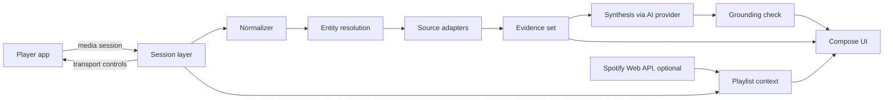

# Sleevesight

**Status:** Draft; Phase 0 passed, Phase 0.5 under way (platform findings in *Platform facts*)  
**Date:** 2026-10-12  
**Owner:** Wacek  
**Platform:** Android (Kotlin, Jetpack Compose, Material 3)  
**License:** [GPL-3.0](../LICENSE)  
**Repository:** [wkusnierczyk/sleevesight](https://github.com/wkusnierczyk/sleevesight)  
**Prototype:** [Sleevesight simulator](https://sleevesight.app/design/simulator.html)  
**Brand:** [Sleevesight brand sheet](https://sleevesight.app/design/brand.html)

Sleevesight is an open-source Android app that reads what a music player is playing, through Android's media session metadata, and shows grounded insights about the song, its artists, its album and its genres. It never touches the audio stream. Every insight is written by an AI service of the user's choice, from evidence retrieved from sources the user switched on, and every claim points back to its source.

## Summary

The phone already announces what is playing. Any app with notification access can read the title, artists, album, duration and album art of the current track from every player that publishes a media session, and can send play, pause, next and previous back to it. Sleevesight builds on that:

1. Read the now-playing metadata and normalize it: separate the song's own title and artists from what the player appends to them. Version tags such as "2006 Remaster" are kept as notes, the work a song is from is recorded as its source work, featured artists move into the artist list, and a list of artists is split into the credited artists. What remains is a clean key to look the song up by. See [Normalizer](#normalizer).
2. Resolve it to entities (recording, artists, release) and retrieve evidence from the sources enabled in Settings.
3. Have the user's chosen AI model write a short insight from that evidence only, with a citation on every factual sentence.
4. Check the citations mechanically before showing the text, and show the evidence underneath.

The prototype in the simulator covers the whole flow against a real 80-track playlist, with frozen lookups and, while it was hosted as a claude.ai artifact, live synthesis. The public copy linked above has no AI service, and its insight cards show the first facts found instead. This document records what it established and what still has to be verified on a real phone.

## Goals and non-goals

### Goals

- Show, within a couple of seconds of a track change, what makes the current song interesting, with sources.
- Make where information comes from a user decision: curated databases, open-web retrieval, and the model's own knowledge are separate switches.
- Let the user choose the AI provider and model and bring their own API key. Sleevesight is the author of the text; the model is a supporting service.
- Work with any player that publishes a media session, with Spotify as the reference player.
- Control the player from the app (play, pause, next, previous) and hand off to the player for a song, artist or album.
- Fail visibly: when nothing is documented, say so; when a match is rejected, show why.

### Non-goals

- Listening to or analyzing audio.
- Accounts, telemetry, analytics, social features, streaks, notifications. None of these ship, and CI enforces it (see Structural constraints).
- Replacing the player. Sleevesight never plays music itself.
- iOS. iOS sandboxing prevents reading another app's now-playing information; see Platform facts.

## Platform facts

These were established while designing, and checked in Phase 0 with the platform probe (`spike/`, removed after the gate; history keeps it) on a Samsung Galaxy S25 Ultra (SM-S938B, Android 16, API 36), with Spotify, Castbox (podcasts), YouTube Music (free tier) and a Sonos session, on 2026-10-12. Items marked **to measure** are still open.

### Reading now-playing

- `MediaSessionManager.getActiveSessions(componentName)` returns a `MediaController` for every app currently publishing a media session: Spotify, YouTube Music, Tidal, Deezer, podcast apps, browsers playing media.
- It requires a declared `NotificationListenerService`. Its `ComponentName` is passed to `getActiveSessions()`; without it the call throws `SecurityException`. The user grants access in Settings, Notification access.
- Use callbacks, not polling. `addOnActiveSessionsChangedListener` tracks sessions appearing and disappearing; `MediaController.Callback.onMetadataChanged` and `onPlaybackStateChanged` deliver track and state changes.
- **Spotify (measured)** fills `TITLE`, `ARTIST`, `ALBUM`, `ALBUM_ARTIST`, `DURATION`, the album art (a bitmap 300 pixels wide, usually 300×300, or 472×472, and an `ALBUM_ART_URI`), and `METADATA_KEY_MEDIA_ID` as a **`spotify:track:<id>`** URI. `ARTIST` is one comma-joined string of the credited artists ("Artist A, Artist B, Artist C"), as the normalizer assumes. It also sends its own keys: the playing context (`com.spotify.music.extra.CONTEXT_URI`, `CONTEXT_TITLE`, `CONTEXT_DESCRIPTION`, `CONTEXT_SHARE_URL`), an `ART_HTTPS_URI` on Spotify's image CDN, an extracted background colour, and explicit, download and advertisement flags. Its `CROSSFADE_ENABLED` and `CROSSFADE_DURATION` extras are **unreliable**: they read `false` and `5000` throughout, including a run with a 12 s crossfade, so nothing relies on them.
- **Castbox (measured)** fills `TITLE`, `DISPLAY_TITLE`, `ARTIST` (the publisher), `ALBUM` (the episode title), `DURATION`, `MEDIA_ID` (its own episode id) and, for the playing episode, `MEDIA_URI` and http(s) art URIs. **YouTube Music (measured, free tier)** fills `TITLE`, `ARTIST`, `ALBUM`, `ALBUM_ARTIST`, `DURATION`, an art bitmap, a rating (always unrated here) and video dimensions (always 0 here), but **no `MEDIA_ID` and no art URI**: a YouTube Music track is looked up and opened by its title and artists, and within a session told apart by its active queue item (see *Track changes*). On the free tier playback stops when YouTube Music leaves the foreground, so its session is often `PAUSED` or `STOPPED`; a paused session is normal, not a change. A **Sonos** session sent only art and an empty media id.
- **Spotify republishes unchanged metadata constantly**: about 93% of same-track updates across the three probe runs repeated the previous metadata exactly (776 of 834: each Spotify metadata update compared with the previous update of the same track, by media id, on all metadata values), and most of the rest changed only the art, the length (sent as a placeholder first) or the extracted colour. The debounce and the lookup-key comparison in the pipeline are what keep this from triggering lookups.
- Spotify also has an opt-in "Device Broadcast Status" setting that sends broadcast intents on metadata, playback-state and queue changes. The media session carries everything it does and more, so it is not used.

### Album art

- Spotify's `ALBUM_ART_URI` is a `content://com.spotify.mobile.android.mediaapi/...` URI, and **another app can read it**. The bitmap and the https URI are there as well.
- Castbox publishes http(s) art URLs (and a small bitmap), which `:sources` fetches like any other network resource.

### Controlling the player

- `MediaController.getTransportControls()` gives `play()`, `pause()`, `skipToNext()`, `skipToPrevious()` and `seekTo()`.
- Only offer an action the session advertises in `PlaybackState.getActions()`. **Measured:** Spotify advertises play or pause, previous, next, seek, play from search and play from URI; play, pause, next and previous were sent and worked (the others were not tried). Castbox advertises play, pause, next, seek and its own set, but not previous, and usually only play/pause while in `NONE` or `BUFFERING`. YouTube Music advertises play, pause, previous, next, seek and play from search, URI or media id. Next and previous come and go in its advertised actions (they are missing, with seek, in its early `STOPPED` and `PAUSED` states); its session extras carry only two car display hints.

### Opening the player

- `MediaController.getSessionActivity()` returns a `PendingIntent` to the player's own screen **for Castbox, which opened it (observed by the tester), and for YouTube Music (not tried); Spotify publishes none.** So for Spotify the app opens the player through a `spotify:` URI or its launch intent instead.
- Opening a specific track, album or artist in Spotify needs a Spotify ID: `Intent.ACTION_VIEW` with `spotify:track:<id>`, `spotify:album:<id>` or `spotify:artist:<id>`. **Measured:** `spotify:track:` with the id from `MEDIA_ID` opens the track.
- When no ID is known, fall back to `spotify:search:<query>`, which always opens (**measured**). Log the fallback.

### Playlist context

The media session carries more context than the design assumed. In order of reliability:

1. **Spotify's metadata.** `CONTEXT_URI` and `CONTEXT_TITLE` name the playlist or album being played (`spotify:playlist:...` and the playlist's name), **without an account**.
2. **The session queue.** Spotify publishes `getQueue()` (the playing track, then the upcoming ones, with `spotify:track:` ids; 4 to 50 items, one fewer per track, reset when a track is opened through a deep link; the playing track's media id matches the queue's first item in every capture, while its active queue item can lag a new track's queue for a moment) and `getQueueTitle()` ("Play Queue"). Castbox publishes its queue too (episode ids), and YouTube Music its "Up next" (13 to 25 items, titles without media ids, starting with the playing track rather than after it).
3. **Session history.** Every track the app has seen play. Always available, but it only knows the past.
4. **Spotify Web API, optional account.** `GET /playlists/{id}/items` returns the whole playlist, not only what is queued.

The track lists can therefore say "In this playlist · <name>" without the optional account; the account adds the full playlist beyond the queue.

### Track changes

Measured for decision D5 on 21 Spotify track changes (of 24 logged; the other three were two Castbox changes and one at the start of a probe session): at each change, the previous track's remaining time (its length less its position, extrapolated from the last playback state), and the playback states before the new metadata (the probe kept the last 3 s; the table counts the last 1.5 s).

| Change | Count | Remaining in the previous track | `PLAYING` states in the 1.5 s before |
|---|---|---|---|
| Ended on its own, no crossfade | 4 | −87 to −39 ms | 6 |
| Ended on its own, crossfade 12 s | 3 | 11.945 to 11.987 s | 6 |
| Skipped in Spotify, with earphones or from the notification | 12 | 20 s to 429 s | 0 |
| Skipped with the probe's buttons, just after pressing play | 2 | 175 s and 369 s | 3 or 4 |

- **No skip state.** Neither Spotify, Castbox nor YouTube Music reported `STATE_SKIPPING_TO_NEXT` or `STATE_SKIPPING_TO_PREVIOUS`, for any kind of skip. Skips in the Spotify app, from earphones and from the notification look the same to the session.
- **A natural end lands exactly at the crossfade.** Without crossfade the change comes within 0.1 s of the end; with a 12 s crossfade, 12.0 s before it, every time within 60 ms. Seeking towards the end beforehand changes nothing.
- **Timing alone is ambiguous inside the crossfade.** The remaining time is measured against the track's full length, so a skip 8 s before a 12 s crossfade reads as 20 s remaining. With a 5 s crossfade, a natural end and a skip 5 s before the transition would both read as 10 s: one change cannot say which it was.
- **The state clusters.** Before every natural end Spotify published two clusters of about six `PLAYING` states: one about 3 s before the change, and one 0.5 to 1 s before. Before a skip from the app, earphones or the notification it published none. Mid-track it publishes nothing but clusters around seeks and an occasional cluster of three. The late cluster therefore separates a natural end from a skip even where timing cannot. It is undocumented Spotify behaviour, so it is used with the timing, not alone. A seek shortly before a skip near the end is not measured.
- Skips made from Sleevesight itself need no detection: the app sent them. The probe-button rows show only that recent playback activity produces a few states (3 or 4), which is why the rule counts states rather than asking for any.
- Castbox, when skipped, sent the new episode's state (position 0) before its metadata; the probe's estimate handles both orders.
- **YouTube Music** (a short run on the free tier): one track listened to the end, then skips early, mid-play and late. It **re-sends the playing track with a new length** (in this run 106 s, then 278.8 s, then 279 s, for one track), so for this player the length is not part of a track's identity; the active queue item is, and it moved exactly at the tester's four changes. Read by the queue item, the natural end came at the track's end (within 0.02 s of it, by the latest length), with no cluster of states before it, so the clusters are Spotify's alone; the skips left 290 s, 131 s and **7.2 s**, the late one reading as a natural end by timing alone, the accepted trade-off. The probe, which compared lengths, first took the length updates for track changes; that is the lesson for the app: a track is identified by its media id, else by the active queue item where the player publishes one (an item of −1, which YouTube Music reports at the start of a session and while stopped in the background, is no item; when either side has no item, title and artists decide), else by title and artists; a new length is an update, after which the time left is computed from the latest length. As with Castbox, the new track's first state (position 0) arrived just before its metadata, at the natural end and the skips alike.

**Decision (D5, refined):** a user setting, *Crossfade*: **Autodetect** (the default) or a fixed value, 0 to 15 s. Changes that Sleevesight caused itself (its own transport buttons, selecting a track) are known to be user-driven and are not put through detection. The rules below are the floor; D15 lets detection learn per player on the device, within them (`architecture.md`, *Learning skip detection*).

- A fixed value *c*: a change is a natural end when the remaining time is at most *c* + 0.5 s; for Spotify, also when the late cluster is there with at most 15 s remaining, so a value set below Spotify's real crossfade does not read natural ends as skips.
- Autodetect, for Spotify (the only player where the clusters have been measured): a change is a natural end when the remaining time is at most 15 s and either the late cluster is there (at least 5 `PLAYING` states within 1.5 s before the change) or the remaining time is within 0.5 s of 0 or of the learned crossfade. Otherwise it is a skip.
- Autodetect, for any other player: timing alone. A change with at most 15 s remaining is a natural end. Whether other players publish such clusters, or another signal, is investigated as they are covered.
- The learned crossfade: the remaining time of natural ends; when two agree within 0.1 s, that is the value, and when two later ones agree on another value, it replaces it, so a changed crossfade is followed. It only adds natural ends that lack the late cluster (a probe connected late, a restart); it never turns a change into a skip.
- Detection errs towards "ended on its own" (decision D5), with one accepted exception: under Autodetect for Spotify, a natural end that lacks the late cluster before any crossfade has been learned reads as a skip. That is the price of catching skips inside the 15 s window, and it ends once a crossfade is learned.

### Notification access and installation

- Installed through `adb`, the probe got notification access without restriction (`packageSource` OTHER, initiating package `com.android.shell`).
- **Installing from a file (measured, D7).** The probe's APK, opened from My Files, was first stopped by **Google Play Protect** ("App blocked to protect your device": Play Protect has not seen an app from this developer before), which offers **Install anyway**. After that, **Advanced Protection** blocked it outright ("Advanced Protection only allows apps from Google Play and other app stores pre-installed on your phone"), with no override. On this phone the device setting was off and the Google account is enrolled in Google's Advanced Protection Program, so the block presumably comes from that enrolment. So:
  - for a user without Advanced Protection, installing Sleevesight from a file costs at least a Play Protect warning (and, the first time, allowing the file manager or browser to install unknown apps);
  - for a user whose Google account is enrolled in Advanced Protection (and, by the dialog's wording, presumably one with the device setting on, which was not tested), only Google Play (or a store pre-installed on the phone) can install it, which rules out GitHub releases and F-Droid for them.
- Restricted settings on notification access, for an app installed from a file, could not be measured on this phone, since the install itself is blocked; it was measured on a second phone (next item).
- **Restricted settings (measured, #29).** On a Samsung Galaxy S23 Ultra (SM-S918B, Android 16, API 36, One UI 8.5, build `S918BXXSAFZI1`) with no Advanced Protection, on 2026-10-16, the debug `:app` APK from CI was copied to `Download/` and opened from My Files. My Files first had to be allowed to install unknown apps, then Play Protect blocked the install and **Install anyway** went through, as on the first phone. Android recorded a file install: `packageSource` 3 (`PACKAGE_SOURCE_LOCAL_FILE`), installer and initiating package `com.google.android.packageinstaller`, originating package `com.sec.android.app.myfiles`. Android **did mark the app restricted**: the app op `ACCESS_RESTRICTED_SETTINGS` read `deny` (`MODE_ERRORED`, which Android sets on file installs; the op's default is `allow`). Yet notification access was then granted from the app's first-run link with only the usual confirmation: **the restriction was not enforced** on that screen. The link asks for `ACTION_NOTIFICATION_LISTENER_DETAIL_SETTINGS` and falls back to the listener list; which of the two One UI showed was not recorded, and the other was not tried. So on this phone a file install costs two warnings and no unlock. One phone, one installer and one grant path only. A browser download gets the same marker and was not tried. Since the marker is set, the other grant screen, a Pixel or another Android version is likely to enforce it, so onboarding should still explain the unlock if access cannot be granted (`architecture.md`, R8).
- **Developer verification (checked 2026-10-16, #29; rechecked 2026-10-19).** Since 2026-09-30, on certified devices in Brazil, Indonesia, Singapore and Thailand, installs from the [participating stores](https://developer.android.com/developer-verification/guides#locations) (Google Play and several phone makers' stores) need a registered developer and package; installs from a file, and `adb` installs, are not checked yet ([FAQ](https://developer.android.com/developer-verification/guides/faq)). Google plans a global rollout in 2027. From then, an unregistered app would install only through `adb` or the *advanced flow* (developer mode, a check that nobody is coaching the user, a restart, a one-time one-day wait and a biometric or PIN confirmation, then installs allowed for 7 days or indefinitely, each still warning of an unverified developer). Short of full registration, a free *limited distribution* account registers packages whose builds install on up to 20 devices: no government ID is checked, but the account needs a Google payments profile (with a legal name and address), 2-Step Verification and a contact email; each device's user consents on the device, through a QR code or a link, and the device is registered in the Android Developer Console ([limited distribution](https://developer.android.com/developer-verification/guides/limited-distribution)). It suits development builds handed to testers. Apps on Play are registered through the Play Console, so under D7 this concerns builds handed out as files: once the package is registered for full distribution, such a build should install as it does today (the unknown-apps permission and the Play Protect warning above remain). The rules and dates are still moving; check them again before a channel outside Play.
- `adb` installs escape the Advanced Protection block and restricted settings, as the probe's `adb` install on the first phone showed (first item), and developer verification, as Google's [FAQ](https://developer.android.com/developer-verification/guides/faq) says. The Advanced Protection block measured is the one that comes from the account's enrolment, with the device setting off; whether an `adb` install escapes the block of the device setting was not tested. Not every check: with *Verify apps over USB* on (developer options), an `adb` install can still be stopped by an "Unsafe App Blocked" warning, with *Install anyway* ([Android Studio, known issues](https://developer.android.com/studio/gemini/journeys#known-issues)).
- **Decision (D7, revised):** Sleevesight is distributed through **Google Play** (owner, 2026-10-12), the one channel that reaches every user, Advanced Protection or not, without a warning. Play's review of an app that holds notification access becomes part of the release work.

### Spotify Web API constraints

Since the February 2026 changes, Development Mode apps need the app owner to have Spotify Premium, are capped at five allowlisted users per client ID, and lost several endpoints and fields (artist followers and popularity, track ISRCs, artist top tracks, new releases). Extended quota is available to organizations only.

For an open-source app this is workable with a bring-your-own model: each user registers their own Spotify developer app and pastes its client ID, the same way they supply an AI key. The cost is friction, so the Spotify account stays optional and nothing in the core flow depends on it.

## Architecture



### Session layer

- `NotificationListenerService` plus `MediaSessionManager`. Follows only the players switched on under Settings, Players; events from other packages are dropped and logged as ignored. A player is listed there once its session has reported music, a title and an artist, so dialer calls and most video apps never are; phone calls (the telecom and dialer packages, or a session whose audio is voice communication, checked again before every read and report, and as reports settle) are never read, whatever the settings say (#435), from when Android marks them. A VoIP call in an ordinary media session is not recognised.
- **Debounce of 650 ms** on metadata changes. A person flicking through tracks produces a burst of changes; only the last one triggers lookups. In-flight retrieval and synthesis for a superseded track are cancelled.
- Seeking or pausing changes playback state, not metadata, and never triggers a lookup.
- Exposes transport controls and the session activity to the UI.

### Normalizer

Players report a song the way their catalogue files it, which is often not how sources such as MusicBrainz and Wikipedia name it: "Fisherman's Blues - 2006 Remaster" is the song "Fisherman's Blues", and "Baby, Please Don't Go (feat. Van Morrison)" has a second artist hidden in its title. Normalizing turns the title and artist strings into the song's plain title, its list of credited artists, and a lookup key, without losing what it removed: each removed part is kept, as a note, a source work, a variant or an added artist. Rules proven on the test playlist:

| Input pattern | Action | Example |
|---|---|---|
| A trailing `- 2006 Remaster`, `- demo`, `- Radio Edit`, `- … Version` | Strip, record as a note | "Fisherman's Blues - 2006 Remaster" |
| `(feat. X)` in the title | Move X to the artists | "Baby, Please Don't Go (feat. Van Morrison)" |
| `(From X)`, a trailing `- From "X"` | Strip, record the source work | "The Departure (From The Leftovers)" |
| `(felt piano)`, `(acoustic)` | Strip, record as a variant | "And Dream Of Sheep (felt piano)" |
| `A, B, C` in the artist field | Split into credited artists | "Peleboy, Tony K" |

The key is the lowercased, accent-folded primary artist plus the normalized title, keeping letters and digits in any script, and `+` ("C++" is not "C"); other punctuation, symbols and emoji become a space, unless they are all there is (a title `★` keys as `★`). Accents are folded on Latin and Greek letters only: Cyrillic `й` is not `и`. Duplicates in a playlist hit the cache.

### Entity resolution

The hard part, and the place most failures came from in the prototype. Resolution produces a **typed outcome** per source, never a silent miss:

| Outcome | Meaning |
|---|---|
| `song_article` | The source describes this recording |
| `artist_article` | The source describes the performer only |
| `original_song` | The source describes the song as first recorded by someone else; this track is a cover or version |
| `rejected(reason)` | A candidate was found and failed the entity check, for example a different artist with the same name |
| `none` | Nothing found |
| `source_off` | The user switched the source off |
| `unreachable` | Network or source error |

`none` and `source_off` are deliberately different: one is a gap in the world's documentation, the other is the user's choice.

Rules:

- **Resolve each credited artist separately.** The prototype only resolved the primary artist, so secondary artists' boxes were nearly empty.
- **Keep recording and release apart.** A release date belongs to the release the player filed the recording under, which is often a compilation or remaster. The prototype showed "Released 2002" for a 1978 song for this reason. MusicBrainz models recordings, releases and release groups separately; use it to find the first release date of the recording.
- Entity matching is deterministic code (name similarity, duration tolerance, MusicBrainz relationships), never the language model.

### Source adapters

One interface, one adapter per source:

```kotlin
interface SourceAdapter {
    val id: SourceId                 // MUSICBRAINZ, WIKIPEDIA (also emits WIKIDATA lines), LASTFM, DISCOGS, WEB
    suspend fun lookup(track: NormalizedTrack, resolution: Deferred<Resolution>): SourceResult  // typed outcome + evidence lines; see architecture.md, Source adapters
}

val SourceAdapter.tag: String get() = id.tag   // MB, W (and WD), L, D, G
```

| Source | Role | Notes |
|---|---|---|
| MusicBrainz | Recordings, releases, credits, relationships, first release dates | Rate limit about one request per second; descriptive User-Agent with contact info is required. No key. Core data is CC0; tags and genre associations are CC BY-NC-SA 3.0 (`architecture.md`, *Licensing*). |
| Wikipedia and Wikidata | Song and artist articles | Reach the article through the MusicBrainz Wikidata link where possible, to avoid same-name collisions. No key. |
| Last.fm | Artist bio, listener count, tags, similar artists | User's own API key. Tags are crowd-applied and noisy; similar artists come from listening overlap, not audio. |
| Discogs | Releases and personnel | User's own token. |
| Web search | Generic RAG over the open web | User's own key; Exa first (D11, below). Results may describe a different song with the same title, so they are filtered. |

The model's own knowledge is modelled as a pseudo-source with tag `M`: it retrieves nothing, and when enabled it lets the model add at most one claim, marked unverified.

#### Web search provider (D11)

**Exa first** ([#40](https://github.com/wkusnierczyk/sleevesight/issues/40), 2026-10-14). The user brings the key, so the deciding points are what a key costs them to get and keep, and whether the results are worth an evidence line. Exa's free tier needs no card and renews monthly; on the fixture's thin tracks it found real listings where the simulator's search found nothing; and its terms, though strict, are no worse than the others'. Only Exa was tested live: it is the only key the project holds. The others were compared on their official pages (2026-10-14):

| Provider | Free tier | Card for the free tier | Price per 1000 searches | Rate limit | Terms on results |
|---|---|---|---|---|---|
| **Exa** | $10 of credit a month, "up to 2,500 Instant searches" | No | $4 `instant`, $7 `auto`, for up to 10 results; whether highlights cost more is ambiguous (below) | 10 per second for `/search` | §4.2(a): no copying, distributing or displaying information obtained through the services beyond the terms or Exa's written leave; no attribution clause |
| Brave Search API | $5 of credit a month | Yes ("to verify identity", not charged) | $5 | 50 per second | Storing results needs a plan with storage rights; grants no rights in the third-party pages |
| Tavily | 1000 credits a month (a basic search is 1 credit) | Pricing page says no; the owner was asked for one at sign-up | $8 (pay as you go) | 100 a minute on a development key | For integration in the customer's own applications; no attribution clause |
| Linkup | $20 of credit, topped up monthly, for a professional email | Not stated | $5 (standard search) | Not stated | Not reviewed |
| You.com | $100 of credit at sign-up | Not stated | $5 | Not stated | Not reviewed |
| Serper, SerpApi | 2500 queries once; 250 a month | No; not stated | $0.30 to $1; $25 for 1000 a month | 50 per second; 50 an hour | They resell Google's results page, scraped: not a sound basis |
| Google Custom Search JSON API | Closed to new customers, ends 2027-01-01 | | | | |
| Bing Web Search API | Retired in 2025 | | | | |

**What a search with highlights costs is not settled by Exa's documents** (checked 2026-10-14). The [pricing page](https://exa.ai/pricing) and [pricing docs](https://exa.ai/docs/admin/pricing) say a `/search` price covers up to 10 results and that "Additional results and Exa-generated page summaries are billed on top"; they price contents at "$1 / 1k pages, per content type" in the `/contents` row, and say nothing on text or highlights requested within `/search`. The [search reference](https://exa.ai/docs/reference/search) describes `costDollars.contents` as the cost of "standalone content retrieval", with text, highlights and summaries "billed outside the bundled search price", and calls `costDollars` an estimate, "not an invoice record". In the spike every `instant` search with 10 highlighted results reported $0.004 and no contents charge. So a month's free credit is 2500 searches if highlights are included, as the spike's estimates suggest, and about 700 if each highlighted result costs $0.001 on top ($14 per 1000); the dashboard's usage settles it. The adapter keeps `numResults` at 10: the filter kept 0 to 4 of 10 on the thin and same-title tracks, so fewer candidates would cost lines where they are scarcest. If highlights turn out to be billed per result, 5 would halve that charge.

**The live test** (20 calls, about $0.10 by Exa's estimates): tracks 1, 12, 23, 30, 45, 61 and 77, with `auto` and `instant`. `instant` was as relevant as `auto` at a tenth of the latency (0.3 s against 3 s) and a little over half the price, so the adapter uses it. On the thin tracks Exa found what the simulator's search did not: for 23, a library catalogue entry naming the composers and the album, a soundtrack listing with the scene, and two song-database pages; for 30, a soundtrack listing and a CritiqueBrainz page; for 77, only Alphaville's and Rod Stewart's songs, which the filter rejects. For 12 it mixed Reem's song with Juice WRLD's of the same name and returned one undecodable page; for 61 one Spotify page for Jessiah's recording among other artists' "willow"s; for 45, Yanjoco's own listings and a Spotify page for another Yanjoco song whose list of the artist's tracks named the title, the case behind the filter's rule on result titles below. This is a summary; no result text is kept in the repository (*Open on the terms*). The app's and the CLI's retrieval cache does keep web search results on the device, for web search's lifetime (D9: 1 day), like any other source's: during development, by the owner's decision of 2026-10-14 ([#81](https://github.com/wkusnierczyk/sleevesight/issues/81)), which reversed the #44 review's refusal, since without it every repeat lookup is a paid search.

**Keeping results about the right recording.** The query is `"<title>" from <work> by <artists>, song`, the `from` part only when the player names the work (track 34, `Theme` from Coronation Street), which suits Exa's neural search; highlights of at most 300 characters, steered by the same words, are the snippet. A track with no credited artist is not searched, since no result could be checked. Ten results are asked for, and at most five kept, in Exa's order. Phrases are matched whole in the result's title and snippet, after folding case, accents and punctuation, with `&` read as `and` and apostrophes dropped ("Don't" and "Dont" agree) except before a possessive "s", which stays a word of its own ("Lightfoot's" still names Lightfoot). A track whose title or artists fold to nothing (an artist named "!!!") is not searched either. A result is kept only if:

- it names the title, and the work it is from when there is one;
- it names a credited artist, and a distinctive one when the track has one: an artist named only with common words (Them, To Twelve) counts only when no credited artist is distinctive, so track 63 needs Van Morrison;
- its own title does not name such an artist without the song. A page titled after the artist alone is about the artist or another of their recordings (Yanjoco's "Caravan" page, which lists the song among the artist's others), so a mention in its snippet does not count. A page titled after neither, such as a catalogue entry or a soundtrack listing, is judged on its snippet, which keeps the thin tracks' best results. Results from the sources the pipeline reads through their own adapters (Wikipedia and its mirror Wikiwand, Wikidata, MusicBrainz, Last.fm, Discogs) are excluded in the query and dropped again by the filter, so their text arrives only through the adapter that verifies it. Kept results give `song_article`; results that all fail give `rejected`; no results give `none`. Known limits: an artist named only with common words, when no other credited artist is distinctive, is matched by those words; a result can quote lyrics; a page about another recording that names the song and the artist in passing still passes; and a listing titled with several artists, this one among them, but not the song (a soundtrack page titled "Ray Johnson And The Sou' Westers, Die Hexen and others") is dropped, even when it lists the song.

**Open on the terms.** Exa's §4.2(a) forbids, without its written permission, to "download, modify, copy, distribute, transmit, display, perform, reproduce, duplicate, publish, license, create derivative works from, or offer for sale any information" obtained through its services. Read literally, it covers what the app does with a result on the user's own key: it displays the highlight, transmits it to the user's AI provider in the prompt, and creates a derivative work from it, the written insight. Showing results is what the API is for (§1.1 grants use "for the limited purposes set forth in the documentation"), but the terms do not say so of these uses. Before release, confirm with Exa that the app's use is within the terms, including the on-device retrieval cache, which keeps web search results for a day during development (owner, 2026-10-14); the question is tracked in [#80](https://github.com/wkusnierczyk/sleevesight/issues/80) and must be settled before the app is published. Because the same clause covers stored copies, the test fixtures in `fixtures/http/web/` are synthetic: the requests are the adapter's own, the responses have Exa's shape with titles, URLs and highlights written by the project; live checks go through `ExaLiveTest`, which keeps nothing. A second provider can be added behind the same `SourceAdapter`, with the filter shared.

### Evidence model

```kotlin
data class EvidenceLine(
    val id: String,          // "W1", "L3", "G2", "P1"
    val source: SourceId,
    val scope: Scope,        // SONG, ARTIST, ORIGINAL_SONG, RELEASE, WEB
    val text: String,        // one claim: templated from structured data, or a short attributed quote, never a whole passage (D1)
    val url: String?,
    val retrievedAt: Instant,
)
```

`P` lines come from player metadata (the release). Scope is passed to the model so it never credits an original song's facts to a cover act.

### Synthesis

- **Provider abstraction.** `AiProvider` with implementations for Anthropic, OpenAI, Google and a local model through Ollama. The user switches one provider on, and sets each provider's key, model and reasoning effort, which it keeps while switched off.
- **Role of the model.** It narrates retrieved evidence. It does not resolve entities, rank sources, or decide what is true.
- **Citation contract.** Every factual sentence ends with the ids of the evidence lines that support it. No names, dates, places or numbers outside the evidence. No sentence goes uncited: where the evidence covers only part of what an insight would say, the insight is shorter, and says nothing of what is missing (prompt version 3, #193). Version 2 (#46) ended such an insight with the fixed, uncited sentence `Little else is documented.`, which ended nearly every insight and told the reader nothing; the grounding check still reads it as a hedge. When the evidence has nothing to narrate (`EvidenceSet.nothingToNarrate`: no line at all, or only the player's release, which repeats what the player reports), no call is made and the card says "The sources give nothing to write an insight from." With model knowledge on, a set of only the player's release gets a call once the player has reported the artists, since the model may add the one unverified `[M]` sentence the user opted into. Before the artists (some players report the title and album first), it gets none, whatever the switch (#204): the card written then would stand for the track, since nothing is written twice for one track without a tap (D5), and its `[M]` sentence would be written without the artist; with no call, the report with the artists is decided afresh. The model replies `NO_EVIDENCE` if the evidence it is given has nothing usable, and the card says the same. The text holds in every case it shows: sources that found nothing, failed or were unreachable, the release alone, or lines the model found unusable.
- **The insight stays on the track** (prompt version 4, [#239](https://github.com/wkusnierczyk/sleevesight/issues/239)). Artist-level lines (Last.fm's bio, the Wikipedia artist article, Wikidata's artist facts) are the same on every track by the artist, so an album played through sent them with every call, and where its songs are thinly documented the model filled the insight with them, the same facts track after track. The prompt now leaves some out (`PromptEvidence`), while *Tell an artist's facts once per session* is on, as it is by default ([#407](https://github.com/wkusnierczyk/sleevesight/issues/407); off, every prompt has every line, as before, for those who would rather each insight introduce the artist than be shorter): a track with at least four lines of its own (about the song, its original or from the web; the player's release does not count) gets no artist-level line, since its insights hardly used them; a track with fewer gets the artist-level lines that no other track's insight in the listening session cited (the history's session, *New session idle trigger*), so each artist fact is told once a session and a later track's insight is shorter rather than repeated. When leaving them out would leave nothing retrieved to narrate, the prompt has them all, with model knowledge on too, so the model's own unverified sentences never stand in for verified artist lines. Web lines count as the track's own; the measurement ran with web search off, and with it on most tracks reach the four. The lines kept keep their ids, and the Sources list shows the whole evidence. A fresh reply is checked against the lines its prompt held: a citation of a line left out is `unknown`, since the model never saw it, and its chip shows and reads as one of no line; such a card is shown but not kept, so a card served from the cache, checked against the track's whole evidence, reads as it did when it was written, and the track is written again, a paid call, the next time it plays. A `NO_EVIDENCE` reply to a prompt that left lines out is not shown and not kept: it is asked again at once, a second paid call, with every line, as the fallback above intends, and a Retry after that call failed or was stopped asks with every line too. Version 4 is a new prompt version though the template is unchanged, since the cards written before it on a thinly documented album are the repeating kind; each track kept is written afresh once. The synthesis cache keys a card by the whole evidence's fingerprint, not the part sent, so a track played again finds its card whatever the session had cited (*Caching and offline*). What the session cited is kept in memory, per session; after a restart the first insight may tell an artist fact again. It is kept with the setting off too, so switching it on mid-session leaves out what the session has already told. A card written with it on and served from the cache with it off (or the other way) is the card it was: the cache keys a card by the whole evidence, not the setting, so a track played again is not written again for it. A fact is matched by its source and its text folded (`ArtistFact`: case, spacing, quotation marks, apostrophes, dashes and a closing full stop ignored), since with the artist cache off ([#420](https://github.com/wkusnierczyk/sleevesight/issues/420), the default) each track's artist lines are fetched afresh, and a source may give a line back with its typography edited; a line whose words changed is another fact, and may be told again. Measured with the CLI's `--tracklist` on three albums and a one-artist playlist (2026-10-21, Claude Haiku 5.5): before, on the album with thin song evidence (*Sundown*), 8 of 10 insights cited an artist fact an earlier one had cited, and on the others none did, though artist lines were a quarter of every prompt; after, none did on any, input tokens fell by 29 percent over the 45 calls (93,318 to 66,407), output stayed level (8,627 to 8,773), and the grounding check found no unknown or uncited sentence either way.
- **The prompt's fixed part** (prompt version 5, [#399](https://github.com/wkusnierczyk/sleevesight/issues/399)). The instructions around the track and its evidence (the task, the data fences, the style and the contract) were about 2,800 characters, roughly 900 input tokens on Claude Haiku 5.5, on every call: more than the artist-level lines ever were. The contract was stated twice, before the style and again after it. It is now stated once, after the style, under a heading saying it holds whatever the style says, which keeps the guarantee the restatement gave; and its rules are shorter, each of the simulator's kept in substance. The fixed part is now about 1,500 characters, about 410 tokens fewer per call. Measured with the CLI over the four tracklists and the regression tracks (2026-10-22, Claude Haiku 5.5, web search off, both versions from the same retrieval, two to ten runs each): input tokens fell by 27 to 30 percent on every tracklist, and output tokens by 14 to 35 percent, as the thinly documented tracks' insights came out shorter; the grounding check found no unknown citation either way, and no uncited sentence on any tracklist. On the eight regression tracks with insights, version 4 had 3 uncited of 115 sentences over five runs, each run under 5 percent (at most 1 of 22 to 25), and version 5 had 3 of 85 over four runs, two of them at or over 5 percent (1 of 20, 2 of 24): its insights are shorter, so one uncited sentence weighs more in a run. On the three thinnest of them (30, 37, 48), run ten more times each, uncited sentences fell from 5 of 56 to 1 of 51. Since replies vary from run to run, the gate now judges uncited sentences over a full sample of at least 50 sentences, pooled over a run's passes (`--repeat`; `architecture.md`, *Testing*), where they must be under 5 percent; a smaller sample is not judged, but fails on a gross share of 15 percent or more of its own sentences (`Gate.GROSS_UNCITED`: a single run of 20 sentences fails from 3 uncited). Version 5 passes it in a three-pass run of the regression tracks (0 of 61); its four single runs, 3 of 85 together, are each under 50 sentences and under 15 percent (1 of 20, 2 of 24), so not checked. Wordings tried in the same runs and dropped: asking for an id on every sentence, before its full stop, made the model reason at length before a few insights of each album, so the first rule keeps "every factual sentence". On thinly documented tracks a sentence still restates the player's release line (`[P1]`) and adds nothing; none of the four rules tried against it was worth its cost: forbidding a sentence that cites only player metadata made the model reason at length; "give it no sentence of its own" made it correct itself in the open on one-line tracks ("Wait, ..."), uncited; "do not restate" it, with "write fewer, even one", answered `NO_EVIDENCE` for a track with one usable line; and "do not pad it with the title, artists or release" left most of the padding. The sentence is cited and true; it is now stopped in code instead (*No restated release*, below).
- **No restated release** (prompt version 6, [#424](https://github.com/wkusnierczyk/sleevesight/issues/424)). On thinly documented tracks the model padded the insight with a sentence citing only the player's release line, `P1` ("This recording is on that same "Sundown" release [P1]"), right after a sentence citing MusicBrainz's "first released ..., on the album "Sundown"". The prompt now leaves the `P` line out when MusicBrainz's first-release line says the song first came out on an album of the same name (`PromptEvidence.restatesRelease`), so there is nothing to restate. The album is read from its own slot of that templated line (`MusicBrainzEvidence.firstReleaseAlbum`: "..., on the album "Sundown"."), after its date and type, whole even when its title holds the template's own words, and never from the track's title or the artist credit the line quotes too. The two names are compared whole, folded as an `ArtistFact`'s text is (case, spacing, quotation marks, apostrophes, dashes and a closing full stop), the player's less its closing bracketed parts, balanced and nested ones included, as long as a name is left (`PromptEvidence.edition`: the player's "Rubber Soul (Remastered)" is MusicBrainz's "Rubber Soul"). MusicBrainz's name is taken as it is: a song first released on "Sundown (Live)" came out on another edition than the studio "Sundown" the player reports, so that `P` line stays. So "Greatest Hits" is not "Greatest Hits II", a title track first released as a single keeps its line (the album it is on is another release), and a short name such as the Beatles' "1" counts only as the whole album's name. A first release on a single or an EP does not count, nor does a player's "Sundown - Single", whose single is not the album. Free-text lines (Wikipedia's "from his 1974 album Sundown", the artist's lines, an original song's, the web's) do not count either: a name found inside a sentence may be part of a longer one, or another recording's. Where the song first came out elsewhere, as for a compilation or a soundtrack, the `P` line stays, and a sentence citing it tells the listener where this recording comes from ("It appears on the soundtrack for Bang: The Bert Berns Story [P1]"). It holds whether *Tell an artist's facts once per session* is on or off ([#407](https://github.com/wkusnierczyk/sleevesight/issues/407)). The release stays in the prompt's track block either way, and the `P` line in the track's evidence and its Sources list; it is left out as the artist-level lines are, keeping the ids, so a reply citing it is `unknown` and not kept, and a `NO_EVIDENCE` reply is asked again with every line. The other candidate, flagging a sentence that cites only `P` lines in the grounding check and dropping it from the card, was compared on #399's recorded version 5 replies (the four tracklists and the regression tracks, 2026-10-25, no new calls): of 38 sentences citing only `P1` over 22 runs, 15 were on tracks where MusicBrainz's first-release line names the album, 7 of *Sundown*'s 8 among them; the other 23 named a compilation, a soundtrack or a release no other line gives, and say something. Dropping every such sentence would have cut those as well, cut 14 of the 30 insights of the three thinnest regression tracks to one sentence, removed text the card had already streamed, and saved no tokens, the sentence having been written; leaving the line out spares its tokens in every prompt that had it, an estimated 1 to 3 percent of a tracklist's input. Version 6 is a new prompt version though the template is version 5's, as version 4 was: the cards written before it on thinly documented tracks are the padded kind, and each track kept is written afresh once.
- **No cached prefix** (#399; the providers' documentation, read 2026-10-22). A cached prefix would need the fixed part first, before the track and its evidence, and long enough. Anthropic caches a prefix the request marks (`cache_control`) from 512 tokens on Claude Haiku 5.5, writes at 1.25 times the input price and reads at 0.1 times, for five minutes from its last use; OpenAI caches automatically from 1,024 tokens on GPT-5.6 and later; Google's implicit caching, on by default from Gemini 2.5, lists minimums of 2,048 to 4,096 tokens and none for Gemini 3.5 Flash-Lite. The fixed part is an estimated 490 tokens (the 1,262 characters left out were 407 tokens), about 520 with *Model's own knowledge* on, just over Anthropic's 512 minimum and under the others'. It is not cached all the same: the prompt gives the data first, so the fixed part is no prefix, and a warm cache would save about four thousandths of a cent a call. So the prompt keeps the data before the instructions, and no client marks a cache. Should a fixed part grow past a minimum (the genre and sounds-like cards' JSON contracts), the change is that order, the prefix sent as a block of its own with Anthropic's mark, and the cache's token counts in `Usage`, since Anthropic's `input_tokens` leaves out the tokens read from or written to the cache.
- **Grounding check, in code, before display.** Each sentence is classified as `ok`, `hedge` (states a gap), `model` (cites `M`), `uncited`, or `unknown` (cites an id that does not exist, or cites `M` when model knowledge is off). Uncited and unknown sentences are underlined; the counts are logged, and the card's note counts the sentences the sources do not back (#437), the full counts behind *Show grounding details*.
- **Cards that use general knowledge.** Genre descriptions, artist comparisons and suggestions have no retrieved source today. They are generated as structured JSON, rendered in a separately labelled "general knowledge" section, and never mixed into the grounded text. See Open questions.

Prompt contracts are in the appendix.

### Genre labels

- Derived from tags filtered through a fixed genre vocabulary: Last.fm's, and from Phase 1.0 MusicBrainz's (D12). Tags outside the vocabulary (places, decades, "seen live", noise such as "bagel" or "under 2000 listeners") are dropped.
- Each vocabulary entry belongs to a family with a fixed hue: folk 135, rock 8, pop 328, hip-hop 30, soul and R&B 48, reggae 92, electronic 190, soundtrack and classical 262, jazz and blues 215. The families are for the genre cards; the labels themselves are plain (#439): a hue per family made related genres match, but the code was arbitrary and unknown to the reader.
- Labels have a level ([#439](https://github.com/wkusnierczyk/sleevesight/issues/439)): the track's, each artist's, the album's. An artist's tags describe a career, not the track playing (The Beatles: rock, pop, psychedelic; "Michelle": closer to a ballad), and both sources tag tracks and albums too. The track's come from Last.fm's track tags and MusicBrainz's recording tags, the latter with the recording lookup the resolution already makes; the artists' from both sources' artist tags; the album's from Last.fm's album tags. MusicBrainz's release tags would take a request of their own, so it gives no album labels. Last.fm's track and album tags are one request each per track, asked for once Last.fm shows the artist and has not rejected the primary one; the album's are kept per album while *Keep what sources said about each artist* is on (`architecture.md`, *Genre labels*). At most five labels a level, and per artist; a genre found on several levels shows on each. Which labels open a genre card is unchanged: an artist's, as before, unless [#101](https://github.com/wkusnierczyk/sleevesight/issues/101) decides otherwise.
- Measured on the test playlist (2026-10-24, live, 80 positions): Last.fm's track tags labelled 5 tracks and its album tags 11, all of them tracks its artists' tags labelled too (53); MusicBrainz's recording tags would label 18. On three albums (`fixtures/tracklists/`) the album's labels came on every track, Last.fm's track labels on 19 of 35 (none on Rubber Soul, whose tracks Last.fm leaves untagged), and MusicBrainz's recording labels on 30 of 35: the requests pay off on well-known music, little on the playlist's (`architecture.md`, *Genre labels*).
- MusicBrainz tags are a genre label source from Phase 1.0 (D12, revised 2026-10-15), for labels only: they are never sent in a prompt. Which sources give labels is a user setting ([#84](https://github.com/wkusnierczyk/sleevesight/issues/84)), MusicBrainz on by default, since it needs no key, and Last.fm on, giving labels once its key is set. With both on, Last.fm's labels come first on each level's row and MusicBrainz's fill the room left, at most five a row; a label both give is shown once and credits both (`architecture.md`, *Genre labels*). A label only MusicBrainz gives is display-only: it opens no AI-written genre card content (no `fits`, no genre card prompt) unless [#101](https://github.com/wkusnierczyk/sleevesight/issues/101) decides otherwise; a label Last.fm also gives is unaffected. Tapping a label only MusicBrainz gives shows only its attribution, the link to the artist's or the recording's MusicBrainz page with the credit "MusicBrainz contributors, CC BY-NC-SA 3.0": as a page under *Separate pages*, inline under the chip under *Expandable boxes* (*Layout setting*). The MetaBrainz inquiry ([#100](https://github.com/wkusnierczyk/sleevesight/issues/100)) is settled before the Play release: answered and its terms met, or the tags off by default in the release, with the reason recorded. The choice is re-evaluated in Phase 2 ([#101](https://github.com/wkusnierczyk/sleevesight/issues/101)). A label supported by MusicBrainz tags links and credits MusicBrainz ("MusicBrainz contributors, CC BY-NC-SA 3.0"), alongside Last.fm where both contribute (`architecture.md`, *MusicBrainz tags and genres*). The vocabulary may take names from MusicBrainz's genre list, which is CC0.
- In the test playlist, 30 of 78 unique tracks got no genre labels from Last.fm because their artists have no usable tags, and 27 got none from Last.fm and MusicBrainz together (*Gate run (#46)*, *D12*).

### Caching and offline

- Retrieval is cached per source and lookup key, as the evidence and outcome the app uses, never the raw response; synthesis per kind, entity, the exact evidence it was written from (the track's whole evidence, not the part the prompt sent, #239), prompt version and style, provider, model and the model-knowledge switch (`architecture.md`, *Cache and history*).
- Offline, cached tracks still work fully; uncached lookups fail with `unreachable`, never with a blank card. The home screen says the phone is offline while a source is unreachable, and once it is back online the playing track's unreachable sources are asked again, once per return ([#192](https://github.com/wkusnierczyk/sleevesight/issues/192)).
- Each insight is a paid call on the user's key, so when one is written is a user setting, *Reactive* (D5; once *Write insights automatically*): on track change (the default), on skip, or manual. Under *On skip*, user-driven changes (a skip in the player, select, play) write, and tracks that change on their own get evidence and a Write button. The default went with writing the next track's insight ahead (D13); Spotify's queue gives no album or length to key it on ([#172](https://github.com/wkusnierczyk/sleevesight/issues/172)), so the card is written when the track starts, its lookups mostly done ahead (#20). One tap lasts as long as the app's process, often days, so automatic writing pauses once the app has not been on screen for more track changes than a user setting, *Saver*, names (5 by default, or off), and waits for a new tap ([#203](https://github.com/wkusnierczyk/sleevesight/issues/203)).

## User interface

Material 3, with dynamic color taken from the album art (material-color-utilities from the art bitmap), light or dark as the phone is unless the user chooses one (*Theme*, #444), and its text in Roboto, bundled with the app, unless the user chooses the system font (*Settings*, #377). The prototype is the reference for layout.

Links, headings and switches leave the palette's accent colour out ([#442](https://github.com/wkusnierczyk/sleevesight/issues/442)): the system's accent (on Android 12 and later, from the wallpaper or the chosen colour theme) is out of place beside the art's colours, and links were styled two ways. Every link is in the colour of the text around it, with a thin line a little below the text, clear of the descenders and under its glyphs only, in either writing direction (one style, `LinkedText`); focused from a keyboard, hovered or pressed, it takes a faint tint of the text colour. A highlight in a darker tint of the background was tried as well and dropped: on the home screen it reads as one more chip beside the genre chips, the citations and the sources' tags. Settings' section headings are bold, in the text colour. A switch is in the text colour when on, its thumb in the background's (black and white, white and black in dark mode), and Material's greys when off. The text keeps WCAG AA contrast (4.5:1) and the switches' states 3:1, in the app's colours and the art's. The rest of the palette stays as it is; a fixed palette is a setting for later (#443).

### Logo and intro

The header of the home screen carries the logo on one line (#383): "Sleeve" in ink and "sight" in the wordmark's red (the record label's, `#cf222e`, on light and dark alike), followed by the record, in the stacked mark's type (Roboto Flex regular, 88% wide), drawn from outlines (`assets/logo/src/make_app_logo.py`), so the app carries no Roboto Flex. The product page's stacked mark is too tall for an app bar.

When the app is opened from the launcher with no screen to restore (not a return from the background, nor a rotation), it plays one of the product page's intros, picked at random: C, D, F, R1 or R2 (`index.html`, `.sl-intro`), on its timings, after Android's splash screen. Each ends on the stacked mark, which comes apart as it flies onto the header: "Sleeve", "sight" and the record each travel to their places on the one line while shrinking to it, and the screen arrives behind them (D's record turns in beside "sight" once its words have landed). On the first-run screen, which has no header logo, the mark fades where it is instead. A tap, Back or any key ends the intro at once (keys Android counts as system keys, `KeyEvent.isSystem`, such as volume and media keys, still do their own work too), and while it plays the screen beneath is hidden from accessibility services. It does not play under *Remove animations* (animator duration scale 0), with touch exploration on (TalkBack), or with *Logo intro at start* off; other animator duration scales stretch or shorten it. The process may have been running for the notification listener: what counts is whether the app was open.

### Home screen, top to bottom

**Header** (#445). Pinned at the top; everything under it scrolls, with a thin divider under it once scrolled. At the left, the one-line logo (#383, *Logo and intro* above): a tap scrolls Home back to the top, animated, or at once with the phone's animations off; a screen reader says "Sleevesight, scroll to top". At the right, the Material *settings* symbol, a cogwheel, opens the settings, with the content description and tooltip "Settings". Both are at least 48 dp targets. A menu icon, if one comes, goes beside the cogwheel.

1. **Player row.** Player name and state ("Spotify · Playing"). The name opens the player's own screen through the session activity. Previous, play or pause, next act through transport controls.
2. **Album art**, which opens the album in the player. Playback progress under it.
3. **Key data** (#438). Song title, larger and bold; then the artists (each one separately), smaller and regular; then the album at the artists' size, in italics, followed by a comma and the year of first release: *Rubber Soul*, 1965. No album reported: the year alone, or "Album not reported" with no year either. No year: the album alone. The album and the year are one line to a screen reader.
4. **Genre labels** (#439). No heading: genres are a fold. Folded, **Genres ▸** and the chips of the most specific level found (the track's, else the album's, else the artists'). Unfolded, **Genres ▾** and a two-column table, a row per level that has labels, in the header's order: *Track*, *Artist* (one row each, the artist's name before its genres, so the left column stays narrow), *Album*; the left column right-aligned, the right left-aligned; a row with none is skipped. Labels of one level only show as its chips, with no fold and no table; none, "None found."; with every label source off, "Every genre source is off in Settings."; with *Show genres* off (#444), nothing of the genres shows. The fold uses the usual disclosure triangle, right when folded, down when unfolded, as the Sources fold does. Chips are plain: a light neutral fill in the text's colour, darker while selected, with no hue per genre family. Each new track starts folded. A tap on a chip says where it comes from, naming the level ("comes from the track's tags on: Last.fm"); on an artist's label it is where the genre's detail content opens, except on a label only MusicBrainz gives (D12, *Genre labels*). A screen reader says the fold's state ("collapsed", "expanded") and reads each row as one ("Track: Baroque Pop, Ballad"; "Artist, The Beatles: Rock, Pop") before its chips.
5. **Why it's interesting.** The grounded insight with citation chips. Under it, a note only when there is something to say (#437), in one line: how many sentences the sources do not back (uncited, citing missing evidence, or from the model's own knowledge: "1 sentence is not backed by the sources."), and "Kept from before." for a card shown from the cache, which explains *Rewrite*. No grounded count: the citations show that a sentence is grounded. The check's full counts ("2 of 3 sentences grounded · 1 uncited") are behind *Show grounding details*, a developer option.
6. **Sounds like.** Similar artists as tappable chips.
7. **Sources.** Quiet styling, the last of the track's content: source status chips that double as display filters, the evidence lines, the lines found but not verified, and rejected matches with their reasons. The list starts folded (#269): the heading, the chips and **show ▸**, with how many entries it holds (an entry is an evidence line, an unverified line or a rejected match). It unfolds a screenful at a time, a fixed 8 entries (they differ in height, and a fixed count reads the same on every phone): **more…** and **show all ▸▸** under it while entries remain, **… less** back to the first screenful once past it, and **hide ▾** both above it and under it (the disclosure triangles of the genres' fold, #439). The unverified lines and the rejected matches are part of the list, after the evidence lines, under their own headings. While the list is folded, a chip unfolds it to its source's first line instead of hiding its lines; unfolded, a chip that shows its lines again unfolds the list as far as their first and scrolls to it. With every entry hidden by the chips, **hide ▾** and the count stay, and **show ▸**, once folded, shows the chips' lines again rather than an empty list. Tapping a citation unfolds the list as far as the cited line, scrolls to it and flashes it. A screen reader names each control in words ("Show sources", "Hide sources", "Show more sources", "Show all sources", "Show fewer sources") and announces how much shows ("Showing 8 of 23 entries") once the listener has changed the fold on that track, not while sources land on their own; each control is a button with a 48 dp target. Each new track's list starts folded, unless *Keep Sources as you left them* is on; the fold is kept through a rotation and when Android restores the screen it closed, not when the app is started afresh.
8. **What leaves the device?** (#441). Under the list, after a muted divider, a link (#442) that opens the first-run screen again, at its top; *Continue* comes back. It is reference, read once, so it sits below what the user came for. Settings, *About*, has the same way in, as the row *What leaves the device*, after *Credits*.

### Detail content

| Opened from | Content |
|---|---|
| Song title | Insight on the recording, Open in player, sources |
| Each artist | Insight on that artist, tracks by them in the playlist or session, Open in player, sources |
| Album | Insight on the release, tracks from it, Open in player, sources |
| Genre label | Why the track fits (grounded), what the genre is (general knowledge), more like this (general knowledge, opens a player search). Not for a label only MusicBrainz gives (D12, *Genre labels*) |
| Sounds-like artist | Why they're linked (grounded), how they compare (general knowledge), songs to start with (general knowledge, opens a player search) |

The detail section is called **Insight**. "Analysis" is reserved for a future deeper mode (see Open questions).

### Layout setting

- **Separate pages.** Each item opens a full screen with a back arrow; Android back works throughout.
- **Expandable boxes.** Song, each artist, and album are boxes on the home screen that expand in place; genre and sounds-like cards open inline under their chips (for a label only MusicBrainz gives, see D12, *Genre labels*).

The detail content is one component mounted either way.

### Settings screen

The settings (#444) are a list of sections, each folded under a heading: its name with the disclosure triangle of the home screen's folds (▸ folded, ▾ unfolded), the whole heading a tap target, and under the name a one-line short description, always shown. Unfolded, a fuller explanation where one is needed, then the section's settings. Every section is folded when the settings open; within one visit each stays as left, through a rotation, and nothing of it is stored. A screen reader reads each heading as a heading, with its state ("collapsed", "expanded"). The sections, in order: *Players*, *Sources*, *AI services*, *Secrets*, *Genres*, *Insights*, *History*, *Appearance*, *About*, and *Developer*, which shows only in developer mode, last and with no descriptions. The headings are drawn by one composable (`SectionHeading`), so their style is set in one place.

A player's row and a source's row carry a link under their name, *Open the app ↗* or *Open website ↗*, in the app's link style with the Material *open in new* symbol; a screen reader names what it opens ("Open Spotify"). Keys are entered only under *Secrets*; a service that needs a key it lacks says so under its own row ("Needs your Exa key, in Secrets."). A model shows by its name, with its id under it in the model picker.

**Developer mode** works as Android's: *About* has a *Version* row (`versionName (versionCode)`), and seven taps on it turn developer mode on; from the fourth, a short message counts down ("3 taps from developer mode"), the seventh says "Developer mode is on", and later taps "Developer mode is already on". The *Developer* section then holds the options for a developer or tester (*Diagnostics*, *Show grounding details*, *Report button*, and the players' package names under *Players*), and a *Developer mode* switch, which turns developer mode off, turns its options off with it, and hides the section. Developer mode is a stored setting, so it survives a restart. It is off by default, except in a build for Play's testing tracks, which starts in developer mode so testers reach *Diagnostics* without the seven taps ([#451](https://github.com/wkusnierczyk/sleevesight/issues/451); `design/release.md`, *Test and production builds*); a choice the user made holds in either build. A later developer-only option goes in that section, and is turned off with developer mode.

### Track lists

Labelled by where they came from: "Played this session" by default, and "In this playlist · <name>" when the player names the playlist, as Spotify does in its metadata (see *Playlist context*); the optional Spotify account adds the tracks beyond the queue.

### Key dialog

A key's dialog (#432) says who gets the key, and holds its field, masked, with three trailing icons (Material Symbols, outlined, weight 400): an eye, then *Scan QR code* (`qr_code_scanner`) and *Type on a computer* (`keyboard_external_input`), each a 48 dp button whose name is its content description and its tooltip. The eye names what a tap does: the open eye (`visibility`, *Show key*) while the field is masked, the crossed one (`visibility_off`, *Hide key*) while it shows. The dialog never loads the saved key, so the eye can show only what was typed, scanned or typed on a computer in it; to keep that plain, the eye is there only while the field holds something, the hint says *A saved key is never shown again. You can only preview the key you enter before it's saved.*, and the field is masked again when it empties, when the dialog closes, and when the activity stops (the app left, the screen locked; autofill is left alone then, since a password manager's unlock screen stops the activity too). The eye comes first, so the other two keep their place when it appears; they are off while a keyboard session runs, and all three while a save or a removal runs, but the eye stays on during a session, to check what arrives. While shown, the field stays a password to autofill (`ContentType.Password`) and to accessibility services alike: Compose marks it a password from its keyboard type, which stays `Password` while shown so that the keyboard neither learns nor suggests the key; a keyboard type that let TalkBack read the key as plain text would let the keyboard learn it too. A keyboard session's code scanned with the QR icon starts the session, since it cannot be a key. With three icons, the dialog is the screen's width less 16 dp at each side, up to Material's widest dialog, 560 dp: so on a screen narrower than 592 dp it is full width, and a wider one keeps that widest width.

## Settings

The groups are the settings screen's sections (*Settings screen* above), in its order.

| Group | Setting | Default |
|---|---|---|
| Players | One switch per player that has reported music (a title and an artist), by its name, with *Open the app ↗* where the player has a launcher entry; never a phone call. The package name shows under the name in developer mode | Spotify on |
| Sources | MusicBrainz, Wikipedia (with Wikidata), Last.fm, Exa web search, AI service knowledge (the model's own), each a switch with what it is and *Open website ↗* (none for the AI service knowledge); Discogs joins in Phase 3. Each web search engine is a source of its own (D11, #84): on while web search is on with that engine | All on except the AI service knowledge; Last.fm and Exa ask only once their keys are saved |
| AI services | Per provider: a switch, its model (by name) and its reasoning effort; the switches are exclusive, and each provider keeps its model, effort and key while switched off (#227) | All off until one is switched on; the model defaults per provider, to its cheapest current model (Anthropic: Claude Haiku 5.5; OpenAI: GPT-6 Luna; Google: Gemini 3.5 Flash-Lite) |
| AI services | Per provider, reasoning effort: how much the model may reason before it writes, from the provider's own scale, or the provider's default (Anthropic and OpenAI: low, medium, high; Google: minimal, low, medium, high) | Per provider (all three: low; an insight narrates a few lines and is waited for) |
| Secrets | *Load keys* (a setup code of several keys, #268), *Purge keys* (every key, after a confirmation; it says why when a key cannot be read or saved, as *Reset saved keys* did), and each service's key, with a button that removes it, after a confirmation (#234) | |
| Spotify account | Connect (OAuth PKCE, user's own client ID) | Off |
| Genres | Show genres: off, no genre information is asked for from any source, and the home screen shows none (#444) | On |
| Genres | Label sources: Last.fm, MusicBrainz; Discogs in Phase 3 (D12, [#84](https://github.com/wkusnierczyk/sleevesight/issues/84)) | Both on: MusicBrainz needs no key, and Last.fm gives labels once its key is set. A source gives labels only while *Show genres* is on and it is on under *Sources*. In the release, MusicBrainz is off by default unless [#100](https://github.com/wkusnierczyk/sleevesight/issues/100) is answered and its terms met |
| Insights | Show insights (off: no AI calls at all; evidence is still shown) | On |
| Insights | Reactive: on track change, on skip, or manual (D5); each insight written is a paid call on the user's key, which the setting says | On track change |
| Insights | Crossfade, for telling skips from natural ends, shown only under *On skip* (D5) | Autodetect |
| Insights | Proactive: the next item in the player's queue looked up ahead by name, evidence only; no insight is written ahead: Spotify's queue items carry no album or length, [#172](https://github.com/wkusnierczyk/sleevesight/issues/172) (D13, #20) | On |
| Insights | Saver: a switch, and while on, 3, 5 or 10 track changes while the app is not on screen; that many are written as usual, and from the next nothing more is written without a new tap ([#203](https://github.com/wkusnierczyk/sleevesight/issues/203)) | On, 5 |
| Insights | Look up in the background (D6); with it on, automatic writing makes its paid calls while the app is not on screen, which the setting says | Off |
| Insights | Tell an artist's facts once per session ([#407](https://github.com/wkusnierczyk/sleevesight/issues/407)): on, an insight leaves out the artist-level lines another insight in the listening session cited, and a track with four or more lines of its own gets none (*Synthesis*, *The insight stays on the track*); off, every insight is written from all its evidence. Facts are kept per credited artist either way, and cannot be changed while *Show insights* is off | On: shorter insights that do not repeat the artist, against ones that always introduce it, measured on three albums and a playlist (#239) |
| Insights | Per aspect (highlights, track, artist, album), with the Phase 2 cards | |
| Insights | Style: a preset or free text, with overrides per card under *Advanced* (D14) | Each card's built-in style |
| History | Keep history for: 7, 30 or 90 days, a year, or forever, counted back from today; the session history and the track changes together (#148) | 90 days |
| History | New session idle trigger: 10, 20 or 30 minutes, 1 or 2 hours, counted from when the last track was heard | 30 minutes |
| History | Cache lifetime per source (D9) | MusicBrainz, Wikidata and Discogs 30 days, Wikipedia and Last.fm 7 days, web search 1 day |
| History | Keep what sources said about each artist ([#420](https://github.com/wkusnierczyk/sleevesight/issues/420)): whether what the sources said about artists is kept on the phone: the artist-level results (#238), and, in the retrieval cache, every track result its source does not mark as about the track alone (default-deny: only Exa's web search, Wikipedia with no artist to look up, and MusicBrainz finding nothing are marked). A privacy choice, its title in the theme's error colour: kept together, it amounts to a record of the artists heard. Off, none of it is kept, and each track's artists are looked up again, so their names go to the sources with every track (of a track's findings, only the web search's findings (pages about the recording, which may name or describe its artists) and those of a lookup that found no artist to look up are kept, so a track played before is looked up again at MusicBrainz (its match held in memory for half an hour only), Wikipedia and Last.fm, unless it has no credited artist, so lookups are slower and more requests go out); what stays is the record of which tracks were played (the history, the retrieval keys) and the insights written, which may retell some of it. On, fewer requests about artists leave the phone; a track's own lookups send its artists' names either way. Turning it off deletes what was kept, and so does every start while it is off, which clears what earlier versions kept unasked. Placed after the cache lifetimes | Off, for new installs and upgraded ones |
| History | Cache lifetime of artist identities, while the switch above is on (not shown) | 90 days |
| History | Cache size limit (not shown) | 50 MB |
| History | Clear history: the session history and the track changes, after a confirmation | |
| Appearance | Theme: system, light or dark (#444); the album art's colours follow it | System |
| Appearance | Font: the app's font (Roboto, bundled), or the system font, the one chosen in the phone's settings; the diagnostics screen's monospace text stays monospace ([#377](https://github.com/wkusnierczyk/sleevesight/issues/377)) | App font: the same type on every phone, in the family the logo and the product page take their faces from (Roboto Flex, Slab and Mono), though not the same faces; many phones' system font is not Roboto |
| Appearance | Keep Sources as you left them: whether the *Sources* list keeps, for the next track, how it was left (folded, a screenful, or all of it; shown past the first screenful but not in full, it comes back at the first), or each new track's list starts folded (#269) | Off: each new track's list starts folded |
| Appearance | Logo intro at start: whether the app, opened from the launcher while it is not open (not a return to it), plays a logo intro before its first screen ([#383](https://github.com/wkusnierczyk/sleevesight/issues/383)) | On: a few seconds, only when the app is opened while it is not open, skipped by a tap, Back or any key; never under *Remove animations* or TalkBack |
| Appearance | Layout: separate pages or expandable boxes (#447) | Separate pages |
| About | Version (seven taps: developer mode), Credits, *What leaves the device* (the first-run screen, #441), and the site's pages with *Open website ↗*: the documentation's index, the privacy policy, the source code and its licence | |
| Developer | Developer mode: shown and turned on by seven taps on *Version*; its switch turns it, and every developer option, off ([#444](https://github.com/wkusnierczyk/sleevesight/issues/444)) | Off; on in a build for Play's testing tracks ([#451](https://github.com/wkusnierczyk/sleevesight/issues/451)) |
| Developer | Diagnostics: the way to the diagnostics screen (*Diagnostics* below) | Off |
| Developer | Show grounding details: the grounding check's counts in full under each insight, where otherwise only a note shows for sentences the sources do not back ([#437](https://github.com/wkusnierczyk/sleevesight/issues/437)) | Off |
| Developer | Report button: Home's button for a tester's report (*Diagnostics* below, [#452](https://github.com/wkusnierczyk/sleevesight/issues/452)) | Off; on in a build for Play's testing tracks, as developer mode is |

The cache size limit covers the evidence and the written insights. A track's evidence is about 5 to 15 KB and each written card 1 to 3 KB (estimates, measured at the Phase 0.5 gate), so 50 MB holds about 2,500 tracks with their insights. Evidence expires within 30 days, so on its own it reaches the limit only for someone playing over 80 new tracks a day; written insights never expire, so they accumulate until the limit, which every listener reaches in time (some 25,000 cards). From then on the least recently used entries go first: the insights of the tracks not played for longest. It is not lower because an evicted insight costs a paid call to write again.

Source switches decide what the model may use. The filter chips in the Sources section only change what is displayed.

## Privacy and security

- What leaves the phone, and to whom. The first-run screen says this plainly.
  - To the enabled sources: the normalized title and artists, for the playing track; Wikidata gets only identifiers from MusicBrainz or Wikipedia. For the genre labels (#439), Last.fm also gets the album name, the only source that does: its track and album tags are asked for by the primary artist with the title and with the album. With *Proactive* on (D13, the default), the title and artists of the next track in the player's queue also go to MusicBrainz where enabled.
  - To the chosen AI provider: the title and artists, as the player reports them and as normalized; the album name as the player reports it; and the evidence retrieved from the sources. This is for the playing track only: the next one is not written ahead (D13, #20). Once the user's style (D14) is built, each prompt will also carry it, including any free text they wrote, and everything that says what leaves the phone will say so.
  - Each API key, only to the service it belongs to, with each request to it; a fill the user asks for by hand also passes the field's key to their password manager, on the phone (#376). The first-run screen leaves that out: it is Android's, for any field, not a request of the app's.
  - To Spotify, once a build offers connecting a Spotify account (Phase 3) and only if one is connected: requests for the playlist or album being played, made with the user's own token.
  - To the server a cover's web address names, when a player gives the cover only as a web address: a request for that image. The address itself may identify the album or episode.
  - To the developer, only when the user sends it: a report of a problem with an insight (#390), which Google Play's [AI-Generated Content policy](https://support.google.com/googleplay/android-developer/answer/13985936) asks for ("in-app user reporting or flagging features ... without needing to exit the app"). *Report a problem*, under a written insight, at the end of its own footer row, takes a reason (*Offensive or inappropriate*, *Wrong*, *Other*) and an optional note, and shows the whole report: the reason and the note; the track as the player reported it (title, artists, album, length) and the MusicBrainz ids resolved for it; the insight's text and the evidence lines its prompt held, with their sources and addresses; and the prompt version, provider, model and effort it was written with (`WrittenBy`, from the card's key). Never the keys, the history, the settings, the player or anything about the phone. It is handed to the user's mail app as an `ACTION_SENDTO` of a `mailto:` address, `support@sleevesight.app`, and reaches the developer only if the user sends it there; until then the mail app handles it as any message, and some sync drafts to the mail account, which the texts say. *Copy report* is offered beside it, and with no mail app the dialog says so. No server: an in-app endpoint (a Worker forwarding to the address) would keep the user in the app, but it is a server that receives data, which changes the privacy policy and the data safety form, so it is built only if Play's review asks. The composition (`insightReport`) and the hand-off (`MailHandoff`, `ReportDialog`) are one path, which the tester's report uses too.
  - To the developer, only when the user sends it: a tester's report (#452), from a small floating button on Home, shown only in developer mode with *Report button* on (both on by default in a build for Play's testing tracks, #451). A tap takes what the app knows then (`TesterSnapshot`): the time with its zone, the version and build; the settings, each by its name in `Settings`, which hold no key (the key store is never read); what the player reports and the pipeline's view, with the sources' outcomes, the evidence, the insight and its citation check, sentence by sentence; and the diagnostics, the events kept in memory and what skip detection has learned, in the export's lines (`DiagnosticsText`). The track changes, the latest 100 up to the tap, are read only if the tester turns that part on; it starts off, since it lists every track played. The review shows each part with a switch and *Edit*, a note on what the tester expected, a line on what is collected, and the whole mail, through `ReportDialog` and `MailHandoff` as the insight's report. Nothing can be sent or copied while a part kept is still being read, nor while the report is longer than 250,000 characters (`TesterReport.MAX_CHARS`: 500 KB as Android passes text, half of Binder's 1 MB), which the dialog says; a part longer than 10,000 characters when collected (the events, often) has no *Edit*, since one field holding all of it is slow to type in, and is left out or edited in the mail app. Plain text, in labelled parts.

  Nothing else leaves the phone, except a diagnostics export the user makes to a file of their choosing (the *Diagnostics* developer setting) and a report (of a problem with an insight, or a tester's) the user hands to their mail app. The duration, the session history and the record of track changes used to learn skip detection (D15) stay on it. The cover is held only in memory, for the current track, and never stored (#491).
- API keys and tokens are stored encrypted with an Android Keystore-backed key and never logged.
- An API key can be typed on a computer (#394): `keyboard.html` on the site makes a one-time session (an id and an AES key) and shows it as a QR code; the phone scans it, advertises a Bluetooth service named for the session's id, and the page writes the whole text at each change, sealed with AES-GCM (the counter in the nonce, and a counter not above the last taken refused; a code scanned again is refused, its id kept on the phone (the last 512, never the key), so a rescan, which would start the counter over, cannot have recorded messages replayed). Chosen over a page served by the phone on Wi-Fi, which is plain HTTP on a shared network and which an `https` page may not reach, and over the text as QR codes, which is not live. Web Bluetooth is Chrome and Edge only. The page's policy forbids any network request (`connect-src 'none'`), and its QR encoder is its own; the protocol is `assets/keyboard/protocol.js` and `KeyboardSession`, checked against each other by vectors the page's code makes (`make_vectors.mjs`). `BLUETOOTH_ADVERTISE` and `BLUETOOTH_CONNECT` are asked for only then; Bluetooth is not a required feature.
- An API key can be entered by QR code (#268): one key in its own field, or a setup code of several, which a page of the site draws in the browser (`api-keys.html`, #436: the format and key shapes ported to `assets/api-keys/keys.js`, checked against `KeySetup` and `KeyShape` by vectors the page's code makes, the QR encoder the keyboard's, grown to version 40; no network request, no storage) or the CLI in the terminal (`keys-qr`), and the settings confirm, each key shown by its last four characters, before anything is saved. The camera is asked for only when the user taps a scan; frames are decoded on the phone (ZXing, on Android's own camera API) and neither kept nor sent. Not Google's code scanner: its ML Kit reports device and usage data to Google. The key dialogs and the scan are secure windows (`FLAG_SECURE`). A key's field is also a password to Android's autofill (`ContentType.Password`, #376), so a password manager offers its entries on it; `FLAG_SECURE` does not stop an autofill service. It fills but is never asked to save: Compose commits the autofill session as the field leaves the screen, which offers the manager to keep the key, so the dialog cancels it first, however it goes: when it closes itself, when it leaves the composition, and on the activity's `ON_DESTROY` (a rotation disposes the dialog's window composition first), but not on `ON_STOP`, which a manager's unlock screen causes mid-fill. Saving a key there would pass it through the manager's service, which scanning a key handed over by someone else avoids. A fill requested by hand (the field's *Autofill* menu) still carries the field's current value to the service, as Android does for any field.
- No telemetry, crash reporting, analytics or accounts of our own. Google Play's Android vitals reports a crash of a Play-installed app to Google when the phone's owner allows usage and diagnostics sharing; that is Google's, not the app's.
- The privacy policy ([`privacy.md`](../privacy.md), at `sleevesight.app/privacy.html`) also says where the app stands under the GDPR and the EU AI Act ([#295](https://github.com/wkusnierczyk/sleevesight/issues/295)): who is responsible for what, the rights and how far each can be used on the phone today, transfers outside the EU, and the app's role and transparency duties under the AI Act (Article 50). The first-run screen, last, and the settings, under *About* beside the credits, link to it.

## Structural constraints

Enforced in CI rather than stated as policy:

- A dependency allowlist check fails the build if an analytics, crash-reporting or ads SDK appears in the lockfile.
- A manifest check fails the build on any permission beyond the expected set (internet, the network's state, notification listener binding).
- Network calls go only through the adapter and provider layer; a lint rule forbids HTTP clients elsewhere.

## Diagnostics

- A pipeline log screen, hidden behind a developer setting, mirrors the simulator's log: session events, normalization, each adapter's typed outcome and latency, cache hits, model calls, grounding-check counts. Beside it, the track changes recorded with their features, and what skip detection has learned, with a reset that lasts across restarts and keeps the history (D15). Exported on request only, to a file the user chooses.
- In developer mode with *Report button* on, a button on Home makes a tester's report of the moment: the same events and learning, with the settings, the player's report and the pipeline's state, and the track changes only if the tester adds them; reviewed, edited and sent by the tester from their mail app (*Privacy and security*, #452).
- A coverage report (Phase 0.5) runs the pipeline over a playlist fixture and reports, per source, how many tracks resolved to each outcome, and per track, how many evidence lines and genre labels it got.

## Phases and gates

### Phase 0. Platform spike

A throwaway app on a real phone. Outputs, written to a log file:

- Fields Spotify, YouTube Music and one podcast app actually put in their media session, including `METADATA_KEY_MEDIA_ID`.
- Whether Spotify publishes `getQueue()` and `getQueueTitle()`.
- Which `PlaybackState` actions each player advertises; whether transport controls work.
- Whether `getSessionActivity()` and `spotify:` deep links open the expected screens.

**Gate:** every unverified item in Platform facts is resolved and this document updated. **Passed 2026-10-13**, with one item moved to Phase 1 (owner, 2026-10-13): restricted settings on notification access for an app installed from a file, on a device without Advanced Protection (#29, measured 2026-10-16: marked restricted but not enforced on that phone). In light of the installation findings, D7 moved distribution to Google Play (owner, 2026-10-12), so this matters for development installs and for any later channel outside Play, not for the release. The probe is removed (#30).

### Phase 0.5. Pipeline CLI

A JVM Kotlin command-line tool sharing the pipeline module: normalizer, resolution, adapters, evidence, synthesis, grounding check. Input is a playlist fixture; output is the coverage report and the generated insights.

**Gate:** on the test playlist, zero `unknown` citations, uncited sentences under 5 percent, every same-name collision either rejected or correctly resolved, and the coverage numbers reviewed. **Passed 2026-10-15**, with the coverage numbers reviewed and D12 decided (#88). Since prompt version 5 (#399), uncited sentences in live replies are judged over at least 50 sentences, pooled over a run's passes; a smaller sample is not judged, but fails at 15 percent or more of its own sentences (`Gate.GROSS_UNCITED`; `architecture.md`, *Testing*).

#### Gate run (#46): findings

The three criteria the CLI checks pass with insight prompt version 2 (`d0e6986`), which the owner chose after the first runs (below); the review of the coverage numbers, and so the gate, was the owner's, on #88. Run on 2026-10-14 with `:cli live --tracks all` (80 positions, 78 unique tracks) and the owner's keys: MusicBrainz, Wikipedia with Wikidata, web search (Exa, `instant`), and Claude Haiku 5.5 at the app's default effort (low). Last.fm was off: no key exists. The reports stay in the gitignored scratchpad, since most insights were written from web lines (on 72 of 80 positions in the first run) (*Web search provider (D11)*, *Open on the terms*); what follows is counts. The run predates the three resolution fixes it led to (#76, #77, #78; PR #83): after them the regression tracks, the listed collisions among them, replay unchanged, and tracks 55 and 62 change as noted below.

**Cost.** Four runs: the first live throughout; the second the same run from its cache, the insights re-checked unchanged after the grounding fix; the third with a trial wording of the prompt; the fourth with prompt version 2 as adopted, its MusicBrainz and Wikipedia answers from the first run's retrieval cache, web search and insights live (one insight, track 70, failed when the model's stream ended early, and was written again alone). Anthropic, first, third and fourth runs (the second's insights came from the cache): 362,363 tokens in, 113,086 out, about $0.09 at $0.10 and $0.50 per million. Exa: 80 searches a run, 321 in all with the retry (web results were not cached at the time; #82 has since added a cache), $1.28 at Exa's $0.004 per `instant` search; if highlights turn out to be billed per result (the open question under D11), up to $4.49. About $1.38 in all on Exa's own per-search estimates.

**The criteria.**

| Criterion | First run (prompt version 1) | Its replies after the split fix (`2b25013`) | Trial wording | **Prompt version 2 (`d0e6986`)** |
|---|---|---|---|---|
| Zero `unknown` citations | Pass: 0 of 265 sentences | Pass: 0 of 262 | Pass: 0 of 258 | **Pass: 0 of 282** |
| Uncited under 5 percent | **Fail**: 35 of 265 (13.2 %) | **Fail**: 18 of 262 (6.9 %) | Pass: 4 of 258 (1.6 %) | **Pass: 0 of 282 (0.0 %)** |
| Same-name collisions rejected or correctly resolved | Pass: 8 of 8 checks (tracks 8 and 22, 12 and 20, 45, 48, 76, 61; Wikipedia's; Last.fm's for 61 not checked, the source being off) | Pass | Pass | **Pass: 8 of 8** |
| Coverage reviewed | The owner's (below) | | | |

The second column counted "little else" and "little more" as hedges, a widening `d0e6986` removed again; the fourth counts only the fixed sentence and the simulator's patterns.

**Uncited sentences, by cause** (first run, 35):

- *A gap stated in other words* (25): the prompt asks for one uncited sentence when little is documented, and the model wrote "Beyond that, little else is documented about this recording", "little more is documented", "the sources say little about…", "the evidence doesn't document much else". The check knew only "little is documented" and a few fixed phrases.
- *An abbreviation read as a sentence end* (3): "the U.S. Billboard Hot 100", and a writer's middle initial twice, as the simulator splits them.
- *Commentary on the evidence* (3): two sources disagree on a date, or may describe another version, and the reply says so without a citation. Uncited by the contract; arguably fair.
- *The model's reasoning in the reply* (3 sentences, one track, 77): a reply that corrected itself in the open and then wrote its insight. The check flags it, as it should; nothing in the check can prevent it.
- *A restatement* (1): a reply that said again, uncited, that its only fact was the release.

**The fix in code** (`2b25013`, the grounding check): an abbreviation (`U.S.`, `R.E.M.`, a middle initial, `Dr.`, `St.`, `feat.`, `vs.`) directly before the next word does not end a sentence, unless initials come before a word that usually opens one (`It`, `The`, `He`; added after the PR #86 reviews). Its cost: a sentence that does end in one before another word (`... toured the U.S. Billboard named ...`) is joined to the next, and if it was uncited the next one's citation hides it. None of the gate's replies ended a sentence that way. It deviates from the simulator on purpose; the simulator's test case that splits after `Dr.` was listed as a deviation and every other stored reply agreed with it (until #481, when the stored results became the check's own). The same commit let a stated gap say "little else" or "little more"; with it, re-checking the same 78 replies gave 18 uncited of 262 (6.9 %): 12 gaps in yet other words, 2 commentary, the restatement, and the 3 of track 77's reasoning. Widening the check's phrase list to every way of saying a gap makes the check guess, and a guessing check lets uncited claims through as hedges.

**The prompt fix, adopted** (`d0e6986`, prompt version 2; the owner's choice). The contract's rule on a gap now reads: "If the evidence covers only part of what you would say, write the sentences it supports. To state the gap, end with exactly this sentence, without a citation: Little else is documented. Write no other sentence without a citation." The grounding check accepts exactly that sentence as a hedge (`GroundingCheck.GAP_SENTENCE`), and the "little else"/"little more" widening is removed, so the hedge patterns are the simulator's again. A trial wording first ("…in these words: "Little else is documented.", or "Little is documented." when nothing is.") left 4 uncited of 258: a fact without its id, a paraphrased quote, a comment, a remark on a title's variant. With version 2, over all 78 insights: 282 sentences, 212 cited, 70 hedges (69 the fixed sentence, 1 matched by the simulator's patterns), no uncited and no `unknown` sentence; 2 positions (4 and 24) had no usable evidence, as before, and replied `NO_EVIDENCE`. No reply in this run had uncited commentary or reasoning in the open, as the first run's did; a later model or style may bring them back, and the check will flag them.

Prompt version 3 (#193) drops the fixed sentence: it ended nearly every insight (`hedge 1` on each in the Phase 1 exit test, #55) and added nothing for the reader. The prompt asks for only the sentences the evidence supports, all cited, and nothing said of a gap (*Citation contract*).

**Collisions, in detail.** Wikipedia gave no song article for the Peleboy track (8, 22), whose namesake is DMX's song; no artist article for the wrong Reem (12, 20); no song lines for the covers 45 and 48 (rejected: the articles are the original songs, and MusicBrainz does not mark these recordings as covers) or 76 (none found); no song article for Jessiah's "willow" (61). MusicBrainz's one rejection was track 50: the recording that matches its title and length is credited to "Mr. A Balladeer", and the player says "a balladeer". Probably the same act under another form of its name, so a false rejection, in the safe direction: a rejection shows, a wrong match would mislead. Followed up in [#79](https://github.com/wkusnierczyk/sleevesight/issues/79): a credit under an honorific variant of the name now counts when no fitting candidate credits the artist by name (`architecture.md`, step 1). The two MusicBrainz entries look like one act: "a balladeer" (a Dutch band) is credited on the instrumental edition of *Sorry, Kid.* and "Mr. A Balladeer" (a person) on the vocal one, both released 2010-02-12, and both recorded the song with Reyn Ouwehand in 2011; the recorded data holds no lookup of either artist, so no relationship between them is shown. The album title on 61 ("Taylor Swift Covers") was not weighed: nothing reads it, and the gate passes without it.

**A wrong original-song label, outside the listed collisions.** Wikipedia gave `original_song` on three tracks. Two are right: 40 (Siouxsie and the Banshees' "The Passenger", Iggy Pop's song) and 79 (a cover of "Dancing in the Dark"). The third is wrong: 55, Chuck Berry's own "Roll Over Beethoven". MusicBrainz links the recording's work to the Wikidata item of the song, whose performers (P175) are the Beatles and three other performers; Chuck Berry is on the item only as composer and lyricist. The identity check reads an item whose performers include no credited artist as the original song (`architecture.md`, step 5), so the article's lines went to the model scoped as another recording's, against a song that is this one. A rule to consider: a credited artist who is the item's composer or lyricist, on a recording MusicBrainz does not mark as a cover, makes it the track's own song. Not a gate criterion; followed up in [#76](https://github.com/wkusnierczyk/sleevesight/issues/76), fixed in PR #83 (a credited writer, or the track's artists' earlier recording of the work, makes the item the track's own song; `architecture.md`, step 5): track 55 is now `song_article`.

**Thresholds** (`ResolutionThresholds`; the search size is `MusicBrainzClient.SEARCH_LIMIT`). Evidence from each unique track's MusicBrainz search (78 searches, every candidate's title similarity, length gap and credited artists), replayed through the resolver's rules at other settings:

- *Title similarity* (0.85): every accepted track's best candidate scores 1.0, and no candidate with a credited artist and a fitting length scores between 0.7 and 1.0. Any value from 0.7 to 1.0 accepts the same 42 tracks, with the same choices; 0.6 would accept, for track 50, its instrumental version, 1 s off the player's length, where the plain recording matches the length too: probably the wrong one. **Unchanged**; the data neither needs nor tests it.
- *Duration tolerance* (7 s): the closest candidate of each accepted track is within 1.5 s, but one within 4.8 s. Any value from 2 to 15 s accepts the same 42 tracks, but the choice moves: at 2 or 3 s, on up to seven tracks, to a recording with no length or a later one; at 10 or 15 s, on one or two, to an earlier recording of another length, which may be another take. 20 s would accept a 43rd, track 50's 2011 recording with Reyn Ouwehand, 18 s shorter: another version. The near misses beyond it are other versions too: a demo against the album take (36 s), a different recording of a folk song (50 s). **Unchanged.**
- *Search size* (50): six searches filled all 50 results, and the chosen recording is often far down: at rank 31 to 42 on four tracks, so 25 would change four choices and 10 twelve, each to a later release. MusicBrainz's ranking also varies from one request to the next: in the gate run, track 55 ("Roll Over Beethoven") found Chuck Berry's May 1956 recording; in the tuning searches, a little later, it was not among the first 50 and the same rules chose a 1985 release, the very error *Entity resolution* warns of. Asked for 100 (MusicBrainz's maximum), it was at rank 44. **A reason to raise it to 100**, not done here: the request changes, so the recorded MusicBrainz responses in `fixtures/http/` must be re-recorded with it. Raised to 100 in [#78](https://github.com/wkusnierczyk/sleevesight/issues/78) (PR #83), with the fixtures re-recorded; track 55 resolves to the May 1956 single at rank 87.
- *Not a threshold, found on the way*: track 62 ("Misirlou", Dick Dale) chose a 2012 release because the 1962 original is credited to "Dick Dale and His Del-Tones", which does not match the player's "Dick Dale" by name. Matching a credited artist to a band named after them is a resolution rule to consider, not a tuning. Added in [#77](https://github.com/wkusnierczyk/sleevesight/issues/77) (PR #83), with the leader confirmed by a performer relationship on the band's recordings: track 62 now resolves to the April 1962 single.

**D4 profile** (first run; the CLI runs tracks one after another, so MusicBrainz's one request a second is never shared between tracks; each latency counts from the start of the track's lookups):

| | Median | 90th percentile | Max |
|---|---|---|---|
| MusicBrainz resolution (and its own lines) | 1.09 s | 2.28 s | 3.11 s |
| Wikipedia with Wikidata, verified | 1.60 s | 4.24 s | 5.22 s |
| Web search (Exa) | 0.56 s | 0.72 s | 0.90 s |
| First source result | 0.51 s | 0.63 s | 0.90 s |
| Last source result | 1.60 s | 4.24 s | 5.22 s |
| The insight call (Haiku 5.5), after the last source | 2.16 s | 4.39 s | 8.23 s |

Waiting for MusicBrainz first would make the first result MusicBrainz's own, at 1.09 s median and 2.28 s at the 90th percentile, against 0.51 s and 0.63 s in parallel; web search would land at resolution plus its own time, 1.61 s median and 2.88 s at the 90th percentile. Wikipedia lands after resolution in either design, since it awaits the ids to verify: it finished a median 0.87 s after resolution, more than 0.5 s after it on 49 of 78 tracks. The events give each source's total, not its requests, so how much of Wikipedia's by-name work the parallel design overlaps with resolution is not measured; the last result is no later in parallel, and the first is twice as early or better. D4 stands. The insight waits for every source, so the time to the insight is the last source's plus the call's: about 3.8 s median.

**Coverage** (first run, all 80 positions):

| Source | song | artist | original song | rejected | none | Cited lines |
|---|---|---|---|---|---|---|
| MusicBrainz | 42 | | | 1 | 37 | 132 |
| Wikipedia (W) and Wikidata (WD) | 18 | 15 | 3 | 34 | 10 | 79 W, 151 WD |
| Web search | 72 | | | 8 | | 249 |
| Last.fm | off (no key) | | | | | |

Per track, 678 cited lines in all (with 67 `P` lines), 0 to 26 a track: none on 2 positions (the duplicate pair 4 and 24, a `NO_EVIDENCE` reply each), 1 to 3 on 30, 4 to 9 on 20, 10 or more on 28. By kind: curated lines (MusicBrainz, Wikipedia or Wikidata) and web lines on 40 positions, web lines alone on 32, curated alone on 1, only the player's release or nothing on 7. So web search carries the thin tracks: without it, 39 positions would have nothing beyond the player's own release. No genre labels: they come from Last.fm alone.

**D12: MusicBrainz tags against Last.fm alone.** The comparison the issue asks for needs Last.fm live, and there is no key, so it was made against the simulator's frozen Last.fm tags (`facts.json`), for the one artist it looked up per track. MusicBrainz tags were fetched for evaluation only (`inc=tags` on each artist the resolver gave an id), kept in the gitignored scratchpad, and mapped through `GenreVocabulary`; what follows is counts (*MusicBrainz tags and genres (#9)*, *Conditions*). Of the 78 unique tracks:

| | Tracks with labels | Without |
|---|---|---|
| Last.fm (simulator's tags) | 48 | 30 |
| MusicBrainz tags alone | 29 | 49 |
| Either | 51 | 27 |

- MusicBrainz tags reach only the artists resolution gives an id: 44 artists on 42 tracks. 31 of them have tags, 30 a tag in the vocabulary. The tracks without Last.fm labels are mostly the small acts MusicBrainz does not know either, so MusicBrainz fills 3 of Last.fm's 30 gaps.
- Where both give labels (26 tracks), they share at least one label on all 26: 60 shared of 99 Last.fm labels and 92 MusicBrainz labels.
- MusicBrainz is keyless; Last.fm needs the user's own key. For a user without one, MusicBrainz tags would label 29 of 78 tracks instead of none.

Recommendation, decided as written on 2026-10-15 and revised the same day (below; D12 in *Decisions*): **do not adopt them to fill Last.fm's gaps**, which they barely do (3 of 30), and the licence conditions (*Conditions*) and an extra request per artist at one a second would be paid for that. **Consider them as the keyless source of labels when Last.fm is off**, for labels only and not in prompts, which keeps clear of the provider-terms question still open under #9; decide that with the genre labels in Phase 2, after MetaBrainz answers the inquiry. The Last.fm side of the comparison is from frozen data and awaits a Last.fm key: Last.fm's live tags, after its verification (`architecture.md`, *Last.fm verification*), may label fewer tracks than the simulator's 48.

**D12 revised, 2026-10-15.** MusicBrainz tags are a genre label source from Phase 1.0 ([#84](https://github.com/wkusnierczyk/sleevesight/issues/84)), for labels only and never in prompts, attributed as `architecture.md` sets out (*Conditions*). Whether 3 of 30 gaps filled, and 29 of 78 tracks labelled for a user without a Last.fm key, are worth another source is a judgement call, so the label sources are a user setting. The MetaBrainz inquiry ([#100](https://github.com/wkusnierczyk/sleevesight/issues/100)) is settled before the Play release: answered and its terms met, or the tags off by default in the release, with the reason recorded. The choice is re-evaluated in Phase 2 ([#101](https://github.com/wkusnierczyk/sleevesight/issues/101)), with Last.fm's live tags.

### Phase 1. Android MVP

Session layer, home screen, sources section, insight with grounding check, genre labels, settings for sources, genre label sources (D12) and AI service, caching; preparing the next track (D13); recording track changes for learned skip detection (D15).

### Phase 1.5. Play release

The release through Google Play (D7), after Phase 1 (owner, 2026-10-13): a signed app bundle from a release workflow, the store listing, privacy policy and data safety form, and Play's review of an app that holds notification access. With it, the AI service gets a row per provider (#227), and OpenAI and Google join Anthropic (#228, #229; moved from Phase 3 on 2026-10-18), so alpha testers can choose a provider and vary its effort. The work is in [plan.md](plan.md).

### Phase 2. Detail and discovery

Song, artist and album detail content; genre cards; sounds-like cards; the re-evaluation of MusicBrainz tags as a genre label source (D12, #101); layout setting; transport controls and player handoff; the prompt style with its overrides per card (D14); learned skip detection (D15), here or later.

### Phase 3. Context and reach

Optional Spotify account; further players; local model through Ollama; Discogs.

## Decisions

D1 to D15 are set out, with their options and reasoning, under *Decisions* in [architecture.md](architecture.md#decisions).

| Date | Decision | Reason |
|---|---|---|
| 2026-10-11 | Android only | iOS cannot read other apps' now-playing information |
| 2026-10-11 | Metadata only, never audio | Enough for the purpose, and no audio permissions |
| 2026-10-12 | Sources are a user setting, with curated, open-web and model-knowledge as separate switches | The user decides what the insight may rest on |
| 2026-10-12 | Grounded synthesis with mechanical citation check | Insights must be traceable; failures must be visible |
| 2026-10-12 | Bring-your-own AI provider, model and key; Sleevesight is the author | Claude is one possible service, not the product |
| 2026-10-12 | Spotify account optional, with the user's own client ID | Development Mode caps users per client ID |
| 2026-10-12 | Session history as the default playlist context | The only context that works without an account |
| 2026-10-12 | Sources section at the bottom, quiet | Provenance matters but is the least interesting content |
| 2026-10-12 | Layout setting: separate pages or expandable boxes | Both are useful; one component serves both |
| 2026-10-12 | Genre labels from a fixed vocabulary over Last.fm tags | Raw tags are crowd-sourced and noisy |
| 2026-10-12 | D1: evidence lines from prose sources are short verbatim quotes, attributed, a fixed number at most per article; templated wherever structured data exists | Deterministic and checkable, no extra paid call; the model still never decides what is true |
| 2026-10-12 | D2: the pipeline in plain Kotlin JVM modules, kept Multiplatform-ready | The CLI and Android both run JVM bytecode; iOS may follow |
| 2026-10-12 | D3: small HTTP clients for the AI providers, not vendor SDKs | One network boundary, a small dependency allowlist, Multiplatform readiness |
| 2026-10-12 | D4: sources queried by name in parallel, matches verified against MusicBrainz and Wikidata afterwards | A slow MusicBrainz delays only its own lines |
| 2026-10-12 | D5: *Write insights automatically*, a user setting (on every track change, when I skip, never), with a *Crossfade* setting for skip detection. The default is on every track change. Replaces "auto-write off by default" | The cost is the user's, so the choice is too; the default goes with D13 |
| 2026-10-18 | D5 extended (#203): *Pause automatic writing after*, a user setting (off, 3, 5 or 10 track changes while the app is not on screen; the default 5): that many are written as usual, and at the next the first action expires and nothing more is written without a new tap. The settings say each insight written is a paid call on the user's key, and that with *Look up in the background* on it is made while the app is not on screen | Since #190 one tap lasts as long as the process, which the notification listener keeps alive for days: unbounded paid calls nobody looks at, or a call on every return |
| 2026-10-12 | D6: retrieval and synthesis only while the app is visible; history always. A user setting, *Look up in the background*, off | No paid or network activity nobody is looking at |
| 2026-10-12 | D7: distribution through Google Play. Replaces "GitHub releases first, F-Droid next" | Phase 0: a file install meets a Play Protect warning, and Advanced Protection blocks it outright |
| 2026-10-12 | D8: a local model through Ollama over HTTPS behind a reverse proxy, with a pinned certificate for that one host; plain HTTP only to a private address, with a warning | Android blocks cleartext and distrusts private CAs; no app-wide trust is widened |
| 2026-10-12 | D9: retrieval cache lifetime a user setting per source | Freshness against requests is the user's trade-off |
| 2026-10-12 | D10: `minSdk` 26 | Reach; nothing used needs more, and the Keystore floor is 23 |
| 2026-10-12 | D11: the first web search provider chosen in Phase 0.5 | The adapter interface does not depend on it |
| 2026-10-14 | D11: Exa is the first web search provider (#40); results kept only when they name the title and a credited artist | A free tier without a card, renewed monthly; real results for the thin tracks. Only Exa was tested live |
| 2026-10-12 | D12: MusicBrainz tags and genres judged in the Phase 0.5 pilot; their licence settled before they ship (#9); licence findings in `architecture.md`, *MusicBrainz tags and genres* | Last.fm alone left 30 of 78 tracks without genres |
| 2026-10-15 | D12: MusicBrainz tags are not adopted to fill Last.fm's gaps; whether they are the keyless labels when Last.fm is off is decided with the genre labels in Phase 2 | They fill 3 of Last.fm's 30 gaps (the gate, #46), at the cost of the licence conditions and a request per artist; with Last.fm off they would label 29 of 78 tracks instead of none. Last.fm's side is the simulator's frozen tags |
| 2026-10-15 | D12 revised: MusicBrainz tags are a genre label source from Phase 1.0 (#84), labels only and never in prompts, attributed; the label sources are a user setting. The MetaBrainz inquiry (#100) is settled before the Play release: answered and its terms met, or the tags off by default in the release. Re-evaluated in Phase 2 (#101). Replaces the entry above | Whether the gaps they fill, and the 29 of 78 tracks they label without a Last.fm key, are worth another source is a judgement call, so it is the user's. Kept out of prompts, they stay clear of the AI providers' terms question (#9) |
| 2026-10-12 | D13: prepare the next track in the queue ahead, a user setting (off, evidence, evidence and insight; the default the last) | The card is ready when the track plays, and the slow MusicBrainz lookups are done before they are needed |
| 2026-10-17 | D13 revised (#20): *Prepare the next track* is off or evidence, the default evidence: the next item is resolved by name, and MusicBrainz's answers kept in memory for when it plays; no insight is written ahead until #172 shows a queue item carries its album and length | A queue item has no album or length, which the caches key on, so an insight written ahead would be paid for again when the track plays (D5) |
| 2026-10-17 | D13 revised (#172): no insight is written ahead; settles the *until #172* of the entry above | Spotify's queue items carry no album or length. The wait for the insight when a track starts is accepted, so neither reading Castbox's queue extras (which carry both) nor keying a card prepared ahead on Spotify's track id is worth its machinery |
| 2026-10-12 | D14: a prompt style for insights, with presets, free text and overrides per card, over a fixed contract | The user shapes the writing; the grounding check keeps its guarantees |
| 2026-10-12 | D15: skip detection learned per player on the device, within the fixed rules, without an LLM | Better detection without cost, data leaving the phone, or decisions moving out of code |
| 2026-10-12 | Working name Sleevesight | Spoken-aloud test still to do |
| 2026-10-13 | Phase 1.5, Play release, after Phase 1 | D7 makes Play's review, the listing and the signed bundle work of their own; the MVP's exit needs only an `adb` install |
| 2026-10-18 | OpenAI and Google move from Phase 3 to Phase 1.5 (#228, #229), after the AI settings per provider (#227); Ollama stays in Phase 3 | Alpha testers can choose a provider and vary its effort, which tells more than an all-Anthropic alpha |
| 2026-10-24 | Genre labels by level, the track's, each artist's and the album's, as a fold with a table (#439); Last.fm's track and album tags asked for, MusicBrainz's recording tags read from the lookup already made; chips plain, without a hue per family | An artist's tags describe a career, not the track playing. On three albums the album's labels came on every track and the track's on most; on the test playlist few, all on tracks the artists' labels already covered |

## Open questions

- **General-knowledge cards and the LLM role.** Genre descriptions, comparisons and "more like this" suggestions come from the model's own knowledge, and the suggestions are the model choosing items at runtime. That sits uneasily with keeping the model to narration. Options: retrieve genre articles from Wikipedia and ground those cards too; build suggestions deterministically from Last.fm similar artists and MusicBrainz relationships, with the model only explaining them; or keep them as labelled general knowledge behind the model-knowledge switch.
- **Deeper analysis.** What an "Analysis" mode adds beyond the collected insight: musical structure, credits graph, lineage of covers and samples.
- **Release date semantics.** Show the recording's first release, the release being played, or both.
- **Web search provider.** Decided: Exa first (D11, 2026-10-14; *Web search provider (D11)* under *Source adapters*). Still open there ([#80](https://github.com/wkusnierczyk/sleevesight/issues/80), to settle before publishing): whether Exa's terms allow the app's use as built (display, transmission to the AI provider, insights written from results, results kept in the on-device cache), what a search with highlights costs, and which provider comes second.
- **Per-player behavior.** How much of the UI to hide for players that send title only.
- **Name.** Run the spoken-aloud test on "Sleevesight".

## Test fixtures

The simulator's data makes a ready fixture: the playlist "Below Soundtrack Netflix" (80 tracks, 78 unique), with frozen lookups from Wikipedia, Last.fm and web search, and album and Spotify-link data. Tracks worth keeping as regression cases:

| Track | Case |
|---|---|
| 1 Sundown, Gordon Lightfoot | Rich data from every source |
| 7 Fisherman's Blues - 2006 Remaster | Version suffix |
| 8 and 22, 4 and 24 | Duplicates in the playlist, should hit the cache |
| 12 and 20, Reem | Wikipedia article about a different Reem, must be rejected |
| 14 Up Down, Peleboy, Tony K | Multiple credited artists |
| 37 The Ode To Newfoundland | Three credited artists |
| 45, 48, 76 | Covers; Wikipedia only describes the original song |
| 61 willow, Jessiah | Last.fm name resolves to an unrelated band. Also a cover of Taylor Swift's "willow" (its album is "Taylor Swift Covers (single)"), which nothing the identity check reads confirms; the album title is a signal for the Phase 0.5 gate (#46) to weigh |
| 63 Baby, Please Don't Go (feat. Van Morrison) | Featured artist in the title |
| 13 New York Groove, 36 Snowbird | Release year is a compilation's, not the song's |
| 23, 30, 77 | Almost nothing documented anywhere; the card must say so |

## Appendix. Prompt contracts

Each prompt has two parts (D14; `architecture.md`, *Prompt style*):

- **The contract**, fixed: the evidence format and ids, the citation rule, no names, dates, places or numbers outside the evidence, the scope rules, `NO_EVIDENCE`, plain text without markdown, and for the genre and sounds-like cards their JSON structure. It comes after the style, under a heading saying it holds whatever the style says, so a style cannot override it.
- **Each card's built-in style**: the lengths and the tone below (sentence and word counts, "plain conversational English"). The user's style (length, tone, focus, audience, free text) adjusts it: shorter or longer relative to the built-in length, and for the JSON cards only in their text fields.

The prompt gives the data, then the style, then the contract, once (version 5, #399; until then the contract was stated before the style too, word for word). The data it narrates (the track as the player reports it, and the evidence) is fenced in `<track>` and `<evidence>` blocks that the prompt calls data, not instructions; each field and each evidence line is flattened to one line and its `<` replaced with `‹`, so no text from a player or a web page can write a block's tag or pass for an evidence line of its own (`:core`, `InsightPrompt`).

### Insight

Input: the now-playing title, artists and album as the player reports them (not the duration), the normalized fields, and evidence lines as `[ID] (source, scope) text`: the track's evidence less the artist-level lines *The insight stays on the track* leaves out (none with *Tell an artist's facts once per session* off, #407), and less the player's release line when MusicBrainz's first-release line names it as the album the song first came out on (*No restated release*, version 6, #424), each line with its id in the whole set (version 4, #239). Rules given to the model:

- Built-in style: two to four sentences, plain conversational English.
- No markdown.
- End every factual sentence with supporting ids, like `[W1]` or `[W2][G1]`.
- Use only the evidence; no names, dates, places or numbers outside it.
- "Original song" lines describe the song as first recorded by someone else; never credit them to this artist.
- "Artist" lines describe the performer, not this recording.
- Web lines may be about a different song with the same name; ignore what does not fit.
- If the evidence covers only part of what the insight would say: only the sentences it supports, each cited, even fewer than the built-in style asks for; nothing said of what the evidence leaves out, and no uncited sentence (prompt version 3, #193). Version 2 (#46) ended such an insight with exactly `Little else is documented.`, uncited; the simulator let the model word the gap freely.
- With model knowledge on: at most one sentence from general knowledge, ending with `[M]`. Otherwise none.
- With no usable evidence: reply exactly `NO_EVIDENCE`. When the evidence has nothing to narrate (no line, or only the player's release unless model knowledge is on and the player has reported the artists), no prompt is sent and the app shows its own text.

Detail insights use the same rules, with a built-in style of one or two short paragraphs, at most 130 words, focused on the song, artist or release.

### Genre card

Not for a label only MusicBrainz gives (D12): it opens no AI-written genre card content, so its tags never reach this prompt, unless [#101](https://github.com/wkusnierczyk/sleevesight/issues/101) decides otherwise.

```json
{
  "fits": "1-3 grounded sentences with ids",
  "about": "2-3 sentences of general knowledge, no ids",
  "more": [{"name": "Artist, or Song - Artist", "kind": "artist|song", "why": "under 15 words"}]
}
```

### Sounds-like card

```json
{
  "link": "1-2 grounded sentences with ids; similarity comes from listening overlap",
  "compare": "2-3 sentences of general knowledge; say so plainly if the artist is not known reliably",
  "start": [{"name": "song by the similar artist", "why": "under 15 words"}]
}
```

`start` must be empty rather than guessed.
