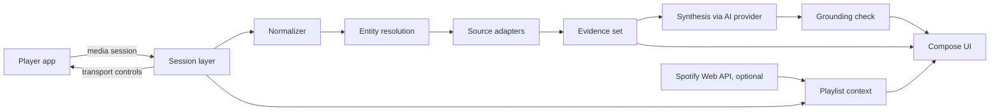

# Sleevesight

**Status:** Draft, ready for Phase 0  
**Date:** 2026-10-12  
**Owner:** Wacek  
**Platform:** Android (Kotlin, Jetpack Compose, Material 3)  
**License:** [GPL-3.0](../LICENSE)  
**Repository:** [wkusnierczyk/sleevesight](https://github.com/wkusnierczyk/sleevesight)  
**Prototype:** [Sleevesight simulator](https://claude.ai/artifact/QNA8y4AvoGp4QjHtp1kZsL)

Sleevesight is an open-source Android app that reads what a music player is playing, through Android's media session metadata, and shows grounded insights about the song, its artists, its album and its genres. It never touches the audio stream. Every insight is written by an AI service of the user's choice, from evidence retrieved from sources the user switched on, and every claim points back to its source.

## Summary

The phone already announces what is playing. Any app with notification access can read the title, artists, album, duration and album art of the current track from every player that publishes a media session, and can send play, pause, next and previous back to it. Sleevesight builds on that:

1. Read the now-playing metadata and normalize it: separate the song's own title and artists from what the player appends to them. Version tags such as "2006 Remaster" are kept as notes, the work a song is from is recorded as its source work, featured artists move into the artist list, and a list of artists is split into the credited artists. What remains is a clean key to look the song up by. See [Normalizer](#normalizer).
2. Resolve it to entities (recording, artists, release) and retrieve evidence from the sources enabled in Settings.
3. Have the user's chosen AI model write a short insight from that evidence only, with a citation on every factual sentence.
4. Check the citations mechanically before showing the text, and show the evidence underneath.

The prototype in the simulator covers the whole flow against a real 80-track playlist, with frozen lookups and live synthesis. This document records what it established and what still has to be verified on a real phone.

## Goals and non-goals

### Goals

- Show, within a couple of seconds of a track change, what makes the current song interesting, with sources.
- Make where information comes from a user decision: curated databases, open-web retrieval, and the model's own knowledge are separate switches.
- Let the user choose the AI provider and model and bring their own API key. Sleevesight is the author of the text; the model is a supporting service.
- Work with any player that publishes a media session, with Spotify as the reference player.
- Control the player from the app (play, pause, next, previous) and hand off to the player for a song, artist or album.
- Fail visibly: when nothing is documented, say so; when a match is rejected, show why.

### Non-goals

- Listening to or analyzing audio.
- Accounts, telemetry, analytics, social features, streaks, notifications. None of these ship, and CI enforces it (see Structural constraints).
- Replacing the player. Sleevesight never plays music itself.
- iOS. iOS sandboxing prevents reading another app's now-playing information; see Platform facts.

## Platform facts

These were established while designing. Items marked **unverified** are Phase 0 tasks.

### Reading now-playing

- `MediaSessionManager.getActiveSessions(componentName)` returns a `MediaController` for every app currently publishing a media session: Spotify, YouTube Music, Tidal, Deezer, podcast apps, browsers playing media.
- It requires a declared `NotificationListenerService`. Its `ComponentName` is passed to `getActiveSessions()`; without it the call throws `SecurityException`. The user grants access in Settings, Notification access.
- Use callbacks, not polling. `addOnActiveSessionsChangedListener` tracks sessions appearing and disappearing; `MediaController.Callback.onMetadataChanged` and `onPlaybackStateChanged` deliver track and state changes.
- Spotify fills `METADATA_KEY_TITLE`, `ARTIST`, `ALBUM`, `DURATION` and the album-art bitmap. Other players vary; some send only a title. **Unverified:** the exact fields per player, and whether Spotify's `METADATA_KEY_MEDIA_ID` carries a `spotify:track:` URI.
- Spotify also has an opt-in "Device Broadcast Status" setting that sends broadcast intents on metadata, playback-state and queue changes. It carries track, artist, album and length but no playlist. Useful as a fallback, not as the primary path.

### Controlling the player

- `MediaController.getTransportControls()` gives `play()`, `pause()`, `skipToNext()`, `skipToPrevious()` and `seekTo()`.
- Only offer an action the session advertises in `PlaybackState.getActions()`.

### Opening the player

- `MediaController.getSessionActivity()` usually returns a `PendingIntent` to the player's own now-playing screen.
- Opening a specific track, album or artist in Spotify needs a Spotify ID: `Intent.ACTION_VIEW` with `spotify:track:<id>`, `spotify:album:<id>` or `spotify:artist:<id>`.
- When no ID is known, fall back to `spotify:search:<query>`, which always opens. Log the fallback.

### Playlist context

The media session describes the current track, not the playlist. Three ways to get more, in order of reliability:

1. **Session history.** Every track the app has seen play. Always available, but it only knows the past.
2. **The session queue.** `MediaController.getQueue()` and `getQueueTitle()` return upcoming items if the player publishes them. Players are not required to. **Unverified** for Spotify.
3. **Spotify Web API, optional account.** `GET /me/player/currently-playing` returns a `context` (playlist or album URI); `GET /playlists/{id}/items` returns the full list.

### Spotify Web API constraints

Since the February 2026 changes, Development Mode apps need the app owner to have Spotify Premium, are capped at five allowlisted users per client ID, and lost several endpoints and fields (artist followers and popularity, track ISRCs, artist top tracks, new releases). Extended quota is available to organizations only.

For an open-source app this is workable with a bring-your-own model: each user registers their own Spotify developer app and pastes its client ID, the same way they supply an AI key. The cost is friction, so the Spotify account stays optional and nothing in the core flow depends on it.

## Architecture



### Session layer

- `NotificationListenerService` plus `MediaSessionManager`. Follows only the players switched on under Settings, Players to follow; events from other packages are dropped and logged as ignored.
- **Debounce of 650 ms** on metadata changes. A person flicking through tracks produces a burst of changes; only the last one triggers lookups. In-flight retrieval and synthesis for a superseded track are cancelled.
- Seeking or pausing changes playback state, not metadata, and never triggers a lookup.
- Exposes transport controls and the session activity to the UI.

### Normalizer

Players report a song the way their catalogue files it, which is often not how sources such as MusicBrainz and Wikipedia name it: "Fisherman's Blues - 2006 Remaster" is the song "Fisherman's Blues", and "Baby, Please Don't Go (feat. Van Morrison)" has a second artist hidden in its title. Normalizing turns the title and artist strings into the song's plain title, its list of credited artists, and a lookup key, without losing what it removed: each removed part is kept, as a note, a source work, a variant or an added artist. Rules proven on the test playlist:

| Input pattern | Action | Example |
|---|---|---|
| ` - 2006 Remaster`, ` - demo`, ` - Radio Edit`, ` - … Version` | Strip, record as a note | "Fisherman's Blues - 2006 Remaster" |
| `(feat. X)` in the title | Move X to the artists | "Baby, Please Don't Go (feat. Van Morrison)" |
| `(From X)`, ` - From "X"` | Strip, record the source work | "The Departure (From The Leftovers)" |
| `(felt piano)`, `(acoustic)` | Strip, record as a variant | "And Dream Of Sheep (felt piano)" |
| `A, B, C` in the artist field | Split into credited artists | "Peleboy, Tony K" |

The key is the lowercased, accent-folded primary artist plus the normalized title. Duplicates in a playlist hit the cache.

### Entity resolution

The hard part, and the place most failures came from in the prototype. Resolution produces a **typed outcome** per source, never a silent miss:

| Outcome | Meaning |
|---|---|
| `song_article` | The source describes this recording |
| `artist_article` | The source describes the performer only |
| `original_song` | The source describes the song as first recorded by someone else; this track is a cover or version |
| `rejected(reason)` | A candidate was found and failed the entity check, for example a different artist with the same name |
| `none` | Nothing found |
| `source_off` | The user switched the source off |
| `unreachable` | Network or source error |

`none` and `source_off` are deliberately different: one is a gap in the world's documentation, the other is the user's choice.

Rules:

- **Resolve each credited artist separately.** The prototype only resolved the primary artist, so secondary artists' boxes were nearly empty.
- **Keep recording and release apart.** A release date belongs to the release the player filed the recording under, which is often a compilation or remaster. The prototype showed "Released 2002" for a 1978 song for this reason. MusicBrainz models recordings, releases and release groups separately; use it to find the first release date of the recording.
- Entity matching is deterministic code (name similarity, duration tolerance, MusicBrainz relationships), never the language model.

### Source adapters

One interface, one adapter per source:

```kotlin
interface SourceAdapter {
    val id: SourceId                 // MUSICBRAINZ, WIKIPEDIA, LASTFM, DISCOGS, WEB
    val tag: String                  // MB, W, L, D, G
    suspend fun lookup(entity: ResolvedEntity): SourceResult  // typed outcome + evidence lines
}
```

| Source | Role | Notes |
|---|---|---|
| MusicBrainz | Recordings, releases, credits, relationships, first release dates | Rate limit about one request per second; descriptive User-Agent with contact info is required. No key. |
| Wikipedia and Wikidata | Song and artist articles | Reach the article through the MusicBrainz Wikidata link where possible, to avoid same-name collisions. No key. |
| Last.fm | Artist bio, listener count, tags, similar artists | User's own API key. Tags are crowd-applied and noisy; similar artists come from listening overlap, not audio. |
| Discogs | Releases and personnel | User's own token. |
| Web search | Generic RAG over the open web | Provider chosen by the user, with their key. Results may describe a different song with the same title. |

The model's own knowledge is modelled as a pseudo-source with tag `M`: it retrieves nothing, and when enabled it lets the model add at most one claim, marked unverified.

### Evidence model

```kotlin
data class EvidenceLine(
    val id: String,          // "W1", "L3", "G2", "P1"
    val source: SourceId,
    val scope: Scope,        // SONG, ARTIST, ORIGINAL_SONG, RELEASE, WEB
    val text: String,        // one claim, in the adapter's own words, never copied prose
    val url: String?,
    val retrievedAt: Instant,
)
```

`P` lines come from player metadata (the release). Scope is passed to the model so it never credits an original song's facts to a cover act.

### Synthesis

- **Provider abstraction.** `AiProvider` with implementations for Anthropic, OpenAI, Google and a local model through Ollama. The user picks provider and model and supplies the key.
- **Role of the model.** It narrates retrieved evidence. It does not resolve entities, rank sources, or decide what is true.
- **Citation contract.** Every factual sentence ends with the ids of the evidence lines that support it. No names, dates, places or numbers outside the evidence. A sentence that states a documentation gap may go uncited. If there is no usable evidence, the model replies `NO_EVIDENCE` and the UI says that little is documented.
- **Grounding check, in code, before display.** Each sentence is classified as `ok`, `hedge` (states a gap), `model` (cites `M`), `uncited`, or `unknown` (cites an id that does not exist, or cites `M` when model knowledge is off). Uncited and unknown sentences are underlined; the counts are logged.
- **Cards that use general knowledge.** Genre descriptions, artist comparisons and suggestions have no retrieved source today. They are generated as structured JSON, rendered in a separately labelled "general knowledge" section, and never mixed into the grounded text. See Open questions.

Prompt contracts are in the appendix.

### Genre labels

- Derived from Last.fm artist tags filtered through a fixed genre vocabulary. Tags outside the vocabulary (places, decades, "seen live", noise such as "bagel" or "under 2000 listeners") are dropped.
- Each vocabulary entry belongs to a family with a fixed hue: folk 135, rock 8, pop 328, hip-hop 30, soul and R&B 48, reggae 92, electronic 190, soundtrack and classical 262, jazz and blues 215.
- Labels are artist-level, and the UI says so.
- In the test playlist, 30 of 78 unique tracks got no genre labels because their artists have no usable tags.

### Caching and offline

- Retrieval is cached per source and lookup key; synthesis per lookup key, enabled-source set, provider and model.
- Offline, cached tracks still work fully; uncached lookups fail with `unreachable`, never with a blank card.
- Writing automatically on every track change is off by default, because each insight is a paid call on the user's key. User-driven changes (skip, select, play) write; tracks that change on their own get evidence and a Write button.

## User interface

Material 3, with dynamic color taken from the album art (material-color-utilities from the art bitmap). The prototype is the reference for layout.

### Home screen, top to bottom

1. **Player row.** Player name and state ("Spotify · Playing"). The name opens the player's own screen through the session activity. Previous, play or pause, next act through transport controls.
2. **Album art**, which opens the album in the player. Playback progress under it.
3. **Key data.** Song title, then artists (each one separately), then album, then "Released YYYY" on its own line.
4. **Genre labels.** Colored, tappable chips.
5. **Why it's interesting.** The grounded insight with citation chips.
6. **Sounds like.** Similar artists as tappable chips.
7. **Sources.** Quiet styling, at the bottom: source status chips that double as display filters, the evidence lines, and rejected matches with their reasons. Tapping a citation scrolls here and flashes the line.

### Detail content

| Opened from | Content |
|---|---|
| Song title | Insight on the recording, Open in player, sources |
| Each artist | Insight on that artist, tracks by them in the playlist or session, Open in player, sources |
| Album | Insight on the release, tracks from it, Open in player, sources |
| Genre label | Why the track fits (grounded), what the genre is (general knowledge), more like this (general knowledge, opens a player search) |
| Sounds-like artist | Why they're linked (grounded), how they compare (general knowledge), songs to start with (general knowledge, opens a player search) |

The detail section is called **Insight**. "Analysis" is reserved for a future deeper mode (see Open questions).

### Layout setting

- **Separate pages.** Each item opens a full screen with a back arrow; Android back works throughout.
- **Expandable boxes.** Song, each artist, and album are boxes on the home screen that expand in place; genre and sounds-like cards open inline under their chips.

The detail content is one component mounted either way.

### Track lists

Labelled by where they came from: "Played this session" by default, "In this playlist · <name>" when a Spotify account is connected.

## Settings

| Group | Setting | Default |
|---|---|---|
| Layout | Separate pages or expandable boxes | Separate pages |
| AI service | Provider, model, API key | None until set |
| Spotify account | Connect (OAuth PKCE, user's own client ID) | Off |
| Players to follow | One switch per player seen | Spotify on |
| Where to look | MusicBrainz, Wikipedia, Last.fm, Discogs, Web search, Model's own knowledge | All on except model knowledge |
| Insights | Write insights; write automatically on every track | On; off |

Source switches decide what the model may use. The filter chips in the Sources section only change what is displayed.

## Privacy and security

- What leaves the phone, and to whom. The first-run screen says this plainly.
  - To the enabled sources: the normalized title and artists, and the album name as the player reports it.
  - To the chosen AI provider: the title and artists, as the player reports them and as normalized; the album name as the player reports it; and the evidence retrieved from the sources.
  - To Spotify, only if a Spotify account is connected: requests for the playlist or album being played, made with the user's own token.

  Nothing else leaves the phone. The duration, the album art and the session history stay on it.
- API keys and tokens are stored encrypted with an Android Keystore-backed key and never logged.
- No telemetry, crash reporting services, analytics or accounts of our own.

## Structural constraints

Enforced in CI rather than stated as policy:

- A dependency allowlist check fails the build if an analytics, crash-reporting or ads SDK appears in the lockfile.
- A manifest check fails the build on any permission beyond the expected set (internet, notification listener binding).
- Network calls go only through the adapter and provider layer; a lint rule forbids HTTP clients elsewhere.

## Diagnostics

- A pipeline log screen, hidden behind a developer setting, mirrors the simulator's log: session events, normalization, each adapter's typed outcome and latency, cache hits, model calls, grounding-check counts.
- A coverage report (Phase 0.5) runs the pipeline over a playlist fixture and reports, per source, how many tracks resolved to each outcome, and per track, how many evidence lines and genre labels it got.

## Phases and gates

### Phase 0. Platform spike

A throwaway app on a real phone. Outputs, written to a log file:

- Fields Spotify, YouTube Music and one podcast app actually put in their media session, including `METADATA_KEY_MEDIA_ID`.
- Whether Spotify publishes `getQueue()` and `getQueueTitle()`.
- Which `PlaybackState` actions each player advertises; whether transport controls work.
- Whether `getSessionActivity()` and `spotify:` deep links open the expected screens.

**Gate:** every unverified item in Platform facts is resolved and this document updated.

### Phase 0.5. Pipeline CLI

A JVM Kotlin command-line tool sharing the pipeline module: normalizer, resolution, adapters, evidence, synthesis, grounding check. Input is a playlist fixture; output is the coverage report and the generated insights.

**Gate:** on the test playlist, zero `unknown` citations, uncited sentences under 5 percent, every same-name collision either rejected or correctly resolved, and the coverage numbers reviewed.

### Phase 1. Android MVP

Session layer, home screen, sources section, insight with grounding check, settings for sources and AI service, caching.

### Phase 2. Detail and discovery

Song, artist and album detail content; genre labels and cards; sounds-like cards; layout setting; transport controls and player handoff.

### Phase 3. Context and reach

Optional Spotify account; further players; local model through Ollama; Discogs.

## Decisions

| Date | Decision | Reason |
|---|---|---|
| 2026-10-11 | Android only | iOS cannot read other apps' now-playing information |
| 2026-10-11 | Metadata only, never audio | Enough for the purpose, and no audio permissions |
| 2026-10-12 | Sources are a user setting, with curated, open-web and model-knowledge as separate switches | The user decides what the insight may rest on |
| 2026-10-12 | Grounded synthesis with mechanical citation check | Insights must be traceable; failures must be visible |
| 2026-10-12 | Bring-your-own AI provider, model and key; Sleevesight is the author | Claude is one possible service, not the product |
| 2026-10-12 | Spotify account optional, with the user's own client ID | Development Mode caps users per client ID |
| 2026-10-12 | Session history as the default playlist context | The only context that works without an account |
| 2026-10-12 | Sources section at the bottom, quiet | Provenance matters but is the least interesting content |
| 2026-10-12 | Layout setting: separate pages or expandable boxes | Both are useful; one component serves both |
| 2026-10-12 | Genre labels from a fixed vocabulary over Last.fm tags | Raw tags are crowd-sourced and noisy |
| 2026-10-12 | Auto-write off by default | Each insight is a paid call on the user's key |
| 2026-10-12 | Working name Sleevesight | Spoken-aloud test still to do |

## Open questions

- **General-knowledge cards and the LLM role.** Genre descriptions, comparisons and "more like this" suggestions come from the model's own knowledge, and the suggestions are the model choosing items at runtime. That sits uneasily with keeping the model to narration. Options: retrieve genre articles from Wikipedia and ground those cards too; build suggestions deterministically from Last.fm similar artists and MusicBrainz relationships, with the model only explaining them; or keep them as labelled general knowledge behind the model-knowledge switch.
- **Deeper analysis.** What an "Analysis" mode adds beyond the collected insight: musical structure, credits graph, lineage of covers and samples.
- **Release date semantics.** Show the recording's first release, the release being played, or both.
- **Web search provider.** Which providers to support first, and how to keep results about the right recording.
- **Per-player behavior.** How much of the UI to hide for players that send title only.
- **Name.** Run the spoken-aloud test on "Sleevesight".

## Test fixtures

The simulator's data makes a ready fixture: the playlist "Below Soundtrack Netflix" (80 tracks, 78 unique), with frozen lookups from Wikipedia, Last.fm and web search, and album and Spotify-link data. Tracks worth keeping as regression cases:

| Track | Case |
|---|---|
| 1 Sundown, Gordon Lightfoot | Rich data from every source |
| 7 Fisherman's Blues - 2006 Remaster | Version suffix |
| 8 and 22, 4 and 24 | Duplicates in the playlist, should hit the cache |
| 12 and 20, Reem | Wikipedia article about a different Reem, must be rejected |
| 14 Up Down, Peleboy, Tony K | Multiple credited artists |
| 37 The Ode To Newfoundland | Three credited artists |
| 45, 48, 76 | Covers; Wikipedia only describes the original song |
| 61 willow, Jessiah | Last.fm name resolves to an unrelated band |
| 63 Baby, Please Don't Go (feat. Van Morrison) | Featured artist in the title |
| 13 New York Groove, 36 Snowbird | Release year is a compilation's, not the song's |
| 23, 30, 77 | Almost nothing documented anywhere; the card must say so |

## Appendix. Prompt contracts

### Insight

Input: the now-playing title, artists and album as the player reports them (not the duration), the normalized fields, and evidence lines as `[ID] (source, scope) text`. Rules given to the model:

- Two to four sentences, plain conversational English, no markdown.
- End every factual sentence with supporting ids, like `[W1]` or `[W2][G1]`.
- Use only the evidence; no names, dates, places or numbers outside it.
- "Original song" lines describe the song as first recorded by someone else; never credit them to this artist.
- "Artist" lines describe the performer, not this recording.
- Web lines may be about a different song with the same name; ignore what does not fit.
- If little is documented, say so in one uncited sentence.
- With model knowledge on: at most one sentence from general knowledge, ending with `[M]`. Otherwise none.
- With no usable evidence: reply exactly `NO_EVIDENCE`.

Detail insights use the same rules with one or two short paragraphs, at most 130 words, focused on the song, artist or release.

### Genre card

```json
{
  "fits": "1-3 grounded sentences with ids",
  "about": "2-3 sentences of general knowledge, no ids",
  "more": [{"name": "Artist, or Song - Artist", "kind": "artist|song", "why": "under 15 words"}]
}
```

### Sounds-like card

```json
{
  "link": "1-2 grounded sentences with ids; similarity comes from listening overlap",
  "compare": "2-3 sentences of general knowledge; say so plainly if the artist is not known reliably",
  "start": [{"name": "song by the similar artist", "why": "under 15 words"}]
}
```

`start` must be empty rather than guessed.
