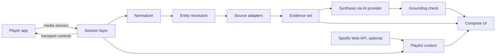

# Sleevesight

**Status:** Draft; Phase 0 passed, Phase 0.5 under way (platform findings in *Platform facts*)  
**Date:** 2026-10-12  
**Owner:** Wacek  
**Platform:** Android (Kotlin, Jetpack Compose, Material 3)  
**License:** [GPL-3.0](../LICENSE)  
**Repository:** [wkusnierczyk/sleevesight](https://github.com/wkusnierczyk/sleevesight)  
**Prototype:** [Sleevesight simulator](https://sleevesight.app/design/simulator.html)  
**Brand:** [Sleevesight brand sheet](https://sleevesight.app/design/brand.html)

Sleevesight is an open-source Android app that reads what a music player is playing, through Android's media session metadata, and shows grounded insights about the song, its artists, its album and its genres. It never touches the audio stream. Every insight is written by an AI service of the user's choice, from evidence retrieved from sources the user switched on, and every claim points back to its source.

## Summary

The phone already announces what is playing. Any app with notification access can read the title, artists, album, duration and album art of the current track from every player that publishes a media session, and can send play, pause, next and previous back to it. Sleevesight builds on that:

1. Read the now-playing metadata and normalize it: separate the song's own title and artists from what the player appends to them. Version tags such as "2006 Remaster" are kept as notes, the work a song is from is recorded as its source work, featured artists move into the artist list, and a list of artists is split into the credited artists. What remains is a clean key to look the song up by. See [Normalizer](#normalizer).
2. Resolve it to entities (recording, artists, release) and retrieve evidence from the sources enabled in Settings.
3. Have the user's chosen AI model write a short insight from that evidence only, with a citation on every factual sentence.
4. Check the citations mechanically before showing the text, and show the evidence underneath.

The prototype in the simulator covers the whole flow against a real 80-track playlist, with frozen lookups and, while it was hosted as a claude.ai artifact, live synthesis. The public copy linked above has no AI service, and its insight cards show the first facts found instead. This document records what it established and what still has to be verified on a real phone.

## Goals and non-goals

### Goals

- Show, within a couple of seconds of a track change, what makes the current song interesting, with sources.
- Make where information comes from a user decision: curated databases, open-web retrieval, and the model's own knowledge are separate switches.
- Let the user choose the AI provider and model and bring their own API key. Sleevesight is the author of the text; the model is a supporting service.
- Work with any player that publishes a media session, with Spotify as the reference player.
- Control the player from the app (play, pause, next, previous) and hand off to the player for a song, artist or album.
- Fail visibly: when nothing is documented, say so; when a match is rejected, show why.

### Non-goals

- Listening to or analyzing audio.
- Accounts, telemetry, analytics, social features, streaks, notifications. None of these ship, and CI enforces it (see Structural constraints).
- Replacing the player. Sleevesight never plays music itself.
- iOS. iOS sandboxing prevents reading another app's now-playing information; see Platform facts.

## Platform facts

These were established while designing, and checked in Phase 0 with the platform probe (`spike/`, removed after the gate; history keeps it) on a Samsung Galaxy S25 Ultra (SM-S938B, Android 16, API 36), with Spotify, Castbox (podcasts), YouTube Music (free tier) and a Sonos session, on 2026-10-12. Items marked **to measure** are still open.

### Reading now-playing

- `MediaSessionManager.getActiveSessions(componentName)` returns a `MediaController` for every app currently publishing a media session: Spotify, YouTube Music, Tidal, Deezer, podcast apps, browsers playing media.
- It requires a declared `NotificationListenerService`. Its `ComponentName` is passed to `getActiveSessions()`; without it the call throws `SecurityException`. The user grants access in Settings, Notification access. On Android 12 (API 31) and later, the service declares `android.service.notification.default_filter_types=""` and `android.service.notification.disabled_filter_types="conversations|alerting|silent|ongoing"` ([#739](https://github.com/wkusnierczyk/sleevesight/issues/739)), which sets its allowed notification filter bitmask in `NotificationManagerService` to `0` on both new installs and upgrades while leaving `MediaSessionService`'s `hasEnabledNotificationListener` check unaffected. Measured on a Samsung Galaxy S25 Ultra with Android 17 (2026-10-30): no notification reaches the listener, fresh or upgraded, and the media sessions read as before (architecture, *Session layer*). On stock Android, the platform documents the disabled types as ones the user cannot turn on in its settings (not measured here); Samsung's One UI has no per-type setting to show.
- Use callbacks, not polling. `addOnActiveSessionsChangedListener` tracks sessions appearing and disappearing; `MediaController.Callback.onMetadataChanged` and `onPlaybackStateChanged` deliver track and state changes.
- **Spotify (measured)** fills `TITLE`, `ARTIST`, `ALBUM`, `ALBUM_ARTIST`, `DURATION`, the album art (a bitmap 300 pixels wide, usually 300×300, or 472×472, and an `ALBUM_ART_URI`), and `METADATA_KEY_MEDIA_ID` as a **`spotify:track:<id>`** URI. `ARTIST` is one comma-joined string of the credited artists ("Artist A, Artist B, Artist C"), as the normalizer assumes. It also sends its own keys: the playing context (`com.spotify.music.extra.CONTEXT_URI`, `CONTEXT_TITLE`, `CONTEXT_DESCRIPTION`, `CONTEXT_SHARE_URL`), an `ART_HTTPS_URI` on Spotify's image CDN, an extracted background colour, and explicit, download and advertisement flags. Its `CROSSFADE_ENABLED` and `CROSSFADE_DURATION` extras are **unreliable**: they read `false` and `5000` throughout, including a run with a 12 s crossfade, so nothing relies on them.
- **Castbox (measured)** fills `TITLE`, `DISPLAY_TITLE`, `ARTIST` (the publisher), `ALBUM` (the episode title), `DURATION`, `MEDIA_ID` (its own episode id) and, for the playing episode, `MEDIA_URI` and http(s) art URIs. **YouTube Music (measured, free tier)** fills `TITLE`, `ARTIST`, `ALBUM`, `ALBUM_ARTIST`, `DURATION`, an art bitmap, a rating (always unrated here) and video dimensions (always 0 here), but **no `MEDIA_ID` and no art URI**: a YouTube Music track is looked up and opened by its title and artists, and within a session told apart by its active queue item (see *Track changes*). On the free tier playback stops when YouTube Music leaves the foreground, so its session is often `PAUSED` or `STOPPED`; a paused session is normal, not a change. A **Sonos** session sent only art and an empty media id.
- **Spotify republishes unchanged metadata constantly**: about 93% of same-track updates across the three probe runs repeated the previous metadata exactly (776 of 834: each Spotify metadata update compared with the previous update of the same track, by media id, on all metadata values), and most of the rest changed only the art, the length (sent as a placeholder first) or the extracted colour. The debounce and the lookup-key comparison in the pipeline are what keep this from triggering lookups.
- Spotify also has an opt-in "Device Broadcast Status" setting that sends broadcast intents on metadata, playback-state and queue changes. The media session carries everything it does and more, so it is not used.

### Album art

- Spotify's `ALBUM_ART_URI` is a `content://com.spotify.mobile.android.mediaapi/...` URI, and **another app can read it**. The bitmap and the https URI are there as well.
- Castbox publishes http(s) art URLs (and a small bitmap), which `:sources` fetches like any other network resource.

### Controlling the player

- `MediaController.getTransportControls()` gives `play()`, `pause()`, `skipToNext()`, `skipToPrevious()` and `seekTo()`.
- Only offer an action the session advertises in `PlaybackState.getActions()`. **Measured:** Spotify advertises play or pause, previous, next, seek, play from search and play from URI; play, pause, next and previous were sent and worked (the others were not tried). Castbox advertises play, pause, next, seek and its own set, but not previous, and usually only play/pause while in `NONE` or `BUFFERING`. YouTube Music advertises play, pause, previous, next, seek and play from search, URI or media id. Next and previous come and go in its advertised actions (they are missing, with seek, in its early `STOPPED` and `PAUSED` states); its session extras carry only two car display hints.

### Opening the player

- `MediaController.getSessionActivity()` returns a `PendingIntent` to the player's own screen **for Castbox, which opened it (observed by the tester), and for YouTube Music (not tried); Spotify publishes none.** So for Spotify the app opens the player through a `spotify:` URI or its launch intent instead. The home screen's player row falls back to the launch intent (`AppGraph.playerLaunchIntent`) whenever the session gives no usable screen, none or a cancelled one (#596), and says it has nothing to open only when there is neither.
- Opening a specific track, album or artist in Spotify needs a Spotify ID: `Intent.ACTION_VIEW` with `spotify:track:<id>`, `spotify:album:<id>` or `spotify:artist:<id>`. **Measured:** `spotify:track:` with the id from `MEDIA_ID` opens the track.
- When no ID is known, fall back to `spotify:search:<query>`, which always opens (**measured**). Log the fallback.

### Playlist context

The media session carries more context than the design assumed. In order of reliability:

1. **Spotify's metadata.** `CONTEXT_URI` and `CONTEXT_TITLE` name the playlist or album being played (`spotify:playlist:...` and the playlist's name), **without an account**.
2. **The session queue.** Spotify publishes `getQueue()` (the playing track, then the upcoming ones, with `spotify:track:` ids; 4 to 50 items, one fewer per track, reset when a track is opened through a deep link; the playing track's media id matches the queue's first item in every capture, while its active queue item can lag a new track's queue for a moment) and `getQueueTitle()` ("Play Queue"). Castbox publishes its queue too (episode ids), and YouTube Music its "Up next" (13 to 25 items, titles without media ids, starting with the playing track rather than after it).
3. **Session history.** The record of every track the app has seen play. Always available, but it only knows the past.
4. **Spotify Web API, optional account.** `GET /playlists/{id}/items` returns the whole playlist, not only what is queued.

The track lists can therefore say "In this playlist · <name>" without the optional account; the account adds the full playlist beyond the queue.

### Track changes

Measured for decision D5 on 21 Spotify track changes (of 24 logged; the other three were two Castbox changes and one at the start of a probe session): at each change, the previous track's remaining time (its length less its position, extrapolated from the last playback state), and the playback states before the new metadata (the probe kept the last 3 s; the table counts the last 1.5 s).

| Change | Count | Remaining in the previous track | `PLAYING` states in the 1.5 s before |
|---|---|---|---|
| Ended on its own, no crossfade | 4 | −87 to −39 ms | 6 |
| Ended on its own, crossfade 12 s | 3 | 11.945 to 11.987 s | 6 |
| Skipped in Spotify, with earphones or from the notification | 12 | 20 s to 429 s | 0 |
| Skipped with the probe's buttons, just after pressing play | 2 | 175 s and 369 s | 3 or 4 |

- **No skip state.** Neither Spotify, Castbox nor YouTube Music reported `STATE_SKIPPING_TO_NEXT` or `STATE_SKIPPING_TO_PREVIOUS`, for any kind of skip. Skips in the Spotify app, from earphones and from the notification look the same to the session.
- **A natural end lands exactly at the crossfade.** Without crossfade the change comes within 0.1 s of the end; with a 12 s crossfade, 12.0 s before it, every time within 60 ms. Seeking towards the end beforehand changes nothing.
- **Timing alone is ambiguous inside the crossfade.** The remaining time is measured against the track's full length, so a skip 8 s before a 12 s crossfade reads as 20 s remaining. With a 5 s crossfade, a natural end and a skip 5 s before the transition would both read as 10 s: one change cannot say which it was.
- **The state clusters.** Before every natural end Spotify published two clusters of about six `PLAYING` states: one about 3 s before the change, and one 0.5 to 1 s before. Before a skip from the app, earphones or the notification it published none. Mid-track it publishes nothing but clusters around seeks and an occasional cluster of three. The late cluster therefore separates a natural end from a skip even where timing cannot. It is undocumented Spotify behaviour, so it is used with the timing, not alone. A seek shortly before a skip near the end is not measured.
- Skips made from Sleevesight itself need no detection: the app sent them. The probe-button rows show only that recent playback activity produces a few states (3 or 4), which is why the rule counts states rather than asking for any.
- Castbox, when skipped, sent the new episode's state (position 0) before its metadata; the probe's estimate handles both orders.
- **YouTube Music** (a short run on the free tier): one track listened to the end, then skips early, mid-play and late. It **re-sends the playing track with a new length** (in this run 106 s, then 278.8 s, then 279 s, for one track), so for this player the length is not part of a track's identity; the active queue item is, and it moved exactly at the tester's four changes. Read by the queue item, the natural end came at the track's end (within 0.02 s of it, by the latest length), with no cluster of states before it, so the clusters are Spotify's alone; the skips left 290 s, 131 s and **7.2 s**, the late one reading as a natural end by timing alone, the accepted trade-off. The probe, which compared lengths, first took the length updates for track changes; that is the lesson for the app: a track is identified by its media id, else by the active queue item where the player publishes one (an item of −1, which YouTube Music reports at the start of a session and while stopped in the background, is no item; when either side has no item, title and artists decide), else by title and artists; a new length is an update, after which the time left is computed from the latest length. As with Castbox, the new track's first state (position 0) arrived just before its metadata, at the natural end and the skips alike.

**Decision (D5, refined):** a user setting, *Crossfade*: **Autodetect** (the default) or a fixed value, 0 to 15 s. Changes that Sleevesight caused itself (its own transport buttons, selecting a track) are known to be user-driven and are not put through detection. The rules below are the floor; D15 lets detection learn per player on the device, within them (`architecture.md`, *Learning skip detection*).

- A fixed value *c*: a change is a natural end when the remaining time is at most *c* + 0.5 s; for Spotify, also when the late cluster is there with at most 15 s remaining, so a value set below Spotify's real crossfade does not read natural ends as skips.
- Autodetect, for Spotify (the only player where the clusters have been measured): a change is a natural end when the remaining time is at most 15 s and either the late cluster is there (at least 5 `PLAYING` states within 1.5 s before the change) or the remaining time is within 0.5 s of 0 or of the learned crossfade. Otherwise it is a skip.
- Autodetect, for any other player: timing alone. A change with at most 15 s remaining is a natural end. Whether other players publish such clusters, or another signal, is investigated as they are covered.
- The learned crossfade: the remaining time of natural ends; when two agree within 0.1 s, that is the value, and when two later ones agree on another value, it replaces it, so a changed crossfade is followed. It only adds natural ends that lack the late cluster (a probe connected late, a restart); it never turns a change into a skip.
- Detection errs towards "ended on its own" (decision D5), with one accepted exception: under Autodetect for Spotify, a natural end that lacks the late cluster before any crossfade has been learned reads as a skip. That is the price of catching skips inside the 15 s window, and it ends once a crossfade is learned.

### Notification access and installation

- Installed through `adb`, the probe got notification access without restriction (`packageSource` OTHER, initiating package `com.android.shell`).
- **Installing from a file (measured, D7).** The probe's APK, opened from My Files, was first stopped by **Google Play Protect** ("App blocked to protect your device": Play Protect has not seen an app from this developer before), which offers **Install anyway**. After that, **Advanced Protection** blocked it outright ("Advanced Protection only allows apps from Google Play and other app stores pre-installed on your phone"), with no override. On this phone the device setting was off and the Google account is enrolled in Google's Advanced Protection Program, so the block presumably comes from that enrolment. So:
  - for a user without Advanced Protection, installing Sleevesight from a file costs at least a Play Protect warning (and, the first time, allowing the file manager or browser to install unknown apps);
  - for a user whose Google account is enrolled in Advanced Protection (and, by the dialog's wording, presumably one with the device setting on, which was not tested), only Google Play (or a store pre-installed on the phone) can install it, which rules out GitHub releases and F-Droid for them.
- Restricted settings on notification access, for an app installed from a file, could not be measured on this phone, since the install itself is blocked; it was measured on a second phone (next item).
- **Restricted settings (measured, #29).** On a Samsung Galaxy S23 Ultra (SM-S918B, Android 16, API 36, One UI 8.5, build `S918BXXSAFZI1`) with no Advanced Protection, on 2026-10-16, the debug `:app` APK from CI was copied to `Download/` and opened from My Files. My Files first had to be allowed to install unknown apps, then Play Protect blocked the install and **Install anyway** went through, as on the first phone. Android recorded a file install: `packageSource` 3 (`PACKAGE_SOURCE_LOCAL_FILE`), installer and initiating package `com.google.android.packageinstaller`, originating package `com.sec.android.app.myfiles`. Android **did mark the app restricted**: the app op `ACCESS_RESTRICTED_SETTINGS` read `deny` (`MODE_ERRORED`, which Android sets on file installs; the op's default is `allow`). Yet notification access was then granted from the app's first-run link with only the usual confirmation: **the restriction was not enforced** on that screen. The link asks for `ACTION_NOTIFICATION_LISTENER_DETAIL_SETTINGS` and falls back to the listener list; which of the two One UI showed was not recorded, and the other was not tried. So on this phone a file install costs two warnings and no unlock. One phone, one installer and one grant path only. A browser download gets the same marker and was not tried. Since the marker is set, the other grant screen, a Pixel or another Android version is likely to enforce it, so onboarding should still explain the unlock if access cannot be granted (`architecture.md`, R8).
- **Developer verification (checked 2026-10-16, #29; rechecked 2026-10-19).** Since 2026-09-30, on certified devices in Brazil, Indonesia, Singapore and Thailand, installs from the [participating stores](https://developer.android.com/developer-verification/guides#locations) (Google Play and several phone makers' stores) need a registered developer and package; installs from a file, and `adb` installs, are not checked yet ([FAQ](https://developer.android.com/developer-verification/guides/faq)). Google plans a global rollout in 2027. From then, an unregistered app would install only through `adb` or the *advanced flow* (developer mode, a check that nobody is coaching the user, a restart, a one-time one-day wait and a biometric or PIN confirmation, then installs allowed for 7 days or indefinitely, each still warning of an unverified developer). Short of full registration, a free *limited distribution* account registers packages whose builds install on up to 20 devices: no government ID is checked, but the account needs a Google payments profile (with a legal name and address), 2-Step Verification and a contact email; each device's user consents on the device, through a QR code or a link, and the device is registered in the Android Developer Console ([limited distribution](https://developer.android.com/developer-verification/guides/limited-distribution)). It suits development builds handed to testers. Apps on Play are registered through the Play Console, so under D7 this concerns builds handed out as files: once the package is registered for full distribution, such a build should install as it does today (the unknown-apps permission and the Play Protect warning above remain). The rules and dates are still moving; check them again before a channel outside Play.
- `adb` installs escape the Advanced Protection block and restricted settings, as the probe's `adb` install on the first phone showed (first item), and developer verification, as Google's [FAQ](https://developer.android.com/developer-verification/guides/faq) says. The Advanced Protection block measured is the one that comes from the account's enrolment, with the device setting off; whether an `adb` install escapes the block of the device setting was not tested. Not every check: with *Verify apps over USB* on (developer options), an `adb` install can still be stopped by an "Unsafe App Blocked" warning, with *Install anyway* ([Android Studio, known issues](https://developer.android.com/studio/gemini/journeys#known-issues)).
- **Decision (D7, revised):** Sleevesight is distributed through **Google Play** (owner, 2026-10-12), the one channel that reaches every user, Advanced Protection or not, without a warning. Play's review of an app that holds notification access becomes part of the release work.

### Spotify Web API constraints

Since the February 2026 changes, Development Mode apps need the app owner to have Spotify Premium, are capped at five allowlisted users per client ID, and lost several endpoints and fields (artist followers and popularity, track ISRCs, artist top tracks, new releases). Extended quota is available to organizations only.

For an open-source app this is workable with a bring-your-own model: each user registers their own Spotify developer app and pastes its client ID, the same way they supply an AI key. The cost is friction, so the Spotify account stays optional and nothing in the core flow depends on it.

## Architecture



### Session layer

- `NotificationListenerService` plus `MediaSessionManager`. Follows only the players switched on under Settings, Players; events from other packages are dropped and logged as ignored. A player is listed there once its session has reported music, a title and an artist, so dialer calls and most video apps never are; phone calls (the telecom and dialer packages, or a session whose audio is voice communication, checked again before every read and report, and as reports settle) are never read, whatever the settings say (#435), from when Android marks them. A VoIP call in an ordinary media session is not recognised.
- **Debounce of 650 ms** on metadata changes. A person flicking through tracks produces a burst of changes; only the last one triggers lookups. In-flight retrieval and synthesis for a superseded track are cancelled.
- Seeking or pausing changes playback state, not metadata, and never triggers a lookup.
- Exposes transport controls and the session activity to the UI.

### Normalizer

Players report a song the way their catalogue files it, which is often not how sources such as MusicBrainz and Wikipedia name it: "Fisherman's Blues - 2006 Remaster" is the song "Fisherman's Blues", and "Baby, Please Don't Go (feat. Van Morrison)" has a second artist hidden in its title. Normalizing turns the title and artist strings into the song's plain title, its list of credited artists, and a lookup key, without losing what it removed: each removed part is kept, as a note, a source work, a variant or an added artist. Rules proven on the test playlist:

| Input pattern | Action | Example |
|---|---|---|
| A trailing `- 2006 Remaster`, `- demo`, `- Radio Edit`, `- … Version` | Strip, record as a note | "Fisherman's Blues - 2006 Remaster" |
| `(feat. X)` in the title | Move X to the artists | "Baby, Please Don't Go (feat. Van Morrison)" |
| `(From X)`, a trailing `- From "X"` | Strip, record the source work | "The Departure (From The Leftovers)" |
| `(felt piano)`, `(acoustic)` | Strip, record as a variant | "And Dream Of Sheep (felt piano)" |
| `A, B, C` in the artist field | Split into credited artists | "Peleboy, Tony K" |

The key is the lowercased, accent-folded primary artist plus the normalized title, keeping letters and digits in any script, and `+` ("C++" is not "C"); other punctuation, symbols and emoji become a space, unless they are all there is (a title `★` keys as `★`). Accents are folded on Latin and Greek letters only: Cyrillic `й` is not `и`. Duplicates in a playlist hit the cache.

### Entity resolution

The hard part, and the place most failures came from in the prototype. Resolution produces a **typed outcome** per source, never a silent miss:

| Outcome | Meaning |
|---|---|
| `song_article` | The source describes this recording |
| `artist_article` | The source describes the performer only |
| `original_song` | The source describes the song as first recorded by someone else; this track is a cover or version |
| `rejected(reason)` | A candidate was found and failed the entity check, for example a different artist with the same name |
| `none` | Nothing found |
| `source_off` | The user switched the source off |
| `unreachable` | Network or source error |

`none` and `source_off` are deliberately different: one is a gap in the world's documentation, the other is the user's choice.

Rules:

- **Resolve each credited artist separately.** The prototype only resolved the primary artist, so secondary artists' boxes were nearly empty.
- **Keep recording and release apart.** A release date belongs to the release the player filed the recording under, which is often a compilation or remaster. The prototype showed "Released 2002" for a 1978 song for this reason. MusicBrainz models recordings, releases and release groups separately; use it to find the first release date of the recording.
- Entity matching is deterministic code (name similarity, duration tolerance, MusicBrainz relationships), never the language model.

### Source adapters

One interface, one adapter per source:

```kotlin
interface SourceAdapter {
    val id: SourceId                 // MUSICBRAINZ, WIKIPEDIA (also emits WIKIDATA lines), LASTFM, DISCOGS, WEB
    suspend fun lookup(track: NormalizedTrack, resolution: Deferred<Resolution>): SourceResult  // typed outcome + evidence lines; see architecture.md, Source adapters
}

val SourceAdapter.tag: String get() = id.tag   // MB, W (and WD), L, D, S
```

| Source | Role | Notes |
|---|---|---|
| MusicBrainz | Recordings, releases, credits, relationships, first release dates | Rate limit about one request per second; descriptive User-Agent with contact info is required. No key. Core data is CC0; tags and genre associations are CC BY-NC-SA 3.0 (`architecture.md`, *Licensing*). |
| Wikipedia and Wikidata | Song and artist articles | Reach the article through the MusicBrainz Wikidata link where possible, to avoid same-name collisions. No key. |
| Last.fm | Artist bio, listener count, tags, similar artists | User's own API key. Tags are crowd-applied and noisy; similar artists come from listening overlap, not audio. |
| Discogs | Releases and personnel | User's own token. |
| Web search | Generic RAG over the open web | User's own key; Exa first (D11, below). Results may describe a different song with the same title, so they are filtered. |

The model's own knowledge is modelled as a pseudo-source with tag `AI` (`M` until 0.1.8, #668): it retrieves nothing, and when enabled it lets the model add at most one claim, marked unverified.

#### Web search provider (D11)

**Exa first** ([#40](https://github.com/wkusnierczyk/sleevesight/issues/40), 2026-10-14). The user brings the key, so the deciding points are what a key costs them to get and keep, and whether the results are worth an evidence line. Exa's free tier needs no card and renews monthly; on the fixture's thin tracks it found real listings where the simulator's search found nothing; and its terms, though strict, are no worse than the others'. Only Exa was tested live: it is the only key the project holds. The others were compared on their official pages (2026-10-14):

| Provider | Free tier | Card for the free tier | Price per 1000 searches | Rate limit | Terms on results |
|---|---|---|---|---|---|
| **Exa** | $10 in credits, reset on the first of each month, "up to 2,500 Lite searches" (2026-10-26) | No | $4 `lite` (and the legacy `instant`), $7 `auto`, for up to 10 results, highlights included; $1 per 1000 results beyond 10 (2026-10-26, below) | 10 per second for `/search` | §4.2(a): no copying, distributing or displaying information obtained through the services beyond the terms or Exa's written leave; no attribution clause |
| Brave Search API | $5 of credit a month | Yes ("to verify identity", not charged) | $5 | 50 per second | Storing results needs a plan with storage rights; grants no rights in the third-party pages |
| Tavily | 1000 credits a month (a basic search is 1 credit) | Pricing page says no; the owner was asked for one at sign-up | $8 (pay as you go) | 100 a minute on a development key | For integration in the customer's own applications; no attribution clause |
| Linkup | $20 of credit, topped up monthly, for a professional email | Not stated | $5 (standard search) | Not stated | Not reviewed |
| You.com | $100 of credit at sign-up | Not stated | $5 | Not stated | Not reviewed |
| Serper, SerpApi | 2500 queries once; 250 a month | No; not stated | $0.30 to $1; $25 for 1000 a month | 50 per second; 50 an hour | They resell Google's results page, scraped: not a sound basis |
| Google Custom Search JSON API | Closed to new customers, ends 2027-01-01 | | | | |
| Bing Web Search API | Retired in 2025 | | | | |

**What a search costs: $0.004** (documented, checked 2026-10-26 on Exa's pages, [#584](https://github.com/wkusnierczyk/sleevesight/issues/584); measured 2026-10-27, [#608](https://github.com/wkusnierczyk/sleevesight/issues/608)). The [pricing page](https://exa.ai/pricing) prices `/search` at $4 per 1000 requests for `lite` and the legacy `instant`, and $7 for `auto`, each for up to 10 results; beyond that it charges only $1 per 1000 results past 10 and $1 per 1000 AI page summaries, and lists no charge for text or highlights within `/search`. The [Exa 3.0 announcement](https://exa.ai/blog/exa-3) (2026-10-19) says the "improved highlights and expanded data sources are included at no additional charge". A search as the adapter sends it (`lite`, 10 results, highlights, no summary) is therefore $0.004, and the free tier, "$10 in credits" reset to $10 on the first of each month, covers "up to 2,500 Lite searches". This settles what was open on 2026-10-14, when the pricing pages priced contents at "$1 / 1k pages, per content type" in the `/contents` row and the [search reference](https://exa.ai/docs/reference/search) said text, highlights and summaries were "billed outside the bundled search price", which would have made highlights $0.001 a result on top ($14 per 1000) and the free credit about 700 searches. The spike's searches agreed with the reading now in the documents: every `instant` search with 10 highlighted results reported $0.004 in `costDollars` and no contents charge. So did the live runs of 2026-10-27 ([#608](https://github.com/wkusnierczyk/sleevesight/issues/608)): each of 156 searches, 77 on `lite` and 78 on `instant` over the fixture playlist and one by `ExaLiveTest`, reported $0.004 in `costDollars`, all of it under `search`, with no contents line ($0.624 in all), including the `instant` searches that returned fewer than 10 results. `costDollars` is Exa's estimate, "not an invoice record"; the dashboard's usage for the runs' window (08:20 to 08:37 UTC) is the last word, to be checked by hand and recorded on [#608](https://github.com/wkusnierczyk/sleevesight/issues/608). The adapter keeps `numResults` at 10: the filter kept 0 to 4 of 10 on the thin and same-title tracks with `instant` (2026-10-14), and 4 or 5 with `lite` (2026-10-27, [#608](https://github.com/wkusnierczyk/sleevesight/issues/608)), so fewer candidates would cost lines where they are scarcest, and with highlights included fewer results would save nothing.

**The live test** (20 calls, about $0.10 by Exa's estimates): tracks 1, 12, 23, 30, 45, 61 and 77, with `auto` and `instant`. `instant` was as relevant as `auto` at a tenth of the latency (0.3 s against 3 s) and a little over half the price, so the adapter used it. Exa 3.0 (2026-10-19) made `instant` legacy ("Legacy. Use `lite` instead.", in the search reference), and the adapter has sent `lite` since [#584](https://github.com/wkusnierczyk/sleevesight/issues/584): the same price, the same index as `auto`, served from the index without fetching pages at query time. `lite` "accepts only" a listed set of parameters and rejects a request with any other; the adapter's (`query`, `numResults`, `excludeDomains`, `contents.highlights`) are all in it. `lite` has since been compared with `instant` live (below). On the thin tracks the spike's `instant` searches found what the simulator's search did not: for 23, a library catalogue entry naming the composers and the album, a soundtrack listing with the scene, and two song-database pages; for 30, a soundtrack listing and a CritiqueBrainz page; for 77, only Alphaville's and Rod Stewart's songs, which the filter rejects. For 12 it mixed Reem's song with Juice WRLD's of the same name and returned one undecodable page; for 61 one Spotify page for Jessiah's recording among other artists' "willow"s; for 45, Yanjoco's own listings and a Spotify page for another Yanjoco song whose list of the artist's tracks named the title, the case behind the filter's rule on result titles below. This is a summary; no result text is kept in the repository (*Open on the terms*). The app's and the CLI's retrieval cache does keep web search results on the device, for web search's lifetime (D9: 1 day), like any other source's: during development, by the owner's decision of 2026-10-14 ([#81](https://github.com/wkusnierczyk/sleevesight/issues/81)), which reversed the #44 review's refusal, since without it every repeat lookup is a paid search.

**`lite` against `instant`** ([#608](https://github.com/wkusnierczyk/sleevesight/issues/608), 2026-10-27; one run of `:cli live --no-insights --tracks all` on each, 78 searches each, the request otherwise the adapter's). `lite` found the recording far more often: web search gave `song_article` on 77 of 80 positions against 63, and 352 lines against 213, more on 47 positions and fewer on 2. `lite` always returned 10 results; `instant` fewer on 19 of 78 searches, at the same price. On the six named tracks `lite` kept 4 or 5 lines each, mostly from the recording's own pages (streaming services, song databases, library catalogues; for 12, only Reem's song; for 77, also a Spotify playlist that lists it); `instant` kept 0 to 3, and returned mostly other songs of the same name: nothing kept for 30 and 61, and for 45 and 77 only a Spotify playlist that lists the track. `instant` did worse than in the spike of 2026-10-14, after Exa 3.0 made it legacy. Speed was about the same: Exa's own search time 239 ms for `lite` and 217 ms for `instant` at the median. One `lite` request got no answer within the 30 s socket timeout and ended `unreachable`. More results also reach the filter's known limit on titles made of common words: for track 4, *Location* by Peleboy, `lite` returned pages naming the artist and using the word, and the filter kept three. The adapter stays on `lite`. The comparison, track by track, is on #608; no result text is kept in the repository.

**Keeping results about the right recording.** The query is `"<title>" from <work> by <artists>, song`, the `from` part only when the player names the work (track 34, `Theme` from Coronation Street), which suits Exa's neural search; highlights asked for at 300 characters (`maxCharacters`), steered by the same words, are the snippet. Exa does not hold to `maxCharacters` (in the runs of 2026-10-27 about three results in ten came back longer, up to 3,000 characters; [#608](https://github.com/wkusnierczyk/sleevesight/issues/608)), so the adapter cuts each snippet to 300 characters, at a word boundary, and marks the cut with an ellipsis (`…`): the line stays a short verbatim quote (D1), and five lines come to about 1,500 characters at most ([#634](https://github.com/wkusnierczyk/sleevesight/issues/634)). The filter below judges the line as cut, not the whole highlight, so a result is never kept for words the line then leaves out. A track with no credited artist is not searched, since no result could be checked. Ten results are asked for, and at most five kept, in Exa's order. Phrases are matched whole in the result's title and snippet, after folding case, accents and punctuation, with `&` read as `and` and apostrophes dropped ("Don't" and "Dont" agree) except before a possessive "s", which stays a word of its own ("Lightfoot's" still names Lightfoot). A track whose title or artists fold to nothing (an artist named "!!!") is not searched either. A result is kept only if:

- it names the title, and the work it is from when there is one;
- it names a credited artist, and a distinctive one when the track has one: an artist named only with common words (Them, To Twelve) counts only when no credited artist is distinctive, so track 63 needs Van Morrison;
- its own title does not name such an artist without the song. A page titled after the artist alone is about the artist or another of their recordings (Yanjoco's "Caravan" page, which lists the song among the artist's others), so a mention in its snippet does not count. A page titled after neither, such as a catalogue entry or a soundtrack listing, is judged on its snippet, which keeps the thin tracks' best results. Results from the sources the pipeline reads through their own adapters (Wikipedia and its mirror Wikiwand, Wikidata, MusicBrainz, Last.fm, Discogs) are excluded in the query and dropped again by the filter, so their text arrives only through the adapter that verifies it. Kept results give `song_article`; results that all fail give `rejected`; no results give `none`. Known limits: an artist named only with common words, when no other credited artist is distinctive, is matched by those words; a result can quote lyrics; a page about another recording that names the song and the artist in passing still passes; and a listing titled with several artists, this one among them, but not the song (a soundtrack page titled "Ray Johnson And The Sou' Westers, Die Hexen and others") is dropped, even when it lists the song.

**Open on the terms.** Exa's §4.2(a) forbids, without its written permission, to "download, modify, copy, distribute, transmit, display, perform, reproduce, duplicate, publish, license, create derivative works from, or offer for sale any information" obtained through its services. Read literally, it covers what the app does with a result on the user's own key: it displays the highlight, transmits it to the user's AI provider in the prompt, and creates a derivative work from it, the written insight. Showing results is what the API is for (§1.1 grants use "for the limited purposes set forth in the documentation"), but the terms do not say so of these uses. Before release, confirm with Exa that the app's use is within the terms, including the on-device retrieval cache, which keeps web search results for a day during development (owner, 2026-10-14); the question is tracked in [#80](https://github.com/wkusnierczyk/sleevesight/issues/80) and must be settled before the app is published. Because the same clause covers stored copies, the test fixtures in `fixtures/http/web/` are synthetic: the requests are the adapter's own, the responses have Exa's shape with titles, URLs and highlights written by the project; live checks go through `ExaLiveTest`, which keeps nothing. A second provider can be added behind the same `SourceAdapter`, with the filter shared.

### Evidence model

```kotlin
data class EvidenceLine(
    val id: String,          // "W1", "L3", "S2", "P1"
    val source: SourceId,
    val scope: Scope,        // SONG, ARTIST, ORIGINAL_SONG, RELEASE, WEB
    val text: String,        // one claim: templated from structured data, or a short attributed quote, never a whole passage (D1)
    val url: String?,
    val retrievedAt: Instant,
)
```

`P` lines come from player metadata (the release). Scope is passed to the model so it never credits an original song's facts to a cover act.

### Synthesis

- **Provider abstraction.** `AiProvider` with implementations for Anthropic, OpenAI, Google and a local model through Ollama. The user switches one provider on, and sets each provider's key, model and reasoning effort, which it keeps while switched off.
- **Role of the model.** It narrates retrieved evidence. It does not resolve entities, rank sources, or decide what is true.
- **Citation contract.** Every factual sentence ends with the ids of the evidence lines that support it. No names, dates, places or numbers outside the evidence. No sentence goes uncited: where the evidence covers only part of what an insight would say, the insight is shorter, and says nothing of what is missing (prompt version 3, #193). Version 2 (#46) ended such an insight with the fixed, uncited sentence `Little else is documented.`, which ended nearly every insight and told the reader nothing; the grounding check still reads it as a hedge. When the evidence has nothing to narrate (`EvidenceSet.nothingToNarrate`: no line at all, or only the player's release, which repeats what the player reports), no call is made and the card says "The sources give nothing to write an insight from." With model knowledge on, a set of only the player's release gets a call once the player has reported the artists, since the model may add the one unverified `[AI]` sentence the user opted into. Before the artists (some players report the title and album first), it gets none, whatever the switch (#204): the card written then would stand for the track, since nothing is written twice for one track without a tap (D5), and its `[AI]` sentence would be written without the artist; with no call, the report with the artists is decided afresh. The model replies `NO_EVIDENCE` if the evidence it is given has nothing usable, and the card says the same. The text holds in every case it shows: sources that found nothing, failed or were unreachable, the release alone, or lines the model found unusable.
- **The insight stays on the track** (prompt version 4, [#239](https://github.com/wkusnierczyk/sleevesight/issues/239)). Artist-level lines (Last.fm's bio, the Wikipedia artist article, Wikidata's artist facts) are the same on every track by the artist, so an album played through sent them with every call, and where its songs are thinly documented the model filled the insight with them, the same facts track after track. The prompt now leaves some out (`PromptEvidence`), while *Don't repeat artist facts* is on, as it is by default ([#407](https://github.com/wkusnierczyk/sleevesight/issues/407); off, every prompt has every line, as before, for those who would rather each insight introduce the artist than be shorter): a track with at least four lines of its own (about the song, its original or from the web; the player's release does not count) gets no artist-level line, since its insights hardly used them; a track with fewer gets the artist-level lines that no other track's insight in the listening session cited (the history's session, *New session idle trigger*), so each artist fact is told once a session and a later track's insight is shorter rather than repeated. When leaving them out would leave nothing retrieved to narrate, the prompt has them all, with model knowledge on too, so the model's own unverified sentences never stand in for verified artist lines. Web lines count as the track's own; the measurement ran with web search off, and with it on most tracks reach the four. The lines kept keep their ids, and the Sources list shows the whole evidence. A fresh reply is checked against the lines its prompt held: a citation of a line left out is `unknown`, since the model never saw it, and its chip shows and reads as one of no line; such a card is shown but not kept, so a card served from the cache, checked against the track's whole evidence, reads as it did when it was written, and the track is written again, a paid call, the next time it plays. A `NO_EVIDENCE` reply to a prompt that left lines out is not shown and not kept: it is asked again at once, a second paid call, with every line, as the fallback above intends, and a Retry after that call failed or was stopped asks with every line too. Version 4 is a new prompt version though the template is unchanged, since the cards written before it on a thinly documented album are the repeating kind; each track kept is written afresh once. The synthesis cache keys a card by the whole evidence's fingerprint, not the part sent, so a track played again finds its card whatever the session had cited (*Caching and offline*). What the session cited is kept in memory, per session; after a restart the first insight may tell an artist fact again. It is kept with the setting off too, so switching it on mid-session leaves out what the session has already told. A card written with it on and served from the cache with it off (or the other way) is the card it was: the cache keys a card by the whole evidence, not the setting, so a track played again is not written again for it. A fact is matched by its source and its text folded (`ArtistFact`: case, spacing, quotation marks, apostrophes, dashes and a closing full stop ignored), since with the artist cache off ([#420](https://github.com/wkusnierczyk/sleevesight/issues/420), the default) each track's artist lines are fetched afresh, and a source may give a line back with its typography edited; a line whose words changed is another fact, and may be told again. Measured with the CLI's `--tracklist` on three albums and a one-artist playlist (2026-10-21, Claude Haiku 5.5): before, on the album with thin song evidence (*Sundown*), 8 of 10 insights cited an artist fact an earlier one had cited, and on the others none did, though artist lines were a quarter of every prompt; after, none did on any, input tokens fell by 29 percent over the 45 calls (93,318 to 66,407), output stayed level (8,627 to 8,773), and the grounding check found no unknown or uncited sentence either way.
- **The prompt's fixed part** (prompt version 5, [#399](https://github.com/wkusnierczyk/sleevesight/issues/399)). The instructions around the track and its evidence (the task, the data fences, the style and the contract) were about 2,800 characters, roughly 900 input tokens on Claude Haiku 5.5, on every call: more than the artist-level lines ever were. The contract was stated twice, before the style and again after it. It is now stated once, after the style, under a heading saying it holds whatever the style says, which keeps the guarantee the restatement gave; and its rules are shorter, each of the simulator's kept in substance. The fixed part is now about 1,500 characters, about 410 tokens fewer per call. Measured with the CLI over the four tracklists and the regression tracks (2026-10-22, Claude Haiku 5.5, web search off, both versions from the same retrieval, two to ten runs each): input tokens fell by 27 to 30 percent on every tracklist, and output tokens by 14 to 35 percent, as the thinly documented tracks' insights came out shorter; the grounding check found no unknown citation either way, and no uncited sentence on any tracklist. On the eight regression tracks with insights, version 4 had 3 uncited of 115 sentences over five runs, each run under 5 percent (at most 1 of 22 to 25), and version 5 had 3 of 85 over four runs, two of them at or over 5 percent (1 of 20, 2 of 24): its insights are shorter, so one uncited sentence weighs more in a run. On the three thinnest of them (30, 37, 48), run ten more times each, uncited sentences fell from 5 of 56 to 1 of 51. Since replies vary from run to run, the gate now judges uncited sentences over a full sample of at least 50 sentences, pooled over a run's passes (`--repeat`; `architecture.md`, *Testing*), where they must be under 5 percent; a smaller sample is not judged, but fails on a gross share of 15 percent or more of its own sentences (`Gate.GROSS_UNCITED`: a single run of 20 sentences fails from 3 uncited). Version 5 passes it in a three-pass run of the regression tracks (0 of 61); its four single runs, 3 of 85 together, are each under 50 sentences and under 15 percent (1 of 20, 2 of 24), so not checked. Wordings tried in the same runs and dropped: asking for an id on every sentence, before its full stop, made the model reason at length before a few insights of each album, so the first rule keeps "every factual sentence". On thinly documented tracks a sentence still restates the player's release line (`[P1]`) and adds nothing; none of the four rules tried against it was worth its cost: forbidding a sentence that cites only player metadata made the model reason at length; "give it no sentence of its own" made it correct itself in the open on one-line tracks ("Wait, ..."), uncited; "do not restate" it, with "write fewer, even one", answered `NO_EVIDENCE` for a track with one usable line; and "do not pad it with the title, artists or release" left most of the padding. The sentence is cited and true; it is now stopped in code instead (*No restated release*, below).
- **No restated release** (prompt version 6, [#424](https://github.com/wkusnierczyk/sleevesight/issues/424)). On thinly documented tracks the model padded the insight with a sentence citing only the player's release line, `P1` ("This recording is on that same "Sundown" release [P1]"), right after a sentence citing MusicBrainz's "first released ..., on the album "Sundown"". The prompt now leaves the `P` line out when MusicBrainz's first-release line says the song first came out on an album of the same name (`PromptEvidence.restatesRelease`), so there is nothing to restate. The album is read from its own slot of that templated line (`MusicBrainzEvidence.firstReleaseAlbum`: "..., on the album "Sundown"."), after its date and type, whole even when its title holds the template's own words, and never from the track's title or the artist credit the line quotes too. The two names are compared whole, folded as an `ArtistFact`'s text is (case, spacing, quotation marks, apostrophes, dashes and a closing full stop), the player's less its closing bracketed parts, balanced and nested ones included, as long as a name is left (`PromptEvidence.edition`: the player's "Rubber Soul (Remastered)" is MusicBrainz's "Rubber Soul"). MusicBrainz's name is taken as it is: a song first released on "Sundown (Live)" came out on another edition than the studio "Sundown" the player reports, so that `P` line stays. So "Greatest Hits" is not "Greatest Hits II", a title track first released as a single keeps its line (the album it is on is another release), and a short name such as the Beatles' "1" counts only as the whole album's name. A first release on a single or an EP does not count, nor does a player's "Sundown - Single", whose single is not the album. Free-text lines (Wikipedia's "from his 1974 album Sundown", the artist's lines, an original song's, the web's) do not count either: a name found inside a sentence may be part of a longer one, or another recording's. Where the song first came out elsewhere, as for a compilation or a soundtrack, the `P` line stays, and a sentence citing it tells the listener where this recording comes from ("It appears on the soundtrack for Bang: The Bert Berns Story [P1]"). It holds whether *Don't repeat artist facts* is on or off ([#407](https://github.com/wkusnierczyk/sleevesight/issues/407)). The release stays in the prompt's track block either way, and the `P` line in the track's evidence and its Sources list; it is left out as the artist-level lines are, keeping the ids, so a reply citing it is `unknown` and not kept, and a `NO_EVIDENCE` reply is asked again with every line. The other candidate, flagging a sentence that cites only `P` lines in the grounding check and dropping it from the card, was compared on #399's recorded version 5 replies (the four tracklists and the regression tracks, 2026-10-25, no new calls): of 38 sentences citing only `P1` over 22 runs, 15 were on tracks where MusicBrainz's first-release line names the album, 7 of *Sundown*'s 8 among them; the other 23 named a compilation, a soundtrack or a release no other line gives, and say something. Dropping every such sentence would have cut those as well, cut 14 of the 30 insights of the three thinnest regression tracks to one sentence, removed text the card had already streamed, and saved no tokens, the sentence having been written; leaving the line out spares its tokens in every prompt that had it, an estimated 1 to 3 percent of a tracklist's input. Version 6 is a new prompt version though the template is version 5's, as version 4 was: the cards written before it on thinly documented tracks are the padded kind, and each track kept is written afresh once.
- **No cached prefix** (#399; the providers' documentation, read 2026-10-22). A cached prefix would need the fixed part first, before the track and its evidence, and long enough. Anthropic caches a prefix the request marks (`cache_control`) from 512 tokens on Claude Haiku 5.5, writes at 1.25 times the input price and reads at 0.1 times, for five minutes from its last use; OpenAI caches automatically from 1,024 tokens on GPT-5.6 and later; Google's implicit caching, on by default from Gemini 2.5, lists minimums of 2,048 to 4,096 tokens and none for Gemini 3.5 Flash-Lite. The fixed part is an estimated 490 tokens (the 1,262 characters left out were 407 tokens), about 520 with *Model's own knowledge* on, just over Anthropic's 512 minimum and under the others'. It is not cached all the same: the prompt gives the data first, so the fixed part is no prefix, and a warm cache would save about four thousandths of a cent a call. So the prompt keeps the data before the instructions, and no client marks a cache. Should a fixed part grow past a minimum (the genre and sounds-like cards' JSON contracts), the change is that order, the prefix sent as a block of its own with Anthropic's mark, and the cache's token counts in `Usage`, since Anthropic's `input_tokens` leaves out the tokens read from or written to the cache.
- **Grounding check, in code, before display.** Each sentence is classified as `ok`, `hedge` (states a gap), `model` (cites `AI`), `uncited`, or `unknown` (cites an id that does not exist, or cites `AI` when model knowledge is off). A reply written before 0.1.8 cites the model's own knowledge `M`, and reads as citing `AI` (#668). Uncited and unknown sentences are underlined; the counts are logged, and the card's note counts the sentences the sources do not back (#437), the full counts behind *Show grounding details*.
- **A reply that corrects itself shows its last version** ([#597](https://github.com/wkusnierczyk/sleevesight/issues/597)). On thinly documented tracks the model sometimes notices an unsupported sentence of its own and says so in the reply, then writes the insight again ("Wait, that second sentence is not supported by the evidence, so I'll drop it. Here is the corrected insight:"); the card showed the draft, the comment and the correction, the same fact twice and a claim the model itself withdrew. Before the check, such a correction is taken out (`SelfCorrection`), when two things hold. First, structure, which prose seldom meets by chance: what follows the line is a revision of what came before it, citing at least one line and only lines the draft before it cited, and opening with a sentence that restates the draft (at least three quarters of its words, each counted once, are the draft's), since a correction drops the unsupported sentences and restates the rest with the same evidence; prose that goes on with evidence of its own (`[W2]` after `[W1]`) is never cut, whatever its words, nor is prose that goes on to say something new from the same line, as on a track documented by one line, where every paragraph cites it ([#606](https://github.com/wkusnierczyk/sleevesight/issues/606)). Second, the line says it corrects the reply. It holds whole sentences (the text before it ends one, and so does the line, so a sentence wrapped over two lines is never one), sits in no quotation, is not wrapped in emphasis (a lyric's or a title's `*…*`), and cites nothing; what it quotes, in double or single quotation marks, is not read (an apostrophe is no quotation mark, inside a word, before a digit or opening a word, as in *I'll*, *'90s* or *'em*, nor is a `"` after a digit, as in a 12" single; a single mark opens a quotation only when one after it in its paragraph can close it, a plural's apostrophe closes none while another such mark follows, and a single quotation ends with its paragraph at the latest). Then it opens as only an aside does (*Wait,*, *Oops,*, *Hmm,*, *On second thought*, *Correction*) and speaks of the reply's making (a sentence, the evidence, a citation, the rules, the reply, the insight, the draft); or it opens as an aside may (*Actually*, *Let me*, *I'll*, *So*) and withdraws or corrects a part of the reply in the first person ("I'll drop it", "let me correct that", "I should correct the second sentence"); or its last sentence is only an introduction of the corrected version ("Here is the corrected insight:", "Corrected reply:", in bold too). Only what follows the last such line is shown and checked, without quotation marks around the whole of it (only when they are its only pair), so the counts describe what is shown. Words such as *evidence*, *rule* or *sentence* alone are not enough after *Actually* or *Here is*: they are also music's (Monk's "Evidence", "Rule, Britannia", a prison sentence); and a lyric that withdraws something ("So I'll cut you loose, I'll drop the act") withdraws no part of the reply. The draft and the comment are kept for the developer: the diagnostics log says the correction was taken out, *Show grounding details* adds *AI model's self-correction taken out*, and the tester's report and the CLI's report give the text taken out. The cache keeps the reply as written and the check takes the correction out again when it is served. The rule is narrow so an insight's own text is never cut: an aside on the same line as the new version, one that opens otherwise ("That second sentence is not supported."), or one before a version citing a line the draft did not or opening with a sentence of new words, is not found, and the reply shows as written with the aside underlined as uncited. While the reply streams, the draft shows until the check replaces it. Measured on the CLI's recorded replies of #399's and #424's runs (917 distinct replies, prompt versions 3 to 6, 2026-10-21 to 2026-10-25, Claude Haiku 5.5, no new calls): six replies corrected themselves, all on the regression playlist's one-line tracks under trial wordings of version 5; it finds five of them and no other reply, and leaves the sixth as written, since its version adds a sentence citing the player's line, `[P1]`, which its draft did not; the grounding check's stored replies (`grounding/replies.json`) read as before. With the restatement and single quotations added (#606), it finds the same five and no other reply. None of the 138 version 6 replies corrected itself; the phone's did, on version 6. The prompt is unchanged: a wording against it would need live runs on thinly documented tracks to show it costs less than the asides (`InsightPrompt.GAP_RULE` records three that cost more), and asking again when the check finds commentary would pay a second call for what code can take out.
- **Cards that use general knowledge.** Genre descriptions, artist comparisons and suggestions have no retrieved source today. They are generated as structured JSON, rendered in a separately labelled "general knowledge" section, and never mixed into the grounded text. See Open questions.

Prompt contracts are in the appendix.

### Genre labels

- Derived from tags filtered through a fixed genre vocabulary: Last.fm's, and from Phase 1.0 MusicBrainz's (D12). Tags outside the vocabulary (places, decades, "seen live", noise such as "bagel" or "under 2000 listeners") are dropped.
- Each vocabulary entry belongs to a family with a fixed hue: folk 135, rock 8, pop 328, hip-hop 30, soul and R&B 48, reggae 92, electronic 190, soundtrack and classical 262, jazz and blues 215. The families are for the genre cards; the labels themselves are plain (#439): a hue per family made related genres match, but the code was arbitrary and unknown to the reader.
- Labels have a level ([#439](https://github.com/wkusnierczyk/sleevesight/issues/439)): the track's, each artist's, the album's. An artist's tags describe a career, not the track playing (The Beatles: rock, pop, psychedelic; "Michelle": closer to a ballad), and both sources tag tracks and albums too. The track's come from Last.fm's track tags and MusicBrainz's recording tags, the latter with the recording lookup the resolution already makes; the artists' from both sources' artist tags; the album's from Last.fm's album tags. MusicBrainz's release tags would take a request of their own, so it gives no album labels. Last.fm's track and album tags are one request each per track, asked for once Last.fm shows the artist and has not rejected the primary one; the album's are kept per album while *Keep what sources said about each artist* is on (`architecture.md`, *Genre labels*). At most five labels a level, and per artist; a genre found on several levels shows on each. Which labels open a genre card is unchanged: an artist's, as before, unless [#101](https://github.com/wkusnierczyk/sleevesight/issues/101) decides otherwise.
- Measured on the test playlist (2026-10-24, live, 80 positions): Last.fm's track tags labelled 5 tracks and its album tags 11, all of them tracks its artists' tags labelled too (53); MusicBrainz's recording tags would label 18. On three albums (`fixtures/tracklists/`) the album's labels came on every track, Last.fm's track labels on 19 of 35 (none on Rubber Soul, whose tracks Last.fm leaves untagged), and MusicBrainz's recording labels on 30 of 35: the requests pay off on well-known music, little on the playlist's (`architecture.md`, *Genre labels*).
- MusicBrainz tags are a genre label source from Phase 1.0 (D12, revised 2026-10-15), for labels only: they are never sent in a prompt. Which sources give labels is a user setting ([#84](https://github.com/wkusnierczyk/sleevesight/issues/84)), MusicBrainz on by default, since it needs no key, and Last.fm on, giving labels once its key is set. With both on, Last.fm's labels come first on each level's row and MusicBrainz's fill the room left, at most five a row; a label both give is shown once and credits both (`architecture.md`, *Genre labels*). A label only MusicBrainz gives is display-only: it opens no AI-written genre card content (no `fits`, no genre card prompt) unless [#101](https://github.com/wkusnierczyk/sleevesight/issues/101) decides otherwise; a label Last.fm also gives is unaffected. A label only MusicBrainz gives opens its genre's panel like any other (#558), and whichever genre's panel is open, the attribution of every label in its table shows under it, the link to the artist's or the recording's MusicBrainz page with the credit "MusicBrainz contributors, CC BY-NC-SA 3.0" and the licence, under either layout (*Layout setting*). The MetaBrainz inquiry ([#100](https://github.com/wkusnierczyk/sleevesight/issues/100)) is settled before the Play release: answered and its terms met, or the tags off by default in the release, with the reason recorded. The choice is re-evaluated in Phase 2 ([#101](https://github.com/wkusnierczyk/sleevesight/issues/101)). A label supported by MusicBrainz tags links and credits MusicBrainz ("MusicBrainz contributors, CC BY-NC-SA 3.0"), alongside Last.fm where both contribute (`architecture.md`, *MusicBrainz tags and genres*). The vocabulary may take names from MusicBrainz's genre list, which is CC0.
- In the test playlist, 30 of 78 unique tracks got no genre labels from Last.fm because their artists have no usable tags, and 27 got none from Last.fm and MusicBrainz together (*Gate run (#46)*, *D12*).

### Caching and offline

- Retrieval is cached per source and lookup key, as the evidence and outcome the app uses, never the raw response; synthesis per kind, entity, the exact evidence it was written from (the track's whole evidence, not the part the prompt sent, #239), prompt version and style, provider, model and the model-knowledge switch (`architecture.md`, *Cache and history*).
- Offline, cached tracks still work fully; uncached lookups fail with `unreachable`, never with a blank card. The home screen says the phone is offline while a source is unreachable, and once it is back online the playing track's unreachable sources are asked again, once per return ([#192](https://github.com/wkusnierczyk/sleevesight/issues/192)).
- Each insight is a paid call on the user's key, so when one is written is a user setting, *Reactive* (D5; once *Write insights automatically*), in order of how much is written automatically: *On demand* (once *Now*, and *Manual* before it), *On track skip (auto)* (once *On track skip*, and *On skip* before it, [#615](https://github.com/wkusnierczyk/sleevesight/issues/615)), or *On track change (auto)* (the default; [#625](https://github.com/wkusnierczyk/sleevesight/issues/625) for the current names). Under *On track skip (auto)*, user-driven changes (a skip in the player, select, play) write, and tracks that change on their own get evidence and a Write button. The default went with writing the next track's insight ahead (D13); Spotify's queue gives no album or length to key it on ([#172](https://github.com/wkusnierczyk/sleevesight/issues/172)), so the card is written when the track starts, its lookups mostly done ahead (#20). After a cold start nothing is written automatically until the user's first action: a tap on *Write insight* or *Rewrite insight*, or an automatic mode chosen, in the split button's menu or in *Reactive* (the current one included, #625). That action lasts as long as the app's process, often days, so automatic writing pauses once the app has not been on screen for more track changes than a user setting, *Saver*, names (5 by default, or off) ([#203](https://github.com/wkusnierczyk/sleevesight/issues/203)); opening the app resumes it, but a track that came to play while it was paused, the one playing at the return included, is written only on a tap (#625). The insight card's split button (*Home screen*, [#615](https://github.com/wkusnierczyk/sleevesight/issues/615)) is the same setting: its menu holds *Reactive*'s three choices.

## User interface

Material 3, with dynamic color taken from the album art (material-color-utilities from the art bitmap), light or dark as the phone is unless the user chooses one (*Theme*, #444), and its text in Roboto, bundled with the app, unless the user chooses the system font (*Settings*, #377); the notes of Home's guide are in a hand-drawn font, Shantell Sans, bundled too ([#627](https://github.com/wkusnierczyk/sleevesight/issues/627), [#672](https://github.com/wkusnierczyk/sleevesight/issues/672)). The prototype is the reference for layout.

Links, headings and switches leave the palette's accent colour out ([#442](https://github.com/wkusnierczyk/sleevesight/issues/442)): the system's accent (on Android 12 and later, from the wallpaper or the chosen colour theme) is out of place beside the art's colours, and links were styled two ways. Every link is in the colour of the text around it, with a thin line a little below the text, clear of the descenders and under its glyphs only, in either writing direction (one style, `LinkedText`); focused from a keyboard, hovered or pressed, it takes a faint tint of the text colour. A highlight, a faint rounded fill of the text colour (10 %) behind the link, from above the capitals to below the descenders (darker than the background in light mode, lighter in dark mode), was tried as well and not chosen: on the home screen it reads as one more chip beside the genre chips, the citations and the sources' tags. Both stay to be tried on the phone over real album art, as the developer setting *Link style* ([#519](https://github.com/wkusnierczyk/sleevesight/issues/519)): *Underline*, the default, or *Highlight*. Once one is kept, the other goes and the setting with it, or it moves to *Appearance*. Settings' section headings are bold, in the text colour. A switch is in the text colour when on, its thumb in the background's (black and white, white and black in dark mode), and Material's greys when off. The text keeps WCAG AA contrast (4.5:1) and the switches' states 3:1, in the app's colours and the art's. The rest of the palette stays as it is; a fixed palette is a setting for later (#443).

**The developer mark** ([#536](https://github.com/wkusnierczyk/sleevesight/issues/536)): everything only developer mode shows is outlined, so a tester's screen and screenshots show what other users will not see. The rule: whatever appears only in developer mode is wrapped in the one `DeveloperMark` (`ui/theme/DeveloperMark.kt`), and nothing a user outside developer mode sees is. The outline is 1.5 dp, with rounded corners and a little room inside, and a small *Developer* tag (10 sp, in the mark's colour, on the surface colour, with a thin border of the mark's colour) sits across its top edge near the end; the content starts below the tag, so it never covers it. The tag is drawn, not composed, so a screen reader reads the screen as unmarked: the *Developer* section's heading already names the section. The colour is a token of its own, `DeveloperMark`: teal, `#00796B` in light mode and `#4DD0C0` in dark mode, fixed rather than taken from the dynamic colours or the art, which could take on any hue; blue was ruled out as the code font's and often the phone's accent. Its contrast is above the 3:1 an outline needs (WCAG 1.4.11) on every surface tone the app uses: in light mode 5.1:1 on the surface (tone 98) and 4.1:1 on the darkest container (tone 90), in dark mode 9.8:1 on the surface (tone 6) and 6.5:1 on the lightest container (tone 22), and the tag's text, on the surface, above 4.5:1. Marked: the *Developer* section as a whole, each player's package name, Home's report button, its menu and the message after its *Hide*, the tester's report's own part of its review, what *Show grounding details* adds on Home (the full counts, *Sources*' table with the sources that are off and the diagnostic statuses, the rejected matches), and the diagnostics screen with its reset's confirmation. A dialog opens in a window of its own, so one only developer mode shows is marked in itself. The outline is at least as wide as the tag, with narrower content (the report button) centred in it; marked or not, the content keeps its state and focus, as only the modifier changes. The developer setting *Mark developer items*, on by default, turns the mark off.

**The AI mark** ([#624](https://github.com/wkusnierczyk/sleevesight/issues/624)): a call to the AI service is paid for on the user's key, so every button whose tap makes one says so. The rule: its label is shown through the one `AiLabel` (`ui/home/AiMark.kt`), which ends it in a small, dimmed **AI**, and no other button's is. The mark is set as the source chips' letters were before *Sources*' table (#662) (*MB*, *W*: `labelSmall`, at three quarters of the label's colour), but after the label, inside the button, on the label's baseline rather than centred. A label too long for its button wraps, and the mark follows its last line, on that line's baseline; in a right-to-left layout it follows the label to its left. It takes the button's content colour, so a disabled button keeps its mark, dimmed with it. A screen reader reads the button as "<label>, uses AI", and the mark itself is hidden from it; the two are read as one only inside a button, which merges them. Marked: the insight card's writes (*Write insight*, *Rewrite insight*), and *Why is this …?* once it comes (#523); not *Look again* in its menu (#617), which only looks the sources up; not *Stop writing* or the split button's chevron, which make no call. Home's buttons, the split button and *Why is this …?*, are as tall as its genre chips, 32 dp, each answering a tap across 48 dp; the genre table's cells stay smaller.

### Logo and intro

The header of the home screen carries the logo on one line (#383): "Sleeve" in ink and "sight" in the wordmark's red (the record label's, `#cf222e`, on light and dark alike), followed by the record, in the stacked mark's type (Roboto Flex regular, 88% wide), drawn from outlines (`assets/logo/src/make_app_logo.py`), so the app carries no Roboto Flex. The product page's stacked mark is too tall for an app bar.

When the app is opened from the launcher with no screen to restore (not a return from the background, nor a rotation), it plays one of the product page's intros, picked at random: C, D, F, R1 or R2 (`index.html`, `.sl-intro`), on its timings, after Android's splash screen. Each ends on the stacked mark, which comes apart as it flies onto the header: "Sleeve", "sight" and the record each travel to their places on the one line while shrinking to it, and the screen arrives behind them (D's record turns in beside "sight" once its words have landed). On the first-run screen, which has no header logo, the mark fades where it is instead. A tap, Back or any key ends the intro at once (keys Android counts as system keys, `KeyEvent.isSystem`, such as volume and media keys, still do their own work too), and while it plays the screen beneath is hidden from accessibility services. It does not play under *Remove animations* (animator duration scale 0), with touch exploration on (TalkBack), or with *Logo intro at start* off; other animator duration scales stretch or shorten it. The process may have been running for the notification listener: what counts is whether the app was open.

### Home screen, top to bottom

As described here, under *Layout*'s *Expandable boxes*, the default; under *Separate pages*, *Sources* and *Genres* each open on a page of their own instead (*Layout setting* below).

**Header** (#445). Pinned at the top; everything under it scrolls, with a thin divider under it once scrolled. At the left, the one-line logo (#383, *Logo and intro* above; a debug build draws the tester report button's bug in the record's place, #652, `design/release.md`): a tap scrolls Home back to the top, animated, or at once with the phone's animations off; a screen reader says "Sleevesight, scroll to top". At the right, the Material *settings* symbol, a cogwheel, opens the settings, with the content description and tooltip "Settings". Before it, while *Appearance*'s *Theme button* is on (the default; [#636](https://github.com/wkusnierczyk/sleevesight/issues/636)), the theme button: each tap moves *Theme* one step on, *Light* → *Dark* → *System* → *Light*, stored as *Theme* each time (so *Theme*'s row in the settings shows it), from the stored value in one atomic update, so two quick taps move it two steps; the screen follows at once (from Android 12 the system restarts the activity in the new night mode). It shows the theme a tap gives, not the current one, kept so for testers' feedback: Material Symbols `dark_mode` (a moon) while *Light*, `brightness_auto` while *Dark*, `light_mode` (a sun) while *System*; its content description and tooltip name that theme too: "Switch to dark theme", "Switch to the system theme", "Switch to light theme". From *System* on a light phone a tap gives *Light*, which looks the same (and *Dark* to *System* on a dark phone); the icon and name change, so the tap is not lost. It shows only once the settings have been read, so a button switched off never flashes on. All three are at least 48 dp targets; at a large font on a narrow screen the logo gives way and both buttons keep their whole targets. A menu icon, if one comes, goes beside the cogwheel.

**Nothing playing** ([#627](https://github.com/wkusnierczyk/sleevesight/issues/627)). With nothing playing in a followed player, Home shows, under the header, a row per player *Players* lists (the same players: stored, and shown by the phone or seen since start), A to Z by the shown name, as *Players* sorts them: the app's icon, **Play on <player>**, and the open-in-new symbol; a tap opens the player from its launcher entry, as *Players*' *Open the app* does, and the music is started there. A switched-off player's row is dimmed and not a button, and as tall as a followed one's, 56 dp ([#675](https://github.com/wkusnierczyk/sleevesight/issues/675)): in the open-in-new symbol's place at the row's end, the link **Enable in Settings**, with a 48 dp touch target inside the row, opens the settings at *Players*; at a large font, where name and link do not fit on one line, the link goes under the name, its text right under the name's, with no gap; a screen reader hears "Play on <player>, not followed", then "Enable in Settings, link". With no player listed: *No music player seen yet. Play music in one, and it is listed here and in Settings → Players.*, the last words a link to *Players*. With *Players*' *Only enabled players on Home* on ([#674](https://github.com/wkusnierczyk/sleevesight/issues/674); off by default), only the followed players are listed, and with players listed but none followed: *No player is switched on. Switch on the players you want Sleevesight to follow in Settings → Players.*, the same link. No heading, and no line about lookups. Under the players, with no heading, the guide: a small picture of Home while a track plays, drawn by the app from Home's parts (its logo, key data and chips, the genres' and *Sources*' folded chip, are Home's own composables, so in a debug build its logo has the bug in the record's place, as Home's header does, #652; the player row, cover, position, insight with a citation and Write button are plain copies, since Home's own need a run's state and take taps), at Home's width scaled down, at the default font size, with a fixed example track (*Blue in Green*, Miles Davis, *Kind of Blue*, 1959) and a fixed beige cover with a band of rust, olive and ochre stripes (no blue, so the pen stands out), in the phone's theme and font. On its right, notes in a hand-drawn font (Shantell Sans, SIL OFL, bundled, credited; [#672](https://github.com/wkusnierczyk/sleevesight/issues/672)), in the theme's primary colour, at the height of their parts and in the same order, each pushed below the one above when they would overlap, each with a slightly bent arrow from its first line to just inside its part's near edge: the cogwheel, *tap to configure*; the player row, *tap to open*; the genre chips, *tap a genre for details*; the insight, *read about what's playing*; a citation, *follow to references*; the Write button, *generate an insight (paid)*; *Sources*, *read source information*. The last note, when below its part, goes a little lower and to the left, under the picture's corner, and its arrow curves up into the bottom of *Sources*' chip; no two arrows cross. No note on the cover and position (no action on them), nor on the title, artist and album, until those have insights of their own (#522). The notes follow the font size, and the picture narrows as it grows. Two ways to see more ([#673](https://github.com/wkusnierczyk/sleevesight/issues/673)): each note is underlined, as a link is, and is a button whose touch target is at least 48 dp high, reaching halfway to the notes above and below (the notes are spaced so that two targets never overlap and a tap goes to the nearer note); a tap on it outlines its part in the pen's colour and lays a panel over the picture's screen: the part's name, a fuller description in the app's own type, and *Close* (not *Dismiss*, which is for good; [#759](https://github.com/wkusnierczyk/sleevesight/issues/759)); a second tap on the note, or *Close*, closes it. The panel is the picture's width (wider at a large font, where the picture narrows: at least 160 dp at the font size), clear of the part and its note, under them if it fits in the picture, else over them; where it fits neither, it is as wide as the guide, and, failing that too, it goes under them, below the picture, the guide growing to hold it. And a tap on the picture, or on the magnifier on the drawn cover's bottom right corner (clear of the arrows), opens the drawn Home alone full screen, fitted, under its name and *Close* (Back too): pinch or double-tap to zoom (up to 5×; a double tap to 2.5× about the point tapped, the next back to fitted), drag to move, the picture's edges never coming inside the screen's; the zoom and the point at the screen's middle are kept across a rotation. A screen reader reads each note as a button named by its part ("Settings: tap to configure, button"), the panel as a region read as it opens, right after its note, and *Close* moves the focus back to the note; the drawn Home is not read, and the magnifier ("Magnify the picture") is the way to it, full screen one image, "Home while a track plays". The picture is drawn left to right in every language, as the notes are placed on its right. Under the guide, at its end, **Hide once** | **Dismiss** ([#759](https://github.com/wkusnierczyk/sleevesight/issues/759)), one connected button group as wide as its labels need (the whole width where they do not fit side by side), each acting at once: *Hide once* hides the guide until Home is left (another screen, or the app in the background; not a rotation) and visited again, or a track plays (held in memory, not stored); *Dismiss* puts it away for good (`Settings.dismissed`), then a message says where to show it again (*Settings → Appearance → Restore dismissed messages*), with *Undo*. The guide shows whenever Home has nothing playing, unless dismissed or hidden once.

1. **Player row.** Player name and state ("Spotify · Playing"). The name opens the player's own screen through the session activity. Previous, play or pause, next act through transport controls.
2. **Album art**, which opens the album in the player. Playback progress under it.
3. **Key data** (#438). Song title, larger and bold; then the artists (each one separately), smaller and regular; then the album at the artists' size, in italics, followed by a comma and the year of the release being played (#556): *Rubber Soul*, 1965. That year is chosen in this order (`ReleaseDate.albumYear`): (1) the releases the album names, among the releases of the recordings the resolution weighed (title and length fit, credited to the accepted artists, never a namesake), by each release's own title, never its release group's: the album's name as sources write it differently, else, only when no release has that name (an undated one counts as having it), the name without bracketed parts that read as an edition (a remaster, deluxe, expanded, anniversary, bonus, special or reissue edition, or a year alone; never one naming another recording or release: live, demo, acoustic, instrumental, mixed or remixed, a session, unplugged, a concert, karaoke, orchestral or symphonic, a cover, a rehearsal, a bootleg, or a soundtrack; whole words only): "Abbey Road (Remastered)" names "Abbey Road", "Sundown (Live)" never names "Sundown"; their years, one per release group (an undated release gives none) (its earliest release of that title, so a same-name reissue in the group has the group's year); (2) the player's own year, when it is one of those years; (3) the one year, when there is one; (4) the player's own year when the named releases give no year (none named, or only undated ones), else none; (5) with several years and the player's none of them (two compilations named "Love Songs"), none. The player's year counts only from 1800 to next year. The album's name is read with "Vol." (or "Vol") as "Volume" before a number or a letter, so "Vol. 2" names "Volume 2" (#724). No album reported: "Album not reported". No year at all: the album alone. The album and its year are one line to a screen reader. Under it, for every track, a *Dates* button drawn as *Sources*' chip opens in place, whatever *Layout* says, into a panel titled *Dates* with *Close* (a new track closes it too) that says each date known in a sentence, as precise as MusicBrainz gives it ("on 29 July 2014", "in July 2014", "in 2014"): the album's release, where the track first came out (on its title, a single or EP named as such, "this album", or the date alone), and for a cover who first recorded the song, when, and on what (#724); so a soundtrack, compilation or reissue never shows the song's first year as its own. With no date, it says why: still looking on MusicBrainz, MusicBrainz disabled (with a link to *Settings → Sources*), MusicBrainz not reached (with *Retry* on the line, which asks MusicBrainz alone again, free), the song not found, or no dates given.
4. **Genre labels** (#439, #558, #772). Behind a **Genres** button on the line under the album, after *Dates*, drawn as it is, shown for every track while *Show genres* is on, also while the genres are gathered; a screen reader reads it "Genres. Button. Double-tap to show genres". A tap opens it in place (under *Separate pages*, the genres' page, *Layout setting* below) into a panel titled *Genres* (a heading) with *Close*, which folds it back into the button and the genre open in it too; *Dates* and *Genres* each open on their own, the closed buttons' line stays on top, and a panel opened later goes above those already open; a new track closes both; the focus moves to *Close* on opening and back to the button on closing, as *Dates*' does. Inside, the chips, those of the most specific level found (the track's, else the album's, else the artists'). A tap on a chip opens the genre in a box of its own under the chips, on the surface colour, which sets it apart from the panel's fill: the genre's name as its heading, with *Close*; then what the genre is and *Why is this …?* (#523, below); then the table, a row per level that has labels, in the header's order, each row's name on a line of its own above its chips: the track's title (set a little stronger), the artist's name (one row per credited artist), the album's title, in place of the words *Track*, *Artist*, *Album*; each name on one line, clipped with an ellipsis when longer; a row with none is skipped. The tapped genre is marked wherever it appears in the table. Under the table, where its labels come from, a line per row, naming the level ("From the track's tags: Last.fm"; the artist when the track credits several), each source that gave any of the row's labels once, linked to its page there, and MusicBrainz's licence, so every label shown from MusicBrainz's tags is credited (D12, *Genre labels*). Tapping the same chip again, or *Close*, folds the genre, and the chips stay; another chip switches it; each new track starts with it closed. The focus moves as *Sources*' does (#629, `FocusHandoff`): to *Close* when a chip opens a genre or switches to another, and back to the chip tapped when *Close* closes the panel, for a keyboard and for a screen reader, nothing moving for plain touch; when a new track closes the panel while a keyboard's focus is in it, the focus goes to the chip tapped if the new track has it, else to its first chip (while a new track's genres are still being gathered there is no chip to go to). Labels of one level only work the same, the table with its one row (a row per artist for artists' labels); with no chip, the panel says why, in their place: "Looking on Last.fm and MusicBrainz…" (the genre sources still asked) while the genres are gathered, and while the requests that come after the evidence (MusicBrainz's artist tags, Last.fm's track and album tags) are still asked, under the chips already in too (`TrackState.laterLabels`); "Last.fm could not be reached." with *Retry* on the line, which asks that source alone again, free (under the other source's chips, if any), or without it when only a later request failed; "None found."; with every label source off, "Genre sources are disabled." and, on a line of its own, "See Settings → Sources.", the link opening the settings at *Sources*, or, when the sources are on but their genre switches are off, "See Settings → Genres.", opening *Genres*; with *Show genres* off (#444), no button, and nothing of the genres shows. Chips are plain: a light neutral fill in the text's colour, and the marked one in the text's colour itself, with the box's colour for its text, with no hue per genre family; the table's chips are smaller, and not buttons. A screen reader reads each chip as a button, selected while its genre's panel shows, naming its action ("show genre", "close genre"); the panel's name as a heading; and each row's name in full, whatever the ellipsis leaves on screen.

   **What the genre is, and why this track has it** ([#523](https://github.com/wkusnierczyk/sleevesight/issues/523)), at the top of the panel, under either layout. First the definition: the first two sentences of the genre's English Wikipedia article, found through the genre's MusicBrainz genre (the vocabulary names it for each tag that is one of MusicBrainz's genres, CC0, and for a tag that is not, or whose genre has no English article, the nearest genre that has one, where one fits: *alternative* is alternative rock, *metal* heavy metal, [#663](https://github.com/wkusnierczyk/sleevesight/issues/663)), the Wikidata item holding its id (`P8052`) and that item's English article; credited under it, "From Wikipedia", linking the article, and "CC BY-SA 4.0", linking the licence. It is the genre's, the same for every track, so it is found once and kept per genre for Wikipedia's lifetime (*How long each source's findings are kept*), whatever *Keep what sources said about each artist* says, since it says nothing about what was played; it is looked up only while Wikipedia is on under *Sources*. A genre left with no MusicBrainz genre, or whose genre has no English article, says so in the definition's place, in the panel's quiet note style: "No definition from Wikipedia for this genre." (#663; not "Wikipedia has no article", which is untrue where Wikipedia has an article by the genre's name that the genre's Wikidata item does not link, as for *classic rock*), once the lookup has answered (nothing while it runs, after it failed, or with Wikipedia off); the link to the article is there because a few articles open with where and when the genre began rather than what it is (*Fado*, *Post-punk*, *Neo soul*). Then *Why is this …?* ("Why is this jazz?", the genre in lower case but for an acronym, "UK garage"), an outlined button with the **AI** mark, as tall as the chips: a tap writes, in one call to the AI service, why the track carries the label, from the track's evidence, grounded and cited as the insight is (*Appendix*, *Genre reason*), about the music, never about the evidence or its gaps ([#664](https://github.com/wkusnierczyk/sleevesight/issues/664)). The reason then shows in the button's place, under the question as a heading, its citations chips that go to their lines (on Home, *Sources* unfolded to it; under *Separate pages*, *Sources*' page at it), with the note under it ("The sentence underlined in red is not backed by the sources.", "Kept from before.", which an insight says in its own line instead, #671); a reason that failed says why, and the button is offered again. It is not offered with *Show insights* off, with no AI service ready, or before the evidence is in. For a label only MusicBrainz gives (D12: its tags never reach a prompt), where it would otherwise be offered, the button shows disabled (so a screen reader says so, and a tap does nothing), with why under it in the panel's quiet note style: "This genre comes only from MusicBrainz tags, which Sleevesight doesn't send to AI services because of their licence." ([#721](https://github.com/wkusnierczyk/sleevesight/issues/721); before, it was left out, so the same genre had the button on one track and not on another). A reason once written is kept with the track, like its insight: shown again with no call when the panel is closed and opened, another genre is opened in between, or the track plays again later; kept in the synthesis cache, keyed like the insight (the track, the genre, the evidence's fingerprint, the prompt version, the AI service, model and effort), so a settings change that would offer *Rewrite insight* offers *Why is this …?* again; for *Keep history for*, and deleted by *Clear history*, whose explanation names it. No new setting.

5. **Why it's interesting.** The grounded insight with citation chips. Markdown the model writes anyway is not shown (#555): a title it marks is set in italics, bold in bold, and other marks are left out. Under it, a note only when there is something to say (#437), in one line: the sentences the sources do not back, named by their red underline (uncited, or citing missing evidence: "The sentence underlined in red is not backed by the sources.", "The 2 sentences underlined in red are not backed by the sources.", #664; a sentence from the model's own knowledge is not counted, since it is not underlined and its chip says where it is from). No grounded count: the citations show that a sentence is grounded. The check's full counts ("2 of 3 sentences grounded · 1 uncited") are behind *Show grounding details*, a developer option, inside the developer mark, in the note's place. **The footer** ([#671](https://github.com/wkusnierczyk/sleevesight/issues/671), which replaced [#606](https://github.com/wkusnierczyk/sleevesight/issues/606)'s two-column row) puts each part on its own line, at the start, top to bottom, so each wraps on its own at a large font size and a screen reader reads them in order: first "As written previously." for an insight not written in this run but earlier (the card paid for, shown from the cache or in place of an insight the run lacks; or one written before a *Look again*, a settings change or a rewrite that failed), with what follows from it on the same line: what *Look again* found or is looking up, a rewrite that failed or was stopped, and *Rewrite insight* offered; nothing for an insight just written. Then the grounding line: the note, or in developer mode the counts, without *kept from before*, which the first line says. The note stays where the counts are, under the line about the insight's history and above *Report a problem*, the action it leads to. Then, for an incomplete reply, that it stopped early; last, *Report a problem*, in the theme's error colour, its label where the lines start. At the end of the card's body, where its action was, a Material 3 split button ([#615](https://github.com/wkusnierczyk/sleevesight/issues/615); it replaced a two-state toggle for automatic writing beside the heading, [#553](https://github.com/wkusnierczyk/sleevesight/issues/553), which could not show *Reactive*'s three modes), so when insights are written is set where they are read. The leading button's label says what a tap does, the same in every mode ([#625](https://github.com/wkusnierczyk/sleevesight/issues/625)), and the card's note line says why: *Write insight*, enabled, whenever the track has no insight and the pipeline offers Write, whatever the reason: under *On demand*; before the first action since the app started; for a track that came to play while *Saver* had paused automatic writing ("Automatic writing was paused while Sleevesight was not on screen, and resumes now. This track wasn't written: tap Write insight to have it written."); under *On track skip (auto)*, for a track that followed the last one by itself ("This track followed the last one by itself, so it wasn't written automatically. Tap Write insight to have it written."); and after a failed or stopped call ("Writing failed: <reason>. Tap Write insight to try again, as a new call."); a tap writes that one track. *Write insight*, disabled, while automatic writing will write the track, before and while it writes ("Writing automatically on every track change." or "… when you skip a track."), while the evidence is gathered, and once an insight is shown that nothing calls to rewrite. *Rewrite insight*, enabled in every mode, beside the card paid for once a settings change (the AI service, its model, its effort, *AI service knowledge*, a source's key, the web engine) changed its key, so the card was written with earlier settings; automatic writing never rewrites it. Its words, "Tap Rewrite insight to write it with the updated source or model settings.", follow "As written previously." on the footer's first line (#671); so do the words after such a rewrite failed or was stopped ("Rewriting failed: <reason>.", "Rewriting stopped.", before the offer to rewrite while it stands). *Stop writing* while one is written, with "Stop writing ends the call at once. If the request has reached your AI service, it still charges for what it has read and written so far." **Look again** ([#617](https://github.com/wkusnierczyk/sleevesight/issues/617)), an item in the chevron's menu rather than the leading button, which stays *Write insight* or *Rewrite insight*: offered on any written insight, with no waiting time, it looks every source up afresh, past the caches, and keeps what they find as any lookup would. It writes nothing and calls no AI service, so it carries no **AI** mark; the web search is a paid search, so the footer's first line says so after "As written previously." while it looks ("Looking every source up again, the web search included: a paid search on your Exa key."; without web search, "Looking every source up again."). If the sources found a line the card's evidence does not hold (by source, scope and words, whatever the order, spacing, case or typography; a line missing never counts; a line of counts and lists, Last.fm's listeners, tags and similar artists, with its numbers masked and its list read as a set), the footer's first line says "As written previously. New findings from sources: tap Rewrite insight to use them, a paid call." in place of the settings' rewrite words, and offers *Rewrite insight*, the paid call made only on that tap, under every rule of a Write. If not, the insight stays, nothing is offered for it, and the footer's first line says "As written previously. No update from sources." The comparison is a heuristic; a wrong "something new" only offers a tap. A source that brings nothing new (it failed, answered in part, or was left provisional) keeps what it found before, and one that brings a new line but lacks a kind of line it had (an artist's, each artist's own) keeps those, so a rewrite is never written from less than the card had. It is a tap, never automatic, greyed out while the sources are looked up. The chevron then reads "Writing mode: <mode>, and Look again". The trailing button, a chevron, opens a menu (after *Look again* and a divider, beside a written insight) of *Reactive*'s three modes by name, in order of how much is written automatically, *On demand*, *On track skip (auto)*, *On track change (auto)*, the current one checked, and after a divider *See Settings for details*, which opens the settings at *Reactive*, where each mode is described. It is the same setting as *Reactive* (D5), and each shows the other's change. Choosing an automatic mode, the current one included, is the first action, so automatic writing starts with the next track; the track playing then is written only on a tap; no button starts or resumes it. Choosing an automatic mode other than the current one says, in a short message, *Each new track's insight is a paid call.*; choosing *On demand*, or the current mode again, says nothing; after *On demand*, from then on no run writes without a tap, the one under way included. With *Show insights* off both halves are disabled, as *Reactive* cannot be changed then. *Write insight* and *Rewrite insight*, enabled or not, end in the **AI** mark (below); *Stop writing* and the chevron make no call and carry none. Both halves are as tall as Home's chips, 32 dp, with the chips' padding and 16 dp outer corners and 4 dp inner ones; where a large font or a narrow screen makes the label wrap rather than be cut off, both grow alike to its height, and the chevron keeps its 48 dp width. The halves sit in a row at least 48 dp high, so each answers a tap across 48 dp without looking bigger. To a screen reader, the leading button reads its action ("Write insight, uses AI" for a write), the trailing one "Writing mode: <mode>" as a drop-down list, and the menu's items as a single-choice list with the selected one; each a 48 dp target. **Read aloud** ([#325](https://github.com/wkusnierczyk/sleevesight/issues/325), [#725](https://github.com/wkusnierczyk/sleevesight/issues/725)): with a written insight, at the end of the *Key insights* heading's row, above the text it reads and apart from the split button, a plain 48 dp icon button (Material Symbols `volume_up`, its tooltip and screen-reader name *Read aloud*; while it reads, `stop_circle`, *Stop reading aloud*, which stops it at once); its width is kept first, and at a large font the heading wraps in what is left. It makes no AI call and carries no **AI** mark. A reading that replaces another keeps the audio focus, so the music does not come up between them. A tap has Android's `TextToSpeech`, with the engine and voice chosen in the phone's settings (no engine of the app's own, no permission, no dependency; the manifest queries `TTS_SERVICE`, without which Android 11 and later hide the engines), read the insight: the track line first with *Read the track line first*, then each sentence as the card shows it, from the grounding check's own sentences and statuses, not the text parsed again: Markdown cleaned, every citation left out whatever its id, a sentence that shows as nothing skipped, and a sentence the sources do not back (underlined in red, uncited or citing missing evidence, or from the model's own knowledge) read after "Unverified:"; the note counts only the sentences underlined in red. It reads in English, the prompts' language, in the phone's own variety of it where the phone is set to one; an engine with no voice for it, no engine, audio focus refused (a call) or the engine failing is said in a short message, never read with a wrong voice. The music is lowered (transient audio focus that lets it duck) or paused (transient focus, which the player meets by pausing and playing on once it is given back), as *While reading aloud* says. One reading at a time; it stops at once on *Stop reading aloud*, when its track no longer plays on (another track, or the player's session gone), when the insight or genre reason it reads is replaced or withdrawn (a rewrite, a settings change that offers it again, *Clear history*; the reason is followed while it is read, whatever screen shows, and a rotation leaves it), when the engine refuses an utterance (the engine is then let go and bound afresh next time), when another app takes the focus other than for a moment's sound, and when the app leaves the screen (D6; not for a rotation), which also releases the engine. *Read new insights aloud* reads an insight written while the app is on screen, as its call ends: not one from the cache, nor one written while the app was away (with *Look up in the background*), nor while a screen reader is on (touch exploration, or an enabled service giving spoken feedback that declares it can turn touch exploration on: TalkBack with or without *Explore by touch*, not Select to Speak), which reads the screen itself; the button works with TalkBack on. A genre's written reason (#523) has the same button at the end of its grounding note's row, reading its question, then the reason; it is read on a tap only. Later, answers to follow-up questions (#214) are read the same way.
6. **Sounds like.** Similar artists as tappable chips.
7. **Sources.** Quiet styling, the last of the track's content. Folded, it is a chip, **Sources**, drawn as a genre chip is (#623), with nothing else (no table, no note, no count). A tap opens its panel in the chip's place, drawn as a genre's panel is: *Sources* as its heading and **Close** at the top right, which folds it back to the chip; the focus moves to *Close* on opening and back to the chip on closing, for a keyboard and for a screen reader, and to the chip when a new track folds the panel while a keyboard's focus is in it; a move to a control that is gone before it runs (the panel folded by a new track at once) is dropped. In the panel: a table of the sources (#662), a row for each source that is on (and one that is off while the insight kept from before cites its lines), in two columns. On the left, right-aligned in a column as wide as the widest, a chip, drawn in the genre chips' shape, with the letter the source's lines and citations use (`SourceId.tag`, the one place it is set: `W` *Wikipedia*, `MB` *MusicBrainz*, `L` *Last.fm*, `S` *Web search*, `P` *Player*, `AI` *AI service knowledge* when the model's own knowledge is on); on the right, left-aligned, the source's name on one line and what it found on the next (*Found the song*, *Found the artist only*, *Found the original song*, *Gave the release*, *Nothing found*, *Looking…*, *Could not be reached*, *Failed*, *Allowed in Settings*; a rejected match is *Nothing found*). The chip is a display filter that shows or hides its source's lines, its state at a glance: **filled** (a solid outline, filled as a genre marked in its panel is) while they show; **outlined** (a solid outline in the text's colour, a little heavier, no fill) while they are hidden, a tap showing them; **dimmed** (a faint hairline, the letter quieter but still 4.5:1 on the panel) for a source with no lines, with nothing to show or hide, and not a button, nor a node a screen reader stops on. The rows sit 6 dp apart, each at least 42 dp tall with its chip centred: the chips' 48 dp targets are not laid out (`CompactChipFrame`), though each still answers a tap across 48 dp, as Compose extends a small control's touch area, and with rows 48 dp apart at the least the targets of two rows do not overlap. A screen reader reads a chip that filters as a switch, its source's name, with its lines shown or hidden, then what it found; a dimmed chip's row as text, the name and what it found. Then one plain note, only when something needs the user, a sentence per source: "Last.fm needs your key, in Settings." when its saved key cannot be read (*Settings* a link to them; a source with no key saved is off, and says nothing, #667), "Web search could not be reached.", "MusicBrainz failed."; nothing for a source that found nothing, was rejected or is off; and the list: the evidence lines, then the lines found but not verified, under their own heading. The sources that are off and the statuses that are diagnostics are behind *Show grounding details*, a developer option: with it on, the same table, in the developer mark, adds a row for each source that is off (*Off in Settings*, a source with no key saved among them, #667) or on with a saved key it cannot read (*Needs your key, in Settings*), says *Match rejected* for a rejected match and *(kept)* after a finding kept from an earlier lookup ("Found the song (kept)"), *Match rejected* and *Failed* in the error colour, and the list ends with *Rejected matches*, with their reasons. The list unfolds a screenful at a time (#269), a fixed 8 entries (they differ in height, and a fixed count reads the same on every phone), with how many show above it ("Showing 8 of 23 entries"; an entry is an evidence line, an unverified line or, with the developer option, a rejected match), and under it, always in the same place, one connected button group (#666, the shared group of #637): **Show less** | **Show more** | **Show all**, *Show less* back to the first screenful, *Show more* a screenful more, *Show all* the rest; a button that does not apply is disabled, not gone, so the group neither moves nor appears as the list grows: *Show less* at the first screenful, *Show more* and *Show all* once every entry shows. Unfolded, a chip that shows its lines again unfolds the list as far as their first and scrolls to it. With every entry hidden by the chips, the count says so, and opening the panel again after closing it shows the chips' lines rather than an empty list. Tapping a citation opens the panel, unfolds the list as far as the cited line, scrolls to it and flashes it, and leaves the focus where it was. A screen reader reads the *Sources* chip as a heading and a button, *Sources*, collapsed, and the panel's heading as a heading; each paging button as a button by its label, with "disabled" for one that does not apply (a button that disables itself when used hands a keyboard's or screen reader's focus on within the group: *Show all*, and *Show more* reaching the end, to *Show less*; *Show less* to *Show more*); and announces how much shows once the listener has changed the fold on that track, not while sources land on their own; the *Sources* chip, the table's chips, *Close* and each paging button have a 48 dp target. Each new track's list starts folded, unless *Keep Sources as you left them* is on; the fold is kept through a rotation and when Android restores the screen it closed, not when the app is started afresh.
8. **What leaves the device?** (#441). Under the list, after a muted divider, a link (#442) that opens the first-run screen again, at its top, as a page (#549): a bar with the back arrow and *What leaves the device?*, and *Close* at its end, both of which come back, as Android's back does; *Continue* is only the first run's, where it goes on to Home. It is reference, read once, so it sits below what the user came for. Settings, *About*, has the same way in, as the row *What leaves the device*, after *Credits*.

### Detail content

| Opened from | Content |
|---|---|
| Song title | Insight on the recording, Open in player, sources |
| Each artist | Insight on that artist, tracks by them in the playlist or session, Open in player, sources |
| Album | Insight on the release, tracks from it, Open in player, sources |
| Genre label | Why the track fits (grounded; in the genre's panel since #523), what the genre is (from Wikipedia since #523, not general knowledge), more like this (general knowledge, opens a player search). Not for a label only MusicBrainz gives (D12, *Genre labels*) |
| Sounds-like artist | Why they're linked (grounded), how they compare (general knowledge), songs to start with (general knowledge, opens a player search) |

The song, artist and album insights are Phase 1.5 (#522), with the layout setting; the rest of this table is Phase 2: the tracks by an artist or from an album, the genre label's card beyond what its panel shows (#523: what the genre is and why the track has it, in 0.1.7), the sounds-like card, and Open in player with the handoff.

The detail section is called **Insight**. "Analysis" is reserved for a future deeper mode (see Open questions).

### Layout setting

*Appearance → Layout* (decided 2026-10-12; brought forward from Phase 2 to Phase 1.5, #447): whether what the home screen holds opens in place or on a page of its own.

- **Expandable boxes** (the default: the home screen as it was before the setting, everything a track has on one screen). Each item expands in place: *Sources*' chip opens its panel in the chip's place (#623), and *Genres* its panel in the button's place, a genre chip opening its genre's box inside (#558, #772); both panels are one composable (`Panel`, which the settings' sections share, #649), and the chips share one frame (`ChipFrame`). The song, artist and album insights are boxes too (#522, Phase 1.5), and in Phase 2 genre and sounds-like cards open inline under their chips (what a genre is and why this track has it are in its panel since #523; for a label only MusicBrainz gives, see D12, *Genre labels*).
- **Separate pages.** Each item opens a full screen on the app's own background, as the home screen is, its accents in the album art's colours, with a back arrow and its name as the title, which a screen reader reads as a heading; the arrow and Android's back return to where it was opened from, the home screen at the place it was scrolled to. On the home screen, *Sources* is the same chip as under *Expandable boxes* (#623), and opens *Sources*' page; a screen reader reads it as a heading and a button, *Sources*, with no state, and names its action "open page". *Genres* is the same button as under *Expandable boxes*, and opens the genres' page (#772; option C of its mock-up), which a screen reader names "open page" too: no chips, every genre the chips would show, in their order, each in a panel of its own titled with its name (a heading), with no *Close*, since the back arrow closes the page, holding what the genre's box holds in place (what it is, *Why is this …?*, the table with the genre marked, where its labels come from); with none, the page says why as the panel does. *Dates* opens in place under either layout. A citation in the insight opens *Sources* at its line, scrolled to and flashed. The key insight is always on the home screen, unfolded, under either layout, and is not a tap target: there is nothing more to open. Song, artist and album insights, which do open as the layout says, are #522. Each page opens fresh: *Sources* at its first screenful with every source's lines shown, whatever *Keep Sources as you left them* says, which applies only to the boxes. A page shows the track playing, from the same state as the home screen, so it follows a track change; with nothing playing, it says *Nothing is playing in a player you follow.*, and no more: the players and the guide are the home screen's, a back arrow away (#627).

Each item is one component mounted either way (`SourcesBody`, the genres' `GenresContent` and `GenrePanel`), so nothing is built twice; the song, artist and album insights (#522, Phase 1.5) and the Phase 2 cards join the same setting.

### Settings screen

The settings (#444) are a list of sections, divided by rules, each opening as *Sources* and the genres do on Home (#649). Closed, a section is a chip with its name, drawn as Home's chips are (`ChipFrame`, unmarked), every chip as wide as the widest name (*Developer*'s included), measured in the chip's style with the app's language, font and font scale, the name centred; beside it, centred on the chip, the section's short description, up to two lines, ellipsised past them (*Developer* has none). A tap on the chip opens the section's panel in place of the chip and its description, drawn as Home's (`Panel`): the name as a heading, *Close* at its top right, then the fuller explanation where one is needed, then the section's settings; *Close* turns it back into the chip. Any number of sections can be open at once, so several can be read or compared; a list of sections each opening a page of its own was set aside, as it means going back and forth between pages. Every section is closed when the settings open; within one visit each stays as left, through a rotation, and nothing of it is stored (`SectionFolds`). A screen reader reads each chip as a heading and a button, by the section's name, "collapsed", and the panel's name as a heading; the focus moves to *Close* on opening and back to the chip on closing, a keyboard's and a screen reader's (`FocusHandoff`, as on Home). The sections, in order: *Players*, *Sources*, *AI services*, *Secrets*, *Genres*, *Insights*, *History*, *Appearance*, *About*, and *Developer*, which shows only in developer mode, last and with no descriptions. The sections are drawn by one composable (`FoldedSection`), so their style is set in one place.

**A few short choices are a button group** (#637): a setting with up to about four choices whose labels fit the row's width at the phone's normal font size shows them in its row, under its name and description, as a connected button group, after Material 3's (m3.material.io/components/button-groups): one tap chooses, with no dialog, and the row follows the stored value, whatever changed it. These are *Theme*, *Font* and *Layout*, and in developer mode *Report button* (the chosen choice's description under the buttons) and *Link style*. A setting whose choices are many or long, or described one by one, stays a row with its value that opens a dialog of radio buttons: the cache lifetimes, the session gap, the pause after, *Keep history for*, the effort, the crossfade, *Reactive*. The group is one shared composable (`ChoiceButtonGroup`, `ui/theme/ButtonGroup.kt`), which also lays out a row of plain actions, each enabled or not (`ActionButtonGroup`), for a list's paging. It is drawn by hand from the spec, since Material's own `ButtonGroup` and `ToggleButton` come with material3 1.5, still alpha, and the Compose BOM gives 1.4; #621 replaces it with Material's once that is stable. Drawn as the app's other controls are: each button at least 32 dp high, as Home's chips and the insight card's split button, in a row at least 48 dp high, so each answers a tap across 48 dp; 2 dp between buttons; the group's outer corners round (16 dp) and the corners where two meet small (4 dp); the chosen one round all round, filled in the text's colour with the surface's for its label and a check before it, the others a light fill of the text's colour (`chipColours`). The buttons share the row equally when every label fits so, else each takes what its label needs and the room left is shared in proportion to it; every button keeps room for the check, so none moves when another is chosen. Where the labels do not fit side by side even so, as at a large font size, the buttons stack, each on a line of its own, full width and at least 48 dp high, the group's ends then at its top and bottom: wrapping was chosen over falling back to the dialog, as it keeps one tap and is built from the same measure (the labels in the buttons' style, the app's language, font and font size). A screen reader reads a choice as one group of radio buttons (`selectableGroup`, each `Role.RadioButton`), the chosen one selected, each read after the setting's name ("Theme: Light"), so a button reached straight away says what it sets, and with its description where the choices have one (*Report button*'s, as its dialog read them, #550); the line under the buttons is a polite live region, so a new choice's description is announced, and while a search finds another choice's description, that one shows there too, by its label. An action reads as a button, disabled where it is.

**Search** (#649): the sections keep their fixed order, which reads naturally; a search box under the *Settings* title, outside the scrolling list so it stays in reach (a search symbol, the hint *Search settings*, × once there is text), is the quick way to a setting. It looks, case-insensitive and as you type, through the sections' names and descriptions (short and full) and each setting's name, description, current value and the choices it offers (*dark* finds *Theme*). Its index (`settingsIndex`) is built from the string resources, so it follows the app's language, for the rows the sections draw under the current settings, with the players found on the phone and the AI services' model names from their current lists; `SettingsIndexTest` checks that every row drawn is found by its name. While searching, only the sections with a match show, each open as its panel: all of a section whose name or a description matches, else only its matching settings (`RowSearch`, through the shared rows), the query marked in the names. *Close* still closes a section; clearing the search returns the sections to how they were open before it (`SectionFolds` keeps both); a link to a setting ends the search and lands as usual. Nothing found: *No settings match "…"*. A screen reader reads the field as *Search settings* and hears, once typing pauses, how many sections match or that none does.

A player's row and a source's row carry a link under their name, *Open the app ↗* or *Open website ↗*, in the app's link style with the Material *open in new* symbol; a screen reader names what it opens ("Open Spotify"). Keys are entered only under *Secrets*; every service that needs a key, saved or not, has a link to it under its row (#539): "Set your Exa API key here.", the key's name a link that opens *Secrets* and lands on the key's row, scrolled to a quarter of the way down the screen (not the bottom edge, where the least scroll would leave it) and focused, so a keyboard goes on from it; a screen reader's own focus is moved to the row too, since Compose does not move it with the input focus. Touched, the focus highlight shows for a moment and then goes (it stays while a screen reader explores by touch); a landing still scrolling when the screen is recreated, as by a rotation, lands again, but once the row has the focus nothing is pending, so coming back to the settings replays nothing; a scroll cut short (a drag) gives up without moving the focus. Once the key is saved, the sentence reads "Update your Exa API key here." (#667). A service with no key saved has its switch off and disabled, so it cannot be switched on, and says why above the link ("Needs your Exa key."), which a screen reader hears with the switch, as unavailable; a key stored but no longer readable counts as saved here, and the row says it cannot be read. The rule is on the stored settings, not only the screen (`KeyGate`): whenever the keys or the settings change, a service switched on whose key has no entry is switched off and saved so, which brings an earlier version's settings (a service on with no key) up off, and switches services off when their key is removed or every key purged; and a key saved where none was stored first writes the services that need it off (failing the save, as storage failing, if that write fails), so a key saved again after a failed write never brings its service back on, across a restart too. Saving a key switches nothing on: the switch becomes usable and stays as it was, and which AI service is on stays the listener's choice. A rule applied as the settings are read would leave the stored switch on, and saving the key would then switch the service back on by itself. On Home, a keyed source switched off says *off*, not that it needs its key; *needs your key* remains for a source on whose saved key can no longer be read. Where no link is shown (Last.fm's genre labels), the note names the place ("Needs your Last.fm key, in Secrets."). Every link from one setting to another works so: it opens the section it leads to as its panel and lands on the row, or on the panel's heading, whose *Close* takes the focus, as on opening. A model shows by its name, with its id under it in the model picker.

**Developer mode** works as Android's: *About* has a *Version* row (`versionName (versionCode)`), and seven taps on it turn developer mode on; from the fourth, a short message counts down ("3 taps from developer mode"), the seventh says "Developer mode is enabled", and later taps "Developer mode is already enabled". The *Developer* section then holds the options for a developer or tester (*Diagnostics*, *Show grounding details*, *Report button*, *Link style*, *Mark developer items*, and the players' package names under *Players*), and a *Developer mode* switch, which turns developer mode off, turns its options off with it (*Report button* to *Hide*, *Link style* to *Underline*, *Mark developer items* back on), and hides the section. What only developer mode shows is marked as such (*User interface*, the developer mark). Developer mode is a stored setting, so it survives a restart. It is off by default, except in a build for Play's testing tracks, which starts in developer mode so testers reach *Diagnostics* without the seven taps ([#451](https://github.com/wkusnierczyk/sleevesight/issues/451); `design/release.md`, *Test and production builds*); a choice the user made holds in either build. A later developer-only option goes in that section, and is turned off with developer mode.

**Load keys and Purge keys** (#446) open screens of their own, each a secure window (`FLAG_SECURE`): no screenshot or screen recording shows them. A screen reader reads each step as a heading, and says a result as it replaces what was there.

- *Load keys*' row says *Save several API keys at once from one QR code.*, and under it, apart from the row so that each link is a target of its own, where the code is made and the guide to it, both links (`sleevesight.app/api-keys`, and the docs' *Several keys at once: Load keys*; #541). The screen starts with the words that seal the code (#590): what they do, *1. On your computer, open the API keys page:* with its link (`sleevesight.app/api-keys`; the CLI's `keys-qr` is for the developer docs, not named in the app, #541), *2. Type these words there. The first three letters of each are enough.*, and five words drawn at random (`SecureRandom`) from the EFF's short wordlist 2 (`KeyWords`), each on a line of its own in `headlineMedium`, its first three letters bold, and that the phone takes one code made with them within 5 minutes (`WORDS_LIFETIME`, measured on `SystemClock.elapsedRealtime`, which counts deep sleep, and checked at the scan and when the words show) and forgets them when the screen is left; *New words*, *Next* and *Cancel*. The words live only in the screen's state, never in saved state, so a recreated screen draws new ones; expired, they are hidden and only *New words* is offered. *Next* shows the camera's step: *3. Then give the page your keys, and it draws the QR code, as its instructions explain:*, with the link, the camera's view in the middle, and *4. Read the QR code with the camera.*, with *Show the words* and *Cancel*. A sealed code is opened off the main thread (*Opening the code…*, about a second on a slow phone), and the words are then spent; one sealed with other words is refused, *The words don’t match this code*, with *Show the words* and *Scan again* (the words stay good); after they expired or were spent, *The words have expired* or *These words were used*, with *New words*; a code that cannot be read, *A damaged sealed code*. A clear code (version 1) is read as before, and says under its keys that it was not sealed. The view holds a rounded square frame, 0.9 of the picture's shorter side, so a code on a computer's screen fits it easily, the picture around it dimmed (a narrow margin; 0.7 until #541). Not blurred: the picture is a `SurfaceView`'s, which `RenderEffect` cannot reach; a blur would need a `TextureView`. Once a code is read, the view gives way to what it holds: each key in the keys' table (below), new or replacing a saved key, then every problem (a key refused and why, a name not known, a line not read, a code that is not a setup code or is of a later version). All good: *Save* or *Cancel*; some keys good: *Save these* (those only), *Scan again* or *Cancel*; nothing usable: *Scan again* or *Cancel*. A save that fails names the keys not saved and tries only those again. Then it says which keys were saved, with *Done*. Its lists of keys, read and saved, and *Purge keys*' are one table (`KeyTable`, #542): two columns, *API Key* and *Ending*, each as wide as its widest cell and aligned to the start; a row names the key's service (*Anthropic*, *OpenAI*, *Google Gemini*, *Last.fm*, *Exa*), with a note under it where there is one (*New*, *Replaces the saved key*, *Can no longer be read*), and its last four characters with no ellipsis, in a code font (monospace, in a blue of the theme's lightness on a faint fill of it; the app's own blue, not the wallpaper's accent). A screen reader reads a row as one item, *Anthropic, ending a 1 B 2*, the ending character by character (`VerbatimTtsAnnotation`).
- *Purge keys* lists the saved keys it will delete, in the keys' table (or as one that can no longer be read), with *Delete* and *Cancel*, and *More about safe delete*, a fold: every saved key's entry is removed, and the Android Keystore key that sealed them is deleted, so no copy left in the phone's storage can be decrypted again (crypto-erasure); the keys were never sent anywhere but to their own services, nor logged; purging does not revoke them: each still works at its service from any other copy kept. After *Delete*, it says the keys listed were deleted, or, when a step failed, which one (removing the entries from the phone's storage, deleting the Keystore key, or both), as `SecretStore.reset` reports each, and the keys left, with *Try again*.

### Track lists

Labelled by where they came from: "Played this session" by default, and "In this playlist · <name>" when the player names the playlist, as Spotify does in its metadata (see *Playlist context*); the optional Spotify account adds the tracks beyond the queue.

### Key dialog

A key's dialog (#432) says who gets the key, and holds its field, masked, with three trailing icons (Material Symbols, outlined, weight 400): an eye, then *Scan QR code* (`qr_code_scanner`) and *Type on a computer* (`keyboard_external_input`), each a 48 dp button whose name is its content description and its tooltip. The eye names what a tap does: the open eye (`visibility`, *Show key*) while the field is masked, the crossed one (`visibility_off`, *Hide key*) while it shows. The dialog never loads the saved key, so the eye can show only what was typed or typed on a computer in it; a key read from a QR code, a plain key's or a setup code's, is never shown (#702): keys are lent to a tester as a setup code, and *Load keys* shows them only by their last four characters, so a scanned key never enters the text field, which holds as many mask dots for it while the dialog keeps the key apart (`KeyField`, set by the scan, not found by comparing text) and *Save* saves it. Nothing that reads the text field gets it then: not the eye, which is not there meanwhile, nor the field's undo history, a copy or cut (a password field's anyway), the keyboard app through its input connection, an autofill request (Compose gives autofill the field's raw value whatever its content type, and an open autofill request is cancelled when the key arrives), or an accessibility service. Any edit replaces the scanned key whole: a deletion empties the field, and what is typed, pasted or filled in its place is the user's own, which the eye can show; so is text typed on a computer, which replaces the field's. To keep that plain, the eye is there only while the field holds something, the hint says *A saved key is never shown again. You can only preview the key you enter before it's saved.*, and the field is masked again when it empties, when the dialog closes, and when the activity stops (the app left, the screen locked; autofill is left alone then, since a password manager's unlock screen stops the activity too). The eye comes first, so the other two keep their place when it appears; they are off while a keyboard session runs, and all three while a save runs (a removal runs in the confirmation over it), but the eye stays on during a session, to check what arrives. While shown, the field stays a password to autofill (`ContentType.Password`) and to accessibility services alike: Compose marks it a password from its keyboard type, which stays `Password` while shown so that the keyboard neither learns nor suggests the key; a keyboard type that let TalkBack read the key as plain text would let the keyboard learn it too. A keyboard session's code scanned with the QR icon starts the session, since it cannot be a key. Its buttons are the same for every key (#543): *Cancel* at the start, away from the actions, a text button, and at the end *Remove*, only while a key is stored, and *Save*, the main action, a filled button. *Remove* deletes the key, so it is a danger action: an outlined button in the theme's error colour, outline and text, with the trash can (`ic_delete`), named for the key it removes to a screen reader (*Remove the Last.fm API key*). It asks first, with the confirmation the key's row uses (*Remove the Last.fm API key?*), whose buttons are laid out the same: *Cancel* at the start, the red *Remove* at the end; once the key is removed, both close, and a removal that fails is said in the confirmation. Where the line is too short, as at a large font scale, the buttons wrap in their order to the end of a line below. An AI service's terms open with the agreement, *Using this key means agreeing to …*, in bold, as a commitment; the rest of them plain. Each icon's scan is a guided screen laid out as *Load keys*' is (#541; a secure window too): *Scan QR code* says what code (*1. Generate a QR code of this one key on your computer*), links `sleevesight.app/api-keys`, then the camera, *2. Read the QR code with the camera.* and *Cancel*; a setup code holding this key alone, as that page makes from one key, fills the field; one naming another service, or with lines this version cannot read, is pointed to *Load keys*, one of a later version asks for an update, this key on two lines or refused says why, and a code of no keys says so, each leaving the field as it was. *Type on a computer*, which the user cannot guess from its icon, says what it is (the key typed on a computer's keyboard, sent to the phone over Bluetooth, encrypted; Chrome or Edge with Bluetooth), then *1. On the computer, open the keyboard page:* with the link to `sleevesight.app/keyboard.html`, the camera, *2. Read the QR code the page shows with the camera.*, *3. Then, on the page, choose “Connect” and pick this phone.* and *Cancel*. On every key screen (these, each step of *Load keys*, *Purge keys*), *Cancel* is at the start of its line and the other buttons at its end, as in the key dialog (#543). On a guided scan the camera's view fills the height the steps leave but never less than 200 dp: in a short window, in landscape or with large text, the title, the steps and the view scroll, so the whole view can be brought onto the screen, and only *Cancel* stays fixed. With three icons, the dialog is the screen's width less 16 dp at each side, up to Material's widest dialog, 560 dp: so on a screen narrower than 592 dp it is full width, and a wider one keeps that widest width.

## Settings

The groups are the settings screen's sections (*Settings screen* above), in its order.

| Group | Setting | Default |
|---|---|---|
| Players | One switch per player that has reported music (a title and an artist) and that the phone shows the app or that has reported music since the process started, with its app's own launcher icon (#535: from `PackageManager.getApplicationIcon`, loaded off the main thread, an adaptive icon under the phone's mask; nothing bundled or fetched; decorative for a screen reader; none for a player the phone does not show) and its name, with *Open the app ↗* where the player has a launcher entry; never a phone call. A player neither shown nor seen is hidden and keeps its entry, so reinstalled it comes back as it was; its entry is dropped only when Android reports the app removed (`PACKAGE_FULLY_REMOVED`), and reinstalled it is listed again switched off, once it reports music. Spotify, listed by default, shows only once installed or seen and always keeps its stored switch. Listed A to Z by the name shown (the locale's collation, whatever the case; the same name by package name), not by the package name, which is internal, as Home lists them while nothing plays ([#627](https://github.com/wkusnierczyk/sleevesight/issues/627)). The package name shows under the name in developer mode. Under the players, *Can’t see your player?* ([#758](https://github.com/wkusnierczyk/sleevesight/issues/758)): what a player needs to be listed, in a panel, with **Hide once** | **Dismiss** at its bottom right ([#759](https://github.com/wkusnierczyk/sleevesight/issues/759)), as the guide to Home has them: hidden once, it is back when *Players* is closed, or the settings left, and opened again (a search started or cleared keeps it hidden); dismissed, with a message and *Undo*, it is neither shown nor found by the search until *Restore dismissed messages*. After it, *Only enabled players on Home* ([#674](https://github.com/wkusnierczyk/sleevesight/issues/674)): "Home lists only the players Sleevesight follows, not every player it has recognized." Off, Home with nothing playing lists every player listed here, those not followed dimmed with *Enable in Settings*, which shows a new user how to follow one | Spotify on, once installed; *Only enabled players on Home* off |
| Sources | MusicBrainz, Wikipedia (with Wikidata), Last.fm, Exa web search, AI service knowledge (the model's own), each a switch with what it is and *Open website ↗* (none for the AI service knowledge, whose description links to *AI services* and says when no service is switched on, #581); Discogs joins in Phase 3. Each web search engine is a source of its own (D11, #84): on while web search is on with that engine | All on except the AI service knowledge; Last.fm and Exa are off, and cannot be switched on, until their keys are saved (#667) |
| AI services | Per provider: a switch, its model (by name) and its reasoning effort; the switches are exclusive, and each provider keeps its model, effort and key while switched off (#227). The model choice offers only the models the service lists for the key, less those it has closed to new users (Anthropic's deprecated ones); a selected model the list no longer holds, or that a call is refused for, is said to be unavailable under the service and on Home ("The currently selected Anthropic model Claude Haiku 5.5 is not available. Please select another model or provider."; Home's *AI services* opens the settings at the service's model row, #581), checked at start, and no insight is written until another is chosen (#540) | All off until one is switched on, which its key must be saved for (#667); the model defaults per provider, to its cheapest current model (Anthropic: Claude Haiku 5.5; OpenAI: GPT-6 Luna; Google: Gemini 3.5 Flash-Lite) |
| AI services | Per provider, reasoning effort: how much the model may reason before it writes, from the provider's own scale, or the provider's default (Anthropic and OpenAI: low, medium, high; Google: minimal, low, medium, high) | Per provider (all three: low; an insight narrates a few lines and is waited for) |
| Secrets | *Load keys* (a setup code of several keys, #268, on a screen of its own, #446), *Purge keys* (every key, on a screen listing them, #446; it says why when a key cannot be read or saved, as *Reset saved keys* did), and each service's key, with a button that removes it, after a confirmation (#234) | |
| Secrets | *Share phone's name with Type on a computer* (#433; named and explained in #544): *Type on a computer* advertises the phone's Bluetooth name, in the scan response, while a session's dialog is open. Its description first says what *Type on a computer* is (an API key typed on a computer's keyboard, sent to the phone over Bluetooth, from the keyboard icon in a key's field), then what sharing the name does (the chooser lists the phone by it; a name that cannot be advertised is left out, and the session says so), then the trade-off, in the normal colour, not the error colour of a privacy choice: anyone nearby scanning for Bluetooth sees the name meanwhile. A link to `sleevesight.app/keyboard.html` follows the whole description | Off (the chooser lists the phone alone either way, as *Unknown or Unsupported Device*; the name is visible to anyone scanning nearby) |
| Spotify account | Connect (OAuth PKCE, user's own client ID) | Off |
| Genres | Show genres: on, the sources below are asked for genres of the track, its artists and its album, shown on the home screen; off, no genre information is sought from any source, and Last.fm's artist tags and Wikidata's genres (P136) are left out of the insight's evidence, the genres' labels not asked for; quoted sentences may still name a style (#444, #545) | On |
| Genres | Label sources: Last.fm, MusicBrainz; Discogs in Phase 3 (D12, [#84](https://github.com/wkusnierczyk/sleevesight/issues/84)), each with *Open website ↗*: MusicBrainz's page on its tags, Last.fm's home page (#545) | Both on: MusicBrainz needs no key, and Last.fm gives labels once its key is set and Last.fm is switched on under *Sources*. A source gives labels only while *Show genres* is on and it is on under *Sources*. In the release, MusicBrainz is off by default unless [#100](https://github.com/wkusnierczyk/sleevesight/issues/100) is answered and its terms met |
| Insights | Show insights: insights written by the AI service from the sources' evidence; each insight written is a paid call on the user's key, which the setting says, and *Stop writing* ends the call at once, though a request that has reached the service is still charged for what it has read and written so far ([#615](https://github.com/wkusnierczyk/sleevesight/issues/615), [#625](https://github.com/wkusnierczyk/sleevesight/issues/625)); when disabled, no AI calls are made and the evidence is still shown | On |
| Insights | Reactive: *On demand*, *On track skip (auto)* or *On track change (auto)*, in order of how much is written automatically (D5; [#625](https://github.com/wkusnierczyk/sleevesight/issues/625); once *Now*, *On track skip*, *On track change*, [#615](https://github.com/wkusnierczyk/sleevesight/issues/615), and *Manual*, *On skip* before); its description adds that the arrow beside *Write insight*, under *Key insights*, sets it too (the insight card's split button, #615), and that choosing an automatic mode starts automatic writing from the next track (it is the first action, #625); each choice described in its dialog ([#546](https://github.com/wkusnierczyk/sleevesight/issues/546)): *Only when you tap Write insight.*, *Writes automatically only when you skip to a track, not when one follows another by itself.*, *Writes automatically on every track change.* | On track change (auto) |
| Insights | Crossfade, for telling skips from natural ends, shown only under *On track skip (auto)* (D5) | Autodetect |
| Insights | Proactive: the next item in the player's queue looked up ahead by name, evidence only; no insight is written ahead: Spotify's queue items carry no album or length, [#172](https://github.com/wkusnierczyk/sleevesight/issues/172) (D13, #20) | On |
| Insights | Saver: a switch, and while on, 3, 5 or 10 track changes while the app is not on screen; that many are written as usual, and from the next nothing more is written until the app is opened again, which resumes automatic writing; a track that came to play while it was paused is written only on a tap ([#203](https://github.com/wkusnierczyk/sleevesight/issues/203), [#625](https://github.com/wkusnierczyk/sleevesight/issues/625)) | On, 5 |
| Insights | Look up in the background (D6): the sources are looked up for every track played while the app is in the background; with *Reactive* set to *On track change (auto)* or *On track skip (auto)*, insights are then written, and paid for, whether read or not, up to *Saver*'s count, which the setting says. Under *On demand*, no AI call is made in the background | Off |
| Insights | Don't repeat artist facts ([#407](https://github.com/wkusnierczyk/sleevesight/issues/407); *Tell an artist's facts once per session* until [#546](https://github.com/wkusnierczyk/sleevesight/issues/546)): on, an insight leaves out the artist-level lines another insight in the listening session cited, and a track with four or more lines of its own gets none (*Synthesis*, *The insight stays on the track*); off, every insight is written from all its evidence. Facts are kept per credited artist either way, and cannot be changed while *Show insights* is off. Its description links to *New session idle trigger* under *History* (#581) | On: shorter insights that do not repeat the artist, against ones that always introduce it, measured on three albums and a playlist (#239) |
| Insights | While reading aloud ([#325](https://github.com/wkusnierczyk/sleevesight/issues/325)): *Lower the music* or *Pause the music*, a button group, under a line that says *Read aloud* has the phone's text-to-speech engine read the insight, and that some engines (Google's network voices) send the text to their server; what the chosen one does is said under the buttons. Through Android's audio focus (*Home screen*, item 5). Changeable with *Show insights* off, as are the two below: none calls the AI service | Lower the music: a tap never interrupts the music |
| Insights | Read the track line first (#325): a reading starts with the track's title and artists, as cleaned up ("Sundown, by Gordon Lightfoot.") | Off: the track is on the screen and in the player |
| Insights | Read new insights aloud (#325): each insight written while the app is on screen is read as its call ends; never one from the cache, one written while the app was away, or while TalkBack or another screen reader is on | Off: speaking unasked over the music is a surprise; the button is one tap |
| Insights | Per aspect (highlights, track, artist, album), with the Phase 2 cards | |
| Insights | Style: a preset or free text, with overrides per card under *Advanced* (D14) | Each card's built-in style |
| History | Keep history for: 7, 30 or 90 days, a year, or forever, counted back from today; the session history and the track changes together (#148), and the insights and genre explanations written, each counted from when it was written (#523, [#643](https://github.com/wkusnierczyk/sleevesight/issues/643)): older ones are no longer shown, not even the one on the screen, and are deleted with the history | 90 days |
| History | Clear history, under *Keep history for*, since *Forever* is offered ([#547](https://github.com/wkusnierczyk/sleevesight/issues/547)): after a confirmation, everything kept about the tracks played: the session history and the track changes (with what skip detection learned), every cache (the sources' findings, the artist resolutions and results, the insights and cards written), MusicBrainz's answers held in memory, the listening session's cited artist facts, and the diagnostics' steps; the API keys and the settings stay. The insight on Home goes at once, work under way keeps nothing, and the track playing is not looked up again on its own (no paid call follows). Its text says what goes, that keys and settings stay, and that the music is not touched | |
| History | New session idle trigger: 10, 20 or 30 minutes, 1 or 2 hours, counted from when the last track was heard | 30 minutes |
| History | Cache lifetime per source (D9), a row per source starting with its badge, in the column and style of the badges under *Sources*, Wikidata's `WD` ([#670](https://github.com/wkusnierczyk/sleevesight/issues/670)) | MusicBrainz, Wikidata and Discogs 30 days, Wikipedia and Last.fm 7 days, web search 1 day |
| History | Keep what sources said about each artist ([#420](https://github.com/wkusnierczyk/sleevesight/issues/420)): whether what the sources said about artists is kept on the phone: the artist-level results (#238), and, in the retrieval cache, every track result its source does not mark as about the track alone (default-deny: only Exa's web search, Wikipedia with no artist to look up, and MusicBrainz finding nothing are marked). A privacy choice, its title in the theme's error colour: kept together, it amounts to a record of the artists heard. Off, none of it is kept, and each track's artists are looked up again, so their names go to the sources with every track (of a track's findings, only the web search's findings (pages about the recording, which may name or describe its artists) and those of a lookup that found no artist to look up are kept, so a track played before is looked up again at MusicBrainz (its match held in memory for half an hour only), Wikipedia and Last.fm, unless it has no credited artist, so lookups are slower and more requests go out); what stays is the record of which tracks were played (the history, the retrieval keys) and the insights written, which may retell some of it. On, fewer requests about artists leave the phone; a track's own lookups send its artists' names either way. Turning it off deletes what was kept, and so does every start while it is off, which clears what earlier versions kept unasked. Placed after the cache lifetimes | Off, for new installs and upgraded ones |
| History | Cache lifetime of artist identities, while the switch above is on (not shown) | 90 days |
| History | Cache size limit (not shown) | 50 MB |
| Appearance | Theme: system, light or dark (#444); the album art's colours follow it | System |
| Appearance | Theme button: whether Home's header shows, before the cogwheel, the button that moves *Theme* one step on with each tap, *Light* → *Dark* → *System* → *Light* ([#636](https://github.com/wkusnierczyk/sleevesight/issues/636); *Home screen*, *Header*) | On: one tap, where *Theme* takes opening the settings |
| Appearance | Font: the app's font (Roboto, bundled), or the system font, the one chosen in the phone's settings; the diagnostics screen's monospace text stays monospace ([#377](https://github.com/wkusnierczyk/sleevesight/issues/377)) | App font: the same type on every phone, in the family the logo and the product page take their faces from (Roboto Flex, Slab and Mono), though not the same faces; many phones' system font is not Roboto |
| Appearance | Layout: expandable boxes or separate pages (#447, *Layout setting*): whether *Sources* and a genre's panel open in place on the home screen, or each on a page of its own with a back arrow; the key insight stays on the home screen either way | Expandable boxes: the home screen as before the setting, everything a track has on one screen |
| Appearance | Keep Sources as you left them: whether the *Sources* list keeps, for the next track, how it was left (folded, a screenful, or all of it; shown past the first screenful but not in full, it comes back at the first), or each new track's list starts folded (#269). Under *Expandable boxes* only: shown but not offered under *Separate pages*, where each page opens fresh | Off: each new track's list starts folded |
| Appearance | Logo intro at start: whether the app, opened from the launcher while it is not open (not a return to it), plays a logo intro before its first screen ([#383](https://github.com/wkusnierczyk/sleevesight/issues/383)) | On: a few seconds, only when the app is opened while it is not open, skipped by a tap, Back or any key; never under *Remove animations* or TalkBack |
| Appearance | Restore dismissed messages ([#759](https://github.com/wkusnierczyk/sleevesight/issues/759)): a row with a button, *Restore*, last in *Appearance*, that shows again everything put away with *Dismiss* (the guide to Home, *Home screen*, *Nothing playing*; *Players*' *Can’t see your player?*), each as it first was, then says *Dismissed messages restored.*; disabled while nothing is dismissed, and no confirmation. What *Hide once* hid is not counted: it is back once its place is visited again. The one way back for what is dismissed: no per-item switch | Nothing dismissed |
| About | Version (seven taps: developer mode), Credits, *What leaves the device* (the first-run screen, #441), and the site's pages with *Open website ↗*: the documentation's index, the privacy policy, the source code and its licence | |
| Developer | Developer mode: shown and turned on by seven taps on *Version*; its switch turns it, and every developer option, off ([#444](https://github.com/wkusnierczyk/sleevesight/issues/444)). The section is shown only in developer mode, so its description says so: *Developer mode is on. Turn it off here to hide this section and turn off everything in it.* ([#550](https://github.com/wkusnierczyk/sleevesight/issues/550)) | Off; on in a build for Play's testing tracks ([#451](https://github.com/wkusnierczyk/sleevesight/issues/451)) |
| Developer | Diagnostics: the way to the diagnostics screen (*Diagnostics* below) | Off |
| Developer | Show grounding details: the grounding check's counts in full under each insight, where otherwise only a note shows for sentences the sources do not back ([#437](https://github.com/wkusnierczyk/sleevesight/issues/437)); and under *Sources* the sources that are off, which findings were kept or rejected, and the rejected matches, where otherwise the table shows the sources that are on, each with what it found ([#440](https://github.com/wkusnierczyk/sleevesight/issues/440), [#662](https://github.com/wkusnierczyk/sleevesight/issues/662)) | Off |
| Developer | Report button: Home's button for a tester's report (*Diagnostics* below, [#452](https://github.com/wkusnierczyk/sleevesight/issues/452)): *Show*, *Auto* (hidden while Home scrolls, back once it stops) or *Hide*, a button group in its row (#637), the chosen one described under it ([#550](https://github.com/wkusnierczyk/sleevesight/issues/550)); the button's menu offers *Report* and *Hide*, which sets *Hide* and, once saved (`SettingsStore.reportButtonHider`), says where to bring it back, or after an I/O error that it could not be hidden ([#518](https://github.com/wkusnierczyk/sleevesight/issues/518)). Stored as `developer.report_button_choice`; a file with only the earlier switch (`developer.report_button`) reads on as *Auto* and off as *Hide* | Hide; Auto in a build for Play's testing tracks, where developer mode is on |
| Developer | Link style: every link underlined, or highlighted with a faint fill of the text colour, to try both on the phone (*User interface*, [#519](https://github.com/wkusnierczyk/sleevesight/issues/519)); back to *Underline* with developer mode off | Underline |
| Developer | Mark developer items: everything only developer mode shows outlined in teal with a small *Developer* tag (*User interface*, [#536](https://github.com/wkusnierczyk/sleevesight/issues/536)); back on with developer mode off | On |

The cache size limit covers the evidence and the written insights. A track's evidence is about 5 to 15 KB and each written card 1 to 3 KB (estimates, measured at the Phase 0.5 gate), so 50 MB holds about 2,500 tracks with their insights. Evidence expires within 30 days, so on its own it reaches the limit only for someone playing over 80 new tracks a day; written insights are kept no longer than *Keep history for* ([#643](https://github.com/wkusnierczyk/sleevesight/issues/643)), 90 days by default, so they reach it only past some 25,000 cards in that time, or with *Keep history for* at *Forever*, where they accumulate until it. From then on the least recently used entries go first: the insights of the tracks not played for longest. It is not lower because an evicted insight costs a paid call to write again.

Source switches decide what the model may use. The chips in the Sources section's table only change what is displayed.

## Privacy and security

- Notification access ([#708](https://github.com/wkusnierczyk/sleevesight/issues/708), [#738](https://github.com/wkusnierczyk/sleevesight/issues/738), [#739](https://github.com/wkusnierczyk/sleevesight/issues/739)). Android lists other apps' active media sessions only to an app that holds it (`getActiveSessions` needs the listener). On the first-run screen the access part (*Notification access is off.* or *is on.* down to its button) sits in a panel of the theme's container colour. Right above *Open notification access*, under *Why notification access* (`access_why_title`), one calm, factual statement (`access_statement`) explains why: Android lets an app see what music apps are playing only with notification access, and Sleevesight uses it for that alone; on Android 12 and newer, delivery of notifications to Sleevesight is disabled at system level and Sleevesight receives no notifications (the listener's filter entry, #739); on older versions, Sleevesight ignores all notifications; it never reads messages or contacts. A second paragraph (`access_more`) points to the open source code as the way to check; the screen's privacy-policy line and link follow the panel. Home's *Turn on notification access* prompt, which leads to that screen, has a short form (`home_access_statement`). *What it reads* says that Android requires notification access, and a line of its own (`first_run_no_audio`) that Sleevesight receives no audio.
- What leaves the phone, and to whom. The first-run screen says this plainly.
  - To the enabled sources: the normalized title and artists, for the playing track; Wikidata is asked only by catalogue numbers (MusicBrainz and Wikidata identifiers), never by a name. For the genre labels (#439), Last.fm also gets the album name, the only source that does: its track and album tags are asked for by the primary artist with the title and with the album. With *Proactive* on (D13, the default), the title and artists of the next track in the player's queue also go to MusicBrainz where enabled.
  - To the chosen AI provider: the title and artists, as the player reports them and as normalized; the album name as the player reports it; and the evidence retrieved from the sources. This is for the playing track only: the next one is not written ahead (D13, #20). Once the user's style (D14) is built, each prompt will also carry it, including any free text they wrote, and everything that says what leaves the phone will say so.
  - Each API key, only to the service it belongs to, with each request to it; a fill the user asks for by hand also passes the field's key to their password manager, on the phone (#376). The first-run screen leaves that out: it is Android's, for any field, not a request of the app's.
  - To Spotify, once a build offers connecting a Spotify account (Phase 3) and only if one is connected: requests for the playlist or album being played, made with the user's own token.
  - To the server a cover's web address names, when a player gives the cover only as a web address: a request for that image, over HTTPS. The address itself may identify the album or episode. A plain `http://` address is not fetched (#696): `ArtFetcher` takes only `https://`, `:net` follows no redirect from `https` to `http`, and the manifest refuses cleartext (`usesCleartextTraffic="false"`) on every supported version, Android 8 and 8.1 included, whose default allows it.
  - To the phone's text-to-speech engine, only when an insight or a genre's reason is read aloud (#325): its text, with the track line when *Read the track line first* is on. The app hands it to the engine chosen in Android's settings and sends it nowhere itself; an engine may speak on the phone or, as Google's network voices do, send the text to its server, under its own policy. The first-run screen says so.
  - To the developer, only when the user sends it: a report of a problem with an insight (#390), which Google Play's [AI-Generated Content policy](https://support.google.com/googleplay/android-developer/answer/13985936) asks for ("in-app user reporting or flagging features ... without needing to exit the app"). *Report a problem*, under a written insight, the last line of its footer, at the start, in the theme's error colour (#671), takes a reason (*Offensive or inappropriate*, *Wrong*, *Other*) and an optional note, and shows the whole report: the reason and the note; the track as the player reported it (title, artists, album, length) and the MusicBrainz ids resolved for it; the insight's text and the evidence lines its prompt held (for an insight kept from before, which keeps no record of them, every line of the track, as the report says), with their sources and addresses; and the prompt version, provider, model and effort it was written with (`WrittenBy`, from the card's key). Never the keys, the history, the settings, the player or anything about the phone. It is handed to the user's mail app as an `ACTION_SENDTO` of a `mailto:` address, `support@sleevesight.app`, and reaches the developer only if the user sends it there; until then the mail app handles it as any message, and some sync drafts to the mail account, which the texts say. *Copy report* is offered beside it, and with no mail app the dialog says so. No server: an in-app endpoint (a Worker forwarding to the address) would keep the user in the app, but it is a server that receives data, which changes the privacy policy and the data safety form, so it is built only if Play's review asks. The composition (`insightReport`) and the hand-off (`MailHandoff`, `ReportDialog`) are one path, which the tester's report uses too.
  - To the developer, only when the user sends it: a tester's report (#452), from a small floating button on Home, shown only in developer mode with *Report button* at *Show* or *Auto* (developer mode on and *Auto* by default in a build for Play's testing tracks, #451; under *Auto* the button is hidden while Home scrolls, #518). A tap opens its menu, *Report* and *Hide*; *Report* takes what the app knows then (`TesterSnapshot`): the time with its zone, the version and build; the settings, each by its name in `Settings`, which hold no key (the key store is never read); what the player reports and the pipeline's view, with the sources' outcomes, the evidence, the insight and its citation check, sentence by sentence; and the diagnostics, the events kept in memory and what skip detection has learned, in the export's lines (`DiagnosticsText`). The track changes, the latest 100 up to the tap, are read only if the tester turns that part on; it starts off, since it lists every track played. The review shows each part with a switch and *Edit*, a note on what the tester expected, a line on what is collected, and the whole mail, through `ReportDialog` and `MailHandoff` as the insight's report. Nothing can be sent or copied while a part kept is still being read, nor while the report is longer than 250,000 characters (`TesterReport.MAX_CHARS`: 500 KB as Android passes text, half of Binder's 1 MB), which the dialog says; a part longer than 10,000 characters when collected (the events, often) has no *Edit*, since one field holding all of it is slow to type in, and is left out or edited in the mail app. Plain text, in labelled parts.

  Nothing else leaves the phone, except a diagnostics export the user makes to a file of their choosing (the *Diagnostics* developer setting) and a report (of a problem with an insight, or a tester's) the user hands to their mail app; and, while a key is typed on a computer (#394), the phone's Bluetooth advertisement, which devices nearby can see: the session's service, and the phone's name only with *Share phone's name with Type on a computer* on (#433). The duration, the session history and the record of track changes used to learn skip detection (D15) stay on it. The cover is held only in memory, for the current track, and never stored (#491).
- API keys and tokens are stored encrypted with an Android Keystore-backed key and never logged.
- An API key can be typed on a computer (#394): `keyboard.html` on the site makes a one-time session (an id and an AES key) and shows it as a QR code; the phone scans it, advertises a Bluetooth service named for the session's id, and the page writes the whole text at each change, sealed with AES-GCM (the counter in the nonce, and a counter not above the last taken refused; a code scanned again is refused, its id kept on the phone (the last 512, never the key), so a rescan, which would start the counter over, cannot have recorded messages replayed). Chosen over a page served by the phone on Wi-Fi, which is plain HTTP on a shared network and which an `https` page may not reach, and over the text as QR codes, which is not live. Web Bluetooth is Chrome and Edge only. The page's policy forbids any network request (`connect-src 'none'`), and its QR encoder is its own; the protocol is `assets/keyboard/protocol.js` and `KeyboardSession`, checked against each other by vectors the page's code makes (`make_vectors.mjs`). `BLUETOOTH_ADVERTISE` and `BLUETOOTH_CONNECT` are asked for only then; Bluetooth is not a required feature. The advertisement holds the service's UUID and the flags (21 of its 31 bytes) and no name, so Chrome's chooser lists the phone, the only device listed, as *Unknown or Unsupported Device*; *Share phone's name with Type on a computer* (#433, off by default) puts the phone's Bluetooth name in the scan response (Android can advertise only that name, not one of the app's), read at each start of the advertising, which Android shortens past 26 bytes and refuses past 29 characters; the first start with the name that fails, for that or any other reason (a vendor's stack may refuse a scan response otherwise), or a later one refused as too long, is made again without it for the rest of that opening, and the dialog says so; a later restart's other failure keeps the name and is retried with it, as any restart's (`PhoneName`). Reading the name needs `BLUETOOTH_CONNECT`, and Android's size check `BLUETOOTH_ADVERTISE`: nothing more is asked for. The phone's Bluetooth address cannot be shown to match the chooser's line instead: Android gives apps a placeholder address, and advertises from a random one.
- An API key can be entered by QR code (#268): one key in its own field, or a setup code of several, which a page of the site draws in the browser (`api-keys.html`, #436: the format and key shapes ported to `assets/api-keys/keys.js`, checked against `KeySetup` and `KeyShape` by vectors the page's code makes, the QR encoder the keyboard's, grown to version 40; no network request, no storage) or the CLI in the terminal (`keys-qr`), and the settings confirm, each key shown by its last four characters, before anything is saved.
- **The setup code is sealed** (#589, which weighed a hardened clear code, the keys over #394's channel, words typed from the phone and the phone's public key read by a webcam, and chose the words; #590). A code on screen is exposed to screen recording, sharing and remote desktops, screenshots, a photo or a look, and the terminal's scrollback, and a clear code is the keys. So *Load keys* shows five words drawn at random from the EFF's short wordlist 2 (1,296 words, about 10.3 bits each, each word's first three letters its own; bundled as published, SHA-256 checked, credited under CC BY 3.0 US); the page (`assets/api-keys/seal.js`, WebCrypto) and `keys-qr` (which reads them from exactly two places: Java's console with `readPassword`, only when it is a terminal, or a file named with `--words-from`, `-` for standard input; anywhere else it refuses before reading anything, so piping its output needs `--words-from`; never from the command line) seal the version 1 text with them, and the code is version 2 (`SealedSetup`): `sleevesight-keys:v2:` and base64url of the PBKDF2 rounds (4 bytes), a 16-byte random salt, a 12-byte random nonce, and the text sealed with AES-256-GCM, the associated data the prefix; the key is PBKDF2-HMAC-SHA256 of the words, in lower case, joined by single spaces, 600,000 rounds (about 0.15 s on an M1's JVM; a low-end phone, which derives it again to open the code, takes several times as long), and a code opened may ask for 600,000 to 6,000,000, so the count can rise without a new version. Every guess is offline (no server, and the page's `connect-src 'none'`), so the words carry their full strength: about 52 bits, and the rounds add about 19 bits of work to each guess; a short code like Magic Wormhole's would need a PAKE. The code opens only with the words; the 5 minutes and the one use are the phone's rules, not the code's: the phone takes one code (the words spent once one opens; a mismatch keeps them, for a typo), within 5 minutes of drawing them by the clock that counts deep sleep, forgets them when the screen is left, never saves them, and the screen is secure, but anyone who has both the code and the words can open it with any PBKDF2 and AES-GCM tool, anywhere, at any time. With the code alone, the words must be searched for offline: about 2^51.7 guesses at 600,000 rounds each, some 2^71 HMAC-SHA256 calls, thousands of GPU-years at today's speeds: ample against an opportunist, not nothing. If a code and its words leak together, the keys are replaced at their services. On the page they are masked, since a screenshot of both would open the code, a code shown goes before another is sealed (`draw.js`), so a clear one never stays while a sealed one is made or after sealing fails, and *Clear*, `pagehide` and `beforeunload` empty them. A wrong word fails the tag (*The words don't match this code*). The page and the app agree by vectors the page's code makes (`make_vectors.mjs`: sealed codes from fixed words, salts and nonces, typed words, the list's hash), which `ApiKeysPageTest` checks. The clear code stays: the page makes it with sealing turned off, for a key's own *Scan QR code*, which shows no words (a sealed code there points to *Load keys*), and `keys-qr --unsealed`; *Load keys* reads it and says it was not sealed. Residual risks: the words and the code on one screen together (masked on the page; a keylogger on the computer sees the words); a photo of the phone's words with one of the code, which opens it at any time; and, since CSP has no directive against top-level navigation, a tampered page script could still leave with a key in the address, reachable only if the served page itself were changed. The camera is asked for only when the user taps a scan; frames are decoded on the phone (ZXing, on Android's own camera API) and neither kept nor sent. Not Google's code scanner: its ML Kit reports device and usage data to Google. The key dialogs and the scan are secure windows (`FLAG_SECURE`). A key's field is also a password to Android's autofill (`ContentType.Password`, #376), so a password manager offers its entries on it; `FLAG_SECURE` does not stop an autofill service. It fills but is never asked to save: Compose commits the autofill session as the field leaves the screen, which offers the manager to keep the key, so the dialog cancels it first, however it goes: when it closes itself, when it leaves the composition, and on the activity's `ON_DESTROY` (a rotation disposes the dialog's window composition first), but not on `ON_STOP`, which a manager's unlock screen causes mid-fill. Saving a key there would pass it through the manager's service, which scanning a key handed over by someone else avoids. A fill requested by hand (the field's *Autofill* menu) still carries the field's current value to the service, as Android does for any field.
- No telemetry, crash reporting, analytics or accounts of our own. Google Play's Android vitals reports a crash of a Play-installed app to Google when the phone's owner allows usage and diagnostics sharing; that is Google's, not the app's.
- The privacy policy ([`privacy.md`](../privacy.md), at `sleevesight.app/privacy.html`) also says where the app stands under the GDPR and the EU AI Act ([#295](https://github.com/wkusnierczyk/sleevesight/issues/295)): who is responsible for what, the rights and how far each can be used on the phone today, transfers outside the EU, and the app's role and transparency duties under the AI Act (Article 50). The first-run screen, last, and the settings, under *About* beside the credits, link to it.

## Structural constraints

Enforced in CI rather than stated as policy:

- A dependency allowlist check fails the build if an analytics, crash-reporting or ads SDK appears in the lockfile.
- A manifest check fails the build on any permission beyond the expected set (internet, the network's state, notification listener binding).
- Network calls go only through the adapter and provider layer; a lint rule forbids HTTP clients elsewhere.

## Diagnostics

- A pipeline log screen, hidden behind a developer setting, mirrors the simulator's log: session events, normalization, each adapter's typed outcome and latency, cache hits, model calls, grounding-check counts. Beside it, the track changes recorded with their features, and what skip detection has learned, with a reset that lasts across restarts and keeps the history (D15). Exported on request only, to a file the user chooses. Its bar has the back arrow, the title and *Export* (#549); no *Close*, since each tab is a list of its own.
- In developer mode with *Report button* at *Show* or *Auto*, a button on Home makes a tester's report of the moment: the same events and learning, with the settings, the player's report and the pipeline's state, and the track changes only if the tester adds them; reviewed, edited and sent by the tester from their mail app (*Privacy and security*, #452).
- A coverage report (Phase 0.5) runs the pipeline over a playlist fixture and reports, per source, how many tracks resolved to each outcome, and per track, how many evidence lines and genre labels it got.

## Phases and gates

### Phase 0. Platform spike

A throwaway app on a real phone. Outputs, written to a log file:

- Fields Spotify, YouTube Music and one podcast app actually put in their media session, including `METADATA_KEY_MEDIA_ID`.
- Whether Spotify publishes `getQueue()` and `getQueueTitle()`.
- Which `PlaybackState` actions each player advertises; whether transport controls work.
- Whether `getSessionActivity()` and `spotify:` deep links open the expected screens.

**Gate:** every unverified item in Platform facts is resolved and this document updated. **Passed 2026-10-13**, with one item moved to Phase 1 (owner, 2026-10-13): restricted settings on notification access for an app installed from a file, on a device without Advanced Protection (#29, measured 2026-10-16: marked restricted but not enforced on that phone). In light of the installation findings, D7 moved distribution to Google Play (owner, 2026-10-12), so this matters for development installs and for any later channel outside Play, not for the release. The probe is removed (#30).

### Phase 0.5. Pipeline CLI

A JVM Kotlin command-line tool sharing the pipeline module: normalizer, resolution, adapters, evidence, synthesis, grounding check. Input is a playlist fixture; output is the coverage report and the generated insights.

**Gate:** on the test playlist, zero `unknown` citations, uncited sentences under 5 percent, every same-name collision either rejected or correctly resolved, and the coverage numbers reviewed. **Passed 2026-10-15**, with the coverage numbers reviewed and D12 decided (#88). Since prompt version 5 (#399), uncited sentences in live replies are judged over at least 50 sentences, pooled over a run's passes; a smaller sample is not judged, but fails at 15 percent or more of its own sentences (`Gate.GROSS_UNCITED`; `architecture.md`, *Testing*).

#### Gate run (#46): findings

The three criteria the CLI checks pass with insight prompt version 2 (`d0e6986`), which the owner chose after the first runs (below); the review of the coverage numbers, and so the gate, was the owner's, on #88. Run on 2026-10-14 with `:cli live --tracks all` (80 positions, 78 unique tracks) and the owner's keys: MusicBrainz, Wikipedia with Wikidata, web search (Exa, `instant`), and Claude Haiku 5.5 at the app's default effort (low). Last.fm was off: no key exists. The reports stay in the gitignored scratchpad, since most insights were written from web lines (on 72 of 80 positions in the first run) (*Web search provider (D11)*, *Open on the terms*); what follows is counts. The run predates the three resolution fixes it led to (#76, #77, #78; PR #83): after them the regression tracks, the listed collisions among them, replay unchanged, and tracks 55 and 62 change as noted below.

**Cost.** Four runs: the first live throughout; the second the same run from its cache, the insights re-checked unchanged after the grounding fix; the third with a trial wording of the prompt; the fourth with prompt version 2 as adopted, its MusicBrainz and Wikipedia answers from the first run's retrieval cache, web search and insights live (one insight, track 70, failed when the model's stream ended early, and was written again alone). Anthropic, first, third and fourth runs (the second's insights came from the cache): 362,363 tokens in, 113,086 out, about $0.09 at $0.10 and $0.50 per million. Exa: 80 searches a run, 321 in all with the retry (web results were not cached at the time; #82 has since added a cache), $1.28 at Exa's $0.004 per `instant` search, highlights included (D11). About $1.38 in all.

**The criteria.**

| Criterion | First run (prompt version 1) | Its replies after the split fix (`2b25013`) | Trial wording | **Prompt version 2 (`d0e6986`)** |
|---|---|---|---|---|
| Zero `unknown` citations | Pass: 0 of 265 sentences | Pass: 0 of 262 | Pass: 0 of 258 | **Pass: 0 of 282** |
| Uncited under 5 percent | **Fail**: 35 of 265 (13.2 %) | **Fail**: 18 of 262 (6.9 %) | Pass: 4 of 258 (1.6 %) | **Pass: 0 of 282 (0.0 %)** |
| Same-name collisions rejected or correctly resolved | Pass: 8 of 8 checks (tracks 8 and 22, 12 and 20, 45, 48, 76, 61; Wikipedia's; Last.fm's for 61 not checked, the source being off) | Pass | Pass | **Pass: 8 of 8** |
| Coverage reviewed | The owner's (below) | | | |

The second column counted "little else" and "little more" as hedges, a widening `d0e6986` removed again; the fourth counts only the fixed sentence and the simulator's patterns.

**Uncited sentences, by cause** (first run, 35):

- *A gap stated in other words* (25): the prompt asks for one uncited sentence when little is documented, and the model wrote "Beyond that, little else is documented about this recording", "little more is documented", "the sources say little about…", "the evidence doesn't document much else". The check knew only "little is documented" and a few fixed phrases.
- *An abbreviation read as a sentence end* (3): "the U.S. Billboard Hot 100", and a writer's middle initial twice, as the simulator splits them.
- *Commentary on the evidence* (3): two sources disagree on a date, or may describe another version, and the reply says so without a citation. Uncited by the contract; arguably fair.
- *The model's reasoning in the reply* (3 sentences, one track, 77): a reply that corrected itself in the open and then wrote its insight. The check flags it, as it should; nothing in the check can prevent it.
- *A restatement* (1): a reply that said again, uncited, that its only fact was the release.

**The fix in code** (`2b25013`, the grounding check): an abbreviation (`U.S.`, `R.E.M.`, a middle initial, `Dr.`, `St.`, `feat.`, `vs.`) directly before the next word does not end a sentence, unless initials come before a word that usually opens one (`It`, `The`, `He`; added after the PR #86 reviews). Its cost: a sentence that does end in one before another word (`... toured the U.S. Billboard named ...`) is joined to the next, and if it was uncited the next one's citation hides it. None of the gate's replies ended a sentence that way. It deviates from the simulator on purpose; the simulator's test case that splits after `Dr.` was listed as a deviation and every other stored reply agreed with it (until #481, when the stored results became the check's own). The same commit let a stated gap say "little else" or "little more"; with it, re-checking the same 78 replies gave 18 uncited of 262 (6.9 %): 12 gaps in yet other words, 2 commentary, the restatement, and the 3 of track 77's reasoning. Widening the check's phrase list to every way of saying a gap makes the check guess, and a guessing check lets uncited claims through as hedges.

**The prompt fix, adopted** (`d0e6986`, prompt version 2; the owner's choice). The contract's rule on a gap now reads: "If the evidence covers only part of what you would say, write the sentences it supports. To state the gap, end with exactly this sentence, without a citation: Little else is documented. Write no other sentence without a citation." The grounding check accepts exactly that sentence as a hedge (`GroundingCheck.GAP_SENTENCE`), and the "little else"/"little more" widening is removed, so the hedge patterns are the simulator's again. A trial wording first ("…in these words: "Little else is documented.", or "Little is documented." when nothing is.") left 4 uncited of 258: a fact without its id, a paraphrased quote, a comment, a remark on a title's variant. With version 2, over all 78 insights: 282 sentences, 212 cited, 70 hedges (69 the fixed sentence, 1 matched by the simulator's patterns), no uncited and no `unknown` sentence; 2 positions (4 and 24) had no usable evidence, as before, and replied `NO_EVIDENCE`. No reply in this run had uncited commentary or reasoning in the open, as the first run's did; a later model or style may bring them back, and the check will flag them.

Prompt version 3 (#193) drops the fixed sentence: it ended nearly every insight (`hedge 1` on each in the Phase 1 exit test, #55) and added nothing for the reader. The prompt asks for only the sentences the evidence supports, all cited, and nothing said of a gap (*Citation contract*).

**Collisions, in detail.** Wikipedia gave no song article for the Peleboy track (8, 22), whose namesake is DMX's song; no artist article for the wrong Reem (12, 20); no song lines for the covers 45 and 48 (rejected: the articles are the original songs, and MusicBrainz does not mark these recordings as covers) or 76 (none found); no song article for Jessiah's "willow" (61). MusicBrainz's one rejection was track 50: the recording that matches its title and length is credited to "Mr. A Balladeer", and the player says "a balladeer". Probably the same act under another form of its name, so a false rejection, in the safe direction: a rejection shows, a wrong match would mislead. Followed up in [#79](https://github.com/wkusnierczyk/sleevesight/issues/79): a credit under an honorific variant of the name now counts when no fitting candidate credits the artist by name (`architecture.md`, step 1). The two MusicBrainz entries look like one act: "a balladeer" (a Dutch band) is credited on the instrumental edition of *Sorry, Kid.* and "Mr. A Balladeer" (a person) on the vocal one, both released 2010-02-12, and both recorded the song with Reyn Ouwehand in 2011; the recorded data holds no lookup of either artist, so no relationship between them is shown. The album title on 61 ("Taylor Swift Covers") was not weighed: nothing reads it, and the gate passes without it.

**A wrong original-song label, outside the listed collisions.** Wikipedia gave `original_song` on three tracks. Two are right: 40 (Siouxsie and the Banshees' "The Passenger", Iggy Pop's song) and 79 (a cover of "Dancing in the Dark"). The third is wrong: 55, Chuck Berry's own "Roll Over Beethoven". MusicBrainz links the recording's work to the Wikidata item of the song, whose performers (P175) are the Beatles and three other performers; Chuck Berry is on the item only as composer and lyricist. The identity check reads an item whose performers include no credited artist as the original song (`architecture.md`, step 5), so the article's lines went to the model scoped as another recording's, against a song that is this one. A rule to consider: a credited artist who is the item's composer or lyricist, on a recording MusicBrainz does not mark as a cover, makes it the track's own song. Not a gate criterion; followed up in [#76](https://github.com/wkusnierczyk/sleevesight/issues/76), fixed in PR #83 (a credited writer, or the track's artists' earlier recording of the work, makes the item the track's own song; `architecture.md`, step 5): track 55 is now `song_article`.

**Thresholds** (`ResolutionThresholds`; the search size is `MusicBrainzClient.SEARCH_LIMIT`). Evidence from each unique track's MusicBrainz search (78 searches, every candidate's title similarity, length gap and credited artists), replayed through the resolver's rules at other settings:

- *Title similarity* (0.85): every accepted track's best candidate scores 1.0, and no candidate with a credited artist and a fitting length scores between 0.7 and 1.0. Any value from 0.7 to 1.0 accepts the same 42 tracks, with the same choices; 0.6 would accept, for track 50, its instrumental version, 1 s off the player's length, where the plain recording matches the length too: probably the wrong one. **Unchanged**; the data neither needs nor tests it.
- *Duration tolerance* (7 s): the closest candidate of each accepted track is within 1.5 s, but one within 4.8 s. Any value from 2 to 15 s accepts the same 42 tracks, but the choice moves: at 2 or 3 s, on up to seven tracks, to a recording with no length or a later one; at 10 or 15 s, on one or two, to an earlier recording of another length, which may be another take. 20 s would accept a 43rd, track 50's 2011 recording with Reyn Ouwehand, 18 s shorter: another version. The near misses beyond it are other versions too: a demo against the album take (36 s), a different recording of a folk song (50 s). **Unchanged.**
- *Search size* (50): six searches filled all 50 results, and the chosen recording is often far down: at rank 31 to 42 on four tracks, so 25 would change four choices and 10 twelve, each to a later release. MusicBrainz's ranking also varies from one request to the next: in the gate run, track 55 ("Roll Over Beethoven") found Chuck Berry's May 1956 recording; in the tuning searches, a little later, it was not among the first 50 and the same rules chose a 1985 release, the very error *Entity resolution* warns of. Asked for 100 (MusicBrainz's maximum), it was at rank 44. **A reason to raise it to 100**, not done here: the request changes, so the recorded MusicBrainz responses in `fixtures/http/` must be re-recorded with it. Raised to 100 in [#78](https://github.com/wkusnierczyk/sleevesight/issues/78) (PR #83), with the fixtures re-recorded; track 55 resolves to the May 1956 single at rank 87.
- *Not a threshold, found on the way*: track 62 ("Misirlou", Dick Dale) chose a 2012 release because the 1962 original is credited to "Dick Dale and His Del-Tones", which does not match the player's "Dick Dale" by name. Matching a credited artist to a band named after them is a resolution rule to consider, not a tuning. Added in [#77](https://github.com/wkusnierczyk/sleevesight/issues/77) (PR #83), with the leader confirmed by a performer relationship on the band's recordings: track 62 now resolves to the April 1962 single.

**D4 profile** (first run; the CLI runs tracks one after another, so MusicBrainz's one request a second is never shared between tracks; each latency counts from the start of the track's lookups):

| | Median | 90th percentile | Max |
|---|---|---|---|
| MusicBrainz resolution (and its own lines) | 1.09 s | 2.28 s | 3.11 s |
| Wikipedia with Wikidata, verified | 1.60 s | 4.24 s | 5.22 s |
| Web search (Exa) | 0.56 s | 0.72 s | 0.90 s |
| First source result | 0.51 s | 0.63 s | 0.90 s |
| Last source result | 1.60 s | 4.24 s | 5.22 s |
| The insight call (Haiku 5.5), after the last source | 2.16 s | 4.39 s | 8.23 s |

Waiting for MusicBrainz first would make the first result MusicBrainz's own, at 1.09 s median and 2.28 s at the 90th percentile, against 0.51 s and 0.63 s in parallel; web search would land at resolution plus its own time, 1.61 s median and 2.88 s at the 90th percentile. Wikipedia lands after resolution in either design, since it awaits the ids to verify: it finished a median 0.87 s after resolution, more than 0.5 s after it on 49 of 78 tracks. The events give each source's total, not its requests, so how much of Wikipedia's by-name work the parallel design overlaps with resolution is not measured; the last result is no later in parallel, and the first is twice as early or better. D4 stands. The insight waits for every source, so the time to the insight is the last source's plus the call's: about 3.8 s median.

**Coverage** (first run, all 80 positions):

| Source | song | artist | original song | rejected | none | Cited lines |
|---|---|---|---|---|---|---|
| MusicBrainz | 42 | | | 1 | 37 | 132 |
| Wikipedia (W) and Wikidata (WD) | 18 | 15 | 3 | 34 | 10 | 79 W, 151 WD |
| Web search | 72 | | | 8 | | 249 |
| Last.fm | off (no key) | | | | | |

Per track, 678 cited lines in all (with 67 `P` lines), 0 to 26 a track: none on 2 positions (the duplicate pair 4 and 24, a `NO_EVIDENCE` reply each), 1 to 3 on 30, 4 to 9 on 20, 10 or more on 28. By kind: curated lines (MusicBrainz, Wikipedia or Wikidata) and web lines on 40 positions, web lines alone on 32, curated alone on 1, only the player's release or nothing on 7. So web search carries the thin tracks: without it, 39 positions would have nothing beyond the player's own release. No genre labels: they come from Last.fm alone.

**D12: MusicBrainz tags against Last.fm alone.** The comparison the issue asks for needs Last.fm live, and there is no key, so it was made against the simulator's frozen Last.fm tags (`facts.json`), for the one artist it looked up per track. MusicBrainz tags were fetched for evaluation only (`inc=tags` on each artist the resolver gave an id), kept in the gitignored scratchpad, and mapped through `GenreVocabulary`; what follows is counts (*MusicBrainz tags and genres (#9)*, *Conditions*). Of the 78 unique tracks:

| | Tracks with labels | Without |
|---|---|---|
| Last.fm (simulator's tags) | 48 | 30 |
| MusicBrainz tags alone | 29 | 49 |
| Either | 51 | 27 |

- MusicBrainz tags reach only the artists resolution gives an id: 44 artists on 42 tracks. 31 of them have tags, 30 a tag in the vocabulary. The tracks without Last.fm labels are mostly the small acts MusicBrainz does not know either, so MusicBrainz fills 3 of Last.fm's 30 gaps.
- Where both give labels (26 tracks), they share at least one label on all 26: 60 shared of 99 Last.fm labels and 92 MusicBrainz labels.
- MusicBrainz is keyless; Last.fm needs the user's own key. For a user without one, MusicBrainz tags would label 29 of 78 tracks instead of none.

Recommendation, decided as written on 2026-10-15 and revised the same day (below; D12 in *Decisions*): **do not adopt them to fill Last.fm's gaps**, which they barely do (3 of 30), and the licence conditions (*Conditions*) and an extra request per artist at one a second would be paid for that. **Consider them as the keyless source of labels when Last.fm is off**, for labels only and not in prompts, which keeps clear of the provider-terms question still open under #9; decide that with the genre labels in Phase 2, after MetaBrainz answers the inquiry. The Last.fm side of the comparison is from frozen data and awaits a Last.fm key: Last.fm's live tags, after its verification (`architecture.md`, *Last.fm verification*), may label fewer tracks than the simulator's 48.

**D12 revised, 2026-10-15.** MusicBrainz tags are a genre label source from Phase 1.0 ([#84](https://github.com/wkusnierczyk/sleevesight/issues/84)), for labels only and never in prompts, attributed as `architecture.md` sets out (*Conditions*). Whether 3 of 30 gaps filled, and 29 of 78 tracks labelled for a user without a Last.fm key, are worth another source is a judgement call, so the label sources are a user setting. The MetaBrainz inquiry ([#100](https://github.com/wkusnierczyk/sleevesight/issues/100)) is settled before the Play release: answered and its terms met, or the tags off by default in the release, with the reason recorded. The choice is re-evaluated in Phase 2 ([#101](https://github.com/wkusnierczyk/sleevesight/issues/101)), with Last.fm's live tags.

### Phase 1. Android MVP

Session layer, home screen, sources section, insight with grounding check, genre labels, settings for sources, genre label sources (D12) and AI service, caching; preparing the next track (D13); recording track changes for learned skip detection (D15).

### Phase 1.5. Play release

The release through Google Play (D7), after Phase 1 (owner, 2026-10-13): a signed app bundle from a release workflow, the store listing, privacy policy and data safety form, and Play's review of an app that holds notification access. With it, the AI service gets a row per provider (#227), and OpenAI and Google join Anthropic (#228, #229; moved from Phase 3 on 2026-10-18), so alpha testers can choose a provider and vary its effort. The release's work is in [plan.md](plan.md).

Also in Phase 1.5, beside the release: the layout setting (*Layout setting*, #447) comes forward from Phase 2 for what the home screen holds now that opens, *Sources* and the genres' table, and the song, artist and album insights (#522) come with it, as items that open as the setting says.

### Phase 2. Detail and discovery

The song, artist and album detail beyond their insights (the tracks by an artist or from an album in the playlist or session; the insights are Phase 1.5, #522), opening as the layout setting says (Phase 1.5, #447); genre cards beyond the genre's panel (which has what the genre is and why the track has it since #523); sounds-like cards; the re-evaluation of MusicBrainz tags as a genre label source (D12, #101); transport controls and player handoff; the prompt style with its overrides per card (D14); learned skip detection (D15), here or later.

### Phase 3. Context and reach

Optional Spotify account; further players; local model through Ollama; Discogs.

## Decisions

D1 to D15 are set out, with their options and reasoning, under *Decisions* in [architecture.md](architecture.md#decisions).

| Date | Decision | Reason |
|---|---|---|
| 2026-10-11 | Android only | iOS cannot read other apps' now-playing information |
| 2026-10-11 | Metadata only, never audio | Enough for the purpose, and no audio permissions |
| 2026-10-12 | Sources are a user setting, with curated, open-web and model-knowledge as separate switches | The user decides what the insight may rest on |
| 2026-10-12 | Grounded synthesis with mechanical citation check | Insights must be traceable; failures must be visible |
| 2026-10-12 | Bring-your-own AI provider, model and key; Sleevesight is the author | Claude is one possible service, not the product |
| 2026-10-12 | Spotify account optional, with the user's own client ID | Development Mode caps users per client ID |
| 2026-10-12 | Session history as the default playlist context | The only context that works without an account |
| 2026-10-12 | Sources section at the bottom, quiet | Provenance matters but is the least interesting content |
| 2026-10-12 | Layout setting: separate pages or expandable boxes | Both are useful; one component serves both |
| 2026-10-12 | Genre labels from a fixed vocabulary over Last.fm tags | Raw tags are crowd-sourced and noisy |
| 2026-10-12 | D1: evidence lines from prose sources are short verbatim quotes, attributed, a fixed number at most per article; templated wherever structured data exists | Deterministic and checkable, no extra paid call; the model still never decides what is true |
| 2026-10-12 | D2: the pipeline in plain Kotlin JVM modules, kept Multiplatform-ready | The CLI and Android both run JVM bytecode; iOS may follow |
| 2026-10-12 | D3: small HTTP clients for the AI providers, not vendor SDKs | One network boundary, a small dependency allowlist, Multiplatform readiness |
| 2026-10-12 | D4: sources queried by name in parallel, matches verified against MusicBrainz and Wikidata afterwards | A slow MusicBrainz delays only its own lines |
| 2026-10-12 | D5: *Write insights automatically*, a user setting (on every track change, when I skip, never), with a *Crossfade* setting for skip detection. The default is on every track change. Replaces "auto-write off by default" | The cost is the user's, so the choice is too; the default goes with D13 |
| 2026-10-18 | D5 extended (#203): *Pause automatic writing after*, a user setting (off, 3, 5 or 10 track changes while the app is not on screen; the default 5): that many are written as usual, and at the next the first action expires and nothing more is written without a new tap. The settings say each insight written is a paid call on the user's key, and that with *Look up in the background* on it is made while the app is not on screen | Since #190 one tap lasts as long as the process, which the notification listener keeps alive for days: unbounded paid calls nobody looks at, or a call on every return |
| 2026-10-12 | D6: retrieval and synthesis only while the app is visible; history always. A user setting, *Look up in the background*, off | No paid or network activity nobody is looking at |
| 2026-10-12 | D7: distribution through Google Play. Replaces "GitHub releases first, F-Droid next" | Phase 0: a file install meets a Play Protect warning, and Advanced Protection blocks it outright |
| 2026-10-12 | D8: a local model through Ollama over HTTPS behind a reverse proxy, with a pinned certificate for that one host; plain HTTP only to a private address, with a warning | Android blocks cleartext and distrusts private CAs; no app-wide trust is widened |
| 2026-10-12 | D9: retrieval cache lifetime a user setting per source | Freshness against requests is the user's trade-off |
| 2026-10-12 | D10: `minSdk` 26 | Reach; nothing used needs more, and the Keystore floor is 23 |
| 2026-10-12 | D11: the first web search provider chosen in Phase 0.5 | The adapter interface does not depend on it |
| 2026-10-14 | D11: Exa is the first web search provider (#40); results kept only when they name the title and a credited artist | A free tier without a card, renewed monthly; real results for the thin tracks. Only Exa was tested live |
| 2026-10-12 | D12: MusicBrainz tags and genres judged in the Phase 0.5 pilot; their licence settled before they ship (#9); licence findings in `architecture.md`, *MusicBrainz tags and genres* | Last.fm alone left 30 of 78 tracks without genres |
| 2026-10-15 | D12: MusicBrainz tags are not adopted to fill Last.fm's gaps; whether they are the keyless labels when Last.fm is off is decided with the genre labels in Phase 2 | They fill 3 of Last.fm's 30 gaps (the gate, #46), at the cost of the licence conditions and a request per artist; with Last.fm off they would label 29 of 78 tracks instead of none. Last.fm's side is the simulator's frozen tags |
| 2026-10-15 | D12 revised: MusicBrainz tags are a genre label source from Phase 1.0 (#84), labels only and never in prompts, attributed; the label sources are a user setting. The MetaBrainz inquiry (#100) is settled before the Play release: answered and its terms met, or the tags off by default in the release. Re-evaluated in Phase 2 (#101). Replaces the entry above | Whether the gaps they fill, and the 29 of 78 tracks they label without a Last.fm key, are worth another source is a judgement call, so it is the user's. Kept out of prompts, they stay clear of the AI providers' terms question (#9) |
| 2026-10-12 | D13: prepare the next track in the queue ahead, a user setting (off, evidence, evidence and insight; the default the last) | The card is ready when the track plays, and the slow MusicBrainz lookups are done before they are needed |
| 2026-10-17 | D13 revised (#20): *Prepare the next track* is off or evidence, the default evidence: the next item is resolved by name, and MusicBrainz's answers kept in memory for when it plays; no insight is written ahead until #172 shows a queue item carries its album and length | A queue item has no album or length, which the caches key on, so an insight written ahead would be paid for again when the track plays (D5) |
| 2026-10-17 | D13 revised (#172): no insight is written ahead; settles the *until #172* of the entry above | Spotify's queue items carry no album or length. The wait for the insight when a track starts is accepted, so neither reading Castbox's queue extras (which carry both) nor keying a card prepared ahead on Spotify's track id is worth its machinery |
| 2026-10-12 | D14: a prompt style for insights, with presets, free text and overrides per card, over a fixed contract | The user shapes the writing; the grounding check keeps its guarantees |
| 2026-10-12 | D15: skip detection learned per player on the device, within the fixed rules, without an LLM | Better detection without cost, data leaving the phone, or decisions moving out of code |
| 2026-10-12 | Working name Sleevesight | Spoken-aloud test still to do |
| 2026-10-13 | Phase 1.5, Play release, after Phase 1 | D7 makes Play's review, the listing and the signed bundle work of their own; the MVP's exit needs only an `adb` install |
| 2026-10-18 | OpenAI and Google move from Phase 3 to Phase 1.5 (#228, #229), after the AI settings per provider (#227); Ollama stays in Phase 3 | Alpha testers can choose a provider and vary its effort, which tells more than an all-Anthropic alpha |
| 2026-10-23 | The layout setting in Phase 1.5 (#447), for *Sources* and the genres' table; the key insight always on the home screen, and a genre chip opening the table, not where its label comes from (the genre explained is #523); *Expandable boxes* the default | So that what the home screen shows now follows it, and the Phase 2 cards slot in; the default keeps the home screen as it was |
| 2026-10-24 | Genre labels by level, the track's, each artist's and the album's, as a fold with a table (#439); Last.fm's track and album tags asked for, MusicBrainz's recording tags read from the lookup already made; chips plain, without a hue per family | An artist's tags describe a career, not the track playing. On three albums the album's labels came on every track and the track's on most; on the test playlist few, all on tracks the artists' labels already covered |
| 2026-10-26 | Genres on the home screen as chips alone; a chip opens the genre's panel, with the table, each row named by the track's title, the artist's name or the album's title, the genre marked wherever it appears, and where the labels come from (#558); under *Separate pages*, the chip opens the genres' page at its genre. Replaces the fold and the table's *Track*, *Artist*, *Album* | The fold's title took a line beside the chips, the table pushed *Key insights* down, and the level words said less than the names; the panel is where what the genre is goes (#523) |
| 2026-10-27 | The insight card's leading button says *Write insight* or *Rewrite insight* in every mode, or *Stop writing*; *Reactive*'s modes renamed *On demand*, *On track skip (auto)*, *On track change (auto)*, in that order; an automatic mode chosen is the first action, and opening the app resumes what *Saver* paused, though not for a track that came to play while paused (#625). Replaces *Write on change* and *Write on skip*, which started or resumed automatic writing on a tap | A label that changed with the mode and the situation was more than a listener needs to learn, and *Now* read as "write now, once"; the track playing at the return is still not paid for unasked |
| 2026-10-27 | A genre's panel says what the genre is, from Wikipedia (its first two sentences, through the genre's MusicBrainz genre and Wikidata item, credited and linked), and offers *Why is this …?*, written on a tap by the AI service from the track's evidence, cited, kept with the track like its insight (#523); in 0.1.7, not Phase 2 | A listener who taps *jazz* wants to know what jazz is and why this track is jazz, not only where the tag came from; a definition from Wikipedia costs nothing and needs no key, and the reason, a paid call, is asked for |

| 2026-10-27 | *Look again* on a written insight (#617): an item in the split button's menu, offered always, with no waiting time; every source looked up afresh, past the caches (which then keep what was found, as for any lookup), and nothing written: when the sources found a line the card's evidence does not hold, *Rewrite insight* is offered, a paid call only on its own tap; else "The sources found nothing new." Two taps, decided after review found that one tap could still pay for an insight when nothing had really changed | *Rewrite* (removed in #615) re-sent the input a card was written from, so it paid for the same text; Look again costs at most the web search, and the writing is the user's choice, once they know something is new |
| 2026-10-27 | *Sources*' filter chips become a table of the sources (#662): each source's letter as a chip, filled, outlined or dimmed, beside its name and what it found; the rows close, the 48 dp targets not laid out; the same table under *Show grounding details*, which adds the sources that are off and the diagnostic statuses | The letters alone meant nothing to someone who did not know them, filled against outlined was easy to miss, and each chip's 48 dp target spread the rows apart |
| 2026-10-27 | A service that needs a key (the AI services, Last.fm, Exa) is off while its key is not saved, and its switch cannot be moved; removing a key, or purging them all, switches its services off; saving a key switches nothing on (#667). Enforced on the stored settings by `KeyGate`, so an earlier version's settings come up off | A switch on with no key did nothing but say the key was missing. A rule applied only as the settings are read would switch a service back on, unasked, once its key is saved |
| 2026-10-28 | The model's own knowledge is cited `AI`, not `M` (#668), wherever its letter shows: the citation, the *Sources* table's chip, the settings' badge; a reply kept with `[M]` reads as citing `AI`, so the insight prompt's version stays | *AI* says what it is; *M* (model) did not. Raising the version would write every kept card afresh, a paid call each, for a letter |
| 2026-10-28 | *Read aloud* on the insight and a genre's reason (#325): Android's `TextToSpeech` with the system's engine; the music lowered by default or paused (*While reading aloud*); citations dropped and unbacked sentences said "Unverified:"; stopped by *Stop*, a track change, a rewrite, losing the audio focus and leaving the screen; *Read the track line first* and *Read new insights aloud* off, the latter on screen only and never with a screen reader on | Listening without looking at the phone, keeping what the screen marks; nothing spoken unasked by default |
| 2026-10-28 | A genre's reason is about the music, never about the evidence or its gaps (prompt version 2); the note under a reason or an insight names the red underline and counts only the sentences underlined (#664) | A sentence about the evidence cannot be backed by it, so the model's own "the evidence says nothing about its sound" was underlined as uncited, and "1 sentence is not backed" did not say which sentence. The app's own line for sources that say nothing about the sound was tried and taken out: no rule-based check of the evidence could decide it safely; it continues in [#695](https://github.com/wkusnierczyk/sleevesight/issues/695) |
| 2026-10-30 | For a genre only MusicBrainz gives, *Why is this …?* shows disabled, with why under it, where it would otherwise be offered (#721) | Left out, the button came and went for the same genre from track to track with nothing to say why; the tags still never reach a prompt (D12) |

## Open questions

- **General-knowledge cards and the LLM role.** Genre descriptions, comparisons and "more like this" suggestions come from the model's own knowledge, and the suggestions are the model choosing items at runtime. That sits uneasily with keeping the model to narration. Options: retrieve genre articles from Wikipedia and ground those cards too; build suggestions deterministically from Last.fm similar artists and MusicBrainz relationships, with the model only explaining them; or keep them as labelled general knowledge behind the model-knowledge switch.
- **Deeper analysis.** What an "Analysis" mode adds beyond the collected insight: musical structure, credits graph, lineage of covers and samples.
- **Release date semantics.** Decided (#556): both, each where it belongs: the release being played after the album, and the recording's first release under it when it is earlier (*Home screen*, *Key data*).
- **Web search provider.** Decided: Exa first (D11, 2026-10-14; *Web search provider (D11)* under *Source adapters*). Still open there ([#80](https://github.com/wkusnierczyk/sleevesight/issues/80), to settle before publishing): whether Exa's terms allow the app's use as built (display, transmission to the AI provider, insights written from results, results kept in the on-device cache), and which provider comes second. What a search costs is settled there: $0.004, highlights included.
- **Per-player behavior.** How much of the UI to hide for players that send title only.
- **Name.** Run the spoken-aloud test on "Sleevesight".

## Test fixtures

The simulator's data makes a ready fixture: the playlist "Below Soundtrack Netflix" (80 tracks, 78 unique), with frozen lookups from Wikipedia, Last.fm and web search, and album and Spotify-link data. Tracks worth keeping as regression cases:

| Track | Case |
|---|---|
| 1 Sundown, Gordon Lightfoot | Rich data from every source |
| 7 Fisherman's Blues - 2006 Remaster | Version suffix |
| 8 and 22, 4 and 24 | Duplicates in the playlist, should hit the cache |
| 12 and 20, Reem | Wikipedia article about a different Reem, must be rejected |
| 14 Up Down, Peleboy, Tony K | Multiple credited artists |
| 37 The Ode To Newfoundland | Three credited artists |
| 45, 48, 76 | Covers; Wikipedia only describes the original song |
| 61 willow, Jessiah | Last.fm name resolves to an unrelated band. Also a cover of Taylor Swift's "willow" (its album is "Taylor Swift Covers (single)"), which nothing the identity check reads confirms; the album title is a signal for the Phase 0.5 gate (#46) to weigh |
| 63 Baby, Please Don't Go (feat. Van Morrison) | Featured artist in the title |
| 13 New York Groove, 36 Snowbird | Release year is a compilation's, not the song's |
| 23, 30, 77 | Almost nothing documented anywhere; the card must say so |

## Appendix. Prompt contracts

Each prompt has two parts (D14; `architecture.md`, *Prompt style*):

- **The contract**, fixed: the evidence format and ids, the citation rule, no names, dates, places or numbers outside the evidence, the scope rules, `NO_EVIDENCE`, plain text without markdown, and for the genre and sounds-like cards their JSON structure. It comes after the style, under a heading saying it holds whatever the style says, so a style cannot override it.
- **Each card's built-in style**: the lengths and the tone below (sentence and word counts, "plain conversational English"). The user's style (length, tone, focus, audience, free text) adjusts it: shorter or longer relative to the built-in length, and for the JSON cards only in their text fields.

The prompt gives the data, then the style, then the contract, once (version 5, #399; until then the contract was stated before the style too, word for word). The data it narrates (the track as the player reports it, and the evidence) is fenced in `<track>` and `<evidence>` blocks that the prompt calls data, not instructions; each field and each evidence line is flattened to one line and its `<` replaced with `‹`, so no text from a player or a web page can write a block's tag or pass for an evidence line of its own (`:core`, `InsightPrompt`).

### Insight

Input: the now-playing title, artists and album as the player reports them (not the duration), the normalized fields, and evidence lines as `[ID] (source, scope) text`: the track's evidence less the artist-level lines *The insight stays on the track* leaves out (none with *Don't repeat artist facts* off, #407), and less the player's release line when MusicBrainz's first-release line names it as the album the song first came out on (*No restated release*, version 6, #424), each line with its id in the whole set (version 4, #239). Rules given to the model:

- Built-in style: two to four sentences, plain conversational English.
- No markdown.
- End every factual sentence with supporting ids, like `[W1]` or `[W2][S1]`.
- Use only the evidence; no names, dates, places or numbers outside it.
- Never the track's length or running time: the player already shows it (prompt version 7, #722; web search lines and the model's own knowledge gave it).
- "Original song" lines describe the song as first recorded by someone else; never credit them to this artist.
- "Artist" lines describe the performer, not this recording.
- Web lines may be about a different song with the same name; ignore what does not fit.
- If the evidence covers only part of what the insight would say: only the sentences it supports, each cited, even fewer than the built-in style asks for; nothing said of what the evidence leaves out, and no uncited sentence (prompt version 3, #193). Version 2 (#46) ended such an insight with exactly `Little else is documented.`, uncited; the simulator let the model word the gap freely.
- With model knowledge on: at most one sentence from general knowledge, ending with `[AI]` (`[M]` until 0.1.8, #668; the prompt's version stayed, as a card kept under `[M]` reads as one written now). Otherwise none.
- With no usable evidence: reply exactly `NO_EVIDENCE`. When the evidence has nothing to narrate (no line, or only the player's release unless model knowledge is on and the player has reported the artists), no prompt is sent and the app shows its own text.

Detail insights use the same rules, with a built-in style of one or two short paragraphs, at most 130 words, focused on the song, artist or release.

### Genre card

Not for a label only MusicBrainz gives (D12): it opens no AI-written genre card content, so its tags never reach this prompt, unless [#101](https://github.com/wkusnierczyk/sleevesight/issues/101) decides otherwise.

```json
{
  "fits": "1-3 grounded sentences with ids",
  "about": "2-3 sentences of general knowledge, no ids",
  "more": [{"name": "Artist, or Song - Artist", "kind": "artist|song", "why": "under 15 words"}]
}
```

### Genre reason

*Why is this …?* in a genre's panel (#523; `GenreReasonPrompt`, version 2). Input: the insight's (the track as the player reports it, the normalized fields), the genre's label as the chip shows it, and the track's whole evidence, artist lines included (the artists' other work is part of why a track is filed under a genre). Not for a label only MusicBrainz gives (D12). The insight's rules, with two of its own first: the genre is a label, not a fact, to be explained only from the evidence; and the reply is about the music and the artists, never about the evidence or the sources (what they say, do not say or leave out); a label the evidence does not support is not argued for, and the reply gives only what the evidence does say, cited (version 2, #664; version 1 asked for a first sentence saying the evidence did not support the label, and the model wrote one about the evidence itself, which no line can back, so it was underlined as uncited). Built-in style: one to three sentences, plain conversational English. The reply goes through the same grounding check; `NO_EVIDENCE` shows "The sources say nothing that explains it."; evidence with nothing to narrate makes no call.

### Sounds-like card

```json
{
  "link": "1-2 grounded sentences with ids; similarity comes from listening overlap",
  "compare": "2-3 sentences of general knowledge; say so plainly if the artist is not known reliably",
  "start": [{"name": "song by the similar artist", "why": "under 15 words"}]
}
```

`start` must be empty rather than guessed.
