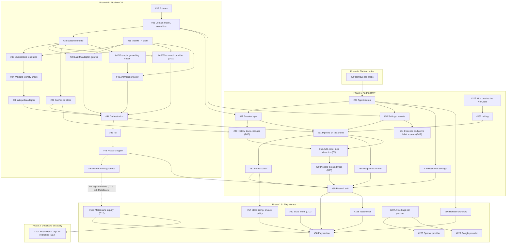

# Sleevesight MVP plan

**Date:** 2026-10-13  
**Scope:** closing Phase 0; Phase 0.5, Pipeline CLI; Phase 1, Android MVP; Phase 1.5, Play release; the Phase 2 issue that waits on Phase 1.5  
**Tracking:** [#31][31]

The work to the MVP and its release, as issues and their dependencies. What each piece is and why is in [design.md](design.md) and [architecture.md](architecture.md); the issues point to the sections. Each dependency is also a native *blocked by* link on its issue, except the two dotted ones around [#9][9], which led to the MetaBrainz inquiry ([#100][100]); the inquiry's links are native.

## Dependencies

An arrow points from an issue to the issues it unblocks. The dotted arrows were conditional: [#46][46] decided whether [#9][9] was needed, and [#9][9] would hold up [#58][58] only if the tags were used. They are: D12, revised on 2026-10-15, makes MusicBrainz tags a genre label source from Phase 1.0 ([#84][84]). [#9][9]'s findings call for asking MetaBrainz, and that inquiry, [#100][100], blocks [#58][58].

- **Starting points:** [#32][32] and [#35][35] need nothing; [#30][30] closes Phase 0. [#80][80] and [#100][100] need nothing either, and are best started early.
- **Two tracks.** [#47][47] and [#29][29] need only [#30][30], and [#48][48] and [#50][50] also only the domain types and `Settings` from [#33][33], so the Android work runs alongside Phase 0.5. The tracks join at [#49][49] (the `:store` schema from [#41][41]), [#51][51] (the pipeline from [#44][44]) and [#55][55] (the gate, [#46][46]).
- **Alongside the release.** [#227][227]–[#229][229] run alongside the release; see *Phase 1.5*.
- **Critical path:** [#32][32] → [#33][33] → [#34][34] → [#36][36] → [#37][37] → [#38][38] → [#44][44] → [#51][51] → [#53][53] → [#20][20] → [#55][55] → [#58][58]. Resolution ([#36][36], [#37][37]) is both the longest stretch and the gate's riskiest criterion: every same-name collision rejected or resolved correctly.

## Work

### Phase 0. Platform spike

| Issue | Work | Blocked by |
|---|---|---|
| [#30][30] | Remove `:spike`, its CI step and its references; the restricted-settings measurement moved to [#29][29] | |

### Phase 0.5. Pipeline CLI

| Issue | Work | Blocked by |
|---|---|---|
| [#32][32] | Fixtures: the simulator's playlist, facts and albums data in `fixtures/below-soundtrack/` | |
| [#33][33] | `:core` domain model, `Settings`, normalizer port; Multiplatform-readiness rules on | [#32][32] |
| [#34][34] | Evidence lines, ids, fingerprint; `SourceAdapter` | [#33][33] |
| [#35][35] | `:net`: rate limits, typed errors, redacting logger, `Secret` | |
| [#36][36] | MusicBrainz client; recording, first release, artists, covers | [#34][34], [#35][35] |
| [#37][37] | Wikidata client; the Wikipedia identity check | [#36][36] |
| [#38][38] | Wikipedia adapter: lead sentences, verbatim, attributed (D1) | [#37][37] |
| [#39][39] | Last.fm adapter; genre vocabulary; MusicBrainz tags for evaluation only | [#34][34], [#35][35] |
| [#40][40] | Choose the web search provider (D11); its adapter | [#34][34], [#35][35] |
| [#41][41] | `:store`: retrieval, artist-resolution and synthesis caches | [#34][34] |
| [#42][42] | Prompt builders; grounding check | [#34][34] |
| [#43][43] | `:ai`: Anthropic provider | [#35][35], [#42][42] |
| [#44][44] | Pipeline orchestration (D4); `PipelineEvent`s | [#38][38], [#39][39], [#40][40], [#41][41], [#43][43] |
| [#45][45] | `:cli`: coverage report, insights, HTTP recordings | [#44][44] |
| [#46][46] | The gate: thresholds tuned, MusicBrainz tags judged (D12), coverage reviewed | [#45][45] |
| [#9][9] | Licence of MusicBrainz tags; its findings became the MetaBrainz inquiry, [#100][100], once the tags were a label source (D12, revised) | [#46][46] decided whether it was needed (no native link) |

### Phase 1. Android MVP

| Issue | Work | Blocked by |
|---|---|---|
| [#47][47] | `:app` skeleton; first-run screen; notification access; `checkManifest` and the debug APK back in CI | [#30][30] |
| [#48][48] | Session layer: `NowPlaying`, track identity, queue, art | [#47][47], [#33][33] |
| [#49][49] | Session history; track-change records (D15) | [#48][48], [#41][41] |
| [#50][50] | Settings (DataStore) and secrets (Keystore): the AI key and the sources' keys (Last.fm, web search); settings screen | [#47][47], [#33][33] |
| [#112][112] | Who creates the app's one `NetClient`: `:wiring` (architecture, *Modules*) | |
| [#132][132] | `:wiring`: the one list of host policies, and the `NetConfig` built from it with each process's version, for the app and `:cli`; the app's one `NetClient`, and the adapters and providers handed to `:app` as `:core` types | [#112][112] (the decision, in architecture) |
| [#51][51] | The pipeline on the phone, with the keys wired into the adapters; visible-only lookups (D6); Write on tap | [#48][48], [#50][50], [#44][44], [#112][112], [#132][132] |
| [#52][52] | Home screen; every empty and error state | [#51][51] |
| [#53][53] | *Write insights automatically*; skip detection and *Crossfade* (D5) | [#49][49], [#51][51] |
| [#20][20] | Prepare the next track (D13) | [#53][53] |
| [#54][54] | Diagnostics screen | [#51][51] |
| [#84][84] | Settings: evidence sources and genre label sources, MusicBrainz tags among them (D12) | [#50][50] |
| [#29][29] | Restricted settings, on a device without Advanced Protection | [#47][47] |
| [#55][55] | Exit: a listening session on a real phone against Spotify | [#52][52], [#54][54], [#20][20], [#29][29], [#46][46] |

### Phase 1.5. Play release

| Issue | Work | Blocked by |
|---|---|---|
| [#56][56] | Release workflow: a signed app bundle, the key in a protected environment; R8 and its keep rules | [#47][47] |
| [#57][57] | Store listing and its graphics, launcher icon, privacy policy, data safety form | [#52][52] |
| [#80][80] | Exa's terms for in-app use (D11), settled before publishing | |
| [#100][100] | MetaBrainz inquiry: MusicBrainz tags as genre labels (D12); the answer recorded and met, or the tags off by default in the release | |
| [#158][158] | Tester brief for the closed test | [#55][55] |
| [#58][58] | Play's requirements for notification access and its target API level; testing track; review | [#55][55], [#56][56], [#57][57], [#80][80], [#100][100], [#158][158] |
| [#227][227] | AI settings per provider: a switch, key, model and reasoning effort each, the switches exclusive | |
| [#228][228] | `:ai`: OpenAI provider | [#227][227] |
| [#229][229] | `:ai`: Google provider | [#227][227] |

[#227][227], [#228][228] and [#229][229] do not hold up the closed test or Play's review ([#58][58]), so none of them is linked to it: they can ship in a later bundle during the closed test, so that testers can choose a provider.

### Phase 2. Detail and discovery

| Issue | Work | Blocked by |
|---|---|---|
| [#101][101] | Re-evaluate MusicBrainz tags as a genre label source (D12), with Last.fm's live tags and the outcome of [#100][100] | [#100][100] |

## Pending decisions

| Decision | Needed by | Options, and the recommendation |
|---|---|---|
| Release-date semantics | [#52][52] | The recording's first release, the release being played, or both. Recommendation: the first release as "Released", the played release in its source line when it differs |
| Players that send only a title | [#52][52] | How much of the home screen to hide when resolution is mostly `none`. Recommendation: decide from what [#46][46] and [#55][55] show, and hide nothing in the meantime |
| AI providers in the MVP | [#50][50] | Anthropic only, as the phase mapping has it, with the others in Phase 3; or one more in Phase 1. Recommendation: Anthropic only; `AiProvider` keeps the rest cheap. Phase 1 shipped Anthropic only. **Revised 2026-10-18:** OpenAI and Google move to Phase 1.5 ([#228][228], [#229][229]), after the AI settings per provider ([#227][227]), so alpha testers can choose a provider and vary its effort; Ollama stays in Phase 3 |
| Web search provider (D11) | [#40][40] | Decided by that spike |
| Genre label sources and their default (D12) | [#84][84] | MusicBrainz tags are a label source from Phase 1.0, for labels only and never in prompts (revised 2026-10-15); licence findings in [#9][9]. Recommendation: MusicBrainz on, since it needs no key and a new user has no Last.fm key; Last.fm on once its key is set. How two sources' labels combine is decided in [#84][84]; [#101][101] re-evaluates the choice in Phase 2 |
| The name | [#57][57] | The spoken-aloud test on "Sleevesight" before the store listing fixes it |
| Play developer account | [#58][58] | Personal or organisation; the testing a new account must do before production depends on the type |

## Considerations

### During implementation

- **CI between [#30][30] and [#47][47]** had no Android module, so `checkManifest` and the APK artifact were off until [#47][47] brought them back.
- **Every new library** is a reviewed edit to `config/dependency-allowlist.txt` with its licence, GPL-3.0 compatible; for example Ktor, OkHttp, SQLDelight, Compose, Navigation, DataStore, Robolectric, material-color-utilities.
- **Multiplatform readiness (D2)** is checked from [#33][33] on, so each pipeline module starts within the rules rather than being brought into them.
- **Recorded responses** in `fixtures/http/` hold third-party text: Wikipedia and Last.fm prose under CC BY-SA, MusicBrainz tags and genres under CC BY-NC-SA 3.0 (marked as such, or recorded without `inc=tags` and `inc=genres`; see [architecture, *MusicBrainz tags and genres*](architecture.md#musicbrainz-tags-and-genres-9)), and Last.fm and web search results under their API terms. Record only what the tests need, keep the attribution with them, and check the API terms on storing responses before committing them.
- **Live runs cost.** Recording the fixture is minutes of MusicBrainz at one request per second; the gate run ([#46][46]) writes an insight per track on the owner's key. CI never calls a live service.
- **Thresholds and tolerances** tuned in [#46][46] are constants, not settings (driver 6).
- **D4's profiling** (parallel by name against waiting for MusicBrainz) happens in [#46][46]; it also tells whether preparing the next track ([#20][20]) hides MusicBrainz's latency as intended.
- **Parallel work** on the two tracks means a worktree per agent.
- **The MetaBrainz inquiry** ([#100][100]) waits on an answer from outside the project, so it is sent early; sent late, it rather than [#55][55] can hold up [#58][58].

### After implementation

- **Phase 2 is already waiting:** [#21][21] (prompt style, D14) and [#22][22] (learned skip detection, D15), which needs the records [#49][49] starts collecting; and [#101][101] (D12), once [#100][100] is settled.
- **Installs outside Play.** Checked with [#29][29] (`design.md`, *Notification access and installation*): on the phone measured, restricted settings marked a file install but did not block notification access; Google's developer verification is enforced since 2026-09-30 only for installs from participating stores in four countries, and is planned globally for 2027, when registering the package becomes the condition for a build handed out as a file (without it, `adb` or the *advanced flow*; a free *limited distribution* account registers it for up to 20 devices, each device's user consenting on the device through a QR code or a link).
- **Play's testing requirement** for a new developer account can add weeks before production; check it when the account is set up, so [#58][58] is scheduled with it.

[9]: https://github.com/wkusnierczyk/sleevesight/issues/9
[20]: https://github.com/wkusnierczyk/sleevesight/issues/20
[21]: https://github.com/wkusnierczyk/sleevesight/issues/21
[22]: https://github.com/wkusnierczyk/sleevesight/issues/22
[29]: https://github.com/wkusnierczyk/sleevesight/issues/29
[30]: https://github.com/wkusnierczyk/sleevesight/issues/30
[31]: https://github.com/wkusnierczyk/sleevesight/issues/31
[32]: https://github.com/wkusnierczyk/sleevesight/issues/32
[33]: https://github.com/wkusnierczyk/sleevesight/issues/33
[34]: https://github.com/wkusnierczyk/sleevesight/issues/34
[35]: https://github.com/wkusnierczyk/sleevesight/issues/35
[36]: https://github.com/wkusnierczyk/sleevesight/issues/36
[37]: https://github.com/wkusnierczyk/sleevesight/issues/37
[38]: https://github.com/wkusnierczyk/sleevesight/issues/38
[39]: https://github.com/wkusnierczyk/sleevesight/issues/39
[40]: https://github.com/wkusnierczyk/sleevesight/issues/40
[41]: https://github.com/wkusnierczyk/sleevesight/issues/41
[42]: https://github.com/wkusnierczyk/sleevesight/issues/42
[43]: https://github.com/wkusnierczyk/sleevesight/issues/43
[44]: https://github.com/wkusnierczyk/sleevesight/issues/44
[45]: https://github.com/wkusnierczyk/sleevesight/issues/45
[46]: https://github.com/wkusnierczyk/sleevesight/issues/46
[47]: https://github.com/wkusnierczyk/sleevesight/issues/47
[48]: https://github.com/wkusnierczyk/sleevesight/issues/48
[49]: https://github.com/wkusnierczyk/sleevesight/issues/49
[50]: https://github.com/wkusnierczyk/sleevesight/issues/50
[51]: https://github.com/wkusnierczyk/sleevesight/issues/51
[52]: https://github.com/wkusnierczyk/sleevesight/issues/52
[53]: https://github.com/wkusnierczyk/sleevesight/issues/53
[54]: https://github.com/wkusnierczyk/sleevesight/issues/54
[55]: https://github.com/wkusnierczyk/sleevesight/issues/55
[56]: https://github.com/wkusnierczyk/sleevesight/issues/56
[57]: https://github.com/wkusnierczyk/sleevesight/issues/57
[58]: https://github.com/wkusnierczyk/sleevesight/issues/58
[80]: https://github.com/wkusnierczyk/sleevesight/issues/80
[84]: https://github.com/wkusnierczyk/sleevesight/issues/84
[100]: https://github.com/wkusnierczyk/sleevesight/issues/100
[101]: https://github.com/wkusnierczyk/sleevesight/issues/101
[112]: https://github.com/wkusnierczyk/sleevesight/issues/112
[132]: https://github.com/wkusnierczyk/sleevesight/issues/132
[158]: https://github.com/wkusnierczyk/sleevesight/issues/158
[227]: https://github.com/wkusnierczyk/sleevesight/issues/227
[228]: https://github.com/wkusnierczyk/sleevesight/issues/228
[229]: https://github.com/wkusnierczyk/sleevesight/issues/229
