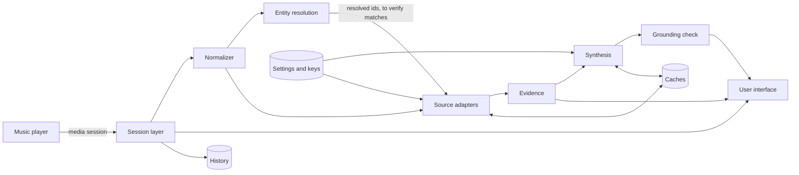
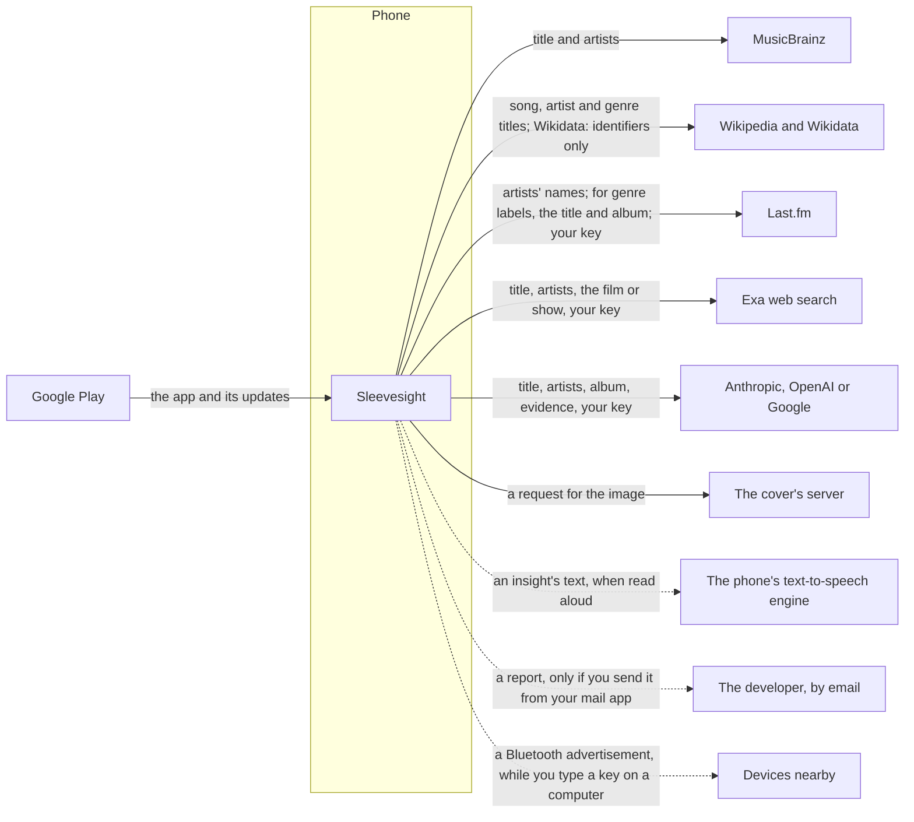
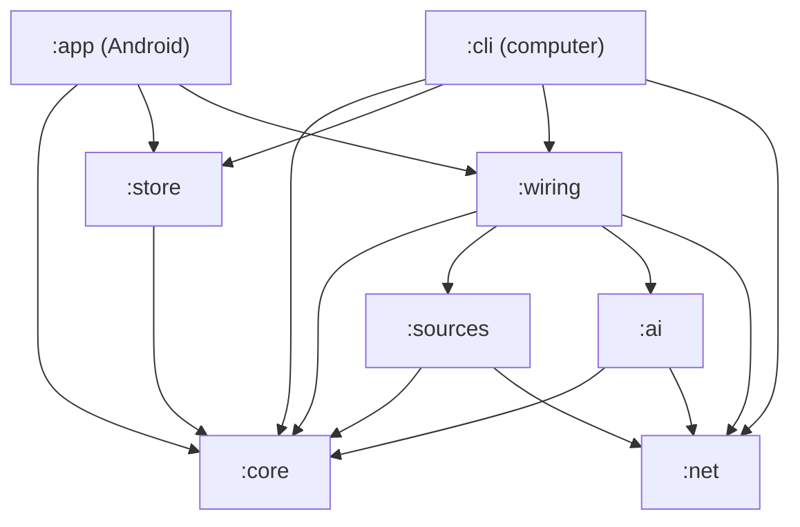

# Architecture

This page gives the picture: what Sleevesight is made of, what talks to what, and what leaves the phone for which service. The detail, with the reasons for each choice, is in the design documents: [`design/architecture.md`](https://github.com/wkusnierczyk/sleevesight/blob/main/design/architecture.md) for how the app is built, and [`design/design.md`](https://github.com/wkusnierczyk/sleevesight/blob/main/design/design.md) for what it does and why. The libraries it ships are on the [dependencies]({{ '/docs/dependencies/' | relative_url }}) page; what it sends, in the words that bind it, is in the [privacy policy]({{ '/privacy.html' | relative_url }}).

## In short

Sleevesight is an Android app with no server of its own. It reads what your music player is playing from the phone's media session, looks the track up at the music sources you switch on, has the AI service you choose write a short insight from what the sources found, and checks every citation in code once the reply is complete. Every request goes from the phone straight to the service it is for, with your own API key where the service needs one. Sleevesight has no accounts and no ads, and no telemetry, crash reporting or analytics of its own; if any is added, it will never carry your data. Nothing you play, and nothing the app sends on its own, reaches its developer: only a report you send from your own mail app does.

## The parts

### The session layer

Android lets an app read what a music player is playing only through notification access. The session layer holds that access, and reads the media session of each player you follow: which player it is; the title, artists, album and its year, length and cover; whether it is playing, and how far in; and the queue up next. It ignores the notifications themselves and never touches the audio. A call's session, from the phone's own call apps or one Android marks as a voice call, is dropped before anything of it is read. The session layer also tells a skip from a track that ended on its own, which decides whether an insight is written under *Reactive* set to *On track skip (auto)*. Playing, pausing and skipping from the app come in Phase 2; today a tap on the player's name opens the player.

### The pipeline

The pipeline turns a track into an insight. It is plain Kotlin with no Android in it, so the same code also runs on a computer in the project's command-line tool, against recorded test data.

- **Normalizer.** Cleans the title and artists of what players append, such as "2006 Remaster" or "feat. Van Morrison", sets the featured artists beside the main ones, and makes the key the track is cached under.
- **Entity resolution.** Finds the recording at MusicBrainz, by title, credited artists and length, and from it the artists, the first release, and whether the song is a cover. It runs alongside the lookups by name, not before them, and each source's match is then checked against what it found: a Wikipedia article, for instance, is accepted only if Wikidata confirms it is a song by one of the credited artists. Web search results have no id to check against; a text filter on the song and its artists is their only check. Of the sources checked this way, a match that fails is shown as rejected, with why, and one that cannot be checked is shown, but never cited.
- **Source adapters.** One for each source: MusicBrainz, Wikipedia and Wikidata, Last.fm, and web search through Exa. Each asks its source and returns a typed outcome (found, nothing, rejected, unreachable) with the lines of evidence it found.
- **Evidence.** The lines that may be cited: the verified lines, and the web search lines that passed its filter, each with an id such as `MB1` or `W2`, given the same way every time for the same answers.
- **Synthesis.** Builds the prompt from the evidence (data only, fenced and labelled as such) and asks the AI service you chose, streaming its reply. The model has no tools: it gets a prompt and returns text.
- **Grounding check.** Splits the reply into sentences and checks each citation against the evidence sent. A sentence that cites nothing is underlined; a citation of a line that does not exist is flagged. A reply in which the model corrects itself ("Wait, that sentence is not supported... Here is the corrected insight:") shows only its corrected version once the reply is complete. The model's own knowledge is used only if you switch it on, and its sentences then carry an *AI* chip in place of a source's.

The model never decides what is true: resolution, matching, the choice of evidence and the citation check are all deterministic code, tested against fixtures.

### The stores

Everything the app keeps is on the phone, and none of it is part of Android's backup or of a transfer to a new phone.

- **The caches**, a database: what each source found for a track, kept for a while so the same track is not looked up again (the lifetimes are settings); the insights and genre explanations written, for as long as *Keep history for* says, or until the caches fill and the least recently used make room; and, only with *Keep what sources said about each artist* on, what the sources said about each artist. Answers from MusicBrainz are also held in memory for half an hour, never on disk.
- **The history**, a database of its own: the list of tracks seen playing (what the player said of each, and when it played) and the record of track changes that skip detection learns from, kept for as long as *Keep history for* says. *Clear history* empties both databases, and forgets what is held in memory about the tracks, at once.
- **Settings and API keys**, in Android's DataStore. The keys are encrypted with a key held in the phone's Android Keystore, are never shown again once saved, and are never logged.
- **The diagnostics log**, in memory only, for the *Diagnostics* screen of the developer settings. It leaves the phone only if you *Export* it to a file you choose.

### The user interface

One Android activity in Jetpack Compose: the first-run screen, the home screen with the playing track, its genres, the insight, its citations and *Sources* (and, with nothing playing, your players and a guide to the screen), the settings, the credits and the diagnostics. *Read aloud* hands an insight's text to the phone's own text-to-speech engine, through Android; the app ships no speech engine of its own. Its colours come from the album art, computed on the phone. Its font is bundled, so nothing is fetched to show text. API keys can be pasted, scanned from a QR code with the camera (*Load keys*), or typed on a computer (*Type on a computer*), over Bluetooth.

### The site's pages

The website, served by GitHub Pages, has three pages that work with the app:

- **The [product page]({{ '/' | relative_url }})** says what the app does. It loads nothing from outside the site.
- **[`api-keys`]({{ '/api-keys.html' | relative_url }})** draws a QR code of several API keys in the browser, for *Load keys*. Its content security policy forbids any network request, and it stores nothing, so the keys leave the computer only in the code you scan.
- **[`keyboard.html`]({{ '/keyboard.html' | relative_url }})**, for *Type on a computer*, makes a one-time key, shows it in a QR code for the phone to scan, and sends what you type to the phone over Bluetooth, encrypted with that key. Its content security policy forbids any network request, so nothing goes through a server; the Bluetooth link is between the computer and the phone alone.

The pages with diagrams, this one among them, load the diagram script, Mermaid, from jsDelivr.

## What leaves the phone

Requests go straight from the phone to each service, over HTTPS; Android refuses the app any unencrypted connection. None passes through a server of Sleevesight's, since there is none. Each service sees the phone's IP address, as every service you connect to does, and every request names the app and its version in its User-Agent, with the project's address, as MusicBrainz asks.

| Service | When | What it receives |
|---|---|---|
| MusicBrainz | Switched on (it is by default) | The title and artists of the playing track, cleaned of tags such as "2006 Remaster". While *Proactive* is on, as it is by default, the title and artists of the next track in the player's queue, before it plays. |
| Wikipedia and Wikidata | Wikipedia switched on | Wikipedia: the title and artists, to find their articles. Wikidata: only identifiers, from MusicBrainz or Wikipedia, never a name. When you open a genre's panel, Wikidata gets the genre's MusicBrainz identifier and Wikipedia the title of the genre's article, to show what the genre is; nothing about the track. |
| Last.fm | Switched on, with your key | The artists' names, and your Last.fm key. For the genre labels, while *Show genres* is on, its tags for the track and for the album are asked for by the first artist's name with the title, and with the album name: Last.fm is the only source that gets the album name. |
| Exa (web search) | Switched on, with your key | The title and artists, the film or show a title says it is from, and your Exa key. |
| The AI service you choose: Anthropic, OpenAI or Google | *Show insights* on, a service switched on, with your key | The title, artists and album, and what the sources found, for the playing track only; each insight, and each *Why is this …?* you tap in a genre's panel (with the genre's name), a request of its own, with no conversation kept. Your key for that service, and the model you chose. The app also asks the service for its list of models, with your key and nothing about your listening: at start, and when you open the model choice. |
| The server a cover's web address names | A player gives the cover only as a web address | A request for that image. The address itself may identify the album or episode. |
| The phone's text-to-speech engine | You tap *Read aloud*, or *Read new insights aloud* is on | The insight's text (or a genre's *Why is this …?* answer), with the track's title and artists if *Read the track line first* is on. The engine is the one chosen in Android's settings: one that speaks on the phone sends nothing, while one with network voices, such as Google's, sends the text to its server to be spoken, under its own policy. |
| The developer, at `support@sleevesight.app` | You tap *Report a problem* on an insight and send the report from your own mail app | The reason and your note; the track as the player reported it (title, artists, album, length) and its MusicBrainz ids; the insight and the evidence lines it was written from (for an insight kept from before, every evidence line of the track), with their sources and addresses; the prompt version, AI service, model and effort. You see all of it before your mail app opens; your mail app handles it from then on as any message you write (some keep a draft in your mail account), and sends it from your address only if you do. Never your keys, the history or the settings. |
| The developer, at `support@sleevesight.app` | In developer mode with *Report button* at *Show* or *Auto* (by default only in the test build for Play's testing tracks), you tap the button on the home screen, then *Report*, and send the tester's report from your own mail app | When you tapped, with the time zone, and the app's version and build; the settings, never your keys; what the player reports and what the app made of it (the sources' findings, the evidence, the insight and its citation check, the AI service and model); the diagnostics' events and what skip detection has learned; the latest track changes, with the tracks' titles and times, only if you add them. You see all of it, and can edit or leave out each part, before your mail app opens; it sends it from your address only if you do. |
| Devices nearby, over Bluetooth | While a key's dialog types on a computer (*Type on a computer*) | The phone's advertisement, which any device nearby that scans for Bluetooth can see: a random identifier for the session, and the phone's Bluetooth name only with *Share phone's name with Type on a computer* on. The typed text comes from the computer, encrypted; the phone sends back only Bluetooth's acknowledgements. |
| Google Play | Installing and updating the app | Google handles the installation under its own policy; it gives the developer aggregated install statistics and, from phones that share usage and diagnostics with Google, crash reports that name no one. The app holds no Google Play library. |

The album name goes to the AI service, and among the sources only to Last.fm, for its album tags. Each API key goes only to the service it belongs to. By default, lookups and writing happen only while Sleevesight is on screen; with *Look up in the background* on, also while it is not. A Spotify account, once the app offers connecting one, would add requests to Spotify's Web API with your own token; no build offers it yet. Nothing else leaves the phone, except a diagnostics export you make yourself, a report you hand to your mail app, an insight read aloud by an engine that speaks through its server, and, while you type a key on a computer, the phone's Bluetooth advertisement, which devices nearby can see (the session's service, and the phone's name only with *Share phone's name with Type on a computer* on).

## Enforced, not promised

The claims above are not only a policy. The build checks them, and fails when one breaks; CI runs the checks on every change.

- **One way out to the internet.** The app is split into Gradle modules, and only one of them, `:net`, may hold an HTTP client (Ktor, with the OkHttp engine). The source adapters (`:sources`) and the AI services (`:ai`) reach the network only through it; the module that builds them (`:wiring`) creates the app's one client and makes no request of its own; and the Android app itself (`:app`) cannot name a `:net` type at all, not even transitively. The pipeline's core (`:core`) and the stores (`:store`) have no network dependency. `checkModuleGraph` holds each module to the dependencies [`config/module-graph.properties`](https://github.com/wkusnierczyk/sleevesight/blob/main/config/module-graph.properties) allows it, a lint rule forbids Java's own network classes outside `:net`, and a check on the compiled pipeline classes fails on any reference to a network API.
- **No library that was not reviewed.** `checkDependencies` fails on any library outside [`config/dependency-allowlist.txt`](https://github.com/wkusnierczyk/sleevesight/blob/main/config/dependency-allowlist.txt), and every dependency's version is locked. A new library, and so any analytics, crash-reporting or ads SDK, would be a reviewed edit to that file.
- **No permission that was not reviewed.** `checkManifest` reads the merged Android manifest of every build and fails on any permission outside [`config/permission-allowlist.txt`](https://github.com/wkusnierczyk/sleevesight/blob/main/config/permission-allowlist.txt): the internet, whether the phone is online, the camera (asked for only to scan a key's QR code) and Bluetooth (asked for only to type on a computer).
- **Keys never logged.** A key is held in a type that prints as redacted, and the network log holds no header value, no key and no URL that may carry one; tests compare complete log lines against requests carrying a key.

What the checks do not cover is held by review instead: that `:wiring` makes no request of its own, and what each adapter puts into its requests. The code is open source, under the GPL 3, on [GitHub](https://github.com/wkusnierczyk/sleevesight), for anyone to check.

## The modules

| Module | What it holds |
|---|---|
| `:core` | The pipeline: the normalizer, resolution logic, evidence, prompts, the grounding check, the settings' defaults. No network, no Android. |
| `:net` | The one HTTP client: per-host rate limits, timeouts, retries that never send a paid request twice, and a log that redacts keys. |
| `:sources` | The source adapters, and the fetcher for covers given as a web address. |
| `:ai` | The clients of Anthropic, OpenAI and Google, small ones over `:net` rather than the vendors' SDKs. |
| `:store` | The caches and the history, in SQLite. |
| `:wiring` | Puts the network side together and hands the app only `:core` types. |
| `:app` | The Android app: the session layer, the user interface, settings and keys, and the diagnostics. |
| `:cli` | The command-line tool that runs the pipeline over a playlist of test tracks, on a computer. |

The diagram is the graph `checkModuleGraph` enforces: an arrow is a dependency the module may have, and a module may have no other.
