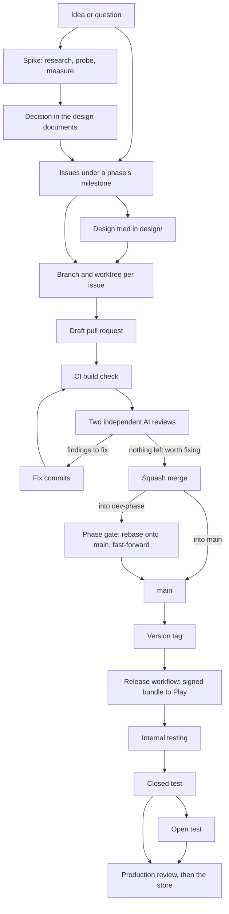

---
# How Sleevesight is built, reviewed, tested and released (#427), at `/docs/process/`. Written from
# the repository's own record: the issues, milestones and pull requests and their review comments,
# the CI and release workflows (`.github/workflows/`), `design/release.md`, `design/plan.md`, the
# README's roadmap, `release-notes/` and the protection of `main`. A change to how work is planned,
# reviewed, merged or released changes it too; so does the closed test (#58), after which the
# testing half says what happened rather than the plan.
title: Process
permalink: /docs/process/
---

# Process

Sleevesight is made by one developer working with AI agents. The agents write most of the code, the documents and the reviews; the developer decides what is built, judges what comes back, and does what needs a person: the phone, the Play Console, the merges into `main`. The work follows a written process, and nearly all of it is public in the [repository](https://github.com/wkusnierczyk/sleevesight): the issues, the milestones, the pull requests and the reviews posted on them.

This page goes through that process in order, from an idea to a release on Google Play. Each step says what is done, why, and links an example.

## How it is built

### 1. Investigation and ideation

**What.** A question that cannot be answered from the desk becomes a `[SPIKE]` issue: what Android lets an app read from a music player, whether a data source's licence allows its use, what Google Play asks of an app with notification access. A spike says its question, its method and when it is done, and ends in findings and a decision. Decisions are numbered in the design documents (`D7`, `D12` and so on, in [`design/design.md`](https://github.com/wkusnierczyk/sleevesight/blob/main/design/design.md) and [`design/architecture.md`](https://github.com/wkusnierczyk/sleevesight/blob/main/design/architecture.md)), so that later issues and code can point to them.

**Why.** Much of what the app depends on is not written down anywhere reliable: how each player reports its tracks, how a phone treats an app installed from a file. Measuring it first keeps guesses out of the design.

**Examples.** The first phase was a probe app on a real phone ([#11](https://github.com/wkusnierczyk/sleevesight/issues/11)), removed once it had answered its questions ([#30](https://github.com/wkusnierczyk/sleevesight/issues/30)). The spike on installing from a file ([#29](https://github.com/wkusnierczyk/sleevesight/issues/29), [PR #123](https://github.com/wkusnierczyk/sleevesight/pull/123)) found that a protected phone refused such an app outright; the decision that followed (`D7`, revised) is to distribute through Google Play only. The licence of MusicBrainz tags ([#9](https://github.com/wkusnierczyk/sleevesight/issues/9)) led to an inquiry to MetaBrainz ([#100](https://github.com/wkusnierczyk/sleevesight/issues/100)) before the tags ship as genre labels.

### 2. Plans as milestones and issues

**What.** The README's [roadmap](https://github.com/wkusnierczyk/sleevesight#roadmap) is a series of phases, and each phase is a [milestone](https://github.com/wkusnierczyk/sleevesight/milestones): *Platform spike*, *Pipeline CLI*, *Android MVP*, *Play release*, *Detail and discovery*, *Context and reach*. Security work has a milestone of its own, which runs alongside the phases ([#217](https://github.com/wkusnierczyk/sleevesight/issues/217)). Every piece of work is an issue in one of them. Its title starts with its kind, such as `[FEATURE]`, `[BUG]`, `[CLEANUP]`, `[DOCS]`, `[SPIKE]` or `[INFRA]`, and its labels say:

- the category (correctness, platform and store compliance, dead code, build, style, docs, features);
- the urgency and the importance, judged separately: how soon it is needed, and how much it matters if left;
- the progress, mirroring a project board (which is not public);
- where the work is done (`environment:workstation`, `environment:mobile`) and by whom (`worker:agent`, `worker:human`);
- what a blocked issue waits on: another issue, a hand step, a decision or a third party.

A real dependency is a native *blocked by* link between issues, not only a sentence. The [MVP plan](https://github.com/wkusnierczyk/sleevesight/blob/main/design/plan.md) draws the dependencies to the first release as a graph.

**Why.** With several agents working at once, the issue list is the shared state: what is open, what is waiting and on what, what can start now. Labels make that list filterable; the links make the order explicit.

**Example.** The Play review ([#58](https://github.com/wkusnierczyk/sleevesight/issues/58)) is blocked by, among others, the release workflow, the store listing and privacy policy, the tester brief, the Phase 1 exit test and the in-app problem report, each a linked issue.

### 3. Simulated designs

**What.** What a page or a screen should look like is tried in [`design/`](https://github.com/wkusnierczyk/sleevesight/tree/main/design) as HTML before it is built: the [brand sheet](https://github.com/wkusnierczyk/sleevesight/blob/main/design/brand.html), with the logo designs, colours and type ([PR #279](https://github.com/wkusnierczyk/sleevesight/pull/279)), and earlier variants of the product page kept beside the live one ([PR #355](https://github.com/wkusnierczyk/sleevesight/pull/355)). Design documents in the same folder record the reasoning: what was considered, what was chosen and why.

**Why.** A design in a browser is quick to change and easy to compare side by side; a rejected one costs an hour, not a branch of app code. The app's launcher icon and the store's graphics are generated from the brand sheet's drawing, so the design stays the one source.

### 4. Coding

**What.** One issue per branch, per commit and per worktree. A branch is named for its issue (`<issue>-<kind>-<slug>`, such as `435-bug-players-list` for [#435](https://github.com/wkusnierczyk/sleevesight/issues/435)) and starts from the remote `main` after a fetch. Each agent works in a worktree of its own, so several issues move at once without touching each other's files. Issues that do not depend on each other run side by side as a *wave*; the dependency links say which can.

**Why.** One issue per branch keeps every change reviewable on its own and every commit on `main` traceable to its issue. Separate worktrees let parallel sessions share one repository without one's checkout landing in another's work.

**Example.** The last wave of the *Play release* phase ran four issues side by side: the home screen's header ([#445](https://github.com/wkusnierczyk/sleevesight/issues/445)), the artist cache ([#420](https://github.com/wkusnierczyk/sleevesight/issues/420)), the logo intro ([#383](https://github.com/wkusnierczyk/sleevesight/issues/383)) and the players to follow ([#435](https://github.com/wkusnierczyk/sleevesight/issues/435)).

### 5. Pull requests

**What.** Each branch becomes a pull request, into `main`, or into the phase's integration branch, `dev-<phase>`, when a phase runs as waves. Its body closes its issue (`Closes #N`), says what changed and why, and ends with a *Verification* section: what was built, run and checked, and what was not. It stays a draft while it is under review. When the integration branch moves, it is merged into each open branch of the phase before the next fix commit, so each review sees the current base.

**Why.** The pull request is where the work is read: the change, the reasoning, the reviews and the answers to them, in one place that outlives the session that made it.

**Example.** [PR #391](https://github.com/wkusnierczyk/sleevesight/pull/391), the OpenAI provider, says what changed module by module, which decisions it took, and that its live test was not run because no key was available yet.

### 6. Building and testing

**What.** Every pull request runs the CI check `build` ([`ci.yml`](https://github.com/wkusnierczyk/sleevesight/blob/main/.github/workflows/ci.yml)), and `main` requires it to pass on a branch that is up to date with `main`. It compiles every module and runs the unit tests, Detekt, ktlint and Android lint; the build logic's functional tests; and the structural checks, which allow only allowlisted dependencies and permissions and the module boundaries the design sets. It checks the release notes, and that generated test vectors are current. A pull request that changes only files the build never reads, such as the privacy policy or the release notes, skips the compilation, but the check still reports. Every push to `main` and to the `dev-*` branches builds too, unless it changes only Markdown, so a merge that combines two branches is checked as well. Commits are pushed only after the local build has passed.

The tests run on recorded responses, with no network and no keys. Where a change touches the AI services or the prompt, it is also run live through the pipeline's command-line tool (the README's [*Pipeline CLI*](https://github.com/wkusnierczyk/sleevesight#pipeline-cli)), against the real sources and AI service, and on a phone where the change is on screen.

**Why.** A required check holds every change to the same bar, documents included. The structural checks hold the design's constraints, such as which permissions the app may ask for, in code rather than in review comments. Live runs catch what recorded responses cannot: a model's answer, or a source that has changed.

**Example.** [PR #398](https://github.com/wkusnierczyk/sleevesight/pull/398), which stops insights from repeating an artist's facts on every track of an album, was checked on a set of regression tracks run live.

### 7. Review rounds to a fixed point

**What.** Each pushed commit is reviewed by two AI reviewers, independently and in parallel: Codex, and a fresh Claude session that has the diff and the issue but not the reasoning of the session that wrote the change. Both get one shared prompt: the issue, what the commit does, what to check, and how to classify a finding (must-fix only for a real defect that matters in practice). Each review is posted on the pull request as written, headed "Codex review of" or "Claude review of" the commit. Then every finding is answered: fixed in the pull request, nits included, or declined or deferred with the reason, in one comment of outcomes that names the reviewer behind each. The fix commit is reviewed in turn. The loop ends at a round with nothing left worth fixing, and runs at most six rounds; when the same kind of finding survives two rounds, the approach changes instead of the patch. What does not fit the issue, or needs substantial new work, becomes an issue of its own. Every finding is also recorded, with a judgement of whether it was valid and useful; those records are kept privately.

**Why.** Each reviewer misses problems the other finds, so two catch more than one. A reviewer without the author's reasoning reads the change as a newcomer would. Fixing in the pull request, rather than filing each nit for later, keeps small faults from piling up; the cap and the change of approach keep a loop from running on a detail.

**Examples.** [PR #458](https://github.com/wkusnierczyk/sleevesight/pull/458), the opt-in artist cache, went through the full loop: its outcomes comments show a finding that came back in a new form round after round, and the approach that was changed for it. [PR #459](https://github.com/wkusnierczyk/sleevesight/pull/459) (players to follow) and [PR #373](https://github.com/wkusnierczyk/sleevesight/pull/373) (a key and a switch per AI service) show the same loop on a bug fix and on a settings change.

### 8. Gated merging

**What.** Pull requests are squash-merged: each becomes one commit, with a message built from its commits. `main` is protected: a pull request into it needs the `build` check, an approving review after its last push and every conversation resolved; its commits must be signed and its history linear; force-pushes and deletion are refused, and the branch is locked, so only the repository's administrator lands a change on it. A pull request into a `dev-<phase>` branch is merged by the agent once its reviews are done and CI is green.

At the end of a phase, the gate, the integration branch is rebased onto `main` and offered as one pull request. The per-PR review loops were the code review; the gate is the acceptance check. It lands by a fast-forward of `main` to the branch, not by the merge button, so that `main` keeps each of the phase's pull requests as its own signed commit.

**Why.** Small reviewed commits keep `main` readable and each change revertible on its own. The gate gives a phase one point at which it is accepted as a whole, and the fast-forward keeps the history it was reviewed in.

**Examples.** The gates of [Phase 1.0](https://github.com/wkusnierczyk/sleevesight/pull/215), of [Phase 1.5](https://github.com/wkusnierczyk/sleevesight/pull/405) and of [a later Phase 1.5 wave](https://github.com/wkusnierczyk/sleevesight/pull/465): each lists its commits with their pull requests and issues, and says what the rebase changed. The first gate, of Phase 0.5 ([PR #88](https://github.com/wkusnierczyk/sleevesight/pull/88)), was squashed into a single commit through the merge button; the fast-forward has been the method since.

## How it is tested and released

Releases so far have gone to Google Play's internal testing track. The closed test ([#58](https://github.com/wkusnierczyk/sleevesight/issues/58)) has not yet run, so what follows from it is the plan; this section will say what happened once it has.

### 9. Testing tracks

**What.** Google Play offers a sequence of tracks, each reaching more people:

- **Internal testing.** A small list of testers named in Play Console, who get each release as soon as it is uploaded. Every release so far has gone here, and it is where a build is first checked on a phone installed from Play.
- **Closed test (alpha).** *Planned.* Invited testers, at least 12, who stay opted in for 14 days in a row: Google Play asks for that before a new developer's app can go public. The [tester brief]({{ '/docs/tester/alpha/' | relative_url }}) tells them how to install the app, what to try and what to report: insights a source does not support, track changes missed, skips misread, crashes, battery or data use, the icon on their home screen.
- **Open test (beta).** *Planned, if needed.* Open to anyone through the store listing, for a wider check before production.
- **Production.** *Planned.* Play reviews the app before it is public, including what it does with notification access and what its data safety form declares.

**How problems come back.** The app has no server and no accounts, so the developer learns little unless a tester says so. Testers send reports from the report button on the test build's home screen ([#452](https://github.com/wkusnierczyk/sleevesight/issues/452)), which collects the app's state at the tap, settings and diagnostics included, and the track changes if they add them, shows it for them to edit, and hands it to their mail app, addressed to [support@sleevesight.app](mailto:support@sleevesight.app); or by email to the same address, or as a public issue in the repository. *Report a problem*, on each insight, composes a report of an insight that is wrong or offensive, shows it, and hands it to the phone's mail app, addressed to the same address ([#390](https://github.com/wkusnierczyk/sleevesight/issues/390)); Play's policy on AI-generated content asks for such a report in the app before production.

**Why.** Each track widens the audience only once the narrower one has found nothing that stops it. A tester's phone, players and listening habits differ from the developer's, and that is where the skip detection, the players and the insights meet cases no fixture holds.

### 10. Release

**What.** A release is a version tag on `main`, `v<major>.<minor>.<patch>`. The tag starts the [release workflow](https://github.com/wkusnierczyk/sleevesight/blob/main/.github/workflows/release.yml), which waits for approval, then checks that the tagged commit is on `main` and that the version has its release notes; builds the app bundle from a clean state, shrunk by R8 and signed with the upload key; checks the signer against the upload certificate Play knows; keeps the bundle as a workflow artifact; and uploads it to the Play track through the Play Developer API. No Google key is stored anywhere: the job proves its identity to Google with a short-lived token that only this repository's release environment can obtain. Google Play then signs the app delivered to phones with its own app signing key.

- **Versioning.** The tag gives both versions: the version name is the tag without its `v`, and the version code is computed from it, so it rises with every release and a release needs no commit to bump it. A tag is never moved or reused.
- **Release notes.** One file per version in [`release-notes/`](https://github.com/wkusnierczyk/sleevesight/tree/main/release-notes), committed with the change that ships, so it is reviewed with it, and checked in CI against Play's limit.
- **The store listing.** Its text is in [`listing/en-US/`](https://github.com/wkusnierczyk/sleevesight/tree/main/listing/en-US) and its graphics in `listing/graphics/`, reviewed like code and entered in Play Console by hand. A change to what the app does or what leaves the phone changes the listing, the README and the [privacy policy]({{ '/privacy.html' | relative_url }}) together.
- **The production review.** *Planned*, after the closed test: Google Play's review of the app for production ([#58](https://github.com/wkusnierczyk/sleevesight/issues/58)).

The details, with the one-time setup outside the repository, are in [`design/release.md`](https://github.com/wkusnierczyk/sleevesight/blob/main/design/release.md).

**Why.** A release built only from `main`, by a workflow from a clean state, can be traced to reviewed commits and rebuilt. Keeping the notes and the listing in the repository puts what users read through the same review as the code it describes.

**Example.** The release of [0.1.3](https://github.com/wkusnierczyk/sleevesight/blob/main/release-notes/0.1.3.txt), which brought the choice of AI service, came from the tag `v0.1.3` through the workflow to the internal testing track.
