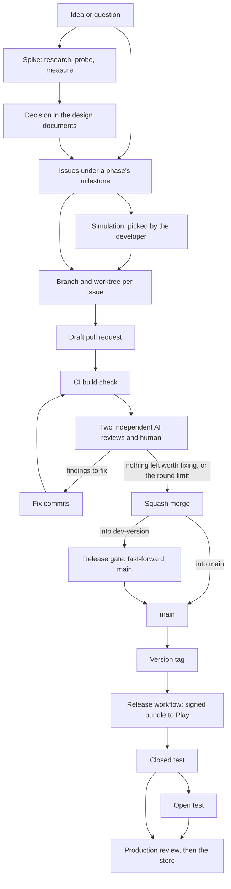

---
# How Sleevesight is built, reviewed, tested and released (#427), at `/docs/process/`. Written from
# the repository's own record: the issues, milestones and pull requests and their review comments,
# the CI and release workflows (`.github/workflows/`), `design/release.md`, `design/plan.md`, the
# README's roadmap, `release-notes/` and the protection of `main`. A change to how work is planned,
# reviewed, merged or released changes it too; so does the closed test (#58), after which the
# testing half says what happened rather than the plan.
# The numbers after the intro (#700) are a snapshot, dated in the text and not kept current; a
# comment before the list says how each was counted.
# *Lessons learned* (#742) is history too, dated in the text: each figure in it has a comment beside
# it, in the source and not shown on the page, saying how it was measured. Every page's footer
# links its paragraph on the labels by its id, `#footer-labels` (#743), so keep the id.
title: Process
permalink: /docs/process/
docs_version: 0.1.18
nav:
  - id: how-it-is-built
    label: How it is built
  - id: how-it-is-tested-and-released
    label: Tested and released
  - id: lessons-learned
    label: Lessons learned
provenance: [ai-wrote, human-reviewed]
---

# Process

Sleevesight is made by one developer working with AI agents. The agents write most of the code, the documents and the reviews; the developer decides what is built and how, judges what comes back, and does what needs a person: the phone, the Play Console, the merges into `main`. The work follows a written process, and nearly all of it is public in the [repository](https://github.com/wkusnierczyk/sleevesight): the issues, the milestones, the pull requests and the reviews posted on them.

In numbers, on 2 November 2026, twenty-one days after the first commit:


  Counted on 2 November 2026, about 10:00 UTC.
  Days: the first commit on `main` is of 12 October 2026.
  Issues: GitHub's search, `repo:wkusnierczyk/sleevesight is:issue` (493) and `is:issue is:closed` (394).
  Pull requests: `is:pr` (345) and `is:pr is:merged` (339).
  CI builds: the Actions API, `actions/workflows/ci.yml/runs` `total_count` (1,509); release runs:
  `actions/workflows/release.yml/runs` (16).
  Reviews: the private review records, `reviews.jsonl`, runs with `status` `done` (1,553: Codex 794,
  Claude 759, of them 310 recorded as `claude-remote`); findings: `findings.jsonl`, records with `n` not 0
  (2,978), of them `outcome` `fixed` (2,570).
  Releases: the tags `v0.1.0` to `v0.1.15` (16); commits: `git rev-list --count origin/main` (304).
  Tests: `@Test` annotations in the tracked `.kt` files of `dev-0.1.16` under a test source set
  (`src/test/`, `src/androidTest/` and the like) (3,239); lines: those files (87,900) and the
  other tracked `.kt` files (66,675), newlines counted.
  Mock-ups: the count of 28 October (about 50, by hand from `design/`, the published mock-ups and
  the unpublished ones kept privately) plus the 41 simulations published as private pages from
  30 October to 2 November (screens, docs pages, release notes, this page), rounded.


- **493 issues**, 394 of them closed.
- **345 pull requests**, 339 of them merged.
- **1,509 CI builds**, and 16 runs of the release workflow.
- **1,553 reviews**, 794 by Codex and 759 by Claude, with **2,978 findings**, 2,570 of them fixed in their pull requests.
- **16 releases**, 0.1.0 to 0.1.15, and 304 commits on `main`.
- **3,239 tests**, in about 88,000 lines of test code, for about 67,000 lines of the project's own Kotlin.
- **About 90 design mock-ups and simulations**: screens, logos, icons, pages and texts tried as HTML before they were built or committed, most never published.

This page goes through that process in order, from an idea to a release on Google Play. Each step says what is done, why, and links an example.

## How it is built

### 1. Investigation and ideation

**What.** A question that cannot be answered from the desk becomes a `[SPIKE]` issue: what Android lets an app read from a music player, whether a data source's licence allows its use, what Google Play asks of an app with notification access. A spike says its question, its method and when it is done, and ends in findings and a decision. Decisions are numbered in the design documents (`D7`, `D12` and so on, in [`design/design.md`](https://github.com/wkusnierczyk/sleevesight/blob/main/design/design.md) and [`design/architecture.md`](https://github.com/wkusnierczyk/sleevesight/blob/main/design/architecture.md)), so that later issues and code can point to them.

**Why.** Much of what the app depends on is not written down anywhere reliable: how each player reports its tracks, how a phone treats an app installed from a file. Measuring it first keeps guesses out of the design.

**Examples.** The first phase was a probe app on a real phone ([#11](https://github.com/wkusnierczyk/sleevesight/issues/11)), removed once it had answered its questions ([#30](https://github.com/wkusnierczyk/sleevesight/issues/30)). The spike on installing from a file ([#29](https://github.com/wkusnierczyk/sleevesight/issues/29), [PR #123](https://github.com/wkusnierczyk/sleevesight/pull/123)) found that a protected phone refused such an app outright; the decision that followed (`D7`, revised) is to distribute through Google Play only. The licence of MusicBrainz tags ([#9](https://github.com/wkusnierczyk/sleevesight/issues/9)) led to an inquiry to MetaBrainz ([#100](https://github.com/wkusnierczyk/sleevesight/issues/100)) before the tags ship as genre labels.

### 2. Plans as milestones and issues

**What.** The README's [roadmap](https://github.com/wkusnierczyk/sleevesight#roadmap) is a series of phases, and each phase is a [milestone](https://github.com/wkusnierczyk/sleevesight/milestones): *Platform spike*, *Pipeline CLI*, *Android MVP*, *Play release*, *Detail and discovery*, *Context and reach*. Security work has a milestone of its own, which runs alongside the phases ([#217](https://github.com/wkusnierczyk/sleevesight/issues/217)). Every piece of work is an issue in one of them. Its title starts with its kind, such as `[FEATURE]`, `[BUG]`, `[CLEANUP]`, `[DOCS]`, `[SPIKE]` or `[INFRA]`, and its labels say:

- the category (correctness, platform and store compliance, dead code, build, style, docs, features);
- the urgency and the importance, judged separately: how soon it is needed, and how much it matters if left;
- the progress, mirroring a project board (which is not public);
- where the work is done (`environment:workstation`, `environment:mobile`) and by whom (`worker:agent`, `worker:human`);
- what a blocked issue waits on: another issue, a hand step, a decision or a third party.

A real dependency is a native *blocked by* link between issues, not only a sentence. The [MVP plan](https://github.com/wkusnierczyk/sleevesight/blob/main/design/plan.md) draws the dependencies to the first release as a graph.

**Why.** With several agents working at once, the issue list is the shared state: what is open, what is waiting and on what, what can start now. Labels make that list filterable; the links make the order explicit.

**Example.** The Play review ([#58](https://github.com/wkusnierczyk/sleevesight/issues/58)) is blocked by, among others, the release workflow, the store listing and privacy policy, the tester brief, the Phase 1 exit test and the in-app problem report, each a linked issue.

### 3. Simulated designs

**What.** What a page or a screen should look like is tried in [`design/`](https://github.com/wkusnierczyk/sleevesight/tree/main/design) as HTML before it is built: the [brand sheet](https://github.com/wkusnierczyk/sleevesight/blob/main/design/brand.html), with the logo designs, colours and type ([PR #279](https://github.com/wkusnierczyk/sleevesight/pull/279)), and earlier variants of the product page kept beside the live one ([PR #355](https://github.com/wkusnierczyk/sleevesight/pull/355)). Design documents in the same folder record the reasoning: what was considered, what was chosen and why.

Since 28 October 2026 this is a gate, not an option: every change to what a user sees, a screen, a control, a page or its words, is first tried as an interactive simulation, with every state that matters, light and dark and large font, and the developer's pick is written on its issue before any code is written ([*Lessons learned*](#simulate-every-visible-change-before-building-it)).

**Why.** A design in a browser is quick to change and easy to compare side by side; a rejected one costs an hour, not a branch of app code. The app's launcher icon and the store's graphics are generated from the brand sheet's drawing, so the design stays the one source.

### 4. Coding

**What.** One issue per branch, per commit and per worktree. A branch is named for its issue (`<issue>-<kind>-<slug>`, such as `435-bug-players-list` for [#435](https://github.com/wkusnierczyk/sleevesight/issues/435)) and starts, after a fetch, from the remote integration branch of the release under way (`dev-<version>`), or from the remote `main` between releases. Each agent works in a worktree of its own, so several issues move at once without touching each other's files. Issues that do not depend on each other run side by side as a *wave*; the dependency links say which can.

**Why.** One issue per branch keeps every change reviewable on its own and every commit on `main` traceable to its issue. Separate worktrees let parallel sessions share one repository without one's checkout landing in another's work.

**Example.** The last wave of the *Play release* phase ran four issues side by side: the home screen's header ([#445](https://github.com/wkusnierczyk/sleevesight/issues/445)), the artist cache ([#420](https://github.com/wkusnierczyk/sleevesight/issues/420)), the logo intro ([#383](https://github.com/wkusnierczyk/sleevesight/issues/383)) and the players to follow ([#435](https://github.com/wkusnierczyk/sleevesight/issues/435)).

### 5. Pull requests

**What.** Each branch becomes a pull request, into `main`, or into an integration branch: the phase's, `dev-<phase>`, when a phase runs as waves, and since release 0.1.5 the release's, `dev-<version>`, one for each release. Its body closes its issue (`Closes #N`), says what changed and why, and ends with a *Verification* section: what was built, run and checked, and what was not. It stays a draft while it is under review. When the integration branch moves, it is merged into each open branch of the phase or release before the next fix commit, so each review sees the current base.

**Why.** The pull request is where the work is read: the change, the reasoning, the reviews and the answers to them, in one place that outlives the session that made it.

**Example.** [PR #391](https://github.com/wkusnierczyk/sleevesight/pull/391), the OpenAI provider, says what changed module by module, which decisions it took, and that its live test was not run because no key was available yet.

### 6. Building and testing

**What.** Every pull request runs the CI check `build` ([`ci.yml`](https://github.com/wkusnierczyk/sleevesight/blob/main/.github/workflows/ci.yml)), and `main` requires it to pass on a branch that is up to date with `main`. It compiles every module and runs the unit tests, Detekt, ktlint and Android lint; the build logic's functional tests; and the structural checks, which allow only allowlisted dependencies and permissions and the module boundaries the design sets. It checks the release notes, and that generated test vectors are current. A pull request that changes only files the build never reads, such as the privacy policy or the release notes, skips the compilation, but the check still reports. Every push to `main` and to the `dev-*` branches builds too, unless it changes only Markdown, so a merge that combines two branches is checked as well. Before a push, only the checks of the modules a change touches are run locally; the full build is left to CI, and nothing is merged while a check has failed or is still running. Hooks in the repository (`.githooks/`, installed with `.githooks/install` as the README's [*Building*](https://github.com/wkusnierczyk/sleevesight#building) describes) format the staged Kotlin with ktlint at each commit, and run ktlint, Detekt and Android lint on the modules a push changes, so most such findings are fixed before CI sees them.

The tests run on recorded responses, with no network and no keys. Where a change touches the AI services or the prompt, it is also run live through the pipeline's command-line tool (the README's [*Pipeline CLI*](https://github.com/wkusnierczyk/sleevesight#pipeline-cli)), against the real sources and AI service, and on a phone where the change is on screen.

A change to a prompt is also tried on real listening, live on the phone ([*Try prompts live on the phone*](#try-prompts-live-on-the-phone)).

**Why.** A required check holds every change to the same bar, documents included. The structural checks hold the design's constraints, such as which permissions the app may ask for, in code rather than in review comments. Live runs catch what recorded responses cannot: a model's answer, or a source that has changed.

**Example.** [PR #398](https://github.com/wkusnierczyk/sleevesight/pull/398), which stops insights from repeating an artist's facts on every track of an album, was checked on a set of regression tracks run live.

### 7. Reviews in capped rounds

**What.** Each pull request is reviewed by two AI reviewers, one after the other: Codex first, then a fresh Claude session that has the diff and the issue but not the reasoning of the session that wrote the change. Each gets a prompt with the issue, what the commit does, what to check, and how to classify a finding: must-fix only for a real defect that matters in practice, should-fix, or nit. Each review is posted on the pull request as written, headed "Codex review of" or "Claude review of" the commit. Then every finding is answered in a comment of outcomes: fixed in the pull request, nits included, or declined or deferred with the reason. The rounds are capped:

- **Codex** reviews first. A must-fix or should-fix is fixed, and the fix gets a second Codex round; what that round finds is fixed, and the pull request moves on. A first round with nothing to fix goes straight to Claude, and a few nits alone earn no second round.
- **Claude** then reviews the pull request, for at most two rounds. A round with no must-fix ends the loop: what is left is fixed in a last commit with no further review. A must-fix is fixed and earns another round; one still there in a third round stops the loop, and the developer decides, since the approach likely needs to change.
- **Text only** (documentation, pages): one round of each. Release notes get no AI review, since they only describe pull requests already reviewed.

Text a user reads, on a screen, on a page or in the release notes, goes to the developer in a simulation before it is committed, and the reviews run on what was picked ([*Lessons learned*](#ai-reviews-may-be-enough-for-code-not-for-what-users-read)). What does not fit the issue, or needs substantial new work, becomes an issue of its own. Every finding is also recorded, with a judgement of whether it was valid and useful; those records are kept privately.

**Why.** Each reviewer misses problems the other finds, so two catch more than one. Codex goes first and flags more; Claude then reads a cleaner change, and no fix commit needs both reviewers. A reviewer without the author's reasoning reads the change as a newcomer would. Fixing in the pull request, rather than filing each nit for later, keeps small faults from piling up, and the cap keeps a loop from running on a detail: review loops do not converge ([*Lessons learned*](#review-loops-do-not-converge-cap-the-rounds)).

**Examples.** [PR #741](https://github.com/wkusnierczyk/sleevesight/pull/741), the first-run screen's text: two Codex rounds, then one Claude round with no must-fix, whose fixes landed without another review. Under the earlier rule, which ran both reviewers side by side for up to six rounds, [PR #458](https://github.com/wkusnierczyk/sleevesight/pull/458), the opt-in artist cache, shows a finding that came back in a new form round after round, and the approach that was changed for it.

### 8. Gated merging

**What.** Pull requests are squash-merged: each becomes one commit, with a message built from its commits. `main` is protected: a pull request into it needs the `build` check, an approving review after its last push and every conversation resolved; its commits must be signed and its history linear; force-pushes and deletion are refused, and the branch is locked, so only the repository's administrator lands a change on it. A pull request into a `dev-*` branch is merged by the agent once its reviews are done and CI is green.

At the end of a phase, and since release 0.1.5 at the end of each release, the gate: the integration branch is offered as one pull request. The per-PR review loops were the code review; the gate is the acceptance check. It lands by a fast-forward of `main` to the branch, not by the merge button, so that `main` keeps each of the phase's or release's pull requests as its own signed commit.

**Why.** Small reviewed commits keep `main` readable and each change revertible on its own. The gate gives a phase one point at which it is accepted as a whole, and the fast-forward keeps the history it was reviewed in.

**Examples.** The gates of [Phase 1.0](https://github.com/wkusnierczyk/sleevesight/pull/215), of [Phase 1.5](https://github.com/wkusnierczyk/sleevesight/pull/405) and of [a later Phase 1.5 wave](https://github.com/wkusnierczyk/sleevesight/pull/465), and of [release 0.1.8](https://github.com/wkusnierczyk/sleevesight/pull/677): each lists its commits with their pull requests and issues, and says what the rebase changed, where there was one. The first gate, of Phase 0.5 ([PR #88](https://github.com/wkusnierczyk/sleevesight/pull/88)), was squashed into a single commit through the merge button; the fast-forward has been the method since.

## How it is tested and released

Sleevesight is in closed testing on Google Play ([#58](https://github.com/wkusnierczyk/sleevesight/issues/58)). Until it began, every release went to the internal testing track alone; from 0.1.13 on, each goes straight to the closed test. What follows the closed test is the plan; this section will say what happened once it has run.

### 9. Testing tracks

**What.** Google Play offers a sequence of tracks, each reaching more people:

- **Internal testing.** *No longer used.* A small list of testers named in Play Console, who got each release as soon as it was uploaded. Until 0.1.12 every release went here first; from 0.1.13 each goes straight to the closed test, and a build is checked before then by installing it on a phone over `adb`.
- **Closed test (alpha).** *Under way.* Invited testers, at least 12, who stay opted in for 14 days in a row: Google Play asks for that before a new developer's app can go public. The [tester brief]({{ '/docs/tester/alpha/' | relative_url }}) tells them how to install the app, what to try and what to report: insights a source does not support, track changes missed, skips misread, crashes, battery or data use, the icon on their home screen.
- **Open test (beta).** *Planned, if needed.* Open to anyone through the store listing, for a wider check before production.
- **Production.** *Planned.* Play reviews the app before it is public, including what it does with notification access and what its data safety form declares.

**How problems come back.** The app has no server and no accounts, so the developer learns little unless a tester says so. Testers send reports from the report button on the test build's home screen ([#452](https://github.com/wkusnierczyk/sleevesight/issues/452)), which collects the app's state at the tap, settings and diagnostics included, and the track changes if they add them, shows it for them to edit, and hands it to their mail app, addressed to [support@sleevesight.app](mailto:support@sleevesight.app); or by email to the same address, or as a public issue in the repository. *Report a problem*, on each insight, composes a report of an insight that is wrong or offensive, shows it, and hands it to the phone's mail app, addressed to the same address ([#390](https://github.com/wkusnierczyk/sleevesight/issues/390)); Play's policy on AI-generated content asks for such a report in the app before production.

**Why.** Each track widens the audience only once the narrower one has found nothing that stops it. A tester's phone, players and listening habits differ from the developer's, and that is where the skip detection, the players and the insights meet cases no fixture holds.

### 10. Release

**What.** A release is a version tag on `main`, `v<major>.<minor>.<patch>`. The tag starts the [release workflow](https://github.com/wkusnierczyk/sleevesight/blob/main/.github/workflows/release.yml), which waits for approval, then checks that the tagged commit is on `main` and that the version has its release notes; builds the app bundle from a clean state, shrunk by R8 and signed with the upload key; checks the signer against the upload certificate Play knows; keeps the bundle as a workflow artifact; and uploads it to the Play track through the Play Developer API. No Google key is stored anywhere: the job proves its identity to Google with a short-lived token that only this repository's release environment can obtain. Google Play then signs the app delivered to phones with its own app signing key.

- **Versioning.** The tag gives both versions: the version name is the tag without its `v`, and the version code is computed from it, so it rises with every release and a release needs no commit to bump it. A tag is never moved or reused.
- **Release notes.** One file per version in [`release-notes/`](https://github.com/wkusnierczyk/sleevesight/tree/main/release-notes), written as the release's last pull request once its scope is final, its text picked by the developer in a simulation, and checked in CI against Play's limit.
- **The store listing.** Its text is in [`listing/en-US/`](https://github.com/wkusnierczyk/sleevesight/tree/main/listing/en-US) and its graphics in `listing/graphics/`, reviewed like code and entered in Play Console by hand. A change to what the app does or what leaves the phone changes the listing, the README and the [privacy policy]({{ '/privacy.html' | relative_url }}) together.
- **The production review.** *Planned*, after the closed test: Google Play's review of the app for production ([#58](https://github.com/wkusnierczyk/sleevesight/issues/58)).

The details, with the one-time setup outside the repository, are in [`design/release.md`](https://github.com/wkusnierczyk/sleevesight/blob/main/design/release.md).

**Why.** A release built only from `main`, by a workflow from a clean state, can be traced to reviewed commits and rebuilt. Keeping the notes and the listing in the repository puts what users read in the same history as the code it describes, and in front of the developer before it ships.

**Example.** The release of [0.1.3](https://github.com/wkusnierczyk/sleevesight/blob/main/release-notes/0.1.3.txt), which brought the choice of AI service, came from the tag `v0.1.3` through the workflow to the internal testing track.

## Lessons learned

What the project learned along the way: which practices paid off, which cost more than they returned, and what changed because of them. Each lesson says what happened, what changed, and links an example. The figures are a snapshot of the project's own records, dated in the text.

### Simulate every visible change before building it

**What happened.** In the first releases, many changes to what the app shows were settled in code: built, reviewed, installed on a phone, judged there, and built again. Much of the work on the 0.1 releases went on that back and forth over screens and controls, across code, phone checks and review rounds, where a mock-up in a browser would have settled the question for a fraction of the cost. The genres on Home are one case: their first form was built, reviewed and released, and only the phone check of 0.1.4 showed their title too small and their table pushing the insights down the screen ([#558](https://github.com/wkusnierczyk/sleevesight/issues/558)).

**What changed.** Since 28 October 2026, every change to what a user sees, whether a screen, a control, a text or a page, is first tried as an interactive HTML simulation, as [*Simulated designs*](#3-simulated-designs) describes: the real screen, every state that matters, light and dark, large font. A person picks in it, the pick is written on the issue, and only then is code written, to the pick. What had been an option became a gate, for what it saves:

- **Build time:** no build of the whole app for each try.
- **CI time:** nothing is pushed while a change is still taking shape, so no remote builds run. That matters most where CI minutes are paid.
- **Review cost:** no review rounds on a change that is still moving, remote review agents included where they are used.
- **Speed:** a change takes seconds, side by side with the others, and nothing is committed until the choice is made.
- **Tokens:** while a simulation is worked on, the agent does not run builds and reviews or fix what they find, so it should use fewer tokens.


  Measured on 2 November 2026. Pull requests merged into `dev-0.1.16` (squash commits named
  "(#N)"), created from 21 October (the first day `gh run list --workflow ci.yml --limit 1000`
  reaches) to 2 November, split at 28 October; "changes the screens" = touches
  `app/src/main/kotlin/app/sleevesight/app/ui/` or `app/src/main/res/`. Reviews per pull request:
  distinct (commit, reviewer) pairs in the private review records (`findings.jsonl`); CI runs: runs
  of `ci.yml` on the pull request's head branch. Means, before and after:
  screens 84 PRs, 5.8 reviews and 4.2 runs; 30 PRs, 3.1 reviews and 4.0 runs.
  others 47 PRs, 4.6 reviews and 3.4 runs; 22 PRs, 1.7 reviews and 2.2 runs.
  The review rules changed on 26 and 30 October too, so the fall cannot be put down to the
  simulations. Tokens are recorded per review run (`reviews.jsonl`), not for the work between
  reviews, so the token saving is not measured.


The records cannot show these savings yet. After 28 October, review rounds and CI runs per pull request fell for every kind of change, and less for those that change the screens than for the rest, because the review rules changed in the same days. So the list above is the reasoning behind the rule, not a measurement, and the saving in tokens is a hypothesis: tokens are recorded for the reviews, not for the work around them.

**Example.** The *Genres* button ([#772](https://github.com/wkusnierczyk/sleevesight/issues/772)) was settled in a mock-up shared with the *Dates* button beside it: its layout picked in the mock-up's fourth round, then the texts of its empty states, each pick written on the issue, before one pull request built it ([PR #779](https://github.com/wkusnierczyk/sleevesight/pull/779)).

### AI reviews may be enough for code, not for what users read

**What happened.** Agents write the code and other agents review it, and for code that works well enough: the tests, CI and two independent reviewers and a glance of the human eye catch most defects. Text that users read is different: screen texts, the documentation, the store listing, the release notes. The AI reviews check such text against the code, and find real errors in it; what they missed, or judged poorly, was its tone and what a reader takes away from it. The first-run screen's explanation of notification access went through both reviews, which found claims in it too broad or too narrow and had them fixed ([PR #716](https://github.com/wkusnierczyk/sleevesight/pull/716)). Testers found the screen alarming: it led with Android's warning that the app could read all their notifications, such as messages, and that some phones name banking apps ([#738](https://github.com/wkusnierczyk/sleevesight/issues/738)). In the same way, *Search with AI* and its "found nothing" note passed their reviews ([PR #789](https://github.com/wkusnierczyk/sleevesight/pull/789)) while naming a search that did not happen: the model answered from its own knowledge ([#802](https://github.com/wkusnierczyk/sleevesight/issues/802)).

**What changed.** Either a person writes such text, with AI reviews to support them, or an agent writes it and a person reads it carefully before it is committed. Since 30 October 2026, every text a user reads, on a screen, on a page or in the release notes, goes to a person first in a simulation: the real screen or page, with the text editable in place. The person edits it there and picks; the text is committed as picked, word for word, and the AI reviews run on that. The first-run text was rewritten that way, from wording proposed on its issue ([PR #741](https://github.com/wkusnierczyk/sleevesight/pull/741)), and the setting behind *Search with AI* got new names and texts ([#802](https://github.com/wkusnierczyk/sleevesight/issues/802)).

**Example.** The *Developer* section of Settings had no short description; its two texts, and the punctuation of every section's description, were picked in a simulation and written on the issue before any code ([#812](https://github.com/wkusnierczyk/sleevesight/issues/812)). This section was drafted by an agent and read, edited and picked by a person the same way.

**The labels in the footer.** Each documentation page says at its foot whose hand is in it ([#743](https://github.com/wkusnierczyk/sleevesight/issues/743)). The first label says who wrote it: *Human wrote* or *AI wrote*. A second label, where there is one, says what the other side did: *edited*, when it changed the text, or *reviewed*, when it read and checked it without rewriting it. So a page labelled *AI wrote* and *Human reviewed* was drafted by an agent and checked by a person before it was published; one labelled *Human wrote* and *AI edited* was written by a person and revised by an agent. The labels are chosen by hand for each page, and each links to this section.
{: #footer-labels}

### Split CI into parallel jobs early

**What happened.** At first CI ran one job: the unit tests, the debug APK, the release build, lint and the static checks, one after the other. As the app and its tests grew, so did the wait: a successful build took a median of about 7 minutes from 21 to 24 October 2026, and about 10 minutes on 28 and 29 October, when 6 builds in 87 took over 15. Every review round waits for CI, so every pull request waited on it, once for each round.


  Measured on 2 November 2026 from `gh run list --workflow ci.yml --limit 1000 --json
  createdAt,updatedAt,conclusion,headBranch` (the 1000 runs reach back to 21 October): runs that
  succeeded, timed from `createdAt` to `updatedAt` (queueing included), leaving out runs under
  2 minutes, which build nothing (text-only changes). 21-24 October: 169 runs, median 6.9 min.
  28-29 October: 87 runs, median 10.4 min, 6 over 15 min. PR #754 merged 2026-10-30 11:20 UTC;
  30 October is left out, since branches cut before it still ran the one job. 31 October to
  2 November: 136 runs, median 5.8 min, 1 over 15 min.


**What changed.** On 30 October 2026, CI was split into three jobs that run side by side, *Tests and debug APK*, *Release build* and *Lint and static checks*, each with its own cache, and a required `build` job that collects their results; the unit tests also run in two JVMs. From 31 October to 2 November, a successful build took a median of under 6 minutes, and 1 in 136 took over 15. CI time adds up across every round of every pull request, so the lesson is to split it into parallel jobs once a build passes a few minutes, rather than once it is a bottleneck.

**Example.** [#746](https://github.com/wkusnierczyk/sleevesight/issues/746) and [PR #754](https://github.com/wkusnierczyk/sleevesight/pull/754), which lists what each job runs and why the static checks leave tasks out rather than name them.

### Review loops do not converge: cap the rounds

**What happened.** Each pushed commit is reviewed, its findings are fixed, and the fix is reviewed in turn ([*Reviews in capped rounds*](#7-reviews-in-capped-rounds)). The loop seldom reaches a round with nothing left. Severity falls from round to round, from must-fix to should-fix to nits, but the nits keep coming. The review records, on 2 November 2026, hold 2,978 findings on 310 pull requests, from 619 loops: one for each reviewer on each pull request, each review a round.


  From the private review records, `findings.jsonl`, on 2 November 2026 (3,451 rows: one per
  finding, and one for each review with none). A loop is a (pull request, reviewer) pair, the
  cloud runs of Claude counted as a reviewer of their own; its rounds are its distinct commits, in
  the order the file records them. "Findings", "must-fix" and "nits" per review use the severity the
  reviewer gave. A clean review has no findings. A loop reached a clean round if any of its reviews
  was clean: 318 of 619.


| Round | Reviews | Findings per review | Must-fix per review | Nits per review | Clean reviews |
|---|---|---|---|---|---|
| 1 | 619 | 2.6 | 0.31 | 1.22 | 20 % |
| 2 | 412 | 1.6 | 0.20 | 0.90 | 33 % |
| 3 | 218 | 1.6 | 0.17 | 0.86 | 37 % |
| 4 | 127 | 1.3 | 0.18 | 0.72 | 47 % |
| 5 | 71 | 1.2 | 0.11 | 0.66 | 51 % |
| 6 and later | 83 | 1.3 | 0.16 | 0.83 | 47 % |

Only 318 of the 619 loops ever reached a clean round. After the first round, the findings per review hardly fall: one to one and a half, most of them nits. The later rounds are a biased sample, since a loop that came back clean stopped there; even so, they show that one more round seldom brought a loop to nothing left.

**What changed.** The limit came step by step:

- at first, no limit;
- a first stop rule on 14 October 2026, after two pull requests had run 9 and 8 rounds on the same kind of finding, each settled only by a change of approach ([PR #64](https://github.com/wkusnierczyk/sleevesight/pull/64), [PR #65](https://github.com/wkusnierczyk/sleevesight/pull/65));
- from 20 October, six rounds at most, with every finding fixed in the pull request, nits included;
- from release 0.1.5, on 26 October, three rounds, a merge at the first round with no must-fix, and what is left in the release's one cleanup issue;
- since 30 October, the reviewers one after the other: Codex for up to two rounds, then Claude for up to two, where only a must-fix earns another round.

The lesson: set the number of rounds in advance, with an exception for a must-fix, and let go of what is still asked for at the limit, or collect it in one cleanup issue after the release, so that it holds up the release no more than it should.

**Example.** The findings left open by release 0.1.6's pull requests, fixed together in one pull request for the next release ([PR #647](https://github.com/wkusnierczyk/sleevesight/pull/647)).

### Try prompts live on the phone


  From the phone round of the key-insights prompt's redesign, 4 November 2026 (#767, its comment
  "Phone round (2026-11-04): observations"): ten insights captured on a debug build (`PromptDump`,
  logcat tag `SleevesightPrompt`, read over `adb`), each sent again through the CLI's `prompt`
  command as prompt version 8 and eight variants, twice each.


**What happened.** The insights were correct but often not interesting enough. Where little was documented about a track, they filled the card with remarks about the sources themselves.

**What was done.** A debug build of the app logged every prompt it sent and every reply, while the phone played music as usual. On the laptop, each logged prompt was sent again in several rewordings through the command-line tool, so the results for each track came back within a minute, on exactly the evidence the app had built.

**What was learned.** Real listening showed what the recorded test cases had not. Much of the filler came from the evidence, not the prompt: web search results holding a page's footer or navigation, which no rewording kept the model from writing about ([#905](https://github.com/wkusnierczyk/sleevesight/issues/905)). And the opening mattered most: an insight that starts with the song's own story, rather than its release, reads better on every model tried, and the new prompt starts that way ([PR #913](https://github.com/wkusnierczyk/sleevesight/pull/913)). A live session finds the problems; a blind comparison on the regression tracks then measures the fix.
