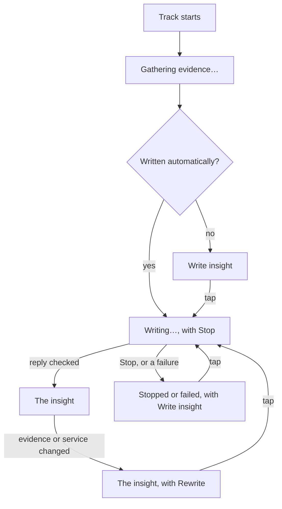

# Using Sleevesight

This page goes through each part of the app as it works now: the home screen from top to bottom, writing an insight and what it costs, the history, the players it can follow, the logo intro, and what the app does when something is missing or fails. Each setting named here is explained on the [settings page]({{ '/docs/tutorials/settings/' | relative_url }}); the [journey]({{ '/docs/journey/' | relative_url }}) goes from installing the app to using it day to day.

Buttons and settings are named as the app names them, in italics.

## Before the home screen

The first time it is opened, the app shows its first-run screen, which says what it reads and what leaves the phone, and leads to Android's notification access. Nothing is read or sent before you continue from it. The [journey]({{ '/docs/journey/' | relative_url }}) covers that screen step by step.

If notification access is turned off later, the home screen says *Sleevesight needs notification access to see what is playing.*, with *Turn on notification access*, which leads back to the first-run screen.

## The logo intro

When you open Sleevesight from the launcher while it is not open, it plays one of the product page's logo animations, picked at random, after Android's own splash screen. The animation ends on the logo, which comes apart and flies onto the home screen's header, where it sits on one line: "Sleevesight" and the record. It lasts a few seconds.

- A tap, Back or any key ends it at once. Volume and media keys still do their own work.
- It does not play when you return to the app from the background, on a rotation, or when Android restores a screen it had closed. What counts is whether the app was open, not whether it was running in the background for the notification listener.
- It never plays while the phone's *Remove animations* is on, while TalkBack is on, or with [*Logo intro at start*]({{ '/docs/tutorials/settings/' | relative_url }}) off.

## The home screen

<!-- screenshot: the home screen with a track playing, header to genre labels, in the cover's colours, from the app version it is taken from -->

### The header

The header stays at the top while the rest of the screen scrolls under it; a thin line shows under it once the screen has scrolled.

- **The logo**, at the left: a tap scrolls the home screen back to the top. A screen reader calls it "Sleevesight, scroll to top".
- **The cogwheel**, at the right, opens the settings.

At the bottom of the home screen, under a thin line, *What leaves the device?* opens the first-run screen again, to reread it. *What leaves the device*, under *About* in the settings, opens it too. Opened again, it has a back arrow at the top and *Close* at the bottom, which bring you back, as Android's back does.

### The playing track

The track is shown on a card in colours taken from its cover: the app picks the cover's most suitable colour and builds the card's colour scheme from it, light or dark as the phone is. Without a cover, the app's own colours are used. While no player you follow has a track, the screen says *Nothing playing in a player you follow yet.*

From top to bottom, the card shows:

- **The player and its state**, such as "Spotify · Playing", or *Paused*, *Stopped*, *Buffering*. A tap opens the player's own screen; a player that has none says so.
- **The cover**, with the playback position under it when the player reports the track's length. Without a cover, a music note stands in.
- **The title**, large and bold, cleaned of what the player appends: a tag such as "2006 Remaster" is set aside, and featured artists ("feat. Van Morrison") join the artists. When the title names the work it is from or a variant ("From …", "acoustic"), that shows under it.
- **The artists**, each credited one, featured artists included.
- **The album**, in italics, followed by the year of that release, the one being played, when it is known: *Rubber Soul*, 1965. The year comes from MusicBrainz, from the release of the name the player gives, or that name without an edition in brackets such as "(Remastered)" or "(Deluxe Edition)" (never without "(Live)" or "(Original Motion Picture Soundtrack)", which name another album); when several releases go by that name in different years, the year the player sends picks one, and without it no year shows. With no release of that name, the year is the player's own, if it sends one. When the song first came out earlier, on another album, a line under it says so: *Project Hail Mary (Original Motion Picture Soundtrack)*, 2026, then "First released 1990". When the two are the same year, it shows once. When the player gives no album, the first release stands in its place ("First released 1965"), or, with no year either, the line reads *Album not reported*.

A new track shows at once, with its sources and insight to come.

### Genre labels

Under the track come its genre labels: the tags Last.fm and MusicBrainz give the track, its artists and its album, kept only when they name a genre in a fixed list. With both on, Last.fm's labels come first on each level and MusicBrainz's fill the rest, five at most a level; a label both give is shown once.

Folded, *Genres ▸* shows the labels of the most specific level found: the track's, else the album's, else the artists'. A tap unfolds it, *Genres ▾*, to a table with a row for each level that has labels: *Track*, one *Artist* row per artist, its name before its labels, and *Album*. When only one level has labels, they show on their own, with no fold. A screen reader says whether the fold is folded or unfolded, and reads each row of the table as one.

A tap on a label shows where it came from: *… comes from the track's tags on:* (or the album's, or the artist's, named when the track has several), then each source, linked to its page there, and for MusicBrainz a link to its licence. A second tap closes it. Which sources give labels is set under [*Genres*]({{ '/docs/tutorials/settings/' | relative_url }}), and *Show genres* there turns them off altogether.

When there are none, it says *None found.*, or *Every genre source is off in Settings.*; with *Show genres* off, nothing of the genres shows.

With [*Layout*]({{ '/docs/tutorials/settings/' | relative_url }}#appearance) set to *Separate pages*, *Genres ›*, or a tap on a label, opens the table on a page of its own, where the labels are plain; with labels of one level only, there is no *Genres ›*, and a tap on a label opens the page all the same. Where a label came from is shown only with *Expandable boxes* ([Pages](#pages)).

### The insight

*Key insights* holds the insight: a few sentences written by the AI service you chose, from what the sources found. The insight is plain text with citation chips in it. The AI service is asked not to format it; when it does anyway, a title it marks is set in italics, bold shows as bold, and its other formatting marks are left out.

<!-- screenshot: the insight with its citation chips and the grounded-sentences line, from the app version it is taken from -->

- **Citation chips.** Each sentence cites the evidence lines it rests on, by their ids, such as `MB1` or `W3`. A tap on a chip unfolds *Sources* as far as that line, scrolls to it and flashes it. A screen reader reads each chip by what it points at ("Source W3"), and offers the lines as actions of the paragraph.
- **The model's own knowledge.** When [*AI service knowledge*]({{ '/docs/tutorials/settings/' | relative_url }}) is on, a claim from it is cited `M`, in a colour of its own, and a screen reader calls it "From the AI model's own knowledge, not verified". It is off by default.
- **Flagged sentences.** Before the insight is kept, the app checks every citation in code. A sentence that cites nothing is underlined in the error colour (a screen reader says "not cited"), and a citation of a line that does not exist shows in the error colour.
- **The note under the insight** shows only when there is something to say. *1 sentence is not backed by the sources.* counts the sentences that cite nothing, cite a line that does not exist, or come from the model's own knowledge; a sentence the sources back needs no word, since its citations show it. *Kept from before.* says the insight was not written now but shown from what was written earlier. The check's full counts (*4 of 5 sentences grounded · 1 uncited*) are a developer option, [*Show grounding details*]({{ '/docs/tutorials/settings/' | relative_url }}#developer).
- **Report a problem**, under the insight, is for an insight that is wrong or offensive. It asks what is wrong (*Offensive or inappropriate*, *Wrong* or *Other*), takes an optional note, and shows the whole report: the reason and the note; the track as the player reported it, with its MusicBrainz ids; the insight and the evidence lines it was written from (for an insight kept from before, every evidence line of the track); and the prompt version, AI service, model and effort it was written with. Never your keys, the history or the settings. *Open in mail app* hands it to your mail app, addressed to support@sleevesight.app, and it reaches the developer only if you send it from there; until then your mail app handles it as any message you write, which may keep a draft in your mail account. *Copy report* copies it instead, for any other way you write email; with no mail app on the phone, the dialog says so. The report stays of the insight it was opened on, even if the track changes meanwhile. The [privacy policy]({{ '/privacy.html' | relative_url }}) says what the developer does with it.

With *Layout* set to *Separate pages*, the insight stays here in full, and a citation chip opens *Sources* on its page, at the line it cites ([Pages](#pages)).

While the insight is being written, its text appears as it arrives, with its citation chips; the underlines wait for the check, which runs once the reply is complete.

When little is documented about a track, the insight is short rather than filled out.

### Sources

*Sources*, at the bottom of the card, shows what the insight was written from.

<!-- screenshot: Sources unfolded, with chips, a note and evidence lines, from the app version it is taken from -->

**Folded and unfolded.** *Sources* starts folded: only its heading shows, **Sources ▸**. A tap on the heading unfolds it (**Sources ▾**), and another folds it again. A screen reader reads the heading as *Sources*, collapsed or expanded.

**The chips.** Unfolded, a chip for each source that gave lines, by its name, with the letter its lines and citations use beside it, small, so a citation can be matched to its chip: `MB` *MusicBrainz*, `W` *Wikipedia* (its chip covers Wikidata's `WD` lines too), `L` *Last.fm*, `G` *Web search*, and `P` *Player*, the release the player reports, the album as a line of evidence. A source that gave no lines has no chip.

A chip shows or hides its source's lines. That only changes what you see: what the AI service may use is set under [*Sources*]({{ '/docs/tutorials/settings/' | relative_url }}). A screen reader reads a chip as its source's name, and whether its lines are shown or hidden.

**The note.** Under the chips, a note only when something needs you or went wrong, a sentence for each source: *Last.fm needs your key, in Settings.* (a tap on *Settings* opens them; the key goes under *Secrets*), *Web search could not be reached.*, or *MusicBrainz failed.* A source that found nothing, whose match was rejected, or that you switched off says nothing.

**The list.** Then the evidence lines, each with its id, its text, what it is about (*song*, *artist*, *original song*, *release*, *web*) and a link to the page it was found on, which opens in the browser. After them, under their own heading, come *Found, but not verified, so not cited*: lines from matches that could not be checked against the track, which are shown but never given to the insight. Above the list, how many entries show ("Showing 8 of 12 entries"). It unfolds 8 entries at a time:

- *show more…* shows the next 8, and *show all* the rest, while entries remain;
- *… show less* goes back to the first 8, once past them.

A citation tapped in the insight unfolds the list as far as its line. When the chips hide every line, the count says so, and folding and unfolding *Sources* shows them again.

**Grounding details.** With [*Show grounding details*]({{ '/docs/tutorials/settings/' | relative_url }}), a developer option, on, the chips are every source's, each with its letter and what it found, and the list ends with *Rejected matches*, each with its source and the reason it was rejected:

| Chip says | Meaning |
|---|---|
| *looking* | The source has not answered yet |
| *the song* | It found the song |
| *the artist only* | It found the artist, not the song |
| *the original song* | It found the song this one covers |
| *release* | The `P` chip: the release the player reports |
| *nothing found* | It answered, with nothing on this track |
| *rejected* | What it found failed the identity check (shown in the error colour) |
| *unreachable* | It could not be reached |
| *failed* | The lookup went wrong (shown in the error colour) |
| *off* | You switched the source off under *Sources* |
| *needs your key, in Settings* | Last.fm or web search is on, but its key is not saved |
| *allowed* | The `M` chip: the model's own knowledge may be cited |
| *(kept)*, after any of these | The answer was kept on the phone from an earlier lookup |

Each new track's list starts folded, so the insight is what you see first. With [*Keep Sources as you left them*]({{ '/docs/tutorials/settings/' | relative_url }}) on, it stays as you left it on the track before. Either way, the fold is kept through a rotation and when Android restores the screen, not when the app starts afresh.

With *Layout* set to *Separate pages*, the heading reads **Sources ›**, and a tap on it opens *Sources* on a page of its own, at its first 8 entries with every source's lines shown ([Pages](#pages)).

### Pages

[*Layout*]({{ '/docs/tutorials/settings/' | relative_url }}#appearance), under *Appearance* in the settings, sets how the parts of the home screen open. *Expandable boxes*, the default, is the home screen as described above: everything a track has is on one screen, and each part unfolds in place.

<!-- screenshot: Sources as a page, with its back arrow, from the app version it is taken from -->

With *Separate pages*, the home screen is shorter, and each part opens a page of its own, in the album art's colours, with a back arrow and the part's name at the top:

- **Sources ›** opens the chips, the note and the list, which works as it does unfolded on the home screen, *show more…* and all.
- **Genres ›**, or a label on the home screen, opens the table of genre labels. With labels of one level only, there is no *Genres ›*, and a label opens the table, with its one row (a row per artist for artists' labels).
- A citation chip in the insight opens *Sources*' page at the line it cites, scrolled to and flashed.

The insight itself stays on the home screen, in full, whichever layout is set.

The back arrow, or Android's back, returns to where the page was opened from: the home screen, where you left it. Each page shows the track playing, and follows a new track. Each page opens fresh, so *Keep Sources as you left them* applies only to *Expandable boxes*. On the home screen, a screen reader reads each of these as its name, and says that a double tap opens its page; a page's title is read as a heading.

## Writing an insight

Each insight written is a call to your AI service (now and then two, below), on your own API key, and the service bills you for it. A call that failed or was stopped is never made again without a tap from you, and the buttons below say when a tap is a new call. One case makes a second call on its own: to keep the prompt short, the first call may leave out lines about the artist, and if the service then answers that it has nothing to write from, the app asks once more at once, with every line, so that you get an insight rather than none. Each of the two calls is billed. [What it costs you]({{ '/docs/costs/' | relative_url }}) says what a call costs.

### *Write insight*

*Write insight* writes the insight for the track on screen, from the sources shown under it: one call, or two in the case above. It is offered with *Tap Write insight to have it written from the sources below.* when the insight is not written on its own (see [Automatic writing](#automatic-writing)). Until the sources have answered, the insight says *Gathering evidence…*, and Write is not offered yet.

### *Stop*

While the insight is being written, the card says *Writing…* and offers *Stop*. Stop ends the call: the card says *Stopped before the reply ended, so nothing was kept.* Nothing of the partial reply is kept, though the service may still bill what it had written before the stop, by its own terms.

### Write again

After a call that was stopped or failed, the card offers *Write insight* again, with *Write insight tries again, as a new call to your AI service.* Each try is a new call on your key, and it is never made on its own.

### *Rewrite*

An insight already written stays when the track is looked up again and the insight would now be written differently: after you save, replace or remove a key, switch a web search engine, or choose another AI service, the sources may find other evidence, or another service would write it. The card then keeps the insight written earlier, with *Written earlier, from the evidence under Sources. Rewrite writes it again from what the sources find now, with your current AI service.* and *Rewrite*. Under it, *Sources* shows the lines that insight cites, found when it was written.

Nothing is written again unless you tap *Rewrite*, which is one call, or two in the case above. If the rewrite fails, the card says *Rewriting failed:* and the reason, and keeps the insight written earlier; if you stop it, *Rewriting stopped. This is the insight written earlier.* *Rewrite* is offered again either way.

### What costs nothing

- **A track played again.** When a track you played before comes back, the sources find the same evidence, and the AI service, model, reasoning effort and *AI service knowledge* are as they were, the insight written then is shown again, marked *Kept from before.*, with no call. Otherwise it is written afresh, as for a new track. Kept insights are dropped, least recently shown first, once they pass the cache's size limit.
- **Nothing to write from.** When the sources give nothing to write an insight from, the card says *The sources give nothing to write an insight from.*, and no call is made. The same line can also follow a call, when the AI service finds nothing in the evidence to write from. With the model's own knowledge on, the album the player reports is enough for a call, once the player has also reported the artists; the model may then add what it knows, marked unverified.
- **The next track.** The track next in the player's queue is looked up ahead (by default, at MusicBrainz), so its sources come sooner when it plays. No insight is written ahead.

### Automatic writing

By default, [*Reactive*]({{ '/docs/tutorials/settings/' | relative_url }}) writes an insight for every track (*On track change*), so each track change is a call. *On skip* writes only the tracks you skip to in your player; a track that ended on its own gets its sources and *Write insight*. Skips are told from natural ends by the time left on the track, and, for Spotify, by the playback states just before the change, with the player's [*Crossfade*]({{ '/docs/tutorials/settings/' | relative_url }}) detected by default. *Manual* (only when you tap *Write insight*) offers *Write insight* on every track.

Automatic writing needs a first tap:

- **After the app starts afresh**, nothing is written until your first tap on *Write insight*, in every mode. That tap lasts as long as the app's process, which the notification listener usually keeps alive after you leave the app, often for days: coming back to the app, from the player, the launcher or the screen turned on again, keeps it, and writing goes on without a new tap. A restart of the phone, an update of the app, or the system ending the process (on some phones, a swipe from Recents) starts afresh.
- **The pause.** So that one tap does not keep paying for days, automatic writing pauses once the app has not been on screen for more track changes than [*Saver*]({{ '/docs/tutorials/settings/' | relative_url }}) names (5 by default). The card then offers *Write insight* with *Automatic writing paused: tracks changed while Sleevesight was not on screen. Tap Write insight to write this one and resume.* A tap writes the track and resumes. Each time you open the app the count starts again.

<!-- screenshot: the insight card with the automatic-writing-paused line and Write insight, from the app version it is taken from -->

### While the app is not on screen

While Sleevesight is not on screen, it looks nothing up and sends nothing, the covers included, unless you turn on [*Look up in the background*]({{ '/docs/tutorials/settings/' | relative_url }}). When you come back, the track playing then is looked up. With the setting on, lookups go on while you are away, and so does automatic writing: those are paid calls made while nobody is looking, which the pause above bounds. The app counts as on screen in split screen, or with a dialog over it.

## The history

Sleevesight keeps, on the phone only, information about the tracks it has seen play (their titles, artists and albums, and when they played) and the track changes between them, from which skip detection learns. It keeps information about the tracks, never the music itself. There is no history screen in the app yet: the history is not shown as a list.

What there is:

- **The settings' *History* group**: [*Keep history for*]({{ '/docs/tutorials/settings/' | relative_url }}) (90 days by default); *Clear history*, right under it, which deletes everything kept about the tracks you played (the list of tracks played and the track changes, the insights written and what the sources found) together, once you confirm, and keeps your API keys and settings and leaves your music untouched; and [*New session idle trigger*]({{ '/docs/tutorials/settings/' | relative_url }}), which decides where one listening session ends.
- **The diagnostics screen**, under the developer settings, which lists the track changes recorded, with what skip detection learns from them, and can export them to a file you choose.

The history is left out of Android's backup, and the app never sends it anywhere; only an export you make from the diagnostics screen takes a copy of the track changes off the app.

## Players

**Followed.** Spotify is followed by default. Any player whose media session reports music, a track with a title and an artist, can be followed: once it has reported music (playing or paused) while Sleevesight has notification access, it appears by its name, switched off, under [*Players*]({{ '/docs/tutorials/settings/' | relative_url }}), and switching it on follows it at once. Following Spotify needs no Spotify account in Sleevesight and no developer app, whichever Spotify plan you have: the app reads the phone's media session, not Spotify's Web API.

With several players followed, the home screen shows the one playing; with none playing, the one most recently active.

**Not followed.** To find your music players, Sleevesight looks at apps that report what they play (playing or paused) and checks whether it is music, a track with a title and an artist: from an app not switched on, it reads what the app says it is playing only until the app reports music, and then nothing more of what it plays until Sleevesight starts afresh (not each time you open it), or the app is uninstalled and installed again. A new player is added under *Players* switched off. Sleevesight does not follow a player that is off: it does not track what the player plays, it keeps or sends none of it, and the home screen does not show it. While only such players play, the home screen says *Nothing playing in a player you follow yet.*

**Not supported.**

- A player that publishes no media session cannot be read at all.
- A player whose session reports no artist, as most video apps do, is never listed.
- Calls from the phone app, and sessions Android marks as voice calls, are never read, whatever the switch. A calling app that shows its call as an ordinary media session is not recognised as a call, and an app you follow that also makes calls may show leftover caller details as a track for a moment after a call.
- A player that publishes no queue gets no looking ahead at its next track.

Playing, pausing and skipping from inside Sleevesight are not built yet; use the player, or tap the player's name to open it.

## When something is missing or fails

| Situation | What you see |
|---|---|
| **Offline** | *Sources* says *Offline. The sources that could not be reached are asked again when the phone is back online.* Once the phone is back online, the playing track's unreachable sources are asked again; the rest keep what they found. What was kept on the phone from earlier lookups still shows. An insight that cannot be written for want of a connection says *The insight could not be written: no connection.* |
| **No AI service on, or no key for it** | The sources are still looked up and shown. The insight says *Choose an AI service and save its key in Settings to have insights written.*, and no Write is offered. Set it up under [*AI services*]({{ '/docs/tutorials/settings/' | relative_url }}), with its key under *Secrets*. |
| **Insights switched off** | *Insights are off. Turn them on in Settings.* No AI calls at all; the evidence is still shown. |
| **No key for Last.fm or web search** | *Sources* says *Last.fm needs your key, in Settings.* or *Web search needs your key, in Settings.*, and it is not asked. MusicBrainz and Wikipedia need no key. |
| **A source rejects a match** | The match is never used, and the source has no chip unless it gave other lines. With *Show grounding details* on, its chip says *rejected*, and the match is listed under *Rejected matches* with the reason. |
| **A match that cannot be verified** | Its lines show under *Found, but not verified, so not cited*, and the insight is not given them. Web search results have nothing to be verified against: those its filter keeps are given to the insight, and may be cited. |
| **A source fails** | *Sources* says so (*MusicBrainz failed.*, or *… could not be reached.*); the other sources' lines are used. |
| **The AI service refuses or fails** | *The insight could not be written:* and the reason: the service did not accept the key, the account needs credit, its quota is used up for now, it is busy, it is not offered in your country, and the like. *Write insight* tries again, as a new call. |
| **The selected model is not available** | *The currently selected Anthropic model Claude Haiku 5.5 is not available. Please select another model or provider in AI services.*, when the service no longer lists the model for your key, or answers a call that it does not know the model or does not let your account use it. *AI services* opens the settings; no insight is written until you choose another model or service. |
| **The reply stopped early** | The insight shows with *The reply stopped early, so this is incomplete, and it was not kept.* |
| **The app itself fails while writing** | *The insight could not be written: something went wrong.*, with no Write; the next track runs as usual. |

A key that can no longer be read, or one that cannot be saved, is dealt with in the settings; the [settings page]({{ '/docs/tutorials/settings/' | relative_url }}) says how.
