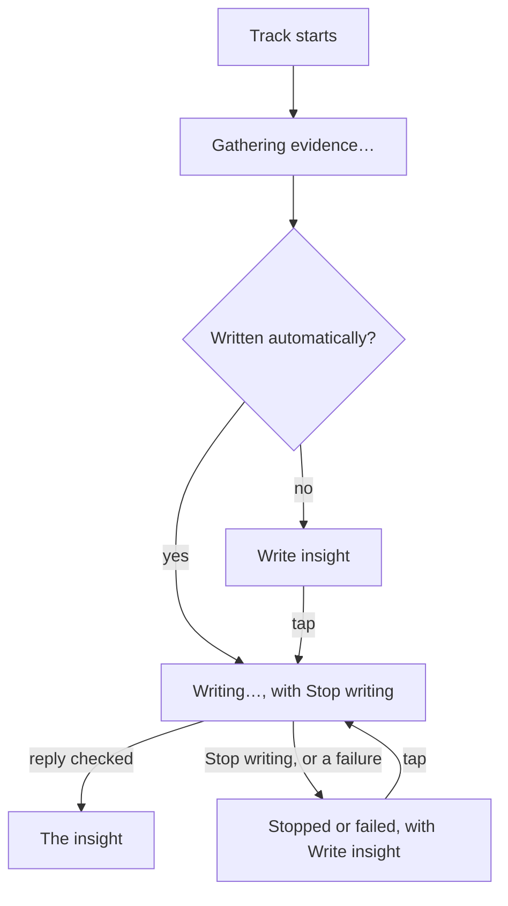

# Using Sleevesight

This page goes through each part of the app as it works now: the home screen from top to bottom, writing an insight and what it costs, the history, the players it can follow, the logo intro, and what the app does when something is missing or fails. Each setting named here is explained on the [settings page]({{ '/docs/tutorials/settings/' | relative_url }}); the [journey]({{ '/docs/journey/' | relative_url }}) goes from installing the app to using it day to day.

Buttons and settings are named as the app names them, in italics.

## Before the home screen

The first time it is opened, the app shows its first-run screen, which says what it reads and what leaves the phone, and leads to Android's notification access. Nothing is read or sent before you continue from it. The [journey]({{ '/docs/journey/' | relative_url }}) covers that screen step by step.

If notification access is turned off later, the home screen says *Sleevesight needs notification access to see what is playing.*, with *Turn on notification access*, which leads back to the first-run screen. Right above *Open notification access*, under *Why notification access*, the first-run screen explains that Android lets an app see what music apps are playing only with notification access, and that Sleevesight uses it for that alone: on Android 12 and newer, delivery of notifications to Sleevesight is disabled at system level and Sleevesight receives no notifications; on older versions, Sleevesight ignores all notifications; and it never reads your messages or contacts. The home screen's prompt says it in short: *Sleevesight uses notification access only to see what is playing. It receives no notifications on Android 12 and newer, and ignores them on older versions.*

## The logo intro

When you open Sleevesight from the launcher while it is not open, it plays one of the product page's logo animations, picked at random, after Android's own splash screen. The animation ends on the logo, which comes apart and flies onto the home screen's header, where it sits on one line: "Sleevesight" and the record. It lasts a few seconds.

- A tap, Back or any key ends it at once. Volume and media keys still do their own work.
- It does not play when you return to the app from the background, on a rotation, or when Android restores a screen it had closed. What counts is whether the app was open, not whether it was running in the background for the notification listener.
- It never plays while the phone's *Remove animations* is on, while TalkBack is on, or with [*Logo intro at start*]({{ '/docs/tutorials/settings/' | relative_url }}) off.

## Close, Hide once and Dismiss

A panel is put away in one of three ways. *Close* shuts a panel that something on the screen opens again, such as a section of the settings, or a note's panel in the guide. *Hide once* puts a panel away for now: it is back when you return to where it was. *Dismiss* puts it away for good: a message says where to show it again, with *Undo*, and only [*Restore dismissed messages*]({{ '/docs/tutorials/settings/' | relative_url }}#appearance), under *Appearance* in the settings, brings it back.

## While something is under way

A message saying that something is under way, such as *Looking…* beside a source, *Gathering evidence…* or *Writing…* in *Key insights*, has the logo's record before it, small and turning. It stands still while the phone's *Remove animations* is on, and a screen reader reads only the message.

## The home screen



### The header

The header stays at the top while the rest of the screen scrolls under it; a thin line shows under it once the screen has scrolled.

- **The logo**, at the left: a tap scrolls the home screen back to the top. A screen reader calls it "Sleevesight, scroll to top". Its record turns while the player line under the header says *Playing*, and only then: it speeds up over a second and slows to a stop over two, as a turntable does, and rests where it stopped until the music plays again. It turns only once the logo intro has ended and while the app is on screen, and stands still while the phone's *Remove animations* is on. [*Spin the logo while music plays*]({{ '/docs/tutorials/settings/' | relative_url }}#appearance) turns it off, and *Logo speed* sets its speed, both under *Appearance* in the settings.
- **The theme button**, before the cogwheel, shows the current theme, kept as [*Theme*]({{ '/docs/tutorials/settings/' | relative_url }}#appearance) in the settings: a sun while it is *Light*, a moon while it is *Dark*, and the automatic brightness symbol while it is *System* (as the phone is). Its tooltip and what a screen reader says name it too: "Theme: light", "Theme: dark", "Theme: system". A tap opens a menu under it: *Light*, *Dark* and *System*, each with its symbol, *As your phone is* under *System*, and the current theme highlighted. Picking one closes the menu and sets *Theme*, and the app changes at once; picking the current one, a tap outside the menu, or Back closes it with nothing changed. A screen reader hears the button as collapsed or expanded, and the three as one choice, the current one selected. *Theme button*, under *Appearance* in the settings, hides it.


- **The cogwheel**, at the right, opens the settings.

At the bottom of the home screen, under a thin line, *What leaves the device?* opens the first-run screen again, to reread it. *What leaves the device*, under *About* in the settings, opens it too. Opened again, it has a back arrow at the top and *Close* at the bottom, which bring you back, as Android's back does.

### Nothing playing

While no player you follow has a track, the home screen shows the way to your music, and what it will show once a track plays.



- **The players**, the same ones [*Players*]({{ '/docs/tutorials/settings/' | relative_url }}#players) lists, A to Z by name, each a row with the app's icon, *Play on …* and the open-in-new symbol. A tap opens the player as its launcher icon does; you start the music there, and the home screen fills in once it plays. A player that is switched off is dimmed and cannot be tapped; its row is as tall as the others, with *Enable in Settings*, which opens the settings at *Players*, at its end where the others have the open-in-new symbol (at a large font, under the name). A screen reader reads it as "Play on Poweramp, not followed", then the link. With [*Only enabled players on Home*]({{ '/docs/tutorials/settings/' | relative_url }}#players) on, only the players switched on are listed; with none switched on, the screen says *No player is switched on. Switch on the players you want Sleevesight to follow in Settings → Players.*, the last words a link to *Players*.
- **No player listed.** While *Players* lists no player (Spotify, there by default, is not installed, and no other player has reported music), the screen says *No music player seen yet. Play music in one, and it is listed here and in Settings → Players.*, the last words a link to *Players*.
- **The guide**, under the players: a small picture of the home screen while a track plays (*Blue in Green*, Miles Davis, *Kind of Blue*, 1959, an example, with a drawn cover), and beside it notes in a hand-drawn font (Shantell Sans), each underlined, with an arrow to the part it names: the cogwheel, *tap to configure*; the player, *tap to open*; the *Genres* button, *tap to see the genres*; the insight, *read about what's playing*; a citation, *follow to references*; the Write button, *generate an insight (paid)*; *Sources*, *read source information*. The picture is drawn by the app, in its theme and font. The notes follow the phone's font size.
  - **A tap on a note**, or just above or below it (each note's tap area is at least a finger's height, and reaches halfway to its neighbours), outlines the part it points at and opens a panel over the picture with the part's name, a fuller description of what it does, and *Close*. A second tap on the note, or *Close*, closes it. The panel lies over the picture's screen, clear of the part and the note; where it does not fit there, it is as wide as the guide, and at a large font it may run below the picture.
  - **A tap on the picture**, or on the magnifier on its cover, opens the picture full screen, under *Home while a track plays* and *Close*. Pinch or double-tap to zoom (a second double tap fits it back), and drag to move it; turning the phone keeps the zoom. *Close*, or Back, returns to the home screen.
  - **With a screen reader**, each note is a button, read with the part it points at ("Settings: tap to configure, button"); its panel is read as it opens, and comes right after its note; *Close* puts the focus back on the note. The drawn home screen itself is not read; the magnifier ("Magnify the picture, button") opens it full screen, where it is one image, "Home while a track plays".
- **Hide once** and **Dismiss**, under the guide, side by side ([what each does](#close-hide-once-and-dismiss)). A guide hidden once is also back when nothing plays again after a track.

### The playing track

The track is shown straight on the home screen, with no box around it, its accents (the playback position, the labels, the buttons, the citation chips) in colours taken from its cover: the app picks the cover's most suitable colour and builds a colour scheme from it, light or dark as the phone is. Without a cover, the app's own colours are used. While no player you follow has a track, the screen shows your players and the guide ([Nothing playing](#nothing-playing)).

From top to bottom, the screen shows:

- **The player and its state**, such as "Spotify · Playing", or *Paused*, *Stopped*, *Buffering*. A tap opens the player's own screen, or, for a player that names none (as Spotify), the app as its launcher icon opens it; a player that has neither says so.
- **The cover**, with the playback position under it when the player reports the track's length. Without a cover, a music note stands in. A tap turns the cover over, like a sleeve, to show the album's tracklist on its back, from MusicBrainz: each track's position, title and length, the playing song marked, in the app's own colours; an album of several discs has a page per disc, swiped sideways, with a dot per disc under it. A tap on the back turns it back. The tracklist is looked up on the first turn, not before. With none, the back says why: MusicBrainz is still being asked, is disabled, could not be reached (with *Retry*), *MusicBrainz has no tracklist for this album.*, or *MusicBrainz reports several albums of this name for this artist. Sleevesight could not decide which one this is.* A screen reader reads the cover as *Album art*, "Double-tap to show tracklist", and a track as "3, Blue in Green, 5 minutes 37 seconds, playing".
  <!-- screenshot (0.6.6) still to take: the cover turned over to the tracklist, the playing song marked; ideally an album of two discs, with its disc heading and dots -->
- **The title**, large and bold, cleaned of what the player appends: a tag such as "2006 Remaster" is set aside, and featured artists ("feat. Van Morrison") join the artists. When the title names the work it is from or a variant ("From …", "acoustic"), that shows under it.
- **The artists**, each credited one, featured artists included.
- **The album**, in italics, followed by the year of that release, the one being played, when it is known: *Rubber Soul*, 1965. The year comes from MusicBrainz, from the release of the name the player gives, or that name without an edition in brackets such as "(Remastered)" or "(Deluxe Edition)" (never without "(Live)" or "(Original Motion Picture Soundtrack)", which name another album); "Vol. 2" and "Volume 2" count as the same name. When several releases go by that name in different years, the year the player sends picks one; without it, or when it is none of theirs, the year of the release the track first came out on, when that is one of them (*Thriller*, 1982, and not a reissue's year), and otherwise no year shows. With no release of that name, the year is the player's own, if it sends one. When the player gives no album, the line reads *Album not reported*.
- **Dates**, a button under the album, for every track. A tap opens it in place into the *Dates* panel, which says each date in a sentence, as precisely as MusicBrainz gives it ("on 29 July 2014", "in July 2014", "in 2014"), in the form of the phone's language and region; a date MusicBrainz gives only as a year, or as a placeholder January 1, reads as the year. It says when the album was first released (*This album was originally released …*, or *This single …*, *This EP …*); for a later edition or a remaster, the original first, then the edition (*The album Thriller was first released …*, then *This edition was released …*, or *This is a 2018 remaster of …*); where this track first came out (*This track was first released on the single Hooked on a Feeling in 1973.*, or *… on this album.*), so a reissue, a soundtrack or a compilation never shows the song's first year as its own; and for a cover, who first recorded the song, when, and where it came out. With no date, the panel says why: MusicBrainz is still being asked, is disabled (with a link to *Settings → Sources*), could not be reached (with *Retry*, which asks it again at no cost), did not find the song, or gives no dates for it; once it has answered, under that line, [*Ask AI*](#ask-ai) asks your AI service instead, a paid call. *Close* folds the panel back into the button; a new track closes it.
- **Lyrics**, a button after *Dates* and *Genres*, for every track while [*Lyrics links*]({{ '/docs/tutorials/settings/' | relative_url }}#appearance) is on, under *Appearance* in the settings. A tap opens it in place into the *Lyrics* panel: a link to the song’s lyrics on each lyrics site MusicBrainz links to, one per site, Genius and Musixmatch first (“Lyrics on Genius”, with “The song’s page, linked from MusicBrainz.” under it); where a site has a page for several artists’ versions of the song, the one for the artist playing. A tap opens the page in your browser; Sleevesight doesn’t fetch or show lyrics. While MusicBrainz is still being asked, the panel says so. With no page to link, it says why, as *Dates* does: MusicBrainz is disabled, could not be reached (with *Retry*), did not find the song, or links to no lyrics page for it, as for most songs. Then, when the track's own web search results (with *Exa web search* on) hold the song's page on a site that exists for lyrics, it links that page, such as “Lyrics on Genius”, with “The song’s page, from the web search for this track.” under it, found at no cost; a store's page, such as Bandcamp's, or an artist's or an album's page is not taken for it. Otherwise it offers “Search Genius for the lyrics”, a search for the title and artist that may find another song of the same name, or, with *Search Genius when there is no link* off, says “Genius search is disabled.”, with a link to *Settings → Appearance*; and under it, **Find the lyrics**, with the *AI* mark, has your AI service search the web for the song's lyrics page, a paid call, as [*Ask AI*](#ask-ai) does (*Searching the web for the lyrics…*; with nothing found, *Claude Haiku 5.5 found no lyrics on the web.*). A track MusicBrainz lists as instrumental gets a line saying so (*MusicBrainz lists this track as instrumental, without lyrics.*), and no search.

  After the links, for every track with lyrics, **Explain the song**, with the *AI* mark, asks your AI service what the song is about, a paid call, only on a tap: *Ask AI automatically* never asks it. It is offered only with *Exa web search* and [*AI web search*]({{ '/docs/tutorials/settings/' | relative_url }}#insights) on, since a model's own memory of what a song means is the least reliable kind. It searches the web once for pages about the song (interviews, reviews, annotations; with *Up to 3 times*, the model's own searches), and writes two to four sentences from them and from the track's own pages, such as its Wikipedia article, quoting at most a few words of the lyrics. Each sentence cites the pages it rests on (`S1`, `S2`), a citation opening its page in the browser, and a sentence no page backs is dimmed, as in an insight. Under it, *Pages cited*, each page by its id and its site, a link, then *by Claude Haiku 5.5*. While it runs, *Reading about the song…*, with *Stop*; with nothing usable, *Claude Haiku 5.5 found nothing to explain the song.* It is kept with the track as the other answers are ([Ask AI](#ask-ai)). *Close* folds the panel back into the button; a new track closes it.
  <!-- screenshot (0.6.6) still to take: Lyrics open, with a lyrics link, Find the lyrics, and Explain the song answered: its cited sentences, Pages cited and the byline -->

A new track shows at once, with its sources and insight to come.

While the player plays an ad, as Spotify Free does between songs, the screen shows the player, a plain tile in the cover's place, *Ad playing on Spotify*, *The next track shows when the ad ends.*, and *An ad is playing. Sleevesight looks nothing up for ads and writes no insight.* Nothing is looked up, written or kept for it, and no *Dates*, *Genres*, *Lyrics* or *Sources* show. When the ad ends, the next track shows as usual.

### Genre labels

Under the track come its genre labels: the tags Last.fm and MusicBrainz give the track, its artists and its album, kept only when they name a genre in a fixed list; and the genres an artist's description names, in the lines the sources found about the artist (below). With both on, Last.fm's labels come first on each level and MusicBrainz's fill the rest, five at most a level; a label both give is shown once.

The labels sit behind **Genres**, a button under the album, after *Dates*, for every track. A tap opens it in place into the *Genres* panel, with *Close*, which holds the labels as chips: every genre in *Genre tags* (the track's, its artists' and its album's, at most five each), each once, in alphabetical order; then any the AI service named (*A genre only MusicBrainz gives*, below), each with the small *AI* mark, in alphabetical order too. A genre only the track's own tags give, which no artist's or album's tags include, is weakly supported when its MusicBrainz tag has fewer than two votes, or when only Last.fm gives it: its chip is dimmed and in italics, and a screen reader reads it as "Country, weak evidence". The panel opens on a genre, its chip selected, as after a tap: the first in the chips' order that is not weakly supported, else the first weakly supported one, never one the AI service named. A tap on a chip unfolds that genre inside the panel, under the chips and a rule: what the genre is and *Why is this …?* (below), then **Genre tags**, a table with a row for each level that has labels: its name on the left, *Track*, *Artist* (*Artist 1*, *Artist 2*, … when the track credits several) and *Album*, and its labels on the right. The genre you tapped is marked wherever it appears. A row's labels are in the order of the chips above, so a genre sits in the same place in both. Under it, **Tag sources**, in the same columns: for each row, each source that gave any of its labels, linked to its page there (with several artists, the artist's name above them), and once, when MusicBrainz gave any, *MusicBrainz tags by contributors* with *CC BY-NC-SA 3.0*, linking its licence. A tap on another chip unfolds its genre instead; a second tap on the same chip folds it, and the chips stay.

**Genres the artist's description names.** When the lines the sources found about an artist (Wikipedia's article, Last.fm's biography) name a genre in the app's list, such as "a soul singer", that genre joins the chips, after the tags' genres, at most five an artist, and *Genre tags* gives them a row of their own, *Described* (*Described 1*, *Described 2*, … with several artists), right after the artist's tags; in *Tag sources*, *Gordon Lightfoot’s description* and the citations of its lines, each opening the line in *Sources*. Under such a genre's definition, *Named in the artist’s description: “…”*, with the words quoted. A genre the artist's own tags give stays the tag's. A screen reader reads such a chip as "Soul, from the artist’s description".

**Instrumental.** A track with vocals is not *Instrumental*, whatever its tags say. Lyrics found for the song drop it from every row: MusicBrainz's lyrics links, [LRCLIB]({{ '/docs/tutorials/settings/' | relative_url }}#sources)'s record of its lyrics, or a lyrics page *Find the lyrics* found. Where the signs only weigh against it, it stays, weak, with a line saying why: *MusicBrainz lists lyrics for this song, so it is likely not Instrumental.*, *MusicBrainz lists this song’s lyrics as English, so it is likely not Instrumental.*, *MusicBrainz credits … with vocals on this track, most likely it is not Instrumental.*, *This track also credits … and may feature vocals.*, or, when LRCLIB's mark alone backs it, *Only LRCLIB’s user-submitted records mark this track Instrumental.* With [*AI web search*]({{ '/docs/tutorials/settings/' | relative_url }}#insights) on, a tap on *Why is this instrumental?* first has your AI service check the web for whether the track has vocals (*Checking whether this track has vocals…*), one Exa search and one paid call with *Once*: *Web search found this track described as instrumental.*, which lifts the weak mark; *Web search found vocals on this track, so it is not Instrumental.*, after which no reason is written; or *Web search found nothing on whether this track has vocals.* Each names the page it rests on, as a citation, which joins *Sources* as a web line (*vocals check*). With [*Ask AI automatically*]({{ '/docs/tutorials/settings/' | relative_url }}#insights) on, the check runs by itself. The answer is kept with the track, as an insight is.

<!-- screenshot (0.6.6) still to take: Genres open on a weak Instrumental, with its line on why, and the same after the vocals check, "Web search found this track described as instrumental." with its citation --> The panel's *Close* folds the panel back into the button, the genre with it; with *Dates* open as well, the panel opened later goes above. Each new track starts with the panels closed.

**What the genre is, and why this track has it.** At the top of the genre, above its tags, the genre explained. First what it is: the first two sentences of the genre's English Wikipedia article, with *From Wikipedia* under them, linking the article, and *CC BY-SA 4.0*, linking its licence. It is the same for every track, so it is looked up once per genre (through the genre's entry in MusicBrainz's list of genres, or the nearest one for a tag that is not in it, such as alternative rock for *alternative*, and its Wikidata item; for a few tags, from an article the app's list of genres names for them, such as *Acoustic music* for *acoustic* or *Film score* for *score*), kept as long as Wikipedia's findings are (*How long each source's findings are kept*), and only while Wikipedia is on under [*Sources*]({{ '/docs/tutorials/settings/' | relative_url }}). Every genre of the track is looked up as soon as its labels are in, so a genre you open usually has its definition already; until it lands, a turning record and *Looking on Wikipedia…* stand in its place. When Wikipedia cannot be reached, it says *Wikipedia could not be reached.*, with *Retry*, which asks again at no cost. A genre with no English article, or with neither a genre in MusicBrainz's list nor an article the app's list of genres names for it, says *No definition from Wikipedia for this genre.* in its place, with [*Ask AI*](#ask-ai) under it, which asks your AI service what the genre is, from the model's own knowledge, a paid call; for a few the article opens with where and when the genre began rather than what it is, which is why the article is linked. For a weakly supported genre, a line under the definition (or what stands in its place) says why, the genre's name in italics: *Few MusicBrainz contributors tagged this track Country, and the artist’s tags don’t include it.*, or *Only Last.fm’s tags for this track give Country, and the album’s tags don’t include it.*, naming the artist's tags, the album's or both, as the track has them. Then **Why is this jazz?** (the genre's name in its place), a button with the small *AI* mark: a tap asks your AI service, one paid call, why this track carries the label, from the track's evidence, the same lines the insight is written from. While it is asked, a turning record and *Looking for an explanation…* take the button's place. The answer replaces the button, under the question, with citations like an insight's: a tap on one shows its line under *Sources*. Under it, *by Claude Haiku 5.5* names the model that wrote it, and the note under that points to any dimmed sentence, as under an insight; an answer written before this play of the track ends with a line saying when (*Kept from before: written today at 13:04.*, as for [*Ask AI*](#ask-ai)). The answer is about the music, never about what the sources leave out, and never says the track is not of the genre or belongs under another: an answer that does counts as no explanation. When the evidence cannot support the genre and [*AI web search*]({{ '/docs/tutorials/settings/' | relative_url }}#insights) is *Once* or *Up to 3 times*, the question is asked again with a web search: with *Once*, one more paid call and one Exa search; with *Up to 3 times*, up to four more calls and three searches ([What it costs you]({{ '/docs/costs/' | relative_url }})). The pages found join the evidence as more web lines, numbered after the track's (`S6`, `S7` after `S1` to `S5`), and are cited as the others. When nothing can explain it, the button stays, greyed out, with *AI could not find an explanation.* under it. A call that fails says *The explanation could not be written:* and why, with *Retry*, another paid call. The answer is kept with the track, like its insight: closing the panel, opening another genre, or playing the track again later shows it again with no new call, until a change in the settings would offer *Rewrite insight* for the insight (another AI service, model or effort, or new evidence), when the button is offered again. It is kept for as long as *Keep history for* says, and *Clear history* deletes it. The button is not offered with *Show insights* off. With no AI service set up, it is greyed out, with *Enable an AI service in Settings → AI services.* under it, the last words a link there. Under a written answer, at the end of the row of its credit, a speaker button, *Read aloud*, reads the question, then the answer, as the insight's does ([The insight](#the-insight)).

**A genre only MusicBrainz gives.** MusicBrainz's tags are never sent to an AI service, because of their licence. So for a genre that only MusicBrainz's tags give, *Why is this …?* first asks your AI service which genres the track is, naming no genre at all: from web pages while *AI web search* is on (one Exa search and one paid call with *Once*, up to three searches and four calls with *Up to 3 times*), which comes first when both are on, or else from the model's own knowledge while [*AI service knowledge*]({{ '/docs/tutorials/settings/' | relative_url }}#sources) is on, one paid call. When its list has the genre, the explanation is asked for as above, with its own calls; when it does not, nothing more is asked, the button is greyed out, and under it the panel says *The AI service doesn’t list Blues among this song’s genres. Only MusicBrainz does, and Sleevesight could not use that annotation. See why.*, *See why.* opening this page's [Genre labels](#genre-labels) in your browser. The tap is remembered for the rest of the track's play. When neither can be used, the button is greyed out from the start, with *No AI service enabled.* under it and *Enable AI service knowledge or AI web search.* under that, each name a link to its setting. The genres on the list that are not among the chips join the chips, after the others, each with the small *AI* mark, and the *Track* row of *Genre tags*, while that row has room (five labels at most): a genre left out of the row gets no chip either; the model joins that row's *Tag sources* (*Last.fm · MusicBrainz · Claude Haiku 5.5 AI*), and with *AI web search* the pages the genres were found on show under the chips, each as *From discogs.com*, a link to the page. A screen reader reads such a genre as "Blues, from Claude Haiku 5.5". It opens as any other genre, and a tap on its *Why is this …?* asks for the explanation straight away. The list is kept with the track as an answer is, so another genre's tap, or a later play, asks for no list again.



With a keyboard or a screen reader, the focus moves to the panel's *Close* when *Genres* opens it and back to the button when it closes, and a chip keeps the focus when it unfolds or folds its genre. A screen reader reads *Genres* as a button, "Double-tap to show genres"; each chip as a button, saying whether its genre is open (selected), and naming what a double tap does ("show genre", "fold"); it reads the panel's name, *Genre tags* and *Tag sources* as headings, and each row of the tables as one item: its name, then its labels or its sources. It skips the turning record and reads *Looking on Wikipedia…*. Which sources give labels is set under [*Genres*]({{ '/docs/tutorials/settings/' | relative_url }}), and *Show genres* there turns them off altogether.

With no labels to show, the panel says why: *Looking on Last.fm and MusicBrainz…* (the sources that are on) while they are asked; *Last.fm could not be reached; some genres may be missing.*, with *Retry*, which asks it again at no cost (another source's labels above it, if it gave any; two not reached are named together, and *Retry* asks both); *The sources give no genres.*; or *Genre sources are disabled.*, then *See Settings → Sources.*, linking there, or *See Settings → Genres.* when the sources are on but their genre switches are off. Once the sources have answered, under it, [*Ask AI*](#ask-ai) asks your AI service for genres instead, a paid call. With *Show genres* off, there is no *Genres* button.

With [*Layout*]({{ '/docs/tutorials/settings/' | relative_url }}#appearance) set to *Pages*, *Genres* opens the genres on a page of their own, every genre open: no chips, a panel for each genre in the chips' order, titled with its name, each with what the genre is, *Why is this …?*, its tags and their sources, and no *Close*: the back arrow returns to the home screen ([Pages](#pages)). With no labels, the page says why, with *Ask AI* under it, as the panel does.

### Ask AI

When *Dates*, *Genres* or *Lyrics* has nothing to show (its source is disabled or could not be reached, did not find the song, or found nothing for it), the panel offers **Ask AI** under the line that says why; in *Lyrics*, it is named **Find the lyrics**, and works the same way. A tap asks your AI service, a paid call, for what the sources did not give, searching the web as [*AI web search*]({{ '/docs/tutorials/settings/' | relative_url }}#insights) says, under *Insights* in the settings:

- ***Once***, the default: Sleevesight searches the web once with Exa, for the title, the artists and what is asked, and gives the pages it finds to your AI service, which answers from them: one Exa search and one call. A search that fails makes no call, and says *AI web search failed.*, with *Retry*; one that finds no page makes no call either.
- ***Up to 3 times***: your AI service searches the web with Exa itself, up to 3 times, changing the search as it learns, then answers from the pages: up to 3 Exa searches and 4 calls. Google's service cannot search by itself, so with it this is asked as *Once*.
- ***Off***, and whenever *Exa web search* is off under *Sources*: the model answers from what it learned in training, one call.

While it runs, a turning record and *Searching the web with AI…* (*Asking AI…* without web search) take the button's place, with **Stop**, which ends the question, its searches included, and shows nothing from it. A genre with no definition from Wikipedia offers *Ask AI* too, in the definition's place; that question is always answered from the model's own knowledge.

The answer shows under a rule, apart from what the sources gave, with the model's name under it in italics (*by Claude Haiku 5.5*). For *Dates*, it is the panel's own sentences. For *Genres*, it is chips, each with the small *AI* mark, kept only when they name a genre in the app's fixed list; a tap on one opens what Wikipedia says the genre is, with no table and no *Why is this …?*, since no source gives the label. For *Lyrics* (*Find the lyrics*), it is a link to the song's lyrics page on each site it names, one per site, kept only on Genius or another site MusicBrainz links lyrics to, opening in your browser. For a genre's definition, it is two or three sentences on what the genre is.

- **From the web**, every value names the page it comes from, one the search found, or it is left out: under each date's sentence, and under the genres' chips, *From discogs.com*, a link to the page; a lyrics link is its own page.
- **From the model's own knowledge**, the answer is marked *From the AI model's own knowledge, not verified*, under the model's name. The model answers from memory, so a date can be wrong and a link can lead to a missing page.
- **Kept from before**: an answer written before this play of the track, and shown again from what was kept, ends with a line of its own saying when it was written, *Kept from before: written today at 13:04.* or *Kept from before: written on 31 October.* (the year only when it is not this one, the time as the phone's 24-hour setting says). An answer written now has no such line.

When nothing in the answer is usable, the panel says *Claude Haiku 5.5 found nothing on the web.*, or *Claude Haiku 5.5 couldn't say from its own knowledge.*, after *Asked automatically:* when the question was asked by itself. When the call fails, it says *Asking AI failed:* and why, with *Retry*, which asks again, another paid call.

<!-- screenshot (0.6.6) to retake: genre-no-definition, on a genre with no definition other than Acoustic, which has one since 0.1.17 (#852) -->


An answer is kept with the track (a genre's definition with the genre, for every track that has it), as a genre's *Why is this …?* answer is: closing the panel or playing the track again later shows it with no new call, with *Ask AI automatically* off too, until you choose another AI service, model or effort, or turn the web search on or off. It is kept, with the addresses of the pages it came from, for as long as *Keep history for* says, and *Clear history* deletes it. It never goes into the insight, the genre labels or *Sources*. With no AI service set up, the button is greyed out, and a screen reader adds *No AI service is enabled.* It is not offered with *Show insights* off, for an instrumental's lyrics, for lyrics the track's web search already found, or while the panel is still looking.

With [*Ask AI automatically*]({{ '/docs/tutorials/settings/' | relative_url }}#insights) on in the settings (off by default), the question is asked by itself as soon as a panel has nothing, whether it is open or not: once for each such panel on a track, and for each of its genres with no definition from Wikipedia, never again for one already answered, and not again for one you stopped, until Sleevesight restarts, you clear the history, or you tap *Ask AI* there yourself. Each is a paid call, and with web search an Exa search or more. It asks only while Sleevesight is on screen, so nothing is paid for while you are away, and it leaves out a panel you have turned off (*Show genres*, *Lyrics links*).

### The insight

*Key insights* holds the insight: a few sentences written by the AI service you chose, from what the sources found. Under the heading, *by Claude Haiku 5.5* names the model that wrote it, as *AI services* lists it: from its first words while it is written, and kept with it, so an insight kept from before names the model that wrote it then, not the one chosen now. No model is named while the sources are gathered, after a failure or a stop, or when the sources give nothing to write from. The insight is plain text with citation chips in it. The AI service is asked not to format it; when it does anyway, a title it marks is set in italics, bold shows as bold, and its other formatting marks are left out.



<!-- screenshot (0.6.6) to retake: key-insights, Key insights with Read aloud, the split button (Write insight greyed out once written), then the Song, Artist and Album buttons (each with the AI mark) and their names, closed, before the Sources chip -->
<!-- screenshot still to take: the insight with a dimmed sentence and the note naming it ("Dimmed text is not backed by the sources.") -->

- **Citation chips.** Each sentence cites the evidence lines it rests on, by their ids, such as `MB1` or `W3`. A tap on a chip opens the *Sources* panel, unfolds its list as far as that line, scrolls to it and flashes it. A screen reader reads each chip by what it points at ("Source W3"), and offers the lines as actions of the paragraph.
- **The model's own knowledge.** When [*AI service knowledge*]({{ '/docs/tutorials/settings/' | relative_url }}) is on, a claim from it is cited `AI`, in a colour of its own, and a screen reader calls it "From the AI model's own knowledge, not verified". It is off by default.
- **Dimmed sentences.** Before the insight is kept, the app checks every citation in code. A sentence the sources do not back is dimmed, in a muted colour and in italics (a title in it set upright): one that cites nothing (a screen reader says "not cited"); one that cites a line that does not exist, whose citation shows in red; or one whose cited lines lack a year it states, or a name of two or more words it states (a screen reader reads that citation as "W3: does not say this"). The check compares words, not meaning, so a false sentence that reuses its line's words still passes. Dimmed means the app could not tie the sentence to any line the sources gave, so treat it as unchecked.
- **A reply that corrects itself.** When the AI model corrects its own reply in the open ("Wait, that sentence is not supported... Here is the corrected insight:"), only the corrected version is shown and checked once the reply is complete; while it arrives, the draft shows. When what would be shown still corrects itself (a correction that cites a line, or the insight written twice), only its last version is kept, if that passes every check; with nothing usable left, the app asks once more, a second paid call, and if that reply does the same, *Key insights* says *Writing failed: the AI model’s answer could not be read.*
- **A source that could not be reached.** While a source the insight draws on did not answer, a line under the text says so, *MusicBrainz could not be reached; some evidence for the insight may be missing.* (two named together, more as a list), with *Retry*, which asks them again with no call to your AI service (web search asked again is one Exa search, paid on your key); the line goes once they answer, and the insight stays as it was. The sources have 20 seconds to answer, longer only while *Wait when busy* waits for a busy MusicBrainz ([settings]({{ '/docs/tutorials/settings/' | relative_url }}#sources)): a source that hangs past that does not hold the insight back, which is written from what arrived, and the source counts as not reached.
- **The lines under the insight** come one under another, each on its own line, so each wraps by itself at a large font size, and a screen reader reads them in that order:
  1. *As written previously.*, for an insight not written just now but earlier: on an earlier play of the track, or before a *Look again*, a settings change or a rewrite that failed. For an insight written by *Rewrite insight*, *Rewritten with* and what the rewrite used that the insight it replaced did not stand in its place, on the play it was rewritten and on every later one: *Rewritten with Claude Haiku 5.5 medium effort.* What follows goes on the same line: *No update from sources.* after *Look again* found nothing new; and, while *Rewrite insight* is offered, *Tap Rewrite insight to have AI rewrite the insight with* and what a rewrite would use now that the insight shown did not, such as *Tap Rewrite insight to have AI rewrite the insight with new findings from sources.* (see [An insight kept from before](#an-insight-kept-from-before) and [Look again](#look-again)). What both lines name is, in this order: *new findings from sources*, what *Look again* found; *updated sources*, evidence changed otherwise (a key, a source or the web search switched on or off, or a source that answers differently); the model and its effort, as *AI services* names them (*Claude Haiku 5.5 medium effort*, or the model alone with the service's default effort); *AI service knowledge switched on* or *off*; and *the updated app’s instructions*, after an update of the app; several joined with commas and a last "and". Nothing for an insight just written.
  2. The note, only when there is something to say: *Dimmed text is not backed by the sources.* points to the dimmed sentences, those that cite nothing, cite a line that does not exist, or cite lines that do not say what the sentence says (a year, or a name of two or more words, missing from them); and, for an insight written from lines in another language, *Translated from Hindi: W2 and S1.* names the citations it translated; a sentence the sources back needs no word, since its citations show it, nor does one from the AI model's own knowledge, whose chip says so. In its place, the check's full counts (*4 of 5 sentences grounded · 1 uncited*) are a developer option, [*Show grounding details*]({{ '/docs/tutorials/settings/' | relative_url }}#developer).
  3. *Report a problem*, in red.
- **Report a problem**, the last line under the insight, is for an insight that is wrong or offensive. It asks what is wrong (*Offensive or inappropriate*, *Wrong* or *Other*), takes an optional note, and shows the whole report: the reason and the note; the track as the player reported it, with its MusicBrainz ids; the insight and the evidence lines it was written from (for an insight kept from before, every evidence line of the track); and the prompt version, AI service, model and effort it was written with. Never your keys, the history or the settings. *Open in mail app* hands it to your mail app, addressed to support@sleevesight.app, and it reaches the developer only if you send it from there; until then your mail app handles it as any message you write, which may keep a draft in your mail account. *Copy report* copies it instead, for any other way you write email; with no mail app on the phone, the dialog says so. The report stays of the insight it was opened on, even if the track changes meanwhile. The [privacy policy]({{ '/privacy.html' | relative_url }}) says what the developer does with it.
- **Read aloud**, a speaker button at the end of the *Key insights* heading, shown once an insight is written, has the phone's text-to-speech engine read the insight to you, for listening without looking at the phone. It is the phone's own built-in text-to-speech voice, so it sounds only as good as the phone's voice: not a natural or studio voice. It makes no AI call and carries no *AI* mark. The citations are not read; a sentence the sources do not back (a dimmed one, or one from the AI model's own knowledge) is read after "Unverified:", so listening keeps what the screen marks. While it reads, the button is a stop symbol, *Stop reading aloud*, which stops it at once; the reading also stops when the track changes, when the insight is rewritten (or a genre's answer offered again), when a call or another app takes the sound, and when Sleevesight leaves the screen. By default the music is lowered while it reads, or paused and played on after it ([*Music while reading aloud*]({{ '/docs/tutorials/settings/' | relative_url }}#insights)). Music a player you follow plays on another device, such as a speaker through Spotify Connect, is held through the player too: lowered where the phone can set its volume, and set back after; where it cannot, as with Spotify Connect, it is paused while the insight is read, and a quiet note under *Key insights* says *The speaker’s volume cannot be set from the phone, so the music is paused while the insight is read.* The track's title and artists can be read first, and each new insight can be read by itself as it is written, while the app is on screen and no screen reader is on (*Read the track line first* and *Read new insights aloud*, both off by default). It reads in English, the language the insight is written in; when the phone's engine has no English voice, or there is no engine, a short message says so. The engine is the one chosen in Android's settings; some, such as Google's network voices, send the text to their server to be spoken ([privacy policy]({{ '/privacy.html#what-leaves-the-phone-and-to-whom' | relative_url }})). A screen reader reads the button as *Read aloud*; with TalkBack on, the button still reads, through the text-to-speech engine.

With *Layout* set to *Pages*, the insight stays here in full, and a citation chip opens *Sources* on its page, at the line it cites ([Pages](#pages)).

While the insight is being written, its text appears as it arrives, with its citation chips; the dimming waits for the check, which runs once the reply is complete.

When little is documented about a track, the insight is short rather than filled out.

### Song, Artist and Album

Under the insight, before *Sources*, three rows: **Song**, **Artist** and **Album**, each a button drawn as *Dates* and *Genres* are, with the small *AI* mark after it while *Show insights* is on, and its name beside it: the track's title as under the cover, without a version the player's title names ("Material Girl" for "Material Girl - 2024 Remaster"), its first artist, and the album as the player names it (with no album named, there is no *Album* row). The buttons are as wide as each other, and the names line up in a column. A name too long for its row is cut short with an ellipsis; a tap on it shows it whole, and another cuts it again. Each button holds an insight of its own, written by your AI service from what the sources found, cited and checked as the key insight is ([The insight](#the-insight)):

- **The song's** tells the song's own story: how it was written and recorded, who plays on it, its release and its versions. The key insight keeps the headline.
- **The artist's** is about the artist alone, from what the sources say about them, and says nothing of the track playing.
- **The album's** is about the album: how it was made, its release, how it was received, from what the sources say about the album itself (below), and nothing of the track playing.

The key insight also draws on what the song, the artist and the album were found to have, once they are found.

<!-- screenshot (0.6.6) still to take: the Song, Artist and Album buttons with their names, closed, and the Artist panel open with its insight written -->

**Open and closed.** A tap on a button opens its item in a panel in the row's place, titled *Song*, *Artist* or *Album*, with the name under it, whole, and, for a song whose title named a version, a line such as *Version: 2024 Remaster*; *Read aloud* once the insight is written, and *Close* at the top right, which folds it back into its row. Several can be open at once. Each new track starts them closed, by default: [*Song, Artist and Album on a new track*]({{ '/docs/tutorials/settings/' | relative_url }}#appearance) can start them open, or as you left them on the track before. A screen reader reads a row as one button: "Song, Paper Boats, uses AI. Button. Double-tap to show the song's insight". With [*Layout*]({{ '/docs/tutorials/settings/' | relative_url }}#appearance) set to *Pages*, a button opens its insight on a page of its own instead ([Pages](#pages)).

**Open**, or on its page, an item holds *by Claude Haiku 5.5* once its insight is written, the insight itself, and *Report a problem*, whose report says which insight it is about and holds the evidence it was written from. A citation chip in it opens *Sources* at its line, as the key insight's do.

**When it is written.** Each is a call of its own to your AI service, a paid call on your key, and never for an item you do not open:

- A tap that opens a panel or a page writes its insight at once, in every mode, *On demand* included: the tap is the consent, as *Write insight* is. Meanwhile a turning record and *Writing…*, with *Stop writing*. A panel closed while it writes lets the call go on, and the row shows the turning record before its name until it is done.
- A panel that starts open on a new track, or is left open, is written by itself only under *On track change (auto)* and *On track skip (auto)*, and only when nothing holds the track's own automatic writing back ([Automatic writing](#automatic-writing)): your first action since the app started, *Saver*'s pause, or, under *On track skip (auto)*, a track that followed the last one by itself. Otherwise it says *Tap Write insight to have it written from the sources.*, with *Write insight* and its *AI* mark.

An insight already written shows again with no call: when its panel is closed and opened or its page opened again, when the track plays again later, and, for the artist's and the album's, which are kept per artist and per album, on every other track of the same artist or album, as it is, with no note. That holds while the evidence and the AI service, model and effort are as they were, and for as long as *Keep history for* says; *Clear history* deletes them. One written by another AI service, model or effort is shown, as for the key insight, with *As written previously. Tap Rewrite insight to have AI rewrite the insight with …* and *Rewrite insight* ([An insight kept from before](#an-insight-kept-from-before)).

*Stop writing* ends an item's call at once, keeps nothing, and says *Stopped before the reply ended, so nothing was kept.*, with *Write insight* to write it again. With nothing to write from, no call is made, and the item says *The sources give nothing to write the song’s insight from.* (or the artist's, or the album's). When that is because a source could not be reached, it names the source instead, *MusicBrainz could not be reached.*, with *Retry*, which asks it again with no call to your AI service (web search asked again is one Exa search, paid on your key) and then offers *Write insight*. A call that fails says *The insight could not be written:* and why, with *Retry*, another paid call, marked *AI*. With *Show insights* off, no AI service set up, or the model found unavailable, the item says so, as *Key insights* does ([When something is missing or fails](#when-something-is-missing-or-fails)). The three have no *Look again*.

**What the album's insight is written from.** Not from the track's evidence, but from lines found for the album: its release group at MusicBrainz, its Wikidata item (with its producers and record label), the opening sentences of its Wikipedia article, what Last.fm says of it, and, with *Exa web search* on, pages a web search found about it. They are looked up once its panel or page is opened, and not before ([privacy policy]({{ '/privacy.html#what-leaves-the-phone-and-to-whom' | relative_url }})). Once found, they join *Sources* on the track, each after its source's lines for the track and numbered on from them (`W3` after the track's `W1` and `W2`; `WD1` when the track has no Wikidata line), with *album* and the page's address under each (*album · en.wikipedia.org*); the source's row in the table then says *Found the track, the album and the artist*, or *Found the album*.

**When the sources fall short.** With [*AI web search*]({{ '/docs/tutorials/settings/' | relative_url }}#insights) on (and *Exa web search*), the artist's insight is written from a web search when the sources have nothing on the artist, and the song's when the sources only list the song (streaming, shop and chart pages, release data): one Exa search with *Once*, or the model's own searches with *Up to 3 times*. The pages found are cited as web lines.

### Sources

*Sources*, at the bottom of the screen, shows what the insight was written from.



<!-- screenshot (0.6.6) to retake: sources-unfolded, the legend under the table now one line, ? and Explain the source chips, in place of Shown, Hidden and No results -->

**Folded and unfolded.** *Sources* starts folded: only its chip shows, **Sources**, which looks like the *Dates* and *Genres* buttons. A tap on it opens the *Sources* panel in its place, which looks like theirs: *Sources* at the top, and **Close** at the top right, which folds it back to the chip. With a keyboard or a screen reader, the focus moves to *Close* when the panel opens and back to the chip when it closes. A screen reader reads the chip as a heading and a button, *Sources*, collapsed.

**The table of the sources.** In the panel, a table with a row for each source that is on, and for one you switched off whose lines the insight kept from before still cites. On the left, right-aligned, a chip with the letter the source's lines and citations use, so a citation can be matched to its source: `MB` *MusicBrainz*, `W` *Wikipedia* (it covers Wikidata's `WD` lines too), `L` *Last.fm*, `S` *Web search*, `P` *Player* (the release the player reports, the album as a line of evidence), and `AI` *AI service knowledge*, when the model's own knowledge is on. On the right, the source's name, and under it what it found: what its lines are about, as a list, such as *Found the track, the original song and the artist* or *Found the artist* (for web search, *Found pages about the track*); *Gave the release* (the player), *Nothing found*, *Not confirmed without MusicBrainz* (a match only MusicBrainz could tie to the track, while it could not be reached), *Looking…* (it has not answered yet), *Could not be reached*, *Failed*, or *Allowed in Settings* (the model's own knowledge). A track looked up in its own language has rows of their own for it, such as *Wikipedia in Hindi* and *Web search in Hindi*, and their lines are marked *in Hindi*, translated in the insight. The rows sit close together, each at least a finger's height.

The chip shows at a glance what a tap does, and a tap anywhere on its row, the chip, the name or what it found, does it:

- **filled**: the source gave lines, and they are shown; a tap hides them;
- **filled grey**: the source gave only lines that could not be verified, so the insight does not cite them; they are shown, at the end of the list, and its row adds *(unverified)* (*Found the artist (unverified)*); a tap hides them;
- **outlined**, a firm outline with no fill: the source gave lines, and they are hidden; a tap shows them again;
- **dimmed**, a faint outline: the source gave no lines, so there is nothing to show or hide, and it is not a button.

That only changes what you see: what the AI service may use is set under [*Sources*]({{ '/docs/tutorials/settings/' | relative_url }}). Under the table, a small **?** and *Explain the source chips* open the legend in that line's place: *Source chips*, then a sample of each look with its meaning, *Verified, cited in the insight*, *Unverified, not cited in the insight*, *Hidden, tap to show* and *No results from this source*, and *Tap a source to show or hide its results.* A tap on *Source chips* closes it again; it starts closed each time *Sources* opens.

<!-- screenshot (0.6.6) still to take: Sources with the legend open (Source chips, the four samples and their meanings), and a source in grey with (unverified) --> A screen reader reads a row that shows or hides lines as one switch, its source's name and what it found, and whether its lines are shown or hidden (*unverified results shown* for a grey one); a dimmed chip's row is read as text, the source's name and what it found.

**The note.** Under the table, a note only when something needs you or went wrong, a sentence for each source: *Last.fm needs your key, in Settings.*, when its saved key can no longer be read (a tap on *Settings* opens them; the key goes under *Secrets*), *Web search could not be reached.* (those not reached named together, *Last.fm and MusicBrainz could not be reached.*, with *Retry* beside the note, which asks them again with no call to your AI service, web search being one Exa search, paid on your key), or *MusicBrainz failed.* A source that found nothing, whose match was rejected, or that is switched off says nothing; a source with no key saved is switched off.

**The list.** Then the evidence lines, each with its id, its text, what it is about (*song*, *artist*, *original song*, *release*, *web*, *album* for the album's own lines, [above](#song-artist-and-album), and *genres* or *vocals check* for the pages a genre's answer or the instrumental check found) and a link to the page it was found on, which opens in the browser. After them, under their own heading, come *Found, but not verified, so not cited*: lines from matches that could not be checked against the track, which are shown but never given to the insight. Above the list, how many entries show ("Showing 8 of 12 entries"). It unfolds 8 entries at a time, with three buttons in one group under it, always in the same place:

- *Show less* goes back to the first 8;
- *Show more* shows the next 8, and *Show all* the rest.

A button that does not apply is disabled, rather than gone: *Show less* at the first 8, *Show more* and *Show all* once every entry shows. A screen reader reads three buttons, and says "disabled" for one that does not apply. Used from a keyboard or with a screen reader, a button that becomes disabled passes the focus to another in the group: *Show all*, or *Show more* at the end, to *Show less*, and *Show less* to *Show more*.

A citation tapped in the insight opens the panel and unfolds the list as far as its line. When the chips hide every line, the count says so, and closing and opening *Sources* again shows them.

**Grounding details.** With [*Show grounding details*]({{ '/docs/tutorials/settings/' | relative_url }}), a developer option, on, the table, in the developer mark, has a row for the sources that are off too, and says more of what some found; and the list ends with *Rejected matches*, each with its source and the reason it was rejected:

| The row says | Meaning |
|---|---|
| *Off in Settings* | The source is off under *Sources*: you switched it off, or its key is not saved |
| *Needs your key, in Settings* | Last.fm or web search is on, but its saved key can no longer be read |
| *Match rejected* | What it found failed the identity check (without the option, *Nothing found*); shown in the error colour |
| *Failed* | As without the option, but shown in the error colour |
| *(kept)*, after what it found | The answer was kept on the phone from an earlier lookup |

Each new track's list starts folded, so the insight is what you see first. [*Sources on a new track*]({{ '/docs/tutorials/settings/' | relative_url }}#appearance) can start it unfolded instead, at its first 8 entries, or as you left it on the track before. Either way, the fold is kept through a rotation and when Android restores the screen, not when the app starts afresh.

With *Layout* set to *Pages*, a tap on the **Sources** chip opens *Sources* on a page of its own, at its first 8 entries with every source's lines shown ([Pages](#pages)).

### Pages

[*Layout*]({{ '/docs/tutorials/settings/' | relative_url }}#appearance), under *Appearance* in the settings, sets how the parts of the home screen open. *Boxes*, the default, is the home screen as described above: everything a track has is on one screen, and each part unfolds in place, as an expandable box.



<!-- screenshot (0.6.6) to retake: sources-page, as sources-unfolded, the legend now the ? line -->

With *Pages*, the home screen is shorter, and each part opens a page of its own, on the app's background like the home screen, its accents in the album art's colours, with a back arrow and the part's name at the top:

- The **Sources** chip opens the table of the sources, the note and the list, which works as it does unfolded on the home screen, *Show more* and all.
- **Genres** on the home screen opens the genres' page: every genre open, a panel each, titled with its name, with what the genre is and *Why is this …?*, its tags and their sources; a citation in an answer opens the *Sources* page at its line.
- A citation chip in the insight opens *Sources*' page at the line it cites, scrolled to and flashed.
- The **Song**, **Artist** and **Album** buttons open a page each, titled *Song*, *Artist* or *Album*, its first line the name (and the song's version under it), with the item as it is open on the home screen ([Song, Artist and Album](#song-artist-and-album)).

**Dates** and **Lyrics** open in place on the home screen with either layout: they are short.

The key insight itself stays on the home screen, in full, whichever layout is set.

The back arrow, or Android's back, returns to where the page was opened from: the home screen, where you left it. Each page shows the track playing, and follows a new track; with nothing playing, it says *Nothing is playing in a player you follow.*, and the back arrow returns to the home screen, with your players. Each page opens fresh, so *Sources on a new track* and *Song, Artist and Album on a new track* apply only to *Boxes*. On the home screen, a screen reader reads the *Sources* chip, the *Genres* button and the *Song*, *Artist* and *Album* buttons by their names, and says that a double tap opens its page; a page's title is read as a heading.

## Writing an insight

Each insight written is a call to your AI service (now and then two or three, below), on your own API key, and the service bills you for it. A call that failed or was stopped is never made again without a tap from you, and the buttons below say when a tap is a new call; the one exception is a call the service turned away as busy, whose connection could not be made, or whose reply broke off before any of it was written, which is asked again by itself, waiting longer each time, for as long as [*Retry when the AI fails*]({{ '/docs/tutorials/settings/' | relative_url }}#retry-when-the-ai-fails) says (30 seconds by default), before *Writing failed:* shows. Two cases each make one more call on their own. To keep the prompt short, the first call may leave out lines about the artist, and if the service then answers that it has nothing to write from, the app asks once more at once, with every line, so that you get an insight rather than none. And when the reply corrects itself in its text and leaves nothing usable ([The insight](#the-insight)), the app asks once more. Every call is billed, so a track where both happen takes three. [What it costs you]({{ '/docs/costs/' | relative_url }}) says what a call costs.

### *Write insight*

*Write insight* writes the insight for the track on screen, from the sources shown under it: one call, or two in the case above. It is offered whenever the track has no insight and nothing will write it on its own (see [Automatic writing](#automatic-writing)), by default with *Tap Write insight to have it written from the sources below.* Until the sources have answered, the insight says *Gathering evidence…*, and *Write insight* is greyed out.

### *Stop writing*

While the insight is being written, *Key insights* says *Writing…* and offers *Stop writing*, and under *Writing…* it says *Stop writing ends the call at once. If the request has reached your AI service, it still charges for what it has read and written so far.* A tap cancels the request: the AI service writes nothing more, and *Key insights* says *Stopped before the reply ended, so nothing was kept.* The service still charges for what it had already processed, the whole request it received and what it wrote before the stop. A stop before the request has gone out sends nothing, so nothing is charged; stopping also prevents the second call described above.

### Write again

After a call that failed, *Key insights* says *Writing failed:*, the reason, and *Tap Write insight to try again, as a new call.*; after one you stopped, *Tap Write insight to try again, as a new call.* Each try is a new call on your key, and it is never made on its own.

### An insight kept from before

An insight already written stays when the track is looked up again and the insight would now be written differently: after you save, replace or remove a key, switch a source or a web search engine on or off, choose another AI service or model, or change its reasoning effort or *AI service knowledge*, the sources may find other evidence, or the insight would be written otherwise. The change applies to the track playing at once, paused or not: a source switched on is looked up for it, and one switched off drops its lines. *Key insights* then keeps the insight written earlier, with *As written previously.* under it, and under it *Sources* shows the lines that insight cites, found when it was written. It is not written again on its own while the track plays, in any mode, and nothing is paid for it: the button under it says *Rewrite insight*, and the line under the insight says what a rewrite would use, such as *As written previously. Tap Rewrite insight to have AI rewrite the insight with Claude Haiku 5.5 medium effort.* ([The insight](#the-insight)). A tap writes it again with the settings as they are now, a new paid call, and the line then reads *Rewritten with Claude Haiku 5.5 medium effort.*, on this play and on later ones. Changing the setting back to what the insight was written with withdraws the offer. A source switched on or off that has no lines for the track changes nothing. If that rewrite fails or you stop it, the insight written earlier stays, with *Rewriting failed:* and the reason, or *Rewriting stopped.*, after *As written previously.* on the same line, and *Rewrite insight* is offered again.

### Look again

Beside an insight already written, the arrow's menu begins with ***Look again***. A tap looks every source up afresh, past what is kept on the phone, as if the track were new to them; it writes nothing and makes no call to your AI service. While they answer, the insight stays, with *As written previously.* under it, and under that, on a line of its own, *Looking every source up again.*, and with *Exa web search* on, that this is one Exa search, a paid search on your key ([*What it costs you*]({{ '/docs/costs/' | relative_url }})); the other sources cost nothing. What they find is kept, as any lookup's, for the tracks that follow. If they found something new, the line under the insight reads *As written previously. Tap Rewrite insight to have AI rewrite the insight with new findings from sources.*, and the button under it says *Rewrite insight*: only a tap on it writes the insight from what they found, one call to your AI service, as any rewrite, with *Stop writing* while it is written. If they found nothing new, the insight stays, nothing is offered for it, and the line under it reads *As written previously. No update from sources.* Something new means a line that says what none of the insight's lines said; the same lines found again in another order, spacing, case or typography, or fewer of them, are nothing new, and neither is a count of listeners that grew or a list of tags in another order. It is a guess, and a wrong one costs nothing: it only offers *Rewrite insight*. A source that brings nothing new, because it cannot be reached then (the phone offline, the service down), answers only in part, or cannot be checked, keeps what it found before; one that brings a new line but lacks a kind of line it had (about the artist, say) keeps those earlier lines beside the new one. So a rewrite is never written from less than the insight had. *Look again* is offered on any insight written, greyed out while the sources are being looked up, and is never made on its own.

### What costs nothing

- **A track played again.** When a track you played before comes back, the sources find the same evidence, and the AI service, model, reasoning effort and *AI service knowledge* are as they were, the insight written then is shown again, marked *As written previously.*, with no call. Otherwise it is written afresh, as for a new track. Kept insights are dropped once older than *Keep history for* (90 days by default), and, least recently shown first, once they pass the cache's size limit.
- **Nothing to write from.** When the sources give nothing to write an insight from, *Key insights* says *The sources give nothing to write an insight from.*, and no call is made. The same line can also follow a call, when the AI service finds nothing in the evidence to write from. With the model's own knowledge on, the album the player reports is enough for a call, once the player has also reported the artists; the model may then add what it knows, marked unverified.
- **Song, Artist and Album, not opened.** Nothing is written for an item you do not open, and the artist's and the album's insights, once written, show again on every track of that artist or album with no call ([Song, Artist and Album](#song-artist-and-album)).
- **The next track.** The track next in the player's queue is looked up ahead (by default, at MusicBrainz), so its sources come sooner when it plays. No insight is written ahead.
- **Reading aloud.** *Read aloud* reads what is already written, with the phone's own text-to-speech engine: no call to your AI service.

### Automatic writing

By default, [*Reactive*]({{ '/docs/tutorials/settings/' | relative_url }}) writes an insight for every track (*On track change (auto)*), so each track change is a call. *On track skip (auto)* writes only the tracks you skip to in your player; a track that ended on its own gets its sources and *Write insight*. Skips are told from natural ends by the time left on the track, and, for Spotify, by the playback states just before the change, with the player's [*Crossfade*]({{ '/docs/tutorials/settings/' | relative_url }}) detected by default. *On demand* (only when you tap *Write insight*) offers *Write insight* on every track.

**The split button.** At the end of *Key insights*, under the insight, one button in two parts. The left part says what a tap does, the same in every mode, and the line above it says why:

- ***Write insight***, whenever the track has no insight and nothing will write it on its own: under *On demand*; after a failed or stopped call; before your first action since the app started (below); for a track that played while *Saver* had paused automatic writing, with *Automatic writing was paused while Sleevesight was not on screen, and resumes now. This track wasn't written: tap Write insight to have it written.*; and under *On track skip (auto)*, for a track that followed the last one by itself, with *This track followed the last one by itself, so it wasn't written automatically. Tap Write insight to have it written.* A tap writes that one track.
- ***Write insight*, greyed out**, while automatic writing will write the track, before and while it writes, with *Writing automatically on every track change.* or *Writing automatically when you skip a track.*; while the evidence is still being gathered; and once the insight is shown, unless it can be rewritten.
- ***Rewrite insight***, in every mode, for an insight kept from before, written with earlier settings (see [An insight kept from before](#an-insight-kept-from-before)).
- ***Stop writing*** while it is written.

*Write insight* and *Rewrite insight* end in a small, dimmed *AI*, greyed out with the button when it is: a tap on it is a call to your AI service, on your key. Every button in the app that calls the AI service carries it (*Why is this …?* in a genre's panel too), except *Ask AI* and the *Retry* under a failed question, where the words say so. After a genre's name, the same mark says that the AI service named the genre ([Genre labels](#genre-labels)). *Look again*, which only looks the sources up, does not, and no other does, so *Stop writing* and the arrow have none. The button is as tall as the genre chips, and answers a tap a little beyond its edges.

The right part, an arrow, opens a menu: beside an insight already written, first [*Look again*](#look-again) and a line; then *Reactive*'s three choices by name, in order of how much is written automatically, *On demand*, *On track skip (auto)* and *On track change (auto)*, the current one checked, and, under a line, *See Settings for details*, which opens the settings at *Reactive*, where each is described. It is the same setting as *Reactive*: choosing in the menu sets it, and a change under *Reactive* shows in the menu. Choosing *On track skip (auto)* or *On track change (auto)*, when it is not already the choice, says, in a short message, *Each new track's insight is a paid call.*; choosing *On demand*, or the current choice again, says nothing; after *On demand*, from then on nothing more is written without a tap, the track playing included. With *Show insights* off, both parts are greyed out. A screen reader reads the left part as its action, with *uses AI* after a write ("Write insight, uses AI"; the mark itself is not read), the right part as *Writing mode* with the current choice (and *and Look again* beside an insight already written), as a drop-down list, *Look again* as itself, and the menu's choices as a list with one selected.

Automatic writing starts with your first action:

- **After the app starts afresh**, nothing is written automatically until you act in it, in every mode: choose a mode (in the menu or under *Reactive*, the current one included), or tap *Write insight* or *Rewrite insight*. A track that played before that offers *Write insight*. That first action lasts as long as the app's process, which the notification listener usually keeps alive after you leave the app, often for days: coming back to the app, from the player, the launcher or the screen turned on again, keeps it, and writing goes on. A restart of the phone, an update of the app, or the system ending the process (on some phones, a swipe from Recents) starts afresh.
- **The pause.** So that one action does not keep paying for days, automatic writing pauses once the app has not been on screen for more track changes than [*Saver*]({{ '/docs/tutorials/settings/' | relative_url }}) names (5 by default). Opening the app resumes it, and the count starts again. A track that played while it was paused is not written on its own, the one playing when you come back included: it offers *Write insight*, with the line above.

<!-- screenshot still to take: Key insights with the automatic-writing-resumed line and Write insight -->

### While the app is not on screen

While Sleevesight is not on screen, it looks nothing up and sends nothing, the covers included, unless you turn on [*Look up in the background*]({{ '/docs/tutorials/settings/' | relative_url }}). When you come back, the track playing then is looked up. With the setting on, lookups go on while you are away, and so does automatic writing: those are paid calls made while nobody is looking, which the pause above bounds. The app counts as on screen in split screen, or with a dialog over it.

## The history

Sleevesight keeps, on the phone only, information about the tracks it has seen play (their titles, artists and albums, and when they played) and the track changes between them, from which skip detection learns. It keeps information about the tracks, never the music itself. There is no history screen in the app yet: the history is not shown as a list.

What there is:

- **The settings' *History* section**: [*Keep history for*]({{ '/docs/tutorials/settings/' | relative_url }}#history) (90 days by default), how long the history and the insights and genre explanations written are kept; *Clear history*, right under it, which deletes everything kept about the tracks you played (the list of tracks played and the track changes, the insights and genre explanations written, and what the sources found) together, once you confirm, and keeps your API keys and settings and leaves your music untouched; *Look up the track again*, which sets whether the track on Home is then looked up again by itself, or only when you tap *Look up again* under *Key insights*, where *This track’s findings were cleared with the history.* says why it is empty; and [*New session idle trigger*]({{ '/docs/tutorials/settings/' | relative_url }}), which decides where one listening session ends.
- **The diagnostics screen**, under the developer settings, which lists the track changes recorded, with what skip detection learns from them, and can export them to a file you choose.

The history is left out of Android's backup, and the app never sends it anywhere; only an export you make from the diagnostics screen takes a copy of the track changes off the app.

## Players

**Followed.** Spotify is followed by default. Any player whose media session reports music, a track with a title and an artist, can be followed: once it has reported music (playing or paused) while Sleevesight has notification access, it appears by its name, switched off, under [*Players*]({{ '/docs/tutorials/settings/' | relative_url }}), and switching it on follows it at once. Following Spotify needs no Spotify account in Sleevesight and no developer app, whichever Spotify plan you have: the app reads the phone's media session, not Spotify's Web API.

With several players followed, the home screen shows the one playing; with none playing, the one most recently active. A player that keeps more than one media session, as Spotify may while it plays to another device through Spotify Connect, is shown through the one playing, with its state and position; when it pauses, it stays shown, rather than the player's idle session. Spotify playing on another device (a car or a speaker, through Spotify Connect) shows as playing, its bar moving, while the Spotify app is open on the phone. With the Spotify app closed on the phone, Spotify tells the phone nothing of that playback, so Sleevesight shows nothing until you open Spotify on the phone.

**Not followed.** To find your music players, Sleevesight looks at apps that report what they play (playing or paused) and checks whether it is music, a track with a title and an artist: from an app not switched on, it reads what the app says it is playing only until the app reports music, and then nothing more of what it plays until Sleevesight starts afresh (not each time you open it), or the app is uninstalled and installed again. A new player is added under *Players* switched off. Sleevesight does not follow a player that is off: it does not track what the player plays, it keeps or sends none of it, and the home screen does not show it. While only such players play, the home screen shows what it shows with nothing playing ([Nothing playing](#nothing-playing)), the player dimmed, with *Enable in Settings*, or, with *Only enabled players on Home* on, without the player.

**Not supported.** A player that publishes no media session, or whose session reports no artist (most video apps), is never listed; calls are never read; a player that publishes no queue gets no looking ahead; and playing, pausing and skipping from inside Sleevesight are not built yet: use the player, or tap the player's name to open it. [Limitations]({{ '/docs/limitations/#players' | relative_url }}) says why, with the players' other limits.

## When something is missing or fails

| Situation | What you see |
|---|---|
| **Offline** | *Sources* says *Offline. The sources that could not be reached are asked again when the phone is back online.* Once the phone is back online, the playing track's unreachable sources are asked again; the rest keep what they found. What was kept on the phone from earlier lookups still shows. An insight that cannot be written for want of a connection says *Writing failed: no connection.* |
| **No AI service on, or no key for it** | The sources are still looked up and shown. The insight says *Choose an AI service and save its key in Settings to have insights written.*, and no Write is offered. Set it up under [*AI services*]({{ '/docs/tutorials/settings/' | relative_url }}), with its key under *Secrets*. |
| **Insights switched off** | *Insights are off. Turn them on in Settings.* No AI calls at all; the evidence is still shown. |
| **No key for Last.fm or web search** | It is off under [*Sources*]({{ '/docs/tutorials/settings/' | relative_url }}), and cannot be switched on until its key is saved; it is not asked. With *Show grounding details* on, its row says *Off in Settings*. A saved key that can no longer be read is entered again: until then *Sources* says *Last.fm needs your key, in Settings.* or *Web search needs your key, in Settings.* MusicBrainz and Wikipedia need no key. |
| **A source rejects a match** | The match is never used, and the source's row says *Nothing found*, its chip dimmed, unless it gave other lines. With *Show grounding details* on, its row says *Match rejected*, and the match is listed under *Rejected matches* with the reason. |
| **A match that cannot be verified** | Its lines show under *Found, but not verified, so not cited*, and the insight is not given them. Web search results have nothing to be verified against: those its filter keeps are given to the insight, and may be cited. |
| **A source fails** | *Sources* says so (*MusicBrainz failed.*, or *… could not be reached.*, with *Retry*); the other sources' lines are used. Under the insight, *MusicBrainz could not be reached; some evidence for the insight may be missing.*, with *Retry*; *Artist* and *Album* name the source too, with *Retry*, when they have nothing else to write from. |
| **MusicBrainz is busy** | It turns requests away when too many reach it at once. Sleevesight asks again, waiting longer each time, for up to [*Wait when busy*]({{ '/docs/tutorials/settings/' | relative_url }}#sources) (15 seconds by default), then goes on without it. |
| **A source hangs** | After 20 seconds (more only while MusicBrainz is waited for), the insight is written from what arrived, and the source counts as not reached, with *Retry*. |
| **The AI service refuses or fails** | A busy service, a connection that could not be made, or a reply that broke off before any of it was written is asked again first, for as long as [*Retry when the AI fails*]({{ '/docs/tutorials/settings/' | relative_url }}#retry-when-the-ai-fails) says. Then *Writing failed:* and the reason: the service did not accept the key, the account needs credit, its quota is used up for now, it is busy, it is not offered in your country, and the like, then *Tap Write insight to try again, as a new call.* Nothing is asked again by itself with the phone offline, after a timeout or a lost connection once the request was sent, or once some of the reply has come: a reply that breaks off part way needs a tap. |
| **The selected model is not available** | *The currently selected Anthropic model Claude Haiku 5.5 is not available. Please select another model or provider in AI services.*, when the service no longer lists the model for your key, or answers a call that it does not know the model or does not let your account use it. *AI services* opens the settings at that service's model, under *AI services*; no insight is written until you choose another model or service. |
| **The reply stopped early** | The insight shows with *The reply stopped early, so this is incomplete, and it was not kept.* |
| **The reply broke off** | *Writing failed:* and how, then *Tap Write insight to try again, as a new call.*: *the connection was lost before the AI service's reply finished*, *the AI service's reply took too long, so the app stopped waiting*, or, when the app cannot tell which, *the AI service's reply broke off before it finished*. A reply that reached its length limit before it wrote anything, or came back empty, says so the same way. |
| **An ad plays** | *Ad playing on Spotify*, and *An ad is playing. Sleevesight looks nothing up for ads and writes no insight.* The next track shows when the ad ends. |
| **After *Clear history*** | *History cleared. The track on Home is looked up again.*, or, with *Look up the track again* at *On request*, *This track’s findings were cleared with the history.* with *Look up again*. |
| **The app itself fails while writing** | *Writing failed: something went wrong.*, with *Write insight* greyed out; the next track runs as usual. |

A key that can no longer be read, or one that cannot be saved, is dealt with in the settings; the [settings page]({{ '/docs/tutorials/settings/' | relative_url }}) says how.
